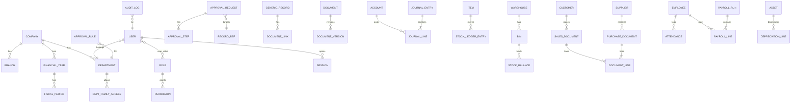

# RHAI Enterprise ERP — Rebuild Plan (React + Node/Express + Prisma + PostgreSQL)

**Source of truth:** `index.html` ("RHAI Enterprise ERP V9.2 – Payslip & Tables Everywhere", 369,171 bytes, 537 lines). I read every line of it for this plan, and checked its behaviour live with Playwright.

* Facts about the prototype are written plainly.
* Anything inferred is marked **(inferred)**.
* Anything added beyond the prototype is marked **[ADD]**.

| Plan file | Contents |
|---|---|
| `PLAN.md` | This file: sections 1–3, 5–8, 10–12, 14, 15 |
| [`docs/plan/04-modules.md`](docs/plan/04-modules.md) | §4: all 22 families and 248 pages, with typed fields, rules and formulas |
| [`docs/plan/09-user-will-break-it.md`](docs/plan/09-user-will-break-it.md) | §9: 75 careless-user scenarios |
| [`docs/plan/13-roadmap.md`](docs/plan/13-roadmap.md) | §13: 22 phases, each with its exact Claude Code prompt |
| [`docs/REGISTRY.csv`](docs/REGISTRY.csv) | One row per page: 248 menu pages plus 4 non-menu screens, with tabs, tab renderers and fields |
| `reference/screens/v92/` | 45 Playwright screenshots of the prototype; the visual target |

---

## Table of contents
1. [Executive Summary](#1-executive-summary)
2. [Reference Analysis](#2-reference-analysis)
3. [Personas and Role Dashboards](#3-personas-and-role-dashboards)
4. [Module-by-Module Specification](docs/plan/04-modules.md)
5. [Cross-cutting Features](#5-cross-cutting-features)
6. [Architecture](#6-architecture)
7. [Frontend Plan](#7-frontend-plan)
8. [Security Plan](#8-security-plan)
9. ["User Will Break It" Plan](docs/plan/09-user-will-break-it.md)
10. [Coding Standards](#10-coding-standards)
11. [QA and Test Strategy](#11-qa-and-test-strategy)
12. [DevOps](#12-devops)
13. [Delivery Roadmap](docs/plan/13-roadmap.md)
14. [Risks, Assumptions, Open Questions, Not in Scope](#14-risks-assumptions-open-questions-not-in-scope)
15. [Appendices](#15-appendices) (A: Registry summary, B: Glossary, C: Sources)

---

## 1. Executive Summary

**What we are building.** A production-grade, multi-user, web ERP for an Indian manufacturing and trading company. In the prototype the company is "RHAI Industries Pvt. Ltd.", head office Pune, with branches Mumbai, Nashik and Nagpur.

* The new system must **look and flow exactly like `index.html`**: the same login screen, sidebar, top bar, department dashboards, 248 menu pages with the same tabs, buttons, tables, drawers, modals, payslip and letterhead PDFs.
* But every button must do real, persistent, secure work on a server.

**Who it is for.**
* 11 departments: Administration, Sales, Purchase, Finance, HR, Production, Quality, Maintenance, Warehouse, Projects, Service.
* 8 authority roles: Super User, Director, CFO, General Manager, Department Head, Department Manager, Supervisor, Employee.
* **[ADD]** Employee self-service, for every employee.

**Why.** The prototype is a convincing UI, but it is a single HTML file:
* it has no backend;
* passwords are in plain text in `localStorage`;
* data is auto-seeded demo data;
* many metrics are hard-coded or synthetic;
* many "actions" only show a toast and write an audit line.

It shows *what* the business wants. The rebuild provides the *how*: real accounting, stock, payroll and GST rules, server-side security, and auditability.

**Approach in one line.** A **metadata-driven engine** serves all 248 pages from a registry extracted automatically from `index.html`. **Typed domain services** are layered on top for the deep business flows: GL, stock, procure-to-pay, order-to-cash, GST, payroll, manufacturing. The work is delivered in 22 dependency-ordered phases that each fit in one Claude Code session.

**Success criteria (all measurable).**
1. **Coverage.** 248/248 menu pages reachable for an authorised user, each with its tabs. Verified by the registry-wide e2e test: 227 generic pages × 16 tabs = 3,632 tab renders with zero console errors, plus 21 custom pages.
2. **Visual parity.** The 45 reference screenshots are reproduced with ≤ 2% differing pixels per screen, data regions masked (§7.6).
3. **Real logic.**
   * Trial balance always balances.
   * Stock value equals the GL inventory account.
   * The GST split and payroll statutory calculations match worked examples from official sources.
   * Zero hard-coded or random KPI numbers (enforced by a test).
4. **Security.**
   * Every API route is authorised server-side (generated matrix test).
   * OWASP ZAP baseline has no High findings.
   * Passwords are hashed with Argon2id.
   * There is no demo login in production.
5. **Robustness.** All 75 "user will break it" scenarios pass as automated tests. The full suite passes **3 consecutive runs from a clean database**.
6. **Performance.** API p95 < 300 ms for list endpoints on 100k rows. First load of the app < 3 s on a 10 Mbps link.

---

## 2. Reference Analysis

### 2.1 Facts table (counted from the file, not estimated)

| Item | Count / value | Where in index.html |
|---|---|---|
| Families (menu sections) | **22** | `const MENU=[…]`, lines 90–157 |
| Menu pages | **248** (no duplicates) | MENU items |
| Profiles (title, family, purpose, tabs, fields) | **244**. The 4 Executive pages `dashboard`, `command-center`, `notifications` and `global-search` have none | line 158 `PROFILES` (≈110 KB) |
| Tabs per profile | 6 for **all** 244 | PROFILES |
| Fields across profiles | **2,773** at runtime (2,746 before the V9.2 override gives `pay-payslip` 37 fields). 7–17 fields per page (37 on `pay-payslip`), median 11 | PROFILES + V9.2 `Object.assign` |
| Pages drawn by the generic `renderModule()` | **227** | `nav()`, line 365 |
| Pages with custom renderers | 21: dashboard, command-center, notifications, global-search, crm-pipeline and proj-kanban (`kanbanPage`), mfg-shopfloor, 8 × `ai-*` (`aiPage`), admin-departments, admin-users, admin-roles, admin-permissions, admin-approval (`approvalCenter`), admin-settings (`systemSetup`) | `nav()` |
| Non-menu screens | 4: Login (Sign In / Sign Up / Forgot), System Control Center, Approval Matrix, Letterhead & PDF settings | `systemControls()`, `approvalMatrix()`, `letterheadSettings()` |
| Tabs on each generic page | **16**: Module Dashboard + 6 profile tabs + Analytics & Graphs, AI Decision Center, Automation Studio, Data Quality, Activity Timeline, Documents, Approvals, Reports, Audit Trail. A 20-row table is appended under each tab (V9.2) | `v9ModuleTabs`, `v92EnsureTabTable` |
| Tab workspace renderers | 36 V9 types chosen by regex on the tab label (`v9SpecialType`). The most used is `v9Allocation`, on 153 tabs | REGISTRY.csv `tab_renderers` |
| Departments | 11 | `DEPARTMENTS` |
| Roles | 8, with levels 99/90/80/70/60/50/30/10 | `seedSystem()` |
| Permission actions | view, add, edit, delete, approve, export, controls. Scopes: `*`, `department`, `finance` | `seedSystem()` |
| Department → family access | `DEPT_FAMILIES` (§3.2) | line 186 |
| Approval matrix | 10 depts × 4 levels: ₹0 Department Manager; ₹50,000 Department Head; ₹2,00,000 General Manager; ₹10,00,000 Director (CFO for Finance) | `seedSystem()` |
| Demo users | 11 (one per department). admin@rhai.local / Admin@123 (Super User); `<dept>@rhai.local` / Demo@123 (Department Manager) | `seedSystem()` |
| Storage | `localStorage` keys `rhai_v7_*` (system), `rhai_v8_data_<page>` (rows), `rhai_v7_docs_*` (files as base64), `rhai_v9_*`, `rhai_v91_*`, `rhai_v92_payslip_rows`. About 563k characters in 66 keys after a tour ✔probe | throughout |
| Demo rows | 25 per page (V8 `seedRows`); 25 payslips (V9.2) | |
| Versions layered in the file | V7 base engine → V8 overrides → V9 tab engine → V9.1 rules → V9.2 payslip/table wrapper. **11 function names are declared more than once**, and later declarations win | e.g. `renderModule` ×3, `renderTab` ×3 |
| Design tokens | see §7.1 | `:root`, line 8 |

### 2.2 Defects found (each one is fixed by the rebuild)

✔probe means it was confirmed live with Playwright (`reference/screens/v92/`). The others were confirmed by reading the code.

**Security and access**

1. Plain-text passwords in `localStorage` (`rhai_v7_users`) ✔probe.
2. Demo credentials printed on the login page, and the fields are **pre-filled** with admin@rhai.local / Admin@123.
3. "Open Demo ERP — Super User" logs in as Super User **without a password**.
4. The 11 quick-department buttons log in **without a password** (`quickLogin`).
5. The URL hash `#finance` (any department name) auto-logs in as that department's user ✔probe.
6. Self-signup lets anyone pick the role **Department Head**, and that role is granted ✔probe.
7. Forgot-password uses the static code `123456`, and the reset changes nothing ("Demo passwords remain unchanged").
8. `seedSystem()` runs on every load and **resets demo users' passwords and re-activates them** (admin deactivated → Active again) ✔probe.
9. The Department select at login is ignored: the user's stored department is used ✔probe. Typing an email also auto-selects that user's department, which leaks who has an account.
10. All permission checks are client-side (`can()`), so devtools or a localStorage edit gives full access.
11. A non-Super-User in the Administration department sees **no menu at all** and `can()` returns false everywhere, because `DEPT_FAMILIES.Administration = ["*"]` is never treated as a wildcard ✔probe.
12. The menu is filtered by department families even for roles with scope `*` (Director, GM). The menu and permissions disagree.
13. **No rate limit, lockout or session timeout.** There is also no session at all: a refresh logs the user out.

**Approvals**

14. The requester can approve their own request ✔probe.
15. A Director can click through **every level alone** ✔probe.
16. `approvalLimit` is shown but **never checked**.
17. The approval department comes from the editable `Department` field of the record.
18. "Submit Approval" is shown to roles without permission (Employee) ✔probe.
19. The `Status` field is free text in the Add/Edit modal, so a user can type "Approved".
20. Approved records stay editable and deletable. Deleting a record leaves an orphan approval request.
21. 147 of 244 profiles have no amount-like field, so `amountOf()` returns 0 and every request needs only level 1 ✔probe.
22. `admin-approval` opens the request queue, not the matrix.

**Data and logic**

23. Every number on the dashboards is derived from **auto-generated demo rows**. The Command Center, Notification Center, Shop Floor, the AI page trend, the "Management Signals" (`v9Pct` = hash of the label) and the KPI cards in Exceptions and Planning are **hard-coded or hash-generated**.
24. "System Health: GREEN", "V8 SYSTEM GREEN" and "QA Green" are static text.
25. Emptying a module **re-seeds 25 demo rows** (`getRows` treats an empty array as missing) ✔probe.
26. "Reset 25 Demo" (replace real data with demo data) is available to every user, with no permission check.
27. Most V9 workspace buttons (Approve, Reject, Allocate, Move Next, Resolve, Create WO, Post Depreciation, Dispose, Save Matrix, Run Validation, Save Mapping…) only call `v9QuickAction`, which is a toast plus an audit line. **Nothing changes.**
28. The V9 workspaces show **synthetic rows** that are unrelated to the module data: "Employee 1…20" in payroll, "Machine-01…" in maintenance, computed demand/available in allocation, fixed ledger dates.
29. Line items (`v9LineItems`) are stored in a separate key and never update the document header totals.
30. The tab-type regex misroutes tabs. For example, GRN "Receipt Lines" opens the **payments** workspace (`v9Payment`).
31. The Security tab checkboxes show the *current user's* rights for every role row, and "Save Matrix" saves nothing.
32. Company, Branch and FY selectors do not filter anything. They only appear in PDF headers.
33. Global search scans only the first 50 rows per module, returns at most 40 hits, and links to the module, not the record.
34. Field types are guessed from labels. There are no required fields and no validation, and numbers are stored as strings.
35. Payslip statutory maths is simplified: PT is a flat ₹200 (no February ₹300, no state slabs or exemption), TDS is a % of gross, ESIC eligibility is per month instead of per contribution period. The payslip edit form lets users type Gross and Net directly.

**Broken UI**

36. `Export Selected` throws `ReferenceError: downloadBlob is not defined` ✔probe.
37. Every button whose inline `onclick` uses `JSON.stringify(label)` breaks the HTML attribute. This covers Add Line, Save Lines, Create Revision, Save Activity, Add to Schedule, Add Note, Run Validation, Add Rule and Run Connection Test. Clicking them fails with "Unexpected end of input" ✔probe.
38. The Virtual Employee ID card (`hrTab`) and E-Way tab router (`ewayTab`) are **dead code**: later `renderTab` overrides never call them ✔probe. `v9Smart`, `V3_CONCEPT_RULES`, the V7 `tabType` renderers and `tableRows` are also unused.
39. "Documents" appears twice in the tab bar of `hr-employees` and `maint-machines` ✔probe.
40. The Module Dashboard table shows "Status" twice (the status field plus the Status column) (seen in `fam-03` screenshot).
41. Several profiles are placeholders that share generic fields:
    * `crm-pipeline` and `crm-customer360`: Record No / Name / Customer Company…;
    * `scm-comparison`, `mfg-shopfloor`, `proj-kanban`;
    * `ai-insights`, `ai-copilot` and `auto-workflows`: Record ID / Model Rule…;
    * `admin-permissions`, `admin-approval`, `admin-workflow`, `admin-import` and `admin-backup`: Code / Name / Category…
42. All 8 `ai-*` pages render the **same** `aiPage()`. The "AI Copilot" is keyword matching.
43. Kanban pages are static (no drag).

**Files, PDF, Excel and print**

44. Uploads are stored as **base64 in localStorage**, so they are limited by the about 5 MB quota. There is no type sniffing and no virus scan. Document delete has no confirmation and no audit.
45. The PDF writer `pdfEsc()` replaces every non-ASCII character with a space. The **₹ sign is dropped** (✔probe: "Amount ₹ 5,000" → "Amount   5,000"), and Hindi is impossible.
46. Generic PDFs truncate lines at 100 characters and have no page numbers, even though the Reports tab text claims "page numbering" and "prepared-by". Only the payslip shows "Page 1 / 1".
47. Excel export is an HTML table saved as `.xls`, so Excel shows a format warning. There is no protection against formula injection.
48. Print calls `window.print()` on the whole app, sidebar included.

**Administration and robustness**

49. Admin masters use `prompt()` and `confirm()` and edit by **array index** (race prone). Departments can be deleted while in use. Role rename orphans permissions. Roles cannot be deleted. The Super User can be edited down to another role.
50. The audit log is client-side, editable, and capped at 1,000 entries. It has no old or new values and no IP.
51. Every record id and timestamp is client-generated.
52. The login copy states "one clean JavaScript engine—no duplicate function overrides". This is **false** (see 2.1).

### 2.3 What the prototype gets right (keep)
* The visual language, which is clean and consistent.
* The department-family access idea.
* The amount-based multi-level approval matrix.
* Per-module controls: enable, owner department, approval, edit, delete, export.
* Documents per record.
* The audit tab.
* The letterhead settings feeding all PDFs.
* The payslip PDF layout, including amount in words in lakh/crore.
* The 16-tab module anatomy.

---

## 3. Personas and Role Dashboards

### 3.1 Roles (from `seedSystem`)

| Role | Level | Scope | View | Add | Edit | Delete | Approve | Export | Controls |
|---|---|---|---|---|---|---|---|---|---|
| Super User | 99 | * | ✓ | ✓ | ✓ | ✓ | ✓ | ✓ | ✓ |
| Director | 90 | * | ✓ | ✓ | ✓ | ✓ | ✓ | ✓ | – |
| CFO | 80 | finance (Finance & Accounts, Indian Taxation, Sales, Procurement/SCM, BI, Executive) | ✓ | ✓ | ✓ | – | ✓ | ✓ | – |
| General Manager | 70 | * | ✓ | ✓ | ✓ | – | ✓ | ✓ | – |
| Department Head | 60 | department | ✓ | ✓ | ✓ | ✓ | ✓ | ✓ | – |
| Department Manager | 50 | department | ✓ | ✓ | ✓ | ✓ | ✓ | ✓ | – |
| Supervisor | 30 | department | ✓ | ✓ | ✓ | – | – | ✓ | – |
| Employee | 10 | department | ✓ | ✓ | ✓ | – | – | – | – |

The rebuild changes three things here:

* **Seed default only.** These are seeded as defaults. Admins edit them in Permission Master.
* **New scopes [ADD].** Scopes become `self | department | branch | company | all`, with `finance` kept as a named family set.
* **Narrower Employee rights [ADD].** Employee gets **add/edit only on own records** by default (decision D-03).

### 3.2 Department → family access (`DEPT_FAMILIES`) and default dashboards

| Department | Families in menu | First screen | Dashboard core modules (`v8DeptCoreModules`) | Prototype KPI cards |
|---|---|---|---|---|
| Administration | all 22 (Super User) | Administration Intelligence Dashboard | admin-users, admin-approval, sales-orders, scm-po, inv-stock, fin-ar, hr-employees | Core Module Records, Open/Pending, Data Completeness, Approval Queue |
| Sales | Executive, CRM, Sales, Service/Support, Communication, BI, AI | Sales dashboard | crm-leads, crm-opportunities, sales-orders, sales-invoices, fin-ar | same 4 generic cards |
| Purchase | Executive, Procurement/SCM, Inventory, WMS, Logistics/Fleet, BI, AI | Purchase dashboard | scm-pr, scm-rfq, scm-po, scm-suppliers, inv-stock | 〃 |
| Finance | Executive, Finance & Accounts, Indian Taxation, Sales, Procurement/SCM, BI, AI | Finance dashboard | fin-ar, fin-ap, fin-journal, fin-bankreco, tax-gstr1 | 〃 |
| HR | Executive, HRMS, Payroll, Document Management, BI, AI | HR dashboard | hr-employees, hr-attendance, hr-leave, pay-processing, pay-payslip | 〃 |
| Production | Executive, Manufacturing, Inventory, WMS, Quality/QMS, Maintenance, BI, AI | Production dashboard | mfg-orders, mfg-workorders, mfg-wip, qms-inspections, maint-workorders | 〃 |
| Quality | Executive, Quality/QMS, Manufacturing, Procurement/SCM, BI, AI | Quality dashboard | qms-inspections, qms-ncr, qms-capa, qms-supplier, mfg-orders | 〃 |
| Maintenance | Executive, Maintenance, Assets, Inventory, BI, AI | Maintenance dashboard | maint-machines, maint-preventive, maint-breakdown, maint-workorders, asset-master | 〃 |
| Warehouse | Executive, Inventory, WMS, Logistics/Fleet, Sales, Procurement/SCM, BI | Warehouse dashboard | inv-stock, inv-transactions, inv-reorder, wms-putaway, wms-pick | 〃 |
| Projects | Executive, Projects, Assets, Service/Support, BI | Projects dashboard | proj-projects, proj-tasks, proj-timesheets, proj-budget, proj-profitability | 〃 |
| Service | Executive, Service/Support, Assets, Logistics/Fleet, CRM, BI | Service dashboard | service-tickets, service-visits, service-amc, service-warranty, service-claims | 〃 |

The menu section counts per department were verified live: Admin 22, Sales 7, Purchase 7, Finance 7, HR 6, Production 8, Quality 6, Maintenance 6, Warehouse 7, Projects 5, Service 6.

### 3.3 What each department sees first (rebuild)
The dashboard keeps the prototype layout:

* a hero band "<Dept> Intelligence Dashboard" with System / Data / Quality / Risk minis;
* buttons My Approvals (n) and Advanced AI Center;
* 4 KPI cards;
* a 20-point trend with forecast, and a module risk comparison;
* a 20-row table;
* an AI executive summary.

The KPI cards switch from the generic four to **real department KPIs** [ADD]. Every one is computed by SQL from posted data. The hero minis become: System (health-check endpoint), Records (live count), Data Quality (completeness of mandatory fields), Open Exceptions.

| Department | KPI 1 | KPI 2 | KPI 3 | KPI 4 | Primary actions |
|---|---|---|---|---|---|
| Administration | Active users / sessions | Pending approvals (all) | Failed jobs + webhooks (24 h) | Security alerts (lockouts, MFA off) | Users, roles, approval matrix, system controls |
| Sales | Pipeline value (weighted) | Orders MTD (₹) | AR outstanding / overdue | Quote→order conversion % | Add lead / quotation / SO, collections |
| Purchase | Open PR (count, ₹) | Open PO (count, ₹) | Pending approvals | Supplier OTIF % | Create PR/RFQ/PO, compare quotes |
| Finance | Cash + bank | AR / AP | Net profit MTD | Unreconciled bank items | Post vouchers, bank reco, GST returns |
| HR | Headcount (active) | Attendance % today | Leave requests pending | Payroll gross (last run) | Add employee, approve leave, run payroll |
| Production | OEE % | Plan attainment today | Rejection % | WIP value | Release orders, MRP, work orders |
| Quality | First-pass yield | Open NCR (critical) | CAPA overdue | Calibration due | Inspections, NCR, CAPA |
| Maintenance | MTBF / MTTR | PM compliance % | Open breakdowns | Downtime hrs MTD | Breakdown, PM work orders |
| Warehouse | Stock value | Shortage SKUs | Open put-away / pick tasks | Inventory accuracy % | GRN put-away, pick, transfer, count |
| Projects | Active projects | At-risk (Red) | Budget burn % | Utilisation % | Tasks, timesheets, budget |
| Service | Open tickets | SLA compliance % | AMC renewals due (30 d) | CSAT | Tickets, visits, claims |

---

## 4. Module-by-Module Specification
→ **[docs/plan/04-modules.md](docs/plan/04-modules.md)**. It has one subsection per family (4.1–4.22), each listing:

* purpose and users;
* **every page**, with typed and required fields (generated from the registry);
* statuses;
* workflow and rules with formulas;
* KPIs and their sources;
* market comparison and improvements;
* careless-user risks.

---

## 5. Cross-cutting Features

### 5.1 Authentication and sessions
* **Login.** Company code + email + password, with optional SSO (OIDC) later. Passwords are hashed with Argon2id (m=64MB, t=3, p=1).
* **Password policy.** Configurable (default min 10 characters, 3 classes). Checked against a breached-password list (k-anonymity API optional; a local top-100k list by default).
* **Tokens.**
  * Access JWT (15 min, RS256, held in memory) carrying `{sub, sid, cid}` only.
  * Refresh token: random 256-bit value, stored **hashed**, in an httpOnly Secure SameSite=Strict cookie, path `/api/v1/auth`.
  * The refresh token rotates on every use. **Reuse detection** revokes the whole session family.
* **Sessions.** The `sessions` table holds device, IP, created and last-seen. Users see and revoke their sessions; admins can force sign-out. The idle timeout (default 15 min) and absolute timeout (12 h) are configurable.
* **MFA [ADD].** TOTP (RFC 6238), enforceable per role. Recovery codes are hashed.
* **Forgot password.** A single-use token valid 15 minutes, hashed, sent by email. Every session is revoked after the reset. The response is generic ("If the account exists…").
* **Lockout.** 10 failures in 15 minutes locks the account. On top of that, IP rate limiting.

### 5.2 Roles and permissions
* **Permission model.** `permission(role, resource, action, scope)`.
  * Resource is a page id, a family (`family:Sales`) or `*`.
  * Actions: `view`, `add`, `edit`, `delete`, `approve`, `export`, `controls`, plus **[ADD]** `submit`, `import`, `print`, `post`, `cancel`.
  * Users can hold several roles; the most permissive grant wins, except that explicit **deny** wins over everything.
* **Evaluation (server).** Allowed when all three hold:
  1. module control `enabled` and the action flag (add/edit/delete/export) is on;
  2. a role grant exists for the page or its family;
  3. the department has access to the family, unless the scope is company or all.
* **Caching.** The result is cached per user for 60 s and invalidated on any permission change through Redis pub/sub.

### 5.3 Department scoping and data scope
* Every record carries `company_id`, `branch_id`, `department_id`, `owner_user_id`.
* Repositories apply the scope filter **in SQL**: `self` → owner = me; `department` → department in my departments; `branch` → branch in my branches; `company`; `all`.
* There is no endpoint that returns rows without going through the scope filter. The repository base class enforces it.
* Cross-department documents (e.g. Finance viewing Sales invoices) are allowed by family grants (`finance` scope).

### 5.4 Module controls
These keep the prototype's System Control Center semantics, per page: `enabled`, `owner_department`, `approval_required`, `allow_add`, `allow_edit`, `allow_delete`, `allow_export`.

* A disabled module disappears from the menu and returns 404 from the API.
* Defaults come from `ctrl()`. Approval is required except for the Executive, BI, AI & Automation, Administration and Document Management families.

### 5.5 Approval matrix and workflow
* **Rules.** `(company, department, document_type?, level, threshold ₹, approver_role | approver_user, sla_hours, escalate_to)`.
* **Levels.** Applicable levels = all rules with threshold ≤ amount, ordered by level (the prototype semantics).
* **Request state machine.** `Pending(level n) → Approved | Rejected | Returned | Cancelled`.
* **Controls.**
  * Segregation of duties: the requester cannot approve, and one user can approve at most one level unless configured.
  * Limit check: `approver.approval_limit ≥ amount` at the final level.
  * Delegation with a date range.
  * SLA escalation by a job.
* **Locking.** While a request is pending, the record is locked for edits. After approval it is locked permanently: changes go through amendment, which creates a revision and re-approval.
* **Validation.** Matrix levels must be contiguous with strictly increasing thresholds.

### 5.6 Audit trail
* **What is logged.** Every mutating request writes `audit_log(id, at, company, user, session, ip, user_agent, page_id, record_id, action, before jsonb, after jsonb, diff jsonb, request_id)`. Also logged: logins, failed logins, exports, prints, downloads and permission changes.
* **Integrity.** Append-only: the DB role used by the app has INSERT only, and a trigger blocks UPDATE/DELETE. Partitioned by month.
* **Retention.** 8 years for finance, 3 years for other data (configurable).
* **Visibility.** Shown in the per-module Audit Trail tab, the per-record Activity Timeline, and the Admin Audit page.

### 5.7 Documents
* **Storage.** S3-compatible object store (MinIO). The DB holds metadata only: id, owner record, category, number, issue/expiry dates, version, sha256, size, mime, scan status.
* **Upload pipeline.** Size limit → extension allow-list (pdf, png, jpg, jpeg, doc, docx, xls, xlsx, csv; same as the prototype) → magic-byte check → ClamAV scan → store. The file stays in quarantine until it is clean.
* **Download.** Through short-lived signed URLs after a permission check. Each download is logged.
* **Expiry alerts.** At 30/15/7 days.
* **Shared service.** The same service backs the per-record 📎, the Documents tab, the HR documents, the DMS and the POD files.

### 5.8 Notifications
* **Storage.** The `notifications` table holds user, type, title, body, link, read_at.
* **Channels.** In-app (bell drawer, Notification Center), email (SMTP), and optionally WhatsApp/SMS through the Communication adapters.
* **Triggers.** Approval assigned, approval decided, document expiry, overdue items, job failures, mentions.
* **Preferences.** Per-user preferences per type and channel. Daily digest option.

### 5.9 Soft-delete and undo
* **Soft delete.** Every business table has `deleted_at` and `deleted_by`. Delete sets them; an **Undo** toast shows for 10 s.
* **Restore.** Admins can restore from "Recently deleted" for 30 days.
* **Purge.** A hard purge only runs after the retention period, by a job, and is audited.
* **Hard rule.** Posted financial or stock documents are **never** deleted. They are cancelled or reversed.

### 5.10 Search, filter, sort, pagination
* **List API.** `GET …/records?q=&filter[status]=Approved&filter[amount][gte]=50000&sort=-doc_date&page=1&size=20`.
* **Implementation.** Search uses Postgres FTS with a trigram fallback. Sorting is limited to an indexed whitelist. Offset paging is used up to 10k rows; keyset paging beyond that.
* **UI.** The URL keeps the state (B-46). The prototype's options are kept: page size 10/20/25, status filter, sortable headers with ▲▼.
* **Global search.** One FTS query across every page the user can view (§4.1).

### 5.11 Bulk actions
* **Actions.** Select across pages, then Export Selected / Submit Selected / Delete Selected (the prototype buttons), plus **[ADD]** Bulk Edit (one field) and Bulk Approve.
* **Execution.** Each bulk request runs in batches of 100 inside one job and returns a per-row report (succeeded, skipped with reason). It is audited per row.
* **Confirmation.** More than 10 records requires typing a confirmation word.

### 5.12 Import / export
* **Import wizard.** Download template → upload → column mapping → dry-run validation report → commit (all, or valid rows only). Runs in batches inside a job.
* **Repeat imports.** A file hash detects re-imports.
* **Export.** XLSX through exceljs, with typed cells, an INR number format and formula-injection escaping. CSV as well. A large export runs as an async job (B-49).

### 5.13 PDF, Excel and print
* **Engine.** PDFs are generated server-side with pdfkit and embedded **Noto Sans + Noto Sans Devanagari**, so ₹ and Hindi render.
* **Letterhead.** From settings (company name, legal name, address, GSTIN, PAN, CIN, footer, signatory). The header also carries company, branch and FY.
* **Footer.** "Prepared by" with the user name, and "Page x of y".
* **Templates.**
  * Generic record and list reports.
  * Document templates: quotation, SO, PO, invoice (with IRN QR), e-way bill, GRN, payslip (prototype layout), ID card, NCR, certificate, voucher.
* **Print.** A print stylesheet hides the chrome. The "Print" button prints the current view.

### 5.14 Numbering series
* **Series.** One per (company, branch, document type, FY). Example pattern: `{PREFIX}/{BR}/{FY}/{#####}`.
* **Allocation.** Allocated inside the save transaction with `SELECT … FOR UPDATE` on the series row, so numbers are gap-free for posted documents. Drafts get the final number only on submit (configurable).
* **Reset.** Per FY.

### 5.15 Multi-company, multi-branch, financial year
* **Company/Branch/FY selectors.** These top-bar selects are **real context**. The allowed lists come from the user's grants, and the choice is sent as request headers. The server validates them against the grants.
* **Defaults.** New documents get the selected company, branch and FY by default.
* **Branches.** A branch has its own GSTIN (state) and default warehouses.
* **FY.** Defined in `admin-fy`. An FY has 12 periods, each Open / Soft-closed / Closed.

### 5.16 Internationalisation (English and Hindi)
* **Strings.** react-i18next with namespaces per family. Hindi translations of all UI strings, menu labels, registry titles and tabs are generated into `locales/hi.json` and reviewed by a human.
* **Formats.** en-IN number format (lakh/crore grouping, as the prototype uses `toLocaleString("en-IN")`). Dates are DD-MM-YYYY in the UI and ISO in the API.
* **Documents.** PDFs are available in English and Hindi. Amount in words exists in both, extending the prototype's `v92NumWords`.
* **Switching.** The language switch sits in the account drawer and is stored per user.

### 5.17 Accessibility
* **Standard.** WCAG 2.1 AA.
* **Contrast.** The prototype's muted text `#64748b` on `#fff` is 4.76:1, which passes. 8–9 px text sizes are raised to a **10 px minimum with zoom-safe rem units** (decision D-06, which affects pixel parity; see §7.6).
* **Behaviour.** Labelled inputs, focus trap in the modal and drawer, ESC to close, visible focus ring, keyboard-operable tabs (arrow keys), `aria-live` toasts, charts with table fallbacks.
* **Verification.** axe-core in CI.

---

## 6. Architecture

### 6.1 Stack
* **Frontend:** React 18 + TypeScript + Vite + React Router + TanStack Query + React Hook Form + Zod + Chart.js. The CSS is the prototype CSS ported as tokens plus CSS modules; no CSS framework, for parity.
* **Backend:** Node 20 LTS + Express 4 + TypeScript, Prisma 5, PostgreSQL 16, Redis (cache, rate limits, pub/sub), pg-boss or BullMQ for jobs, MinIO, ClamAV, pdfkit, exceljs, pino logging, OpenTelemetry.
* **Shared:** `packages/registry` (registry.json + types + schema builder) and `packages/shared` (tax, payroll, valuation and depreciation calculators as pure tested functions).

### 6.2 Folder structure
```
erp/
├─ apps/
│  ├─ api/
│  │  ├─ prisma/ (schema.prisma, migrations/, seed/)
│  │  └─ src/
│  │     ├─ app.ts, server.ts, config/
│  │     ├─ core/ (http/ errors/ auth/ rbac/ scope/ audit/ validation/ numbering/ files/ pdf/ excel/ jobs/ notify/ idempotency/)
│  │     ├─ engine/ (generic.routes.ts generic.controller.ts generic.service.ts generic.repository.ts schema-builder.ts)
│  │     └─ modules/<family>/ (routes.ts controller.ts service.ts repository.ts schemas.ts posting.ts)
│  └─ web/
│     └─ src/
│        ├─ app/ (providers, router)  layout/ (Sidebar, Topbar, Shell)
│        ├─ components/ ui/ table/ form/ charts/ workspaces/ (one per renderer type)
│        ├─ features/<family>/ (custom pages)  pages/ (GenericModulePage, Dashboard, Login)
│        ├─ lib/ (api client, auth, i18n, format)  locales/{en,hi}.json
│        └─ styles/ (tokens.css, base.css, print.css)
├─ packages/ registry/ (extract.ts, registry.json, overrides/) shared/ (tax/ payroll/ inventory/ assets/)
├─ tests/ api/ e2e/ visual/ break-it/ registry/ perf/
├─ reference/ (index.html, screens/)
├─ tools/ (migrate-localstorage/)
├─ infra/ (docker/, nginx/, compose files)
├─ docs/ (plan/, REGISTRY.csv, PROGRESS.md, LEGACY.md, adr/)
└─ legacy/ (earlier attempts, moved in Phase 0; not used)
```
**The repo already contains code from earlier attempts** (`server.js`, `controllers/`, `src/`, `client/`, `prisma/`, `docs/AUDIT.md` …). I did **not** review it for this plan, as instructed to trust only index.html. Phase 0 inventories it and moves it to `legacy/`.

### 6.3 Layered design (backend)
`routes` → `controllers` → `services` → `repositories` → Prisma. Each layer has one job:

* **routes:** path + middleware (`authenticate`, `authorize(page, action)`, `validate(schema)`, `idempotency`, `rateLimit`).
* **controllers:** HTTP only. Parse the request, call the service, shape the response. No business logic.
* **services:** business rules, transactions (`prisma.$transaction` with SERIALIZABLE for posting and stock), state machines, calls to `PostingService`, `StockService`, `ApprovalService`, `AuditService`, `NumberingService`.
* **repositories:** the only place that touches Prisma. The scope filter and soft-delete filter are always applied.
* **Cross-module calls** go through service interfaces, never another module's repository.

### 6.4 Typed tables vs. JSONB — decision
* **Hybrid.**
  * **JSONB generic records** (`generic_records`, with typed hot columns code, status, amount, doc_date, party_id plus `data jsonb` and a GIN index) are used **for pages that are registers without deep rules**, so all 227 generic pages work from Phase 5.
  * **Typed Prisma models** are used wherever there are money postings, stock, statutory calculations, uniqueness or heavy reporting.
* **Promotion path.** A page starts generic and is "promoted" to typed in its family phase. The page id, fields and UI stay the same; only the repository changes behind the generic service interface. A migration script moves its JSONB rows.
* **Typed from the start (masters and core):** users and auth, roles and permissions, departments, company, branch, FY and periods, settings, numbering, audit, notifications, documents, approvals, items, UOM, HSN/taxes, customers, suppliers, warehouses/bins, accounts, cost/profit centers, employees.
* **Typed in their phases:** journals and lines, stock ledger and balances, sales/purchase documents and lines, GRN, payments, payroll runs and lines, attendance, leave, BOM/routing, production/work orders, assets and depreciation, inspections/NCR/CAPA, projects/tasks/timesheets, tickets.
* **Probably JSONB for good (inferred, per registry):** analytics views (they are SQL views, not tables), communication logs, BI definitions (JSON by nature), some logistics registers (container tracking, gate return), custom fields.

### 6.5 Data model — ER outline (core)

**Common columns:**
* `id uuid`, `company_id`, `branch_id`, `department_id`, `owner_user_id`;
* `code`, `status`, `version int`;
* `created_at/by`, `updated_at/by`, `deleted_at/by`;
* `custom jsonb`.

Money is `numeric(18,2)`, quantity `numeric(18,3)` and rates `numeric(18,6)`. Timestamps are `timestamptz` in UTC.

### 6.6 API conventions, error and response format
* **Base and auth.** Base `/api/v1`. JSON only. Bearer access token.
* **Writes.** Every write takes an `Idempotency-Key` header. Updates take `If-Match: <version>`.
* **Generic engine routes:**
  * `GET /pages` (registry + permissions for me);
  * `GET|POST /pages/:pageId/records`;
  * `GET|PATCH|DELETE /pages/:pageId/records/:id`;
  * `POST …/:id/restore`, `POST …/:id/submit`;
  * `POST /pages/:pageId/bulk`;
  * `GET /pages/:pageId/export?format=xlsx|pdf|csv`;
  * `GET|POST /records/:pageId/:id/documents`.
* **Typed modules:** `/api/v1/sales/invoices/:id/post`, `/inventory/transfers`, … with plural nouns and verbs only for state transitions.
* **Success shape:**
  ```json
  { "data": {…} | [...], "meta": { "page":1, "size":20, "total":245, "version":7 } }
  ```
* **Error shape** (RFC 7807-style):
  ```json
  { "error": { "type":"validation_error", "message":"Please fix the highlighted fields.",
    "code":"VALIDATION", "status":422, "requestId":"01J…",
    "fields": { "Grand Total": "Must be ≥ 0" } } }
  ```
* **Status codes:** 400 malformed, 401 unauthenticated, 403 forbidden, 404 not found or not in scope (scope misses return **404 to avoid existence leaks**), 409 conflict (version, period locked, duplicate, in use), 413 too large, 422 validation, 429 rate limit, 500 with requestId only.

### 6.7 Custom services for deep flows
* `PostingService`: balanced journals, period checks.
* `StockService`: ledger, valuation, reservations, locks.
* `TaxService`: GST split, rates by date, TDS.
* `PayrollEngine`: formula evaluation (a safe expression parser, no `eval`).
* `ApprovalService`.
* `NumberingService`.
* `DocumentService`.
* `NotificationService`.
* `AutomationEngine`.
* `ReportService` (whitelisted datasets).
* `MRPService`.
* `DepreciationService`.

Each one has unit tests with worked examples.

---

## 7. Frontend Plan

### 7.1 Design tokens (copied verbatim from index.html)
```css
:root{
  --bg:#f4f7fb; --card:#fff; --card2:#f8fafc; --text:#172033; --muted:#64748b; --line:#e2e8f0;
  --primary:#1d4ed8; --success:#16a34a; --warn:#d97706; --danger:#dc2626; --side:#0f172a;
  --shadow:0 10px 28px rgba(15,23,42,.08); --sw:304px;
  /* derived from literal values used in the file */
  --login-grad:linear-gradient(145deg,#071426,#103268 58%,#1762af);
  --sidebar-grad:linear-gradient(180deg,#0f172a,#111827);
  --logo-grad:linear-gradient(135deg,#38bdf8,#2563eb);
  --hero-grad:linear-gradient(135deg,#071426,#1e3a8a 65%,#0369a1);
  --submit-grad:linear-gradient(135deg,#1d4ed8,#2563eb,#0ea5e9);
  --chip-bg:#eff6ff; --chip-fg:#1e40af; --chip-bd:#bfdbfe;
  --ok-bg:#dcfce7; --ok-fg:#166534; --pend-bg:#fef3c7; --pend-fg:#92400e; --bad-bg:#fee2e2; --bad-fg:#991b1b;
  --tab-active-bg:#dbeafe; --tab-active-bd:#93c5fd;
  --radius-btn:9px; --radius-card:15px; --radius-modal:17px; --radius-pill:999px;
  --font:Inter,"Segoe UI",Arial,sans-serif;
}
```
* **Type scale** (px, from the CSS): h1 23, login h1 clamp(36–60), card h3 14, KPI value 22, body 14 (browser default), buttons 12/700, table 10, chips/labels 9–10. Raised to a 10 px minimum per D-06 → parity mask.
* **Spacing:** main padding 17; card padding 14; gaps 7/9/11/12; table cell 9×10.
* **Layout grid:** `.app` = 304 px sidebar + fluid; top bar 66 px. `.kpis` repeat(4); `.grid2` 1.25fr/1fr; `.form-grid` and `.detail-grid` 3 columns; modal width min(980px, 96vw); drawer width min(460px, 96vw).
* **Breakpoints:** 1150, 1100, 1000 (sidebar becomes an off-canvas toggle), 900, 760, 600 (single column), exactly as the media queries in the file.
* **Status colours:** `.status.active/approved/completed/paid/closed` green; `pending/draft/open/in-progress` amber; `rejected/overdue/cancelled` red; anything else grey.

### 7.2 Components (1:1 with prototype classes)
| Prototype | React component |
|---|---|
| `.login*`, `.auth-tabs`, `.field`, `.pass` | LoginPage, AuthTabs, Field, PasswordField |
| `.sidebar .brand .side-search .menu .menu-head .menu-item` | Sidebar, MenuSection, MenuItem |
| `.top .global select .health .icon .user .avatar` | Topbar, ContextSelect, HealthPill, IconButton, AccountButton |
| `.page-head .actions .btn(.primary/.success/.danger)` | PageHeader, Button |
| `.context .chip`, `.recordbar` | ContextChips, RecordBar |
| `.tabs .tab`, `.v9-subtabs` | Tabs, SubTabs |
| `.card .panel .kpis .kpi .grid2 .grid3 .notice` | Card, Panel, KpiCard, Grid, Notice |
| `.v8-table-summary .v8-table-toolbar table .status .v8-pager` | DataTable (summary, toolbar, sticky header, selection, sort, pager), StatusPill |
| `.modal-bg .modal .form-grid`, `.drawer`, `.toast` | Modal, FormGrid, Drawer, Toast |
| `.detail-grid .detail`, `.doc-grid .doc` | DetailGrid, DocumentCard |
| `.v8-dash-hero .v8-health`, `.v9-workspace .v9-stat` | DashboardHero, WorkspaceStats |
| `.workflow .lane .lane-card`, `.v9-kanban .v9-lane .v9-ticket` | Kanban (dnd-kit) |
| `.calendar .day`, `.v9-gantt`, `.tree`, `.v9-timeline`, `.v9-stepper`, `.v9-heat`, `.v9-funnel`, `.ledger-row` | Calendar, Gantt, Tree, Timeline, Stepper, Heatmap, Funnel, LedgerTable |
| `.v92-payslip-preview`, `.id-card` | PayslipPreview, EmployeeIdCard |
| canvas `lineChart` / `barChart` | Chart.js configured to the same colours (#2563eb, #16a34a; grid #d1d5db) |

### 7.3 Routing
* `/login`;
* `/` (department dashboard);
* `/m/:pageId` (module page), with `?tab=<n>&q=&status=&sort=&page=`;
* `/m/:pageId/:recordId` (deep link; opens the drawer);
* custom routes for the 21 custom pages, under the same ids (`/m/admin-users` etc.);
* `/approvals`, `/notifications`, `/search`;
* `/403`, `/404`.

Each route is guarded by `GET /pages`, which returns only the pages the user may view.

### 7.4 State
* **Server state:** TanStack Query (cache keys per page, record and context). Mutations use an idempotency key and invalidate on success.
* **Client state:** auth (access token in memory), context (company, branch, FY), UI preferences (sidebar, language). Held in a small Zustand store.
* **URL state:** filters, tab and page.
* **Drafts:** form drafts in sessionStorage (B-04).

### 7.5 Forms, tables and the role-based menu
* **Forms.**
  * `MetaForm` renders the registry fields with React Hook Form plus the Zod schema from `packages/registry` (the same schema as the server).
  * Inputs per type: lookup comboboxes for `ref`, a masked money input, date pickers, enum selects, a GSTIN/PAN validator with live feedback.
  * Read-only computed fields; status shown as a pill.
  * Line-item grid for documents.
* **Tables.** `DataTable` is server-driven and has column chooser, sticky header, selection across pages, bulk bar, export, and keyboard navigation.
* **Menu.** Built from `/me/menu`, with the prototype's family order and icons (▦ ◎ ₹ 🛒 ▤ ▥ ⚙ ✓ 🔧 GST 👥 ▣ ◈ 🎫 🚚 📁 AI ✉). Menu search filters families and items like `renderMenu(filter)`. Families are collapsible.

### 7.6 Screenshot parity method
1. **Reference.** `reference/screens/v92/*.png` (45 files: login desktop and mobile, 11 department dashboards, 22 family pages, 10 UI states) captured at 1440×900 by Playwright from `index.html` (script recorded in `tests/visual/capture-reference.ts`, Phase 3).
2. **Candidate.** The same Playwright script runs against the new app with a **deterministic seed** that loads the same 25 demo rows per page that the prototype generates (we port `seedRows` as a dev seeder; it never runs in production).
3. **Diff.** `pixelmatch` with `threshold: 0.1` (per-pixel colour distance). The **pass criterion is ≤ 2.0% differing pixels** per screenshot after masking dynamic regions: charts, timestamps, record ids, and any number that becomes real data. The masks are defined per screen in `tests/visual/masks.ts`.
4. Layout-only checks (sidebar width 304, top bar 66, KPI grid 4 columns, tab heights) are asserted from DOM measurements in addition to pixels.
5. Intentional deviations (D-06 font minimum, removed demo box in prod, fixed duplicate "Documents" tab) are listed in `tests/visual/DEVIATIONS.md`, each with its own mask.

---

## 8. Security Plan

### 8.1 OWASP Top 10 (2021) mapping
| OWASP | Risk in prototype | Control in rebuild |
|---|---|---|
| A01 Broken Access Control | All checks client-side; URL hash login; self-assigned roles | `authorize()` on every route plus repository scope filters; deny by default; 404 on out-of-scope; generated authZ matrix test; no self-role assignment |
| A02 Cryptographic Failures | Plain-text passwords; base64 files in the browser | Argon2id; TLS 1.2+ only, HSTS; Aadhaar/bank numbers encrypted with AES-256-GCM (key from KMS/env); secrets hashed (API keys, refresh tokens) |
| A03 Injection | `innerHTML` templating; inline handlers; Excel formula injection | Prisma parameterised queries; `$queryRaw` only with tagged templates and identifier whitelists; React escaping; CSP; formula-escape on export |
| A04 Insecure Design | Approval SoD missing; editable status | State machines; SoD; locked postings; threat model per phase |
| A05 Security Misconfiguration | n/a (static file) | helmet (CSP `default-src 'self'`, no inline script), CORS allow-list, error pages without stack traces, secure cookies, `x-powered-by` off |
| A06 Vulnerable Components | none | `npm audit` / Dependabot / `osv-scanner` in CI; pinned versions; Renovate weekly |
| A07 Identification & Authentication Failures | static reset code; no lockout | Rate limit, lockout, MFA, rotating refresh with reuse detection, session revocation, generic errors |
| A08 Software & Data Integrity | n/a | Signed commits optional; CI provenance; webhook HMAC; `npm ci` with lockfile; no `eval`/`new Function` (payroll formulas use a safe parser) |
| A09 Logging & Monitoring Failures | client audit, capped at 1,000 | Append-only audit; security events to logs; alerts on lockout spikes and 5xx |
| A10 SSRF | n/a | Webhook/integration URL validation: https only, DNS resolve with private/loopback/link-local/metadata ranges blocked, re-check on redirect |

### 8.2 Token handling
* The access token lives in memory only, never in localStorage.
* The refresh token is an httpOnly cookie. CSRF protection: SameSite=Strict plus a double-submit token on `/auth/refresh` and on state-changing requests from browsers.
* JWT RS256 with key rotation (`kid`).
* Logout revokes server-side.

### 8.3 Rate limiting
Using Redis sliding windows:
* login 5/min per IP+email;
* password reset 3/hour;
* general API 300/min per user;
* export 10/hour;
* public webhooks 60/min.

Over the limit, the API returns 429 with `Retry-After`.

### 8.4 Validation
* **Input.** Zod on every request body, query and params, built from the registry plus overrides. Unknown keys are stripped. Strings are trimmed with a max length. The body limit is 1 MB (uploads use multipart with their own limit).
* **Output.** Response DTOs never include password hashes, secrets or tokens.

### 8.5 File upload rules
See §5.7:
* allow-list, magic bytes and ClamAV;
* max 25 MB, configurable;
* random storage keys;
* `Content-Disposition: attachment`;
* images re-encoded to strip EXIF (employee photos);
* never served from the API origin with an inline content type.

### 8.6 Secrets
* `.env` only in development; it is listed in `.gitignore`. Note that a `.env` already exists at the repo root (untracked). Phase 0 confirms it is ignored and contains no real secrets.
* Production uses a secret manager or Docker secrets. Rotation runbook.
* Provider credentials (WhatsApp, SMS, payment) are encrypted in the DB and shown masked.

### 8.7 Server-side enforcement of every permission
* Every route has `authorize(page, action)` metadata. A **startup self-check fails the boot** if any route lacks it.
* The generated test matrix calls every route as each role/department combination and compares the result with the expected matrix derived from the permission seed.
* UI hiding is cosmetic only.

---

## 9. "User Will Break It" Plan
→ **[docs/plan/09-user-will-break-it.md](docs/plan/09-user-will-break-it.md)**: 75 scenarios (B-01…B-75), each with the prototype behaviour and the expected safe behaviour. Each becomes an automated test.

---

## 10. Coding Standards

### 10.1 TypeScript
* `strict: true`, plus `noUncheckedIndexedAccess`, `exactOptionalPropertyTypes` and `noImplicitOverride`.
* No `any`; use `unknown` and narrow.
* No non-null `!` except in tests.
* No default exports.

### 10.2 Lint and format
* ESLint with `@typescript-eslint/strict`, `eslint-plugin-security`, `react-hooks` and `jsx-a11y`.
* Prettier (printWidth 100).
* Husky + lint-staged on pre-commit.
* `npm run verify` = lint + typecheck + test.

### 10.3 Naming
* Files: `kebab-case.ts`. React components: `PascalCase.tsx`.
* Variables and functions: `camelCase`. Types: `PascalCase`. Constants: `UPPER_SNAKE`.
* DB tables: `snake_case` plural. Prisma models: `PascalCase` singular with `@@map`.
* API paths: kebab-case plural.
* Page ids: exactly the registry ids (e.g. `sales-invoices`).

### 10.4 Commits and branching
* Conventional Commits (`feat(sales): …`, `fix(auth): …`).
* Trunk-based: `main` is protected, with short-lived branches `phase-NN-slug` / `fix/…`.
* PR required, CI green, squash merge.
* Tags `v0.N.0` per phase.

### 10.5 Review rules
* Every PR has a description, a test list and screenshots for UI changes.
* No PR may reduce coverage below 80% lines on `packages/shared` and `apps/api/src/modules/*/service.ts`.
* Security-sensitive files (auth, rbac, files, payroll, posting) need a second review (or `/code-review high`).

### 10.6 Error handling
* Throw typed `AppError(code, status, message, fields?)`. One error middleware formats it as §6.6.
* No `console.log`; use the pino logger with `requestId`.
* Never swallow errors.

### 10.7 Definition of Done (per story and per phase)
* Acceptance criteria met.
* Unit and API tests written; e2e for user flows.
* Break-it tests for the scope.
* Visual parity under threshold.
* Permissions enforced and tested.
* Audit entries present.
* i18n keys added (English, plus Hindi placeholders).
* Docs updated (`PROGRESS.md`).
* `npm run verify` green **three times in a row from a clean DB** at phase end.

---

## 11. QA and Test Strategy

### 11.1 Test pyramid
| Layer | Tool | Target |
|---|---|---|
| Unit (pure calculators, schema builder, state machines) | Vitest | ~60% of tests; GST, PF/ESIC/PT/TDS, valuation, depreciation, MRP, EMI, OEE, ageing |
| API / integration (real Postgres in Docker) | Vitest + supertest + testcontainers | ~25%; every route: authZ matrix, validation, conflicts |
| E2E (browser) | Playwright | ~10%; user journeys, registry sweep |
| Visual | Playwright + pixelmatch | 45 reference screens plus new ones |
| Accessibility | @axe-core/playwright | 22 sample pages plus all custom pages |
| Performance | k6 + autocannon | list/search/post endpoints |

### 11.2 Scenario-based user stories (written as real user tests)
| Persona | Story (Given / When / Then) — sample |
|---|---|
| **Beginner (first-day Sales executive)** | Given an invited user with role Employee in Sales, when she logs in, she sees only the 7 Sales families. She adds a lead with only the required fields, gets friendly inline errors for a bad mobile number, saves, and sees it in the register with code `LEAD/PUN/26-27/00001`. |
| **Careless user** | Runs B-01…B-75 (double clicks, back button, two tabs, wrong files, letters in amounts…), each asserting the safe behaviour. |
| **Admin** | Creates a department, a role "Store Keeper" with Inventory view/add only, invites a user, disables `wms-rfid`, changes the approval matrix, then logs in as the new user and verifies the menu, the API 403s and the disabled module 404. |
| **Each department (11 tests)** | Department Manager logs in and sees the dashboard with correct KPIs from seeded fixtures. Completes the core flow (e.g. Purchase: PR → PO → approval by Head → GRN; Finance: post a JV, run TB; HR: run payroll, download payslip containing "₹"). |
| **Blocked user** | An inactive user cannot log in (generic error). A locked user gets a lockout message after 10 failures. A user whose department lost a family gets 403 on a bookmarked URL and the menu updates without logout (cache bust). |
| **Hacker** | Tampered JWT → 401. Replayed refresh token → all sessions revoked. IDOR (another company's record id) → 404. `filter[__proto__]` → 400. SQL meta characters in search → treated as text. `` in names → rendered inert. CSV injection → escaped. Uploading a polyglot file → rejected. SSRF webhook → blocked. Brute force → 429. |

### 11.3 Registry-wide test
`tests/e2e/registry-sweep.spec.ts` reads `docs/REGISTRY.csv`. For **every** page:

* (a) the Super User can open it;
* (b) each of the 16 tabs (generic) or custom sections renders with no console error;
* (c) for generic pages: create a record with valid generated data from field types, then read, edit, list (find it), export xlsx and pdf, soft delete, undo, attach a document, submit approval (when required) — the full **CRUD-completeness checklist**;
* (d) for each department user: the page is visible exactly when `DEPT_FAMILIES` and permissions allow.

The output is a coverage table `docs/COVERAGE.md` (generated, not hand-written).

### 11.4 Visual parity tests
See §7.6. They run in CI on Linux with a pinned Chromium and fonts.

### 11.5 Accessibility
axe-core with zero serious/critical issues. Keyboard-only journey for login → add record → save. Screen-reader labels checked on forms.

### 11.6 Performance
* **Seed:** 100k records on 5 large pages plus 1M stock ledger rows.
* **Targets:** list p95 < 300 ms; post invoice p95 < 500 ms; TB for a year < 2 s; 100 concurrent users with error rate < 0.5%.
* **Frontend:** bundle < 400 KB gzip initial, with route-level code splitting.

### 11.7 Break-it suite
`tests/break-it/B-nn.*`, one file per scenario in §9.

### 11.8 The three-run rule
At the end of every phase and before release:
1. `docker compose down -v`;
2. `up`;
3. `migrate`;
4. `seed`;
5. run the **full** suite.

Repeat this **3 times**. All three runs must be green with no retries enabled. A flaky test counts as a failure. The run logs are attached to `PROGRESS.md`.

---

## 12. DevOps

### 12.1 Docker
* **Images:** `api` (node:20-alpine, multi-stage, non-root user) and `web` (nginx serving the static build with security headers).
* **Compose for development:** postgres:16, redis:7, minio, clamav, mailpit.
* **Production compose / k8s manifests:** in `infra/`.

### 12.2 CI (GitHub Actions)
* **On PR:** install (`npm ci`), lint, typecheck, unit, API tests (service containers), e2e on a headless Chromium (sharded), visual tests, axe, `npm audit --audit-level=high`, build images.
* **On main:** the same, plus pushing images tagged with the SHA, then deploying to staging.

### 12.3 Environments
| Env | Purpose | Data |
|---|---|---|
| `local` | developer | seed + demo seeder |
| `demo` | sales demos (keeps the prototype's demo accounts UX, with random passwords) | demo seeder, reset nightly |
| `staging` | UAT | anonymised copy of prod |
| `prod` | live | real; no demo code paths compiled in (build flag) |

### 12.4 Backups
* Postgres: WAL archiving plus a nightly `pg_dump`, giving point-in-time recovery 7 days back and dailies kept 35 days.
* MinIO bucket versioning plus a nightly sync to off-site storage.
* A monthly **restore drill** into staging, documented.
* Targets: RPO ≤ 15 min, RTO ≤ 4 h.

### 12.5 Logging
pino JSON logs with requestId, userId, companyId, route, status and latency. PII is redacted (passwords, tokens, Aadhaar, bank details). Logs are shipped to Loki/ELK. Audit logs are kept separate in the DB.

### 12.6 Monitoring
* Health endpoints `/health/live` and `/health/ready` (DB, Redis, MinIO, queue).
* Prometheus metrics: HTTP latency and errors, queue depth, job failures, login failures.
* Grafana dashboards.
* Alerts: 5xx > 1% for 5 min, p95 > 1 s, queue backlog > 1k, failed backups, lockout spikes.
* The top-bar "SYSTEM GREEN" pill reflects the real `/health/ready`.

### 12.7 Migration script from the prototype's localStorage
* **Purpose.** Some users may have typed real data into the prototype.
* **Export (browser side).** `tools/migrate-localstorage/export.html` is a static page served from the same origin/path as the prototype. A page can only read localStorage of its own origin, so the user opens it from the same folder or URL. It reads every `rhai_*` key and downloads a single JSON file.
* **Import (CLI).** `npm run migrate:prototype -- --file export.json --company RHAI --dry-run`:
  * maps `rhai_v8_data_<page>` rows → generic records (field names already match the registry);
  * maps `rhai_v92_payslip_rows` → payroll history (read-only, marked "imported");
  * maps `rhai_v7_docs_*` base64 → objects in MinIO plus document links;
  * maps `rhai_v7_users` → users **with passwords discarded**, status "Invited" and a reset email (never import plain-text passwords);
  * maps the roles, permissions and approval matrix and the module controls → settings;
  * maps the audit → imported audit (flagged).
* **Report.** A dry-run report lists counts, validation failures per page, and rows identified as demo data. Demo-pattern rows, such as names from the seeded lists or `…demo record…` remarks, are **skipped by default**.

---

## 13. Delivery Roadmap
→ **[docs/plan/13-roadmap.md](docs/plan/13-roadmap.md)**: 22 phases ordered by dependency. Each phase lists its scope, files, dependencies, acceptance criteria, tests, and the exact prompt to give Claude Code. A shared preamble is pasted before each prompt.

| Phase | Name | Depends on |
|---|---|---|
| P0 | Foundation (monorepo, CI, Docker, registry extractor, legacy move) | — |
| P1 | Authentication & sessions | P0 |
| P2 | RBAC, departments, admin core, audit | P1 |
| P3 | UI shell & design system, visual-parity harness | P2 |
| P4 | Generic metadata engine (API) | P2 |
| P5 | Generic module page (UI, 16 tabs) | P3, P4 |
| P6 | Approval engine, notifications, audit UI | P5 |
| P7 | Core masters (typed) | P6 |
| P8 | Finance core (GL, books, reports, period close) | P7 |
| P9 | Inventory & WMS | P7, P8 |
| P10 | Procurement (PR → 3-way match → AP) | P8, P9 |
| P11 | CRM & Sales (lead → cash) | P8, P9 |
| P12 | Indian Taxation | P10, P11 |
| P13 | HRMS (ID card restored) | P7 |
| P14 | Payroll | P8, P13 |
| P15 | Manufacturing & QMS | P9 (P10) |
| P16 | Maintenance & Assets | P8, P9 |
| P17 | Projects & Service | P11 |
| P18 | Logistics, Fleet, Gate, DMS | P11 |
| P19 | Executive, BI, AI & Automation, Communication | P12, P14, P16, P17, P18 |
| P20 | Advanced admin, Hindi i18n, accessibility | P19 |
| P21 | Hardening, localStorage migration, 3× regression, release | P20 |

**Run first: Phase 0 (Foundation).**

---

## 14. Risks, Assumptions, Open Questions, Not in Scope

### 14.1 Risks
| # | Risk | Impact | Mitigation |
|---|---|---|---|
| R1 | Scope is huge: 248 pages, 22 families | Delays | Generic engine first; typed promotion by phase; strict phase prompts |
| R2 | Statutory rules change (Income-tax Act 2025 from 1 Apr 2026, Labour Codes from 21 Nov 2025, GST 2.0 rates from 22 Sep 2025, EPF ceiling talk) | Wrong payroll and tax | All rates and thresholds are effective-dated data; re-verify sources at the start of P12/P14 |
| R3 | Pixel parity conflicts with accessibility (8–9 px fonts) | Visual test failures | D-06 documented deviation with masks |
| R4 | Earlier AI-written code in the repo has unknown quality | Confusion, regressions | Move to `legacy/`; do not reuse without review |
| R5 | Claude Code sessions overrun | Half-done phases | Phase sizes kept small; PROGRESS.md evidence; never claim unrun tests |
| R6 | Performance of JSONB generic pages at scale | Slow lists | Hot typed columns, GIN/trigram indexes, promotion to typed tables |
| R7 | Data privacy (Aadhaar, PAN, bank data, DPDP Act 2023) | Legal exposure | Encryption, masking, access logging, retention policies, consent fields |
| R8 | Conflicting secondary sources (e.g. e-way bill validity slabs, EPF ceiling 25k claim) | Wrong calculation | Configurable tables; verify against CBIC/EPFO primary text in the phase |

### 14.2 Assumptions
* A1. Single company at go-live; multi-company is supported by design.
* A2. India only (INR base currency, GST). Other currencies are only for foreign purchases and sales.
* A3. Users have modern browsers; there is no offline mode.
* A4. Hosting is a single VM or a small k8s cluster in India (data residency) (inferred preference).
* A5. Email (SMTP) is available. WhatsApp, SMS and payment providers are chosen later.

### 14.3 Open questions, with the default I chose
| ID | Question | Default chosen |
|---|---|---|
| D-01 | Keep self-signup? | No. Admin invites; optional "request access" |
| D-02 | Keep demo accounts? | Only in the `demo` environment, never in prod |
| D-03 | Employee role edit rights | Own records only (scope `self` for edit) |
| D-04 | Valuation method default | Moving average per item; FIFO selectable before the first transaction |
| D-05 | Keep the V9.2 "20-row table under every tab"? | Yes for parity, but it shows real filtered data and is collapsible |
| D-06 | Minimum font size | 10 px (prototype uses 8–9 px); masked in parity tests |
| D-07 | Report pages that show Add/Edit/Delete in the prototype (GL, TB, P&L, BS, cash flow, analytics, registers) | Buttons visible but disabled with a tooltip, for layout parity |
| D-08 | Negative stock | Not allowed (company setting) |
| D-09 | `admin-approval` page content | Two tabs: Approval Matrix and Approval Queue |
| D-10 | GST/IRP/EWB portal integration | Not in v1; JSON export + manual IRN/EWB entry + adapter interface |
| D-11 | DMS access | All departments, governed by document permissions (the prototype limits it to HR) |
| D-12 | Restore from backup in the UI | No; ops runbook only |
| D-13 | AI copilot | Optional, off by default, read-only tools, audited |
| D-14 | Offline queue for writes | No (financial integrity); show offline state |
| D-15 | Duplicate "Documents" tab on hr-employees / maint-machines | Keep the profile tab and rename it "Employee Documents" / "Machine Documents" (it opens the DMS-filtered view); keep the universal tab |

### 14.4 Not in scope (v1)
* Direct filing on government portals (GSTN returns, IRP/e-way bill API calls, TRACES/TDS filing, EPFO/ESIC portal uploads). We generate the files and JSON only.
* Real payment settlement or payouts (payment-gateway capture, bank payment APIs). Payment links and webhooks are recorded as pending only.
* RFID reader hardware integration and GPS/telematics. CSV/manual import only.
* Biometric device integration (CSV import only).
* Native mobile apps (the responsive web covers phones).
* Multi-country localisation beyond India.
* An LLM that writes data without human confirmation.

---

## 15. Appendices

### Appendix A — REGISTRY summary
Generated from `index.html`. The full per-page list is in `docs/REGISTRY.csv`: 252 rows = 248 menu pages + 4 non-menu screens.

| # | Family | Pages | Generic (`renderModule`) | Custom renderer | Fields (sum) | Departments with access (`DEPT_FAMILIES`) |
|---|---|---|---|---|---|---|
| 1 | Executive | 5 | 0 | 5 | 10 | all |
| 2 | CRM | 8 | 7 | 1 | 94 | Sales, Service |
| 3 | Sales | 10 | 10 | 0 | 131 | Sales, Finance, Warehouse |
| 4 | Procurement / SCM | 11 | 11 | 0 | 151 | Purchase, Finance, Quality, Warehouse |
| 5 | Inventory | 14 | 14 | 0 | 178 | Purchase, Production, Maintenance, Warehouse |
| 6 | Warehouse / WMS | 13 | 13 | 0 | 146 | Purchase, Production, Warehouse |
| 7 | Manufacturing | 13 | 12 | 1 | 154 | Production, Quality |
| 8 | Quality / QMS | 10 | 10 | 0 | 118 | Production, Quality |
| 9 | Maintenance | 10 | 10 | 0 | 115 | Production, Maintenance |
| 10 | Finance & Accounts | 19 | 19 | 0 | 200 | Finance |
| 11 | Indian Taxation | 10 | 10 | 0 | 108 | Finance |
| 12 | HRMS | 12 | 12 | 0 | 141 | HR |
| 13 | Payroll | 12 | 12 | 0 | 156 | HR |
| 14 | Projects | 11 | 10 | 1 | 119 | Projects |
| 15 | Assets | 8 | 8 | 0 | 90 | Maintenance, Projects, Service |
| 16 | Service / Support | 9 | 9 | 0 | 108 | Sales, Projects, Service |
| 17 | Logistics / Fleet | 16 | 16 | 0 | 189 | Purchase, Warehouse, Service |
| 18 | Document Management | 6 | 6 | 0 | 60 | HR |
| 19 | Business Intelligence | 10 | 10 | 0 | 99 | all departments |
| 20 | AI & Automation | 11 | 4 | 7 | 113 | Sales, Purchase, Finance, HR, Production, Quality, Maintenance |
| 21 | Communication | 6 | 6 | 0 | 61 | Sales |
| 22 | Administration | 24 | 18 | 6 | 232 | Administration (Super User) |
| | **Total** | **248** | **227** | **21** | **2,773** | |

The Payroll field sum includes the V9.2 payslip override (37 fields instead of 10). Executive's 10 fields belong to `ai-insights`, which has a profile but is drawn by `aiPage()`.

### Appendix B — Glossary
| Term | Meaning |
|---|---|
| AATO | Aggregate annual turnover (all GSTINs under one PAN), used for e-invoice and HSN thresholds |
| AMC | Annual maintenance contract |
| AQL | Acceptable quality level (sampling) |
| BOM | Bill of materials |
| CAPA | Corrective and preventive action |
| CGST/SGST/IGST | Central / State / Integrated GST (intra-state = CGST+SGST, inter-state = IGST) |
| COA | Chart of accounts |
| CPI/SPI | Cost / Schedule performance index (earned value) |
| ECR | Electronic challan-cum-return (EPFO monthly upload) |
| EDLI / EPS / EPF | Employees' Deposit Linked Insurance / Pension Scheme / Provident Fund |
| ESIC | Employees' State Insurance Corporation |
| E-way bill (EWB) | Electronic permit for movement of goods above the value threshold |
| FEFO / FIFO | First-expiry-first-out / First-in-first-out |
| FY | Financial year (Apr–Mar) |
| GRN | Goods receipt note |
| GSTR-1 / GSTR-3B / 2B | Outward supplies return / summary return with payment / auto-drafted ITC statement |
| HSN / SAC | Harmonised System of Nomenclature (goods) / Services Accounting Code |
| IRN / IRP | Invoice reference number / Invoice registration portal (e-invoice) |
| ITC | Input tax credit |
| MRP | Material requirements planning |
| MTBF / MTTR | Mean time between failures / to repair |
| NCR | Non-conformance report |
| OEE | Overall equipment effectiveness = Availability × Performance × Quality |
| OTIF | On time in full |
| PM | Preventive maintenance |
| PT | Professional tax (state levy) |
| QRMP | Quarterly return, monthly payment scheme (GST) |
| SoD | Segregation of duties |
| SRNB | Stock received but not billed (GL clearing account) |
| TDS / TCS | Tax deducted / collected at source |
| UAN | Universal account number (EPFO) |
| WIP | Work in progress |
| WDV / SLM | Written-down value / Straight-line method (depreciation) |

### Appendix C — Sources
Statutory and market facts were researched on 2026-11-01. **Most links are secondary sources (tax portals, vendor blogs). The primary text must be re-verified at the start of the phase that uses it (see R2, R8).** These are ideas and rules only; no GPL/AGPL code was copied.

**Indian statutory**
* GST e-invoice ₹5 Cr threshold and 30-day IRP rule (≥ ₹10 Cr): https://taxguru.in/?p=1089104 · https://tallysolutions.com/gst/e-invoicing-threshold/ · https://thetaxcorp.in/article/navigating-the-dual-gst-e-invoicing-thresholds-the-rs-5-crore-mandate-vs-the-30 · https://fermor.in/blogs/e-invoicing-gst-applicability-irn-time-limit · https://www.vatcalc.com/india/india-b2b-e-invoicing/ · portal to verify: https://einvoice1.gst.gov.in
* GST rate rationalisation (5/18/40 from 22 Sep 2025, 56th Council): https://www.ey.com/content/dam/ey-unified-site/ey-com/en-in/alerts-hub/2025/09/gst-council-announces-major-rate-rationalization-and-trade-facilitation-measures.pdf · https://taxguru.in/goods-and-service-tax/56th-gst-council-meeting-overview.html · https://tallysolutions.com/gst/new-gst-rates-september-2025-business-impact/ · https://moneylife.in/article/gst-20-faqs/78175.html
* GSTR-1 / 3B due dates, IFF, hard-locking from July 2025: https://www.taxaj.com/learn/?p=289 · https://calcguru.in/questions/gstr-1-and-gstr-3b-due-dates-monthly-and-qrmp-filing-dates/ · https://studycafe.in/gst-qrmp-vs-non-qrmp-brief-analysis-102122.html
* E-way bill ₹50,000 threshold and validity (Rule 138): https://gstcouncil.gov.in/sites/default/files/e-version-gst-flyers/51_GST_Flyer_Chapter18.pdf · https://studycafe.in/validity-of-e-way-bill-narrowed-by-increasing-distance-from-100-km-to-200-km-per-day-93584.html · https://www.taxaj.com/learn/?p=936 (conflicting slab view) · https://cleartax.in/s//eway-bill-gst-rules-compliance
* EPF rates and ₹15,000 ceiling (official EPFO sheet): https://www.epfindia.gov.in/site_docs/PDFs/MiscPDFs/ContributionRate.pdf · https://www.icmr.gov.in/icmrobject/uploads/Circular/1771221426_provisionofepf.pdf · https://employmentlaw.lkslaw.com/calculators/epf
* ESIC rates and ₹21,000 limit: https://www.cleartax.in/s/esi-rate · https://mondaq.com/india/employee-benefits--compensation/560980/esi-corporation-raises-wage-threshold-to-rs-21000 · https://www.onsurity.com/guides/esic-employer-guide · verify at https://www.esic.gov.in
* Maharashtra professional tax (₹200/₹300 Feb, women ≤ ₹25,000 exempt): https://khaitanco.com/thought-leaderships/Maharashtra-Professional-Tax-Amendment-2023-Key-Takeaways · https://cleartax.in/s/professional-tax-maharashtra · https://www.zoho.com/in/payroll/academy/payroll-laws/maharashtra/professional-tax.html · https://docs.frappe.io/hr/india-payroll/professional-tax
* Income-tax Act 2025 (from 1 Apr 2026; s.392 salary TDS, s.393 other TDS): https://taxguru.in/income-tax/tds-rates-income-tax-act-2025-1-april-2026.html · https://india-briefing.com/news/section-393-income-tax-act-2025-tds-rules-rates-compliance-guide-44450.html/ · https://cleartax.in/s/section-393-of-income-tax-act · https://thetaxcorp.in/article/new-tds-regime-under-income-tax-act-2025-practical-guide-to-sections-forms
* TCS 206C(1H) not applicable from 1 Apr 2025; 194Q: https://www.incometaxindia.gov.in/w/tds-on-purchase-of-goods · https://blog.tdsman.com/tag/section-206c1h/ · https://cleartax.in/s/section-206c-of-income-tax-act
* Code on Wages 2019 in force 21 Nov 2025; 50% wage rule: https://taxguru.in/corporate-law/employers-wage-rules-effective-21st-nov-2025.html · https://www.india-briefing.com/news/salary-structure-india-labor-code-compliance-guide-44332.html · https://cm.twobirds.com/en/insights/2025/indias-new-labour-codes-wages,-workers,-and-welfare-rights · https://ksandk.com/labour-employment/50-wage-rule-labour-codes-salary-pf-gratuity/
* Companies Act Schedule II depreciation (useful life, 5% residual): https://taxguru.in/company-law/depreciation-companies-act-2013-practical-approach.html · https://sbsandco.com/blog/schedule-ii-to-companies-act-2013 · https://tallysolutions.com/business-guides/depreciation-rate-companies-act-2013/

**Market products (ideas only)**
* ERPNext perpetual inventory and FIFO/moving average: https://docs.frappe.io/erpnext/perpetual-inventory · https://docs.frappe.io/erpnext/fifo-and-moving-average · https://docs.frappe.io/erpnext/calculation-of-valuation-rate-in-fifo-and-moving-average · https://docs.frappe.io/erpnext/purchase-receipt.md
* Odoo three-way matching / bill control: https://github.com/odoo/documentation/pull/14581/files · https://www.cybrosys.com/blog/how-to-protect-your-business-from-fake-bills-using-3-way-matching-in-odoo-19 · https://hibou.io/docs/accounting-3/3-way-matching-1493
* ERPNext user feedback (customisation effort, setup skill, support): https://www.capterra.in/software/164441/erpnext · https://www.gartner.com/reviews/product/erpnext · https://discuss.frappe.io/t/feedback-on-erpnext-vs-zoho/144837 · https://discuss.frappe.io/t/problems-and-feature-requests/88621 · https://frappe.io/erpnext/articles/40-year-old-manufacturing-business-moves-to-erpnext-from-tcs
* ERP implementation failure causes (data migration, training, over-customisation): https://www.panorama-consulting.com/erp-failure-reasons/ · https://www.itconvergence.com/blog/11-reasons-why-erp-implementations-fail-and-how-to-avoid-them/ · https://www.opkey.com/blog/top-9-reasons-erp-implementation-projects-fail-and-how-to-avoid-them · https://softwareconnect.com/erp/implementation-failures/

**Research gaps (honest note).**
* Searches for Reddit threads returned no Reddit results; user complaints come from Capterra, Gartner and the Frappe forum instead.
* Zoho, Tally, SAP Business One, Dolibarr and Akaunting were compared from general product knowledge. No dedicated page was fetched for each, so those comparisons are marked as general and should be re-checked in the relevant phase.
* No primary government text (CBIC notification PDFs, the EPFO circular on the ₹25,000 ceiling, ESIC site) was opened directly, apart from the EPFO contribution-rate PDF that appeared in search results.
