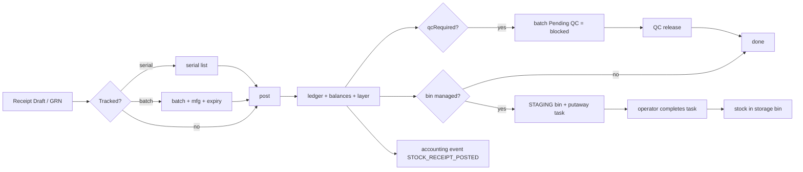
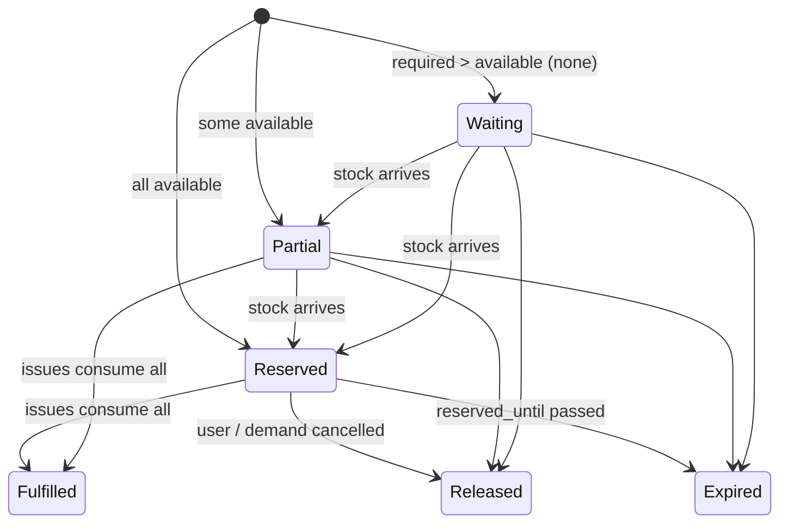
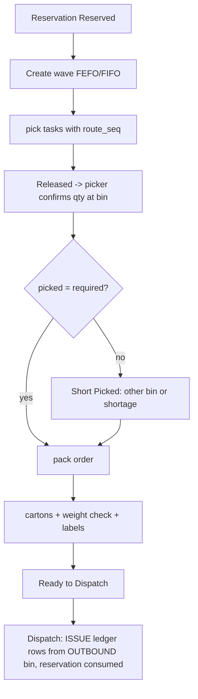
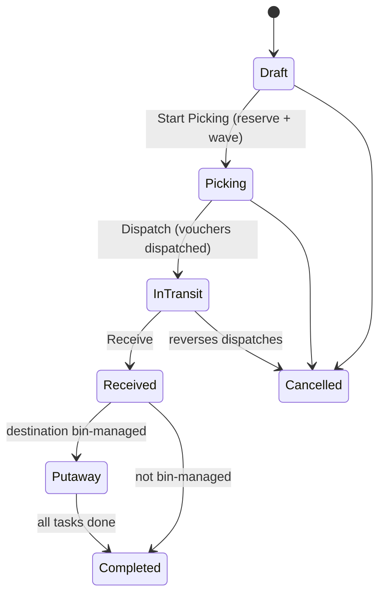
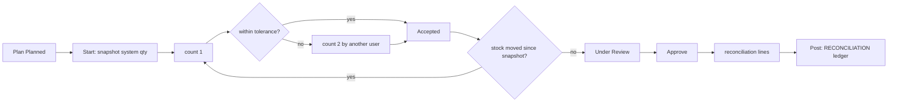
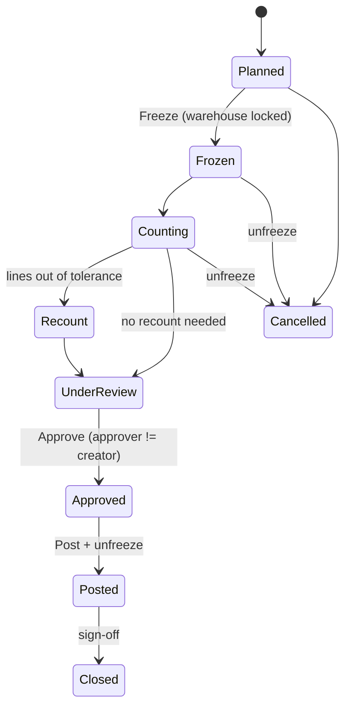
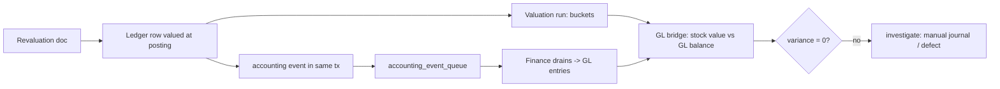
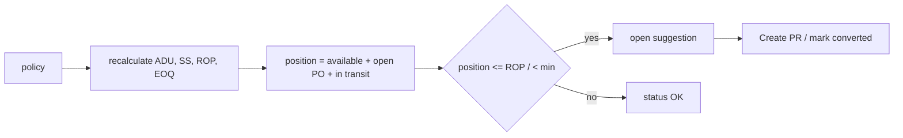
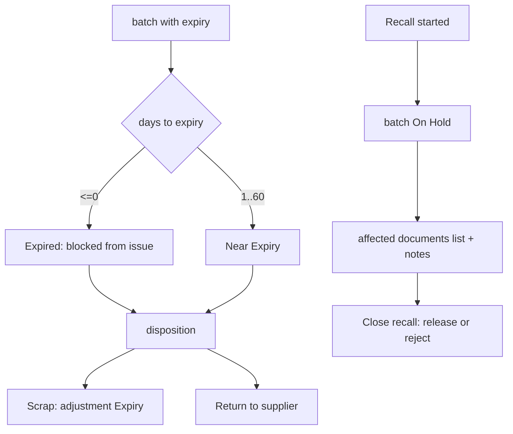
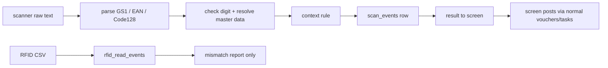

# 02b - Inventory and WMS: end-to-end processes (section 4)

Part of `02-INVENTORY-WMS.md`. Rules named `BR-INV-nn` are in `02d`; tables in `02c`; tickets `T-INV-nn` in `02f`.

Roles used below (permissions are page actions, never role names in services): **Store keeper** = `add`/`edit` on inventory and WMS pages; **Supervisor** = additionally `approve`; **Manager** = additionally `delete` (needed to cancel anything that already moved stock, as built); **System** = a job or another module calling a service.

---

## 4. End-to-end processes

### 4.1 Receive, quality-check and put away stock

Actors: Store keeper (manual receipt now), SCM (GRN later), QC, Operator.

1. A receipt arrives. **Today** the Store keeper creates a Receipt on `inv-transactions` (status Draft). **After the SCM plan**, the GRN service calls `StockService.postMovement` with the same input shape (foundation section 7). Both paths use the same function.
2. For a **batch-tracked** item the voucher carries the batch number, manufacturing date and expiry date (expiry defaults to manufacturing date + item shelf life days, BR-INV-07). A new batch master row is created on posting; its QC status is `Pending QC` if the item has `qcRequired`, else `Released`. For a **serial-tracked** item the voucher carries the list of serial numbers (count = quantity, BR-INV-12).
3. Post: in one transaction `StockService.postMovement` (a) checks the warehouse is not frozen (BR-INV-05), (b) locks the `stock_balances` row, (c) writes the ledger row with `batch_id`, (d) updates `stock_batch_balances`, (e) creates/updates serial rows and `serial_events`, (f) creates a FIFO cost layer when the item is FIFO, (g) for a **bin-managed** warehouse adds the quantity to the `STAGING` bin (`stock_bin_balances`, `stock_bin_moves`) and creates one **putaway task** (`PUT/...`, status Pending) per ledger row, (h) re-runs the reservation allocator for waiting reservations (BR-INV-17), (i) writes the accounting event `STOCK_RECEIPT_POSTED` into `accounting_event_queue`, (j) writes the audit row.
4. Pending QC stock is **Blocked**: it is on hand but not available (BR-INV-18). QC (Quality module later; a Supervisor today) opens `inv-batch` > Quality Status and chooses Release / On Hold / Reject with a reason. Release makes it available and triggers step 3(h).
5. The Operator opens `wms-putaway`, takes a task, sees the **suggested bin** (BR-INV-52), goes there, scans the bin and item (barcode scan console), enters the quantity and presses Complete. The system moves the quantity STAGING to the chosen bin (`stock_bin_moves`, no ledger row because warehouse stock is unchanged) after checking bin capacity (BR-INV-51) and bin status. A different bin than suggested is allowed and recorded (`chosen_bin_id`); a full or blocked bin gives 409 `BIN_CAPACITY_EXCEEDED` / `BIN_BLOCKED`.
6. Task states: Pending, Assigned, In Progress, Completed; Exception (no bin fits, damaged goods) leaves the quantity in STAGING and appears in the Putaway Exceptions tab; Cancelled only while Pending.

### 4.2 Reserve stock for a demand and consume it

Actors: Sales/Manufacturing (later) or Store keeper (manual), allocator (System).

1. A demand calls `StockService.reserve(tx, {...})` or the Store keeper adds a reservation on `inv-reservation`: item, warehouse, optional batch, required qty, priority, reserved-until.
2. The allocator locks the `stock_balances` row (and the batch row when a batch is named), computes `available = on_hand - reserved - blocked` (BR-INV-03) and reserves `min(required, available)`. Status becomes `Reserved` (all), `Partial` (some) or `Waiting` (none). Reserved qty is added to `stock_balances.reserved_qty` (and the batch balance).
3. When stock arrives or is released from QC, the allocator re-runs for that item x warehouse and serves Waiting/Partial reservations in the order Critical > High > Medium > Low, then earlier `reserved_until`, then older `created_at` (BR-INV-17).
4. An **Issue** voucher (or a Delivery/Pack dispatch) that names the reservation consumes it: `reserved_qty -= q`, `fulfilled_qty += q`, `on_hand -= q`, same transaction. When `fulfilled_qty = required_qty` the status is `Fulfilled`.
5. A reservation ends as `Released` (user, or auto when the demand is cancelled), or `Expired` (the daily job when `reserved_until < today`, BR-INV-16). Releasing returns the quantity to available and re-runs the allocator for others.
6. A corrective movement that would leave `reserved > on_hand` (count correction, scrap) shortens the **lowest-priority, newest** reservations until the balance is valid and audits `RESERVATION_SHORTENED` (BR-INV-19).

### 4.3 Outbound: wave, pick, pack, dispatch

Actors: Supervisor (wave), Picker, Packer, Dispatcher. Demand comes from reservations (Sales later; manual today).

1. The Supervisor opens `wms-pick` > header `+ Add` > **Create Wave**: chooses warehouse, strategy (FEFO or FIFO; default the warehouse `pick_method`) and the reservations to include (status Reserved/Partial, in this warehouse).
2. For each reservation the **allocator** (BR-INV-54) picks source bins: for batch items by batch order (FEFO: expiry asc, then FIFO) and inside a batch by bin priority (pick faces first, then fewest quantity to empty bins), from `stock_bin_balances`; one pick task per (bin, batch) slice. Tasks get `route_seq` (BR-INV-54), status Open. The wave is Open.
3. The Supervisor **Releases** the wave: tasks become Released; pickers are assigned (manually or "assign by zone").
4. The Picker starts a task (In Progress), goes to the bin, scans bin + item (+ batch / serials), enters Picked Qty and confirms. The system moves the quantity from the bin to the `OUTBOUND` bin (`stock_bin_moves` PICK). Short pick: if picked < required the Picker gives a reason; the task is `Short Picked`, `short_qty` set, the system proposes another bin with stock (BR-INV-55); if none, the reservation shortens to what was picked and the rest becomes Waiting (shortage handling).
5. When all tasks of a sales order are Picked the system creates a **pack order** (`PAK/...`, Open). The Packer adds cartons (L, W, H, weight), assigns pick lines to cartons, weighs, the system verifies expected vs measured weight (BR-INV-56). Label status Printed after the label is generated.
6. `Mark Ready` sets Ready to Dispatch and `dispatch_ready = true` only if: all lines packed, weight check passed or overridden with reason, labels printed (BR-INV-57).
7. **Dispatch**: the Dispatcher presses Dispatch (or Sales posts the delivery later via the same function). `dispatchPack` posts one ISSUE ledger row per pack line from the OUTBOUND bin, consumes the reservation, writes serial events (Issued, owner = customer), the accounting event `STOCK_ISSUE_POSTED` (COGS is the Sales plan's `DELIVERY_POSTED`), and sets the pack Dispatched.

### 4.4 Transfers

**Simple transfer (`inv-transfer`, built):** Draft, Dispatch (stock leaves source at the average, `dispatchedQty`, rate and value stored), Dispatched, Receive (exactly the dispatched qty, rate and value enter the destination), Received. Cancel from Draft; from Dispatched writes reversals. New: batch and serial identity travel with the stock (the receive row carries the same `batch_id`; serials go In Transit then In Stock at the destination), and `dispatch`/`receive` respect freezes, bins (OUTBOUND bin at the source when bin-managed; STAGING at the destination).

**Warehouse transfer task (`wms-transfer`, new):**
1. Draft: source warehouse, destination (code), lines (item, batch, qty), expected date.
2. `Start Picking`: creates reservations in the source (demand type Transfer Order, ref = WTR no) and a pick wave; status Picking.
3. When all lines are picked: `Dispatch` creates one `inv-transfer` voucher per line in status Draft and dispatches it (service call, not HTTP), stores `voucher_id`, `dispatched_qty`, `rate` per line, consumes the reservations, status In Transit.
4. Destination: `Receive` receives each voucher (exactly the dispatched qty), status Received; for a bin-managed destination a putaway task per line is created (status Putaway while tasks are open).
5. `Complete` when `putaway_qty = received_qty` for all lines (or the destination is not bin-managed). **Variance** = (dispatched - putaway) x rate; non-zero only if a putaway task was cancelled or left in Exception.

### 4.5 Cycle count and reconciliation

1. **Plan** (`wms-cycle`): manual, or `Generate Due Counts`: for every class with `next_count_date <= today`, create a plan for the warehouse (and zone) with the items of that class that have stock (BR-INV-39). `blind = true`, tolerance from settings.
2. **Start** (Planned to Counting): the system snapshots `system_qty` per line (item x bin x batch) with `snapshot_at`. The counter's screen hides `system_qty` when blind.
3. The counter enters `count1_qty`. If `|count1 - system| > tolerance` (BR-INV-32) the line becomes `Recount`: a **different user** enters `count2_qty` (same user is refused 409 `SAME_COUNTER`). `final_qty = count2` if present else `count1`.
4. **Stale check** (BR-INV-34): if any ledger row for the item x warehouse (x batch) has `posted_at > snapshot_at` the line is `Stale`: its system qty is refreshed and it must be counted again.
5. When all lines are counted/accepted the plan goes Under Review. The Supervisor reviews variance lines; **Approve** (needs `approve`) creates one `inv-reconciliation` line (Draft to Under Review to Approved automatically for lines created by the approval, status Approved) per variance line; then **Post** of each reconciliation (or "Post All" on the plan) writes `RECONCILIATION` ledger rows (BR-INV-31) and the accounting event `STOCK_RECONCILIATION_POSTED`.
6. Accuracy % (BR-INV-33) is stored on the plan; `Last Count` of the shelves/bins is set.

### 4.6 Physical verification (full count with freeze)

1. Plan (`wms-physical`): warehouse, freeze date, count team, tolerance, blind.
2. **Freeze** (Planned to Frozen): sets `warehouses.frozen_by_count_id`; from now every `postMovement` into/out of that warehouse is refused 409 `WAREHOUSE_FROZEN` (except the postings of this count); the system snapshots every item x bin x batch with stock into lines (system qty), prints sheets by zone/shelf.
3. **Counting**: count 1 entered per line; recount for lines beyond tolerance (different user); after the recount round, remaining differences are the **final variance**.
4. **Under Review**: net value variance and **variance % of book value** are shown; if the net variance of any item class is >= 10 % of book value the screen shows the CARO flag (BR-INV-36).
5. **Approve** (needs `approve`, approver is not the creator): creates reconciliation lines (status Approved).
6. **Post**: posts them, sets `posting_date`, status Posted, and **unfreezes** the warehouse. `Close` records the sign-off (closure note) and status Closed. Cancelling a count unfreezes the warehouse and posts nothing.

### 4.7 Valuation, revaluation and the GL bridge

1. Every ledger row is valued by the item's method at posting time (moving average, FIFO layers, standard cost; BR-INV-01/20/21). There is no recompute of history.
2. **Revaluation** (`inv-valuation` > Revaluation): the Store keeper/Finance creates a revaluation draft for item x warehouse with a new rate (moving average) or new standard cost, or an NRV write-down amount; Post writes one `REVALUATION` ledger row (quantity 0, value = delta) and the accounting event `STOCK_REVALUATION_POSTED` (BR-INV-23/27).
3. **Run Valuation**: a run for a date range creates lines per item x warehouse with opening / receipt / issue / adjustment buckets (BR-INV-25). Draft runs can be re-created; **Finalize** locks the run and captures GL balances from `GlBridge`.
4. **GL bridge**: `GlBridge.inventoryBalance(tx, {unitId, asOf})` is implemented by the Finance plan; until then it returns `null` and the screen says `Finance not live`. After Finance exists the variance (stock value - GL balance) must be 0 (BR-INV-26); a non-zero variance is a defect or a manual journal on the inventory account.
5. Landed cost (SCM): `StockService.applyLandedCost` posts a value-only REVALUATION (kind LANDED) allocated pro rata by value (BR-INV-28).

### 4.8 Reorder: policy, suggestion, purchase request

1. A policy per item x warehouse stores method (Min-Max or ROP-EOQ), lead time, service level, ordering cost, holding cost %, multiple, preferred vendor.
2. **Recalculate** (button, and the daily job): ADU (average daily usage over the last 90 days), sigma, safety stock, reorder level, EOQ (BR-INV-40..43).
3. **Position** = available + open PO qty (provider) + in-transit-in. If position <= reorder level (ROP-EOQ) or < min (Min-Max) the policy status is Reorder Now/Soon and the job inserts an Open `reorder_suggestions` row (one open suggestion per policy; refreshed, not duplicated) with the suggested qty (BR-INV-44).
4. The buyer opens Suggested PR, selects rows and chooses **Create PR** (when SCM registered the gateway: creates a draft PR via `document_links`) or **Mark Converted** with a PR number typed by hand. Dismiss closes a suggestion with a reason.

### 4.9 Expiry management and batch recall

1. Daily job (and live SQL): days to expiry per batch x warehouse with stock. Bands: Expired, Critical <= 30, High 31-60, Medium 61-90, Low > 90; status Near Expiry when 0 < days <= `nearExpiryDays` (60).
2. The owner chooses a **disposition** (Use First, Discount Sale, Return to Supplier, Rework, Scrap, Donate). Use First raises FEFO priority only (information). Scrap creates an Adjustment draft (reason Expiry) for the available qty; posting it writes off the stock and sets disposition Scrap, batch status Exhausted once zero.
3. Expired batches cannot be issued, transferred, reserved or picked (409 `BATCH_EXPIRED`), except by an Adjustment with reason Expiry/Damage.
4. **Recall**: Start Recall on a batch sets `recalled = true`, QC status On Hold (all remaining stock blocked), writes `RECALL_STARTED`; the affected-documents list is every ledger row of the batch with an outflow (issues, transfer-outs) and its voucher/reference (customers come from Sales documents later via the reference); notes are added to the timeline; Close Recall releases or rejects the remaining stock by choosing the QC status.

### 4.10 Barcode scan and RFID import

**Scan (`POST /wms/scan`, BR-INV-59/60):** the client sends the raw text from a hardware scanner (keyboard wedge) or camera and the context (Lookup, Receive, Put away, Pick, Count). The server (1) trims, (2) detects GS1 element strings (starts with `(01)` or `01` + 14 digits, or contains FNC1/ASCII 29), parses AIs 01, 10, 17, 21, 37, 30, (3) validates GTIN/EAN/UPC check digits, (4) resolves to item / batch / serial / bin through `item_barcodes`, `batches`, `serial_numbers`, `wms_bins.code`, (5) checks the context rule (e.g. in Pick the item must match the open task), (6) always writes a `scan_events` row, increments `scan_count` or `invalid_scan_count`, and returns `{valid, kind, item, batch, serial, bin, qty, expiry, message}`. The scan endpoint never posts stock; the calling screen does.

**RFID import (`POST /pages/wms-rfid/import`, BR-INV-61):** rows `epc,readerCode,rssi,readAt` are appended to `rfid_read_events`; each known tag gets `last_read_at`, `last_rssi`, `actual_zone_id` (the reader's zone); mismatch rules: reader zone <> expected zone gives exception `Location mismatch`; EPC not in registry gives exception row `Unknown tag` (only in the import result, no tag row); an active tag not read for `missedReadHours` is `Missing` in the Missed Reads view. **No stock is ever posted from RFID.**

