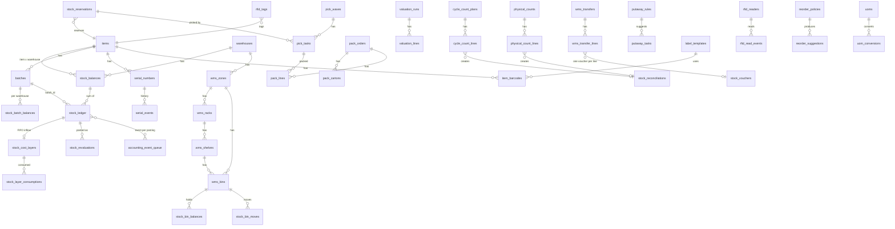

# 02c - Inventory and WMS: database design (section 5)

Part of `02-INVENTORY-WMS.md`. Follows `01-SHARED-FOUNDATION.md` section 2 (conventions) and the style of `apps/api/prisma/migrations/20261105000000_phase5_inventory/migration.sql`.

---

## 5. Database design

### 5.1 The idea in one page: stock is a stack of layers

The existing model is item x warehouse: `stock_balances` (qty, value, average rate) fed by the append-only `stock_ledger`. It stays **the authority for quantity and value**. Every new dimension is a **side table that must add up to it**, so the 645 existing tests cannot break:

| Layer | Table | Key | Adds up to (invariant) | Used when |
|---|---|---|---|---|
| 1 | `stock_balances` (+ `reserved_qty`) | item x warehouse | = Sigma ledger (INV-1) | always |
| 2 | `stock_batch_balances` | batch x warehouse | for a batch-tracked item: Sigma over batches = layer 1 `on_hand` (INV-3) | item `batch_tracked` |
| 3 | `serial_numbers` | item x serial | count of serials `In Stock`/`Reserved` in a warehouse = layer 1 `on_hand` (INV-5) | item `serial_tracked` |
| 4 | `stock_bin_balances` | item x bin x batch | for a bin-managed warehouse: Sigma over bins = layer 1 `on_hand` (INV-4) | `warehouses.bin_managed` |
| 5 | `stock_cost_layers` | one per FIFO inflow | Sigma(qty_remaining x rate) = layer 1 `value` for FIFO items (INV-6) | item `valuation_method = 'FIFO'` |

* Layers 2-5 are **optional per item / per warehouse**. An item with no flags and a warehouse that is not bin-managed behaves exactly as today.
* The single entry point is `StockService.postMovement(tx, input)` (new file `apps/api/src/modules/inventory/stock/stock-service.ts`). It validates the dimensions, calls the existing valuation core `postMovement` (renamed `postCoreMovement`, same body plus the strategy hooks of ticket T-INV-19) and then updates layers 2-5 in the same transaction. The old function name `postMovement` in `posting.ts` is kept as a re-export of `postCoreMovement` so existing imports and tests keep working.
* Ledger rows get nullable `batch_id` and `bin_id`. A movement of a batch-tracked item is **one ledger row per batch**; a movement over several bins is one ledger row per (batch) with the bin split recorded in `stock_bin_moves` (bin is not part of valuation).
* Backdating: posting dates inside the open FY are allowed as built; nothing is recomputed (BR-INV-02).

### 5.2 Conventions for the new tables (from foundation section 2, adapted to what is built)

* Table names `snake_case` plural, primary key `id uuid DEFAULT gen_random_uuid()` (Prisma `@default(uuid())` like the built models). Money `numeric(18,2)`, quantity `numeric(18,3)`, rate `numeric(18,6)`, percent `numeric(7,4)`.
* Enums are `varchar` + `CHECK (... IN (...))`. No Postgres ENUM (the old `MasterStatus` enum is not reused).
* **Standard columns "STD"** (masters and documents): `company_id` (FK `companies`), `unit_id` (FK `units`, NOT NULL for documents and unit-owned masters, NULL for company-wide masters, absent where marked), `created_at`, `created_by_id`, `updated_at`, `updated_by_id`, `version` (optimistic lock), `deleted_at`, `deleted_by_id`. **FOUNDATION-CHANGE (naming only):** foundation 2 says `created_by`; the built code (all six existing tables) uses `created_by_id`, `updated_by_id`, `deleted_by_id`; the new tables follow the built names so repositories and `writeAudit` stay uniform. No behaviour change.
* **Document columns "DOC"** (anything with a number): `code`, `doc_date`, `fy_id`, `department` (default `Warehouse`), `unit_id` NOT NULL. Unique `code`. Gap-free numbers from `number_series` through `NumberingService` (T-INV-02). A deleted document keeps its code.
* **LOG tables** (append-only): `company_id`, `created_at`, `created_by_id` and the trigger from `inv_make_append_only` (below). **Child lines** (`..._lines`, cartons) have no STD columns: they live and die with the parent (`ON DELETE CASCADE`) and are never edited after the parent is final.
* Foreign keys are named `<table>_<col>_fkey`, every FK column is indexed (the DDL below includes the indexes). Composite FKs `(zone_id, warehouse_id)` make it impossible for a bin to point to a zone of another warehouse.
* **Prisma models have scalar columns only** (no `@relation`), the same way the built models keep user ids as plain columns: all foreign keys, CHECKs, partial and expression indexes live in the migration SQL. After editing `schema.prisma` run `npx prisma generate`; never run `migrate dev` without `--create-only` and always replace the generated SQL by the SQL in this plan.
* Soft delete (`deleted_at`) only on masters (zones, racks, shelves, bins, batches, barcodes, templates, printers, readers, tags, policies, rules) and drafts of documents; posted/approved documents are never deleted, they are cancelled.

### 5.3 Entity relationship diagram



### 5.4 Migrations, in build order, and how the 645 tests stay green

| Order | Folder (create with `npx prisma migrate dev --create-only --name <name>`, then replace the SQL) | Contains | Ticket |
|---|---|---|---|
| M1 | `20261106000000_inv_foundation` | helper functions, `uoms`, `uom_conversions`, `accounting_event_queue`, ALTERs of `items`, `warehouses`, `stock_balances`, `stock_ledger`, `stock_vouchers`, seeds (settings, UOMs) | T-INV-01 |
| M2 | `20261106100000_inv_wms_structure` | `wms_zones`, `wms_racks`, `wms_shelves`, `wms_bins` | T-INV-07 |
| M3 | `20261106200000_inv_tracking` | `batches`, `stock_batch_balances`, `serial_numbers`, `serial_events`, `batch_events`, `stock_bin_balances`, `stock_bin_moves`, `stock_holds`, `stock_reservations`, ALTERs of ledger/vouchers (batch, bin, reservation), legacy batch and serial backfill | T-INV-10 |
| M4 | `20261106300000_inv_valuation` | `stock_cost_layers`, `stock_layer_consumptions`, `stock_revaluations`, `stock_reconciliations`, `valuation_runs`, `valuation_lines`, `item_classifications` | T-INV-19 |
| M5 | `20261106400000_inv_wms_tasks` | `putaway_rules`, `putaway_tasks`, `pick_waves`, `pick_tasks`, `pack_orders`, `pack_cartons`, `pack_lines`, `cycle_count_*`, `physical_count_*`, `wms_transfers`, `wms_transfer_lines`, ALTER `warehouses.frozen_by_count_id`, `stock_vouchers.wms_transfer_id` | T-INV-25 |
| M6 | `20261106500000_inv_barcode_rfid_reorder` | `label_templates`, `label_printers`, `item_barcodes` (+ backfill from `items.barcode`), `scan_events`, `rfid_*`, `reorder_*` | T-INV-32 |

**Backward-compatibility rules (the reviewer checks each):**
1. Every new column on `items`, `warehouses`, `stock_balances`, `stock_ledger`, `stock_vouchers` is nullable or has a default that reproduces today's behaviour (`valuation_method = 'MOVING_AVG'`, `reserved_qty = 0`, `bin_managed = false`, `negative_allowed = false`).
2. The two CHECKs that forbid negative quantity are **replaced** by `qty >= 0 OR negative_allowed`; `negative_allowed` is false unless the engine sets it under the negative-stock policy, so direct SQL inserts in the existing tests are still refused exactly as before.
3. The `one_direction` CHECK gains one allowed shape (`REVALUATION` with both quantities 0). The `voucher_type` CHECK gains `RECONCILIATION`, `REVALUATION`.
4. New business rules that could refuse an existing flow (batch required, serial list, reserved limit, expiry, frozen warehouse, UOM precision) only fire when the item is tracked, a reservation / hold / freeze exists, or the setting is on. The existing test files create items with `batchTracked: true` only in `phase5-masters.test.ts` (master CRUD, no posting); no test posts a tracked item.
5. `NOT VALID` is used for `items_one_tracking` so existing rows are not re-checked, but any new write is.
6. After **each** migration ticket the builder runs `npm run db:reset:test` then the full `npm run verify`; the count of passing tests must be >= the count before (record both numbers in the report).

#### 5.4.1 M1 hand-written SQL (put at the top of `migration.sql`, before the generated tables)

```sql
-- Helper functions used by every later migration -------------------------------------------
CREATE FUNCTION "inv_append_only"() RETURNS trigger LANGUAGE plpgsql AS $$
BEGIN
  RAISE EXCEPTION '% is append-only (% not allowed)', TG_TABLE_NAME, TG_OP USING ERRCODE = 'restrict_violation';
END;
$$;
CREATE FUNCTION "inv_make_append_only"(tbl text) RETURNS void LANGUAGE plpgsql AS $$
BEGIN
  EXECUTE format('CREATE TRIGGER %I BEFORE UPDATE OR DELETE ON %I FOR EACH ROW EXECUTE FUNCTION inv_append_only()', tbl || '_no_update_delete', tbl);
  EXECUTE format('CREATE TRIGGER %I BEFORE TRUNCATE ON %I FOR EACH STATEMENT EXECUTE FUNCTION inv_append_only()', tbl || '_no_truncate', tbl);
END;
$$;
```

#### 5.4.2 M1 hand-written SQL: changes to EXISTING tables (after the generated `CREATE TABLE`s of M1)

```sql
-- items ------------------------------------------------------------------------------------
ALTER TABLE "items"
  ADD COLUMN "valuation_method" varchar(12) NOT NULL DEFAULT 'MOVING_AVG',
  ADD COLUMN "qc_required"      boolean     NOT NULL DEFAULT false,
  ADD COLUMN "unit_weight_kg"   numeric(18,3),
  ADD COLUMN "storage_units"    numeric(18,6) NOT NULL DEFAULT 1;
ALTER TABLE "items" ADD CONSTRAINT "items_valuation_method" CHECK ("valuation_method" IN ('MOVING_AVG','FIFO','STANDARD'));
ALTER TABLE "items" ADD CONSTRAINT "items_unit_weight_kg" CHECK ("unit_weight_kg" IS NULL OR "unit_weight_kg" >= 0);
ALTER TABLE "items" ADD CONSTRAINT "items_storage_units" CHECK ("storage_units" > 0);
ALTER TABLE "items" ADD CONSTRAINT "items_one_tracking" CHECK (NOT ("batch_tracked" AND "serial_tracked")) NOT VALID;

-- warehouses -------------------------------------------------------------------------------
ALTER TABLE "warehouses"
  ADD COLUMN "bin_managed"      boolean    NOT NULL DEFAULT false,
  ADD COLUMN "putaway_required" boolean    NOT NULL DEFAULT false,
  ADD COLUMN "pick_method"      varchar(6) NOT NULL DEFAULT 'FEFO';
ALTER TABLE "warehouses" ADD CONSTRAINT "warehouses_pick_method" CHECK ("pick_method" IN ('FEFO','FIFO','MANUAL'));

-- stock_balances ---------------------------------------------------------------------------
ALTER TABLE "stock_balances"
  ADD COLUMN "reserved_qty"     numeric(18,3) NOT NULL DEFAULT 0,
  ADD COLUMN "negative_allowed" boolean       NOT NULL DEFAULT false;
ALTER TABLE "stock_balances" DROP CONSTRAINT "stock_balances_not_negative";
ALTER TABLE "stock_balances" ADD CONSTRAINT "stock_balances_not_negative" CHECK ("on_hand" >= 0 OR "negative_allowed");
ALTER TABLE "stock_balances" ADD CONSTRAINT "stock_balances_reserved_valid" CHECK ("reserved_qty" >= 0 AND "reserved_qty" <= GREATEST("on_hand", 0));

-- stock_ledger (append-only trigger fires on UPDATE/DELETE/TRUNCATE only; ALTER TABLE is allowed) --
ALTER TABLE "stock_ledger"
  ADD COLUMN "batch_id"         uuid,
  ADD COLUMN "bin_id"           uuid,
  ADD COLUMN "uom"              varchar(20),
  ADD COLUMN "uom_factor"       numeric(18,6),
  ADD COLUMN "ppv"              numeric(18,2) NOT NULL DEFAULT 0,
  ADD COLUMN "reason_code"      varchar(30),
  ADD COLUMN "negative_allowed" boolean NOT NULL DEFAULT false;
ALTER TABLE "stock_ledger" DROP CONSTRAINT "stock_ledger_balance_not_negative";
ALTER TABLE "stock_ledger" ADD CONSTRAINT "stock_ledger_balance_not_negative" CHECK ("balance_qty" >= 0 OR "negative_allowed");
ALTER TABLE "stock_ledger" DROP CONSTRAINT "stock_ledger_one_direction";
ALTER TABLE "stock_ledger" ADD CONSTRAINT "stock_ledger_one_direction" CHECK (
  ("qty_in" > 0 AND "qty_out" = 0) OR ("qty_in" = 0 AND "qty_out" > 0)
  OR ("voucher_type" = 'REVALUATION' AND "qty_in" = 0 AND "qty_out" = 0));
ALTER TABLE "stock_ledger" DROP CONSTRAINT "stock_ledger_voucher_type";
ALTER TABLE "stock_ledger" ADD CONSTRAINT "stock_ledger_voucher_type" CHECK ("voucher_type" IN
  ('OPENING','RECEIPT','ISSUE','ADJUSTMENT','TRANSFER_OUT','TRANSFER_IN','REVERSAL','RECONCILIATION','REVALUATION'));

-- stock_vouchers ---------------------------------------------------------------------------
ALTER TABLE "stock_vouchers"
  ADD COLUMN "entered_qty"       numeric(18,3),
  ADD COLUMN "uom"               varchar(20),
  ADD COLUMN "uom_factor"        numeric(18,6),
  ADD COLUMN "mfg_date"          date,
  ADD COLUMN "expiry_date"       date,
  ADD COLUMN "serial_nos"        jsonb,
  ADD COLUMN "approved_by_id"    uuid,
  ADD COLUMN "reason_note"       varchar(300),
  ADD COLUMN "upload_batch"      varchar(40),
  ADD COLUMN "validation_status" varchar(8);
ALTER TABLE "stock_vouchers" ADD CONSTRAINT "stock_vouchers_approved_by_id_fkey" FOREIGN KEY ("approved_by_id") REFERENCES "users"("id") ON DELETE SET NULL ON UPDATE CASCADE;
ALTER TABLE "stock_vouchers" ADD CONSTRAINT "stock_vouchers_validation_status" CHECK ("validation_status" IS NULL OR "validation_status" IN ('Valid','Warning','Error'));
ALTER TABLE "stock_vouchers" ADD CONSTRAINT "stock_vouchers_uom_factor" CHECK ("uom_factor" IS NULL OR "uom_factor" > 0);
```
Meaning of the voucher columns: `qty` stays the **base-UOM quantity** (the posting engine is unchanged); `entered_qty`, `uom`, `uom_factor` keep what the user typed (`NULL` = typed in the base UOM, `qty = entered_qty x uom_factor`, BR-INV-06).

#### 5.4.3 M1 seeds (end of `migration.sql`; a fresh database gets the same from `seedInventoryDefaults`, T-INV-37)

```sql
-- inventory policy (settings.key is varchar(60), value is jsonb)
INSERT INTO "settings" ("key","value","version","created_at","updated_at") VALUES ('inventory.policy', '{
 "allowNegativeStock": false, "enforceUomPrecision": false,
 "reservationDays": 14, "autoReleaseReservations": true, "releaseOnDemandCancel": true,
 "nearExpiryDays": 60, "approvalThresholdValue": 10000, "reconThresholdValue": 10000,
 "countTolerancePct": 2, "countToleranceValue": 500,
 "movementDays": {"fast": 30, "normal": 90, "slow": 180},
 "abc": {"aCumPct": 80, "bCumPct": 95, "freqDays": {"A": 30, "B": 90, "C": 365}},
 "xyz": {"xMaxCv": 0.5, "yMaxCv": 1.0},
 "usageWindowDays": 90, "serviceLevelDefaultPct": 95, "holdingCostPctDefault": 20,
 "packWeightTolerancePct": 2, "volumetricDivisor": 5000, "missedReadHours": 24
}'::jsonb, 1, now(), now()) ON CONFLICT ("key") DO NOTHING;

-- UOMs: the nine the item form already offers, plus any code already used by items
INSERT INTO "uoms" ("company_id","code","name","uom_class","decimals","status","created_by_id")
SELECT (SELECT "id" FROM "companies" ORDER BY "created_at" LIMIT 1), v.code, v.name, v.cls, v.dec, 'Active',
       (SELECT "id" FROM "users" ORDER BY "created_at" LIMIT 1)
FROM (VALUES ('Nos','Numbers','Count',0),('Set','Set','Count',0),('Pair','Pair','Count',0),('Box','Box','Count',0),
             ('Roll','Roll','Count',0),('Sheet','Sheet','Count',0),('Kg','Kilogram','Weight',3),
             ('Meter','Meter','Length',3),('Litre','Litre','Volume',3)) AS v(code,name,cls,dec)
WHERE EXISTS (SELECT 1 FROM "companies") AND EXISTS (SELECT 1 FROM "users")
ON CONFLICT DO NOTHING;
INSERT INTO "uoms" ("company_id","code","name","uom_class","decimals","status","created_by_id")
SELECT (SELECT "id" FROM "companies" ORDER BY "created_at" LIMIT 1), u.code, u.code, 'Other', 3, 'Active',
       (SELECT "id" FROM "users" ORDER BY "created_at" LIMIT 1)
FROM (SELECT "base_uom" AS code FROM "items" UNION SELECT "alt_uom" FROM "items" WHERE "alt_uom" IS NOT NULL) u
WHERE EXISTS (SELECT 1 FROM "companies") AND EXISTS (SELECT 1 FROM "users")
ON CONFLICT DO NOTHING;
```

#### 5.4.4 M3 hand-written SQL (after the generated tables of M3)

```sql
ALTER TABLE "stock_ledger" ADD CONSTRAINT "stock_ledger_batch_id_fkey" FOREIGN KEY ("batch_id") REFERENCES "batches"("id") ON DELETE RESTRICT ON UPDATE CASCADE;
ALTER TABLE "stock_ledger" ADD CONSTRAINT "stock_ledger_bin_id_fkey"   FOREIGN KEY ("bin_id")   REFERENCES "wms_bins"("id") ON DELETE RESTRICT ON UPDATE CASCADE;
CREATE INDEX "stock_ledger_batch_id_idx" ON "stock_ledger" ("batch_id") WHERE "batch_id" IS NOT NULL;
CREATE INDEX "stock_ledger_item_posting_date_idx" ON "stock_ledger" ("item_id", "posting_date");
ALTER TABLE "stock_vouchers" ADD COLUMN "batch_id" uuid, ADD COLUMN "reservation_id" uuid;
ALTER TABLE "stock_vouchers" ADD CONSTRAINT "stock_vouchers_batch_id_fkey" FOREIGN KEY ("batch_id") REFERENCES "batches"("id") ON DELETE RESTRICT ON UPDATE CASCADE;
ALTER TABLE "stock_vouchers" ADD CONSTRAINT "stock_vouchers_reservation_id_fkey" FOREIGN KEY ("reservation_id") REFERENCES "stock_reservations"("id") ON DELETE RESTRICT ON UPDATE CASCADE;

-- Legacy backfill: items already flagged as tracked and holding stock keep working.
-- Batch-tracked items with stock get one batch LEGACY per item (no expiry, Released) holding all stock.
INSERT INTO "batches" ("company_id","item_id","batch_no","qc_status","is_legacy","created_by_id")
SELECT (SELECT "id" FROM "companies" ORDER BY "created_at" LIMIT 1), i."id", 'LEGACY', 'Released', true,
       (SELECT "id" FROM "users" ORDER BY "created_at" LIMIT 1)
FROM "items" i
WHERE i."batch_tracked" AND EXISTS (SELECT 1 FROM "stock_balances" b WHERE b."item_id" = i."id" AND b."on_hand" > 0)
  AND EXISTS (SELECT 1 FROM "companies") AND EXISTS (SELECT 1 FROM "users");
INSERT INTO "stock_batch_balances" ("batch_id","warehouse_id","item_id","on_hand")
SELECT bt."id", b."warehouse_id", b."item_id", b."on_hand"
FROM "stock_balances" b JOIN "batches" bt ON bt."item_id" = b."item_id" AND bt."batch_no" = 'LEGACY'
WHERE b."on_hand" > 0;
-- Serial-tracked items with whole-number stock get LEGACY-<WAREHOUSE>-<n> serial rows (In Stock).
INSERT INTO "serial_numbers" ("company_id","unit_id","item_id","serial_no","warehouse_id","status","last_movement_at","created_by_id")
SELECT (SELECT "id" FROM "companies" ORDER BY "created_at" LIMIT 1), w."unit_id", b."item_id",
       left('LEGACY-' || w."code" || '-' || g::text, 40), b."warehouse_id", 'In Stock', now(),
       (SELECT "id" FROM "users" ORDER BY "created_at" LIMIT 1)
FROM "stock_balances" b
JOIN "items" i ON i."id" = b."item_id" AND i."serial_tracked"
JOIN "warehouses" w ON w."id" = b."warehouse_id"
CROSS JOIN LATERAL generate_series(1, floor(b."on_hand")::int) g
WHERE b."on_hand" > 0 AND b."on_hand" = floor(b."on_hand");
```
The legacy serial rows are named `LEGACY-<warehouse code>-<n>`; stock of a serial-tracked item that is not a whole number is skipped by this INSERT (its on-hand then differs from the serial count; the invariant test INV-5 lists such items and the migration report must name them).

#### 5.4.5 M5 hand-written SQL (after the generated tables of M5)

```sql
ALTER TABLE "warehouses" ADD COLUMN "frozen_by_count_id" uuid;
ALTER TABLE "warehouses" ADD CONSTRAINT "warehouses_frozen_by_count_id_fkey" FOREIGN KEY ("frozen_by_count_id") REFERENCES "physical_counts"("id") ON DELETE SET NULL ON UPDATE CASCADE;
ALTER TABLE "stock_vouchers" ADD COLUMN "wms_transfer_id" uuid;
ALTER TABLE "stock_vouchers" ADD CONSTRAINT "stock_vouchers_wms_transfer_id_fkey" FOREIGN KEY ("wms_transfer_id") REFERENCES "wms_transfers"("id") ON DELETE SET NULL ON UPDATE CASCADE;
```

#### 5.4.6 M6 hand-written SQL (after the generated tables of M6)

```sql
-- Mirror the item master barcode as the primary registry row (type by length: 13 digits EAN-13, 12 UPC-A, else Code 128).
INSERT INTO "item_barcodes" ("company_id","item_id","barcode","barcode_type","is_primary","status","created_by_id")
SELECT (SELECT "id" FROM "companies" ORDER BY "created_at" LIMIT 1), i."id", i."barcode",
       CASE WHEN i."barcode" ~ '^[0-9]{13}$' THEN 'EAN-13' WHEN i."barcode" ~ '^[0-9]{12}$' THEN 'UPC-A' ELSE 'Code 128' END,
       true, 'Active', (SELECT "id" FROM "users" ORDER BY "created_at" LIMIT 1)
FROM "items" i
WHERE i."barcode" IS NOT NULL AND i."deleted_at" IS NULL AND char_length(i."barcode") >= 4
  AND EXISTS (SELECT 1 FROM "companies") AND EXISTS (SELECT 1 FROM "users");
```
From then on the item master barcode and the primary registry row are kept equal by the items service (T-INV-32): editing the item barcode updates the primary row inside the same transaction; barcodes shorter than 4 characters stay only on the item.

### 5.5 The new tables (generated from one spec; DDL first, then the Prisma model)

Read the DDL as the source of truth. Paste the DDL into the `migration.sql` of the migration named in the heading **in the order shown** (a table appears after the tables it references). Paste each Prisma model into `apps/api/prisma/schema.prisma` and run `npx prisma generate`. Standard columns are already expanded in every table.

#### 5.5.M1.1 `uoms`

```sql
-- uoms: Units of measure (foundation 3.3). Code is the same text the items table already stores in base_uom / alt_uom.
CREATE TABLE "uoms" (
  "id" uuid NOT NULL DEFAULT gen_random_uuid(),
  "company_id" uuid NOT NULL,
  "code" varchar(20) NOT NULL,
  "name" varchar(60) NOT NULL,
  "uom_class" varchar(12) NOT NULL DEFAULT 'Count',
  "decimals" smallint NOT NULL DEFAULT 3,
  "status" varchar(10) NOT NULL DEFAULT 'Active',
  "created_at" timestamptz(3) NOT NULL DEFAULT now(),
  "created_by_id" uuid NOT NULL,
  "updated_at" timestamptz(3) NOT NULL DEFAULT now(),
  "updated_by_id" uuid,
  "version" integer NOT NULL DEFAULT 1,
  "deleted_at" timestamptz(3),
  "deleted_by_id" uuid,
  CONSTRAINT "uoms_pkey" PRIMARY KEY ("id"),
  CONSTRAINT "uoms_company_id_fkey" FOREIGN KEY ("company_id") REFERENCES "companies" ("id") ON DELETE RESTRICT ON UPDATE CASCADE,
  CONSTRAINT "uoms_created_by_id_fkey" FOREIGN KEY ("created_by_id") REFERENCES "users" ("id") ON DELETE RESTRICT ON UPDATE CASCADE,
  CONSTRAINT "uoms_updated_by_id_fkey" FOREIGN KEY ("updated_by_id") REFERENCES "users" ("id") ON DELETE SET NULL ON UPDATE CASCADE,
  CONSTRAINT "uoms_deleted_by_id_fkey" FOREIGN KEY ("deleted_by_id") REFERENCES "users" ("id") ON DELETE SET NULL ON UPDATE CASCADE,
  CONSTRAINT "uoms_uom_class_check" CHECK (uom_class IN ('Count','Weight','Length','Volume','Area','Time','Other')),
  CONSTRAINT "uoms_decimals_check" CHECK (decimals BETWEEN 0 AND 6),
  CONSTRAINT "uoms_status_check" CHECK (status IN ('Active','Inactive')),
  CONSTRAINT "uoms_code_format" CHECK (code ~ '^[A-Za-z0-9._/ -]{1,20}$')
);
CREATE UNIQUE INDEX "uoms_code_key" ON "uoms" ("code");
```

```prisma
model Uom {
  id                     String     @id @default(uuid()) @db.Uuid
  companyId              String     @map("company_id") @db.Uuid
  code                   String     @db.VarChar(20)
  name                   String     @db.VarChar(60)
  uomClass               String     @default("Count") @map("uom_class") @db.VarChar(12)
  decimals               Int        @default(3) @db.SmallInt
  status                 String     @default("Active") @db.VarChar(10)
  createdAt              DateTime   @default(now()) @map("created_at") @db.Timestamptz(3)
  createdById            String     @map("created_by_id") @db.Uuid
  updatedAt              DateTime   @default(now()) @updatedAt @map("updated_at") @db.Timestamptz(3)
  updatedById            String?    @map("updated_by_id") @db.Uuid
  version                Int        @default(1)
  deletedAt              DateTime?  @map("deleted_at") @db.Timestamptz(3)
  deletedById            String?    @map("deleted_by_id") @db.Uuid
  @@unique([code])
  @@map("uoms")
}
```

#### 5.5.M1.2 `uom_conversions`

```sql
-- uom_conversions: Conversion factors. item_id NULL = global row; an item row wins over a global row. 1 from_uom = factor x to_uom.
CREATE TABLE "uom_conversions" (
  "id" uuid NOT NULL DEFAULT gen_random_uuid(),
  "company_id" uuid NOT NULL,
  "item_id" uuid,
  "from_uom_id" uuid NOT NULL,
  "to_uom_id" uuid NOT NULL,
  "factor" numeric(18,6) NOT NULL,
  "created_at" timestamptz(3) NOT NULL DEFAULT now(),
  "created_by_id" uuid NOT NULL,
  "updated_at" timestamptz(3) NOT NULL DEFAULT now(),
  "updated_by_id" uuid,
  "version" integer NOT NULL DEFAULT 1,
  "deleted_at" timestamptz(3),
  "deleted_by_id" uuid,
  CONSTRAINT "uom_conversions_pkey" PRIMARY KEY ("id"),
  CONSTRAINT "uom_conversions_company_id_fkey" FOREIGN KEY ("company_id") REFERENCES "companies" ("id") ON DELETE RESTRICT ON UPDATE CASCADE,
  CONSTRAINT "uom_conversions_item_id_fkey" FOREIGN KEY ("item_id") REFERENCES "items" ("id") ON DELETE CASCADE ON UPDATE CASCADE,
  CONSTRAINT "uom_conversions_from_uom_id_fkey" FOREIGN KEY ("from_uom_id") REFERENCES "uoms" ("id") ON DELETE RESTRICT ON UPDATE CASCADE,
  CONSTRAINT "uom_conversions_to_uom_id_fkey" FOREIGN KEY ("to_uom_id") REFERENCES "uoms" ("id") ON DELETE RESTRICT ON UPDATE CASCADE,
  CONSTRAINT "uom_conversions_created_by_id_fkey" FOREIGN KEY ("created_by_id") REFERENCES "users" ("id") ON DELETE RESTRICT ON UPDATE CASCADE,
  CONSTRAINT "uom_conversions_updated_by_id_fkey" FOREIGN KEY ("updated_by_id") REFERENCES "users" ("id") ON DELETE SET NULL ON UPDATE CASCADE,
  CONSTRAINT "uom_conversions_deleted_by_id_fkey" FOREIGN KEY ("deleted_by_id") REFERENCES "users" ("id") ON DELETE SET NULL ON UPDATE CASCADE,
  CONSTRAINT "uom_conversions_factor_check" CHECK (factor > 0),
  CONSTRAINT "uom_conversions_differ" CHECK (from_uom_id <> to_uom_id)
);
CREATE INDEX "uom_conversions_item_id_idx" ON "uom_conversions" ("item_id");
CREATE INDEX "uom_conversions_from_uom_id_idx" ON "uom_conversions" ("from_uom_id");
CREATE INDEX "uom_conversions_to_uom_id_idx" ON "uom_conversions" ("to_uom_id");
CREATE UNIQUE INDEX "uom_conversions_unique" ON "uom_conversions" (COALESCE("item_id", '00000000-0000-0000-0000-000000000000'::uuid), "from_uom_id", "to_uom_id") WHERE "deleted_at" IS NULL;
```

```prisma
model UomConversion {
  id                     String     @id @default(uuid()) @db.Uuid
  companyId              String     @map("company_id") @db.Uuid
  itemId                 String?    @map("item_id") @db.Uuid
  fromUomId              String     @map("from_uom_id") @db.Uuid
  toUomId                String     @map("to_uom_id") @db.Uuid
  factor                 Decimal    @db.Decimal(18, 6)
  createdAt              DateTime   @default(now()) @map("created_at") @db.Timestamptz(3)
  createdById            String     @map("created_by_id") @db.Uuid
  updatedAt              DateTime   @default(now()) @updatedAt @map("updated_at") @db.Timestamptz(3)
  updatedById            String?    @map("updated_by_id") @db.Uuid
  version                Int        @default(1)
  deletedAt              DateTime?  @map("deleted_at") @db.Timestamptz(3)
  deletedById            String?    @map("deleted_by_id") @db.Uuid
  @@index([itemId])
  @@index([fromUomId])
  @@index([toUomId])
  @@map("uom_conversions")
}
```

#### 5.5.M1.3 `accounting_event_queue`

```sql
-- accounting_event_queue: Foundation 5: operational modules record accounting events here until Finance drains the queue. Idempotent by (event, doc_type, doc_id).
CREATE TABLE "accounting_event_queue" (
  "id" uuid NOT NULL DEFAULT gen_random_uuid(),
  "company_id" uuid NOT NULL,
  "event" varchar(40) NOT NULL,
  "doc_type" varchar(30) NOT NULL,
  "doc_id" uuid NOT NULL,
  "doc_date" date NOT NULL,
  "unit_id" uuid,
  "payload" jsonb NOT NULL,
  "status" varchar(8) NOT NULL DEFAULT 'PENDING',
  "journal_id" uuid,
  "error" text,
  "created_at" timestamptz(3) NOT NULL DEFAULT now(),
  "processed_at" timestamptz(3),
  CONSTRAINT "accounting_event_queue_pkey" PRIMARY KEY ("id"),
  CONSTRAINT "accounting_event_queue_company_id_fkey" FOREIGN KEY ("company_id") REFERENCES "companies" ("id") ON DELETE RESTRICT ON UPDATE CASCADE,
  CONSTRAINT "accounting_event_queue_unit_id_fkey" FOREIGN KEY ("unit_id") REFERENCES "units" ("id") ON DELETE RESTRICT ON UPDATE CASCADE,
  CONSTRAINT "accounting_event_queue_status_check" CHECK (status IN ('PENDING','POSTED','FAILED'))
);
CREATE UNIQUE INDEX "accounting_event_queue_event_doc_type_doc_id_key" ON "accounting_event_queue" ("event", "doc_type", "doc_id");
CREATE INDEX "accounting_event_queue_status_created_at_idx" ON "accounting_event_queue" ("status", "created_at");
CREATE INDEX "accounting_event_queue_unit_id_idx" ON "accounting_event_queue" ("unit_id");
```

```prisma
model AccountingEventQueue {
  id                     String     @id @default(uuid()) @db.Uuid
  companyId              String     @map("company_id") @db.Uuid
  event                  String     @db.VarChar(40)
  docType                String     @map("doc_type") @db.VarChar(30)
  docId                  String     @map("doc_id") @db.Uuid
  docDate                DateTime   @map("doc_date") @db.Date
  unitId                 String?    @map("unit_id") @db.Uuid
  payload                Json
  status                 String     @default("PENDING") @db.VarChar(8)
  journalId              String?    @map("journal_id") @db.Uuid
  error                  String?
  createdAt              DateTime   @default(now()) @map("created_at") @db.Timestamptz(3)
  processedAt            DateTime?  @map("processed_at") @db.Timestamptz(3)
  @@index([status, createdAt])
  @@index([unitId])
  @@unique([event, docType, docId])
  @@map("accounting_event_queue")
}
```


#### 5.5.M2.1 `wms_zones`

```sql
-- wms_zones: Zone of a warehouse (wms-zones).
CREATE TABLE "wms_zones" (
  "id" uuid NOT NULL DEFAULT gen_random_uuid(),
  "company_id" uuid NOT NULL,
  "unit_id" uuid NOT NULL,
  "warehouse_id" uuid NOT NULL,
  "code" varchar(12) NOT NULL,
  "name" varchar(100) NOT NULL,
  "zone_type" varchar(12) NOT NULL DEFAULT 'Storage',
  "capacity" numeric(18,3),
  "storage_class" varchar(12) NOT NULL DEFAULT 'General',
  "temperature" numeric(5,1),
  "putaway_priority" varchar(6) NOT NULL DEFAULT 'Medium',
  "pick_sequence" integer NOT NULL DEFAULT 100,
  "allowed_item_types" text,
  "status" varchar(10) NOT NULL DEFAULT 'Active',
  "created_at" timestamptz(3) NOT NULL DEFAULT now(),
  "created_by_id" uuid NOT NULL,
  "updated_at" timestamptz(3) NOT NULL DEFAULT now(),
  "updated_by_id" uuid,
  "version" integer NOT NULL DEFAULT 1,
  "deleted_at" timestamptz(3),
  "deleted_by_id" uuid,
  CONSTRAINT "wms_zones_pkey" PRIMARY KEY ("id"),
  CONSTRAINT "wms_zones_company_id_fkey" FOREIGN KEY ("company_id") REFERENCES "companies" ("id") ON DELETE RESTRICT ON UPDATE CASCADE,
  CONSTRAINT "wms_zones_unit_id_fkey" FOREIGN KEY ("unit_id") REFERENCES "units" ("id") ON DELETE RESTRICT ON UPDATE CASCADE,
  CONSTRAINT "wms_zones_warehouse_id_fkey" FOREIGN KEY ("warehouse_id") REFERENCES "warehouses" ("id") ON DELETE RESTRICT ON UPDATE CASCADE,
  CONSTRAINT "wms_zones_created_by_id_fkey" FOREIGN KEY ("created_by_id") REFERENCES "users" ("id") ON DELETE RESTRICT ON UPDATE CASCADE,
  CONSTRAINT "wms_zones_updated_by_id_fkey" FOREIGN KEY ("updated_by_id") REFERENCES "users" ("id") ON DELETE SET NULL ON UPDATE CASCADE,
  CONSTRAINT "wms_zones_deleted_by_id_fkey" FOREIGN KEY ("deleted_by_id") REFERENCES "users" ("id") ON DELETE SET NULL ON UPDATE CASCADE,
  CONSTRAINT "wms_zones_code_check" CHECK (code ~ '^[A-Z0-9_-]{1,12}$'),
  CONSTRAINT "wms_zones_zone_type_check" CHECK (zone_type IN ('Receiving','Storage','Picking','Packing','Dispatch','Quarantine','Returns')),
  CONSTRAINT "wms_zones_capacity_check" CHECK (capacity >= 0),
  CONSTRAINT "wms_zones_storage_class_check" CHECK (storage_class IN ('General','Cold Chain','Hazardous','Bulk','High Value')),
  CONSTRAINT "wms_zones_temperature_check" CHECK (temperature BETWEEN -80 AND 80),
  CONSTRAINT "wms_zones_putaway_priority_check" CHECK (putaway_priority IN ('High','Medium','Low')),
  CONSTRAINT "wms_zones_pick_sequence_check" CHECK (pick_sequence >= 1),
  CONSTRAINT "wms_zones_status_check" CHECK (status IN ('Active','Inactive'))
);
CREATE UNIQUE INDEX "wms_zones_warehouse_id_code_key" ON "wms_zones" ("warehouse_id", "code");
CREATE UNIQUE INDEX "wms_zones_id_warehouse_id_key" ON "wms_zones" ("id", "warehouse_id");
CREATE INDEX "wms_zones_warehouse_id_idx" ON "wms_zones" ("warehouse_id");
CREATE INDEX "wms_zones_unit_id_idx" ON "wms_zones" ("unit_id");
```

```prisma
model WmsZone {
  id                     String     @id @default(uuid()) @db.Uuid
  companyId              String     @map("company_id") @db.Uuid
  unitId                 String     @map("unit_id") @db.Uuid
  warehouseId            String     @map("warehouse_id") @db.Uuid
  code                   String     @db.VarChar(12)
  name                   String     @db.VarChar(100)
  zoneType               String     @default("Storage") @map("zone_type") @db.VarChar(12)
  capacity               Decimal?   @db.Decimal(18, 3)
  storageClass           String     @default("General") @map("storage_class") @db.VarChar(12)
  temperature            Decimal?   @db.Decimal(5, 1)
  putawayPriority        String     @default("Medium") @map("putaway_priority") @db.VarChar(6)
  pickSequence           Int        @default(100) @map("pick_sequence")
  allowedItemTypes       String?    @map("allowed_item_types")
  status                 String     @default("Active") @db.VarChar(10)
  createdAt              DateTime   @default(now()) @map("created_at") @db.Timestamptz(3)
  createdById            String     @map("created_by_id") @db.Uuid
  updatedAt              DateTime   @default(now()) @updatedAt @map("updated_at") @db.Timestamptz(3)
  updatedById            String?    @map("updated_by_id") @db.Uuid
  version                Int        @default(1)
  deletedAt              DateTime?  @map("deleted_at") @db.Timestamptz(3)
  deletedById            String?    @map("deleted_by_id") @db.Uuid
  @@index([warehouseId])
  @@index([unitId])
  @@unique([warehouseId, code])
  @@unique([id, warehouseId])
  @@map("wms_zones")
}
```

#### 5.5.M2.2 `wms_racks`

```sql
-- wms_racks: Rack in a zone (wms-racks).
CREATE TABLE "wms_racks" (
  "id" uuid NOT NULL DEFAULT gen_random_uuid(),
  "company_id" uuid NOT NULL,
  "unit_id" uuid NOT NULL,
  "warehouse_id" uuid NOT NULL,
  "zone_id" uuid NOT NULL,
  "code" varchar(20) NOT NULL,
  "aisle" varchar(20),
  "rack_type" varchar(16) NOT NULL DEFAULT 'Selective Pallet',
  "levels" integer NOT NULL DEFAULT 1,
  "max_load_kg" numeric(18,3),
  "last_audit" date,
  "status" varchar(10) NOT NULL DEFAULT 'Active',
  "created_at" timestamptz(3) NOT NULL DEFAULT now(),
  "created_by_id" uuid NOT NULL,
  "updated_at" timestamptz(3) NOT NULL DEFAULT now(),
  "updated_by_id" uuid,
  "version" integer NOT NULL DEFAULT 1,
  "deleted_at" timestamptz(3),
  "deleted_by_id" uuid,
  CONSTRAINT "wms_racks_pkey" PRIMARY KEY ("id"),
  CONSTRAINT "wms_racks_company_id_fkey" FOREIGN KEY ("company_id") REFERENCES "companies" ("id") ON DELETE RESTRICT ON UPDATE CASCADE,
  CONSTRAINT "wms_racks_unit_id_fkey" FOREIGN KEY ("unit_id") REFERENCES "units" ("id") ON DELETE RESTRICT ON UPDATE CASCADE,
  CONSTRAINT "wms_racks_created_by_id_fkey" FOREIGN KEY ("created_by_id") REFERENCES "users" ("id") ON DELETE RESTRICT ON UPDATE CASCADE,
  CONSTRAINT "wms_racks_updated_by_id_fkey" FOREIGN KEY ("updated_by_id") REFERENCES "users" ("id") ON DELETE SET NULL ON UPDATE CASCADE,
  CONSTRAINT "wms_racks_deleted_by_id_fkey" FOREIGN KEY ("deleted_by_id") REFERENCES "users" ("id") ON DELETE SET NULL ON UPDATE CASCADE,
  CONSTRAINT "wms_racks_zone_fkey" FOREIGN KEY ("zone_id", "warehouse_id") REFERENCES "wms_zones" ("id", "warehouse_id") ON DELETE RESTRICT ON UPDATE CASCADE,
  CONSTRAINT "wms_racks_warehouse_id_fkey" FOREIGN KEY ("warehouse_id") REFERENCES "warehouses" ("id") ON DELETE RESTRICT ON UPDATE CASCADE,
  CONSTRAINT "wms_racks_code_check" CHECK (code ~ '^[A-Z0-9_-]{1,20}$'),
  CONSTRAINT "wms_racks_rack_type_check" CHECK (rack_type IN ('Selective Pallet','Drive-in','Cantilever','Shelving','Mezzanine','Floor Stack')),
  CONSTRAINT "wms_racks_levels_check" CHECK (levels BETWEEN 1 AND 20),
  CONSTRAINT "wms_racks_max_load_kg_check" CHECK (max_load_kg >= 0),
  CONSTRAINT "wms_racks_status_check" CHECK (status IN ('Active','Inactive'))
);
CREATE UNIQUE INDEX "wms_racks_warehouse_id_code_key" ON "wms_racks" ("warehouse_id", "code");
CREATE UNIQUE INDEX "wms_racks_id_warehouse_id_key" ON "wms_racks" ("id", "warehouse_id");
CREATE INDEX "wms_racks_zone_id_idx" ON "wms_racks" ("zone_id");
CREATE INDEX "wms_racks_unit_id_idx" ON "wms_racks" ("unit_id");
```

```prisma
model WmsRack {
  id                     String     @id @default(uuid()) @db.Uuid
  companyId              String     @map("company_id") @db.Uuid
  unitId                 String     @map("unit_id") @db.Uuid
  warehouseId            String     @map("warehouse_id") @db.Uuid
  zoneId                 String     @map("zone_id") @db.Uuid
  code                   String     @db.VarChar(20)
  aisle                  String?    @db.VarChar(20)
  rackType               String     @default("Selective Pallet") @map("rack_type") @db.VarChar(16)
  levels                 Int        @default(1)
  maxLoadKg              Decimal?   @map("max_load_kg") @db.Decimal(18, 3)
  lastAudit              DateTime?  @map("last_audit") @db.Date
  status                 String     @default("Active") @db.VarChar(10)
  createdAt              DateTime   @default(now()) @map("created_at") @db.Timestamptz(3)
  createdById            String     @map("created_by_id") @db.Uuid
  updatedAt              DateTime   @default(now()) @updatedAt @map("updated_at") @db.Timestamptz(3)
  updatedById            String?    @map("updated_by_id") @db.Uuid
  version                Int        @default(1)
  deletedAt              DateTime?  @map("deleted_at") @db.Timestamptz(3)
  deletedById            String?    @map("deleted_by_id") @db.Uuid
  @@index([zoneId])
  @@index([unitId])
  @@unique([warehouseId, code])
  @@unique([id, warehouseId])
  @@map("wms_racks")
}
```

#### 5.5.M2.3 `wms_shelves`

```sql
-- wms_shelves: Shelf (a level) of a rack (wms-shelves).
CREATE TABLE "wms_shelves" (
  "id" uuid NOT NULL DEFAULT gen_random_uuid(),
  "company_id" uuid NOT NULL,
  "unit_id" uuid NOT NULL,
  "warehouse_id" uuid NOT NULL,
  "rack_id" uuid NOT NULL,
  "code" varchar(20) NOT NULL,
  "level_no" integer NOT NULL DEFAULT 1,
  "length_cm" numeric(9,2),
  "width_cm" numeric(9,2),
  "height_cm" numeric(9,2),
  "max_weight_kg" numeric(18,3),
  "max_item_weight_kg" numeric(18,3),
  "storage_rule" varchar(200),
  "last_count" date,
  "status" varchar(10) NOT NULL DEFAULT 'Active',
  "created_at" timestamptz(3) NOT NULL DEFAULT now(),
  "created_by_id" uuid NOT NULL,
  "updated_at" timestamptz(3) NOT NULL DEFAULT now(),
  "updated_by_id" uuid,
  "version" integer NOT NULL DEFAULT 1,
  "deleted_at" timestamptz(3),
  "deleted_by_id" uuid,
  CONSTRAINT "wms_shelves_pkey" PRIMARY KEY ("id"),
  CONSTRAINT "wms_shelves_company_id_fkey" FOREIGN KEY ("company_id") REFERENCES "companies" ("id") ON DELETE RESTRICT ON UPDATE CASCADE,
  CONSTRAINT "wms_shelves_unit_id_fkey" FOREIGN KEY ("unit_id") REFERENCES "units" ("id") ON DELETE RESTRICT ON UPDATE CASCADE,
  CONSTRAINT "wms_shelves_created_by_id_fkey" FOREIGN KEY ("created_by_id") REFERENCES "users" ("id") ON DELETE RESTRICT ON UPDATE CASCADE,
  CONSTRAINT "wms_shelves_updated_by_id_fkey" FOREIGN KEY ("updated_by_id") REFERENCES "users" ("id") ON DELETE SET NULL ON UPDATE CASCADE,
  CONSTRAINT "wms_shelves_deleted_by_id_fkey" FOREIGN KEY ("deleted_by_id") REFERENCES "users" ("id") ON DELETE SET NULL ON UPDATE CASCADE,
  CONSTRAINT "wms_shelves_rack_fkey" FOREIGN KEY ("rack_id", "warehouse_id") REFERENCES "wms_racks" ("id", "warehouse_id") ON DELETE RESTRICT ON UPDATE CASCADE,
  CONSTRAINT "wms_shelves_code_check" CHECK (code ~ '^[A-Z0-9_-]{1,20}$'),
  CONSTRAINT "wms_shelves_level_no_check" CHECK (level_no BETWEEN 1 AND 20),
  CONSTRAINT "wms_shelves_length_cm_check" CHECK (length_cm > 0),
  CONSTRAINT "wms_shelves_width_cm_check" CHECK (width_cm > 0),
  CONSTRAINT "wms_shelves_height_cm_check" CHECK (height_cm > 0),
  CONSTRAINT "wms_shelves_max_weight_kg_check" CHECK (max_weight_kg >= 0),
  CONSTRAINT "wms_shelves_max_item_weight_kg_check" CHECK (max_item_weight_kg >= 0),
  CONSTRAINT "wms_shelves_status_check" CHECK (status IN ('Active','Inactive'))
);
CREATE UNIQUE INDEX "wms_shelves_rack_id_code_key" ON "wms_shelves" ("rack_id", "code");
CREATE UNIQUE INDEX "wms_shelves_id_warehouse_id_key" ON "wms_shelves" ("id", "warehouse_id");
CREATE INDEX "wms_shelves_rack_id_idx" ON "wms_shelves" ("rack_id");
CREATE INDEX "wms_shelves_unit_id_idx" ON "wms_shelves" ("unit_id");
```

```prisma
model WmsShelf {
  id                     String     @id @default(uuid()) @db.Uuid
  companyId              String     @map("company_id") @db.Uuid
  unitId                 String     @map("unit_id") @db.Uuid
  warehouseId            String     @map("warehouse_id") @db.Uuid
  rackId                 String     @map("rack_id") @db.Uuid
  code                   String     @db.VarChar(20)
  levelNo                Int        @default(1) @map("level_no")
  lengthCm               Decimal?   @map("length_cm") @db.Decimal(9, 2)
  widthCm                Decimal?   @map("width_cm") @db.Decimal(9, 2)
  heightCm               Decimal?   @map("height_cm") @db.Decimal(9, 2)
  maxWeightKg            Decimal?   @map("max_weight_kg") @db.Decimal(18, 3)
  maxItemWeightKg        Decimal?   @map("max_item_weight_kg") @db.Decimal(18, 3)
  storageRule            String?    @map("storage_rule") @db.VarChar(200)
  lastCount              DateTime?  @map("last_count") @db.Date
  status                 String     @default("Active") @db.VarChar(10)
  createdAt              DateTime   @default(now()) @map("created_at") @db.Timestamptz(3)
  createdById            String     @map("created_by_id") @db.Uuid
  updatedAt              DateTime   @default(now()) @updatedAt @map("updated_at") @db.Timestamptz(3)
  updatedById            String?    @map("updated_by_id") @db.Uuid
  version                Int        @default(1)
  deletedAt              DateTime?  @map("deleted_at") @db.Timestamptz(3)
  deletedById            String?    @map("deleted_by_id") @db.Uuid
  @@index([rackId])
  @@index([unitId])
  @@unique([rackId, code])
  @@unique([id, warehouseId])
  @@map("wms_shelves")
}
```

#### 5.5.M2.4 `wms_bins`

```sql
-- wms_bins: Bin = the smallest storage location (wms-bins). System bins STAGING and OUTBOUND are created when a warehouse becomes bin-managed.
CREATE TABLE "wms_bins" (
  "id" uuid NOT NULL DEFAULT gen_random_uuid(),
  "company_id" uuid NOT NULL,
  "unit_id" uuid NOT NULL,
  "warehouse_id" uuid NOT NULL,
  "zone_id" uuid NOT NULL,
  "rack_id" uuid,
  "shelf_id" uuid,
  "code" varchar(30) NOT NULL,
  "bin_type" varchar(12) NOT NULL DEFAULT 'Standard',
  "capacity" numeric(18,3) NOT NULL DEFAULT 0,
  "max_weight_kg" numeric(18,3),
  "putaway_priority" varchar(6) NOT NULL DEFAULT 'Medium',
  "fixed_item_id" uuid,
  "is_system" boolean NOT NULL DEFAULT false,
  "status" varchar(10) NOT NULL DEFAULT 'Active',
  "created_at" timestamptz(3) NOT NULL DEFAULT now(),
  "created_by_id" uuid NOT NULL,
  "updated_at" timestamptz(3) NOT NULL DEFAULT now(),
  "updated_by_id" uuid,
  "version" integer NOT NULL DEFAULT 1,
  "deleted_at" timestamptz(3),
  "deleted_by_id" uuid,
  CONSTRAINT "wms_bins_pkey" PRIMARY KEY ("id"),
  CONSTRAINT "wms_bins_company_id_fkey" FOREIGN KEY ("company_id") REFERENCES "companies" ("id") ON DELETE RESTRICT ON UPDATE CASCADE,
  CONSTRAINT "wms_bins_unit_id_fkey" FOREIGN KEY ("unit_id") REFERENCES "units" ("id") ON DELETE RESTRICT ON UPDATE CASCADE,
  CONSTRAINT "wms_bins_warehouse_id_fkey" FOREIGN KEY ("warehouse_id") REFERENCES "warehouses" ("id") ON DELETE RESTRICT ON UPDATE CASCADE,
  CONSTRAINT "wms_bins_fixed_item_id_fkey" FOREIGN KEY ("fixed_item_id") REFERENCES "items" ("id") ON DELETE RESTRICT ON UPDATE CASCADE,
  CONSTRAINT "wms_bins_created_by_id_fkey" FOREIGN KEY ("created_by_id") REFERENCES "users" ("id") ON DELETE RESTRICT ON UPDATE CASCADE,
  CONSTRAINT "wms_bins_updated_by_id_fkey" FOREIGN KEY ("updated_by_id") REFERENCES "users" ("id") ON DELETE SET NULL ON UPDATE CASCADE,
  CONSTRAINT "wms_bins_deleted_by_id_fkey" FOREIGN KEY ("deleted_by_id") REFERENCES "users" ("id") ON DELETE SET NULL ON UPDATE CASCADE,
  CONSTRAINT "wms_bins_zone_fkey" FOREIGN KEY ("zone_id", "warehouse_id") REFERENCES "wms_zones" ("id", "warehouse_id") ON DELETE RESTRICT ON UPDATE CASCADE,
  CONSTRAINT "wms_bins_rack_fkey" FOREIGN KEY ("rack_id", "warehouse_id") REFERENCES "wms_racks" ("id", "warehouse_id") ON DELETE RESTRICT ON UPDATE CASCADE,
  CONSTRAINT "wms_bins_shelf_fkey" FOREIGN KEY ("shelf_id", "warehouse_id") REFERENCES "wms_shelves" ("id", "warehouse_id") ON DELETE RESTRICT ON UPDATE CASCADE,
  CONSTRAINT "wms_bins_code_check" CHECK (code ~ '^[A-Z0-9_-]{2,30}$'),
  CONSTRAINT "wms_bins_bin_type_check" CHECK (bin_type IN ('Standard','Pallet','Floor','Pick Face','Bulk','Staging','Quarantine')),
  CONSTRAINT "wms_bins_capacity_check" CHECK (capacity >= 0),
  CONSTRAINT "wms_bins_max_weight_kg_check" CHECK (max_weight_kg >= 0),
  CONSTRAINT "wms_bins_putaway_priority_check" CHECK (putaway_priority IN ('High','Medium','Low')),
  CONSTRAINT "wms_bins_status_check" CHECK (status IN ('Active','Inactive','Blocked')),
  CONSTRAINT "wms_bins_shelf_needs_rack" CHECK (shelf_id IS NULL OR rack_id IS NOT NULL)
);
CREATE UNIQUE INDEX "wms_bins_warehouse_id_code_key" ON "wms_bins" ("warehouse_id", "code");
CREATE UNIQUE INDEX "wms_bins_id_warehouse_id_key" ON "wms_bins" ("id", "warehouse_id");
CREATE INDEX "wms_bins_warehouse_id_zone_id_idx" ON "wms_bins" ("warehouse_id", "zone_id");
CREATE INDEX "wms_bins_rack_id_idx" ON "wms_bins" ("rack_id");
CREATE INDEX "wms_bins_shelf_id_idx" ON "wms_bins" ("shelf_id");
CREATE INDEX "wms_bins_unit_id_idx" ON "wms_bins" ("unit_id");
CREATE INDEX "wms_bins_fixed_item_id_idx" ON "wms_bins" ("fixed_item_id");
```

```prisma
model WmsBin {
  id                     String     @id @default(uuid()) @db.Uuid
  companyId              String     @map("company_id") @db.Uuid
  unitId                 String     @map("unit_id") @db.Uuid
  warehouseId            String     @map("warehouse_id") @db.Uuid
  zoneId                 String     @map("zone_id") @db.Uuid
  rackId                 String?    @map("rack_id") @db.Uuid
  shelfId                String?    @map("shelf_id") @db.Uuid
  code                   String     @db.VarChar(30)
  binType                String     @default("Standard") @map("bin_type") @db.VarChar(12)
  capacity               Decimal    @default(0) @db.Decimal(18, 3)
  maxWeightKg            Decimal?   @map("max_weight_kg") @db.Decimal(18, 3)
  putawayPriority        String     @default("Medium") @map("putaway_priority") @db.VarChar(6)
  fixedItemId            String?    @map("fixed_item_id") @db.Uuid
  isSystem               Boolean    @default(false) @map("is_system")
  status                 String     @default("Active") @db.VarChar(10)
  createdAt              DateTime   @default(now()) @map("created_at") @db.Timestamptz(3)
  createdById            String     @map("created_by_id") @db.Uuid
  updatedAt              DateTime   @default(now()) @updatedAt @map("updated_at") @db.Timestamptz(3)
  updatedById            String?    @map("updated_by_id") @db.Uuid
  version                Int        @default(1)
  deletedAt              DateTime?  @map("deleted_at") @db.Timestamptz(3)
  deletedById            String?    @map("deleted_by_id") @db.Uuid
  @@index([warehouseId, zoneId])
  @@index([rackId])
  @@index([shelfId])
  @@index([unitId])
  @@index([fixedItemId])
  @@unique([warehouseId, code])
  @@unique([id, warehouseId])
  @@map("wms_bins")
}
```


#### 5.5.M3.1 `batches`

```sql
-- batches: Batch / lot master (inv-batch), company-wide per item. Received qty, status and available qty are computed, not stored.
CREATE TABLE "batches" (
  "id" uuid NOT NULL DEFAULT gen_random_uuid(),
  "company_id" uuid NOT NULL,
  "unit_id" uuid,
  "item_id" uuid NOT NULL,
  "batch_no" varchar(40) NOT NULL,
  "mfg_date" date,
  "expiry_date" date,
  "supplier_name" varchar(150),
  "grn_ref" varchar(60),
  "qc_status" varchar(12) NOT NULL DEFAULT 'Released',
  "recalled" boolean NOT NULL DEFAULT false,
  "recall_reason" varchar(300),
  "disposition" varchar(20) NOT NULL DEFAULT 'None',
  "owner_id" uuid,
  "first_warehouse_id" uuid,
  "is_legacy" boolean NOT NULL DEFAULT false,
  "created_at" timestamptz(3) NOT NULL DEFAULT now(),
  "created_by_id" uuid NOT NULL,
  "updated_at" timestamptz(3) NOT NULL DEFAULT now(),
  "updated_by_id" uuid,
  "version" integer NOT NULL DEFAULT 1,
  "deleted_at" timestamptz(3),
  "deleted_by_id" uuid,
  CONSTRAINT "batches_pkey" PRIMARY KEY ("id"),
  CONSTRAINT "batches_company_id_fkey" FOREIGN KEY ("company_id") REFERENCES "companies" ("id") ON DELETE RESTRICT ON UPDATE CASCADE,
  CONSTRAINT "batches_unit_id_fkey" FOREIGN KEY ("unit_id") REFERENCES "units" ("id") ON DELETE RESTRICT ON UPDATE CASCADE,
  CONSTRAINT "batches_item_id_fkey" FOREIGN KEY ("item_id") REFERENCES "items" ("id") ON DELETE RESTRICT ON UPDATE CASCADE,
  CONSTRAINT "batches_owner_id_fkey" FOREIGN KEY ("owner_id") REFERENCES "users" ("id") ON DELETE SET NULL ON UPDATE CASCADE,
  CONSTRAINT "batches_first_warehouse_id_fkey" FOREIGN KEY ("first_warehouse_id") REFERENCES "warehouses" ("id") ON DELETE RESTRICT ON UPDATE CASCADE,
  CONSTRAINT "batches_created_by_id_fkey" FOREIGN KEY ("created_by_id") REFERENCES "users" ("id") ON DELETE RESTRICT ON UPDATE CASCADE,
  CONSTRAINT "batches_updated_by_id_fkey" FOREIGN KEY ("updated_by_id") REFERENCES "users" ("id") ON DELETE SET NULL ON UPDATE CASCADE,
  CONSTRAINT "batches_deleted_by_id_fkey" FOREIGN KEY ("deleted_by_id") REFERENCES "users" ("id") ON DELETE SET NULL ON UPDATE CASCADE,
  CONSTRAINT "batches_batch_no_check" CHECK (batch_no ~ '^[A-Za-z0-9._/-]{1,40}$'),
  CONSTRAINT "batches_qc_status_check" CHECK (qc_status IN ('Pending QC','Released','On Hold','Rejected')),
  CONSTRAINT "batches_disposition_check" CHECK (disposition IN ('None','Use First','Discount Sale','Return to Supplier','Rework','Scrap','Donate')),
  CONSTRAINT "batches_dates" CHECK (expiry_date IS NULL OR mfg_date IS NULL OR expiry_date > mfg_date)
);
CREATE UNIQUE INDEX "batches_item_id_batch_no_key" ON "batches" ("item_id", "batch_no");
CREATE INDEX "batches_item_id_expiry_date_idx" ON "batches" ("item_id", "expiry_date");
CREATE INDEX "batches_expiry_date_idx" ON "batches" ("expiry_date");
CREATE INDEX "batches_unit_id_idx" ON "batches" ("unit_id");
CREATE INDEX "batches_owner_id_idx" ON "batches" ("owner_id");
CREATE INDEX "batches_first_warehouse_id_idx" ON "batches" ("first_warehouse_id");
```

```prisma
model Batch {
  id                     String     @id @default(uuid()) @db.Uuid
  companyId              String     @map("company_id") @db.Uuid
  unitId                 String?    @map("unit_id") @db.Uuid
  itemId                 String     @map("item_id") @db.Uuid
  batchNo                String     @map("batch_no") @db.VarChar(40)
  mfgDate                DateTime?  @map("mfg_date") @db.Date
  expiryDate             DateTime?  @map("expiry_date") @db.Date
  supplierName           String?    @map("supplier_name") @db.VarChar(150)
  grnRef                 String?    @map("grn_ref") @db.VarChar(60)
  qcStatus               String     @default("Released") @map("qc_status") @db.VarChar(12)
  recalled               Boolean    @default(false)
  recallReason           String?    @map("recall_reason") @db.VarChar(300)
  disposition            String     @default("None") @db.VarChar(20)
  ownerId                String?    @map("owner_id") @db.Uuid
  firstWarehouseId       String?    @map("first_warehouse_id") @db.Uuid
  isLegacy               Boolean    @default(false) @map("is_legacy")
  createdAt              DateTime   @default(now()) @map("created_at") @db.Timestamptz(3)
  createdById            String     @map("created_by_id") @db.Uuid
  updatedAt              DateTime   @default(now()) @updatedAt @map("updated_at") @db.Timestamptz(3)
  updatedById            String?    @map("updated_by_id") @db.Uuid
  version                Int        @default(1)
  deletedAt              DateTime?  @map("deleted_at") @db.Timestamptz(3)
  deletedById            String?    @map("deleted_by_id") @db.Uuid
  @@index([itemId, expiryDate])
  @@index([expiryDate])
  @@index([unitId])
  @@index([ownerId])
  @@index([firstWarehouseId])
  @@unique([itemId, batchNo])
  @@map("batches")
}
```

#### 5.5.M3.2 `stock_batch_balances`

```sql
-- stock_batch_balances: Quantity of a batch per warehouse. For a batch-tracked item the sum over its batches equals stock_balances.on_hand (invariant INV-3).
CREATE TABLE "stock_batch_balances" (
  "batch_id" uuid NOT NULL,
  "warehouse_id" uuid NOT NULL,
  "item_id" uuid NOT NULL,
  "on_hand" numeric(18,3) NOT NULL DEFAULT 0,
  "reserved_qty" numeric(18,3) NOT NULL DEFAULT 0,
  "updated_at" timestamptz(3) NOT NULL DEFAULT now(),
  CONSTRAINT "stock_batch_balances_pkey" PRIMARY KEY ("batch_id", "warehouse_id"),
  CONSTRAINT "stock_batch_balances_batch_id_fkey" FOREIGN KEY ("batch_id") REFERENCES "batches" ("id") ON DELETE RESTRICT ON UPDATE CASCADE,
  CONSTRAINT "stock_batch_balances_warehouse_id_fkey" FOREIGN KEY ("warehouse_id") REFERENCES "warehouses" ("id") ON DELETE RESTRICT ON UPDATE CASCADE,
  CONSTRAINT "stock_batch_balances_item_id_fkey" FOREIGN KEY ("item_id") REFERENCES "items" ("id") ON DELETE RESTRICT ON UPDATE CASCADE,
  CONSTRAINT "stock_batch_balances_on_hand_check" CHECK (on_hand >= 0),
  CONSTRAINT "stock_batch_balances_reserved_qty_check" CHECK (reserved_qty >= 0),
  CONSTRAINT "stock_batch_balances_reserved" CHECK (reserved_qty <= on_hand)
);
CREATE INDEX "stock_batch_balances_item_id_warehouse_id_idx" ON "stock_batch_balances" ("item_id", "warehouse_id");
CREATE INDEX "stock_batch_balances_warehouse_id_idx" ON "stock_batch_balances" ("warehouse_id");
```

```prisma
model StockBatchBalance {
  batchId                String     @map("batch_id") @db.Uuid
  warehouseId            String     @map("warehouse_id") @db.Uuid
  itemId                 String     @map("item_id") @db.Uuid
  onHand                 Decimal    @default(0) @map("on_hand") @db.Decimal(18, 3)
  reservedQty            Decimal    @default(0) @map("reserved_qty") @db.Decimal(18, 3)
  updatedAt              DateTime   @default(now()) @updatedAt @map("updated_at") @db.Timestamptz(3)

  @@id([batchId, warehouseId])
  @@index([itemId, warehouseId])
  @@index([warehouseId])
  @@map("stock_batch_balances")
}
```

#### 5.5.M3.3 `serial_numbers`

```sql
-- serial_numbers: Serial number master (inv-serial). Never deleted.
CREATE TABLE "serial_numbers" (
  "id" uuid NOT NULL DEFAULT gen_random_uuid(),
  "company_id" uuid NOT NULL,
  "unit_id" uuid,
  "item_id" uuid NOT NULL,
  "serial_no" varchar(40) NOT NULL,
  "batch_id" uuid,
  "warehouse_id" uuid,
  "status" varchar(12) NOT NULL DEFAULT 'In Stock',
  "current_owner" varchar(150) NOT NULL DEFAULT 'Company',
  "purchase_grn_ref" varchar(60),
  "sales_invoice_ref" varchar(60),
  "warranty_start" date,
  "warranty_end" date,
  "last_movement_at" timestamptz(3),
  "service_ticket_ref" varchar(60),
  "condition_note" text,
  "created_at" timestamptz(3) NOT NULL DEFAULT now(),
  "created_by_id" uuid NOT NULL,
  "updated_at" timestamptz(3) NOT NULL DEFAULT now(),
  "updated_by_id" uuid,
  "version" integer NOT NULL DEFAULT 1,
  "deleted_at" timestamptz(3),
  "deleted_by_id" uuid,
  CONSTRAINT "serial_numbers_pkey" PRIMARY KEY ("id"),
  CONSTRAINT "serial_numbers_company_id_fkey" FOREIGN KEY ("company_id") REFERENCES "companies" ("id") ON DELETE RESTRICT ON UPDATE CASCADE,
  CONSTRAINT "serial_numbers_unit_id_fkey" FOREIGN KEY ("unit_id") REFERENCES "units" ("id") ON DELETE RESTRICT ON UPDATE CASCADE,
  CONSTRAINT "serial_numbers_item_id_fkey" FOREIGN KEY ("item_id") REFERENCES "items" ("id") ON DELETE RESTRICT ON UPDATE CASCADE,
  CONSTRAINT "serial_numbers_batch_id_fkey" FOREIGN KEY ("batch_id") REFERENCES "batches" ("id") ON DELETE RESTRICT ON UPDATE CASCADE,
  CONSTRAINT "serial_numbers_warehouse_id_fkey" FOREIGN KEY ("warehouse_id") REFERENCES "warehouses" ("id") ON DELETE RESTRICT ON UPDATE CASCADE,
  CONSTRAINT "serial_numbers_created_by_id_fkey" FOREIGN KEY ("created_by_id") REFERENCES "users" ("id") ON DELETE RESTRICT ON UPDATE CASCADE,
  CONSTRAINT "serial_numbers_updated_by_id_fkey" FOREIGN KEY ("updated_by_id") REFERENCES "users" ("id") ON DELETE SET NULL ON UPDATE CASCADE,
  CONSTRAINT "serial_numbers_deleted_by_id_fkey" FOREIGN KEY ("deleted_by_id") REFERENCES "users" ("id") ON DELETE SET NULL ON UPDATE CASCADE,
  CONSTRAINT "serial_numbers_serial_no_check" CHECK (serial_no ~ '^[A-Za-z0-9._/-]{1,40}$'),
  CONSTRAINT "serial_numbers_status_check" CHECK (status IN ('In Stock','Reserved','In Transit','Issued','Returned','Scrapped')),
  CONSTRAINT "serial_numbers_warranty" CHECK (warranty_end IS NULL OR warranty_start IS NULL OR warranty_end >= warranty_start)
);
CREATE UNIQUE INDEX "serial_numbers_item_id_serial_no_key" ON "serial_numbers" ("item_id", "serial_no");
CREATE INDEX "serial_numbers_item_id_warehouse_id_status_idx" ON "serial_numbers" ("item_id", "warehouse_id", "status");
CREATE INDEX "serial_numbers_warranty_end_idx" ON "serial_numbers" ("warranty_end");
CREATE INDEX "serial_numbers_unit_id_idx" ON "serial_numbers" ("unit_id");
CREATE INDEX "serial_numbers_batch_id_idx" ON "serial_numbers" ("batch_id");
CREATE INDEX "serial_numbers_warehouse_id_idx" ON "serial_numbers" ("warehouse_id");
```

```prisma
model SerialNumber {
  id                     String     @id @default(uuid()) @db.Uuid
  companyId              String     @map("company_id") @db.Uuid
  unitId                 String?    @map("unit_id") @db.Uuid
  itemId                 String     @map("item_id") @db.Uuid
  serialNo               String     @map("serial_no") @db.VarChar(40)
  batchId                String?    @map("batch_id") @db.Uuid
  warehouseId            String?    @map("warehouse_id") @db.Uuid
  status                 String     @default("In Stock") @db.VarChar(12)
  currentOwner           String     @default("Company") @map("current_owner") @db.VarChar(150)
  purchaseGrnRef         String?    @map("purchase_grn_ref") @db.VarChar(60)
  salesInvoiceRef        String?    @map("sales_invoice_ref") @db.VarChar(60)
  warrantyStart          DateTime?  @map("warranty_start") @db.Date
  warrantyEnd            DateTime?  @map("warranty_end") @db.Date
  lastMovementAt         DateTime?  @map("last_movement_at") @db.Timestamptz(3)
  serviceTicketRef       String?    @map("service_ticket_ref") @db.VarChar(60)
  conditionNote          String?    @map("condition_note")
  createdAt              DateTime   @default(now()) @map("created_at") @db.Timestamptz(3)
  createdById            String     @map("created_by_id") @db.Uuid
  updatedAt              DateTime   @default(now()) @updatedAt @map("updated_at") @db.Timestamptz(3)
  updatedById            String?    @map("updated_by_id") @db.Uuid
  version                Int        @default(1)
  deletedAt              DateTime?  @map("deleted_at") @db.Timestamptz(3)
  deletedById            String?    @map("deleted_by_id") @db.Uuid
  @@index([itemId, warehouseId, status])
  @@index([warrantyEnd])
  @@index([unitId])
  @@index([batchId])
  @@index([warehouseId])
  @@unique([itemId, serialNo])
  @@map("serial_numbers")
}
```

#### 5.5.M3.4 `serial_events`

```sql
-- serial_events: Append-only history of a serial number (ownership history, movements).
CREATE TABLE "serial_events" (
  "id" uuid NOT NULL DEFAULT gen_random_uuid(),
  "company_id" uuid NOT NULL,
  "serial_id" uuid NOT NULL,
  "event" varchar(14) NOT NULL,
  "from_warehouse_id" uuid,
  "to_warehouse_id" uuid,
  "ledger_id" uuid,
  "voucher_no" varchar(60),
  "owner" varchar(150),
  "note" varchar(300),
  "at" timestamptz(3) NOT NULL DEFAULT now(),
  "created_at" timestamptz(3) NOT NULL DEFAULT now(),
  "created_by_id" uuid,
  CONSTRAINT "serial_events_pkey" PRIMARY KEY ("id"),
  CONSTRAINT "serial_events_company_id_fkey" FOREIGN KEY ("company_id") REFERENCES "companies" ("id") ON DELETE RESTRICT ON UPDATE CASCADE,
  CONSTRAINT "serial_events_serial_id_fkey" FOREIGN KEY ("serial_id") REFERENCES "serial_numbers" ("id") ON DELETE RESTRICT ON UPDATE CASCADE,
  CONSTRAINT "serial_events_from_warehouse_id_fkey" FOREIGN KEY ("from_warehouse_id") REFERENCES "warehouses" ("id") ON DELETE RESTRICT ON UPDATE CASCADE,
  CONSTRAINT "serial_events_to_warehouse_id_fkey" FOREIGN KEY ("to_warehouse_id") REFERENCES "warehouses" ("id") ON DELETE RESTRICT ON UPDATE CASCADE,
  CONSTRAINT "serial_events_ledger_id_fkey" FOREIGN KEY ("ledger_id") REFERENCES "stock_ledger" ("id") ON DELETE RESTRICT ON UPDATE CASCADE,
  CONSTRAINT "serial_events_created_by_id_fkey" FOREIGN KEY ("created_by_id") REFERENCES "users" ("id") ON DELETE SET NULL ON UPDATE CASCADE,
  CONSTRAINT "serial_events_event_check" CHECK (event IN ('RECEIVED','ISSUED','TRANSFER_OUT','TRANSFER_IN','RETURNED','SCRAPPED','OWNER_CHANGED','ADJUSTED','NOTE'))
);
CREATE INDEX "serial_events_serial_id_at_idx" ON "serial_events" ("serial_id", "at");
CREATE INDEX "serial_events_from_warehouse_id_idx" ON "serial_events" ("from_warehouse_id");
CREATE INDEX "serial_events_to_warehouse_id_idx" ON "serial_events" ("to_warehouse_id");
CREATE INDEX "serial_events_ledger_id_idx" ON "serial_events" ("ledger_id");
SELECT inv_make_append_only('serial_events');
```

```prisma
model SerialEvent {
  id                     String     @id @default(uuid()) @db.Uuid
  companyId              String     @map("company_id") @db.Uuid
  serialId               String     @map("serial_id") @db.Uuid
  event                  String     @db.VarChar(14)
  fromWarehouseId        String?    @map("from_warehouse_id") @db.Uuid
  toWarehouseId          String?    @map("to_warehouse_id") @db.Uuid
  ledgerId               String?    @map("ledger_id") @db.Uuid
  voucherNo              String?    @map("voucher_no") @db.VarChar(60)
  owner                  String?    @db.VarChar(150)
  note                   String?    @db.VarChar(300)
  at                     DateTime   @default(now()) @db.Timestamptz(3)
  createdAt              DateTime   @default(now()) @map("created_at") @db.Timestamptz(3)
  createdById            String?    @map("created_by_id") @db.Uuid
  @@index([serialId, at])
  @@index([fromWarehouseId])
  @@index([toWarehouseId])
  @@index([ledgerId])
  @@map("serial_events")
}
```

#### 5.5.M3.5 `batch_events`

```sql
-- batch_events: Append-only history of a batch (QC changes, recall timeline, disposition, expiry extension).
CREATE TABLE "batch_events" (
  "id" uuid NOT NULL DEFAULT gen_random_uuid(),
  "company_id" uuid NOT NULL,
  "batch_id" uuid NOT NULL,
  "event" varchar(16) NOT NULL,
  "from_value" varchar(60),
  "to_value" varchar(60),
  "note" varchar(500),
  "at" timestamptz(3) NOT NULL DEFAULT now(),
  "created_at" timestamptz(3) NOT NULL DEFAULT now(),
  "created_by_id" uuid,
  CONSTRAINT "batch_events_pkey" PRIMARY KEY ("id"),
  CONSTRAINT "batch_events_company_id_fkey" FOREIGN KEY ("company_id") REFERENCES "companies" ("id") ON DELETE RESTRICT ON UPDATE CASCADE,
  CONSTRAINT "batch_events_batch_id_fkey" FOREIGN KEY ("batch_id") REFERENCES "batches" ("id") ON DELETE RESTRICT ON UPDATE CASCADE,
  CONSTRAINT "batch_events_created_by_id_fkey" FOREIGN KEY ("created_by_id") REFERENCES "users" ("id") ON DELETE SET NULL ON UPDATE CASCADE,
  CONSTRAINT "batch_events_event_check" CHECK (event IN ('CREATED','QC_CHANGED','RECALL_STARTED','RECALL_NOTE','RECALL_CLOSED','EXPIRY_EXTENDED','DISPOSITION','HOLD_PLACED','HOLD_RELEASED'))
);
CREATE INDEX "batch_events_batch_id_at_idx" ON "batch_events" ("batch_id", "at");
SELECT inv_make_append_only('batch_events');
```

```prisma
model BatchEvent {
  id                     String     @id @default(uuid()) @db.Uuid
  companyId              String     @map("company_id") @db.Uuid
  batchId                String     @map("batch_id") @db.Uuid
  event                  String     @db.VarChar(16)
  fromValue              String?    @map("from_value") @db.VarChar(60)
  toValue                String?    @map("to_value") @db.VarChar(60)
  note                   String?    @db.VarChar(500)
  at                     DateTime   @default(now()) @db.Timestamptz(3)
  createdAt              DateTime   @default(now()) @map("created_at") @db.Timestamptz(3)
  createdById            String?    @map("created_by_id") @db.Uuid
  @@index([batchId, at])
  @@map("batch_events")
}
```

#### 5.5.M3.6 `stock_bin_balances`

```sql
-- stock_bin_balances: Quantity per item x bin x batch for bin-managed warehouses. Sum over bins = stock_balances.on_hand (invariant INV-4).
CREATE TABLE "stock_bin_balances" (
  "id" uuid NOT NULL DEFAULT gen_random_uuid(),
  "company_id" uuid NOT NULL,
  "item_id" uuid NOT NULL,
  "warehouse_id" uuid NOT NULL,
  "bin_id" uuid NOT NULL,
  "batch_id" uuid,
  "qty" numeric(18,3) NOT NULL DEFAULT 0,
  "updated_at" timestamptz(3) NOT NULL DEFAULT now(),
  CONSTRAINT "stock_bin_balances_pkey" PRIMARY KEY ("id"),
  CONSTRAINT "stock_bin_balances_company_id_fkey" FOREIGN KEY ("company_id") REFERENCES "companies" ("id") ON DELETE RESTRICT ON UPDATE CASCADE,
  CONSTRAINT "stock_bin_balances_item_id_fkey" FOREIGN KEY ("item_id") REFERENCES "items" ("id") ON DELETE RESTRICT ON UPDATE CASCADE,
  CONSTRAINT "stock_bin_balances_warehouse_id_fkey" FOREIGN KEY ("warehouse_id") REFERENCES "warehouses" ("id") ON DELETE RESTRICT ON UPDATE CASCADE,
  CONSTRAINT "stock_bin_balances_batch_id_fkey" FOREIGN KEY ("batch_id") REFERENCES "batches" ("id") ON DELETE RESTRICT ON UPDATE CASCADE,
  CONSTRAINT "stock_bin_balances_bin_fkey" FOREIGN KEY ("bin_id", "warehouse_id") REFERENCES "wms_bins" ("id", "warehouse_id") ON DELETE RESTRICT ON UPDATE CASCADE,
  CONSTRAINT "stock_bin_balances_qty_check" CHECK (qty >= 0)
);
CREATE INDEX "stock_bin_balances_warehouse_id_bin_id_idx" ON "stock_bin_balances" ("warehouse_id", "bin_id");
CREATE INDEX "stock_bin_balances_item_id_warehouse_id_idx" ON "stock_bin_balances" ("item_id", "warehouse_id");
CREATE INDEX "stock_bin_balances_batch_id_idx" ON "stock_bin_balances" ("batch_id");
CREATE UNIQUE INDEX "stock_bin_balances_unique" ON "stock_bin_balances" ("item_id", "bin_id", COALESCE("batch_id", '00000000-0000-0000-0000-000000000000'::uuid));
```

```prisma
model StockBinBalance {
  id                     String     @id @default(uuid()) @db.Uuid
  companyId              String     @map("company_id") @db.Uuid
  itemId                 String     @map("item_id") @db.Uuid
  warehouseId            String     @map("warehouse_id") @db.Uuid
  binId                  String     @map("bin_id") @db.Uuid
  batchId                String?    @map("batch_id") @db.Uuid
  qty                    Decimal    @default(0) @db.Decimal(18, 3)
  updatedAt              DateTime   @default(now()) @updatedAt @map("updated_at") @db.Timestamptz(3)
  @@index([warehouseId, binId])
  @@index([itemId, warehouseId])
  @@index([batchId])
  @@map("stock_bin_balances")
}
```

#### 5.5.M3.7 `stock_bin_moves`

```sql
-- stock_bin_moves: Append-only bin movement history (putaway, pick, replenishment, counts); the "Movement History" tab of wms-bins.
CREATE TABLE "stock_bin_moves" (
  "id" uuid NOT NULL DEFAULT gen_random_uuid(),
  "company_id" uuid NOT NULL,
  "warehouse_id" uuid NOT NULL,
  "item_id" uuid NOT NULL,
  "batch_id" uuid,
  "from_bin_id" uuid,
  "to_bin_id" uuid,
  "qty" numeric(18,3) NOT NULL,
  "move_type" varchar(10) NOT NULL,
  "task_type" varchar(12),
  "task_id" uuid,
  "task_no" varchar(60),
  "ledger_id" uuid,
  "at" timestamptz(3) NOT NULL DEFAULT now(),
  "created_at" timestamptz(3) NOT NULL DEFAULT now(),
  "created_by_id" uuid,
  CONSTRAINT "stock_bin_moves_pkey" PRIMARY KEY ("id"),
  CONSTRAINT "stock_bin_moves_company_id_fkey" FOREIGN KEY ("company_id") REFERENCES "companies" ("id") ON DELETE RESTRICT ON UPDATE CASCADE,
  CONSTRAINT "stock_bin_moves_warehouse_id_fkey" FOREIGN KEY ("warehouse_id") REFERENCES "warehouses" ("id") ON DELETE RESTRICT ON UPDATE CASCADE,
  CONSTRAINT "stock_bin_moves_item_id_fkey" FOREIGN KEY ("item_id") REFERENCES "items" ("id") ON DELETE RESTRICT ON UPDATE CASCADE,
  CONSTRAINT "stock_bin_moves_batch_id_fkey" FOREIGN KEY ("batch_id") REFERENCES "batches" ("id") ON DELETE RESTRICT ON UPDATE CASCADE,
  CONSTRAINT "stock_bin_moves_from_bin_id_fkey" FOREIGN KEY ("from_bin_id") REFERENCES "wms_bins" ("id") ON DELETE RESTRICT ON UPDATE CASCADE,
  CONSTRAINT "stock_bin_moves_to_bin_id_fkey" FOREIGN KEY ("to_bin_id") REFERENCES "wms_bins" ("id") ON DELETE RESTRICT ON UPDATE CASCADE,
  CONSTRAINT "stock_bin_moves_ledger_id_fkey" FOREIGN KEY ("ledger_id") REFERENCES "stock_ledger" ("id") ON DELETE RESTRICT ON UPDATE CASCADE,
  CONSTRAINT "stock_bin_moves_created_by_id_fkey" FOREIGN KEY ("created_by_id") REFERENCES "users" ("id") ON DELETE SET NULL ON UPDATE CASCADE,
  CONSTRAINT "stock_bin_moves_qty_check" CHECK (qty > 0),
  CONSTRAINT "stock_bin_moves_move_type_check" CHECK (move_type IN ('RECEIPT','ISSUE','PUTAWAY','PICK','TRANSFER','REPLEN','ADJUST','COUNT')),
  CONSTRAINT "stock_bin_moves_one_side" CHECK (from_bin_id IS NOT NULL OR to_bin_id IS NOT NULL)
);
CREATE INDEX "stock_bin_moves_warehouse_id_at_idx" ON "stock_bin_moves" ("warehouse_id", "at");
CREATE INDEX "stock_bin_moves_from_bin_id_idx" ON "stock_bin_moves" ("from_bin_id");
CREATE INDEX "stock_bin_moves_to_bin_id_idx" ON "stock_bin_moves" ("to_bin_id");
CREATE INDEX "stock_bin_moves_item_id_idx" ON "stock_bin_moves" ("item_id");
CREATE INDEX "stock_bin_moves_batch_id_idx" ON "stock_bin_moves" ("batch_id");
CREATE INDEX "stock_bin_moves_ledger_id_idx" ON "stock_bin_moves" ("ledger_id");
SELECT inv_make_append_only('stock_bin_moves');
```

```prisma
model StockBinMove {
  id                     String     @id @default(uuid()) @db.Uuid
  companyId              String     @map("company_id") @db.Uuid
  warehouseId            String     @map("warehouse_id") @db.Uuid
  itemId                 String     @map("item_id") @db.Uuid
  batchId                String?    @map("batch_id") @db.Uuid
  fromBinId              String?    @map("from_bin_id") @db.Uuid
  toBinId                String?    @map("to_bin_id") @db.Uuid
  qty                    Decimal    @db.Decimal(18, 3)
  moveType               String     @map("move_type") @db.VarChar(10)
  taskType               String?    @map("task_type") @db.VarChar(12)
  taskId                 String?    @map("task_id") @db.Uuid
  taskNo                 String?    @map("task_no") @db.VarChar(60)
  ledgerId               String?    @map("ledger_id") @db.Uuid
  at                     DateTime   @default(now()) @db.Timestamptz(3)
  createdAt              DateTime   @default(now()) @map("created_at") @db.Timestamptz(3)
  createdById            String?    @map("created_by_id") @db.Uuid
  @@index([warehouseId, at])
  @@index([fromBinId])
  @@index([toBinId])
  @@index([itemId])
  @@index([batchId])
  @@index([ledgerId])
  @@map("stock_bin_moves")
}
```

#### 5.5.M3.8 `stock_holds`

```sql
-- stock_holds: Manual / QC hold of a quantity (blocked stock, BR-INV-18). Batch QC status blocks a whole batch; a hold blocks a part.
CREATE TABLE "stock_holds" (
  "id" uuid NOT NULL DEFAULT gen_random_uuid(),
  "company_id" uuid NOT NULL,
  "unit_id" uuid NOT NULL,
  "code" varchar(60) NOT NULL,
  "doc_date" date NOT NULL,
  "fy_id" uuid NOT NULL,
  "department" varchar(60) NOT NULL DEFAULT 'Warehouse',
  "item_id" uuid NOT NULL,
  "warehouse_id" uuid NOT NULL,
  "batch_id" uuid,
  "qty" numeric(18,3) NOT NULL,
  "reason" varchar(200) NOT NULL,
  "source_type" varchar(8) NOT NULL DEFAULT 'MANUAL',
  "source_ref" varchar(60),
  "status" varchar(10) NOT NULL DEFAULT 'Active',
  "released_at" timestamptz(3),
  "released_by_id" uuid,
  "release_note" varchar(200),
  "created_at" timestamptz(3) NOT NULL DEFAULT now(),
  "created_by_id" uuid NOT NULL,
  "updated_at" timestamptz(3) NOT NULL DEFAULT now(),
  "updated_by_id" uuid,
  "version" integer NOT NULL DEFAULT 1,
  "deleted_at" timestamptz(3),
  "deleted_by_id" uuid,
  CONSTRAINT "stock_holds_pkey" PRIMARY KEY ("id"),
  CONSTRAINT "stock_holds_company_id_fkey" FOREIGN KEY ("company_id") REFERENCES "companies" ("id") ON DELETE RESTRICT ON UPDATE CASCADE,
  CONSTRAINT "stock_holds_unit_id_fkey" FOREIGN KEY ("unit_id") REFERENCES "units" ("id") ON DELETE RESTRICT ON UPDATE CASCADE,
  CONSTRAINT "stock_holds_fy_id_fkey" FOREIGN KEY ("fy_id") REFERENCES "financial_years" ("id") ON DELETE RESTRICT ON UPDATE CASCADE,
  CONSTRAINT "stock_holds_item_id_fkey" FOREIGN KEY ("item_id") REFERENCES "items" ("id") ON DELETE RESTRICT ON UPDATE CASCADE,
  CONSTRAINT "stock_holds_warehouse_id_fkey" FOREIGN KEY ("warehouse_id") REFERENCES "warehouses" ("id") ON DELETE RESTRICT ON UPDATE CASCADE,
  CONSTRAINT "stock_holds_batch_id_fkey" FOREIGN KEY ("batch_id") REFERENCES "batches" ("id") ON DELETE RESTRICT ON UPDATE CASCADE,
  CONSTRAINT "stock_holds_released_by_id_fkey" FOREIGN KEY ("released_by_id") REFERENCES "users" ("id") ON DELETE SET NULL ON UPDATE CASCADE,
  CONSTRAINT "stock_holds_created_by_id_fkey" FOREIGN KEY ("created_by_id") REFERENCES "users" ("id") ON DELETE RESTRICT ON UPDATE CASCADE,
  CONSTRAINT "stock_holds_updated_by_id_fkey" FOREIGN KEY ("updated_by_id") REFERENCES "users" ("id") ON DELETE SET NULL ON UPDATE CASCADE,
  CONSTRAINT "stock_holds_deleted_by_id_fkey" FOREIGN KEY ("deleted_by_id") REFERENCES "users" ("id") ON DELETE SET NULL ON UPDATE CASCADE,
  CONSTRAINT "stock_holds_qty_check" CHECK (qty > 0),
  CONSTRAINT "stock_holds_source_type_check" CHECK (source_type IN ('MANUAL','QC','GRN','RECALL')),
  CONSTRAINT "stock_holds_status_check" CHECK (status IN ('Active','Released'))
);
CREATE UNIQUE INDEX "stock_holds_code_key" ON "stock_holds" ("code");
CREATE INDEX "stock_holds_item_id_warehouse_id_status_idx" ON "stock_holds" ("item_id", "warehouse_id", "status");
CREATE INDEX "stock_holds_unit_id_idx" ON "stock_holds" ("unit_id");
CREATE INDEX "stock_holds_fy_id_idx" ON "stock_holds" ("fy_id");
CREATE INDEX "stock_holds_warehouse_id_idx" ON "stock_holds" ("warehouse_id");
CREATE INDEX "stock_holds_batch_id_idx" ON "stock_holds" ("batch_id");
```

```prisma
model StockHold {
  id                     String     @id @default(uuid()) @db.Uuid
  companyId              String     @map("company_id") @db.Uuid
  unitId                 String     @map("unit_id") @db.Uuid
  code                   String     @db.VarChar(60)
  docDate                DateTime   @map("doc_date") @db.Date
  fyId                   String     @map("fy_id") @db.Uuid
  department             String     @default("Warehouse") @db.VarChar(60)
  itemId                 String     @map("item_id") @db.Uuid
  warehouseId            String     @map("warehouse_id") @db.Uuid
  batchId                String?    @map("batch_id") @db.Uuid
  qty                    Decimal    @db.Decimal(18, 3)
  reason                 String     @db.VarChar(200)
  sourceType             String     @default("MANUAL") @map("source_type") @db.VarChar(8)
  sourceRef              String?    @map("source_ref") @db.VarChar(60)
  status                 String     @default("Active") @db.VarChar(10)
  releasedAt             DateTime?  @map("released_at") @db.Timestamptz(3)
  releasedById           String?    @map("released_by_id") @db.Uuid
  releaseNote            String?    @map("release_note") @db.VarChar(200)
  createdAt              DateTime   @default(now()) @map("created_at") @db.Timestamptz(3)
  createdById            String     @map("created_by_id") @db.Uuid
  updatedAt              DateTime   @default(now()) @updatedAt @map("updated_at") @db.Timestamptz(3)
  updatedById            String?    @map("updated_by_id") @db.Uuid
  version                Int        @default(1)
  deletedAt              DateTime?  @map("deleted_at") @db.Timestamptz(3)
  deletedById            String?    @map("deleted_by_id") @db.Uuid
  @@index([itemId, warehouseId, status])
  @@index([unitId])
  @@index([fyId])
  @@index([warehouseId])
  @@index([batchId])
  @@unique([code])
  @@map("stock_holds")
}
```

#### 5.5.M3.9 `stock_reservations`

```sql
-- stock_reservations: Reservation of stock for a demand (inv-reservation). reserved_qty is mirrored in stock_balances.reserved_qty (and stock_batch_balances.reserved_qty when batch_id is set).
CREATE TABLE "stock_reservations" (
  "id" uuid NOT NULL DEFAULT gen_random_uuid(),
  "company_id" uuid NOT NULL,
  "unit_id" uuid NOT NULL,
  "code" varchar(60) NOT NULL,
  "doc_date" date NOT NULL,
  "fy_id" uuid NOT NULL,
  "department" varchar(60) NOT NULL DEFAULT 'Warehouse',
  "demand_type" varchar(16) NOT NULL DEFAULT 'Manual',
  "demand_ref" varchar(60),
  "demand_doc_type" varchar(30),
  "demand_doc_id" uuid,
  "item_id" uuid NOT NULL,
  "warehouse_id" uuid NOT NULL,
  "batch_id" uuid,
  "required_qty" numeric(18,3) NOT NULL,
  "reserved_qty" numeric(18,3) NOT NULL DEFAULT 0,
  "fulfilled_qty" numeric(18,3) NOT NULL DEFAULT 0,
  "priority" varchar(8) NOT NULL DEFAULT 'Medium',
  "reserved_until" date,
  "status" varchar(10) NOT NULL DEFAULT 'Waiting',
  "released_at" timestamptz(3),
  "release_reason" varchar(120),
  "created_at" timestamptz(3) NOT NULL DEFAULT now(),
  "created_by_id" uuid NOT NULL,
  "updated_at" timestamptz(3) NOT NULL DEFAULT now(),
  "updated_by_id" uuid,
  "version" integer NOT NULL DEFAULT 1,
  "deleted_at" timestamptz(3),
  "deleted_by_id" uuid,
  CONSTRAINT "stock_reservations_pkey" PRIMARY KEY ("id"),
  CONSTRAINT "stock_reservations_company_id_fkey" FOREIGN KEY ("company_id") REFERENCES "companies" ("id") ON DELETE RESTRICT ON UPDATE CASCADE,
  CONSTRAINT "stock_reservations_unit_id_fkey" FOREIGN KEY ("unit_id") REFERENCES "units" ("id") ON DELETE RESTRICT ON UPDATE CASCADE,
  CONSTRAINT "stock_reservations_fy_id_fkey" FOREIGN KEY ("fy_id") REFERENCES "financial_years" ("id") ON DELETE RESTRICT ON UPDATE CASCADE,
  CONSTRAINT "stock_reservations_item_id_fkey" FOREIGN KEY ("item_id") REFERENCES "items" ("id") ON DELETE RESTRICT ON UPDATE CASCADE,
  CONSTRAINT "stock_reservations_warehouse_id_fkey" FOREIGN KEY ("warehouse_id") REFERENCES "warehouses" ("id") ON DELETE RESTRICT ON UPDATE CASCADE,
  CONSTRAINT "stock_reservations_batch_id_fkey" FOREIGN KEY ("batch_id") REFERENCES "batches" ("id") ON DELETE RESTRICT ON UPDATE CASCADE,
  CONSTRAINT "stock_reservations_created_by_id_fkey" FOREIGN KEY ("created_by_id") REFERENCES "users" ("id") ON DELETE RESTRICT ON UPDATE CASCADE,
  CONSTRAINT "stock_reservations_updated_by_id_fkey" FOREIGN KEY ("updated_by_id") REFERENCES "users" ("id") ON DELETE SET NULL ON UPDATE CASCADE,
  CONSTRAINT "stock_reservations_deleted_by_id_fkey" FOREIGN KEY ("deleted_by_id") REFERENCES "users" ("id") ON DELETE SET NULL ON UPDATE CASCADE,
  CONSTRAINT "stock_reservations_demand_type_check" CHECK (demand_type IN ('Sales Order','Production Order','Transfer Order','Project','Service Job','Manual')),
  CONSTRAINT "stock_reservations_required_qty_check" CHECK (required_qty > 0),
  CONSTRAINT "stock_reservations_reserved_qty_check" CHECK (reserved_qty >= 0),
  CONSTRAINT "stock_reservations_fulfilled_qty_check" CHECK (fulfilled_qty >= 0),
  CONSTRAINT "stock_reservations_priority_check" CHECK (priority IN ('Critical','High','Medium','Low')),
  CONSTRAINT "stock_reservations_status_check" CHECK (status IN ('Waiting','Partial','Reserved','Fulfilled','Released','Expired')),
  CONSTRAINT "stock_reservations_qty" CHECK (reserved_qty + fulfilled_qty <= required_qty)
);
CREATE UNIQUE INDEX "stock_reservations_code_key" ON "stock_reservations" ("code");
CREATE INDEX "stock_reservations_item_id_warehouse_id_status_idx" ON "stock_reservations" ("item_id", "warehouse_id", "status");
CREATE INDEX "stock_reservations_demand_type_demand_ref_idx" ON "stock_reservations" ("demand_type", "demand_ref");
CREATE INDEX "stock_reservations_reserved_until_idx" ON "stock_reservations" ("reserved_until");
CREATE INDEX "stock_reservations_unit_id_idx" ON "stock_reservations" ("unit_id");
CREATE INDEX "stock_reservations_fy_id_idx" ON "stock_reservations" ("fy_id");
CREATE INDEX "stock_reservations_warehouse_id_idx" ON "stock_reservations" ("warehouse_id");
CREATE INDEX "stock_reservations_batch_id_idx" ON "stock_reservations" ("batch_id");
```

```prisma
model StockReservation {
  id                     String     @id @default(uuid()) @db.Uuid
  companyId              String     @map("company_id") @db.Uuid
  unitId                 String     @map("unit_id") @db.Uuid
  code                   String     @db.VarChar(60)
  docDate                DateTime   @map("doc_date") @db.Date
  fyId                   String     @map("fy_id") @db.Uuid
  department             String     @default("Warehouse") @db.VarChar(60)
  demandType             String     @default("Manual") @map("demand_type") @db.VarChar(16)
  demandRef              String?    @map("demand_ref") @db.VarChar(60)
  demandDocType          String?    @map("demand_doc_type") @db.VarChar(30)
  demandDocId            String?    @map("demand_doc_id") @db.Uuid
  itemId                 String     @map("item_id") @db.Uuid
  warehouseId            String     @map("warehouse_id") @db.Uuid
  batchId                String?    @map("batch_id") @db.Uuid
  requiredQty            Decimal    @map("required_qty") @db.Decimal(18, 3)
  reservedQty            Decimal    @default(0) @map("reserved_qty") @db.Decimal(18, 3)
  fulfilledQty           Decimal    @default(0) @map("fulfilled_qty") @db.Decimal(18, 3)
  priority               String     @default("Medium") @db.VarChar(8)
  reservedUntil          DateTime?  @map("reserved_until") @db.Date
  status                 String     @default("Waiting") @db.VarChar(10)
  releasedAt             DateTime?  @map("released_at") @db.Timestamptz(3)
  releaseReason          String?    @map("release_reason") @db.VarChar(120)
  createdAt              DateTime   @default(now()) @map("created_at") @db.Timestamptz(3)
  createdById            String     @map("created_by_id") @db.Uuid
  updatedAt              DateTime   @default(now()) @updatedAt @map("updated_at") @db.Timestamptz(3)
  updatedById            String?    @map("updated_by_id") @db.Uuid
  version                Int        @default(1)
  deletedAt              DateTime?  @map("deleted_at") @db.Timestamptz(3)
  deletedById            String?    @map("deleted_by_id") @db.Uuid
  @@index([itemId, warehouseId, status])
  @@index([demandType, demandRef])
  @@index([reservedUntil])
  @@index([unitId])
  @@index([fyId])
  @@index([warehouseId])
  @@index([batchId])
  @@unique([code])
  @@map("stock_reservations")
}
```


### 5.6 Data volumes and growth

Assumptions: 3 units, about 250 stock movements per unit per working day, 300 working days.

| Table | Rows per year | Note |
|---|---|---|
| `stock_ledger` | ~225,000 | + one row per batch for tracked items; existing index `(item_id, warehouse_id, posted_at)`; new `(item_id, posting_date)` serves valuation and ageing. At 1 M rows the ageing SQL (BR-INV-46) still runs in < 1 s per warehouse with these indexes. |
| `stock_bin_moves` | ~400,000 | retention: keep all (audit); partition by year later if > 5 M |
| `scan_events` | ~600,000 | job `archiveScanEvents` is NOT built; backlog item X-27 (delete > 12 months) |
| `rfid_read_events` | up to millions | import caps: 50,000 rows per request; backlog: delete > 90 days |
| `stock_cost_layers` | = FIFO inflows | rows with `qty_remaining = 0` are kept (history); the partial index only covers open layers |
| `batches` | ~20,000 | `serial_numbers`: depends on products, expect < 500,000 |
| `serial_events`, `batch_events` | ~3 per serial / 5 per batch | small |
| `valuation_lines` | items x warehouses per run | a monthly Final run of 5,000 pairs = 60,000 rows/year |
| everything else | < 50,000 | |

### 5.7 Other seed data (ticket T-INV-37, idempotent insert-if-missing, recorded in `system.seed` like `phase5-defaults.ts`)

| Seed | Content |
|---|---|
| Label templates | `ITEM-50X25` (Code 128, 50x25 mm, kind ITEM), `BIN-70X35` (QR Code, 70x35, kind BIN), `LOT-GS1` (GS1 DataMatrix, 40x40, kind LOT), `PACK-100X150` (GS1-128, 100x150, kind PACK), `SERIAL-50X25` (Code 128, kind SERIAL) |
| Printer | `BROWSER` (type Browser, name `Browser print`, DPI 203) |
| Putaway rule | created when a warehouse becomes bin-managed: priority 100, "Any item", zone = first Storage zone (BR-INV-50) |
| UOMs | the nine of M1 |
| Settings | `inventory.policy` (M1) |
| Demo structure for dev/e2e only (never in `seed-prod.ts`) | helper `createDemoWarehouseStructure` in the test helpers: zones RCV, STO, PCK, DSP; rack R01 with 3 shelves; 12 bins |

### 5.8 Accounting events and default account mapping (for the Finance plan)

Every posting writes the event **in the same transaction** through `AccountingService.post` (the stub inserts into `accounting_event_queue`; unique `(event, doc_type, doc_id)` makes a retry a no-op). The line `role` is a key that the Finance plan maps to a real account in `posting_rules`; `itemType` lets Finance use one inventory account per item type. All amounts are `numeric(18,2)`, positive, with `side` DR or CR; each event is balanced.

Payload shape: `{ "lines": [{ "role": "INVENTORY", "side": "DR", "amount": "1500.00", "itemId": "...", "itemType": "Raw Material", "warehouseId": "...", "unitId": "...", "narration": "..." }], "gstItcReversal": false, "reasonCode": null }`.

| Event | doc_type | When | Debit role | Credit role | Amount |
|---|---|---|---|---|---|
| `STOCK_OPENING_POSTED` | `OPENING` | opening voucher posted | `INVENTORY` | `OPENING_BALANCE_EQUITY` | voucher value |
| `STOCK_RECEIPT_POSTED` | `TRANSACTION` | manual receipt (no PO) | `INVENTORY` | `STOCK_SUSPENSE` | voucher value (accountant clears the suspense) |
| `STOCK_ISSUE_POSTED` | `TRANSACTION` | manual issue / pack dispatch | `CONSUMPTION_EXPENSE` | `INVENTORY` | value at average / layer cost |
| `STOCK_ADJUSTMENT_POSTED` | `ADJUSTMENT` | adjustment with reason Count Correction / Other | gain: `INVENTORY` / loss: `STOCK_ADJUSTMENT_GAIN_LOSS` | gain: `STOCK_ADJUSTMENT_GAIN_LOSS` / loss: `INVENTORY` | abs value impact |
| `STOCK_SCRAP_POSTED` | `ADJUSTMENT` | adjustment with reason Damage, Expiry, Theft/Loss | `SCRAP_LOSS` | `INVENTORY` | abs value; payload `gstItcReversal = true` (Section 17(5)(h)) |
| `STOCK_RECONCILIATION_POSTED` | `RECONCILIATION` | reconciliation posted | as adjustment (gain/loss) | | abs value variance; `gstItcReversal` true when root cause Damage or Theft |
| `STOCK_TRANSFER_OUT_POSTED` | `TRANSFER` | dispatch of a transfer to **another unit** | `INTER_UNIT_CLEARING` (source unit) | `INVENTORY` (source unit) | dispatch value |
| `STOCK_TRANSFER_IN_POSTED` | `TRANSFER` | receipt of an inter-unit transfer | `INVENTORY` (dest unit) | `INTER_UNIT_CLEARING` (dest unit) | received value |
| `STOCK_REVALUATION_POSTED` | `REVALUATION` | revaluation posted | gain: `INVENTORY` / loss: `INVENTORY_REVALUATION_LOSS` (kind NRV: `INVENTORY_WRITE_DOWN`) | gain: `INVENTORY_REVALUATION_GAIN` / loss: `INVENTORY` | abs delta |
| `STOCK_LANDED_COST_POSTED` | `REVALUATION` | landed cost applied | `INVENTORY` (share on hand) + `LANDED_COST_VARIANCE` (share already consumed) | `LANDED_COST_CLEARING` | amount |
| `*_REVERSED` | same doc type | cancel / reversal of any above | the stub records `<EVENT>_REVERSED` with the original doc id; Finance calls `AccountingService.reverse` on the original journal | | |
| (SCM) `GRN_POSTED` | | SCM, not here | `INVENTORY` (+ `PURCHASE_PRICE_VARIANCE` when the item is STANDARD, amount = ledger `ppv`) | `GRNI` | |
| (Sales) `DELIVERY_POSTED` | | Sales, not here | `COGS` | `INVENTORY` | value at average / layer cost |

An intra-unit transfer (same unit) posts **no** event (the inventory account does not change) unless the two warehouses' item types map to different accounts (not the case in v1).

The GL bridge (BR-INV-26) compares `Sigma(stock_balances.value)` per unit with the net of all `INVENTORY` role postings; because every ledger row has exactly one event (or none for intra-unit transfers) the two sides are equal by construction, and the variance report catches manual journals or defects.
