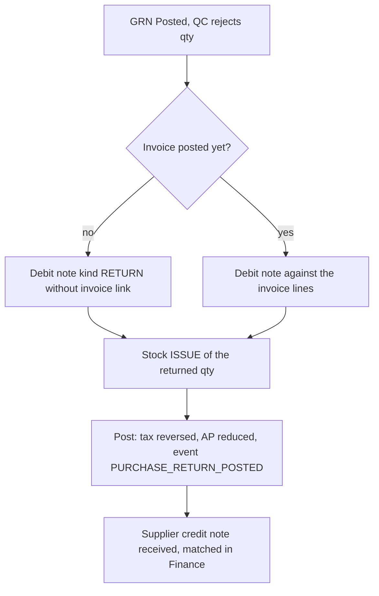
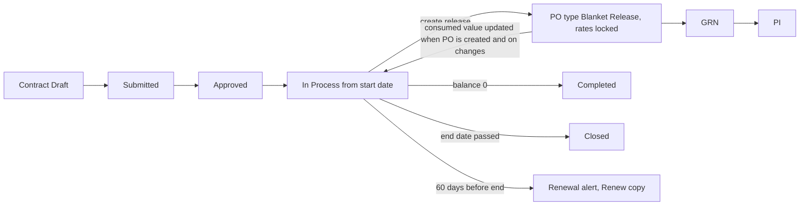
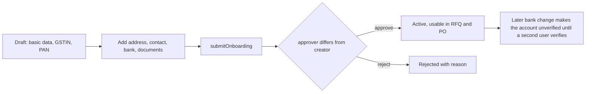
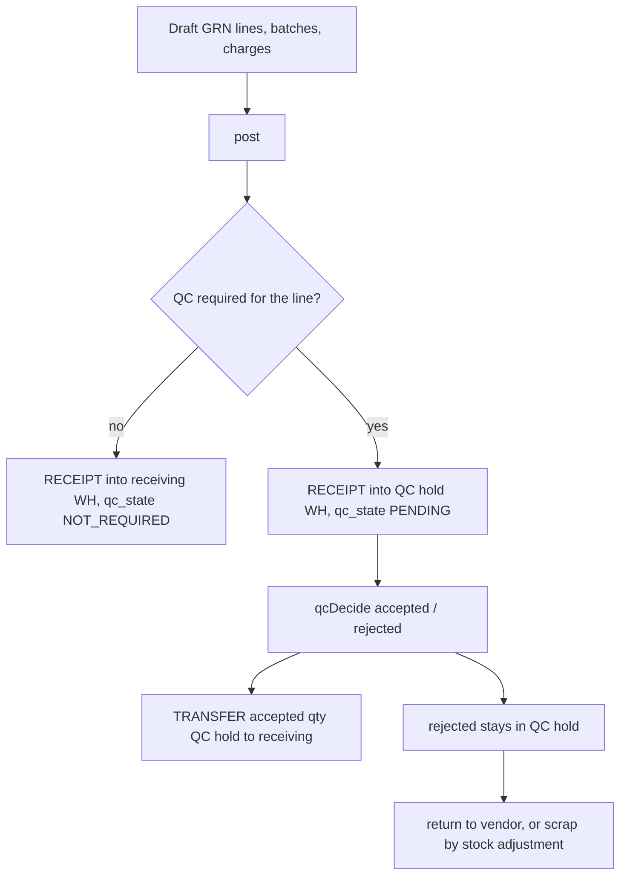
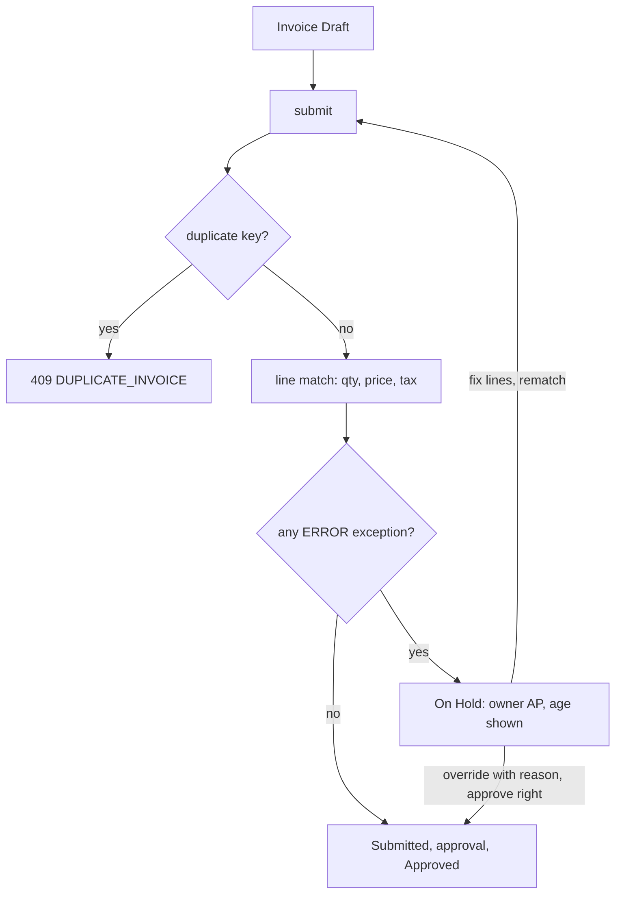

# 03 — Procurement / SCM (11 pages) — INDEX AND MASTER PLAN

> **File set (read all four, in this order).** This plan is long, so it is split as the task allowed.
> | File | Holds |
> |---|---|
> | `03-SCM-PROCUREMENT.md` (this file) | Sections 0, 1, 3, 4, 6, 8, 9, 10, 11, 13, 14, 15 in full; sections 2, 5, 7, 12 as summaries with a pointer |
> | `03a-SCM-PAGES-API.md` | **Section 2** (the frozen UI page by page) and **Section 7** (API) in full |
> | `03b-SCM-DATABASE.md` | **Section 5** in full: every DDL, Prisma model, seed, migration order |
> | `03c-SCM-TICKETS.md` | **Section 12** in full: tickets `T-SCM-01 …` |
>
> Always read `00-BUILDER-RULES.md` and `01-SHARED-FOUNDATION.md` first. They win over this file except where a line starts with `FOUNDATION-CHANGE:`. Dates in this plan are as of **2026-11-02**.

---

## 0. Header

**Purpose.** Build the whole source-to-pay chain of the Sawant Group ERP for the three units (Talwade, Sawardari, Varale; FY April–March; ₹, `en-IN`): *Purchase Requisition → RFQ → Vendor Quotation → Vendor Comparison → Purchase Order → Goods Receipt (GRN, with QC and batch/serial) → Purchase Invoice (3-way match, GST, ITC flags, TDS, MSME due date) → payment hand-off to Finance*, plus *Purchase Approval*, *Supplier Master*, *Supplier Evaluation* and *Rate / Blanket Contracts*, purchase returns (debit note) and the supplier side of the shared `parties` table.

**Who it serves.** Owner department **Purchase** (buyers, purchase manager). Also: **Finance** (invoice approval, TDS, payment readiness, ITC), **Quality** (QC decision on GRN, supplier quality score), **Warehouse** (receiving, putaway, returns), and Department Managers who raise requisitions. Approvers: Department Manager → Department Head → General Manager → Director/CFO (matrix, section 6 BR-SCM-26).

**Dependencies (build order).** Needs the existing Phase 1–5 code (users, roles, units, FY, generic engine, items, warehouses, `StockService.postMovement`). Needs from plan `02-INVENTORY-WMS.md` (written in parallel; **not available when this plan was written**): the `accounting_event_queue` table + `AccountingService.post` stub, and (optionally) batch/serial/QC-hold support in stock. If a ticket finds that table missing it STOPS with `QUESTION` (ticket T-SCM-04 contains the exact check). Every Inventory touch-point in this plan goes through one adapter file (`InventoryGateway`, ticket T-SCM-21) so plan 02 can plug in without rewriting SCM. Feeds: plan 05 Finance (drains `accounting_event_queue`, pays invoices, GST/TDS returns), plan 04 Sales (re-uses `parties`, `payment_terms`, `tax_codes`, `TaxService`, `document_links`).

**Foundation items this plan owns and builds (per foundation §8):** `parties` (+ `party_addresses`, `party_contacts`, `party_bank_accounts`), `payment_terms`, `tax_codes` + `tax_code_rates`, `hsn_sac`, `tds_sections`, `document_links`, `TaxService.compute`, `PartyService`. Designed exactly per foundation §3; only **appended** columns (listed in 03b with the tag `APPENDED`).

**Foundation items this plan uses:** `NumberingService` (existing `number_series` through `recordRepository.nextNumber`), `StockService.postMovement` (exists), `AccountingService.post` (stub from plan 02), `ApprovalService.submit` (Phase 6; this plan ships an interim adapter, BR-SCM-26/27), standard columns (§2), status vocabulary (§6), cross-module contracts (§7: *GRN accepted* and *Purchase Invoice posted* rows).

**FOUNDATION-CHANGE items (the architect decides; builder never decides):**
1. `FOUNDATION-CHANGE:` lines carry `uom` (code, text) not `uom_id`, because the `uoms` table is built by plan 02 and may not exist when SCM is built. Lines have `uom text not null` (equals `items.base_uom` or `items.alt_uom`) and `uom_factor numeric(18,6)` to the item base UOM. When plan 02's `uoms` lands, a later migration adds nullable `uom_id`.
2. `FOUNDATION-CHANGE:` `parties.currency_id` is created as `uuid null` **without** FK and a new `currency_code varchar(3) default 'INR'` is added (the `currencies` table is not owned by any built plan yet). The import ticket T-SCM-38 creates `currencies`/`exchange_rates` only if plan 02/05 did not.
3. `FOUNDATION-CHANGE:` engine extensions needed by typed pages beyond Inventory (ticket T-SCM-05): `FieldMeta.lookup` union widened (suppliers, users, departments, purchaseRequisitions, rfqs, quotes, purchaseOrders, goodsReceipts, contracts, paymentTerms, taxCodes); `SchemaAction.requires` widened from `'edit'|'delete'` to `'add'|'edit'|'delete'|'approve'`; the schema JSON gains optional `tabPanels` (the six profile tabs get real content); typed handlers gain optional `sub-resources` routes. Existing Inventory behaviour must not change (their tests stay green).
4. `FOUNDATION-CHANGE:` new audit actions and target types for SCM (listed in 03a §7.0).
5. `FOUNDATION-CHANGE:` `TaxService.compute` takes the database handle and is async: `compute(db, input): Promise<{lines, totals}>` (foundation §5 shows a synchronous call, but effective-dated rates must be read from `tax_code_rates`); a pure `computeWithRates` is also exported.
6. `FOUNDATION-CHANGE:` tables created by SCM that the foundation did not list: `scm_settings`, `scm_budgets`, `supplier_tds_ledger` (TDS threshold tracking), `scm_approval_*` (interim approval), `purchase_debit_notes`. Finance (plan 05) may later take over `supplier_tds_ledger` and `gstr2b_import_lines`; SCM keeps them until then.

---

## 1. Scope and status

Legend: **TO BUILD typed** = own tables, own handler registered in `TYPED_PAGES` (the generic engine then answers 404 `NOT_GENERIC`). All 11 pages are TO BUILD typed. Today they are served by the generic JSON engine (`generic_records`), which has no lines, no stock, no tax, no matching. **No existing data must be migrated** (nothing real was entered; the generic rows of these 11 pages may be left in `generic_records`, hidden once the page becomes typed. Ticket T-SCM-05 does not delete them).

| # | Page id | Title (frozen) | Owner dept | Kind | Exists today | This plan adds |
|---|---|---|---|---|---|---|
| 1 | `scm-pr` | Purchase Requisition | Purchase (any dept requests) | TO BUILD typed | generic header-only rows | lines, budget check, approval, convert to RFQ/PO, short-close |
| 2 | `scm-rfq` | RFQ Management | Purchase | TO BUILD typed | generic | lines, supplier invitations, deadlines, response tracker, print/email text |
| 3 | `scm-vendorquote` | Vendor Quotations | Purchase | TO BUILD typed | generic | lines, landed cost, technical compliance, negotiation rounds, deviations |
| 4 | `scm-comparison` | Vendor Comparison | Purchase | TO BUILD typed | generic placeholder | comparison matrix, weighted score, award, create PO |
| 5 | `scm-po` | Purchase Orders | Purchase | TO BUILD typed | generic | lines + tax, release, amend/revisions, short-close, create-from PR/comparison/contract |
| 6 | `scm-grn` | Goods Receipt / GRN | Warehouse (Purchase, Quality see) | TO BUILD typed | generic | lines, batch/serial, QC decision, stock RECEIPT, landed cost, cancel by reversal |
| 7 | `scm-purchaseinvoice` | Purchase Invoice | Purchase + Finance | TO BUILD typed | generic | 3-way match, tax validation, ITC flags, TDS, MSME due date, debit notes, exceptions |
| 8 | `scm-approval` | Purchase Approval | Purchase | TO BUILD typed | generic | interim approval engine (matrix, steps, delegation, SLA) |
| 9 | `scm-suppliers` | Supplier Master | Purchase | TO BUILD typed (view over `parties`) | generic | parties supplier side, addresses/contacts/bank (two-person rule), documents, capability, scorecard |
| 10 | `scm-evaluation` | Supplier Evaluation | Purchase (Quality) | TO BUILD typed | generic | monthly computed scorecard from GRN/QC/invoice data |
| 11 | `scm-contracts` | Rate / Blanket Contracts | Purchase | TO BUILD typed | generic | lines, value/qty caps, release orders, renewal alerts, utilization |

**Not new pages (never add):** purchase return / debit note lives in the *Debit Adjustments* tab of `scm-purchaseinvoice`; landed-cost charges live in the *Landed Cost* area of `scm-grn` and the quotation; GSTR-2B matching lives in the *Tax Validation* tab of `scm-purchaseinvoice`.

What already exists and is reused: `inv-items` (items), `wms-warehouses`, `stock_ledger`/`stock_balances`, `number_series`, `idempotency_keys`, RBAC `can()`/`requireParamPageAction`, module controls (`approval_required`), audit, FY and unit context. Counts: **11 pages, 44 new tables (10 shared + 34 SCM; the SHOULD table `gstr2b_import_lines` is the 44th), 41 tickets** (T-SCM-01 … T-SCM-41).

---

## 2. The frozen UI, page by page — SUMMARY (full text in `03a-SCM-PAGES-API.md`)

Every page keeps: the page head (title, purpose, Excel / Print / ＋ Add), the universal 16-tab strip (`Module Dashboard`, the 6 profile tabs, `Analytics & Graphs`, `AI Decision Center`, `Automation Studio`, `Data Quality`, `Activity Timeline`, `Documents`, `Approvals`, `Reports`, `Audit Trail`), the register table and the 15-field frozen order. This plan fills the **6 profile tabs** with real data (they are `PhaseNotice` placeholders in the generic page today) through a new optional `tabPanels` entry in the typed schema. `[ADD]` fields and tabs are appended after the frozen ones, never in between. The field key of every frozen field is `labelToKey(label)` of `apps/api/src/engine/keys.ts` (for example `PR No` → `prNo`, `GST` → `gst`, `Vendor Invoice Ref` → `vendorInvoiceRef`).

Conventions that hold for all 11 pages are written once in `03a` §2.0 (header/lines storage, computed read-only fields, lookups, status colours, `Approval Level` text, empty states, unit/FY, Excel columns).

---

## 3. How the market does it

Research done 2026-11-02 (sources in section 15). Ideas only; no code or long text copied.

| Concept | Odoo Purchase | ERPNext (Frappe) | Zoho Books / Inventory | SAP B1 / S/4 MM | Dynamics 365 BC | Tally Prime | What we do |
|---|---|---|---|---|---|---|---|
| Source chain | RFQ is the same document as the PO (draft, sent, confirmed); requisitions via add-on | Material Request, RFQ, Supplier Quotation, PO, Purchase Receipt, Purchase Invoice, Payment; each step optional | PO, Receive, Bill, Payment; no RFQ | PR, RFQ, Quotation, PO, GR, IR | Quote, order, receipt, invoice | Purchase Order, Receipt Note, Purchase Voucher | Full chain, every step optional by rule (BR-SCM-07/15/16); separate documents (ERPNext/SAP style) |
| Quote comparison | call for tenders compares lines | RFQ comparison report | none | quotation comparison | none native | none | own weighted matrix (BR-SCM-18) |
| Bill control and matching | policy ordered vs received; 3-way flag "Should be paid": Yes / No / Exception (flags, does not block) | "Purchase Receipt required" setting; over-billing allowance | PO converted to bill, 2-way | tolerance keys per difference (price, qty); blocked invoices released later; GR/IR clearing account | Get Receipt Lines on the invoice | bill against receipt-note reference | hard 3-way for goods, 2-way for services, tolerances in settings, exceptions are rows with audited override (BR-SCM-10); GR/IR in the event (BR-SCM-23) |
| Over-receipt | per-product receipt rules | over-receipt / over-delivery allowance percent | n/a | under/over-delivery tolerance on PO line | tolerance | none | per-PO-line % with company default (BR-SCM-06) |
| Approval | PO two-level by amount | workflow engine on any state | approval by amount | release strategy on PR and PO | approval workflows with limits | none | amount matrix per department x document type, SoD, delegation, SLA (BR-SCM-26) |
| Blanket orders | blanket order type with releases | Blanket Order doc to PO | none | scheduling agreement / contract with release orders | blanket purchase order | none | contracts with value and qty caps plus release POs (BR-SCM-16) |
| Returns | return picking + vendor credit note | purchase return flag on receipt/invoice | vendor credits | return PO, return delivery, credit memo | purchase return order, credit memo | Rejections Out before bill, Debit Note after bill | one debit-note document with stock issue for both timings (BR-SCM-30) |
| Landed cost | landed cost split by qty / weight / volume / value | Landed Cost Voucher | in bill | delivery costs | item charges | expense allocation | charges on the GRN split by value / qty / weight (BR-SCM-03) |
| India GST | l10n_in RCM, HSN, GSTR reports | India Compliance app | native GST | India add-on | India localisation | native RCM purchase type and 2B reconciliation | native tax split, RCM, ITC flags, 2B status (BR-SCM-01/20/21) |
| Supplier evaluation | add-on | Supplier Scorecard (periodic, weighted criteria, standing) | none | vendor evaluation, weighted | vendor ratings | none | monthly auto score, 4 weights, grade, rank (BR-SCM-28) |
| Reported pitfalls | 3-way flag advisory only, so third-party modules hard-block | back-dated receipts disturb valuation | partially billed confusion | blocked invoices pile up with no owner; GR/IR never cleared | wrong receipt line picked | free vouchers allow duplicates | hard duplicate key; owner and age on every exception; GR/IR report |

**What we adopt:** ERPNext's optional steps and over-receipt allowance; SAP's tolerance per difference, release by amount, GR/IR clearing and blocked-invoice review; Odoo's three-state "should be paid" idea (we hard-block but allow an audited override); Tally's rule "return before bill versus after bill" (one debit-note document covers both); ERPNext/SAP scorecards; Business Central's "get receipt lines" (our create-from endpoints). **What we skip and why:** SAP's characteristic-class release strategy (too heavy for 3 units; the amount matrix covers it); Odoo's RFQ-is-the-PO merge (breaks revision control and comparison); dynamic discounting and supply-chain finance (needs Finance plan; COULD); vendor portal (COULD, security surface); live GST-portal GSTR-2B API (needs a GSP contract; we import the 2B file, SHOULD).

**Indian rules checked (2026-11-02):**
* GST slabs from 22 Sep 2025: 5 %, 18 % and a special 40 % rate; the 12 % and 28 % slabs were removed (GST Council 56th meeting, 3 Sep 2025). Sources are secondary (Tally, Taxguru, Vision IAS); the primary rate schedule is Notification 9/2025-Central Tax (Rate) dated 17 Sep 2025 and the accountant must read it. Item-by-item rates are **not** verified by this plan.
* ITC: Section 16(2)(aa) allows ITC only to the extent shown in GSTR-2B (in force from 1 Jan 2022, CBIC Circular 193/2023); the old 5 % provisional cushion of Rule 36(4) is gone. A High Court read Section 16(2)(aa) down in Dec 2025 so that a bona fide buyer must be heard before denial (KPMG note, court name not seen: informational). Section 16(4): ITC on an invoice by the earlier of 30 November after the FY or the annual return date. 180-day rule: ITC reversed with interest if the supplier is not paid within 180 days (not for RCM). Section 17(5) blocked credits are applied through the `INELIGIBLE_17_5` flag chosen by Finance (the blocked list was not re-verified here; (unverified)).
* TDS on purchases: the Income-tax Act 2025 is in force from 1 Apr 2026; contractor, professional, rent, commission and goods-purchase provisions sit in section 393(1). Sl. 8(ii) is purchase of goods (old 194Q): **0.1 % on the amount above Rs 50 lakh per seller per FY; 5 % if no PAN; deducted at the earlier of credit or payment; on value excluding GST when GST is shown separately**. A Rs 10 crore buyer-turnover condition is stated by one source but its survival in the 2025 Act is unconfirmed, hence the setting `tds_194q_applicable`. Other sub-numbers: sources disagree (unverified).
* MSMED Act sections 15-16: payment within the agreed period, never more than 45 days from acceptance (15 days when there is no written agreement); compound interest with monthly rests at three times the RBI bank rate, for micro and small suppliers only (not medium); Section 43B(h) of the 1961 Act defers the deduction of sums owed to micro/small suppliers paid late until actually paid (renumbering in the 2025 Act unverified). The current RBI bank rate is disputed between sources (5.50 % vs 5.75 %), so it is an editable setting (unverified).
* E-way bill: Rule 138 CGST Rules, consignment value above Rs 50,000 (tax included, exempt goods excluded). We only store the e-way bill number on GRN/invoice; generation is Finance/Logistics scope.
* Import (Bill of Entry): IGST paid at customs is creditable and flows to GSTR-2B from ICEGATE data; basic customs duty and surcharge are part of landed cost (SHOULD, T-SCM-38). Job work: GST Section 143 lets the principal send inputs under challan and take them back within 1 year (capital goods 3 years) (unverified here; COULD).

---

## 4. End-to-end processes

Actors: **REQ** requester, **BUY** buyer (Purchase), **MGR** approver per matrix, **QC** Quality, **WH** Warehouse, **AP** Finance/AP clerk. Status words are the real ones of section 2.

### 4.1 Main chain: PR, RFQ, Quote, Comparison, PO, GRN, Invoice, Payment

```mermaid
flowchart LR
  PR[PR Draft] -->|submit| PRS[PR Submitted]
  PRS -->|matrix approve| PRA[PR Approved]
  PRA -->|create RFQ| RFQ[RFQ Draft then In Process]
  PRA -.->|direct PO: contract or limit| PO
  RFQ -->|invite suppliers| VQ[Quotes Submitted]
  VQ -->|close bidding| CMP[Comparison Draft]
  CMP -->|evaluate, submit| CMPA[Comparison Approved]
  CMPA -->|create PO| PO[PO Draft]
  PO -->|submit, approve| POA[PO Approved]
  POA -->|release| POI[PO In Process]
  POI -->|receive| GRN[GRN Posted]
  GRN -->|QC decide| ST[Stock in receiving WH]
  GRN -->|create invoice| PI[Invoice Draft]
  PI -->|submit: match| M{3-way match}
  M -->|ok| PIA[Approved]
  M -->|exception| H[On Hold: fix or override]
  PIA -->|post| PIP[Invoice Posted]
  PIP -->|event| FIN[Finance pays]
```

1. REQ creates a PR (Draft): the Add form is line 1; more lines in *Requirement Details*; `submit`. Budget check (BR-SCM-22) runs; `PR_NO_LINES` if no lines. An approval request `APR/..` is created; PR becomes Submitted.
2. MGR approves through the matrix (4.5). PR becomes Approved (`approval_status=APPROVED`).
3. BUY either *Create RFQ* (competitive quotes) or *Create PO* directly (always allowed; above the RFQ threshold of Rs 5,00,000 without a comparison or contract the PO needs a written justification, BR-SCM-16). PR is In Process while quantities are converted (BR-SCM-04) and Completed when every line is fully on POs.
4. RFQ: BUY adds lines (from PR), invites suppliers (category/capability filter), sets closing date, `issue` (RFQ In Process; e-mail text + print). Quotes are entered as Vendor Quotations (Draft, then Submitted). A late quote needs an audited override. After the closing date BUY `closeBidding` (RFQ Closed).
5. BUY creates a Comparison from the closed RFQ: the server builds the landed-cost matrix and scores (BR-SCM-18); BUY may change weights, record negotiation rounds (new quote round, BR-SCM-14), then `evaluate` and `submit`; MGR approves. Comparison Approved.
6. `Create PO` from the comparison (one PO per awarded supplier, quantities per award split). PO Draft, `submit`, matrix approval, Approved, `release` (printable PO and e-mail text), In Process. Quote becomes Completed, RFQ Completed, PR counters update.
7. WH receives goods: *Create GRN* from the PO (open lines), enters received qty, batch/serial, challan, vehicle, charges; `post`. Stock RECEIPT goes to Receiving, or to QC Hold when QC is required; PO line counters update; PO becomes Completed when every line is received within the under-receipt tolerance. Event `GRN_POSTED`.
8. QC records accepted/rejected qty (`qcDecide`): accepted stock moves from QC Hold to Receiving; rejected stays held until returned (4.2).
9. AP creates the Purchase Invoice from the GRN or PO (create-from), enters the supplier invoice no./date/total, `submit`: duplicate check, 3-way match, tax validation, TDS and ITC flags, MSME and payment due dates. The invoice then goes through the approval matrix (document type `PINV`, requesting department `Finance`, levels by invoice total) and is `post`ed: TDS ledger entry, event `PURCHASE_INVOICE_POSTED`, GRN lines marked billed, PO line billed qty updated; PO becomes Closed when fully received and billed.
10. Finance (plan 05) drains the event queue, pays, and calls `applyPayment` (interface in BR-SCM-23) which sets `paid_amount` and `payment_status`.

### 4.2 Purchase return and debit note

Steps: WH/Purchase picks *Return rejected to supplier* (GRN) or *Create debit note* (invoice). Draft debit note lines: qty not more than returnable qty (BR-SCM-30); reason code (`QUALITY`, `DAMAGED`, `WRONG_ITEM`, `EXCESS`, `RATE_DIFF`, `SHORT`). `post` writes a stock ISSUE in the warehouse where the stock sits (QC Hold for rejected qty), increases `goods_receipt_lines.returned_qty`, emits `PURCHASE_RETURN_POSTED` and reduces net payable.

### 4.3 Blanket / rate contract release

### 4.4 Supplier onboarding

### 4.5 Approval (interim engine)
```mermaid
sequenceDiagram
  participant D as Document
  participant G as ApprovalGateway
  participant M as Matrix
  participant A as Approver
  D->>G: submit(docType, docId, amount, department)
  G->>M: levels with threshold <= amount
  G-->>D: request APR created, steps L1..Ln, document Submitted
  A->>G: approve / reject / return at level k
  G->>G: SoD, eligibility, delegation, version checks
  alt last level
    G-->>D: Approved
  else next level
    G-->>A: next approver inbox
  end
  Note over G: SLA timer; escalation job reminds the next level
```
### 4.6 GRN with QC and batch

### 4.7 Invoice match and exceptions


---

## 5. Database design — SUMMARY (full DDL, Prisma rules, seeds and migration order in `03b-SCM-DATABASE.md`)

44 new tables in 10 migration folders, in this order: `20261110000000_scm_shared_masters`, `20261110000100_scm_parties`, `20261110000200_scm_settings_budget`, `20261111000000_scm_approval`, `20261111000100_scm_sourcing_docs`, `20261112000000_scm_po_contracts`, `20261112000100_scm_grn`, `20261113000000_scm_invoice_tds`, `20261113000100_scm_evaluation`, `20261120000000_scm_gstr2b`. Conventions: foundation §2 (standard columns, soft delete, `version`, CHECK for enums, FK names, indexes), documents carry `doc_type/code/status/doc_date/fy_id/unit_id/department`, lines are `<doc>_lines` with `unique(document_id, line_no)`. Append-only: `supplier_tds_ledger`, decided rows of `scm_approval_steps` (trigger). Prisma: scalar FK fields only (precedent: phase 5). Seeds: payment terms, GST tax codes 0/5/18/40 (+legacy 12/28 closed on 2025-09-21), 7 TDS sections x 2 act versions, 29 HSN/SAC starter rows, `scm_settings`, approval matrix 0 / 50,000 / 2,00,000 / 10,00,000.

---

## 6. Business rules and formulas

Notation: `D()` = Prisma Decimal; `r2` = round half-up to 2 dp; `r3`, `r6` likewise; `₹` amounts are `numeric(18,2)`. Unless a rule says otherwise, errors are `AppError` with the status and code in 6.99. "Ticket" = the ticket that implements and tests the rule.

### BR-SCM-01 Tax split and line computation (`TaxService.compute`)
* **Rule.** For each line: `gross = r2(qty × rate)`; `discount = discountAmount` if given (must be ≤ gross) else `r2(gross × discountPct / 100)`; `taxable = gross − discount`. The GST rate is read from `tax_code_rates` for the document `date` (latest `effective_from ≤ date` with `effective_to` null or `≥ date`); none → 422 `TAX_CODE_NOT_EFFECTIVE`.
* **Intra-state** when `supplierStateCode == placeOfSupplyStateCode`: `cgst = r2(taxable × (rate/2) / 100)`, `sgst = same value`, `igst = 0`. **Inter-state, SEZ, overseas, import:** `igst = r2(taxable × rate / 100)`, cgst = sgst = 0. `cess = r2(taxable × cessRate / 100)`. `lineTotal = taxable + cgst + sgst + igst + cess`.
* **Place of supply for a purchase** is the receiving unit's state (first two digits of `units.gstin`; if the unit has no GSTIN the setting `company.gstin` is used; if neither → 422 `PLACE_OF_SUPPLY_MISSING`). Supplier state = `parties.state_code` (from the GSTIN for registered suppliers).
* **Inclusive tax** (`tax_codes.is_inclusive`): `amount = gross − discount`; `taxable = r2(amount / (1 + rate/100))`; `tax = amount − taxable`; `cgst = r2(tax/2)`, `sgst = tax − cgst` (intra) or `igst = tax`.
* **Composition supplier:** any line with rate > 0 → 422 `TAX_COMPOSITION_SUPPLIER` ("A composition supplier cannot charge GST; use a 0% / exempt code"). **Unregistered supplier:** tax is computed only when the document is RCM (BR-SCM-02).
* **Worked example (used in tests).** qty 10, rate 62.50, discount 2 %, GST18, supplier state 27 = unit state 27: gross 625.00; discount 12.50; taxable 612.50; cgst = r2(612.50 × 9 / 100) = r2(55.125) = **55.13**; sgst **55.13**; total **722.76**. Same line inter-state (supplier state 29): igst = r2(612.50 × 18 / 100) = r2(110.25) = **110.25**; total **722.75** (one paisa lower: intentional, half-up per component).
* **Error codes:** `TAX_CODE_NOT_EFFECTIVE`, `TAX_COMPOSITION_SUPPLIER`, `PLACE_OF_SUPPLY_MISSING`, 422 `VALIDATION_ERROR` (discount > gross, negative values). **Ticket:** T-SCM-03.

### BR-SCM-02 Header totals, charges, round-off, RCM
* `subtotal = Σ gross`; `discount_total = Σ discount`; charges: `freight_charge` and `other_charges` are taxable as one extra pseudo-line each using `freight_tax_code_id` (default: the tax code of the highest-rate line; none → GST0). `taxable_total = Σ line taxable + freight + other`. `cgst_total` etc. = sums including the charge pseudo-lines.
* `raw = taxable_total + cgst + sgst + igst + cess` (when `is_rcm`, taxes are **liability only** and are excluded: `raw = taxable_total`). `grand_total = round half-up to whole rupee(raw)`; `round_off = grand_total − raw` (can be negative). Only for INR; foreign currency documents keep 2 dp and `round_off = 0`.
* `is_rcm = true` when the supplier's `gst_registration_type = UNREGISTERED` and the document is a goods or service purchase subject to reverse charge (Section 9(4) is limited to notified classes; **v1 rule: Finance sets the flag manually on the invoice; the PO default is `false`**), so no automatic assumption is made.
* **Worked example (PO of 7.1 / BR-SCM-01).** Line taxable 612.50; freight 1,500 at GST18 (intra): cgst 135.00, sgst 135.00. `taxable_total = 2,112.50`; `cgst_total = 55.13 + 135.00 = 190.13`; `sgst_total = 190.13`; `raw = 2,112.50 + 380.26 = 2,492.76`; `grand_total = 2,493.00`; `round_off = +0.24`.
* **Ticket:** T-SCM-03 (compute), applied in T-SCM-19/27/30.

### BR-SCM-03 Landed cost allocation (GRN)
* **Rule.** Charges on the GRN with `capitalize = true` are spread over **all received lines** (accepted + rejected + pending: all of it enters stock) by the charge's `basis`. Basis value per line: `VALUE` = `taxable_value` (received qty × net PO rate); `QTY` = received base qty; `WEIGHT` = `weight_kg` (every line must have a weight else 422 `WEIGHT_REQUIRED`). `share_i = r2(charge × basis_i / Σ basis)`; the **last line (highest `line_no`) takes the rounding remainder** so `Σ share = charge` exactly. `landed_charge_i = Σ over charges of share_i`.
* `stock_value_i = taxable_value_i + landed_charge_i`; `unit_cost_i = r6(stock_value_i / base_qty_i)`. Stock posting uses `value = stock_value_i` exactly (the `value` override of `postMovement`) and `rate = unit_cost_i`.
* `non_creditable_tax` is reserved and is 0 in v1 (ITC-ineligible tax is booked on the invoice, BR-SCM-23).
* **Example.** Line A taxable 6,000 qty 10; line B taxable 4,000 qty 30. Freight 500 by VALUE: A 300.00, B 200.00. Customs 100 by QTY: A r2(100 × 10/40) = 25.00, B 75.00. `landed_charge` A 325.00, B 275.00; `stock_value` A 6,325.00 (unit cost 632.500000), B 4,275.00 (unit cost 142.500000). Remainder example: three lines of equal value, charge 100.00: shares 33.33, 33.33, **33.34**.
* **Ticket:** T-SCM-23. **Error:** `WEIGHT_REQUIRED` 422.

### BR-SCM-04 Open quantity and the document chain
* `document_links` rows are written when a document is created from another (same transaction) and removed when the target is deleted or cancelled. Open quantity: `open(PR line) = qty − closed_qty − Σ links(PR_LINE → PO line).qty`; `open(PO line to receive) = qty − closed_qty − received_qty`; `open(GRN line to bill) = accepted_qty − billed_qty − returned_qty`.
* Creating a PO line from a PR line with `qty > open` → 422 `QUANTITY_EXCEEDS_OPEN` (field `lines[n].qty`, message "Only 40 left on PR/TAL/26-27/0007 line 1"). RFQ links do **not** consume PR quantity (several RFQs may cover the same line). Link rows for lines also set `qty`; header links (`from_line_id` null) are used for RFQ→CMP, CMP→PO, VQ→PO.
* **Example.** PR line 100. PO1 takes 60 → open 40. PO2 asks 50 → 422. PO2 asks 40 → ok → open 0 → PR line "fully converted"; when all lines are converted PR → Completed. Cancelling PO1 (not received) removes its link → open 60 again.
* **Ticket:** T-SCM-05 (service `DocumentLinkService`), used by 13, 14, 19, 20, 23, 27.

### BR-SCM-05 Partial receipts and PO status roll-up
* A PO line may receive in several GRNs. After every GRN `post`/`cancel`, in the same transaction: for each PO line recompute `received_qty = Σ posted GRN lines.received_qty` (line UOM) and `accepted_qty`. PO status: all lines satisfy `received_qty + closed_qty ≥ qty × (1 − under_receipt_close_pct/100)` → **Completed**; otherwise **In Process**. A cancelled GRN can move Completed back to In Process. `scm_settings.under_receipt_close_pct` default 2.
* **Example.** Line 100, tolerance 2 %: GRN1 60 → In Process; GRN2 38 → received 98 ≥ 98.00 → Completed. A GRN3 of 3 is still allowed (up to the over-receipt limit) and keeps Completed.
* **Ticket:** T-SCM-24.

### BR-SCM-06 Over-receipt tolerance
* `max_total = r3((qty − closed_qty) × (1 + pct/100))` with `pct = po_line.over_receipt_pct ?? settings.over_receipt_pct`. Post fails when `received_qty_before + this_received > max_total` → 422 `OVER_RECEIPT` on the line field `receivedQty`: "Received 106.000 would exceed the allowed 105.000 (ordered 100, tolerance 5 %). Ask the buyer to amend the PO." Checked under `SELECT … FOR UPDATE` of the PO line rows so two simultaneous GRNs cannot both pass.
* **Example.** Ordered 100, tolerance 5 %: received 100 + new 5 → ok; new 6 → 422.
* **Ticket:** T-SCM-24.

### BR-SCM-07 GRN without PO is blocked
* `poNo` empty → 422 `GRN_PO_REQUIRED` ("Receive against a Purchase Order. Ask Purchase to create one first.") unless `settings.allow_grn_without_po` is true **and** the user has `approve` on `scm-grn`; such a GRN has `po_id` null, lines carry a `rate` and are marked in remarks `Unordered receipt`; an invoice cannot be created for it until a PO exists (exception `NO_PO`).
* A GRN against a PO that is not In Process → 409 `PO_NOT_RELEASED`. Supplier of the GRN must equal the PO supplier (422).
* **Ticket:** T-SCM-23/24.

### BR-SCM-08 Batch and serial capture
* Item `batchTracked` → the line needs ≥ 1 batch rows with `Σ batch.qty = received_qty` exactly (3 dp); else 422 `BATCH_REQUIRED` (none) or `BATCH_QTY_MISMATCH` (sum differs). Batch no: `^[A-Z0-9/_-]{1,40}$` after upper-casing; the same batch no twice on one line → 422 `DUPLICATE`-style field error. `expiry_date` must be after the receipt date → 422 `EXPIRED_BATCH`; `expiry_date ≥ mfg_date`.
* Item `serialTracked` → `received_qty` must be a whole number and the serial list length must equal it (`SERIAL_MISMATCH` 422); a serial no must be unique within the document and among all non-cancelled GRN batches of the same item (409 `DUPLICATE`, message names the GRN). Serials are stored in `goods_receipt_batches.serial_nos` (jsonb array of strings, max 50 chars each).
* Items not tracked: batch rows are optional and informational.
* Until plan 02 supplies batch-aware stock, batches/serials live only in these tables (the stock ledger has no batch column); `InventoryGateway.receive` passes them through to `StockService` when the field exists.
* **Ticket:** T-SCM-23.

### BR-SCM-09 QC hold, QC decision, GRN cancel
* A line is `qc_required` by default when `item.itemType ∈ settings.qc_required_item_types` or `supplier_items.quality_hold` is true for (supplier, item); the receiver may untick unless the quality hold is true. At `post`: if any line is `qc_required` the unit must have `qc_hold_warehouse_id` (else 422 `QC_HOLD_WAREHOUSE_MISSING`); those lines are received into the QC hold warehouse with `qc_state=PENDING`, others into `goods_receipts.warehouse_id` with `qc_state=NOT_REQUIRED` and `accepted_qty = received_qty`. GRN `qc_status` = `Pending` while any PENDING line, `Accepted` when all accepted, `Rejected` when all rejected, else `Partially Accepted`; `Not Required` when no line needs QC.
* `qcDecide` per line: `accepted_qty + rejected_qty = received_qty` (422 `QC_QTY_MISMATCH`), `rejected_qty > 0` needs `rejectReason`. It posts `TRANSFER_OUT` (QC hold) + `TRANSFER_IN` (receiving warehouse) for `accepted_qty` with the same value (`outValue`/`value` = `accepted_qty × unit_cost`, no valuation change), voucher id = the GRN id. Only a user with `approve` on `scm-grn` (Quality role) may decide.
* **Cancel (reversal)** is allowed when: GRN Posted, every line `billed_qty = 0` (else 409 `GRN_ALREADY_INVOICED`), `returned_qty = 0`, and stock reversal succeeds (`reverseVoucher`; otherwise 409 `INSUFFICIENT_STOCK` "Part of this stock was already issued"). It writes REVERSAL entries, removes the `document_links`, recomputes PO counters/status (BR-SCM-05), emits `GRN_CANCELLED`.
* **Ticket:** T-SCM-24.

### BR-SCM-10 Tolerance-based three-way match (qty / price / tax)
For each invoice line `L` (settings `qty_tolerance_pct`=2, `price_tolerance_pct`=2, `tax_tolerance_amt`=₹1.00):
1. **Mode.** Goods line (item type ≠ Service, or has `grn_line_id`) is matched THREE-WAY when `settings.invoice_match_mode = 'THREE_WAY'`; Service lines and capital advances are TWO-WAY (PO only). A goods line without `grn_line_id` → `NO_GRN` ERROR.
2. **Quantity.** `billable = grn_line.accepted_qty − grn_line.billed_qty − grn_line.returned_qty` (QC `PENDING` → billable 0 → `QC_PENDING` ERROR). If `L.qty > billable × (1 + qty_tol/100)` → `QTY_OVER_RECEIPT` ERROR; if `billable < L.qty ≤ billable × (1 + qty_tol/100)` → `QTY_WITHIN_TOLERANCE` WARNING. Two-way: `billable = po_line.qty − po_line.closed_qty − po_line.billed_qty`.
3. **Price.** `po_net = po_line.rate × (1 − po_line.discount_pct/100)` (6 dp); `bill_net = L.rate × (1 − L.discount_pct/100)`; `pv = (bill_net − po_net) / po_net × 100` (4 dp). `pv > price_tol` → `PRICE_VARIANCE` ERROR; `pv < −price_tol` → `PRICE_BELOW_PO` WARNING; otherwise within tolerance. A PO net rate of 0 → `PRICE_VARIANCE` ERROR if bill rate > 0.
4. **Tax.** Recompute with TaxService on `L`'s taxable value and the **PO** tax code and states; `|L.tax_total − expected| > tax_tolerance_amt` → `TAX_VARIANCE` ERROR. If `L.tax_code` rate ≠ PO line rate → `TAX_RATE_MISMATCH` ERROR (no tolerance).
5. **Totals.** `matched_value_L = r2(min(L.qty, billable) × po_net)`; `matched_amount = Σ matched_value`; `variance = taxable_total − matched_amount` (signed, shown on the page). Header: `TOTAL_MISMATCH` ERROR if `supplier_invoice_total` is given and `|supplier_invoice_total − invoice_total| > 1.00`.
6. **Result.** Line `match_status` = `EXCEPTION` if it has an ERROR, `WITHIN_TOLERANCE` if only WARNINGs on qty/price, else `MATCHED`. Header `match_state` = `EXCEPTIONS` if any ERROR is OPEN, `OVERRIDDEN` if all ERRORs are overridden, else `MATCHED`. `submit` with OPEN ERRORs → status **On Hold**; `approve`/`post` while OPEN ERRORs exist → 409 `MATCH_BLOCKED`. `override` (right `approve`) needs a reason ≥ 10 chars, sets the exception `OVERRIDDEN`, audits `SCM_DOC_OVERRIDDEN`.
* **Worked example.** PO line 100 @ 50.00 (disc 0), GRN accepted 98 (billed 0). Invoice line qty 100 @ 50.50: billable 98; 100 > 98 × 1.02 = 99.96 → `QTY_OVER_RECEIPT` ERROR; pv = 1.0000 % ≤ 2 → fine; `matched_value = 98 × 50.00 = 4,900.00`; taxable 5,050.00; `variance = +150.00`. After a second GRN of 2 (accepted) → billable 100, no error, matched 5,000.00, variance +50.00 (price only, within tolerance). Invoice qty 99 @ 52.00: pv = 4 % → `PRICE_VARIANCE` ERROR.
* **Tickets:** T-SCM-28 (engine), T-SCM-29 (status handling).

### BR-SCM-11 Duplicate invoice detection
* `vendor_invoice_no` is normalised (upper-case, all characters other than `A-Z0-9/-` removed, leading zeros kept) and stored. Hard rule: unique `(company, supplier, normalised no, invoice FY code)` among non-cancelled, non-deleted invoices (DB unique index `purchase_invoices_dup_key`). Violation → 409 `DUPLICATE_INVOICE` with the code of the existing voucher. Soft rule (WARNING `POSSIBLE_DUPLICATE`): same supplier, `supplier_invoice_total` equal and invoice date within 3 days but a different number.
* **Tests:** same number with different case and spaces ("ab 12" vs "AB12") is a duplicate; a cancelled voucher frees the number; the same number next FY is allowed. **Ticket:** T-SCM-27.

### BR-SCM-12 Short-close (PO, PR)
* `shortClose` (PO: right `approve`; reason ≥ 10 chars): for each line `closed_qty += max(0, qty − closed_qty − received_qty)`; PR lines linked to the closed quantity get their link `qty` reduced by that amount (the PR quantity becomes open again for re-sourcing) unless the body has `releaseToPr:false`. Contract consumption is recomputed. PO status: all lines closed/received and billed → **Closed**; received but not fully billed → **Completed**; nothing received at all → **Closed**.
* PR `close`: `closed_qty += open qty` for chosen lines; PR → **Closed** when no open quantity remains and nothing is converted, else Completed/In Process by the usual rule.
* **Example.** PO line 100, received 70, short-close → `closed_qty = 30`, open 0, PO Completed (Closed after billing). **Ticket:** T-SCM-20 (PO), T-SCM-13 (PR).

### BR-SCM-13 PO amendment and revision
* `amend` allowed in Approved or In Process (reason ≥ 10 chars). In one transaction: insert `purchase_order_revisions(revision_no = current, snapshot = full header + lines JSON, grand_total_before)`, set `revision_no + 1`, `amend_of_status = <current status>`, status **Draft**, `approval_status` NA. Receiving and invoicing are blocked while Draft (`PO_NOT_RELEASED`).
* Edit constraints while amending (422 `AMEND_RULE`): a line cannot go below `received_qty + closed_qty`; item, tax code and supplier cannot change on a line with `received_qty > 0` or `billed_qty > 0`; lines with receipts cannot be deleted; supplier of the PO cannot change at all.
* Re-approval: `submit` always goes through the matrix on the **new** total, except when `po_amendment_reapproval_pct > 0` and `|new − old| / old × 100 ≤ pct` and no qty/rate increase → auto-approved (default 0 = always). After final approval the PO returns to `amend_of_status` (Approved, or In Process directly) and `grand_total_after` is stored on the revision row. PR/contract links and the budget are recalculated (`BudgetService.check` excluding the PO itself).
* The PO print shows `Revision R<n>`; the *Approval & Amendments* tab lists revisions with a field-level diff (computed from snapshots). **Example.** R0 total 2,493.00 → amend qty 10 → 12: gross 750.00, discount 15.00, taxable 735.00, CGST = SGST = 66.15; freight 1,500 unchanged (tax 135.00 + 135.00); raw = 2,235.00 + 402.30 = 2,637.30; R1 total **2,637.00**, round-off −0.30; re-approval runs on 2,637.00.
* **Ticket:** T-SCM-20.

### BR-SCM-14 Vendor quote landed cost and negotiation rounds
* `landed_cost = Σ line taxable + freight + packing + insurance + duty + non_creditable_gst`, where `non_creditable_gst = Σ GST` only when the supplier is COMPOSITION/UNREGISTERED-charging or the RFQ category is flagged non-creditable by the buyer (v1: always 0 for registered suppliers because GST paid is recovered as ITC). `gst` field = total GST (information). Line `landed_unit_cost = r6((line taxable + charges × line taxable / Σ taxable) / base_qty)`.
* **Example.** Line taxable 10,000.00 (GST18 = 1,800.00), freight 500.00, packing 200.00, duty 0: `landed_cost = 10,700.00`; `gst = 1,800.00` (+ GST on freight/packing 126.00 if taxable → 1,926.00; the quote screen has a checkbox "charges taxable", default on, tax code GST18). `discount` = 0.
* **Negotiation round.** `POST …/round` copies the current quote into a new Draft quote (`round_no+1`, `is_current=true`, same RFQ/supplier), the previous quote becomes `Closed` (`is_current=false`), and the new quote's `rounds` jsonb gets `{round, at, by, remark, totalBefore, totalAfter}`. Comparison always uses the `is_current` quote per supplier.
* **Ticket:** T-SCM-15.

### BR-SCM-15 RFQ rules
* `issue` needs ≥ 1 line, ≥ 1 supplier, closing date ≥ today. If the estimated value (Σ line qty × [PR est. rate, else last PO net rate of the item, else 0]) > `rfq_min_suppliers_above` (₹5,00,000) there must be ≥ 3 invited suppliers unless `rfq_type = 'Single Source'` with `single_source_reason` ≥ 20 chars → else 422 `RFQ_MIN_SUPPLIERS`. A quote dated after `closing_date` → 422 `QUOTE_AFTER_CLOSING` (override: `approve` + reason, stored in `late_override_reason`). `extend` only moves the date forward. A supplier that is not Active+approved cannot be invited (`SUPPLIER_NOT_ACTIVE`).
* **Ticket:** T-SCM-14.

### BR-SCM-16 Contract release and direct PO
* A PO line may carry `contract_line_id`. Checks at PO `submit` and `approve`, with the contract row locked `FOR UPDATE`: contract status In Process (else 422 `CONTRACT_NOT_ACTIVE`); same supplier; PO date inside `[start_date, end_date]` and the line's own `[valid_from, valid_to]`; line net rate equals contract `rate × (1 − discount_pct/100)` within 0.000001 (else 422 `CONTRACT_RATE_MISMATCH`); `min_qty ≤ qty` and `released_qty + qty ≤ max_qty` when set (422 `CONTRACT_QTY_EXCEEDED`); value: `consumed + this PO taxable_total ≤ committed_value` when `committed_value > 0` (422 `BLANKET_BALANCE_EXCEEDED`: "Balance ₹1,20,000.00, this release ₹1,50,000.00"). `consumed_value` = Σ `taxable_total` of releases in Submitted, Approved, In Process, Completed (Closed counts received value only); cancelled/rejected/Draft do not count; `released_qty` per line likewise.
* **Direct PO** (no RFQ/comparison/contract): always allowed; when `taxable_total > rfq_min_suppliers_above` the header `remarks` must hold a justification of ≥ 20 chars at `submit` → else 422 `DIRECT_PO_JUSTIFICATION`.
* **Example.** Blanket ₹10,00,000; consumed ₹8,80,000; release ₹1,50,000 → balance ₹1,20,000 → 422. Release ₹1,20,000 → ok, balance 0, contract → Completed on PO approval.
* **Tickets:** T-SCM-18 (contract), T-SCM-19/20 (PO checks).

### BR-SCM-17 TDS computation with threshold tracking
* **Scope.** TDS section: line `tds_section_id` else `parties.tds_section_id`; none → no TDS (a WARNING `TDS_SECTION_MISSING` is raised for service lines whose HSN/SAC starts with 99). Section 194Q applies only if `settings.tds_194q_applicable`. **Base** per section = Σ line `taxable_value` + taxable charges (GST excluded).
* **Rate** (first match): `parties.tds_rate_override` when `tds_cert_valid_to ≥ invoice date` (lower-deduction certificate); else `section.no_pan_rate` when the supplier has no PAN; else `rate_pct_individual` when the section has one and PAN's 4th character is `P` or `H`; else `rate_pct`. Section row = the one effective on `doc_date`.
* **Threshold state** per (supplier, FY of `doc_date`, section) is the last `supplier_tds_ledger` row (`cum_base_after`, `cum_tds_base_after`; 0 if none), read after `pg_advisory_xact_lock(hashtext(party_id||fy_id||section_id))`.
  * mode **ON_ALL** (194C, 194J, 194I, 194H): `cum_after = cum_base + base`. TDS applies when `(threshold_single > 0 and base > threshold_single) or (threshold_annual > 0 and cum_after > threshold_annual)` or both thresholds are 0; then `tds_base_now = cum_after − cum_tds_base` (it catches up earlier amounts that were below the threshold) else 0.
  * mode **ON_EXCESS** (194Q): `tds_base_now = max(0, cum_after − threshold_annual) − cum_tds_base`.
  * `tds = round half-up to whole rupee(tds_base_now × rate / 100)` (rounding rule for the 2025 Act is (unverified); accountant to confirm).
* **Posting.** Preview at `submit` (`tds-preview` endpoint); the ledger row is written at `post` in the posting transaction and `purchase_invoices.tds_*` filled. Cancel of a posted invoice writes a reversing row and is allowed only if it is the **latest** ledger row of its (supplier, FY, section) → else 409 `TDS_LATER_ENTRIES`. A debit note writes a negative row: `tds_base_deducted = −r2(DN taxable × inv.tds_base / inv.taxable_total)`, `tds_amount = −round(tds_base_deducted × rate/100)`. `net_payable = invoice_total − tds − Σ posted debit notes`.
* **Worked example 194C (supplier is a company, no override, thresholds 30,000 single / 1,00,000 annual, rate 2 %).** Inv1 taxable 60,000: base > 30,000 → `cum_after = 60,000`, `tds_base_now = 60,000 − 0 = 60,000` → TDS **1,200**; ledger (cum_base 60,000, cum_tds_base 60,000). Inv2 25,000: not > 30,000; `cum_after = 85,000 ≤ 1,00,000` → TDS **0**; (cum_base 85,000, cum_tds_base 60,000). Inv3 20,000: `cum_after = 1,05,000 > 1,00,000` → `tds_base_now = 1,05,000 − 60,000 = 45,000` → TDS **900**.
* **Worked example 194Q (0.1 %, threshold 50,00,000, buyer flag on).** Inv1 30,00,000 → 0; Inv2 40,00,000: `cum_after = 70,00,000`, base now `20,00,000` → **2,000**; Inv3 10,00,000: `cum_after = 80,00,000`, base now `30,00,000 − 20,00,000 = 10,00,000` → **1,000**.
* **Errors:** `TDS_LATER_ENTRIES` 409. **Ticket:** T-SCM-26.

### BR-SCM-18 Comparison weighted score
* Qualified quotes = `is_current`, status Submitted, `technical_compliance ≠ Non-Compliant`. Weights (sum must be 100, else 422 `WEIGHTS_INVALID`): price 50, delivery 20, quality 15, terms 10, experience 5 (defaults, editable in Draft).
* Scores (0–100, 4 dp): `price = 100 × L1landed / landed`; `delivery = 100 × minLead / lead` (lead 0 counts as 1 day); `quality = supplier overall rating` (latest published, else 70); `terms = 100 × payment_days / max(payment_days of qualified quotes)` (all zero → 100); `experience = min(100, 100 × completed POs of that supplier in the last 24 months / 10)`. `total = Σ weight × score / 100`. Rank by total desc, tie → lower landed cost. Recommended = rank 1; L1 = lowest landed cost. Recommended ≠ L1 → `justification` ≥ 20 chars (422 `COMPARISON_JUSTIFICATION_REQUIRED`). `savings_pct = (reference − recommended landed)/reference × 100` with `reference = Σ qty × last posted-PO net rate (12 months, any supplier)`; null when no history.
* **Worked example.** Landed A 1,00,000 / B 96,000 / C 1,04,000; lead days 15 / 25 / 10; quality 80 / 70 / 90; payment days 30 / 45 / 15; experience 100 / 30 / 60. Scores: price 96.0000 / 100 / 92.3077; delivery 66.6667 / 40 / 100; terms 66.6667 / 100 / 33.3333. Totals A **85.0000**, B **80.0000**, C **85.9872**. Recommended C (but L1 is B → justification required). `MIN_QUOTES` if fewer than `min_quotes_for_comparison` (2) qualified quotes (single-source RFQ excepted).
* `simulate` (no save) applies a % discount to a quote's rates and re-ranks. At `submit` the entries are frozen (`locked_at`).
* **Ticket:** T-SCM-16.

### BR-SCM-19 Invoice due date and early-payment discount
* `due_date = invoice_date + payment_terms.due_days` (terms: PO's, else supplier's, else NET30 default 30). If the terms have an early discount: `earlyDiscountUntil = invoice_date + early_discount_days`, discount shown on Payment Readiness (not auto-applied). MSME supplier: `due_date = min(terms due, msme_due_date)` (BR-SCM-25). Finance (`approve`) may override the date with a reason (audited).
* **Example.** Invoice 2026-11-10, NET45 → due 2026-12-25. **Ticket:** T-SCM-27.

### BR-SCM-20 ITC eligibility flags
* Default per line: `NOT_APPLICABLE` when tax = 0, or supplier is COMPOSITION/UNREGISTERED (and not RCM); `CAPITAL_GOODS` when the PO type is Capital; `INPUT_SERVICE` when the HSN/SAC starts with `99`; else `ELIGIBLE`. Finance can set `INELIGIBLE_17_5` (reason required, ≥ 5 chars) on any line (`setItc`, right `approve`): blocked-credit categories under Section 17(5) are chosen by the accountant (not auto-detected).
* `itc_claimable = Σ (cgst + sgst + igst + cess)` of lines flagged ELIGIBLE, CAPITAL_GOODS or INPUT_SERVICE. Ineligible tax is debited to expense in the accounting event (BR-SCM-23). Claim deadline (Section 16(4)): `30 November` after the end of the FY of the invoice date, or earlier annual return; alert 30 days before when `gstr2b_status ≠ Matched`/ITC not claimed.
* **Example.** Taxable 10,000, GST 18 %, line flagged ELIGIBLE: claimable 1,800.00; flagged INELIGIBLE_17_5: 0.00 and the 1,800.00 goes to the ineligible-ITC expense account. **Ticket:** T-SCM-27.

### BR-SCM-21 GSTR-2B match status
* Status values: `Not Checked` (default), `Matched`, `Mismatch`, `Not In 2B`, `Manual OK` (set by Finance with a note). Import (SHOULD, T-SCM-37) matches an uploaded 2B file row to an invoice by `supplier GSTIN + normalised invoice no + same FY`; `Matched` when `|taxable diff| ≤ 1` and `|tax diff| ≤ 1`, `Mismatch` when found but amounts differ, `Not In 2B` when absent after the period file is imported. Rule 36(4)/Section 16(2)(aa) means ITC is claimable only to the extent in GSTR-2B, so the report "ITC at risk" lists posted invoices with ITC eligible and status ≠ Matched/Manual OK. Posting is **not** blocked by 2B status.
* **Ticket:** T-SCM-27 (manual), T-SCM-37 (import).

### BR-SCM-22 Budget check hook
* `BudgetService.check(tx, { unitId, fyId, costCenter, amount, excludeDocType?, excludeDocId? })` → `{ mode, budget, committed, actual, available, verdict: 'OK'|'WARN'|'EXCEEDED'|'NO_BUDGET' }`. No `scm_budgets` row for (unit, FY, cost center) → `NO_BUDGET` (not controlled). `committed = open PR value (Approved/In Process PRs: Σ open qty × est_rate) + open PO value (POs Submitted…Completed: Σ taxable_value × (1 − billed_qty/qty))`; PR value that is already on a PO is not counted twice (open qty only). `actual = Σ taxable_total of Posted invoices − Σ taxable_total of Posted debit notes` with that cost center and `doc_date` in the FY. `available = budget − committed − actual`; `EXCEEDED` when `amount > available`.
* Mode `OFF` ignores; `WARN` allows and returns `warnings:[{code:'BUDGET_EXCEEDED',…}]` (the form shows them); `BLOCK` → 422 `BUDGET_EXCEEDED` unless the caller has `approve` and sends `budgetOverrideReason` (≥ 10 chars; stored on the approval request, audited). Called at PR `submit`, PO `submit` (and `amend` re-submit), contract `submit`.
* **Example.** Budget ₹10,00,000, committed ₹6,00,000, actual ₹3,00,000 → available ₹1,00,000. PR ₹1,50,000 → `EXCEEDED` by ₹50,000. **Ticket:** T-SCM-12.

### BR-SCM-23 Accounting events and journal lines (hand-off to Finance)
Operational code calls `AccountingService.post(tx, { event, docType, docId, date, payload, lines })`; `lines` use **logical account keys** that Finance's `posting_rules` map to ledgers (`INVENTORY`, `GRIR`, `LANDED_COST_CLEARING`, `AP_CONTROL`, `INPUT_CGST`, `INPUT_SGST`, `INPUT_IGST`, `INPUT_CESS`, `RCM_PAYABLE_CGST/SGST/IGST/CESS`, `TDS_PAYABLE`, `PURCHASE_PRICE_VARIANCE`, `ITC_INELIGIBLE_EXPENSE`, `PURCHASE_EXPENSE`, `ROUND_OFF`). Each line: `{ account, debit, credit, partyId?, itemId?, costCenter?, narration }`. Σ debit must equal Σ credit (builder function asserts; else throws `INTERNAL`). Until Finance exists the stub stores this as `accounting_event_queue.payload`.
* **GRN_POSTED** (date = receipt date): `Dr INVENTORY Σ stock_value`; `Cr GRIR Σ taxable_value`; `Cr LANDED_COST_CLEARING Σ landed_charge`. Example (BR-SCM-03): Dr INVENTORY 10,600.00 (6,325 + 4,275); Cr GRIR 10,000.00; Cr LANDED_COST_CLEARING 600.00. QC transfers: no event.
* **PURCHASE_INVOICE_POSTED** (date = `doc_date`): `Dr GRIR Σ matched_value` of GRN-linked lines; `Dr PURCHASE_PRICE_VARIANCE (taxable − matched)` per line (credit if negative); `Dr PURCHASE_EXPENSE` for service lines (taxable, with cost center); `Dr LANDED_COST_CLEARING` for invoice charge lines linked to GRN charges; `Dr INPUT_CGST/SGST/IGST/CESS` for ITC-eligible tax; `Dr ITC_INELIGIBLE_EXPENSE` for INELIGIBLE_17_5 tax; RCM: `Dr INPUT_x` and `Cr RCM_PAYABLE_x` for the RCM tax (not in AP); `Cr TDS_PAYABLE tds_amount` (payload.sectionCode); `Cr AP_CONTROL (invoice_total − tds_amount)` (partyId = supplier); `±ROUND_OFF`. Example: taxable 10,000 fully matched, CGST 900 + SGST 900, TDS 200 → Dr GRIR 10,000; Dr INPUT_CGST 900; Dr INPUT_SGST 900; Cr TDS_PAYABLE 200; Cr AP_CONTROL 11,600; Σ 11,800 = 11,800.
* **PURCHASE_RETURN_POSTED:** invoiced: `Dr AP_CONTROL (DN total incl. tax)`; `Cr INVENTORY stock_value issued`; `Cr INPUT_x` tax; `±PURCHASE_PRICE_VARIANCE` = difference (DN taxable − stock value). Not yet invoiced: `Dr GRIR (DN taxable)`; `Cr INVENTORY stock_value`; `±PURCHASE_PRICE_VARIANCE`. Value-only debit notes (RATE_DIFF, SHORT_SUPPLY): `Dr AP_CONTROL total`, `Cr PURCHASE_PRICE_VARIANCE taxable`, `Cr INPUT_x tax`.
* **Reversals:** `GRN_CANCELLED`, `PURCHASE_INVOICE_CANCELLED`, `PURCHASE_RETURN_CANCELLED` with `payload.reverses = '<event>:<docType>:<docId>'`; Finance reverses the original journal (`AccountingService.reverse`).
* **Payments from Finance:** `PurchaseInvoiceService.applyPayment(tx, { invoiceId, amount: Decimal, paymentRef, paymentDate })` (exported by T-SCM-29): locks the invoice, `amount ≤ net_payable − paid_amount` else 422 `PAYMENT_EXCEEDS_PAYABLE`; `paid_amount += amount`; `payment_status = 'Paid'` when `paid_amount = net_payable`, else `Partially Paid`.
* **Ticket:** T-SCM-22 (pure builders + tests), used by 24, 29, 30.

### BR-SCM-24 Supplier bank account: two-person rule
* Any insert or change of `account_no`, `ifsc` or `holder_name` sets `changed_by = current user`, `changed_at = now()`, clears `verified_at/verified_by`. `verify` requires right `approve` on `scm-suppliers` and `user ≠ changed_by` → else 403 `BANK_VERIFY_SAME_USER` ("A second person must verify this bank account."). The DB CHECK `verified_by <> changed_by` is the last defence. Account number is AES-256-GCM encrypted (`account_no_enc`), the page shows `bank ••••last4`; audit detail stores only last4 and the old/new IFSC.
* Payments (Finance) may use only accounts with `verified_at is not null`; an unverified default account raises WARNING `BANK_UNVERIFIED` at invoice post and blocks the Payment Readiness tick. Changing the default account of a supplier with open payables adds the supplier to the Supplier Risk list for 7 days. **Ticket:** T-SCM-07/09.

### BR-SCM-25 MSME 45-day due date and interest
* Applies when `msme_registered` and `msme_category ∈ {MICRO, SMALL}` (medium is excluded). Clock start = latest `receipt_date` of the GRNs behind the invoice lines (goods), or `invoice_date` for services. `days = parties.msme_agreement_days ?? 15` (a written agreement of up to 45 days; none → 15), capped at 45. `msme_due_date = clock_start + days`. `due_date = min(terms due date, msme_due_date)`.
* Interest (information + report, payment is Finance's): `R = 3 × msme_bank_rate_pct / 100` per annum; `interest = P × ((1 + R/12)^(d/30) − 1)` with `d` = days paid after `msme_due_date` (monthly rests), `P` = unpaid principal. **Example.** P = 1,00,000, bank rate 5.75 % → R = 17.25 %; d = 60 → `(1 + 0.014375)^2 − 1 = 0.028957` → interest **2,895.66**. Alert `MSME_DUE` when `msme_due_date − today ≤ msme_alert_days` and unpaid. Udyam number must match `^UDYAM-[A-Z]{2}-[0-9]{2}-[0-9]{7}$`.
* Section 43B(h) report: posted invoices of micro/small suppliers unpaid after `msme_due_date` at FY end (30 Apr aging not needed). **Ticket:** T-SCM-27 (date), T-SCM-32 (alert/report).

### BR-SCM-26 Approval matrix and segregation of duties
* **Levels.** For document type T, requesting department D and amount A: rows of `scm_approval_matrix` for (D, T) with `threshold ≤ A`, ordered by level; all of them approve **in sequence** (like the prototype `approvalLevels()`). No rows for (D, T) → one level, `Department Manager`. Amount: PR `budget_amount`, PO `grand_total`, PINV `invoice_total`, CMP `amount`, CON `committed_value`, DN `grand_total`, RFQ/SUP 0. PINV uses department `Finance`.
* **Seeded thresholds:** L1 ₹0, L2 ₹50,000, L3 ₹2,00,000, L4 ₹10,00,000. PO of ₹3,50,000 → L1, L2, L3; ₹12,00,000 → L1..L4; ₹40,000 → L1 only.
* **Eligibility** of user U for step S: U has `approve` on the target page (`requireParamPageAction` logic via `can()`); U's role ≥ `S.min_role`; and (`S.named_user_id = U` or U is the named user's active delegate or (no named user and (U.department = request department or U.role ≥ ADMIN))).
* **SoD:** U ≠ `requested_by` and U ≠ document `created_by` (403 `SELF_APPROVAL_FORBIDDEN`); U has not decided another level of the same request (403 `APPROVAL_NOT_ELIGIBLE`: "You already approved level 1"); decision only while the request is Pending and the document `version = target_version` (else 409 `VERSION_CONFLICT`). `reject` and `returnForChange` require a comment. Reject → document `Rejected`; return → document `Draft` (editable, resubmit creates a new request).
* **Switches:** if the page's `module_controls.approval_required = false` or `scm_settings.approval_enabled = false`, `submit` auto-approves (`approval_status = 'NA'`, status Approved). **Ticket:** T-SCM-06 (engine), T-SCM-11 (page).

### BR-SCM-27 Delegation, escalation, SLA, and the Phase 6 replacement
* **Delegation:** an approver (or ADMIN for them) creates `scm_approval_delegations(from, to, dates, doc_types?)`; during validity the delegate is eligible for steps the delegator is named on, or where the delegator qualifies by role/department; the decision records `acted_for`. A delegation cannot make a user approve what SoD forbids. Overlapping delegations: allowed.
* **SLA:** `sla_due_at = step creation + sla_hours` (calendar hours). `Age Hours` = `now − submitted_at` (or `decided_at`). Job `approval-escalation` (every 30 min; also `POST /scm/jobs/approval-escalation/run`): steps past `sla_due_at` and not escalated → set `request.escalated_at`, audit `SCM_APPROVAL_ESCALATED`; any user with `min_role` of the **next higher** level and `approve` on the target page may then decide that step. Reminders appear in `GET /scm/alerts`.
* **Phase 6 replacement.** All documents depend only on the interface `ApprovalGateway { submit, decide, withdraw }` (file `apps/api/src/modules/scm/approval/gateway.ts`) and the callbacks `approvalHooks[docType].{approved,rejected,returned}(tx, docId)`. Phase 6 implements `ApprovalService` with generic tables, a one-off migration copies `scm_approval_matrix/requests/steps/delegations` into them (request numbers kept), the gateway factory returns the Phase 6 implementation, and the page `scm-approval` becomes a filtered view of the generic inbox. No SCM document table changes. **Ticket:** T-SCM-06/11.

### BR-SCM-28 Supplier evaluation (monthly)
Period = a completed calendar month; unit-scoped (data of that unit). Weights from `scm_settings.eval_weights` (default **quality 40, delivery 30, cost 20, responsiveness 10**; compliance is a gate, not a weight), stored in `details` so later changes never rewrite history.
* **Quality** `Q`: `PPM = Σ rejected base qty / Σ received base qty × 1,000,000` over supplier GRN lines posted in the period with QC decided (or not required); `Q = max(0, 100 − PPM / (eval_ppm_zero_score / 100))` (zero score at 50,000 PPM, i.e. `PPM/500`). PPM 20,000 → **60**.
* **Delivery** `D`: delivery lines = non-cancelled PO lines of released POs with `delivery_date` inside the period. A line **hits** when cumulative received qty reached `qty × (1 − under_receipt_close_pct/100)` on or before `delivery_date` (the date of the GRN that completed it). Not yet complete and `delivery_date < today` = miss. `OTIF = hits / lines × 100`; `D = clamp((OTIF − floor)/(100 − floor) × 100, 0, 100)` with `floor = eval_otif_floor_pct` (70). OTIF 91 % → **70**. `avg_lead_days` = avg(first receipt date − PO date).
* **Cost** `C`: per received line, `benchmark` = qty-weighted average net rate of the same item on POs of **other** suppliers in the previous 180 days (if none: this supplier's own previous 180 days; if none: line excluded); `lineScore = min(100, 100 × benchmark / net rate)`; `C = Σ lineScore × lineValue / Σ lineValue`. Rate 105 vs benchmark 100 → 95.24; rate 95 → 100.
* **Responsiveness** `R`: RFQs of the unit with `closing_date` in the period where the supplier was invited: `rate = quoted / invited × 100`; `turnaround = avg over quoted of clamp(100 × (1 − daysTaken / windowDays))` (window = invite date → closing date); `R = 0.7 × rate + 0.3 × turnaround`. No RFQ in the period → `R = null` and its weight is redistributed proportionally.
* **Compliance** (display and gate): `0.6 × documents score + 0.2 × (default bank account verified ? 100 : 0) + 0.2 × (100 − invoiceErrorRate)`; documents score = valid mandatory documents / mandatory × 100 (BR-SCM-29); invoiceErrorRate = % of the period's invoices that had an ERROR exception at first match.
* **Overall** `= (wQ·Q + wD·D + wC·C + wR·R) / Σ w(active) + adjustment_pts`, clamped 0–100, 4 dp. **Grade:** ≥ 85 A, ≥ 70 B, ≥ 50 C, else D; compliance < 60 caps the grade at C and sets `risk_flag`. **Rank:** dense rank by overall desc among suppliers with `sample_lines > 0` in the same unit and period; ties → lower PPM, then supplier name.
* **Example.** Q 60, D 70, C 95.24, R 80, no adjustment: `0.4×60 + 0.3×70 + 0.2×95.24 + 0.1×80 = 24 + 21 + 19.048 + 8 = 72.048` → overall **72.0480**, grade **B**.
* **Why these weights.** Published scorecards weight quality and delivery highest (e.g. 35/30/20/15, 40/30/20/10, 60/40 in the pages read); the requested 40/30/20/10 is inside that range, so it is kept as default and made configurable. Scores and thresholds are fixed per period (changing settings affects only future periods).
* **Supplier master fields:** `Quality Score`, `Delivery Score`, `Compliance Score`, `Overall Rating` = average of the supplier's last 3 published evaluations weighted by `sample_lines`. **Ticket:** T-SCM-31.

### BR-SCM-29 Supplier compliance documents and risk
* Mandatory set: `PAN`, `GST_CERT` (registered/composition), `CANCELLED_CHEQUE`, `MSME` (if registered), `TDS_LOWER_CERT` (if rate override). Document status: `Valid` (valid_to null or ≥ today+30), `Expiring` (within 30 days), `Expired`, `Missing`. Documents score = `Valid+Expiring` mandatory / mandatory × 100.
* Risk: **High** if any of: status Blocked; a mandatory document Expired/Missing; default bank unverified while open payables > 0; last grade D; MSME payable overdue > 0. **Medium** if: a document Expiring; single-source items (item supplied only by this supplier among `supplier_items`) ≥ 1; share of the last 12 months' PO value > 40 %; last grade C; the bank account hash is shared with another supplier. Otherwise **Low**. **Ticket:** T-SCM-09.

### BR-SCM-30 Purchase return and debit note
* `returnable(GRN line) = received_qty − returned_qty` (never more than stock exists: `INSUFFICIENT_STOCK` from the ledger). Returns of `RETURN` kind issue stock from: QC hold warehouse for up to `rejected_qty − already returned rejected`, then the receiving warehouse. Stock ISSUE leaves at the moving-average value (`stock_value` stored on the DN line); price difference to the debit-note taxable value goes to `PURCHASE_PRICE_VARIANCE` (BR-SCM-23). Value: `rate` defaults to the invoice line net rate (else PO net rate); tax with the same tax code and states; totals via TaxService.
* Kinds: `RETURN` (stock out), `RATE_DIFF`, `SHORT_SUPPLY`, `QUALITY` (value only; `stock_posted = false`; qty required for the line math, rate = difference per unit). Post is idempotent; cancel reverses stock (`reverseVoucher` with voucher id = DN id) and the event. `returned_qty` on the GRN line follows posts/cancels. Exceeding → 422 `RETURN_EXCEEDS_RECEIVED`.
* **Example.** GRN line received 100 (accepted 90, rejected 10, QC hold holds 10). Return 10 at invoice rate 50.00, GST18 intra: taxable 500.00, CGST 45.00, SGST 45.00, total 590.00; stock issued at average 48.00 → stock value 480.00; PPV 20.00. **Ticket:** T-SCM-30.

### BR-SCM-31 Numbering, FY and period
* `code = <PFX>/<UNIT>/<FY>/<0001>`; `PFX`: `PR`, `RFQ`, `VQ`, `CMP`, `PO`, `GRN`, `PINV`, `DNT`, `EVL`, `CON`, `APR`; `UNIT` = `units.code`; `FY` = `fy.code.slice(2)` (`2026-27` → `26-27`); counter from `recordRepository.nextNumber(key, unitId, fyId, tx)` with key = `scm-pr`, `scm-rfq`, `scm-vendorquote`, `scm-comparison`, `scm-po`, `scm-grn`, `scm-purchaseinvoice`, `scm-debitnote`, `scm-evaluation`, `scm-contracts`, `scm-approval` (gap-free: the number is taken inside the insert transaction). Supplier code `SUP/00001` (5 digits, company-wide, advisory lock). Soft-deleted documents keep their number.
* Date rules: `doc_date` inside the document's FY and FY OPEN (`PERIOD_CLOSED` otherwise); every action re-checks the document's own FY. A GRN `receipt_date` may not be in the future; PO date ≤ delivery date. **Ticket:** T-SCM-05.

### BR-SCM-32 Import purchases (SHOULD)
* `po_type = 'Import'` or `currency_code ≠ 'INR'`: `exchange_rate` required (> 0), default the latest `exchange_rates` row on or before the PO date; line amounts in foreign currency; GST legs are always IGST (place of supply = unit state, supplier `OVERSEAS`). At GRN, a `CUSTOMS_DUTY` charge (basic duty + surcharge, INR) is capitalised (BR-SCM-03); IGST paid at customs is entered as a non-capitalised charge with a tax code and becomes `INPUT_IGST` in the event. INR value at GRN = foreign amount × rate on the receipt date; exchange difference at invoice posting goes to `PURCHASE_PRICE_VARIANCE`. **Ticket:** T-SCM-38 (SHOULD).

### BR-SCM-33 Last price and price-variance alert
* On GRN post, `supplier_items.last_price/last_price_date` are upserted (net rate in base UOM). On PO create/patch/submit: for each line, `ref = latest posted-GRN net rate of that item (any supplier, ≤ 180 days)`; if `net rate > ref × (1 + price_variance_alert_pct/100)` the response carries `warnings:[{code:'PRICE_ALERT', lineNo, message:'Rate 112.00 is 12.0 % above the last purchase price 100.00'}]` and the approval request comment notes it. Not a blocker. **Ticket:** T-SCM-19.

### BR-SCM-34 UOM and base quantity
* `uom` must equal the item's `base_uom` (factor 1) or `alt_uom` (factor = `alt_uom_factor`, meaning 1 alt unit = factor base units) else 422 `UOM_INVALID`. `base_qty = r3(qty × uom_factor)`. Stock postings, open-quantity maths and evaluations use base units; screens show the line UOM. **Ticket:** T-SCM-05 (helper `toBaseQty`).

### 6.99 Error code catalogue (new codes this plan adds; all through `AppError`, message in plain English)
| Code | HTTP | Meaning |
|---|---|---|
| `SUPPLIER_NOT_ACTIVE` | 422 | supplier not Active/approved/unblocked |
| `SUPPLIER_NOT_INVITED` | 422 | quote vendor not on the RFQ |
| `TAX_CODE_NOT_EFFECTIVE` | 422 | no tax rate on that date |
| `TAX_COMPOSITION_SUPPLIER` | 422 | tax on a composition supplier line |
| `PLACE_OF_SUPPLY_MISSING` | 422 | unit has no state/GSTIN |
| `UOM_INVALID` | 422 | UOM not defined for the item |
| `PR_NO_LINES` | 422 | PR submit without lines |
| `QUANTITY_EXCEEDS_OPEN` | 422 | more than the open source quantity |
| `BUDGET_EXCEEDED` | 422 | BLOCK mode budget |
| `RFQ_MIN_SUPPLIERS` | 422 | fewer suppliers than required |
| `RFQ_CLOSED` | 409 | RFQ no longer accepts quotes |
| `QUOTE_AFTER_CLOSING` | 422 | late quote |
| `MIN_QUOTES`, `NO_QUALIFIED_QUOTE`, `WEIGHTS_INVALID`, `COMPARISON_JUSTIFICATION_REQUIRED` | 422 | comparison rules |
| `CONTRACT_NOT_ACTIVE`, `CONTRACT_RATE_MISMATCH`, `CONTRACT_QTY_EXCEEDED`, `BLANKET_BALANCE_EXCEEDED`, `CONTRACT_OVERLAP` | 422 / 409 (overlap) | contract release rules |
| `DIRECT_PO_JUSTIFICATION` | 422 | direct high-value PO |
| `PO_NOT_RELEASED` | 409 | PO not In Process |
| `AMEND_RULE` | 422 | amendment constraint |
| `GRN_PO_REQUIRED`, `OVER_RECEIPT`, `BATCH_REQUIRED`, `BATCH_QTY_MISMATCH`, `SERIAL_MISMATCH`, `EXPIRED_BATCH`, `WEIGHT_REQUIRED`, `QC_QTY_MISMATCH`, `QC_HOLD_WAREHOUSE_MISSING` | 422 | receiving rules |
| `GRN_ALREADY_INVOICED` | 409 | cancel blocked |
| `DUPLICATE_INVOICE` | 409 | duplicate supplier invoice |
| `MATCH_BLOCKED` | 409 | open ERROR exceptions |
| `TDS_LATER_ENTRIES` | 409 | TDS ledger order |
| `PAYMENT_EXCEEDS_PAYABLE` | 422 | applyPayment too large |
| `RETURN_EXCEEDS_RECEIVED` | 422 | debit note too large |
| `SELF_APPROVAL_FORBIDDEN`, `APPROVAL_NOT_ELIGIBLE`, `BANK_VERIFY_SAME_USER` | 403 | SoD |
| `PERIOD_NOT_COMPLETE` | 422 | evaluation of an unfinished month |
Existing codes reused: `VALIDATION_ERROR`, `CONFLICT`, `RECORD_LOCKED`, `VERSION_CONFLICT`, `DUPLICATE`, `IN_USE`, `PERIOD_CLOSED`, `FORBIDDEN`, `NOT_FOUND`, `CONTEXT_INVALID`, `INSUFFICIENT_STOCK`. The codes are added as `Errors.*` helpers in `apps/api/src/core/http/errors.ts` by ticket T-SCM-05 (the only ticket allowed to edit that file for this plan).

---

## 7. API design — SUMMARY (full endpoint table E1-E24, request/response JSON and line schemas in `03a-SCM-PAGES-API.md` §7)

All SCM pages stay under the existing `/pages/:pageId/...` URLs (typed handlers registered in `TYPED_PAGES`, same row shape, same `If-Match` / `Idempotency-Key` behaviour). New: record/page **panels** (`…/panels/:panelKey`), **create-from** (`POST /pages/<target>/records/from/<source>/:id`), per-page **sub-resources** (RFQ suppliers, supplier addresses/contacts/bank/documents/items, GRN charges, comparison criteria/simulate, debit notes, TDS preview), **lookups** (`/lookups/suppliers|users|departments|payment-terms|tax-codes|hsn|purchase-requisitions|rfqs|quotes|purchase-orders|goods-receipts|contracts`), **admin-ish** endpoints (`/scm/settings`, `/scm/budgets`, `/scm/approval-matrix`, `/scm/approval-delegations`, `/scm/reports/:key`, `/scm/alerts`, `/scm/jobs/:name/run`). Every route is guarded by `requirePageAction(pageId, action)`; documents follow the unit/FY context and data scope.

---

## 8. Reports and KPIs

Endpoint `GET /scm/reports/:key?from&to&supplierId&format=json|xlsx` (context unit + FY; `from/to` default FY start/today). Each returns `{columns, rows, totals}`. Definitions (all money `numeric(18,2)`; "posted" = status Posted; "live" = not deleted/cancelled):

| Key | Definition and data source |
|---|---|
| `open-po` | PO lines of POs in Approved/In Process/Completed with `qty − closed_qty − received_qty > 0` (or open to bill): PO no, supplier, item, ordered, received, open qty, rate, **open value = open qty × net rate**, delivery date, days overdue (`today − delivery_date` if > 0). Totals: open value. Source `purchase_order_lines`. |
| `pending-grn` | Same as open-po restricted to lines with delivery date ≤ today + 7 and open receive qty > 0 (what the warehouse should expect). |
| `grn-not-invoiced` | Posted GRN lines with `accepted_qty − billed_qty − returned_qty > 0`: GRN no, date, supplier, item, un-billed qty, **value = qty × unit_cost (stock value share)**, age days. Total = the GR/IR open balance (reconciles with the `GRIR` account in Finance). |
| `price-variance` | Per item and supplier: last 12 months PO net rate min / max / avg / latest, **variance % = (latest − avg)/avg × 100**, plus posted-invoice PPV: Σ(taxable − matched). |
| `supplier-otif` | OTIF % per supplier for the period using the BR-SCM-28 delivery definition, plus late lines count and average days late. |
| `spend-analysis` | Σ posted invoice taxable value (less posted debit notes) by supplier / category / item group / department / month / cost center; top 10 suppliers share %; **contract spend %** = spend on POs with `contract_id` / total; **maverick spend** = spend on POs with no RFQ, comparison or contract. |
| `ageing-by-supplier` | Posted invoices not fully paid: `net_payable − paid_amount` bucketed by days past `due_date` (Not due, 1-30, 31-60, 61-90, 90+). Hand-off: Finance (plan 05) owns the payable ledger and will replace the source with AP ledger; until then this is the source. |
| `msme-due` | Posted unpaid invoices of micro/small suppliers: `msme_due_date`, days left or overdue, principal, interest to date (BR-SCM-25). Section 43B(h) list = overdue ones at FY end. |
| `itc-at-risk` | Posted invoices with `itc_claimable > 0` and `gstr2b_status` not in (Matched, Manual OK); column Section 16(4) deadline (30 Nov after FY end); total ITC. |
| `tds-summary` | `supplier_tds_ledger` by supplier and section: base, TDS, cumulative vs threshold, rate; for Finance's TDS payment/return. |
| `invoice-exceptions` | Open exceptions by code, owner, age (hours). |
| `pr-aging` | Approved/In Process PRs by days since approval, converted %, past required date. |
| `rfq-savings` | Per comparison: reference total, awarded landed total, savings ₹ and %. |
| `budget-vs-actual` | Per cost center: budget, committed, actual, available (BR-SCM-22). |
| `approval-sla` | Pending count, average age, % decided within SLA, escalated, by approver. |
| `contract-utilization` | Committed vs consumed vs invoiced per contract, % used, days to expiry. |

**KPIs on the module dashboard tabs / analytics panels** (each = one of the reports above, one number): open PO value; PRs awaiting approval; average PR-to-PO days (`PO.created_at − PR approval date` averaged over POs created from PRs in the period); GRN-not-invoiced value; invoice first-pass match rate = invoices with `match_state = 'MATCHED'` at first run / invoices submitted; average approval hours; OTIF %; rejection PPM; spend under contract %; MSME invoices due in 10 days.

---

## 9. Extra functions beyond the prototype `[ADD]`

Priority: **MUST** = in this plan's tickets and needed for a correct purchase cycle; **SHOULD** = in tickets, built after the MUST set; **COULD** = backlog only (not in tickets).

| # | Idea | Prio | Why | Market source | Where |
|---|---|---|---|---|---|
| 1 | Document chain with open quantity (`document_links`) | MUST | stops double-ordering, shows "still to receive/bill" | ERPNext "create from", BC Get Receipt Lines | BR-04, T-05 |
| 2 | Last purchase price + price-variance alert | MUST | catches rate creep | Sage invoice-over-PO warning, SAP info record | BR-33, T-19 |
| 3 | GRN-without-PO block | MUST | prevents unrecorded commitments | ERPNext "PO required" setting | BR-07, T-24 |
| 4 | Duplicate invoice detection (hard + soft) | MUST | duplicate payments are the commonest AP leak | Vorp/Stampli AP guides, Tally pitfall | BR-11, T-27 |
| 5 | Approval by amount with SoD, delegation, SLA | MUST | control + audit | SAP release strategy, Odoo two-level | BR-26/27, T-06/11 |
| 6 | PO amendment with revision history | MUST | audit of changes after release | SAP PO versions | BR-13, T-20 |
| 7 | Budget check at PR/PO | MUST | spend control | Dynamics budget check, SAP funds | BR-22, T-12 |
| 8 | MSME 45-day clock, alerts, interest, 43B(h) list | MUST | statutory and tax-deduction impact | MSMED Act, 43B(h) | BR-25, T-27/32 |
| 9 | Two-person bank-account verification | MUST | stops payment fraud | AP fraud guides | BR-24, T-07 |
| 10 | Tolerance 3-way match with audited override | MUST | core of AP control | SAP tolerance keys, Odoo should-be-paid | BR-10, T-28 |
| 11 | Over-receipt tolerance per PO line | MUST | real deliveries are never exact | ERPNext allowance, SAP tolerance | BR-06, T-24 |
| 12 | TDS threshold tracking per supplier per FY | MUST | statutory | Income-tax Act 2025 s.393 | BR-17, T-26 |
| 13 | Landed-cost allocation (value/qty/weight) | MUST | correct stock cost | ERPNext/Odoo/Sage landed cost | BR-03, T-23 |
| 14 | Short-close of PO/PR lines | MUST | clears dead commitments | SAP "delivery completed" | BR-12, T-13/20 |
| 15 | Supplier scorecard computed monthly | MUST | requested; objective supplier choice | ERPNext Supplier Scorecard | BR-28, T-31 |
| 16 | Blanket/rate contract release with balance | MUST | page exists | SAP scheduling agreement | BR-16, T-18 |
| 17 | ITC flags + GSTR-2B status + Section 16(4) deadline alert | MUST | tax leakage | CBIC/ClearTax pages | BR-20/21, T-27/32 |
| 18 | QC hold warehouse and QC decision | MUST | rejected goods must not be usable | SAP QM stock types | BR-09, T-24 |
| 19 | Auto-PR from reorder level | SHOULD | stock-outs | Odoo reordering rules, ERPNext auto-material-request | T-39 |
| 20 | RFQ printable text / e-mail body + reminders | SHOULD | saves typing; actual SMTP send is COULD | Odoo "send RFQ" | T-14 |
| 21 | Negotiation rounds on quotes | SHOULD | page tab requires it | SAP quotation versions | BR-14, T-15 |
| 22 | Split award per line | SHOULD | cost + risk spread | SAP quota arrangement | BR-18, T-16 |
| 23 | Approved vendor list per item with quality hold | SHOULD | AVL discipline | ISO supplier controls | T-09 |
| 24 | Pick contract rate automatically on PO lines | SHOULD | enforces negotiated price | SAP contract reference | T-19/20 |
| 25 | GSTR-2B file import and invoice matching | SHOULD | ITC protection | Tally 2B reconciliation, ClearTax | BR-21, T-37 |
| 26 | Import purchases: foreign currency, duty, BoE IGST | SHOULD | imported inputs exist | SAP/ERPNext landed cost | BR-32, T-38 |
| 27 | Payment readiness + early-payment discount display | SHOULD | cash management | Zoho/SAP payment terms | BR-19, T-27 |
| 28 | Spend analysis and maverick-spend report | SHOULD | savings visibility | Odoo/ERPNext reports | §8, T-32 |
| 29 | Supplier risk panel (docs, bank, concentration, single source) | SHOULD | resilience | supplier risk scorecards | BR-29, T-09 |
| 30 | Dashboard alert feed (`/scm/alerts`) | SHOULD | one place for due items | ERP notification centres | T-32 |
| 31 | Vendor portal (quote entry, PO acknowledgement, ASN) | COULD | collaboration | Odoo/ERPNext portals | backlog |
| 32 | Job-work / subcontracting challan (GST Section 143) | COULD | outsourced processes | SAP subcontracting | backlog |
| 33 | Multi-schedule PO lines (split delivery dates) | COULD | phased deliveries | SAP schedule lines | backlog |
| 34 | Straight-through auto-approval of clean invoices below a limit | COULD | AP productivity | SAP/Odoo automation | backlog |
| 35 | Barcode/QR scanning at GRN | COULD | accuracy | WMS | backlog (plan 02) |
| 36 | Dynamic discounting / supply-chain finance | COULD | cost of money | Coupa/SAP | backlog |
| 37 | E-way bill generation/validation via API | COULD | statutory movement | GST portal | backlog (Logistics plan) |
| 38 | External supplier GST-status checks | COULD | fraud prevention | GSTN APIs | backlog |

---

## 10. Edge cases and careless-user scenarios (each has a test; file names under `apps/api/tests/`)

| # | Scenario | Exact safe behaviour | Test |
|---|---|---|---|
| 1 | Double click on `post` GRN (two requests) | one posting; second returns the same record with `Idempotent-Replay: true` or 409 `CONFLICT` if no key; ledger has one RECEIPT | `scm-grn.test.ts::double post posts once` |
| 2 | Two receivers post GRNs that together exceed the PO | the second gets 422 `OVER_RECEIPT`; PO line `received_qty` ≤ limit | `scm-grn.test.ts::parallel receipts respect tolerance` |
| 3 | GRN for a Draft or Approved (not released) PO | 409 `PO_NOT_RELEASED` | `scm-grn.test.ts::requires released PO` |
| 4 | GRN with batch-tracked item and no batch | 422 `BATCH_REQUIRED`, nothing posted | `scm-grn.test.ts::batch required` |
| 5 | Serial entered twice / already used | 409 `DUPLICATE` naming the GRN | `scm-grn.test.ts::serial unique` |
| 6 | Expiry date in the past | 422 `EXPIRED_BATCH` | same file |
| 7 | QC decision where accepted + rejected ≠ received | 422 `QC_QTY_MISMATCH` | `scm-grn-qc.test.ts` |
| 8 | Cancel a GRN whose goods are already invoiced | 409 `GRN_ALREADY_INVOICED` | `scm-grn.test.ts::cancel blocked after invoice` |
| 9 | Cancel a GRN whose stock was already issued | 409 `INSUFFICIENT_STOCK`; GRN stays Posted | `scm-grn.test.ts::cancel needs stock` |
| 10 | Edit a Posted/Approved document | 409 `RECORD_LOCKED` | each page test |
| 11 | Stale edit (old `If-Match`) | 409 `VERSION_CONFLICT` | `scm-po.test.ts::version conflict` |
| 12 | Invoice with the same supplier invoice number typed in lower case with spaces | 409 `DUPLICATE_INVOICE` | `scm-invoice.test.ts::duplicate normalised` |
| 13 | Invoice for goods with no GRN | submit → On Hold with `NO_GRN` ERROR; `post` → 409 `MATCH_BLOCKED` | `scm-match.test.ts::no grn` |
| 14 | Invoice price 4 % above PO | `PRICE_VARIANCE` ERROR; override without reason → 422; with reason ≥ 10 chars → proceeds and is audited | `scm-match.test.ts::price override` |
| 15 | Invoice by the same user who raised the PO tries to approve it | 403 `SELF_APPROVAL_FORBIDDEN` | `scm-approval.test.ts::sod` |
| 16 | Same approver tries level 2 after approving level 1 | 403 `APPROVAL_NOT_ELIGIBLE` | same file |
| 17 | Document edited by someone while Submitted | 409 `RECORD_LOCKED` (Submitted is locked); approval bound to `target_version` | same file |
| 18 | Approver on leave: delegation inactive (outside dates) | delegate gets 403 `APPROVAL_NOT_ELIGIBLE`; inside dates OK with `acted_for` set | same file |
| 19 | Supplier bank account changed and verified by the same user | 403 `BANK_VERIFY_SAME_USER`; DB CHECK also refuses | `scm-supplier.test.ts::bank two person` |
| 20 | Supplier GSTIN with a wrong checksum / PAN not matching GSTIN | 422 `VALIDATION_ERROR` on `gstin` / `pan` | `scm-supplier.test.ts::gstin pan` |
| 21 | Same GSTIN entered twice | 409 `DUPLICATE` | same |
| 22 | Block a supplier, then create a PO | 422 `SUPPLIER_NOT_ACTIVE`; already-approved POs stay valid (warning in receipt) | `scm-supplier.test.ts::blocked` |
| 23 | Delete a supplier with POs | 409 `IN_USE` | same |
| 24 | RFQ quote after closing date | 422 `QUOTE_AFTER_CLOSING`; override needs `approve` + reason | `scm-rfq.test.ts::late quote` |
| 25 | Comparison weights sum to 90 | 422 `WEIGHTS_INVALID` | `scm-comparison.test.ts` |
| 26 | Comparison recommends a dearer supplier without justification | 422 `COMPARISON_JUSTIFICATION_REQUIRED` | same |
| 27 | PO from PR for more than the open PR quantity | 422 `QUANTITY_EXCEEDS_OPEN` | `scm-links.test.ts` |
| 28 | Release PO beyond blanket balance | 422 `BLANKET_BALANCE_EXCEEDED` | `scm-contract.test.ts` |
| 29 | PO rate differs from the contract rate | 422 `CONTRACT_RATE_MISMATCH` | same |
| 30 | PO dated outside the contract validity | 422 `CONTRACT_NOT_ACTIVE` | same |
| 31 | Amend PO below received quantity | 422 `AMEND_RULE`; PO stays in amendment Draft | `scm-po-amend.test.ts` |
| 32 | Receive against a PO that is mid-amendment | 409 `PO_NOT_RELEASED` | same |
| 33 | Tax code with no rate on the document date (e.g. GST12 after 2025-09-21) | 422 `TAX_CODE_NOT_EFFECTIVE` | `tax-service.test.ts` |
| 34 | Composition supplier line with 18 % | 422 `TAX_COMPOSITION_SUPPLIER` | same |
| 35 | Client sends its own totals or tax amounts | ignored; server recomputes; response has server values | `scm-po.test.ts::server totals` |
| 36 | Financial year closed | 409 `PERIOD_CLOSED` on create and on every action | `scm-fy.test.ts` |
| 37 | Document date outside the FY | 422 field error on the date | same |
| 38 | Unit "All units" selected while creating | 422 `CONTEXT_INVALID` | each page test |
| 39 | Member without `approve` calls approve/override/shortClose | 403 `FORBIDDEN` | `scm-permissions.test.ts` |
| 40 | OWN-scope user opens another user's PO | 404 `NOT_FOUND` | same |
| 41 | Cancel a posted invoice that is not the latest TDS entry | 409 `TDS_LATER_ENTRIES` | `scm-tds.test.ts` |
| 42 | Return more than received | 422 `RETURN_EXCEEDS_RECEIVED` | `scm-debitnote.test.ts` |
| 43 | Return stock that was already consumed | 409 `INSUFFICIENT_STOCK` | same |
| 44 | Finance applies a payment larger than payable | 422 `PAYMENT_EXCEEDS_PAYABLE` | `scm-invoice.test.ts::payment` |
| 45 | Evaluation run twice for the same month | second returns `skipped`, no duplicate (409 `DUPLICATE` on single create) | `scm-evaluation.test.ts` |
| 46 | Evaluate the current (unfinished) month | 422 `PERIOD_NOT_COMPLETE` | same |
| 47 | Budget BLOCK mode exceeded | 422 `BUDGET_EXCEEDED`; with `approve` + override reason allowed | `scm-budget.test.ts` |
| 48 | Unit has no QC hold warehouse but a line needs QC | 422 `QC_HOLD_WAREHOUSE_MISSING` | `scm-grn-qc.test.ts` |
| 49 | UOM not defined for the item | 422 `UOM_INVALID` | `scm-links.test.ts::uom` |
| 50 | Deleting a Draft PR then reusing its number | number is never reused (next PR gets the next number) | `scm-pr.test.ts::number not reused` |

---

## 11. Test plan

**Unit tests (pure, no DB)** under `apps/api/tests/unit/scm/`: `tax-compute.unit.test.ts` (BR-01/02 numbers: 55.13 / 722.76 / 722.75 / 2,493.00; inclusive tax; rate dates; composition), `landed-cost.unit.test.ts` (BR-03: 325 / 275, remainder 33.34), `tds.unit.test.ts` (both worked examples: 1,200 / 0 / 900 and 0 / 2,000 / 1,000; no-PAN 5 % for 194Q; certificate rate), `match.unit.test.ts` (BR-10 worked example: matched 4,900, variance +150; tolerance edges 2.0000 % pass / 2.0001 % fail), `comparison-score.unit.test.ts` (85.0000 / 80.0000 / 85.9872, tie-break), `evaluation.unit.test.ts` (Q 60, D 70, C 95.24, overall 72.0480 grade B), `msme.unit.test.ts` (interest 2,895.66; due-date cap 45), `events.unit.test.ts` (each event builder balances; examples of BR-23), `gstin.unit.test.ts` (checksum known-good and bad GSTINs), `approval-levels.unit.test.ts` (levels for 40,000 / 3,50,000 / 12,00,000).
**API tests (supertest, DB `rhai_erp_test`)** named in section 10 plus one per ticket (each ticket lists its file). Helpers: `apps/api/tests/scm-helpers.ts` (create supplier approved+active with verified bank, item, warehouses incl. QC hold, PO released, GRN posted; clean-up deletes only rows created by the test, section 7 lesson 1).
**Simulation / invariants** (`apps/api/tests/scm-simulation.test.ts`, T-SCM-40): a seeded pseudo-random run of 200 operations (PR→PO→partial GRN→QC→invoice→return→cancel) must keep: **I1** `purchase_order_lines.received_qty` = Σ posted GRN line received (per line) and ≤ tolerance limit; **I2** `goods_receipt_lines.billed_qty` = Σ posted invoice lines linked; **I3** Σ stock_ledger value of GRN vouchers = Σ GRN `received_value + landed_cost_total`; **I4** every `accounting_event_queue` payload balances (Σ Dr = Σ Cr); **I5** `document_links` sums never exceed source qty; **I6** TDS ledger `cum_base_after` of the last row = Σ signed `base_amount`; **I7** no supplier has two posted invoices with the same normalised number in the same FY; **I8** contract `consumed_value` = Σ released POs; **I9** no negative stock; **I10** numbers per (doc type, unit, FY) are gap-free.
**E2E (Playwright, `tests/e2e/scm.spec.ts`, T-SCM-41)** — scenario data uses unit TAL, FY 2026-27, items created by the test:
1. **Full cycle:** supplier created (company, GSTIN of Maharashtra, PAN, NET30) and approved by a second user; item "HR Coil", batch tracked; PR 100 Kg est. ₹60 → approved (L1); RFQ to 3 suppliers; quotes landed ₹6,100 / ₹5,900 / ₹6,400; comparison recommends the cheapest with weights default; PO 100 Kg @ ₹59, GST18 intra: taxable 5,900.00, CGST 531.00, SGST 531.00, total **6,962.00**; approve; release; GRN 60 Kg (batch B1) then 40 Kg; PO Completed; invoice taxable 5,900: **matched_amount 5,900.00, variance 0.00**; post; AP net payable **6,962.00** (no TDS); stock balance 100 Kg value 5,900.00 (no landed charges).
2. **Over-receipt:** GRN of 106 against 100 with 5 % → toast with `OVER_RECEIPT`; 105 passes.
3. **Price exception:** invoice @ ₹61 (3.39 % above) → On Hold, exception visible; override with reason → Approved.
4. **Return:** QC rejects 10 Kg → return → debit note taxable 590.00 (10 × 59), CGST 53.10, SGST 53.10, total **696.20**; stock −10.
5. **Blanket:** contract ₹10,00,000, release ₹6,00,000 and then ₹5,00,000 → second blocked.
6. **SoD:** requester cannot approve own PR (button hidden / 403).
Also keep `apps/web` unit tests (T-SCM-35/36): panel rendering from fixture JSON, LinesEditor totals, schema-driven actions.

---

## 12. Build tickets — INDEX (full tickets in `03c-SCM-TICKETS.md`)

| Ticket | Title | Depends on | Size |
|---|---|---|---|
| T-SCM-01 | Migration + Prisma: shared masters (payment terms, tax codes/rates, HSN, TDS sections, document links) | — | M |
| T-SCM-02 | Migration + Prisma: parties, addresses, contacts, bank accounts, supplier documents, supplier items; field encryption helper | 01 | M |
| T-SCM-03 | `TaxService.compute` and `TaxRateService` (pure + DB) | 01 | M |
| T-SCM-04 | Migration + Prisma: `scm_settings`, `scm_budgets`; settings service; seed file; event-queue precondition | 01, 02 | M |
| T-SCM-05 | Typed-page plumbing: kinds, lookups, `requires`, tab panels, audit actions, error helpers, numbering, links, UOM helper | 01–04 | L |
| T-SCM-06 | Migration + Prisma: approval tables; `ApprovalGateway` + interim engine | 04, 05 | L |
| T-SCM-07 | `PartyService`, GSTIN/PAN validators, bank account service (two-person) | 02, 05 | M |
| T-SCM-08 | `scm-suppliers` typed handler (CRUD, onboarding actions) + supplier lookup | 06, 07 | L |
| T-SCM-09 | Supplier sub-resources (addresses, contacts, bank, documents, AVL) + supplier panels + risk | 08 | L |
| T-SCM-10 | Migration + Prisma: sourcing documents (PR, RFQ, quote, comparison) | 05 | M |
| T-SCM-11 | `scm-approval` typed handler, matrix/delegation endpoints, escalation job, panels | 06, 08 | L |
| T-SCM-12 | `BudgetService` + budgets endpoint | 04, 05 | S |
| T-SCM-13 | `scm-pr` typed handler | 10, 11, 12 | L |
| T-SCM-14 | `scm-rfq` typed handler, invitations, create-from-PR | 13 | L |
| T-SCM-15 | `scm-vendorquote` typed handler, landed cost, rounds | 14 | L |
| T-SCM-16 | `scm-comparison` typed handler (matrix, scores, award) | 15 | L |
| T-SCM-17 | Migration + Prisma: contracts, PO, PO lines, revisions | 10 | M |
| T-SCM-18 | `scm-contracts` typed handler, lifecycle, utilization | 17, 11 | L |
| T-SCM-19 | `scm-po` typed handler core (CRUD, totals, submit/approve/release/hold/cancel, price alert) | 17, 11, 12, 03 | L |
| T-SCM-20 | PO create-from (PR, comparison, quote, contract), amend/revisions, short-close | 19, 16, 18 | L |
| T-SCM-21 | Migration + Prisma: GRN tables; `InventoryGateway` | 17 | M |
| T-SCM-22 | Accounting event builders (pure) + queue writer | 04 | M |
| T-SCM-23 | `scm-grn` handler: draft CRUD, batches/serials, charges, landed cost | 21, 20 | L |
| T-SCM-24 | GRN post/cancel, QC decision, over-receipt, PO roll-up, stock + event | 23, 22 | L |
| T-SCM-25 | Migration + Prisma: invoice, exceptions, debit note, TDS ledger | 21 | M |
| T-SCM-26 | `TdsService` + ledger + preview endpoint | 25 | M |
| T-SCM-27 | `scm-purchaseinvoice` handler core (CRUD, create-from, due dates, MSME, ITC flags, duplicates) | 25, 24, 26 | L |
| T-SCM-28 | Three-way match engine + exceptions + override | 27 | L |
| T-SCM-29 | Invoice submit/approve/post/cancel, event, `applyPayment` | 28, 22 | L |
| T-SCM-30 | Debit notes / purchase returns | 29 | L |
| T-SCM-31 | Migration + Prisma + service + handler: supplier evaluation | 24, 29 | L |
| T-SCM-32 | Reports, alerts, jobs, settings endpoints | 29, 31 | L |
| T-SCM-33 | Panels backend A (PR, RFQ, quote, comparison, approval, contracts) | 16, 18 | L |
| T-SCM-34 | Panels backend B (PO, GRN, invoice, supplier, evaluation) | 30, 31 | L |
| T-SCM-35 | Web: `PanelView`, `LinesEditor`, tab wiring, schema flags | 05, 33 | L |
| T-SCM-36 | Web: page extras (create-from buttons, comparison matrix, approvals, supplier forms) | 35, 34 | L |
| T-SCM-37 | GSTR-2B import and matching (SHOULD) | 29 | M |
| T-SCM-38 | Import purchases (SHOULD) | 29 | M |
| T-SCM-39 | Auto-PR from reorder level (SHOULD) | 13 | S |
| T-SCM-40 | Demo seed + simulation/invariant test | 32 | M |
| T-SCM-41 | Playwright e2e | 36, 40 | M |

41 tickets: 34 backend/database MUST, 2 web, 2 seed/test, 3 SHOULD (37, 38, 39). Sizes: S ≤ 4 files, M ≤ 8 files, L ≤ 12 files and ≈ 900 lines.

---

## 13. Reviewer checklist

**Per ticket:** (1) every file the ticket lists exists, no other file changed (except imports it names); (2) `npm run verify` and build output pasted; (3) tests named in the ticket exist with the stated numbers; (4) no `any`, no `!`, no `console.log`, no default export, header comment on every new file; (5) money only through `Decimal` (grep for `Number(` on money, `parseFloat`, `toFixed` on money); (6) every write in one transaction with audit and `version` check; (7) the generic engine answers 404 `NOT_GENERIC` for the page (kinds updated).
**Most likely builder mistakes — verify each:**
1. Totals taken from the client instead of `TaxService.compute` (try posting wrong totals).
2. Half-up vs banker's rounding; rounding per component in CGST/SGST (55.13 + 55.13, not 110.25 halved).
3. Row lock taken after reading the PO line / balance (must be `FOR UPDATE` first) — over-receipt race test.
4. `received_qty` counters updated outside the transaction or not on cancel.
5. Cancel implemented as delete instead of reversal; ledger rows edited.
6. Match using PO qty instead of GRN accepted qty; QC-pending lines billable.
7. Duplicate key not normalised (case/spaces).
8. TDS threshold computed per invoice instead of cumulative; ledger lock missing; cancel of a non-latest entry allowed.
9. Approval: self-approval allowed at level 1; same user approves two levels; version binding forgotten; escalation widening eligibility wrongly.
10. Bank: `verified_by = changed_by` possible through PATCH of other fields (only account_no/ifsc/holder changes reset); account number logged or returned in clear text.
11. Statuses invented (`Open`, `Active` for documents); status vocabulary must be exactly section 2.
12. Frozen UI broken: fields reordered/renamed, `Status` missing from list columns, `listColumns` cut at 12 by the inventory helper (SCM must pass 11 + Status).
13. Using `generic_records` for any SCM page.
14. Prisma relation fields added (should be scalar FKs only) causing drift; editing an applied migration.
15. Seed not idempotent (duplicate tax codes on second run); legacy GST12/28 codes selectable for new documents.
16. Contract consumed value counting Draft/cancelled releases; balance race (no contract row lock).
17. Per-unit data leaks: lists not filtered by unit/FY/scope; lookups returning inactive suppliers.
18. Event builders that do not balance, or posting events from inside a loop without idempotency (unique `(event, doc_type, doc_id)` must hold).
**Reviewer reproductions:** run the BR worked examples (they are test fixtures); try the careless-user table in section 10; compare screenshots of the 11 pages' register and six tabs with `reference/screens/v92/` (e.g. `fam-04-Procurement-scm-po.png`).

---

## 14. Open questions and decisions taken (defaults apply until the owner answers)

| # | Question | Decision taken (default) |
|---|---|---|
| Q1 | Plan 02 (`02-INVENTORY-WMS.md`) was not available: batch/serial/QC-hold in stock | SCM stores batches itself, uses a QC hold **warehouse** (`scm_settings.qc_hold_warehouse_id`) and the existing `postMovement`; one adapter file `InventoryGateway` isolates it; revisit when 02 is final |
| Q2 | Is `accounting_event_queue` already created by plan 02's first ticket? | Assumed yes; T-SCM-04 checks and stops with `QUESTION` if missing |
| Q3 | Rates and thresholds in TDS seeds, HSN default tax codes, bank-rate 5.75 % | seeded with `needs_review=true`; accountant must confirm before go-live; marked (unverified) |
| Q4 | Buyer-turnover condition for 194Q (Rs 10 crore) | setting `tds_194q_applicable` default false |
| Q5 | RCM automation | manual flag set by Finance in v1 |
| Q6 | Per-user approval limits (prototype demo users have limits) | not used; matrix by amount only; add user limit column later if wanted |
| Q7 | Evaluation per unit vs company-wide | per unit; supplier scorecard averages published evaluations weighted by sample lines |
| Q8 | File storage for supplier documents | metadata + `file_ref` text only (DMS family later) |
| Q9 | Payment and AP ledger | Finance plan 05; SCM exposes `applyPayment` and `ageing-by-supplier` meanwhile |
| Q10 | Landed charges after the GRN is posted | not supported in v1 (charges must be on the GRN before posting); a post-facto revaluation voucher is backlog |
| Q11 | Rounding of TDS to ₹1 | accountant to confirm for the 2025 Act (unverified) |
| Q12 | Foundation spells audit columns `created_by`; phase-5 tables use `created_by_id` | new tables follow the foundation; no rename of old columns |
| Q13 | `uom_id` vs UOM code text on lines | text code now (FOUNDATION-CHANGE 1) |
| Q14 | Business calendar for SLA | calendar hours |

**CONSISTENCY (checked 2026-11-03 against `01-SHARED-FOUNDATION.md`; `02-INVENTORY-WMS.md` still does not exist):**
* CONSISTENCY: foundation §5 names `StockService.postMovement`; the code exposes the function `postMovement(db, Movement)` in `inventory/stock/posting.ts`. SCM calls it only through `InventoryGateway` (T-SCM-21), so a later `StockService` wrapper needs one file change.
* CONSISTENCY: foundation §5 names `NumberingService.next`; no such class exists, `recordRepository.nextNumber` is used (BR-SCM-31).
* CONSISTENCY: foundation §3.1 lists `parties.currency_id`, `credit_limit`, line column `uom_id`, `TaxService.compute` sync signature: deviations are FOUNDATION-CHANGE items 1, 2, 5 in section 0.
* CONSISTENCY: `accounting_event_queue` columns used as in foundation §5 (event, doc_type, doc_id, doc_date, payload, status); unique `(event, doc_type, doc_id)` is assumed from foundation text "idempotent by (event, doc_type, doc_id)"; T-SCM-04 stops if the table is missing.
* CONSISTENCY (open until plan 02 exists): batch/serial/QC-hold. SCM uses its own batch tables and a QC-hold warehouse; foundation §7 says "receiving warehouse or QC hold", which this satisfies. Plan 02 may add a stock status or batch columns: only `InventoryGateway` changes.
* CONSISTENCY: `stock_ledger.voucher_type` CHECK allows only OPENING, RECEIPT, ISSUE, ADJUSTMENT, TRANSFER_OUT, TRANSFER_IN, REVERSAL; SCM uses only RECEIPT, ISSUE, TRANSFER_*, REVERSAL.
* CONSISTENCY: foundation §2 audit columns `created_by`; phase-5 tables use `created_by_id` (Q12).

---

## 15. Sources

(URLs actually opened or returned by the searches used for this plan, 2026-11-02. "Secondary" = commentary site, not the statute.)
* GST 2.0 slabs: https://tallysolutions.com/gst/new-gst-rates-september-2025-business-impact/ (fetched) · https://taxguru.in/goods-and-service-tax/56th-gst-council-meeting-overview.html · https://www.wionews.com/india-news/gst-meeting-council-gives-nod-to-two-tier-tax-structure-common-people-farmers-to-be-benefited-says-sitharaman-1756917961983/amp · https://visionias.in/current-affairs/upsc-daily-news-summary/article/2025-09-04/the-hindu/economy/gst-council-approves-two-rate-tax-slab-effective-september-22 (all secondary; primary: CBIC Notification 9/2025-CT(Rate), not opened).
* ITC: https://cleartax.in/s/gst-section-162aa-avail-itc · https://www.gstcouncil.gov.in/sites/default/files/2024-06/circular-cgst-193.pdf · https://busy.in/gst/gst-section-16-4-itc-time-limit-2026/ (fetched) · https://www.in.kpmg.com/taxflashnews/KPMG-Flash-News-Mcleod-Russel.pdf (court name not read) · https://cleartax.in/s/provisional-itc-claim-gstr-3b. Section 17(5) was **not** found by the searches (unverified).
* TDS / Income-tax Act 2025: https://blog.tdsman.com/2026/07/tds-on-purchase-of-goods-section-3931-section-194q/ (fetched) · https://blog.tdsman.com/2026/06/tds-on-payments-to-contractors-section-3931-section-194c/ · https://blog.tdsman.com/2026/05/tds-on-rent-section-3931-section-194i-a-b/ · https://www.incometaxindia.gov.in/w/section-393-5 (heading only) · https://ebizfiling.com/blog/section-194j-of-income-tax-act/ · https://busy.in/tds/section-194c-contractors-subcontractors.md · https://taxgarden.in/blog/income-tax-act-2025-section-393-tds-new-numbers-old-194c-194j-194q. Sub-numbers of table entries disagree between sources (unverified).
* MSMED: https://taxguru.in/income-tax/payment-msme-45-15-days-section-43b-h-explained.html · https://vinodkothari.com/2024/02/the-big-buzz-on-small-business-payment-delays/ · https://blog.ipleaders.in/msme-samadhaan-delayed-payment-recovery/ · https://calcguru.in/?p=7882 (bank-rate figures conflict: unverified).
* E-way bill: https://www.scconline.com/blog/post/2018/03/11/recommendations-gst-council-regarding-e-way-bill/ · https://gstcouncil.gov.in/sites/default/files/e-version-gst-flyers/51_GST_Flyer_Chapter18.pdf (value rule only).
* ERPNext: https://docs.frappe.io/erpnext/procurement-cycle-overview (fetched) · https://docs.frappe.io/erpnext/supplier-quotation · https://docs.frappe.io/erpnext/request-for-quotation · https://docs.frappe.io/erpnext/purchase-order.
* Odoo: https://www.odoo.com/documentation/16.0/applications/inventory_and_mrp/purchase/manage_deals/control_bills.html (fetched; version 16 docs) · https://cybrosys.com/odoo/odoo-books/v17/purchase/3way-matching (third party). Odoo blanket orders: not found in this research (unverified).
* Zoho: https://www.zoho.com/books/help/purchase-order/po-bill.html · https://www.zoho.com/books/kb/purchase-order/multiple-po-to-bills.html (vendor credits not covered: unverified).
* SAP: https://masteringsap.com/articles/use-a-three-way-invoice-control-assessment-to-reduce-the-risk-of-fraud-and-money-loss/ · https://qoblex.com/blog/gr-ir-explained-reconciling-goods-receipts-and-supplier-invoices/ · https://www.michaelmanagement.com/blog/sap/understanding-the-goods-and-invoice-receipt-process. Release-strategy details not found (unverified).
* Dynamics 365 Business Central: https://learn.microsoft.com/zh-tw/dynamics365/release-plan/2023wave2/smb/dynamics365-business-central/navigate-easier-between-order-receipt-invoice-documents · https://microsoftlearning.github.io/MB-800-Business-Central-Functional-Consultant/Instructions/Labs/Lab19_Process_Purchase.html.
* Tally Prime: https://help.tallysolutions.com/purchase-returns-tally/ · https://help.tallysolutions.com/tally-prime/gst-purchase/record-a-debit-note-under-gst · https://help.tallysolutions.com/india-gst-inward-supply-rcm-tally/.
* Supplier scorecards: https://lapasar.com/procurement/supplier-scorecards · https://metricgate.com/docs/supplier-scorecard/ · https://www.tacto.ai/en/procurement-glossary/supplier-score (vendor blogs: weights illustrative).
* Landed cost: https://viindoo.com/documentation/17.0/applications/finance/accounting-and-invoicing/inventory/accounting-for-landed-cost.html · https://help-sage100.na.sage.com/2016/Subsystems/PO/POConcept/Allocating_Landed_and_Freight_Costs.htm · https://www.hyperbots.com/glossary/erp-landed-cost-calculation.
* AP controls (duplicates, price variance, blanket POs): https://vorplabs.com/blog/duplicate-invoice-detection-checklist · https://ramp.com/blog/accounts-payable/duplicate-invoices · https://racklify.com/encyclopedia/when-should-retailers-use-blanket-purchase-orders-process-and-best-practices/ · https://www.cleverence.com/amp/articles/sage-documentation/entering-settings-vendor-invoice-over-po-warning-sage-6384/.
* Not verified at all (written from general knowledge, marked in the text): Section 17(5) list, Section 143 job-work time limits, Udyam number format, TDS rounding rule, exact post-22-Sep-2025 rate of each HSN code.
