# 03b — SCM: Section 5 (Database design)

Part of `03-SCM-PROCUREMENT.md`. Follows `01-SHARED-FOUNDATION.md` §2, §3, §4 (conventions, shared tables, standard columns). Existing code to copy patterns from: `apps/api/prisma/migrations/20261105000000_phase5_inventory/migration.sql` (CHECK constraints, the append-only trigger, partial unique indexes) and `apps/api/prisma/schema.prisma`.

## 5.1 Table inventory and ERD

**44 new tables** (10 shared masters owned here per foundation §8, 34 SCM).

| Group | Tables | Migration folder (build order) |
|---|---|---|
| Shared masters | `payment_terms`, `tax_codes`, `tax_code_rates`, `hsn_sac`, `tds_sections`, `document_links` | `20261110000000_scm_shared_masters` |
| Parties | `parties`, `party_addresses`, `party_contacts`, `party_bank_accounts`, `supplier_documents`, `supplier_items` | `20261110000100_scm_parties` |
| Control | `scm_settings`, `scm_budgets` | `20261110000200_scm_settings_budget` |
| Approval (interim) | `scm_approval_matrix`, `scm_approval_requests`, `scm_approval_steps`, `scm_approval_delegations` | `20261111000000_scm_approval` |
| Sourcing | `purchase_requisitions`, `purchase_requisition_lines`, `rfqs`, `rfq_lines`, `rfq_suppliers`, `vendor_quotes`, `vendor_quote_lines`, `purchase_comparisons`, `purchase_comparison_entries` | `20261111000100_scm_sourcing_docs` |
| Orders | `purchase_contracts`, `purchase_contract_lines`, `purchase_orders`, `purchase_order_lines`, `purchase_order_revisions` | `20261112000000_scm_po_contracts` |
| Receipt | `goods_receipts`, `goods_receipt_lines`, `goods_receipt_batches`, `goods_receipt_charges` | `20261112000100_scm_grn` |
| Invoice | `purchase_invoices`, `purchase_invoice_lines`, `purchase_invoice_exceptions`, `purchase_debit_notes`, `purchase_debit_note_lines`, `supplier_tds_ledger` | `20261113000000_scm_invoice_tds` |
| Evaluation | `supplier_evaluations` | `20261113000100_scm_evaluation` |
| SHOULD | `gstr2b_import_lines` | `20261120000000_scm_gstr2b` |

```mermaid
erDiagram
  parties ||--o{ party_addresses : has
  parties ||--o{ party_contacts : has
  parties ||--o{ party_bank_accounts : has
  parties ||--o{ supplier_documents : has
  parties ||--o{ supplier_items : "AVL"
  parties ||--o{ rfq_suppliers : invited
  parties ||--o{ vendor_quotes : quotes
  parties ||--o{ purchase_orders : supplies
  parties ||--o{ supplier_evaluations : scored
  parties ||--o{ supplier_tds_ledger : tds
  payment_terms ||--o{ parties : default
  tds_sections ||--o{ parties : default
  tax_codes ||--o{ tax_code_rates : dated
  tax_codes ||--o{ hsn_sac : default
  purchase_requisitions ||--o{ purchase_requisition_lines : lines
  purchase_requisitions ||--o{ rfqs : "pr_id"
  rfqs ||--o{ rfq_lines : lines
  rfqs ||--o{ rfq_suppliers : invites
  rfqs ||--o{ vendor_quotes : receives
  vendor_quotes ||--o{ vendor_quote_lines : lines
  rfqs ||--o{ purchase_comparisons : compared
  purchase_comparisons ||--o{ purchase_comparison_entries : scores
  vendor_quotes ||--o{ purchase_comparison_entries : scored
  purchase_contracts ||--o{ purchase_contract_lines : lines
  purchase_contracts ||--o{ purchase_orders : releases
  purchase_orders ||--o{ purchase_order_lines : lines
  purchase_orders ||--o{ purchase_order_revisions : history
  purchase_orders ||--o{ goods_receipts : received
  goods_receipts ||--o{ goods_receipt_lines : lines
  goods_receipt_lines ||--o{ goods_receipt_batches : batches
  goods_receipts ||--o{ goods_receipt_charges : charges
  purchase_orders ||--o{ purchase_invoices : billed
  purchase_invoices ||--o{ purchase_invoice_lines : lines
  purchase_invoices ||--o{ purchase_invoice_exceptions : raises
  purchase_invoices ||--o{ purchase_debit_notes : adjusted
  purchase_debit_notes ||--o{ purchase_debit_note_lines : lines
  scm_approval_requests ||--o{ scm_approval_steps : steps
  items ||--o{ purchase_order_lines : ordered
  warehouses ||--o{ goods_receipts : "receives into"
  stock_ledger }o--|| goods_receipts : "voucher_id (RECEIPT)"
  document_links }o--|| purchase_orders : "chain"
```

Never edit an applied migration. Each folder is created with `npx prisma migrate dev --create-only --name <name>` (use the name after the timestamp), the generated SQL is **replaced** by the SQL in this file, then `npx prisma generate`.



## 5.2 Conventions used by every DDL below

* **Types:** `uuid` PK `id uuid primary key default gen_random_uuid()`; money `numeric(18,2)`; qty `numeric(18,3)`; rate `numeric(18,6)`; percent `numeric(7,4)`; timestamps `timestamptz(3)` (Prisma `@db.Timestamptz(3)`, as phase 5); dates `date`.
* **Macros** — wherever a table says `@STD`, `@DOC`, `@MONEY`, `@LINETAX` paste the exact text below (they are spelled out once to keep this file readable; the migration SQL must contain them literally):

```sql
-- @STD  (business tables; master tables use "unit_id uuid null", document tables "unit_id uuid not null")
company_id uuid not null references companies(id) on delete restrict,
unit_id uuid [null|not null] references units(id) on delete restrict,
created_at timestamptz(3) not null default now(), created_by uuid not null references users(id) on delete restrict,
updated_at timestamptz(3) not null default now(), updated_by uuid null references users(id) on delete set null,
version int not null default 1,
deleted_at timestamptz(3) null, deleted_by uuid null references users(id) on delete set null

-- @DOC  (every numbered document; doc_type is a constant per table, enforced by CHECK)
doc_type varchar(10) not null, code varchar(60) not null, status varchar(30) not null,
doc_date date not null, fy_id uuid not null references financial_years(id) on delete restrict,
department varchar(60) not null,
approval_status varchar(10) not null default 'NA' check (approval_status in ('NA','PENDING','APPROVED','REJECTED')),
remarks text null, cancelled_reason text null
-- plus per table:  unique (company_id, doc_type, code)   -- code is never reused, soft-deleted rows keep it

-- @MONEY  (document header totals; foundation §4)
currency_code varchar(3) not null default 'INR', exchange_rate numeric(18,6) not null default 1 check (exchange_rate > 0),
place_of_supply varchar(2) null,
subtotal numeric(18,2) not null default 0, discount_total numeric(18,2) not null default 0,
taxable_total numeric(18,2) not null default 0, cgst_total numeric(18,2) not null default 0,
sgst_total numeric(18,2) not null default 0, igst_total numeric(18,2) not null default 0,
cess_total numeric(18,2) not null default 0, other_charges numeric(18,2) not null default 0,
round_off numeric(18,2) not null default 0, grand_total numeric(18,2) not null default 0

-- @LINETAX  (every priced line table; "document_id" is the parent FK declared per table)
id uuid primary key default gen_random_uuid(), company_id uuid not null references companies(id) on delete restrict,
line_no int not null check (line_no > 0), description varchar(300) null,
qty numeric(18,3) not null check (qty > 0), uom varchar(20) not null,
uom_factor numeric(18,6) not null default 1 check (uom_factor > 0), base_qty numeric(18,3) not null,
rate numeric(18,6) not null default 0 check (rate >= 0),
discount_pct numeric(7,4) not null default 0 check (discount_pct between 0 and 100),
discount_amount numeric(18,2) not null default 0 check (discount_amount >= 0),
taxable_value numeric(18,2) not null default 0, tax_code_id uuid null references tax_codes(id) on delete restrict,
cgst_rate numeric(7,4) not null default 0, cgst_amount numeric(18,2) not null default 0,
sgst_rate numeric(7,4) not null default 0, sgst_amount numeric(18,2) not null default 0,
igst_rate numeric(7,4) not null default 0, igst_amount numeric(18,2) not null default 0,
cess_rate numeric(7,4) not null default 0, cess_amount numeric(18,2) not null default 0,
line_total numeric(18,2) not null default 0,
unique (document_id, line_no)
```
* Every FK column gets an index named `<table>_<col>_idx`. FK constraint names are `<table>_<col>_fkey` (the Postgres default). Every document table also gets `index (company_id, unit_id, fy_id, status) where deleted_at is null` named `<table>_list_idx`, and `index (supplier_id)` where it has one.
* **Prisma rules (apply to all 44 models).** One model per table, PascalCase singular, `@@map("<table>")`. Field name = camelCase of the column, `@map("<column>")` on every field whose name differs. Type map: `uuid`→`String @db.Uuid`; `varchar(n)`→`String @db.VarChar(n)`; `text`→`String`; `int`→`Int`; `boolean`→`Boolean`; `date`→`DateTime @db.Date`; `timestamptz(3)`→`DateTime @db.Timestamptz(3)`; `numeric(p,s)`→`Decimal @db.Decimal(p, s)`; `jsonb`→`Json`; `text[]`→`String[]`; nullable column → `?`; `default now()`→`@default(now())`; `default gen_random_uuid()` → `@default(uuid())`; plain defaults → `@default(<value>)`; `version int` → `Int @default(1)`; `updated_at` → `@updatedAt`. **Foreign keys are declared in the SQL only; the Prisma models carry scalar FK fields and no `@relation`** (exactly the precedent of `createdById` in `Item`: see the comment at the top of the phase-5 migration). Parent→child navigation is done in repositories with explicit queries. The `@STD` columns become the field block shown in the worked example (`PaymentTerm`). Partial/functional indexes and CHECKs exist only in SQL (Prisma ignores them). After writing a model run `npx prisma generate` and the typecheck.

**Worked Prisma example (macro `@STD` for masters)**
```prisma
model PaymentTerm {
  id                String    @id @default(uuid()) @db.Uuid
  companyId         String    @map("company_id") @db.Uuid
  unitId            String?   @map("unit_id") @db.Uuid
  code              String    @db.VarChar(20)
  name              String    @db.VarChar(100)
  dueDays           Int       @map("due_days")
  earlyDiscountPct  Decimal   @default(0) @map("early_discount_pct") @db.Decimal(7, 4)
  earlyDiscountDays Int       @default(0) @map("early_discount_days")
  status            String    @default("ACTIVE") @db.VarChar(10)
  createdAt         DateTime  @default(now()) @map("created_at") @db.Timestamptz(3)
  createdBy         String    @map("created_by") @db.Uuid
  updatedAt         DateTime  @default(now()) @updatedAt @map("updated_at") @db.Timestamptz(3)
  updatedBy         String?   @map("updated_by") @db.Uuid
  version           Int       @default(1)
  deletedAt         DateTime? @map("deleted_at") @db.Timestamptz(3)
  deletedBy         String?   @map("deleted_by") @db.Uuid

  @@unique([companyId, code], map: "payment_terms_company_code_key")
  @@map("payment_terms")
}
```
(Phase-5 models name the audit columns `createdById`; **new SCM tables follow foundation §2** — `created_by`, `updated_by`, `deleted_by` — and the Prisma fields are `createdBy`, `updatedBy`, `deletedBy`. FOUNDATION note: the two spellings coexist until a clean-up migration; do not rename the phase-5 columns.)

---

## 5.3 `20261110000000_scm_shared_masters`

### `payment_terms` — purpose: due-date and early-payment-discount rules shared by purchasing and (later) sales.
```sql
create table payment_terms (
  id uuid primary key default gen_random_uuid(), /* @STD with unit_id null */
  code varchar(20) not null, name varchar(100) not null,
  due_days int not null check (due_days between 0 and 365),
  early_discount_pct numeric(7,4) not null default 0 check (early_discount_pct between 0 and 100),
  early_discount_days int not null default 0 check (early_discount_days between 0 and 365),
  status varchar(10) not null default 'ACTIVE' check (status in ('ACTIVE','INACTIVE')),
  check (early_discount_pct = 0 or early_discount_days < due_days),
  unique (company_id, code)
);
```
### `tax_codes` — purpose: a named tax (GST5, GST18 …); the rate itself lives in `tax_code_rates` (effective-dated).
```sql
create table tax_codes (
  id uuid primary key default gen_random_uuid(), /* @STD unit null */
  code varchar(20) not null, name varchar(100) not null,
  kind varchar(10) not null check (kind in ('GST','CESS','TDS','TCS','EXEMPT')),
  is_inclusive boolean not null default false,
  is_exempt boolean not null default false,            -- NIL/EXEMPT/NON-GST: rate row 0, but ITC reversal rules apply
  status varchar(10) not null default 'ACTIVE' check (status in ('ACTIVE','INACTIVE')),
  unique (company_id, code)
);
-- foundation column "rate" (current nominal rate) is NOT stored: always read from tax_code_rates by date.
```
### `tax_code_rates`
```sql
create table tax_code_rates (
  id uuid primary key default gen_random_uuid(),
  company_id uuid not null references companies(id) on delete restrict,
  tax_code_id uuid not null references tax_codes(id) on delete cascade,
  rate numeric(7,4) not null check (rate between 0 and 100),
  effective_from date not null, effective_to date null check (effective_to is null or effective_to >= effective_from),
  created_at timestamptz(3) not null default now(), created_by uuid not null references users(id) on delete restrict,
  unique (tax_code_id, effective_from)
);
-- Overlap rule is enforced in TaxRateService.addRate (service checks no other row overlaps) + test; no btree_gist extension.
create index tax_code_rates_lookup_idx on tax_code_rates (tax_code_id, effective_from desc);
```
### `hsn_sac`
```sql
create table hsn_sac (
  id uuid primary key default gen_random_uuid(), /* @STD unit null */
  code varchar(8) not null check (code ~ '^([0-9]{4}|[0-9]{6}|[0-9]{8})$'),
  description varchar(300) not null, is_service boolean not null default false,
  default_tax_code_id uuid null references tax_codes(id) on delete restrict,
  uqc varchar(10) null, effective_from date not null default date '2017-07-01', effective_to date null,
  needs_review boolean not null default true,          -- APPENDED: starter data must be confirmed by the accountant
  unique (company_id, code, effective_from)
);
```
### `tds_sections`
```sql
create table tds_sections (
  id uuid primary key default gen_random_uuid(), /* @STD unit null */
  code varchar(20) not null, description varchar(200) not null,
  ref_2025 varchar(60) null,                           -- APPENDED: Income-tax Act 2025 reference text, e.g. 'S.393(1) Table 6 (unverified)'
  rate_pct numeric(7,4) not null check (rate_pct between 0 and 100),
  rate_pct_individual numeric(7,4) null,               -- APPENDED: rate when payee is individual/HUF (194C 1%)
  no_pan_rate numeric(7,4) not null check (no_pan_rate between 0 and 100),
  threshold_single numeric(18,2) not null default 0, threshold_annual numeric(18,2) not null default 0,
  threshold_mode varchar(10) not null default 'ON_ALL' check (threshold_mode in ('ON_ALL','ON_EXCESS')),  -- APPENDED
  effective_from date not null, effective_to date null check (effective_to is null or effective_to >= effective_from),
  act_version varchar(4) not null check (act_version in ('1961','2025')),
  needs_review boolean not null default true,          -- APPENDED
  status varchar(10) not null default 'ACTIVE' check (status in ('ACTIVE','INACTIVE')),
  unique (company_id, code, effective_from)
);
```
### `document_links` — purpose: the document chain and "open quantity" (foundation §3.4). Not soft-deleted; a link is removed only when its target document is deleted (Draft) or cancelled.
```sql
create table document_links (
  id uuid primary key default gen_random_uuid(),
  company_id uuid not null references companies(id) on delete restrict,
  from_type varchar(12) not null check (from_type in ('PR','RFQ','VQ','CMP','PO','GRN','PINV','CON','DN','QUOTATION','SO','DELIVERY','SINV')),
  from_id uuid not null, from_line_id uuid null,
  to_type varchar(12) not null check (to_type in ('PR','RFQ','VQ','CMP','PO','GRN','PINV','CON','DN','QUOTATION','SO','DELIVERY','SINV')),
  to_id uuid not null, to_line_id uuid null,
  qty numeric(18,3) null check (qty is null or qty >= 0), amount numeric(18,2) null,
  created_at timestamptz(3) not null default now(), created_by uuid null references users(id) on delete set null
);
create unique index document_links_line_key on document_links (from_type, from_line_id, to_type, to_line_id) where from_line_id is not null and to_line_id is not null;
create unique index document_links_header_key on document_links (from_type, from_id, to_type, to_id) where from_line_id is null and to_line_id is null;
create index document_links_from_idx on document_links (from_type, from_id);
create index document_links_to_idx on document_links (to_type, to_id);
create index document_links_from_line_idx on document_links (from_type, from_line_id) where from_line_id is not null;
```
Open quantity of a line = `line.qty − coalesce(sum(document_links.qty where from_type=<X> and from_line_id=line.id and to_type=<Y>), 0)` (BR-SCM-04).

---

## 5.4 `20261110000100_scm_parties`

### `parties`
```sql
create table parties (
  id uuid primary key default gen_random_uuid(), /* @STD unit null */
  code varchar(30) not null check (code ~ '^[A-Z0-9/_-]{2,30}$'),
  name varchar(150) not null check (char_length(name) >= 2), legal_name varchar(200) null,
  is_customer boolean not null default false, is_supplier boolean not null default false, is_transporter boolean not null default false,
  check (is_customer or is_supplier or is_transporter),
  party_type varchar(12) not null default 'COMPANY' check (party_type in ('COMPANY','INDIVIDUAL','GOVERNMENT','SEZ','EXPORT')),
  gstin varchar(15) null check (gstin is null or gstin ~ '^[0-9]{2}[A-Z]{5}[0-9]{4}[A-Z][1-9A-Z]Z[0-9A-Z]$'),
  pan varchar(10) null check (pan is null or pan ~ '^[A-Z]{5}[0-9]{4}[A-Z]$'),
  check (gstin is null or pan is null or substring(gstin from 3 for 10) = pan),
  gst_registration_type varchar(12) not null default 'REGISTERED' check (gst_registration_type in ('REGISTERED','COMPOSITION','UNREGISTERED','SEZ','OVERSEAS')),
  state_code char(2) null check (state_code is null or state_code ~ '^[0-9]{2}$'),
  msme_registered boolean not null default false, msme_no varchar(30) null,
  msme_category varchar(8) null check (msme_category in ('MICRO','SMALL','MEDIUM')),
  msme_agreement_days int null check (msme_agreement_days is null or msme_agreement_days between 1 and 45),   -- APPENDED (BR-SCM-25)
  check (not msme_registered or msme_category is not null),
  tds_section_id uuid null references tds_sections(id) on delete restrict, tds_rate_override numeric(7,4) null check (tds_rate_override between 0 and 100),
  tds_cert_valid_to date null,                                                                                     -- APPENDED
  payment_terms_id uuid null references payment_terms(id) on delete restrict,
  credit_limit numeric(18,2) null check (credit_limit is null or credit_limit >= 0), credit_days int null check (credit_days is null or credit_days >= 0),
  currency_id uuid null,                              -- FOUNDATION-CHANGE: no FK until a plan builds `currencies`
  currency_code varchar(3) not null default 'INR',    -- APPENDED
  price_list_id uuid null, sales_person_id uuid null references users(id) on delete set null,
  status varchar(10) not null default 'ACTIVE' check (status in ('ACTIVE','INACTIVE','BLOCKED')),
  onboarding_status varchar(10) not null default 'APPROVED' check (onboarding_status in ('DRAFT','SUBMITTED','APPROVED','REJECTED')), -- APPENDED; supplier creates start DRAFT
  supplier_category varchar(20) null check (supplier_category in ('Raw Material','Components','Packing','Consumables','Services','Capital Goods','Transport','Others')), -- APPENDED
  block_reason varchar(200) null, onboarded_by uuid null references users(id) on delete set null, onboarded_at timestamptz(3) null,   -- APPENDED
  unique (company_id, code)
);
create unique index parties_gstin_live_key on parties (company_id, gstin) where gstin is not null and deleted_at is null;
create index parties_supplier_list_idx on parties (company_id, status) where is_supplier and deleted_at is null;
create index parties_name_idx on parties (company_id, lower(name));
```
`code`: `SUP/00001` generated under `pg_advisory_xact_lock(hashtext('party-code:SUP'))` as `max(numeric suffix over all rows including deleted)+1`, 5 digits (same method as `ITM/00001` in `items/repository.ts`; this is the only allowed "max+1" because masters are not gap-free documents).

### `party_addresses`, `party_contacts`, `party_bank_accounts`
```sql
create table party_addresses (
  id uuid primary key default gen_random_uuid(), /* @STD unit null */
  party_id uuid not null references parties(id) on delete cascade,
  type varchar(10) not null check (type in ('BILLING','SHIPPING','REGISTERED')),
  line1 varchar(200) not null, line2 varchar(200) null, city varchar(80) not null, district varchar(80) null,
  state_code char(2) not null check (state_code ~ '^[0-9]{2}$'), pincode char(6) not null check (pincode ~ '^[0-9]{6}$'),
  country varchar(60) not null default 'India', gstin_override varchar(15) null, is_default boolean not null default false
);
create unique index party_addresses_default_key on party_addresses (party_id, type) where is_default and deleted_at is null;

create table party_contacts (
  id uuid primary key default gen_random_uuid(), /* @STD unit null */
  party_id uuid not null references parties(id) on delete cascade,
  name varchar(100) not null, designation varchar(80) null,
  mobile varchar(15) null check (mobile is null or mobile ~ '^[0-9+ -]{10,15}$'), email varchar(150) null,
  is_primary boolean not null default false
);
create unique index party_contacts_primary_key on party_contacts (party_id) where is_primary and deleted_at is null;

create table party_bank_accounts (
  id uuid primary key default gen_random_uuid(), /* @STD unit null */
  party_id uuid not null references parties(id) on delete cascade,
  bank_name varchar(100) not null, holder_name varchar(150) not null,
  account_no_enc text not null,                       -- AES-256-GCM, format "v1:<iv b64>:<tag b64>:<cipher b64>" (ticket T-SCM-02)
  account_last4 char(4) not null, account_hash char(64) not null,   -- HMAC-SHA256(account_no) for duplicate detection; never reversible
  ifsc char(11) not null check (ifsc ~ '^[A-Z]{4}0[A-Z0-9]{6}$'),
  is_default boolean not null default false,
  changed_by uuid not null references users(id) on delete restrict,   -- APPENDED: user who last changed account no / IFSC / holder
  changed_at timestamptz(3) not null default now(),
  verified_at timestamptz(3) null, verified_by uuid null references users(id) on delete restrict,
  check ((verified_at is null) = (verified_by is null)),
  check (verified_by is null or verified_by <> changed_by)           -- two-person rule, enforced by the database
);
create unique index party_bank_default_key on party_bank_accounts (party_id) where is_default and deleted_at is null;
create index party_bank_hash_idx on party_bank_accounts (company_id, account_hash) where deleted_at is null;
```
### `supplier_documents`, `supplier_items`
```sql
create table supplier_documents (
  id uuid primary key default gen_random_uuid(), /* @STD unit null */
  party_id uuid not null references parties(id) on delete cascade,
  doc_kind varchar(20) not null check (doc_kind in ('GST_CERT','PAN','MSME','CANCELLED_CHEQUE','ISO','TDS_LOWER_CERT','NDA','QUALITY_AGREEMENT','OTHER')),
  doc_no varchar(60) null, valid_from date null, valid_to date null check (valid_to is null or valid_from is null or valid_to >= valid_from),
  file_ref varchar(300) null, remark varchar(200) null
);
create index supplier_documents_party_idx on supplier_documents (party_id, doc_kind);

create table supplier_items (
  id uuid primary key default gen_random_uuid(), /* @STD unit null */
  party_id uuid not null references parties(id) on delete cascade,
  item_id uuid not null references items(id) on delete restrict,
  lead_days int null check (lead_days is null or lead_days >= 0), moq numeric(18,3) null check (moq is null or moq >= 0),
  last_price numeric(18,6) null, last_price_date date null,
  is_preferred boolean not null default false, quality_hold boolean not null default false, approved_since date null,
  unique (party_id, item_id)
);
```
Mandatory compliance set (for Compliance Score, BR-SCM-29): `PAN`, `GST_CERT` (if registered), `CANCELLED_CHEQUE`, `MSME` (if `msme_registered`), `TDS_LOWER_CERT` (if `tds_rate_override` set).

---

## 5.5 `20261110000200_scm_settings_budget`

### `scm_settings` — purpose: tolerances and switches (one company default row + optional per-unit override rows; a NULL column on a unit row means "use the company value").
```sql
create table scm_settings (
  id uuid primary key default gen_random_uuid(),
  company_id uuid not null references companies(id) on delete restrict,
  unit_id uuid null references units(id) on delete cascade,
  qty_tolerance_pct numeric(7,4) null default 2 check (qty_tolerance_pct between 0 and 100),
  price_tolerance_pct numeric(7,4) null default 2 check (price_tolerance_pct between 0 and 100),
  tax_tolerance_amt numeric(18,2) null default 1.00 check (tax_tolerance_amt >= 0),
  over_receipt_pct numeric(7,4) null default 5 check (over_receipt_pct between 0 and 100),
  under_receipt_close_pct numeric(7,4) null default 2 check (under_receipt_close_pct between 0 and 100),
  allow_grn_without_po boolean null default false,
  invoice_match_mode varchar(10) null default 'THREE_WAY' check (invoice_match_mode in ('THREE_WAY','TWO_WAY')),
  qc_hold_warehouse_id uuid null references warehouses(id) on delete restrict,
  qc_required_item_types text[] null default array['Raw Material','Packing Material','Spare Part'],
  budget_check_mode varchar(5) null default 'WARN' check (budget_check_mode in ('OFF','WARN','BLOCK')),
  price_variance_alert_pct numeric(7,4) null default 10,
  po_amendment_reapproval_pct numeric(7,4) null default 0,
  rfq_min_suppliers_above numeric(18,2) null default 500000, min_quotes_for_comparison int null default 2,
  msme_alert_days int null default 10, msme_bank_rate_pct numeric(7,4) null default 5.75,   -- rate to be confirmed by the accountant (unverified)
  tds_194q_applicable boolean null default false,
  eval_weights jsonb null default '{"quality":40,"delivery":30,"cost":20,"responsiveness":10}',
  eval_otif_floor_pct numeric(7,4) null default 70, eval_ppm_zero_score numeric(18,2) null default 50000,
  approval_enabled boolean null default true,
  created_at timestamptz(3) not null default now(), created_by uuid not null references users(id) on delete restrict,
  updated_at timestamptz(3) not null default now(), updated_by uuid null references users(id) on delete set null,
  version int not null default 1
);
create unique index scm_settings_company_key on scm_settings (company_id) where unit_id is null;
create unique index scm_settings_unit_key on scm_settings (company_id, unit_id) where unit_id is not null;
```
Resolution function `getSettings(tx, companyId, unitId)`: company row, overlaid by unit row where the unit column is not null. Seeded: one company row with the defaults above.

### `scm_budgets`
```sql
create table scm_budgets (
  id uuid primary key default gen_random_uuid(), /* @STD with unit_id not null */
  fy_id uuid not null references financial_years(id) on delete restrict,
  cost_center varchar(40) not null, department varchar(60) null,
  budget_amount numeric(18,2) not null check (budget_amount >= 0), notes varchar(200) null,
  unique (company_id, unit_id, fy_id, cost_center)
);
```

---

## 5.6 `20261111000000_scm_approval` (interim; Phase 6 replaces — see BR-SCM-27)
```sql
create table scm_approval_matrix (
  id uuid primary key default gen_random_uuid(),
  company_id uuid not null references companies(id) on delete restrict,
  department varchar(60) not null,
  doc_type varchar(10) not null check (doc_type in ('PR','RFQ','CMP','PO','PINV','CON','SUP','DN')),
  level int not null check (level between 1 and 5), threshold numeric(18,2) not null check (threshold >= 0),
  role_label varchar(40) not null,                 -- 'Department Manager','Department Head','General Manager','Director','CFO'
  min_role varchar(12) not null check (min_role in ('LEAD','MANAGER','ADMIN','SUPER_ADMIN')),
  approver_user_id uuid null references users(id) on delete restrict,
  sla_hours int not null default 24 check (sla_hours between 1 and 720),
  is_active boolean not null default true,
  created_at timestamptz(3) not null default now(), created_by uuid not null references users(id) on delete restrict,
  updated_at timestamptz(3) not null default now(), updated_by uuid null references users(id) on delete set null,
  version int not null default 1,
  unique (company_id, department, doc_type, level)
);

create table scm_approval_requests (
  id uuid primary key default gen_random_uuid(), /* @STD with unit_id not null */ /* @DOC with doc_type='APR' */
  target_type varchar(10) not null check (target_type in ('PR','RFQ','CMP','PO','PINV','CON','SUP','DN')),
  target_id uuid not null, target_code varchar(60) not null, target_version int not null,
  requesting_department varchar(60) not null, requested_by uuid not null references users(id) on delete restrict,
  amount numeric(18,2) not null default 0, current_level int not null default 1, total_levels int not null check (total_levels between 1 and 5),
  decision varchar(10) not null default 'PENDING' check (decision in ('PENDING','APPROVED','REJECTED','RETURNED')),
  submitted_at timestamptz(3) not null default now(), decided_at timestamptz(3) null, escalated_at timestamptz(3) null,
  last_comment text null,
  check (doc_type = 'APR'), unique (company_id, doc_type, code)
);
create unique index scm_approval_open_key on scm_approval_requests (target_type, target_id) where decision = 'PENDING' and deleted_at is null;
create index scm_approval_inbox_idx on scm_approval_requests (company_id, unit_id, decision, submitted_at);

create table scm_approval_steps (
  id uuid primary key default gen_random_uuid(),
  company_id uuid not null references companies(id) on delete restrict,
  request_id uuid not null references scm_approval_requests(id) on delete cascade,
  level int not null, role_label varchar(40) not null, min_role varchar(12) not null,
  named_user_id uuid null references users(id) on delete restrict,
  sla_due_at timestamptz(3) not null,
  decision varchar(10) not null default 'PENDING' check (decision in ('PENDING','APPROVED','REJECTED','RETURNED')),
  decided_by uuid null references users(id) on delete restrict, acted_for uuid null references users(id) on delete restrict,   -- acted_for: delegation
  decided_at timestamptz(3) null, comment text null,
  unique (request_id, level),
  check ((decision = 'PENDING') = (decided_by is null))
);
-- trigger: a step whose decision is not PENDING can never be updated or deleted (decision history is immutable)
create function scm_approval_steps_immutable() returns trigger language plpgsql as $$
begin
  if tg_op = 'DELETE' and old.decision <> 'PENDING' then raise exception 'scm_approval_steps: decided steps are immutable'; end if;
  if tg_op = 'UPDATE' and old.decision <> 'PENDING' then raise exception 'scm_approval_steps: decided steps are immutable'; end if;
  if tg_op = 'DELETE' then return old; end if; return new; end $$;
create trigger scm_approval_steps_immutable_trg before update or delete on scm_approval_steps for each row execute function scm_approval_steps_immutable();

create table scm_approval_delegations (
  id uuid primary key default gen_random_uuid(),
  company_id uuid not null references companies(id) on delete restrict,
  from_user_id uuid not null references users(id) on delete restrict, to_user_id uuid not null references users(id) on delete restrict,
  valid_from date not null, valid_to date not null, doc_types text[] null, reason varchar(200) null,
  revoked_at timestamptz(3) null,
  created_at timestamptz(3) not null default now(), created_by uuid not null references users(id) on delete restrict,
  check (from_user_id <> to_user_id), check (valid_to >= valid_from)
);
create index scm_delegations_active_idx on scm_approval_delegations (to_user_id, valid_from, valid_to) where revoked_at is null;
```
Note: `scm_approval_requests` uses the `@DOC` macro columns but with its own `decision` workflow; `status` holds `Pending|Approved|Rejected|Cancelled|On Hold` (CHECK in SQL: `status in ('Pending','Approved','Rejected','Cancelled','On Hold')`).

---

## 5.7 `20261111000100_scm_sourcing_docs`

All tables in this block use `@STD` with `unit_id not null` and `@DOC` (doc_type shown) unless said otherwise. `status` CHECK lists are the statuses of the page (section 2).

```sql
create table purchase_requisitions (
  id uuid primary key default gen_random_uuid(), /* @STD(unit not null) @DOC doc_type='PR' */
  status varchar(30) not null check (status in ('Draft','Submitted','Approved','In Process','Completed','Rejected','Cancelled','Closed','On Hold')),
  requesting_department varchar(60) not null, requester_id uuid not null references users(id) on delete restrict,
  required_date date null check (required_date is null or required_date >= doc_date),
  budget_amount numeric(18,2) not null default 0 check (budget_amount >= 0),
  cost_center varchar(40) null, project_code varchar(40) null,
  priority varchar(10) not null default 'Medium' check (priority in ('Low','Medium','High','Urgent')),
  request_type varchar(10) not null default 'Goods' check (request_type in ('Goods','Service','Capital')),
  purpose varchar(200) null, warehouse_id uuid null references warehouses(id) on delete restrict,
  hold_reason varchar(200) null, closed_reason varchar(200) null, check (doc_type = 'PR'), unique (company_id, doc_type, code)
);
create table purchase_requisition_lines (
  document_id uuid not null references purchase_requisitions(id) on delete cascade, /* @LINETAX columns not used: PR is untaxed */
  id uuid primary key default gen_random_uuid(), company_id uuid not null references companies(id) on delete restrict,
  line_no int not null check (line_no > 0), item_id uuid not null references items(id) on delete restrict,
  description varchar(300) null, specification text null,
  qty numeric(18,3) not null check (qty > 0), uom varchar(20) not null, uom_factor numeric(18,6) not null default 1 check (uom_factor > 0), base_qty numeric(18,3) not null,
  est_rate numeric(18,6) null check (est_rate is null or est_rate >= 0), est_amount numeric(18,2) not null default 0,
  required_date date null, suggested_supplier_id uuid null references parties(id) on delete restrict,
  closed_qty numeric(18,3) not null default 0 check (closed_qty >= 0 and closed_qty <= qty), remark varchar(200) null,
  unique (document_id, line_no)
);

create table rfqs (
  id uuid primary key default gen_random_uuid(), /* @STD(unit not null) @DOC doc_type='RFQ' */
  status varchar(30) not null check (status in ('Draft','In Process','Closed','Completed','Cancelled')),
  pr_id uuid null references purchase_requisitions(id) on delete restrict, closing_date date null check (closing_date is null or closing_date >= doc_date),
  buyer_id uuid not null references users(id) on delete restrict,
  category varchar(20) null check (category in ('Raw Material','Components','Packing','Consumables','Services','Capital Goods','Transport','Others')),
  technical_spec text null, commercial_terms text null, delivery_location varchar(200) null, validity_date date null,
  rfq_type varchar(15) not null default 'Open Bidding' check (rfq_type in ('Single Source','Open Bidding','Limited Tender')),
  currency_code varchar(3) not null default 'INR', payment_terms_id uuid null references payment_terms(id) on delete restrict,
  single_source_reason varchar(300) null, extended_count int not null default 0, issued_at timestamptz(3) null, closed_at timestamptz(3) null,
  check (doc_type = 'RFQ'), unique (company_id, doc_type, code)
);
create table rfq_lines (
  document_id uuid not null references rfqs(id) on delete cascade, id uuid primary key default gen_random_uuid(),
  company_id uuid not null references companies(id) on delete restrict, line_no int not null check (line_no > 0),
  pr_line_id uuid null references purchase_requisition_lines(id) on delete restrict,
  item_id uuid not null references items(id) on delete restrict, description varchar(300) null,
  qty numeric(18,3) not null check (qty > 0), uom varchar(20) not null, uom_factor numeric(18,6) not null default 1, base_qty numeric(18,3) not null,
  tech_spec text null, required_date date null, unique (document_id, line_no)
);
create table rfq_suppliers (
  id uuid primary key default gen_random_uuid(), company_id uuid not null references companies(id) on delete restrict,
  rfq_id uuid not null references rfqs(id) on delete cascade, supplier_id uuid not null references parties(id) on delete restrict,
  status varchar(12) not null default 'INVITED' check (status in ('INVITED','VIEWED','QUOTED','DECLINED','NO_RESPONSE')),
  invited_at timestamptz(3) not null default now(), sent_at timestamptz(3) null,
  reminder_count int not null default 0, last_reminder_at timestamptz(3) null, responded_at timestamptz(3) null, decline_reason varchar(200) null,
  created_by uuid not null references users(id) on delete restrict, unique (rfq_id, supplier_id)
);

create table vendor_quotes (
  id uuid primary key default gen_random_uuid(), /* @STD(unit not null) @DOC doc_type='VQ' @MONEY */
  status varchar(30) not null check (status in ('Draft','Submitted','Completed','Rejected','Closed','Cancelled')),
  rfq_id uuid null references rfqs(id) on delete restrict, supplier_id uuid not null references parties(id) on delete restrict,
  round_no int not null default 1 check (round_no >= 1), is_current boolean not null default true,
  supplier_quote_ref varchar(60) null, valid_until date null, lead_time_days int null check (lead_time_days is null or lead_time_days >= 0),
  payment_terms_id uuid null references payment_terms(id) on delete restrict, payment_terms_text text null, warranty varchar(100) null,
  freight_charge numeric(18,2) not null default 0, packing_charge numeric(18,2) not null default 0,
  insurance_charge numeric(18,2) not null default 0, duty_charge numeric(18,2) not null default 0,
  landed_cost numeric(18,2) not null default 0,
  technical_compliance varchar(20) not null default 'Not Assessed' check (technical_compliance in ('Compliant','Partially Compliant','Non-Compliant','Not Assessed')),
  compliance jsonb not null default '[]', rounds jsonb not null default '[]', late_override_reason varchar(300) null,
  check (doc_type = 'VQ'), unique (company_id, doc_type, code)
);
create unique index vendor_quotes_current_key on vendor_quotes (rfq_id, supplier_id) where is_current and deleted_at is null and rfq_id is not null and status <> 'Cancelled';
create table vendor_quote_lines (
  document_id uuid not null references vendor_quotes(id) on delete cascade, /* @LINETAX */
  rfq_line_id uuid null references rfq_lines(id) on delete restrict, item_id uuid not null references items(id) on delete restrict,
  lead_days int null check (lead_days is null or lead_days >= 0), moq numeric(18,3) null, valid_until date null,
  make_brand varchar(100) null, remark varchar(200) null, landed_unit_cost numeric(18,6) not null default 0
);

create table purchase_comparisons (
  id uuid primary key default gen_random_uuid(), /* @STD(unit not null) @DOC doc_type='CMP' */
  status varchar(30) not null check (status in ('Draft','Submitted','Approved','Completed','Rejected','Cancelled')),
  rfq_id uuid not null references rfqs(id) on delete restrict,
  recommended_supplier_id uuid not null references parties(id) on delete restrict, l1_supplier_id uuid null references parties(id) on delete restrict,
  requesting_department varchar(60) null, buyer_id uuid not null references users(id) on delete restrict, required_date date null,
  amount numeric(18,2) not null default 0,
  weights jsonb not null default '{"price":50,"delivery":20,"quality":15,"terms":10,"experience":5}',
  justification text null, savings_pct numeric(7,4) null, locked_at timestamptz(3) null,
  awarded jsonb not null default '[]',      -- [{supplierId, quoteId, lines:[{rfqLineNo, qty}]}] split award
  check (doc_type = 'CMP'), unique (company_id, doc_type, code)
);
create table purchase_comparison_entries (
  id uuid primary key default gen_random_uuid(), company_id uuid not null references companies(id) on delete restrict,
  comparison_id uuid not null references purchase_comparisons(id) on delete cascade,
  quote_id uuid not null references vendor_quotes(id) on delete restrict, supplier_id uuid not null references parties(id) on delete restrict,
  landed_total numeric(18,2) not null, price_score numeric(7,4) not null, delivery_score numeric(7,4) not null,
  quality_score numeric(7,4) not null, terms_score numeric(7,4) not null, experience_score numeric(7,4) not null,
  total_score numeric(7,4) not null, rank int null, is_l1 boolean not null default false, is_recommended boolean not null default false,
  is_qualified boolean not null default true, disqualify_reason varchar(200) null, unique (comparison_id, quote_id)
);
```

---

## 5.8 `20261112000000_scm_po_contracts`

```sql
create table purchase_contracts (
  id uuid primary key default gen_random_uuid(), /* @STD(unit not null) @DOC doc_type='CON' */
  status varchar(30) not null check (status in ('Draft','Submitted','Approved','In Process','Completed','Closed','On Hold','Rejected','Cancelled')),
  supplier_id uuid not null references parties(id) on delete restrict,
  contract_type varchar(25) not null default 'Rate Contract' check (contract_type in ('Rate Contract','Blanket Order','Annual Rate Agreement','Service Contract')),
  category varchar(20) null, start_date date not null, end_date date null check (end_date is null or end_date >= start_date),
  currency_code varchar(3) not null default 'INR', committed_value numeric(18,2) not null default 0 check (committed_value >= 0),
  max_release_value numeric(18,2) null, renewal_date date null, notice_days int not null default 30, auto_renew boolean not null default false,
  payment_terms_id uuid null references payment_terms(id) on delete restrict, terms text null, allow_overlap boolean not null default false,
  activated_at timestamptz(3) null, terminated_reason varchar(300) null,
  check (doc_type = 'CON'), check (contract_type <> 'Blanket Order' or committed_value > 0), unique (company_id, doc_type, code)
);
create table purchase_contract_lines (
  id uuid primary key default gen_random_uuid(), company_id uuid not null references companies(id) on delete restrict,
  document_id uuid not null references purchase_contracts(id) on delete cascade, line_no int not null check (line_no > 0),
  item_id uuid not null references items(id) on delete restrict, uom varchar(20) not null,
  rate numeric(18,6) not null check (rate >= 0), discount_pct numeric(7,4) not null default 0, tax_code_id uuid null references tax_codes(id) on delete restrict,
  min_qty numeric(18,3) null, max_qty numeric(18,3) null check (max_qty is null or max_qty > 0),
  valid_from date null, valid_to date null, released_qty numeric(18,3) not null default 0, invoiced_qty numeric(18,3) not null default 0,
  rate_history jsonb not null default '[]', unique (document_id, line_no)
);

create table purchase_orders (
  id uuid primary key default gen_random_uuid(), /* @STD(unit not null) @DOC doc_type='PO' @MONEY */
  status varchar(30) not null check (status in ('Draft','Submitted','Approved','In Process','Completed','Closed','On Hold','Rejected','Cancelled')),
  supplier_id uuid not null references parties(id) on delete restrict,
  po_type varchar(15) not null default 'Standard' check (po_type in ('Standard','Blanket Release','Import','Service','Capital','Job Work')),
  delivery_date date null, warehouse_id uuid null references warehouses(id) on delete restrict,
  payment_terms_id uuid null references payment_terms(id) on delete restrict, payment_terms_text text null,
  buyer_id uuid not null references users(id) on delete restrict, revision_no int not null default 0 check (revision_no >= 0),
  contract_id uuid null references purchase_contracts(id) on delete restrict,
  pr_id uuid null references purchase_requisitions(id) on delete restrict, comparison_id uuid null references purchase_comparisons(id) on delete restrict,
  quote_id uuid null references vendor_quotes(id) on delete restrict,
  freight_charge numeric(18,2) not null default 0 check (freight_charge >= 0), freight_tax_code_id uuid null references tax_codes(id) on delete restrict,
  cost_center varchar(40) null, project_code varchar(40) null,   -- copied from the PR, used by the budget check (BR-SCM-22)
  terms text null, is_rcm boolean not null default false, released_at timestamptz(3) null, short_closed_at timestamptz(3) null,
  hold_reason varchar(200) null, amend_of_status varchar(30) null,
  check (doc_type = 'PO'), unique (company_id, doc_type, code)
);
create index purchase_orders_open_idx on purchase_orders (company_id, unit_id, supplier_id) where status in ('Approved','In Process','Completed') and deleted_at is null;
create table purchase_order_lines (
  document_id uuid not null references purchase_orders(id) on delete cascade, /* @LINETAX */
  item_id uuid not null references items(id) on delete restrict, hsn_sac varchar(8) null,
  delivery_date date null, warehouse_id uuid null references warehouses(id) on delete restrict,
  over_receipt_pct numeric(7,4) null check (over_receipt_pct is null or over_receipt_pct between 0 and 100),
  received_qty numeric(18,3) not null default 0 check (received_qty >= 0),    -- in line UOM, accepted+rejected+pending (posted GRNs, net of cancels)
  accepted_qty numeric(18,3) not null default 0 check (accepted_qty >= 0),
  billed_qty numeric(18,3) not null default 0 check (billed_qty >= 0),
  closed_qty numeric(18,3) not null default 0 check (closed_qty >= 0),        -- short-closed quantity
  pr_line_id uuid null references purchase_requisition_lines(id) on delete restrict,
  quote_line_id uuid null references vendor_quote_lines(id) on delete restrict,
  contract_line_id uuid null references purchase_contract_lines(id) on delete restrict,
  remark varchar(200) null,
  check (received_qty + closed_qty <= qty * 2)   -- hard backstop only (settings cap the tolerance at 100%); the tolerance rule is in the service (BR-SCM-06)
);
create table purchase_order_revisions (
  id uuid primary key default gen_random_uuid(), company_id uuid not null references companies(id) on delete restrict,
  po_id uuid not null references purchase_orders(id) on delete cascade, revision_no int not null,
  reason varchar(300) not null, snapshot jsonb not null, grand_total_before numeric(18,2) not null, grand_total_after numeric(18,2) null,
  created_at timestamptz(3) not null default now(), created_by uuid not null references users(id) on delete restrict,
  unique (po_id, revision_no)
);
```
`purchase_order_lines.received_qty/accepted_qty/billed_qty` are **denormalised counters** changed only inside the GRN/invoice services in the same transaction; the simulation test (section 11) asserts they equal the sums from the GRN/invoice lines.

---

## 5.9 `20261112000100_scm_grn`
```sql
create table goods_receipts (
  id uuid primary key default gen_random_uuid(), /* @STD(unit not null) @DOC doc_type='GRN' */
  status varchar(30) not null check (status in ('Draft','Posted','Cancelled')),
  supplier_id uuid not null references parties(id) on delete restrict, po_id uuid null references purchase_orders(id) on delete restrict,
  warehouse_id uuid not null references warehouses(id) on delete restrict,
  vehicle_no varchar(20) null, lr_no varchar(40) null, vendor_invoice_no varchar(40) null, challan_date date null,
  eway_bill_no varchar(20) null, transporter varchar(100) null, driver_mobile varchar(15) null, gate_entry_no varchar(30) null,
  qc_status varchar(20) not null default 'Not Required' check (qc_status in ('Not Required','Pending','Accepted','Partially Accepted','Rejected')),
  putaway_status varchar(15) not null default 'Pending' check (putaway_status in ('Not Required','Pending','Completed')),
  item_count int not null default 0, accepted_qty numeric(18,3) not null default 0, rejected_qty numeric(18,3) not null default 0,
  landed_cost_total numeric(18,2) not null default 0, received_value numeric(18,2) not null default 0,
  stock_location varchar(10) not null default 'RECEIVING' check (stock_location in ('RECEIVING','QC_HOLD')),
  posted_at timestamptz(3) null, posted_by uuid null references users(id) on delete restrict, qc_decided_at timestamptz(3) null, qc_decided_by uuid null references users(id) on delete restrict,
  check (doc_type = 'GRN'), unique (company_id, doc_type, code)
);
create table goods_receipt_lines (
  id uuid primary key default gen_random_uuid(), company_id uuid not null references companies(id) on delete restrict,
  document_id uuid not null references goods_receipts(id) on delete cascade, line_no int not null check (line_no > 0),
  po_line_id uuid null references purchase_order_lines(id) on delete restrict, item_id uuid not null references items(id) on delete restrict,
  description varchar(300) null, uom varchar(20) not null, uom_factor numeric(18,6) not null default 1 check (uom_factor > 0),
  received_qty numeric(18,3) not null check (received_qty > 0),
  accepted_qty numeric(18,3) not null default 0 check (accepted_qty >= 0), rejected_qty numeric(18,3) not null default 0 check (rejected_qty >= 0),
  check (accepted_qty + rejected_qty <= received_qty),
  qc_required boolean not null default false, qc_state varchar(12) not null default 'NOT_REQUIRED' check (qc_state in ('NOT_REQUIRED','PENDING','DECIDED')),
  reject_reason varchar(30) null,
  rate numeric(18,6) not null default 0 check (rate >= 0),                -- net PO unit rate (after discount) in line UOM
  taxable_value numeric(18,2) not null default 0, non_creditable_tax numeric(18,2) not null default 0,
  landed_charge numeric(18,2) not null default 0, weight_kg numeric(18,3) null check (weight_kg is null or weight_kg >= 0),
  stock_value numeric(18,2) not null default 0, unit_cost numeric(18,6) not null default 0,   -- value posted to stock for received qty, and per base unit
  stock_warehouse_id uuid null references warehouses(id) on delete restrict,
  billed_qty numeric(18,3) not null default 0 check (billed_qty >= 0), returned_qty numeric(18,3) not null default 0 check (returned_qty >= 0),
  remark varchar(200) null, unique (document_id, line_no)
);
create table goods_receipt_batches (
  id uuid primary key default gen_random_uuid(), company_id uuid not null references companies(id) on delete restrict,
  grn_line_id uuid not null references goods_receipt_lines(id) on delete cascade,
  batch_no varchar(40) not null, mfg_date date null, expiry_date date null check (expiry_date is null or mfg_date is null or expiry_date >= mfg_date),
  qty numeric(18,3) not null check (qty > 0), serial_nos jsonb null,
  unique (grn_line_id, batch_no)
);
create table goods_receipt_charges (
  id uuid primary key default gen_random_uuid(), company_id uuid not null references companies(id) on delete restrict,
  grn_id uuid not null references goods_receipts(id) on delete cascade,
  charge_type varchar(12) not null check (charge_type in ('FREIGHT','INSURANCE','CUSTOMS_DUTY','HANDLING','OTHER')),
  amount numeric(18,2) not null check (amount >= 0), basis varchar(6) not null default 'VALUE' check (basis in ('VALUE','QTY','WEIGHT')),
  supplier_ref varchar(40) null, tax_code_id uuid null references tax_codes(id) on delete restrict, capitalize boolean not null default true,
  created_at timestamptz(3) not null default now(), created_by uuid not null references users(id) on delete restrict
);
create index goods_receipt_lines_po_line_idx on goods_receipt_lines (po_line_id);
```

---

## 5.10 `20261113000000_scm_invoice_tds`
```sql
create table purchase_invoices (
  id uuid primary key default gen_random_uuid(), /* @STD(unit not null) @DOC doc_type='PINV' @MONEY */
  status varchar(30) not null check (status in ('Draft','Submitted','Approved','Posted','On Hold','Rejected','Cancelled')),
  supplier_id uuid not null references parties(id) on delete restrict,
  invoice_date date not null, vendor_invoice_no varchar(40) null, invoice_fy_code varchar(7) not null,   -- FY code of invoice_date, e.g. '2026-27'
  po_id uuid null references purchase_orders(id) on delete restrict, grn_id uuid null references goods_receipts(id) on delete restrict,
  due_date date null, msme_due_date date null, supplier_invoice_total numeric(18,2) null,
  is_rcm boolean not null default false,
  payment_status varchar(15) not null default 'Unpaid' check (payment_status in ('Unpaid','Partially Paid','Paid','On Hold')),
  gstr2b_status varchar(12) not null default 'Not Checked' check (gstr2b_status in ('Not Checked','Matched','Mismatch','Not In 2B','Manual OK')),
  tds_section_id uuid null references tds_sections(id) on delete restrict, tds_rate numeric(7,4) not null default 0,
  tds_base numeric(18,2) not null default 0, tds_amount numeric(18,2) not null default 0 check (tds_amount >= 0),
  matched_amount numeric(18,2) not null default 0, variance numeric(18,2) not null default 0,
  match_state varchar(12) not null default 'NOT_RUN' check (match_state in ('NOT_RUN','MATCHED','EXCEPTIONS','OVERRIDDEN')), match_run_at timestamptz(3) null,
  itc_claimable numeric(18,2) not null default 0, net_payable numeric(18,2) not null default 0, hold_reason varchar(200) null,
  cost_center varchar(40) null, eway_bill_no varchar(20) null, posted_at timestamptz(3) null, paid_amount numeric(18,2) not null default 0 check (paid_amount >= 0),
  check (doc_type = 'PINV'), unique (company_id, doc_type, code)
);
create unique index purchase_invoices_dup_key on purchase_invoices (company_id, supplier_id, upper(vendor_invoice_no), invoice_fy_code)
  where deleted_at is null and status <> 'Cancelled' and vendor_invoice_no is not null;
create index purchase_invoices_due_idx on purchase_invoices (company_id, unit_id, due_date) where status = 'Posted' and payment_status <> 'Paid';
create table purchase_invoice_lines (
  document_id uuid not null references purchase_invoices(id) on delete cascade, /* @LINETAX */
  po_line_id uuid null references purchase_order_lines(id) on delete restrict, grn_line_id uuid null references goods_receipt_lines(id) on delete restrict,
  item_id uuid null references items(id) on delete restrict, hsn_sac varchar(8) null,
  itc_eligibility varchar(16) not null default 'ELIGIBLE' check (itc_eligibility in ('ELIGIBLE','INELIGIBLE_17_5','CAPITAL_GOODS','INPUT_SERVICE','NOT_APPLICABLE')),
  itc_reason varchar(200) null, tds_section_id uuid null references tds_sections(id) on delete restrict,
  match_status varchar(16) not null default 'NOT_RUN' check (match_status in ('NOT_RUN','MATCHED','WITHIN_TOLERANCE','EXCEPTION')),
  matched_value numeric(18,2) not null default 0, po_rate numeric(18,6) null, grn_open_qty numeric(18,3) null,
  qty_variance numeric(18,3) null, price_variance_pct numeric(9,4) null, tax_variance numeric(18,2) null
);
create table purchase_invoice_exceptions (
  id uuid primary key default gen_random_uuid(), company_id uuid not null references companies(id) on delete restrict,
  invoice_id uuid not null references purchase_invoices(id) on delete cascade, line_no int null,
  code varchar(30) not null, severity varchar(8) not null check (severity in ('WARNING','ERROR')), message varchar(400) not null,
  status varchar(10) not null default 'OPEN' check (status in ('OPEN','OVERRIDDEN','RESOLVED')),
  raised_at timestamptz(3) not null default now(), resolved_by uuid null references users(id) on delete restrict, resolved_at timestamptz(3) null, note varchar(300) null,
  check ((status = 'OPEN') = (resolved_by is null))
);
create table purchase_debit_notes (
  id uuid primary key default gen_random_uuid(), /* @STD(unit not null) @DOC doc_type='DN' @MONEY */
  status varchar(30) not null check (status in ('Draft','Posted','Cancelled')),
  supplier_id uuid not null references parties(id) on delete restrict, invoice_id uuid null references purchase_invoices(id) on delete restrict,
  grn_id uuid null references goods_receipts(id) on delete restrict,
  kind varchar(12) not null check (kind in ('RETURN','RATE_DIFF','SHORT_SUPPLY','QUALITY')),
  reason_code varchar(30) not null, vehicle_no varchar(20) null, stock_posted boolean not null default false, posted_at timestamptz(3) null,
  check (doc_type = 'DN'), unique (company_id, doc_type, code)
);
create table purchase_debit_note_lines (
  document_id uuid not null references purchase_debit_notes(id) on delete cascade, /* @LINETAX */
  grn_line_id uuid null references goods_receipt_lines(id) on delete restrict, pi_line_id uuid null references purchase_invoice_lines(id) on delete restrict,
  item_id uuid not null references items(id) on delete restrict, reason_code varchar(30) not null, stock_value numeric(18,2) not null default 0
);
create table supplier_tds_ledger (
  id uuid primary key default gen_random_uuid(),
  company_id uuid not null references companies(id) on delete restrict, unit_id uuid null references units(id) on delete restrict,
  party_id uuid not null references parties(id) on delete restrict, fy_id uuid not null references financial_years(id) on delete restrict,
  section_id uuid not null references tds_sections(id) on delete restrict,
  source_type varchar(6) not null check (source_type in ('PINV','DN')), source_id uuid not null, entry_date date not null,
  base_amount numeric(18,2) not null,          -- signed: + invoice taxable, - debit note / reversal
  tds_base_deducted numeric(18,2) not null,    -- signed: the part of cumulative base on which TDS was deducted by this entry
  tds_amount numeric(18,2) not null,           -- signed
  cum_base_after numeric(18,2) not null, cum_tds_base_after numeric(18,2) not null, rate_pct numeric(7,4) not null,
  reversal_of uuid null references supplier_tds_ledger(id) on delete restrict,
  created_at timestamptz(3) not null default now(), created_by uuid not null references users(id) on delete restrict
);
create index supplier_tds_ledger_key_idx on supplier_tds_ledger (party_id, fy_id, section_id, created_at);
create function scm_append_only() returns trigger language plpgsql as $$ begin raise exception '% is append-only', tg_table_name; end $$;
create trigger supplier_tds_ledger_no_update before update or delete on supplier_tds_ledger for each row execute function scm_append_only();
create trigger supplier_tds_ledger_no_truncate before truncate on supplier_tds_ledger for each statement execute function scm_append_only();
```
(`scm_append_only()` is created in this migration; if plan 02/05 already created a function of the same name use `create or replace`.)

## 5.11 `20261113000100_scm_evaluation`
```sql
create table supplier_evaluations (
  id uuid primary key default gen_random_uuid(), /* @STD(unit not null) @DOC doc_type='EVL' */
  status varchar(30) not null check (status in ('Draft','Approved','Cancelled')),
  supplier_id uuid not null references parties(id) on delete restrict, period_start date not null, period_end date not null check (period_end >= period_start),
  quality_score numeric(7,4) null, otif_pct numeric(7,4) null, cost_score numeric(7,4) null, responsiveness_score numeric(7,4) null, compliance_score numeric(7,4) null,
  rejection_ppm numeric(18,2) null, avg_lead_days numeric(9,2) null, overall_score numeric(7,4) null,
  grade char(1) null check (grade in ('A','B','C','D')), rank int null, sample_lines int not null default 0,
  adjustment_pts numeric(7,4) not null default 0 check (adjustment_pts between -10 and 10), adjustment_reason varchar(200) null,
  risk_flag boolean not null default false, details jsonb not null default '{}', published_at timestamptz(3) null,
  check (doc_type = 'EVL'), unique (company_id, doc_type, code)
);
create unique index supplier_evaluations_period_key on supplier_evaluations (company_id, unit_id, supplier_id, period_end) where deleted_at is null and status <> 'Cancelled';
```
## 5.12 `20261120000000_scm_gstr2b` (SHOULD, ticket T-SCM-37)
```sql
create table gstr2b_import_lines (
  id uuid primary key default gen_random_uuid(), company_id uuid not null references companies(id) on delete restrict,
  period char(6) not null, supplier_gstin varchar(15) not null, invoice_no varchar(40) not null, invoice_date date not null,
  taxable_value numeric(18,2) not null, igst numeric(18,2) not null default 0, cgst numeric(18,2) not null default 0, sgst numeric(18,2) not null default 0, cess numeric(18,2) not null default 0,
  itc_available char(1) not null default 'Y' check (itc_available in ('Y','N')), batch_id uuid not null,
  matched_invoice_id uuid null references purchase_invoices(id) on delete set null,
  match_state varchar(10) not null default 'UNMATCHED' check (match_state in ('UNMATCHED','MATCHED','MISMATCH')),
  imported_at timestamptz(3) not null default now(), imported_by uuid not null references users(id) on delete restrict,
  unique (company_id, supplier_gstin, invoice_no, period)
);
```

## 5.13 Seed data (file `apps/api/src/core/seed/phase6-scm-defaults.ts`, hooked from `run-seed.ts`; idempotent insert-if-missing by natural key; runs after the Super Admin and the company exist; created_by = Super Admin)

**Payment terms:** `IMMEDIATE`/Immediate/0; `NET15`/Net 15 days/15; `NET30`/Net 30 days/30; `NET45`/Net 45 days/45; `NET60`/Net 60 days/60; `ADV100`/100% advance/0; `2/10N30`/2% in 10 days, net 30/30 with early_discount_pct 2, days 10.

**Tax codes + rates (GST, dated).** Rates verified against the 56th GST Council decision (two slabs 5% and 18%, special 40%, effective 22 Sep 2025; see Sources). Legacy codes exist so documents dated before 22 Sep 2025 can be read; they cannot be used for dates after `effective_to`.

| code | name | kind | rate rows (`effective_from → effective_to`) |
|---|---|---|---|
| `GST0` | GST 0% | GST | 0 · 2017-07-01 → open |
| `GST5` | GST 5% | GST | 5 · 2017-07-01 → open |
| `GST18` | GST 18% | GST | 18 · 2017-07-01 → open |
| `GST40` | GST 40% (sin/luxury) | GST | 40 · 2025-09-22 → open |
| `GST12` | GST 12% (legacy) | GST | 12 · 2017-07-01 → 2025-09-21 |
| `GST28` | GST 28% (legacy) | GST | 28 · 2017-07-01 → 2025-09-21 |
| `GSTNIL` | Nil rated | EXEMPT | 0 · 2017-07-01 → open (`is_exempt=true`) |
| `GSTEXEMPT` | Exempt | EXEMPT | 0 · 2017-07-01 → open (`is_exempt=true`) |
| `CESS0` | Cess 0% | CESS | 0 · 2017-07-01 → open |

**TDS sections** (each inserted twice: `act_version='1961'` effective 2020-04-01 → 2026-03-31 and `act_version='2025'` effective 2026-04-01 → open; same numbers; **all `needs_review=true`** — the accountant must confirm every number before go-live; the numbers below are from the sources listed and marked (unverified) where the searches did not give the official table):

| code | description | rate_pct | individual | no_pan_rate | single | annual | mode | `ref_2025` text |
|---|---|---|---|---|---|---|---|---|
| `194C` | Contractors / sub-contractors | 2 | 1 | 20 | 30,000 | 1,00,000 | ON_ALL | `S.393(1) Table Sl.6 (sub-no. unverified)` |
| `194J-B` | Professional fees | 10 | null | 20 | 0 | 50,000 | ON_ALL | `S.393(1) Table Sl.6(iii)D (unverified)` |
| `194J-A` | Technical services / call centre | 2 | null | 20 | 0 | 50,000 | ON_ALL | `S.393(1) Table Sl.6(iii)D (unverified)` |
| `194I-A` | Rent: plant & machinery | 2 | null | 20 | 0 | 6,00,000 | ON_ALL | `S.393(1) Table Sl.2(ii)D(a) (unverified)` |
| `194I-B` | Rent: land, building, furniture | 10 | null | 20 | 0 | 6,00,000 | ON_ALL | `S.393(1) Table Sl.2(ii)D(b) (unverified)` |
| `194H` | Commission / brokerage | 2 | null | 20 | 0 | 20,000 | ON_ALL | `S.393(1) (sl. no. unverified)` |
| `194Q` | Purchase of goods | 0.1 | null | 5 | 0 | 50,00,000 | ON_EXCESS | `S.393(1) Table Sl.8(ii)` |
(No-PAN rate 5% for 194Q and the threshold ₹50 lakh per seller per FY and the Sl.8(ii) reference are from the cited tdsman page; the other thresholds, 20% no-PAN rates and sub-numbers are the pre-2026 values carried forward and are **unverified** for the 2025 Act. Section numbers inside the Income-tax Act 2025 must be confirmed by the accountant.)

**HSN/SAC starter set** (code · description · is_service · default tax code): all rows are `needs_review=true`; the default tax code is **GST18** for every row unless noted. The accountant must confirm the post-22-Sep-2025 rate of each code (not verified item by item). `7208` Flat-rolled iron/steel hot rolled; `7210` Coated flat-rolled steel; `7213` Bars and rods hot rolled coils; `7214` Other bars and rods; `7306` Tubes, pipes; `7308` Structures of iron/steel; `7318` Screws, bolts, nuts; `7326` Other articles of iron/steel; `8481` Taps, valves; `8482` Bearings; `8483` Transmission shafts, gears; `8421` Filters; `8501` Electric motors; `8536` Electrical switches; `8544` Insulated wire/cable; `3917` Plastic tubes/pipes; `3923` Plastic packing articles; `4819` Cartons, boxes of paper; `2710` Lubricating oils; `3403` Lubricating preparations; `4016` Rubber articles; `9403` Furniture; `9987` SAC Maintenance and repair services (service); `9988` SAC Manufacturing services on others' inputs / job work (service); `9965` SAC Goods transport services (service, **GST5** default — unverified); `9973` SAC Leasing/rental services (service); `9983` SAC Professional/technical services (service); `9985` SAC Support services (service); `9954` SAC Construction services (service).

**scm_settings:** the company row with the column defaults (5.5). **Approval matrix:** for every department except Administration × doc types `PR`, `PO`, `PINV`, `CON`, `CMP`, `RFQ`(only level 1), `SUP`(level 1 + level 2), `DN`(level 1 + 2): levels from the prototype (`reference/index.html` line 181): L1 threshold 0 `Department Manager` (min_role MANAGER, sla 24h); L2 threshold 50,000 `Department Head` (MANAGER, 24h); L3 threshold 2,00,000 `General Manager` (ADMIN, 48h); L4 threshold 10,00,000 `Director` (`CFO` for department Finance; min_role ADMIN, 48h). Purchase department also gets `PO` L5 none (max four levels).

**Data volumes (planning, 3 units, 5 years):** suppliers ~600; PR ~12,000 (+40,000 lines); RFQ ~3,000; quotes ~9,000; POs ~25,000 (+90,000 lines); GRN ~35,000 (+120,000 lines, +60,000 batch rows); purchase invoices ~30,000 (+110,000 lines); approval requests ~60,000 (+150,000 steps); document_links ~1,000,000; supplier_tds_ledger ~80,000; evaluations ~600/month·unit. All fit PostgreSQL with the listed indexes without partitioning. Add partitioning only if `document_links` passes 20M rows (note in backlog).


## 5.14 Table to Prisma model map (all 44)
`payment_terms`PaymentTerm, `tax_codes`TaxCode, `tax_code_rates`TaxCodeRate, `hsn_sac`HsnSac, `tds_sections`TdsSection, `document_links`DocumentLink, `parties`Party, `party_addresses`PartyAddress, `party_contacts`PartyContact, `party_bank_accounts`PartyBankAccount, `supplier_documents`SupplierDocument, `supplier_items`SupplierItem, `scm_settings`ScmSetting, `scm_budgets`ScmBudget, `scm_approval_matrix`ScmApprovalMatrix, `scm_approval_requests`ScmApprovalRequest, `scm_approval_steps`ScmApprovalStep, `scm_approval_delegations`ScmApprovalDelegation, `purchase_requisitions`PurchaseRequisition, `purchase_requisition_lines`PurchaseRequisitionLine, `rfqs`Rfq, `rfq_lines`RfqLine, `rfq_suppliers`RfqSupplier, `vendor_quotes`VendorQuote, `vendor_quote_lines`VendorQuoteLine, `purchase_comparisons`PurchaseComparison, `purchase_comparison_entries`PurchaseComparisonEntry, `purchase_contracts`PurchaseContract, `purchase_contract_lines`PurchaseContractLine, `purchase_orders`PurchaseOrder, `purchase_order_lines`PurchaseOrderLine, `purchase_order_revisions`PurchaseOrderRevision, `goods_receipts`GoodsReceipt, `goods_receipt_lines`GoodsReceiptLine, `goods_receipt_batches`GoodsReceiptBatch, `goods_receipt_charges`GoodsReceiptCharge, `purchase_invoices`PurchaseInvoice, `purchase_invoice_lines`PurchaseInvoiceLine, `purchase_invoice_exceptions`PurchaseInvoiceException, `purchase_debit_notes`PurchaseDebitNote, `purchase_debit_note_lines`PurchaseDebitNoteLine, `supplier_tds_ledger`SupplierTdsLedger, `supplier_evaluations`SupplierEvaluation, `gstr2b_import_lines`Gstr2bImportLine. Each model is written by the ticket that owns its migration, with every column of the DDL (Prisma rules 5.2).
