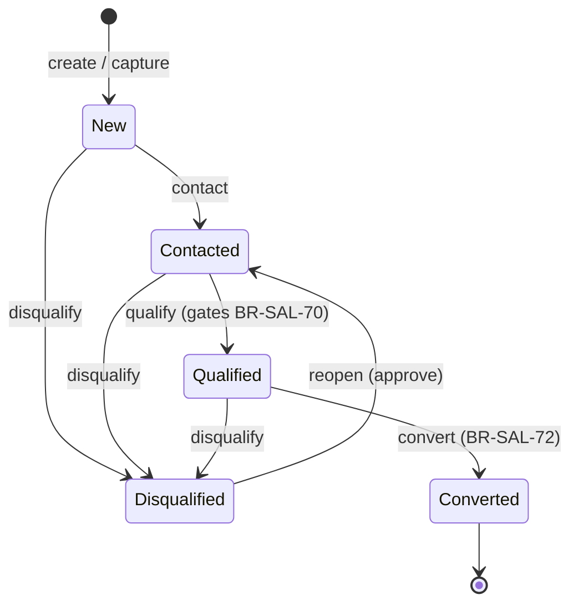
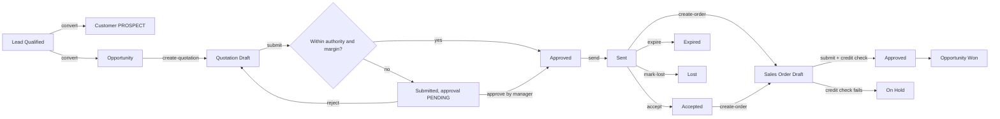
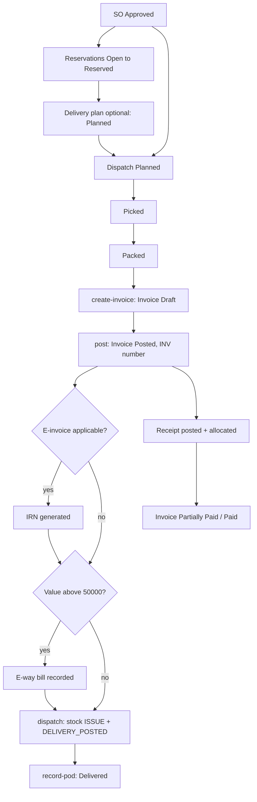
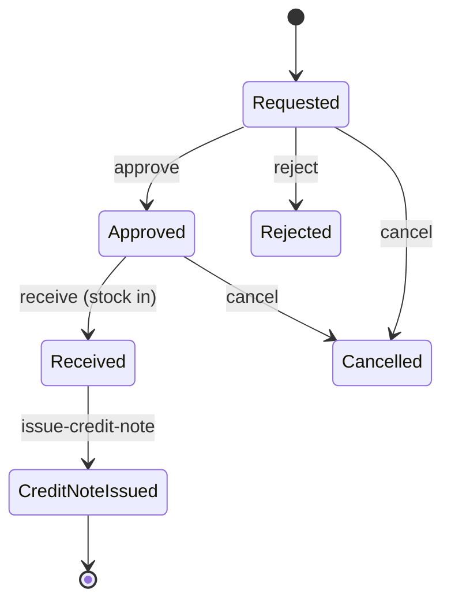
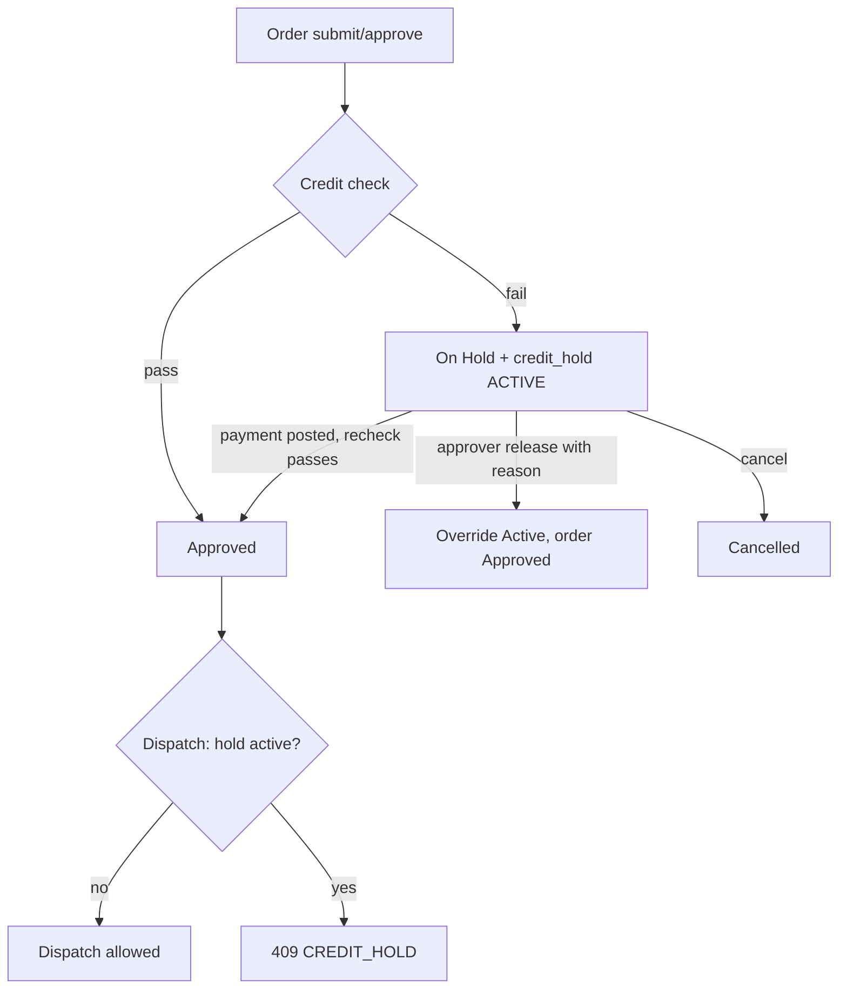
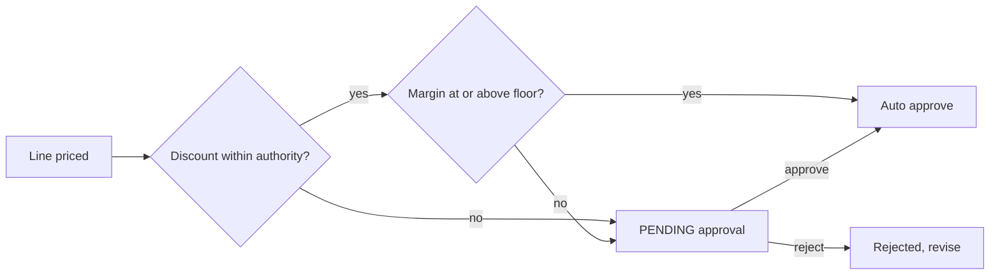
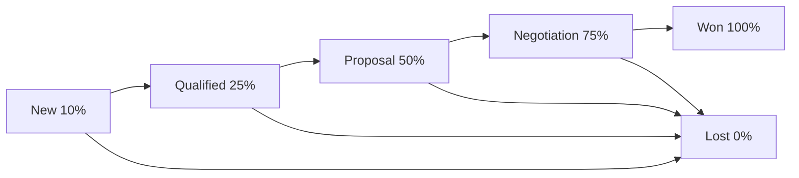
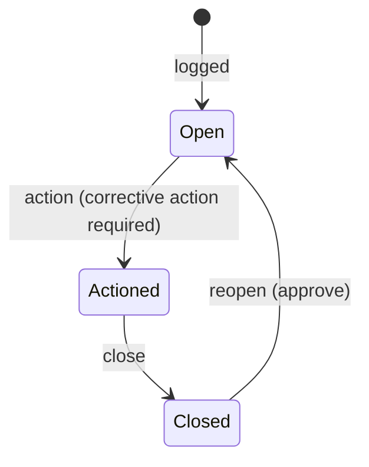
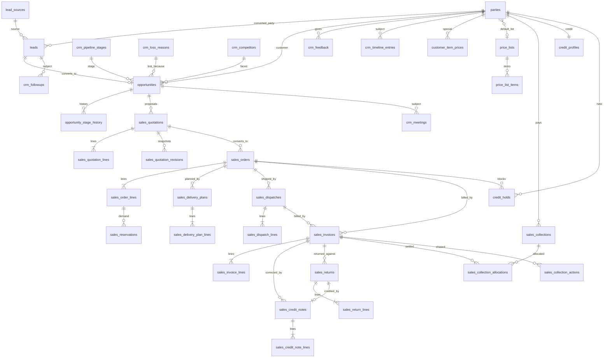

# 04b — Sales & CRM: end-to-end processes and database design (sections 4 and 5 of 04-SALES-CRM.md)

## 4. End-to-end processes

Actors: **Sales Rep** (role MEMBER, dept Sales), **Sales Manager** (MANAGER/LEAD with `approve` on the page), **Credit Controller** (Finance, `approve` on `sales-credit`), **Warehouse** (picks, packs, dispatches), **Finance** (receipts, e-invoice), **Customer**, **System** (jobs). Status names are the exact words of section 2.

### 4.1 Lead capture and qualification

1. Rep creates a lead (manual, Excel import later, or the public capture endpoint `POST /api/v1/crm/leads/capture` guarded by an API key header, BR-SAL-73 duplicate check, consent flag in the body). Status New, Stage New, score computed.
2. Duplicate check (BR-SAL-73): same mobile / email → 409 `DUPLICATE` with the matches; fuzzy company ≥ 85 % → warning list; ≥ 95 % → 409 unless the user sends `overrideDuplicate:true` and holds `approve`.
3. Rep contacts the lead (`contact`: New → Contacted); every call/meeting/follow-up is a timeline entry and raises the engagement part of the score.
4. `qualify` (Contacted → Qualified) passes only when the gates of BR-SAL-70 hold (contact channel, requirement, budget or expected value, owner, score ≥ `sales_config.qualify_min_score` = 50). Otherwise 422 `QUALIFICATION_GATE` with the list of missing items.
5. Or `disqualify` (reason required) → Disqualified (locked; `reopen` by an approver).
6. Consent is recorded separately (BR-SAL-85); marketing messages need `Granted`.



### 4.2 Lead → opportunity → quotation → sales order

1. `convert` on a Qualified lead: finds an existing customer (GSTIN, else mobile/email on `party_contacts`, else exact name+city) or creates a customer with `customer_stage = 'PROSPECT'` (BR-SAL-62/72); creates an Opportunity at stage Qualified (probability 25) and copies value, close date, owner, requirement; writes timeline entries; lead → Converted with `converted_party_id` and `converted_opportunity_id`.
2. Rep moves the card on the Kanban: New → Qualified → Proposal → Negotiation → Won (gates BR-SAL-74). Skipping a stage needs `approve`.
3. In Proposal the rep clicks `create-quotation` (or creates from the Quotation page): Draft quotation with customer, price list, lines priced by the engine BR-SAL-20.
4. Quotation `submit`: if any line discount exceeds the user's authority or margin < floor → status Submitted, `approval_status = PENDING`; a manager `approve`s (different user) → Approved; else auto Approved (BR-SAL-22). `send` → Sent. Opportunity auto-advances to Negotiation when the first quotation is Sent (BR-SAL-74).
5. Customer accepts: `accept` → Accepted (or directly `create-order` from Sent/Approved). `create-order` copies lines into a Draft sales order, links `document_links(QUOTATION → SALES_ORDER)` and marks the quotation Accepted. The customer's PO number is entered on the order.
6. Order `submit` → credit check (BR-SAL-50) → Approved or On Hold; on approval reservations are created (4.3). The opportunity moves to Won when an order linked to it is Approved (BR-SAL-74).
7. A Lost quotation (customer declined) records the reason; if all quotations of the opportunity are Lost / Expired the opportunity shows the "No active quotation" exception (it is not auto-lost).



### 4.3 Sales order → reservation → delivery/dispatch → invoice → e-invoice / e-way → collection

1. **Approve** (4.2 step 6): the SO becomes Approved; for each stockable line the system creates a reservation row (`sales_reservations`, status Open) and tries to reserve `min(open qty, available)` in the order's warehouse (BR-SAL-30/32) → Reserved / Partially Reserved. Service items need no reservation.
2. **Delivery plan** (optional): `create-delivery-plan` on the order creates a plan with the open quantities and promise date; the planner sets route, vehicle, planned date; `plan` → Planned.
3. **Dispatch**: `create-dispatch` (from the order or from the plan) creates a Dispatch (Planned) with lines = chosen qty ≤ open qty (BR-SAL-33). Warehouse `pick` (needs stock or reservation), `pack` (packages count).
4. **Invoice from dispatch**: `create-invoice` on a Packed dispatch creates a Draft sales invoice with lines = dispatch lines (qty ≤ dispatch qty − invoiced), prices from the order line, tax recomputed by **invoice date** and place of supply (BR-SAL-07). `post` assigns the gap-free number, raises `SALES_INVOICE_POSTED`. For invoice policy **On Order** (advances, services, make-to-order with part billing) the invoice is created from the order lines instead (BR-SAL-36).
5. **E-invoice**: if applicable (BR-SAL-44) the IRN is generated through the `EInvoiceGateway` (Tax plan) within the 30-day window; IRN status Generated; the QR prints on the invoice PDF.
6. **E-way bill**: if consignment value (invoice grand total, Part A) > ₹50,000 (BR-SAL-41) the e-way bill number is recorded on the dispatch (Part B vehicle details) before `dispatch`.
7. **Dispatch** (`dispatch`): requires the invoice rule (BR-SAL-35) and the e-way rule; posts the stock ISSUE at moving-average value, consumes the reservation, increments `delivered_qty` on the order lines, raises `DELIVERY_POSTED` (COGS). Order status → Partially Delivered / Delivered. Delivery plan status/OTIF updated (BR-SAL-89).
8. **POD**: `record-pod` → Delivered, `pod_date`; the invoice due date is **not** moved (due date counts from the invoice date, BR-SAL-06).
9. **Collection**: Finance/Sales post a receipt (`COL`), allocated oldest-first or manually (BR-SAL-40); the invoice becomes Partially Paid / Paid; TDS deducted by the customer is allocated too (BR-SAL-47). Event `RECEIPT_RECEIVED`.
10. Order status becomes Invoiced when every line is fully invoiced and delivered; Closed manually or by `close` when nothing is open (BR-SAL-37).



### 4.4 Returns and credit notes

1. Customer reports a problem (feedback/phone). Rep creates a Sales Return (Requested) against the invoice (Item + Qty shortcut or lines).
2. Manager `approve` (checks the qty rule BR-SAL-45) or `reject`.
3. Goods arrive: Warehouse `receive`: per line disposition Restock / Rework / Replace / Quarantine → stock RECEIPT into the return warehouse at the **original dispatch cost**; Scrap → no stock, loss event; event `SALES_RETURN_POSTED`. Status Received.
4. `issue-credit-note`: creates and posts a credit note linked to the invoice (BR-SAL-46): GST reversed at the original invoice's rates and place of supply, `CREDIT_NOTE_POSTED`, e-invoice IRN for the credit note when the invoice needed one; the invoice balance falls; if the invoice was already paid, the credit note becomes customer credit (an advance usable on the next invoice). Return → Credit Note Issued.
5. Disposition Replace: `create-replacement` creates a Draft sales order (flag `is_replacement`, rates 0, reason) which follows 4.3.
6. A credit note after the Section 34 deadline (30 November following the FY of the invoice) is still allowed as a **commercial credit note without GST adjustment** (flag `gst_adjusted = false`, warning shown) (BR-SAL-46).



### 4.5 Credit hold and release

1. On SO `submit` (and again on `approve`, on `dispatch`, and by the nightly job) the credit check runs (BR-SAL-50/51): exposure = AR outstanding − unallocated advances + open undelivered order value; hold when `exposure + this order > limit`, or overdue beyond `max_overdue_days`, or the customer is Blocked.
2. Fail → the order becomes **On Hold**, a `credit_holds` row (ACTIVE) is written, `credit_check = false`, the credit controller gets a notification entry (timeline) and the rep sees the reason on the order.
3. Resolution options: (a) customer pays → receipt posted → auto-recheck releases holds whose reason no longer applies (system release, audit `CREDIT_HOLD_RELEASED` by "system"); (b) controller `release-hold` with a reason and optional override limit/expiry (needs `approve` on `sales-credit`, not the order creator, BR-SAL-52); (c) rep `cancel`s the order.
4. After release the order returns to Approved and reservations proceed. A dispatch is refused while an ACTIVE hold exists for the customer (BR-SAL-51) unless an override covers it.



### 4.6 Price approval (discount and margin)

1. Price engine fills each line's rate (BR-SAL-20). The user may type a discount % (or change the rate, which is turned into a discount against the resolved price; rate **above** the resolved price is allowed).
2. On `submit` the server computes for each line: discount % vs the user's authority `sales_config.discount_authority[role]` and margin % vs the floor (BR-SAL-21/22).
3. If every line is within authority and above the floor: auto-approved (`approval_status = 'NA'` → Approved).
4. Otherwise `approval_status = 'PENDING'`, status Submitted; the approver (needs `approve`, ≠ creator, authority of the approver covers the highest discount / lowest margin) approves or rejects with a reason. Rejected → creator revises.
5. The same logic applies to sales orders created without a quotation and to order-line changes before approval.



### 4.7 Pipeline stage gates

1. A move is requested (drag, record-bar action or `PATCH /crm/opportunities/:id/stage`).
2. Server loads `crm_pipeline_stages` and checks, in order: record not locked (Won/Lost), version (`If-Match`), forward skip rule, the target stage's gate (BR-SAL-74), required reason for backward moves and for Lost.
3. On success: `opportunities.stage`, `probability_pct` (stage default unless overridden manually earlier and not Won/Lost), `status`, `forecast_category` updated; a row in `opportunity_stage_history`; a timeline entry; lead source stats update.
4. On failure: 422 `STAGE_GATE_FAILED` with `fields` listing what is missing; the Kanban card snaps back.



### 4.8 Customer feedback / NPS loop

1. Feedback is logged by the rep (call/visit), by Service, or after delivery (the nightly job creates a **feedback request follow-up** 7 days after the POD of each dispatch when `sales_config.auto_feedback_request` is true, de-duplicated per customer per 30 days).
2. Entry: rating (CSAT), NPS 0-10, category, comments. Detractor (NPS ≤ 6 or rating ≤ 40) → the system creates a follow-up for the owner due next working day (BR-SAL-87) and a timeline entry.
3. Owner `action`s it (corrective action text) then `close`s it (closure date). Improvement actions are reviewed in the tab; NPS trend is a KPI on Customer 360 and the Executive dashboard.



---

## 5. Database design (the core)

### 5.0 Conventions and macros (binding for every DDL below)

* Rules of `01-SHARED-FOUNDATION.md` §2 and §4 apply. New migration folders are listed in §5.9, in build order. **Money** `numeric(18,2)`, **qty** `numeric(18,3)`, **rate** `numeric(18,6)`, **percent** `numeric(7,4)`. Enums are `text` + `CHECK`. Table names plural `snake_case`; FKs named `<table>_<col>_fkey`; every FK column is indexed (`<table>_<col>_idx`).
* **Preconditions** (the first migration starts with a guard and fails with a clear message if one is missing): tables `companies, users, units, financial_years, items, warehouses, stock_ledger, stock_balances, number_series, parties, party_addresses, party_contacts, payment_terms, tax_codes, tax_code_rates, hsn_sac, document_links, accounting_event_queue` exist (parties/payment_terms/tax_codes/hsn_sac/document_links come from the SCM plan 03; `accounting_event_queue` from the Inventory plan 02). If one is missing, the builder stops with `STATUS: QUESTION`.
* **Macros: reuse plan 03.** `03b-SCM-DATABASE.md` §5.2 defines the exact column blocks `@STD`, `@DOC`, `@MONEY`, `@LINETAX` (`varchar(n)` for codes and status, `timestamptz(3)`, `created_by / updated_by / deleted_by`, `doc_type`, `approval_status`). **This plan uses them literally** and adds only what is stated here:
  * `/*STD*/` = `@STD` (company_id, unit_id, created_*, updated_*, version, deleted_*); `id uuid primary key default gen_random_uuid()` is the first column of every table. Masters: `unit_id uuid null`; documents: `unit_id uuid not null`. `/*STD-FK*/` = `CHECK (version >= 1)` (the FKs are already inside `@STD`).
  * `/*DOC fields*/` = `@DOC` (doc_type, code, status, doc_date, fy_id, department, approval_status, remarks, cancelled_reason) **plus** `owner_user_id uuid null references users(id) on delete set null`; the constant `doc_type` per table (`LEA` leads, `OPP` opportunities, `FUP` follow-ups, `MTG` meetings, `FDB` feedback, `QTN` quotations, `SO` orders, `RSV` reservations, `DLP` delivery plans, `DSP` dispatches, `SINV` invoices, `CN` credit notes, `SRT` returns, `COL` collections), each enforced by `CHECK (doc_type = '…')`; `unique (company_id, doc_type, code)` named `<table>_code_key`; `index (company_id, unit_id, fy_id, status) where deleted_at is null` named `<table>_list_idx`; `index (owner_user_id)`. A table whose DDL below also shows `approval_status` uses the `@DOC` column (never declare it twice).
  * `/*HDR fields*/` = `@MONEY` **plus** `party_id uuid not null references parties(id) on delete restrict`, `supplier_state char(2) not null` (state of OUR unit GSTIN) and `other_charges_tax numeric(18,2) not null default 0`; `place_of_supply` is made NOT NULL for sales documents; checks added: totals `>= 0` except `round_off between -1 and 1`, `currency_code = 'INR'` (BR-SAL-09), `(cgst_total + sgst_total = 0) or igst_total = 0`; index on `party_id`. Columns of the HDR text below that `@MONEY`/`@DOC` already define (currency_code, exchange_rate, place_of_supply, totals, approval_status, remarks) are **not** declared twice.
  * `/*LINE*/` = `@LINETAX` (already has `cgst_rate … cess_amount`, `uom`, `uom_factor`, `base_qty`, `taxable_value`, `line_total`) with the parent FK `document_id uuid not null references <doc>(id) on delete cascade` **plus** `item_id uuid null references items(id) on delete restrict`, `hsn_sac varchar(8) null`, `charges_share numeric(18,2) not null default 0 check (charges_share >= 0)` (BR-SAL-05), `warehouse_id uuid null references warehouses(id) on delete restrict`, `delivery_date date null`; and `taxable_value = qty*rate - discount_amount + charges_share`. Wherever the LINE text or a formula in this plan says `gst_rate`, read it as the sum `cgst_rate + sgst_rate + igst_rate` of the line's component columns and build the three component columns of `@LINETAX` (no separate `gst_rate` column exists). Foundation §4 per-component rates are therefore kept.
  * Where this file writes `text` the column is Postgres `text` (Prisma `String`); `varchar(n)` comes only from 03b's blocks. Both coexist.
* **Soft delete** only on masters and Draft documents (`deleted_at`). Posted documents are never deleted.
* **Triggers.** `set_updated_at` is done in code (like Inventory). Append-only tables get the function pattern of `stock_ledger_append_only` (named per table). Posted-document immutability triggers are specified per table (`<t>_lock_posted`).
* **Prisma mapping rule** (so every model below is mechanical): field name = camelCase of the column; `@map("snake_case")`; `uuid → String @db.Uuid @default(uuid())` for `id`; `text → String` (add `@db.VarChar(n)` where the DDL has a length comment); `char(2) → String @db.Char(2)`; `numeric(18,2) → Decimal @db.Decimal(18, 2)` (3 / 6 / 7,4 likewise); `date → DateTime @db.Date`; `timestamptz → DateTime @db.Timestamptz(3)`; `jsonb → Json`; nullable column → `?`; `STD` expands to the nine fields `id, companyId, createdAt, createdById (@map("created_by")), updatedAt (@updatedAt), updatedById, version, deletedAt, deletedById` (the existing models call the user FKs `createdById` — keep that name, mapped to the column `created_by`); relations only where the line says `rel`. Every model has `@@map("<table>")`. The Prisma models below list **only the table-specific fields**; `…STD`, `…DOC`, `…HDR`, `…LINE` mean "insert the macro fields". Relations to `User`, `Company`, `Unit`, `FinancialYear` are added the same way as `StockVoucher` does it. Because most repositories use `$queryRaw` for locking and totals (like Inventory), correctness of the DDL is what the tests check; `prisma validate` and `prisma generate` must pass.

### 5.1 ERD



### 5.2 Extensions to existing / foundation tables (ALTER only)

**5.2.1 `parties` (customer side)** — all `ADD COLUMN IF NOT EXISTS` (the SCM plan owns the table; if a column of the foundation §3.1 list is missing the guard stops: required existing columns are `code, name, legal_name, is_customer, party_type, gstin, pan, gst_registration_type, state_code, payment_terms_id, credit_limit, credit_days, price_list_id, sales_person_id, status, currency_id`):

```sql
ALTER TABLE parties
  ADD COLUMN IF NOT EXISTS customer_stage text NOT NULL DEFAULT 'ACTIVE',     -- PROSPECT|NEW|ACTIVE|AT_RISK|DORMANT|LOST
  ADD COLUMN IF NOT EXISTS customer_stage_manual boolean NOT NULL DEFAULT false,
  ADD COLUMN IF NOT EXISTS customer_tier char(1) NOT NULL DEFAULT 'C',        -- A|B|C
  ADD COLUMN IF NOT EXISTS customer_segment text,                              -- Dealer|OEM|Distributor|Retail|Government|Export|Internal
  ADD COLUMN IF NOT EXISTS territory text,
  ADD COLUMN IF NOT EXISTS next_action_note text,
  ADD COLUMN IF NOT EXISTS source_lead_id uuid,                                -- FK leads(id) added in migration 2
  ADD COLUMN IF NOT EXISTS customer_since date,
  ADD COLUMN IF NOT EXISTS deducts_tds boolean NOT NULL DEFAULT false,        -- BR-SAL-47
  ADD COLUMN IF NOT EXISTS tds_receivable_rate numeric(7,4),                   -- usual % the customer deducts
  ADD COLUMN IF NOT EXISTS marketing_consent text NOT NULL DEFAULT 'NOT_RECORDED', -- NOT_RECORDED|GRANTED|WITHDRAWN|EXPIRED
  ADD COLUMN IF NOT EXISTS marketing_consent_at timestamptz,
  ADD COLUMN IF NOT EXISTS last_order_date date,                               -- maintained by invoice post
  ADD COLUMN IF NOT EXISTS customer_part_prefix text;
ALTER TABLE parties ADD CONSTRAINT parties_customer_stage_chk CHECK (customer_stage IN ('PROSPECT','NEW','ACTIVE','AT_RISK','DORMANT','LOST'));
ALTER TABLE parties ADD CONSTRAINT parties_customer_tier_chk CHECK (customer_tier IN ('A','B','C'));
ALTER TABLE parties ADD CONSTRAINT parties_marketing_consent_chk CHECK (marketing_consent IN ('NOT_RECORDED','GRANTED','WITHDRAWN','EXPIRED'));
ALTER TABLE parties ADD CONSTRAINT parties_tds_rate_chk CHECK (tds_receivable_rate IS NULL OR tds_receivable_rate BETWEEN 0 AND 30);
ALTER TABLE parties ADD CONSTRAINT parties_credit_limit_chk CHECK (credit_limit IS NULL OR credit_limit >= 0);
CREATE INDEX IF NOT EXISTS parties_customer_stage_idx ON parties (customer_stage) WHERE is_customer AND deleted_at IS NULL;
CREATE INDEX IF NOT EXISTS parties_price_list_idx ON parties (price_list_id) WHERE price_list_id IS NOT NULL;
```
(The constraint adds are wrapped in `DO $$ … IF NOT EXISTS (SELECT 1 FROM pg_constraint WHERE conname = '…') …` so the migration is re-runnable on a copy.) `parties.price_list_id` gets its FK to `price_lists(id) ON DELETE SET NULL` in migration 3 (after the table exists). The existing columns `credit_limit` (NULL = no limit, 0 = no credit, BR-SAL-50) and `credit_days` are the **single source of truth** for limit and days; `credit_profiles` stores only what is *not* on the party.
Prisma: add the new fields to `model Party` (created by the SCM plan) — ticket T-SAL-02 edits it.

**5.2.2 `stock_ledger.voucher_type`**: new movement types `DELIVERY` (issue at dispatch) and `SALES_RETURN` (receipt of a return).
```sql
ALTER TABLE stock_ledger DROP CONSTRAINT IF EXISTS stock_ledger_voucher_type;
ALTER TABLE stock_ledger ADD CONSTRAINT stock_ledger_voucher_type CHECK (voucher_type IN
  ('OPENING','RECEIPT','ISSUE','ADJUSTMENT','TRANSFER_OUT','TRANSFER_IN','REVERSAL','DELIVERY','SALES_RETURN'));
```
`FOUNDATION-CHANGE:` this constraint is owned by the Inventory plan (02), which may add more types (GRN, production, …). The migration therefore **must build the list from the live constraint** — see T-SAL-02 step 4: read `pg_get_constraintdef`, parse the `IN (...)` values, append `'DELIVERY'`, `'SALES_RETURN'` if absent, re-create. Also extend `LedgerVoucherType` in `apps/api/src/modules/inventory/stock/posting.ts` with the two strings (one-line change named in the ticket).

**5.2.2b `document_links` types** (plan 03 §5.3, `varchar(12)` CHECK on `from_type` and `to_type`): add `'LEAD','OPP','DLP','DSP','CN','SRET','COL'` (the existing `'QUOTATION','SO','SINV'` are reused). Same technique as 5.2.2: read the live constraints (find them in `pg_constraint` by table `document_links` and `contype = 'c'`), parse with `pg_get_constraintdef`, append, re-create. `FOUNDATION-CHANGE` (index section 0, item 3).

**5.2.3 Audit actions** (code, `apps/api/src/core/audit/audit-service.ts` `AUDIT_ACTIONS`): add `LEAD_CREATED, LEAD_UPDATED, LEAD_DELETED, LEAD_RESTORED, LEAD_STATUS_CHANGED, LEAD_CONVERTED, OPPORTUNITY_CREATED, OPPORTUNITY_UPDATED, OPPORTUNITY_DELETED, OPPORTUNITY_RESTORED, OPPORTUNITY_STAGE_CHANGED, CRM_RECORD_CREATED, CRM_RECORD_UPDATED, CRM_RECORD_DELETED, CRM_RECORD_RESTORED, CRM_RECORD_STATUS_CHANGED, CUSTOMER_CREATED, CUSTOMER_UPDATED, CUSTOMER_STATUS_CHANGED, SALES_DOC_CREATED, SALES_DOC_UPDATED, SALES_DOC_DELETED, SALES_DOC_RESTORED, SALES_DOC_STATUS_CHANGED, SALES_DOC_POSTED, SALES_DOC_CANCELLED, PRICE_LIST_CHANGED, CREDIT_HOLD_CREATED, CREDIT_HOLD_RELEASED, CREDIT_LIMIT_CHANGED, CONSENT_CHANGED, CONFIG_UPDATED`. Audit `targetType` values: `Lead, Opportunity, Customer, Followup, Meeting, Feedback, LeadSource, Quotation, SalesOrder, Reservation, DeliveryPlan, Dispatch, Invoice, CreditNote, Collection, PriceList, CreditProfile, SalesReturn, SalesConfig`; `detail` always has `pageId`, `code`, `unitId`.

### 5.3 Configuration and CRM masters (migration 1 and 2)

#### 5.3.1 `sales_config` — one row per company (typed settings)
Purpose: every tunable number of the module in one typed row (no magic numbers in code). Created with defaults by the migration (one row for the one company); edited through `PATCH /api/v1/sales/config` (needs `controls` on `sales-orders`) and `PATCH /api/v1/crm/config` (needs `controls` on `crm-pipeline`).
```sql
CREATE TABLE sales_config (
  company_id uuid PRIMARY KEY REFERENCES companies(id) ON DELETE CASCADE,
  version int NOT NULL DEFAULT 1,
  updated_at timestamptz NOT NULL DEFAULT now(), updated_by uuid REFERENCES users(id) ON DELETE SET NULL,
  quotation_validity_days int NOT NULL DEFAULT 30 CHECK (quotation_validity_days BETWEEN 1 AND 365),
  default_lead_days int NOT NULL DEFAULT 7 CHECK (default_lead_days BETWEEN 0 AND 365),
  auto_reserve boolean NOT NULL DEFAULT true,
  reservation_hold_days int NOT NULL DEFAULT 7 CHECK (reservation_hold_days BETWEEN 1 AND 90),
  default_margin_floor_pct numeric(7,4) NOT NULL DEFAULT 10 CHECK (default_margin_floor_pct BETWEEN 0 AND 100),
  discount_authority jsonb NOT NULL DEFAULT '{"MEMBER":5,"LEAD":10,"MANAGER":15,"ADMIN":25,"SUPER_ADMIN":100}',
  order_value_authority jsonb NOT NULL DEFAULT '{"MEMBER":200000,"LEAD":1000000,"MANAGER":5000000,"ADMIN":50000000,"SUPER_ADMIN":null}', -- max order grand total each role may approve alone; null = unlimited
  default_max_overdue_days int NOT NULL DEFAULT 30 CHECK (default_max_overdue_days BETWEEN 0 AND 365),
  credit_check_at_dispatch boolean NOT NULL DEFAULT true,
  require_invoice_before_dispatch boolean NOT NULL DEFAULT true,
  over_delivery_tolerance_pct numeric(7,4) NOT NULL DEFAULT 0 CHECK (over_delivery_tolerance_pct BETWEEN 0 AND 20),
  einvoice_aato_threshold numeric(18,2) NOT NULL DEFAULT 50000000,          -- 5 crore
  aato numeric(18,2) NOT NULL DEFAULT 0 CHECK (aato >= 0),                  -- aggregate annual turnover (highest FY since 2017-18), entered by Finance
  einvoice_force boolean NOT NULL DEFAULT false,                            -- force e-invoicing on although aato is below the threshold
  einvoice_report_limit_aato numeric(18,2) NOT NULL DEFAULT 100000000,      -- 10 crore: 30-day reporting limit applies at or above
  einvoice_warn_day int NOT NULL DEFAULT 25 CHECK (einvoice_warn_day BETWEEN 1 AND 30),
  eway_threshold numeric(18,2) NOT NULL DEFAULT 50000,
  returns_warehouse_id uuid REFERENCES warehouses(id) ON DELETE SET NULL,
  qualify_min_score int NOT NULL DEFAULT 50 CHECK (qualify_min_score BETWEEN 0 AND 100),
  stale_days int NOT NULL DEFAULT 14 CHECK (stale_days BETWEEN 1 AND 180),
  allow_stage_skip boolean NOT NULL DEFAULT false,
  consent_valid_months int NOT NULL DEFAULT 24 CHECK (consent_valid_months BETWEEN 1 AND 120),
  followup_reminder_hours int NOT NULL DEFAULT 2 CHECK (followup_reminder_hours BETWEEN 0 AND 72),
  followup_escalate_days int NOT NULL DEFAULT 3 CHECK (followup_escalate_days BETWEEN 1 AND 30),
  auto_feedback_request boolean NOT NULL DEFAULT true,
  dunning_days jsonb NOT NULL DEFAULT '[1,7,15,30]',
  source_conversion_green_pct numeric(7,4) NOT NULL DEFAULT 10,
  credit_note_gst_deadline_month int NOT NULL DEFAULT 11,                    -- November (Section 34(2), BR-SAL-46)
  tds_receivable_default_rate numeric(7,4) NOT NULL DEFAULT 2 CHECK (tds_receivable_default_rate BETWEEN 0 AND 30)
);
```
The e-invoice thresholds are **data, not code** because the Government has changed them several times (₹10 Cr → ₹5 Cr on 1 Aug 2023; 30-day limit for AATO ≥ ₹10 Cr from 1 Apr 2025). Prisma:
```prisma
model SalesConfig {
  companyId String @id @map("company_id") @db.Uuid
  version Int @default(1)
  updatedAt DateTime @updatedAt @map("updated_at") @db.Timestamptz(3)
  updatedById String? @map("updated_by") @db.Uuid
  quotationValidityDays Int @default(30) @map("quotation_validity_days")
  defaultLeadDays Int @default(7) @map("default_lead_days")
  autoReserve Boolean @default(true) @map("auto_reserve")
  reservationHoldDays Int @default(7) @map("reservation_hold_days")
  defaultMarginFloorPct Decimal @default(10) @map("default_margin_floor_pct") @db.Decimal(7, 4)
  discountAuthority Json @map("discount_authority")
  orderValueAuthority Json @map("order_value_authority")
  defaultMaxOverdueDays Int @default(30) @map("default_max_overdue_days")
  creditCheckAtDispatch Boolean @default(true) @map("credit_check_at_dispatch")
  requireInvoiceBeforeDispatch Boolean @default(true) @map("require_invoice_before_dispatch")
  overDeliveryTolerancePct Decimal @default(0) @map("over_delivery_tolerance_pct") @db.Decimal(7, 4)
  einvoiceAatoThreshold Decimal @default(50000000) @map("einvoice_aato_threshold") @db.Decimal(18, 2)
  aato Decimal @default(0) @db.Decimal(18, 2)
  einvoiceForce Boolean @default(false) @map("einvoice_force")
  einvoiceReportLimitAato Decimal @default(100000000) @map("einvoice_report_limit_aato") @db.Decimal(18, 2)
  einvoiceWarnDay Int @default(25) @map("einvoice_warn_day")
  ewayThreshold Decimal @default(50000) @map("eway_threshold") @db.Decimal(18, 2)
  returnsWarehouseId String? @map("returns_warehouse_id") @db.Uuid
  qualifyMinScore Int @default(50) @map("qualify_min_score")
  staleDays Int @default(14) @map("stale_days")
  allowStageSkip Boolean @default(false) @map("allow_stage_skip")
  consentValidMonths Int @default(24) @map("consent_valid_months")
  followupReminderHours Int @default(2) @map("followup_reminder_hours")
  followupEscalateDays Int @default(3) @map("followup_escalate_days")
  autoFeedbackRequest Boolean @default(true) @map("auto_feedback_request")
  dunningDays Json @map("dunning_days")
  sourceConversionGreenPct Decimal @default(10) @map("source_conversion_green_pct") @db.Decimal(7, 4)
  creditNoteGstDeadlineMonth Int @default(11) @map("credit_note_gst_deadline_month")
  tdsReceivableDefaultRate Decimal @default(2) @map("tds_receivable_default_rate") @db.Decimal(7, 4)
  @@map("sales_config")
}
```
Seed: migration inserts one row per existing company: `INSERT INTO sales_config (company_id) SELECT id FROM companies ON CONFLICT DO NOTHING;`.

#### 5.3.2 `crm_pipeline_stages` — stage configuration (master, 6 rows)
```sql
CREATE TABLE crm_pipeline_stages (
  /*STD*/,
  code text NOT NULL,                      -- NEW|QUALIFIED|PROPOSAL|NEGOTIATION|WON|LOST
  name text NOT NULL,                      -- 'New','Qualified','Proposal','Negotiation','Won','Lost'
  sort_order int NOT NULL,
  default_probability numeric(7,4) NOT NULL CHECK (default_probability BETWEEN 0 AND 100),
  forecast_category text NOT NULL CHECK (forecast_category IN ('Pipeline','Best Case','Commit','Closed','Omitted')),
  is_won boolean NOT NULL DEFAULT false, is_lost boolean NOT NULL DEFAULT false,
  required_fields jsonb NOT NULL DEFAULT '[]',   -- keys of opportunities columns that must be set to ENTER the stage
  sla_days int CHECK (sla_days IS NULL OR sla_days > 0),
  /*STD-FK*/, CHECK (NOT (is_won AND is_lost))
);
CREATE UNIQUE INDEX crm_pipeline_stages_code_key ON crm_pipeline_stages (company_id, code);
CREATE UNIQUE INDEX crm_pipeline_stages_order_key ON crm_pipeline_stages (company_id, sort_order);
```
Seed (per company): `(NEW,'New',1,10,'Pipeline',[],7) (QUALIFIED,'Qualified',2,25,'Pipeline',["expected_value","primary_contact"],7) (PROPOSAL,'Proposal',3,50,'Best Case',["expected_value","expected_close"],10) (NEGOTIATION,'Negotiation',4,75,'Commit',["expected_value","expected_close"],10) (WON,'Won',5,100,'Closed',[],NULL, is_won) (LOST,'Lost',6,0,'Omitted',[],NULL, is_lost)`.
Prisma `CrmPipelineStage`: …STD, `code String`, `name String`, `sortOrder Int`, `defaultProbability Decimal @db.Decimal(7,4)`, `forecastCategory String`, `isWon Boolean @default(false)`, `isLost Boolean @default(false)`, `requiredFields Json`, `slaDays Int?`, `@@unique([companyId, code])`, `@@unique([companyId, sortOrder])`.

#### 5.3.3 `lead_sources` (page `crm-sources`)
```sql
CREATE TABLE lead_sources (
  /*STD*/,
  code text NOT NULL CHECK (code ~ '^[A-Z0-9/_-]{2,30}$'),
  name text NOT NULL CHECK (char_length(name) BETWEEN 2 AND 100),
  channel text CHECK (channel IS NULL OR channel IN ('Website','Referral','Trade Show','Cold Call','IndiaMART','Google Ads','LinkedIn','Email Campaign','Channel Partner','Walk-in','Other')),
  campaign text CHECK (campaign IS NULL OR char_length(campaign) <= 100),
  utm_source text CHECK (utm_source IS NULL OR utm_source IN ('Google','LinkedIn','Facebook','Instagram','Email','WhatsApp','IndiaMART','Direct','Other')),
  utm_medium text CHECK (utm_medium IS NULL OR char_length(utm_medium) <= 60),
  monthly_cost numeric(18,2) NOT NULL DEFAULT 0 CHECK (monthly_cost >= 0),
  status text NOT NULL DEFAULT 'Active' CHECK (status IN ('Active','Inactive')),
  department text NOT NULL DEFAULT 'Sales',
  /*STD-FK*/
);
CREATE UNIQUE INDEX lead_sources_code_key ON lead_sources (company_id, code);
CREATE UNIQUE INDEX lead_sources_name_key ON lead_sources (company_id, lower(name)) WHERE deleted_at IS NULL;
```
Seed: 8 sources `WEB Website, REF Referral, TRD Trade Show, COLD Cold Call, IMART IndiaMART, GADS Google Ads, DLR Channel Partner, WALK Walk-in`. Prisma `LeadSource`: …STD, `code, name, channel?, campaign?, utmSource?, utmMedium?, monthlyCost Decimal @db.Decimal(18,2) @default(0), status String @default("Active"), department String @default("Sales")`, `leads Lead[]`, `@@unique([companyId, code])`.

#### 5.3.4 `crm_loss_reasons` and `crm_competitors` (small masters, no own page; edited in `crm-pipeline` Controls tab)
```sql
CREATE TABLE crm_loss_reasons (/*STD*/, code text NOT NULL CHECK (code ~ '^[A-Z0-9_]{2,30}$'), name text NOT NULL CHECK (char_length(name) BETWEEN 2 AND 100),
  status text NOT NULL DEFAULT 'Active' CHECK (status IN ('Active','Inactive')), /*STD-FK*/);
CREATE UNIQUE INDEX crm_loss_reasons_code_key ON crm_loss_reasons (company_id, code);
CREATE TABLE crm_competitors (/*STD*/, name text NOT NULL CHECK (char_length(name) BETWEEN 2 AND 100), notes text,
  status text NOT NULL DEFAULT 'Active' CHECK (status IN ('Active','Inactive')), /*STD-FK*/);
CREATE UNIQUE INDEX crm_competitors_name_key ON crm_competitors (company_id, lower(name)) WHERE deleted_at IS NULL;
```
Seed loss reasons: `PRICE Price too high, COMPETITOR Lost to competitor, NO_BUDGET No budget, NO_DECISION No decision, DELIVERY Delivery time, QUALITY Quality concern, SPEC Specification mismatch, OTHER Other`. Prisma `CrmLossReason` (…STD, code, name, status) and `CrmCompetitor` (…STD, name, notes?, status).

### 5.4 CRM transaction tables (migration 2)

#### 5.4.1 `leads` (page `crm-leads`)
```sql
CREATE TABLE leads (
  /*STD*/, /*DOC fields: code, status, doc_date, fy_id, unit_id, department, owner_user_id*/
  lead_name text NOT NULL CHECK (char_length(lead_name) BETWEEN 2 AND 150),
  company_name text CHECK (company_name IS NULL OR char_length(company_name) <= 150),
  mobile text CHECK (mobile IS NULL OR mobile ~ '^[6-9][0-9]{9}$'),
  email text CHECK (email IS NULL OR email = lower(email)),
  designation text, is_decision_maker boolean NOT NULL DEFAULT false,
  city text, state_code char(2), gstin text CHECK (gstin IS NULL OR gstin ~ '^[0-9]{2}[A-Z]{5}[0-9]{4}[A-Z][1-9A-Z]Z[0-9A-Z]$'),
  source_id uuid, campaign text CHECK (campaign IS NULL OR char_length(campaign) <= 100),
  utm_source text, utm_medium text,
  stage text NOT NULL DEFAULT 'New' CHECK (stage IN ('New','Contacted','Nurture','Qualified','Unqualified')),
  qualification_score int NOT NULL DEFAULT 0 CHECK (qualification_score BETWEEN 0 AND 100),
  expected_value numeric(18,2) NOT NULL DEFAULT 0 CHECK (expected_value >= 0),
  expected_close date, requirement text,
  next_follow_up date,                                  -- maintained mirror (BR-SAL-82)
  consent_status text NOT NULL DEFAULT 'NOT_RECORDED' CHECK (consent_status IN ('NOT_RECORDED','GRANTED','WITHDRAWN','EXPIRED')),
  consent_at timestamptz, consent_purpose text, consent_channel text, consent_proof_ref text,
  disqualify_reason text CHECK (disqualify_reason IS NULL OR disqualify_reason IN ('Budget','No Need','Competitor','Not Reachable','Duplicate','Other')),
  converted_party_id uuid, converted_opportunity_id uuid, converted_at timestamptz,
  last_activity_at timestamptz,
  CHECK (status IN ('New','Contacted','Qualified','Converted','Disqualified')),
  CHECK ((status = 'Converted') = (converted_party_id IS NOT NULL)),
  CHECK (mobile IS NOT NULL OR email IS NOT NULL OR status = 'New'),   -- a contacted lead needs a way to reach it
  /*STD-FK*/,
  CONSTRAINT leads_source_id_fkey FOREIGN KEY (source_id) REFERENCES lead_sources(id) ON DELETE SET NULL,
  CONSTRAINT leads_converted_party_id_fkey FOREIGN KEY (converted_party_id) REFERENCES parties(id) ON DELETE SET NULL
);
CREATE INDEX leads_source_id_idx ON leads (source_id);
CREATE INDEX leads_converted_party_id_idx ON leads (converted_party_id);
CREATE UNIQUE INDEX leads_mobile_live_key ON leads (company_id, mobile) WHERE mobile IS NOT NULL AND deleted_at IS NULL AND status NOT IN ('Disqualified');
CREATE UNIQUE INDEX leads_email_live_key ON leads (company_id, email) WHERE email IS NOT NULL AND deleted_at IS NULL AND status NOT IN ('Disqualified');
CREATE INDEX leads_company_trgm_idx ON leads USING gin (lower(company_name) gin_trgm_ops);
```
(`converted_opportunity_id` FK to `opportunities` is added by `ALTER TABLE` after that table is created, same migration.) `CREATE EXTENSION IF NOT EXISTS pg_trgm;` at the top of migration 2 (trusted extension in PG 13+; if the DB user cannot create it the migration stops, QUESTION). Conversion to `status='Converted'` keeps the unique mobile index intact (a converted lead still owns its mobile; a new lead with the same mobile is a duplicate — it must be handled on the customer).
Trigger `leads_lock_converted`: BEFORE UPDATE raising `exception 'converted lead is locked'` when `OLD.status = 'Converted'` and any column other than `last_activity_at`, `updated_at`, `version`, `consent_*`, `next_follow_up` changes (use `IS DISTINCT FROM` comparisons on the business columns).
Prisma `Lead`: …STD, …DOC (code, status, docDate, fyId, unitId, department, ownerUserId), then every column above with `@map`, `@@unique([companyId, code])`, `@@index([unitId, fyId, status])`.

#### 5.4.2 `crm_followups` (page `crm-followups`)
```sql
CREATE TABLE crm_followups (
  /*STD*/, /*DOC fields*/,
  subject_type text NOT NULL CHECK (subject_type IN ('LEAD','CUSTOMER')), subject_id uuid NOT NULL,
  related_type text CHECK (related_type IS NULL OR related_type IN ('OPPORTUNITY','QUOTATION','ORDER','INVOICE')), related_id uuid,
  due_date date NOT NULL, due_time text CHECK (due_time IS NULL OR due_time ~ '^([01][0-9]|2[0-3]):[0-5][0-9]$'),
  channel text CHECK (channel IS NULL OR channel IN ('Call','Email','WhatsApp','SMS','Visit','Meeting')),
  purpose text, outcome text, next_follow_up date,
  priority text NOT NULL DEFAULT 'Medium' CHECK (priority IN ('Low','Medium','High')),
  completed_at timestamptz, source_meeting_id uuid, source_feedback_id uuid, reminder_sent_at timestamptz, escalated_at timestamptz,
  CHECK (status IN ('Planned','Done','Missed','Cancelled')),
  CHECK ((related_type IS NULL) = (related_id IS NULL)),
  CHECK (status <> 'Done' OR (outcome IS NOT NULL AND completed_at IS NOT NULL)),
  /*STD-FK*/
);
CREATE INDEX crm_followups_subject_idx ON crm_followups (subject_type, subject_id);
CREATE INDEX crm_followups_due_idx ON crm_followups (owner_user_id, due_date) WHERE status = 'Planned' AND deleted_at IS NULL;
```
(`source_meeting_id`/`source_feedback_id` FKs added after those tables exist, `ON DELETE SET NULL`.) `subject_id` is polymorphic and cannot have an FK; the service validates it. Prisma `CrmFollowup`: …STD …DOC + columns.

#### 5.4.3 `crm_meetings` (page `crm-meetings`)
```sql
CREATE TABLE crm_meetings (
  /*STD*/, /*DOC fields*/,                                   -- doc_date = start date
  kind text NOT NULL DEFAULT 'Meeting' CHECK (kind IN ('Meeting','Call')),
  subject text CHECK (subject IS NULL OR char_length(subject) <= 200),
  subject_type text NOT NULL CHECK (subject_type IN ('LEAD','CUSTOMER')), subject_id uuid NOT NULL,
  opportunity_id uuid,
  start_time text CHECK (start_time IS NULL OR start_time ~ '^([01][0-9]|2[0-3]):[0-5][0-9]$'),
  duration_min numeric(18,3) NOT NULL DEFAULT 0 CHECK (duration_min >= 0),
  location_mode text CHECK (location_mode IS NULL OR location_mode IN ('Office','Customer Site','Video Call','Phone Call')),
  organizer_user_id uuid, participants jsonb NOT NULL DEFAULT '[]',   -- [{"name","role","attended"}]
  agenda text, outcome text,
  CHECK (status IN ('Planned','Done','Missed','Cancelled')),
  CHECK (jsonb_typeof(participants) = 'array'),
  CHECK (status <> 'Done' OR outcome IS NOT NULL),
  /*STD-FK*/,
  CONSTRAINT crm_meetings_opportunity_id_fkey FOREIGN KEY (opportunity_id) REFERENCES opportunities(id) ON DELETE SET NULL,
  CONSTRAINT crm_meetings_organizer_user_id_fkey FOREIGN KEY (organizer_user_id) REFERENCES users(id) ON DELETE SET NULL
);
CREATE INDEX crm_meetings_subject_idx ON crm_meetings (subject_type, subject_id);
CREATE INDEX crm_meetings_start_idx ON crm_meetings (unit_id, doc_date) WHERE deleted_at IS NULL;
```
Prisma `CrmMeeting` …STD …DOC + columns.

#### 5.4.4 `crm_timeline_entries` (append-only; written by services; feeds the timelines)
```sql
CREATE TABLE crm_timeline_entries (
  id uuid PRIMARY KEY DEFAULT gen_random_uuid(),
  company_id uuid NOT NULL REFERENCES companies(id) ON DELETE RESTRICT,
  created_at timestamptz NOT NULL DEFAULT now(),
  created_by uuid REFERENCES users(id) ON DELETE SET NULL,      -- NULL = system
  unit_id uuid REFERENCES units(id) ON DELETE SET NULL,
  subject_type text NOT NULL CHECK (subject_type IN ('LEAD','OPPORTUNITY','CUSTOMER')),
  subject_id uuid NOT NULL,
  party_id uuid REFERENCES parties(id) ON DELETE SET NULL,      -- denormalised customer, for Customer 360
  entry_type text NOT NULL CHECK (entry_type IN ('NOTE','CALL','EMAIL','WHATSAPP','MEETING','FOLLOWUP','STAGE_CHANGE','CONVERSION','QUOTATION','ORDER','DELIVERY','INVOICE','PAYMENT','RETURN','CREDIT','FEEDBACK','REMINDER','CONSENT')),
  summary text NOT NULL CHECK (char_length(summary) BETWEEN 1 AND 500),
  ref_type text, ref_id uuid, ref_code text
);
CREATE INDEX crm_timeline_subject_idx ON crm_timeline_entries (subject_type, subject_id, created_at DESC);
CREATE INDEX crm_timeline_party_idx ON crm_timeline_entries (party_id, created_at DESC);
CREATE FUNCTION crm_timeline_append_only() RETURNS trigger LANGUAGE plpgsql AS $$ BEGIN RAISE EXCEPTION 'crm_timeline_entries is append-only (% not allowed)', TG_OP USING ERRCODE = 'restrict_violation'; END; $$;
CREATE TRIGGER crm_timeline_no_update_delete BEFORE UPDATE OR DELETE ON crm_timeline_entries FOR EACH ROW EXECUTE FUNCTION crm_timeline_append_only();
CREATE TRIGGER crm_timeline_no_truncate BEFORE TRUNCATE ON crm_timeline_entries FOR EACH STATEMENT EXECUTE FUNCTION crm_timeline_append_only();
```
Service helper `TimelineService.add(tx, {subjectType, subjectId, partyId?, entryType, summary, refType?, refId?, refCode?, actor|null})` is called by every service in this plan (names fixed in 04c §7.10). Prisma `CrmTimelineEntry` (no STD; fields as above, `@@index([subjectType, subjectId, createdAt])`).

#### 5.4.5 `opportunities` (pages `crm-opportunities` and `crm-pipeline`)
```sql
CREATE TABLE opportunities (
  /*STD*/, /*DOC fields*/,                                    -- doc_date = creation date; status Open|Won|Lost|On Hold
  party_id uuid NOT NULL REFERENCES parties(id) ON DELETE RESTRICT,
  name text NOT NULL CHECK (char_length(name) BETWEEN 2 AND 150),
  stage_id uuid NOT NULL REFERENCES crm_pipeline_stages(id) ON DELETE RESTRICT,
  stage_entered_at timestamptz NOT NULL DEFAULT now(),
  probability_pct numeric(7,4) NOT NULL CHECK (probability_pct BETWEEN 0 AND 100),
  probability_manual boolean NOT NULL DEFAULT false,
  expected_value numeric(18,2) NOT NULL DEFAULT 0 CHECK (expected_value >= 0),
  expected_close date, primary_contact text, competitor_name text, competitor_id uuid REFERENCES crm_competitors(id) ON DELETE SET NULL,
  next_action text, next_action_date date,
  priority text NOT NULL DEFAULT 'Medium' CHECK (priority IN ('Low','Medium','High')),
  forecast_category text NOT NULL DEFAULT 'Pipeline' CHECK (forecast_category IN ('Pipeline','Best Case','Commit','Closed','Omitted')),
  source_lead_id uuid REFERENCES leads(id) ON DELETE SET NULL,
  loss_reason_id uuid REFERENCES crm_loss_reasons(id) ON DELETE RESTRICT,
  closed_at timestamptz, last_activity_at timestamptz,
  CHECK (status IN ('Open','Won','Lost','On Hold')),
  CHECK (status <> 'Lost' OR loss_reason_id IS NOT NULL),
  CHECK ((status IN ('Won','Lost')) = (closed_at IS NOT NULL)),
  /*STD-FK*/
);
CREATE INDEX opportunities_party_id_idx ON opportunities (party_id);
CREATE INDEX opportunities_stage_id_idx ON opportunities (stage_id);
CREATE INDEX opportunities_source_lead_id_idx ON opportunities (source_lead_id);
CREATE INDEX opportunities_board_idx ON opportunities (unit_id, stage_id, status) WHERE deleted_at IS NULL;
ALTER TABLE leads ADD CONSTRAINT leads_converted_opportunity_id_fkey FOREIGN KEY (converted_opportunity_id) REFERENCES opportunities(id) ON DELETE SET NULL;
ALTER TABLE parties ADD CONSTRAINT parties_source_lead_id_fkey FOREIGN KEY (source_lead_id) REFERENCES leads(id) ON DELETE SET NULL;
```
Prisma `Opportunity` …STD …DOC + columns; `stageHistory OpportunityStageHistory[]`.

#### 5.4.6 `opportunity_stage_history` (append-only)
```sql
CREATE TABLE opportunity_stage_history (
  id uuid PRIMARY KEY DEFAULT gen_random_uuid(),
  company_id uuid NOT NULL REFERENCES companies(id) ON DELETE RESTRICT,
  opportunity_id uuid NOT NULL REFERENCES opportunities(id) ON DELETE RESTRICT,
  from_stage_id uuid REFERENCES crm_pipeline_stages(id) ON DELETE RESTRICT,
  to_stage_id uuid NOT NULL REFERENCES crm_pipeline_stages(id) ON DELETE RESTRICT,
  moved_at timestamptz NOT NULL DEFAULT now(), moved_by uuid REFERENCES users(id) ON DELETE SET NULL,
  days_in_from_stage numeric(9,2), reason text, expected_value numeric(18,2) NOT NULL
);
CREATE INDEX opportunity_stage_history_opp_idx ON opportunity_stage_history (opportunity_id, moved_at);
-- append-only trigger: same pattern as crm_timeline_append_only, named opportunity_stage_history_append_only
```
Prisma `OpportunityStageHistory` (fields above).

#### 5.4.7 `crm_feedback` (page `crm-feedback`)
```sql
CREATE TABLE crm_feedback (
  /*STD*/, /*DOC fields*/,                                    -- doc_date = Date field; status Open|Actioned|Closed
  party_id uuid NOT NULL REFERENCES parties(id) ON DELETE RESTRICT,
  channel text CHECK (channel IS NULL OR channel IN ('Email','Phone','WhatsApp','Visit','Web Form','Survey')),
  rating numeric(7,4) CHECK (rating IS NULL OR rating BETWEEN 0 AND 100),
  nps_score int CHECK (nps_score IS NULL OR nps_score BETWEEN 0 AND 10),
  category text CHECK (category IS NULL OR category IN ('Quality','Delivery','Pricing','Service','Documentation','Other')),
  comments text, corrective_action text, closure_date date, related_type text, related_id uuid,
  CHECK (status IN ('Open','Actioned','Closed')),
  CHECK (closure_date IS NULL OR closure_date >= doc_date),
  CHECK (status <> 'Closed' OR closure_date IS NOT NULL),
  CHECK (status = 'Open' OR corrective_action IS NOT NULL),
  /*STD-FK*/
);
CREATE INDEX crm_feedback_party_id_idx ON crm_feedback (party_id, doc_date);
ALTER TABLE crm_followups ADD CONSTRAINT crm_followups_source_meeting_id_fkey FOREIGN KEY (source_meeting_id) REFERENCES crm_meetings(id) ON DELETE SET NULL;
ALTER TABLE crm_followups ADD CONSTRAINT crm_followups_source_feedback_id_fkey FOREIGN KEY (source_feedback_id) REFERENCES crm_feedback(id) ON DELETE SET NULL;
```
Prisma `CrmFeedback` …STD …DOC + columns.

**Prisma models from here on** are given in the *non-mechanical* form: model name, `@@map`, relations, `@@unique` / `@@index`, and any Prisma-only attribute. Every DDL column becomes one field by the mapping rule of §5.0, in the DDL order, and the macros expand as stated. T-SAL-02 adds a **schema-parity test** (`apps/api/tests/sales-schema-parity.test.ts`) that compares, for every table of this plan, the columns in `information_schema.columns` with the fields of the Prisma DMMF (`Prisma.dmmf.datamodel`) by name, nullability and base type, so a missing or misnamed field fails the build.

### 5.5 Pricing tables (migration 3)

#### 5.5.1 `price_lists` (page `sales-pricelist`)
```sql
CREATE TABLE price_lists (
  /*STD*/,
  code text NOT NULL CHECK (code ~ '^[A-Z0-9/_-]{2,30}$'),
  name text NOT NULL CHECK (char_length(name) BETWEEN 2 AND 100),
  customer_segment text NOT NULL DEFAULT 'All' CHECK (customer_segment IN ('Dealer','OEM','Distributor','Retail','Government','Export','Internal','All')),
  item_category text NOT NULL DEFAULT 'All',
  currency_code char(3) NOT NULL DEFAULT 'INR' CHECK (currency_code = 'INR'),
  base_price numeric(18,2) CHECK (base_price IS NULL OR base_price >= 0),
  min_qty numeric(18,3) NOT NULL DEFAULT 0 CHECK (min_qty >= 0),
  discount_pct numeric(7,4) NOT NULL DEFAULT 0 CHECK (discount_pct BETWEEN 0 AND 100),
  margin_floor_pct numeric(7,4) CHECK (margin_floor_pct IS NULL OR margin_floor_pct BETWEEN 0 AND 100),
  effective_from date NOT NULL, effective_to date,
  status text NOT NULL DEFAULT 'Draft' CHECK (status IN ('Draft','Active','Inactive')),
  is_default boolean NOT NULL DEFAULT false, notes text, department text NOT NULL DEFAULT 'Sales',
  CHECK (effective_to IS NULL OR effective_to >= effective_from),
  /*STD-FK*/
);
CREATE UNIQUE INDEX price_lists_code_key ON price_lists (company_id, code);
CREATE UNIQUE INDEX price_lists_default_key ON price_lists (company_id, currency_code) WHERE is_default AND deleted_at IS NULL AND status = 'Active';
CREATE INDEX price_lists_lookup_idx ON price_lists (customer_segment, item_category, effective_from) WHERE status = 'Active' AND deleted_at IS NULL;
ALTER TABLE parties ADD CONSTRAINT parties_price_list_id_fkey FOREIGN KEY (price_list_id) REFERENCES price_lists(id) ON DELETE SET NULL;
```
Prisma: `model PriceList { …STD … items PriceListItem[] ; @@unique([companyId, code]) @@map("price_lists") }`.

#### 5.5.2 `price_list_items` (slabs and promotions of a list)
```sql
CREATE TABLE price_list_items (
  id uuid PRIMARY KEY DEFAULT gen_random_uuid(),
  company_id uuid NOT NULL REFERENCES companies(id) ON DELETE RESTRICT,
  price_list_id uuid NOT NULL REFERENCES price_lists(id) ON DELETE CASCADE,
  kind text NOT NULL DEFAULT 'PRICE' CHECK (kind IN ('PRICE','PROMO')),
  item_id uuid REFERENCES items(id) ON DELETE RESTRICT,
  item_category text,
  min_qty numeric(18,3) NOT NULL DEFAULT 1 CHECK (min_qty >= 0),
  price numeric(18,2) CHECK (price IS NULL OR price >= 0),
  discount_pct numeric(7,4) CHECK (discount_pct IS NULL OR discount_pct BETWEEN 0 AND 100),
  promo_name text, valid_from date, valid_to date, is_active boolean NOT NULL DEFAULT true,
  created_at timestamptz NOT NULL DEFAULT now(), created_by uuid NOT NULL REFERENCES users(id) ON DELETE RESTRICT,
  updated_at timestamptz NOT NULL DEFAULT now(), version int NOT NULL DEFAULT 1,
  CHECK (item_id IS NOT NULL OR item_category IS NOT NULL),
  CHECK (price IS NOT NULL OR discount_pct IS NOT NULL),
  CHECK (kind = 'PRICE' OR (discount_pct IS NOT NULL AND promo_name IS NOT NULL)),
  CHECK (valid_to IS NULL OR valid_from IS NULL OR valid_to >= valid_from)
);
CREATE INDEX price_list_items_list_idx ON price_list_items (price_list_id);
CREATE INDEX price_list_items_item_idx ON price_list_items (item_id, min_qty);
CREATE UNIQUE INDEX price_list_items_slab_key ON price_list_items (price_list_id, kind, COALESCE(item_id, '00000000-0000-0000-0000-000000000000'::uuid), COALESCE(item_category, ''), min_qty, COALESCE(valid_from, DATE '0001-01-01'));
```
Prisma: `PriceListItem` relation `priceList PriceList @relation(fields:[priceListId], references:[id], onDelete: Cascade)`, `@@map("price_list_items")`.

#### 5.5.3 `customer_item_prices` (customer-specific price and customer part number; automotive "customer part no")
```sql
CREATE TABLE customer_item_prices (
  /*STD*/,
  party_id uuid NOT NULL REFERENCES parties(id) ON DELETE RESTRICT,
  item_id uuid NOT NULL REFERENCES items(id) ON DELETE RESTRICT,
  customer_part_no text CHECK (customer_part_no IS NULL OR char_length(customer_part_no) <= 60),
  customer_part_desc text,
  price numeric(18,2) CHECK (price IS NULL OR price >= 0),
  discount_pct numeric(7,4) CHECK (discount_pct IS NULL OR discount_pct BETWEEN 0 AND 100),
  min_qty numeric(18,3) NOT NULL DEFAULT 1 CHECK (min_qty >= 0),
  valid_from date NOT NULL DEFAULT CURRENT_DATE, valid_to date, notes text,
  CHECK (valid_to IS NULL OR valid_to >= valid_from),
  CHECK (price IS NOT NULL OR discount_pct IS NOT NULL OR customer_part_no IS NOT NULL),
  /*STD-FK*/
);
CREATE UNIQUE INDEX customer_item_prices_key ON customer_item_prices (party_id, item_id, min_qty, valid_from) WHERE deleted_at IS NULL;
CREATE INDEX customer_item_prices_item_idx ON customer_item_prices (item_id);
```
Prisma `CustomerItemPrice` …STD, `@@map("customer_item_prices")`.

### 5.6 Quotations, orders, reservations, credit (migration 4)

#### 5.6.1 `sales_quotations` / `sales_quotation_lines` / `sales_quotation_revisions` (page `sales-quotations`)
```sql
CREATE TABLE sales_quotations (
  /*STD*/, /*DOC fields*/, /*HDR fields*/,
  price_list_id uuid REFERENCES price_lists(id) ON DELETE SET NULL,
  opportunity_id uuid REFERENCES opportunities(id) ON DELETE SET NULL,
  valid_till date NOT NULL,
  payment_terms_id uuid REFERENCES payment_terms(id) ON DELETE SET NULL,
  delivery_terms text, warranty text, terms_notes text, customer_rfq_ref text, contact_name text,
  revision_no int NOT NULL DEFAULT 0 CHECK (revision_no >= 0),
  salesperson_id uuid REFERENCES users(id) ON DELETE SET NULL,
  sent_at timestamptz, accepted_at timestamptz, accepted_ref text,
  lost_reason_id uuid REFERENCES crm_loss_reasons(id) ON DELETE SET NULL,
  submitted_by uuid REFERENCES users(id) ON DELETE SET NULL, approved_by uuid REFERENCES users(id) ON DELETE SET NULL,
  approved_at timestamptz, reject_reason text, needs_approval_reason text,
  CHECK (status IN ('Draft','Submitted','Approved','Rejected','Sent','Accepted','Expired','Lost','Cancelled')),
  CHECK (valid_till >= doc_date),
  CHECK (approved_by IS NULL OR approved_by <> created_by),
  /*STD-FK*/
);
CREATE INDEX sales_quotations_party_idx ON sales_quotations (party_id, doc_date);
CREATE INDEX sales_quotations_opportunity_idx ON sales_quotations (opportunity_id);
CREATE INDEX sales_quotations_validity_idx ON sales_quotations (valid_till) WHERE status IN ('Sent','Approved') AND deleted_at IS NULL;

CREATE TABLE sales_quotation_lines (
  /*LINE with document_id → sales_quotations*/,
  price_source text NOT NULL DEFAULT 'MANUAL' CHECK (price_source IN ('CUSTOMER','LIST_SLAB','LIST_DISCOUNT','LIST_BASE','ITEM_PRICE','PROMO','MANUAL')),
  list_rate numeric(18,6) NOT NULL DEFAULT 0 CHECK (list_rate >= 0),     -- resolved price before the user's discount
  cost_rate numeric(18,6) NOT NULL DEFAULT 0 CHECK (cost_rate >= 0),
  margin_pct numeric(7,4), customer_part_no text
);

CREATE TABLE sales_quotation_revisions (
  id uuid PRIMARY KEY DEFAULT gen_random_uuid(), company_id uuid NOT NULL REFERENCES companies(id) ON DELETE RESTRICT,
  quotation_id uuid NOT NULL REFERENCES sales_quotations(id) ON DELETE CASCADE,
  revision_no int NOT NULL, snapshot jsonb NOT NULL, reason text,
  created_at timestamptz NOT NULL DEFAULT now(), created_by uuid NOT NULL REFERENCES users(id) ON DELETE RESTRICT,
  UNIQUE (quotation_id, revision_no)
);
```
`snapshot` = `{header:{…all columns except STD…}, lines:[…all line columns…]}` taken *before* the revision resets to Draft. Revision snapshots and posted/sent quotations are never edited. Prisma: `SalesQuotation` (relations `lines`, `revisions`), `SalesQuotationLine`, `SalesQuotationRevision`; `@@map` each.

#### 5.6.2 `sales_orders` / `sales_order_lines` (page `sales-orders`)
```sql
CREATE TABLE sales_orders (
  /*STD*/, /*DOC fields*/, /*HDR fields*/,
  quotation_id uuid REFERENCES sales_quotations(id) ON DELETE SET NULL,
  opportunity_id uuid REFERENCES opportunities(id) ON DELETE SET NULL,
  po_reference text CHECK (po_reference IS NULL OR char_length(po_reference) <= 60), po_date date,
  promise_date date, warehouse_id uuid REFERENCES warehouses(id) ON DELETE RESTRICT,
  invoice_policy text NOT NULL DEFAULT 'ON_DELIVERY' CHECK (invoice_policy IN ('ON_DELIVERY','ON_ORDER')),
  payment_terms_id uuid REFERENCES payment_terms(id) ON DELETE SET NULL,
  ship_to_address_id uuid REFERENCES party_addresses(id) ON DELETE SET NULL, ship_to_text text,
  salesperson_id uuid REFERENCES users(id) ON DELETE SET NULL,
  credit_check_passed boolean NOT NULL DEFAULT false, hold_reason text,
  is_replacement boolean NOT NULL DEFAULT false, return_id uuid,   -- FK to sales_returns added in migration 6
  submitted_by uuid REFERENCES users(id) ON DELETE SET NULL, approved_by uuid REFERENCES users(id) ON DELETE SET NULL, approved_at timestamptz,
  notes text,
  CHECK (status IN ('Draft','Pending Approval','Approved','On Hold','Partially Delivered','Delivered','Invoiced','Closed','Cancelled')),
  CHECK (promise_date IS NULL OR promise_date >= doc_date),
  CHECK (approved_by IS NULL OR approved_by <> created_by OR approval_status = 'NA'),
  /*STD-FK*/
);
CREATE INDEX sales_orders_party_idx ON sales_orders (party_id, doc_date);
CREATE INDEX sales_orders_open_idx ON sales_orders (unit_id, status) WHERE status IN ('Approved','Partially Delivered','On Hold') AND deleted_at IS NULL;
CREATE INDEX sales_orders_po_idx ON sales_orders (party_id, po_reference) WHERE po_reference IS NOT NULL;

CREATE TABLE sales_order_lines (
  /*LINE with document_id → sales_orders*/,
  quotation_line_id uuid REFERENCES sales_quotation_lines(id) ON DELETE SET NULL,
  price_source text NOT NULL DEFAULT 'MANUAL' CHECK (price_source IN ('CUSTOMER','LIST_SLAB','LIST_DISCOUNT','LIST_BASE','ITEM_PRICE','PROMO','MANUAL')),
  list_rate numeric(18,6) NOT NULL DEFAULT 0, cost_rate numeric(18,6) NOT NULL DEFAULT 0, margin_pct numeric(7,4), customer_part_no text,
  reserved_qty numeric(18,3) NOT NULL DEFAULT 0, delivered_qty numeric(18,3) NOT NULL DEFAULT 0,
  invoiced_qty numeric(18,3) NOT NULL DEFAULT 0, returned_qty numeric(18,3) NOT NULL DEFAULT 0, cancelled_qty numeric(18,3) NOT NULL DEFAULT 0,
  CHECK (reserved_qty >= 0 AND delivered_qty >= 0 AND invoiced_qty >= 0 AND returned_qty >= 0 AND cancelled_qty >= 0),
  CHECK (cancelled_qty <= qty),
  CHECK (delivered_qty <= qty * 1.20 AND invoiced_qty <= qty * 1.20),     -- hard ceiling; the configured tolerance is checked in code
  CHECK (returned_qty <= delivered_qty)
);
CREATE INDEX sales_order_lines_quotation_line_idx ON sales_order_lines (quotation_line_id);
```
Prisma: `SalesOrder` (relations `lines`, `reservations`, `dispatches`, `invoices`), `SalesOrderLine`. Open qty of a line = `qty − cancelled_qty − delivered_qty` (never negative; BR-SAL-33).

#### 5.6.3 `sales_reservations` (page `sales-reservations`)
```sql
CREATE TABLE sales_reservations (
  /*STD*/, /*DOC fields*/,                      -- doc_date = creation date; status Open|Reserved|Partially Reserved|Released|Fulfilled|Cancelled
  order_id uuid NOT NULL REFERENCES sales_orders(id) ON DELETE RESTRICT,
  order_line_id uuid NOT NULL REFERENCES sales_order_lines(id) ON DELETE RESTRICT,
  party_id uuid NOT NULL REFERENCES parties(id) ON DELETE RESTRICT,
  item_id uuid NOT NULL REFERENCES items(id) ON DELETE RESTRICT,
  warehouse_id uuid NOT NULL REFERENCES warehouses(id) ON DELETE RESTRICT,
  batch_serial text,
  required_qty numeric(18,3) NOT NULL CHECK (required_qty > 0),
  reserved_qty numeric(18,3) NOT NULL DEFAULT 0 CHECK (reserved_qty >= 0),
  short_qty numeric(18,3) GENERATED ALWAYS AS (required_qty - reserved_qty) STORED,
  priority text NOT NULL DEFAULT 'Normal' CHECK (priority IN ('Low','Normal','High','Urgent')),
  expiry_date date, released_at timestamptz,
  CHECK (status IN ('Open','Reserved','Partially Reserved','Released','Fulfilled','Cancelled')),
  CHECK (reserved_qty <= required_qty),
  /*STD-FK*/
);
CREATE UNIQUE INDEX sales_reservations_live_line_key ON sales_reservations (order_line_id) WHERE status IN ('Open','Reserved','Partially Reserved') AND deleted_at IS NULL;
CREATE INDEX sales_reservations_stock_idx ON sales_reservations (item_id, warehouse_id) WHERE status IN ('Open','Reserved','Partially Reserved');
CREATE INDEX sales_reservations_expiry_idx ON sales_reservations (expiry_date) WHERE status IN ('Reserved','Partially Reserved');
```
**Stock port.** Reserved quantity of an item in a warehouse (as seen by everyone) = `Σ sales_reservations.reserved_qty WHERE status IN ('Reserved','Partially Reserved')` plus whatever the Inventory plan reports as reserved by other modules. All reads and writes of stock go through the single file `apps/api/src/modules/sales/stock-port.ts` (T-SAL-23): `availableQty(tx,itemId,warehouseId)`, `lockAndReserve`, `release`, `issue` (calls `postMovement` with `voucherType 'DELIVERY'`), `receiveReturn` (`'SALES_RETURN'`). When the Inventory plan's `StockService.reserve/release/available` exist, only this file changes. Prisma `SalesReservation`.

#### 5.6.4 `credit_profiles` and `credit_holds` (page `sales-credit`)
```sql
CREATE TABLE credit_profiles (
  party_id uuid PRIMARY KEY REFERENCES parties(id) ON DELETE CASCADE,
  company_id uuid NOT NULL REFERENCES companies(id) ON DELETE RESTRICT,
  risk_grade char(1) NOT NULL DEFAULT 'B' CHECK (risk_grade IN ('A','B','C','D')),
  risk_grade_computed char(1) CHECK (risk_grade_computed IS NULL OR risk_grade_computed IN ('A','B','C','D')),
  risk_computed_at timestamptz,
  hold_status text NOT NULL DEFAULT 'NONE' CHECK (hold_status IN ('NONE','ON_HOLD','OVERRIDE','RELEASED')),
  hold_reason text, override_approver_id uuid REFERENCES users(id) ON DELETE SET NULL,
  override_until date, override_amount numeric(18,2) CHECK (override_amount IS NULL OR override_amount >= 0),
  max_overdue_days int CHECK (max_overdue_days IS NULL OR max_overdue_days BETWEEN 0 AND 365),
  review_date date, status text NOT NULL DEFAULT 'Active' CHECK (status IN ('Active','Inactive','Blocked')),
  version int NOT NULL DEFAULT 1, created_at timestamptz NOT NULL DEFAULT now(), created_by uuid REFERENCES users(id) ON DELETE SET NULL,
  updated_at timestamptz NOT NULL DEFAULT now(), updated_by uuid REFERENCES users(id) ON DELETE SET NULL
);
CREATE INDEX credit_profiles_company_idx ON credit_profiles (company_id, hold_status);

CREATE TABLE credit_holds (
  id uuid PRIMARY KEY DEFAULT gen_random_uuid(), company_id uuid NOT NULL REFERENCES companies(id) ON DELETE RESTRICT,
  party_id uuid NOT NULL REFERENCES parties(id) ON DELETE RESTRICT,
  order_id uuid REFERENCES sales_orders(id) ON DELETE SET NULL,
  reason_code text NOT NULL CHECK (reason_code IN ('LIMIT_EXCEEDED','OVERDUE','MANUAL','BLOCKED_CUSTOMER')),
  reason text NOT NULL, exposure numeric(18,2), limit_amount numeric(18,2),
  status text NOT NULL DEFAULT 'ACTIVE' CHECK (status IN ('ACTIVE','RELEASED','CANCELLED')),
  created_at timestamptz NOT NULL DEFAULT now(), created_by uuid REFERENCES users(id) ON DELETE SET NULL,
  released_at timestamptz, released_by uuid REFERENCES users(id) ON DELETE SET NULL, release_reason text,
  override_until date, override_amount numeric(18,2),
  CHECK ((status = 'ACTIVE') = (released_at IS NULL)),
  CHECK (status <> 'RELEASED' OR (released_by IS NOT NULL AND release_reason IS NOT NULL))
);
CREATE INDEX credit_holds_party_idx ON credit_holds (party_id, status);
CREATE INDEX credit_holds_order_idx ON credit_holds (order_id);
```
A credit profile row is created lazily (`INSERT … ON CONFLICT DO NOTHING`) the first time a customer is listed, checked or edited. Credit limit and days live on `parties`. Prisma `CreditProfile` (`@id partyId`), `CreditHold`.

### 5.7 Fulfilment tables (migration 5)

```sql
CREATE TABLE sales_delivery_plans (
  /*STD*/, /*DOC fields*/,                       -- doc_date = plan creation; status Draft|Planned|In Transit|Partially Delivered|Delivered|Cancelled
  order_id uuid REFERENCES sales_orders(id) ON DELETE RESTRICT,
  party_id uuid NOT NULL REFERENCES parties(id) ON DELETE RESTRICT,
  ship_to_text text, promise_date date, planned_date date, route text, transporter text, vehicle_no text,
  vehicle_capacity_kg numeric(18,3) CHECK (vehicle_capacity_kg IS NULL OR vehicle_capacity_kg >= 0),
  pod_ref text, otif_status text NOT NULL DEFAULT 'Pending' CHECK (otif_status IN ('Pending','On Time In Full','Late','Short','Late and Short')),
  repromise_reason text, repromise_history jsonb NOT NULL DEFAULT '[]',
  CHECK (status IN ('Draft','Planned','In Transit','Partially Delivered','Delivered','Cancelled')),
  /*STD-FK*/
);
CREATE INDEX sales_delivery_plans_order_idx ON sales_delivery_plans (order_id);
CREATE INDEX sales_delivery_plans_promise_idx ON sales_delivery_plans (unit_id, promise_date) WHERE status NOT IN ('Delivered','Cancelled') AND deleted_at IS NULL;

CREATE TABLE sales_delivery_plan_lines (
  id uuid PRIMARY KEY DEFAULT gen_random_uuid(),
  plan_id uuid NOT NULL REFERENCES sales_delivery_plans(id) ON DELETE CASCADE,
  line_no int NOT NULL, order_line_id uuid NOT NULL REFERENCES sales_order_lines(id) ON DELETE RESTRICT,
  item_id uuid NOT NULL REFERENCES items(id) ON DELETE RESTRICT, planned_qty numeric(18,3) NOT NULL CHECK (planned_qty > 0),
  UNIQUE (plan_id, line_no), UNIQUE (plan_id, order_line_id)
);

CREATE TABLE sales_dispatches (
  /*STD*/, /*DOC fields*/,                       -- doc_date = Dispatch Date; status Planned|Picked|Packed|Dispatched|Delivered|Cancelled
  order_id uuid REFERENCES sales_orders(id) ON DELETE RESTRICT,
  plan_id uuid REFERENCES sales_delivery_plans(id) ON DELETE SET NULL,
  party_id uuid NOT NULL REFERENCES parties(id) ON DELETE RESTRICT,
  warehouse_id uuid NOT NULL REFERENCES warehouses(id) ON DELETE RESTRICT,
  dispatch_type text NOT NULL DEFAULT 'Sale' CHECK (dispatch_type IN ('Sale','Sample','Replacement','Job Work')),
  pick_list_no text, packing_ref text, vehicle_no text, driver_name text, driver_mobile text CHECK (driver_mobile IS NULL OR driver_mobile ~ '^[6-9][0-9]{9}$'),
  transporter text, transporter_gstin text, lr_no text, lr_date date,
  eway_bill_no text CHECK (eway_bill_no IS NULL OR eway_bill_no ~ '^[0-9]{12}$'), eway_valid_upto timestamptz,
  distance_km numeric(18,3) CHECK (distance_km IS NULL OR distance_km >= 0), packages numeric(18,3) CHECK (packages IS NULL OR packages >= 0),
  gross_weight_kg numeric(18,3) CHECK (gross_weight_kg IS NULL OR gross_weight_kg >= 0),
  pod_status text NOT NULL DEFAULT 'Pending' CHECK (pod_status IN ('Pending','Received','Disputed','Not Required')),
  pod_ref text, pod_date date, pod_remarks text,
  picked_at timestamptz, packed_at timestamptz, dispatched_at timestamptz,
  goods_value numeric(18,2) NOT NULL DEFAULT 0 CHECK (goods_value >= 0),
  invoice_id uuid,                                  -- FK to sales_invoices added in migration 6
  CHECK (status IN ('Planned','Picked','Packed','Dispatched','Delivered','Cancelled')),
  CHECK (dispatch_type <> 'Sale' OR order_id IS NOT NULL),
  CHECK (status NOT IN ('Dispatched','Delivered') OR dispatched_at IS NOT NULL),
  /*STD-FK*/
);
CREATE INDEX sales_dispatches_order_idx ON sales_dispatches (order_id);
CREATE INDEX sales_dispatches_queue_idx ON sales_dispatches (unit_id, status, doc_date) WHERE deleted_at IS NULL;

CREATE TABLE sales_dispatch_lines (
  id uuid PRIMARY KEY DEFAULT gen_random_uuid(),
  dispatch_id uuid NOT NULL REFERENCES sales_dispatches(id) ON DELETE CASCADE,
  line_no int NOT NULL, order_line_id uuid REFERENCES sales_order_lines(id) ON DELETE RESTRICT,
  item_id uuid NOT NULL REFERENCES items(id) ON DELETE RESTRICT, description text NOT NULL, uom text NOT NULL,
  qty numeric(18,3) NOT NULL CHECK (qty > 0), picked_qty numeric(18,3) NOT NULL DEFAULT 0 CHECK (picked_qty >= 0),
  batch_no text, serial_nos jsonb, taxable_value numeric(18,2) NOT NULL DEFAULT 0 CHECK (taxable_value >= 0),
  unit_cost numeric(18,6), cost_value numeric(18,2), ledger_entry_id uuid REFERENCES stock_ledger(id) ON DELETE RESTRICT,
  invoiced_qty numeric(18,3) NOT NULL DEFAULT 0 CHECK (invoiced_qty >= 0), returned_qty numeric(18,3) NOT NULL DEFAULT 0 CHECK (returned_qty >= 0),
  UNIQUE (dispatch_id, line_no), CHECK (invoiced_qty <= qty), CHECK (returned_qty <= qty), CHECK (picked_qty <= qty)
);
CREATE INDEX sales_dispatch_lines_order_line_idx ON sales_dispatch_lines (order_line_id);
```
After a dispatch is `Dispatched` its lines are immutable except `invoiced_qty`, `returned_qty` (trigger `sales_dispatch_lines_lock_dispatched` blocks other column changes and DELETE when the parent status is Dispatched / Delivered). `unit_cost` / `cost_value` are written by the `dispatch` action from the ledger entry (issue value at moving average). Prisma: `SalesDeliveryPlan`, `SalesDeliveryPlanLine`, `SalesDispatch`, `SalesDispatchLine` with relations to order, lines, `StockLedger`.

### 5.8 Billing and returns tables (migration 6)

```sql
CREATE TABLE sales_invoices (
  /*STD*/, /*DOC fields*/, /*HDR fields*/,         -- doc_date = Invoice Date; code 'DRAFT/xxxxxxxx' until posted
  invoice_type text NOT NULL DEFAULT 'Tax Invoice' CHECK (invoice_type IN ('Tax Invoice','Bill of Supply','Export (LUT)','SEZ (LUT)')),
  order_id uuid REFERENCES sales_orders(id) ON DELETE RESTRICT, dispatch_id uuid REFERENCES sales_dispatches(id) ON DELETE RESTRICT,
  billing_gstin text, billing_address text, ship_to_text text, po_reference text,
  due_date date NOT NULL, payment_terms_id uuid REFERENCES payment_terms(id) ON DELETE SET NULL,
  irn text CHECK (irn IS NULL OR irn ~ '^[0-9a-f]{64}$'), ack_no text, ack_date timestamptz, signed_qr text,
  irn_status text NOT NULL DEFAULT 'Not Applicable' CHECK (irn_status IN ('Not Applicable','Pending','Generated','Cancelled','Failed')),
  irn_cancelled_at timestamptz, irn_error text, eway_bill_no text,
  lut_ref text, shipping_bill_no text, port_code text,
  tds_receivable numeric(18,2) NOT NULL DEFAULT 0 CHECK (tds_receivable >= 0),
  paid_amount numeric(18,2) NOT NULL DEFAULT 0 CHECK (paid_amount >= 0),
  credit_note_amount numeric(18,2) NOT NULL DEFAULT 0 CHECK (credit_note_amount >= 0),
  balance numeric(18,2) GENERATED ALWAYS AS (grand_total - paid_amount - credit_note_amount) STORED,
  posted_at timestamptz, posted_by uuid REFERENCES users(id) ON DELETE SET NULL, cancelled_reason text,
  CHECK (status IN ('Draft','Posted','Partially Paid','Paid','Cancelled')),
  CHECK (paid_amount + credit_note_amount <= grand_total),
  CHECK (due_date >= doc_date),
  CHECK ((code LIKE 'DRAFT/%') = (posted_at IS NULL)),
  CHECK (invoice_type NOT IN ('Export (LUT)','SEZ (LUT)') OR (igst_total = 0 AND cgst_total = 0 AND sgst_total = 0)),
  /*STD-FK*/
);
CREATE INDEX sales_invoices_party_idx ON sales_invoices (party_id, doc_date);
CREATE INDEX sales_invoices_order_idx ON sales_invoices (order_id);
CREATE INDEX sales_invoices_dispatch_idx ON sales_invoices (dispatch_id);
CREATE INDEX sales_invoices_open_idx ON sales_invoices (unit_id, due_date) WHERE status IN ('Posted','Partially Paid') AND deleted_at IS NULL;
CREATE INDEX sales_invoices_irn_idx ON sales_invoices (irn_status, doc_date) WHERE irn_status IN ('Pending','Failed');
ALTER TABLE sales_dispatches ADD CONSTRAINT sales_dispatches_invoice_id_fkey FOREIGN KEY (invoice_id) REFERENCES sales_invoices(id) ON DELETE SET NULL;

CREATE TABLE sales_invoice_lines (
  /*LINE with document_id → sales_invoices*/,
  dispatch_line_id uuid REFERENCES sales_dispatch_lines(id) ON DELETE RESTRICT,
  order_line_id uuid REFERENCES sales_order_lines(id) ON DELETE RESTRICT,
  customer_part_no text, cost_value numeric(18,2) NOT NULL DEFAULT 0 CHECK (cost_value >= 0),
  credit_noted_qty numeric(18,3) NOT NULL DEFAULT 0 CHECK (credit_noted_qty >= 0), CHECK (credit_noted_qty <= qty)
);
CREATE INDEX sales_invoice_lines_dispatch_line_idx ON sales_invoice_lines (dispatch_line_id);
CREATE INDEX sales_invoice_lines_order_line_idx ON sales_invoice_lines (order_line_id);

-- Posted-invoice immutability (BR-SAL-43): after status leaves 'Draft' only these columns may change.
CREATE FUNCTION sales_invoices_lock_posted() RETURNS trigger LANGUAGE plpgsql AS $$
BEGIN
  IF OLD.status <> 'Draft' THEN
    IF (to_jsonb(NEW) - ARRAY['status','paid_amount','credit_note_amount','irn','ack_no','ack_date','signed_qr','irn_status','irn_cancelled_at','irn_error','eway_bill_no','tds_receivable','cancelled_reason','version','updated_at','updated_by','balance','deleted_at','deleted_by'])
       IS DISTINCT FROM
       (to_jsonb(OLD) - ARRAY['status','paid_amount','credit_note_amount','irn','ack_no','ack_date','signed_qr','irn_status','irn_cancelled_at','irn_error','eway_bill_no','tds_receivable','cancelled_reason','version','updated_at','updated_by','balance','deleted_at','deleted_by']) THEN
      RAISE EXCEPTION 'posted invoice % is immutable', OLD.code USING ERRCODE = 'restrict_violation';
    END IF;
  END IF;
  RETURN NEW;
END; $$;
CREATE TRIGGER sales_invoices_lock_posted_trg BEFORE UPDATE ON sales_invoices FOR EACH ROW EXECUTE FUNCTION sales_invoices_lock_posted();
CREATE FUNCTION sales_invoice_lines_lock_posted() RETURNS trigger LANGUAGE plpgsql AS $$
DECLARE s text; doc uuid;
BEGIN
  IF TG_OP = 'DELETE' THEN doc := OLD.document_id; ELSE doc := NEW.document_id; END IF;
  SELECT status INTO s FROM sales_invoices WHERE id = doc;
  IF s IS NOT NULL AND s <> 'Draft' THEN
    -- the only change allowed on a posted invoice's line: credit_noted_qty (credit notes)
    IF TG_OP = 'UPDATE' THEN
      IF (to_jsonb(NEW) - 'credit_noted_qty') IS NOT DISTINCT FROM (to_jsonb(OLD) - 'credit_noted_qty') THEN RETURN NEW; END IF;
    END IF;
    RAISE EXCEPTION 'lines of a posted invoice are immutable' USING ERRCODE = 'restrict_violation';
  END IF;
  IF TG_OP = 'DELETE' THEN RETURN OLD; END IF;
  RETURN NEW;
END; $$;
CREATE TRIGGER sales_invoice_lines_lock_posted_trg BEFORE INSERT OR UPDATE OR DELETE ON sales_invoice_lines FOR EACH ROW EXECUTE FUNCTION sales_invoice_lines_lock_posted();
```
(A new line inserted while the invoice is Posted is rejected as well because the `INSERT` branch has `s <> 'Draft'`. The `INSERT` of lines while the header is being created works because the header row is inserted first with status Draft.) Prisma `SalesInvoice` (relations `lines`, `allocations SalesCollectionAllocation[]`, `creditNotes SalesCreditNote[]`), `SalesInvoiceLine`; `balance` is `Decimal? @db.Decimal(18,2)` marked `/// generated` and **never written** by Prisma (use `Unsupported`-free read; write paths use raw SQL for header updates that touch paid amounts, like the Inventory balance updates).

```sql
CREATE TABLE sales_credit_notes (
  /*STD*/, /*DOC fields*/, /*HDR fields*/,            -- code 'DRAFT/…' then 'CN/<UNIT>/<FY>/0001' at post; status Draft|Posted|Cancelled
  invoice_id uuid NOT NULL REFERENCES sales_invoices(id) ON DELETE RESTRICT,
  return_id uuid,                                      -- FK to sales_returns added below
  reason_code text NOT NULL CHECK (reason_code IN ('Sales Return','Rate Difference','Quality','Discount','Other')),
  reason text, gst_adjusted boolean NOT NULL DEFAULT true,
  irn text CHECK (irn IS NULL OR irn ~ '^[0-9a-f]{64}$'), ack_no text, ack_date timestamptz, signed_qr text,
  irn_status text NOT NULL DEFAULT 'Not Applicable' CHECK (irn_status IN ('Not Applicable','Pending','Generated','Cancelled','Failed')),
  applied_to_invoice numeric(18,2) NOT NULL DEFAULT 0 CHECK (applied_to_invoice >= 0),
  posted_at timestamptz, posted_by uuid REFERENCES users(id) ON DELETE SET NULL,
  CHECK (status IN ('Draft','Posted','Cancelled')),
  CHECK ((code LIKE 'DRAFT/%') = (posted_at IS NULL)),
  CHECK (applied_to_invoice <= grand_total),
  /*STD-FK*/
);
CREATE INDEX sales_credit_notes_invoice_idx ON sales_credit_notes (invoice_id);
CREATE INDEX sales_credit_notes_party_idx ON sales_credit_notes (party_id, doc_date);
CREATE TABLE sales_credit_note_lines (
  /*LINE with document_id → sales_credit_notes*/,
  invoice_line_id uuid NOT NULL REFERENCES sales_invoice_lines(id) ON DELETE RESTRICT, return_line_id uuid
);
-- trigger sales_credit_notes_lock_posted: same pattern as invoices (allowed columns: status, irn*, ack*, signed_qr, applied_to_invoice, version, updated_*, deleted_*).

CREATE TABLE sales_returns (
  /*STD*/, /*DOC fields*/,                              -- doc_date = Return Date; status Requested|Approved|Received|Credit Note Issued|Rejected|Cancelled
  party_id uuid NOT NULL REFERENCES parties(id) ON DELETE RESTRICT,
  invoice_id uuid REFERENCES sales_invoices(id) ON DELETE RESTRICT,
  return_warehouse_id uuid REFERENCES warehouses(id) ON DELETE RESTRICT,
  reason_code text CHECK (reason_code IS NULL OR reason_code IN ('Defective','Damaged in Transit','Wrong Item','Excess','Quality Reject','Other')),
  reason text, condition_note text,
  disposition text CHECK (disposition IS NULL OR disposition IN ('Restock','Scrap','Rework','Replace','Quarantine')),
  credit_note_id uuid REFERENCES sales_credit_notes(id) ON DELETE SET NULL,
  replacement_order_id uuid REFERENCES sales_orders(id) ON DELETE SET NULL,
  approved_by uuid REFERENCES users(id) ON DELETE SET NULL, reject_reason text, received_at timestamptz,
  return_value numeric(18,2) NOT NULL DEFAULT 0 CHECK (return_value >= 0),
  CHECK (status IN ('Requested','Approved','Received','Credit Note Issued','Rejected','Cancelled')),
  CHECK (approved_by IS NULL OR approved_by <> created_by),
  /*STD-FK*/
);
CREATE INDEX sales_returns_invoice_idx ON sales_returns (invoice_id);
CREATE INDEX sales_returns_party_idx ON sales_returns (party_id, doc_date);
CREATE TABLE sales_return_lines (
  id uuid PRIMARY KEY DEFAULT gen_random_uuid(),
  return_id uuid NOT NULL REFERENCES sales_returns(id) ON DELETE CASCADE,
  line_no int NOT NULL, invoice_line_id uuid NOT NULL REFERENCES sales_invoice_lines(id) ON DELETE RESTRICT,
  dispatch_line_id uuid REFERENCES sales_dispatch_lines(id) ON DELETE RESTRICT, item_id uuid NOT NULL REFERENCES items(id) ON DELETE RESTRICT,
  qty numeric(18,3) NOT NULL CHECK (qty > 0), qty_received numeric(18,3) NOT NULL DEFAULT 0 CHECK (qty_received >= 0),
  qty_accepted numeric(18,3) NOT NULL DEFAULT 0 CHECK (qty_accepted >= 0), condition_note text,
  disposition text CHECK (disposition IS NULL OR disposition IN ('Restock','Scrap','Rework','Replace','Quarantine')),
  reason_code text, unit_cost numeric(18,6), taxable_value numeric(18,2) NOT NULL DEFAULT 0 CHECK (taxable_value >= 0),
  ledger_entry_id uuid REFERENCES stock_ledger(id) ON DELETE RESTRICT,
  UNIQUE (return_id, line_no), CHECK (qty_accepted <= qty_received), CHECK (qty_received <= qty)
);
ALTER TABLE sales_credit_notes ADD CONSTRAINT sales_credit_notes_return_id_fkey FOREIGN KEY (return_id) REFERENCES sales_returns(id) ON DELETE SET NULL;
ALTER TABLE sales_orders ADD CONSTRAINT sales_orders_return_id_fkey FOREIGN KEY (return_id) REFERENCES sales_returns(id) ON DELETE SET NULL;
```
Prisma: `SalesCreditNote`, `SalesCreditNoteLine`, `SalesReturn`, `SalesReturnLine` (+ relations).

```sql
CREATE TABLE sales_collections (
  /*STD*/, /*DOC fields*/,                              -- doc_date = Receipt Date; code 'DRAFT/…' then 'COL/<UNIT>/<FY>/0001' at post
  party_id uuid NOT NULL REFERENCES parties(id) ON DELETE RESTRICT,
  primary_invoice_id uuid REFERENCES sales_invoices(id) ON DELETE SET NULL,
  collector_user_id uuid REFERENCES users(id) ON DELETE SET NULL,
  contact_mode text CHECK (contact_mode IS NULL OR contact_mode IN ('Call','Email','WhatsApp','Visit','Letter')),
  payment_mode text CHECK (payment_mode IS NULL OR payment_mode IN ('Bank Transfer','Cheque','UPI','Cash','Card','Adjustment')),
  receipt_amount numeric(18,2) NOT NULL DEFAULT 0 CHECK (receipt_amount >= 0),
  tds_deducted numeric(18,2) NOT NULL DEFAULT 0 CHECK (tds_deducted >= 0),
  allocated_amount numeric(18,2) NOT NULL DEFAULT 0 CHECK (allocated_amount >= 0),
  unallocated numeric(18,2) GENERATED ALWAYS AS (receipt_amount + tds_deducted - allocated_amount) STORED,
  reference text, deposit_account text, cheque_date date, posted_at timestamptz, posted_by uuid REFERENCES users(id) ON DELETE SET NULL, bounce_reason text,
  CHECK (status IN ('Draft','Posted','Bounced','Cancelled')),
  CHECK ((code LIKE 'DRAFT/%') = (posted_at IS NULL)),
  CHECK (allocated_amount <= receipt_amount + tds_deducted),
  CHECK (status IN ('Draft','Cancelled') OR (receipt_amount + tds_deducted > 0 AND payment_mode IS NOT NULL)),
  CHECK (payment_mode <> 'Cash' OR receipt_amount < 200000),          -- Sec. 269ST: ₹2 lakh or more in cash is not receivable, BR-SAL-40
  /*STD-FK*/
);
CREATE UNIQUE INDEX sales_collections_ref_key ON sales_collections (company_id, party_id, payment_mode, reference) WHERE reference IS NOT NULL AND status IN ('Draft','Posted') AND deleted_at IS NULL;
CREATE INDEX sales_collections_party_idx ON sales_collections (party_id, doc_date);

CREATE TABLE sales_collection_allocations (
  id uuid PRIMARY KEY DEFAULT gen_random_uuid(), company_id uuid NOT NULL REFERENCES companies(id) ON DELETE RESTRICT,
  collection_id uuid NOT NULL REFERENCES sales_collections(id) ON DELETE RESTRICT,
  invoice_id uuid NOT NULL REFERENCES sales_invoices(id) ON DELETE RESTRICT,
  amount numeric(18,2) NOT NULL CHECK (amount > 0), tds_amount numeric(18,2) NOT NULL DEFAULT 0 CHECK (tds_amount >= 0),
  created_at timestamptz NOT NULL DEFAULT now(), created_by uuid NOT NULL REFERENCES users(id) ON DELETE RESTRICT,
  reversed_at timestamptz, reversed_by uuid REFERENCES users(id) ON DELETE SET NULL, reversal_reason text,
  CHECK ((reversed_at IS NULL) = (reversed_by IS NULL))
);
CREATE UNIQUE INDEX sales_collection_allocations_live_key ON sales_collection_allocations (collection_id, invoice_id) WHERE reversed_at IS NULL;
CREATE INDEX sales_collection_allocations_invoice_idx ON sales_collection_allocations (invoice_id);

CREATE TABLE sales_collection_actions (
  /*STD*/,
  party_id uuid NOT NULL REFERENCES parties(id) ON DELETE RESTRICT, invoice_id uuid REFERENCES sales_invoices(id) ON DELETE SET NULL,
  action_type text NOT NULL CHECK (action_type IN ('REMINDER','CALL','EMAIL','WHATSAPP','VISIT','PROMISE','ESCALATION')),
  contact_mode text CHECK (contact_mode IS NULL OR contact_mode IN ('Call','Email','WhatsApp','Visit','Letter')),
  promise_date date, promise_amount numeric(18,2) CHECK (promise_amount IS NULL OR promise_amount > 0),
  outcome text, note text, escalation_level int NOT NULL DEFAULT 0 CHECK (escalation_level BETWEEN 0 AND 4),
  status text NOT NULL DEFAULT 'OPEN' CHECK (status IN ('OPEN','KEPT','BROKEN','CANCELLED')),
  collector_user_id uuid REFERENCES users(id) ON DELETE SET NULL, unit_id uuid REFERENCES units(id) ON DELETE SET NULL,
  CHECK (action_type <> 'PROMISE' OR promise_date IS NOT NULL),
  /*STD-FK*/
);
CREATE INDEX sales_collection_actions_party_idx ON sales_collection_actions (party_id, status);
CREATE INDEX sales_collection_actions_promise_idx ON sales_collection_actions (promise_date) WHERE action_type = 'PROMISE' AND status = 'OPEN';
```
Prisma: `SalesCollection`, `SalesCollectionAllocation`, `SalesCollectionAction`.

**Views** (created in migration 6, read by workspaces, reports and the Finance plan):
```sql
CREATE VIEW v_sales_receivable AS
SELECT i.id AS invoice_id, i.company_id, i.unit_id, i.party_id, i.code, i.doc_date, i.due_date, i.grand_total, i.balance,
       GREATEST(0, CURRENT_DATE - i.due_date) AS days_past_due,
       CASE WHEN CURRENT_DATE <= i.due_date THEN 'CURRENT' WHEN CURRENT_DATE - i.due_date <= 30 THEN '1-30'
            WHEN CURRENT_DATE - i.due_date <= 60 THEN '31-60' WHEN CURRENT_DATE - i.due_date <= 90 THEN '61-90' ELSE '90+' END AS bucket
FROM sales_invoices i WHERE i.status IN ('Posted','Partially Paid') AND i.deleted_at IS NULL AND i.balance > 0;

CREATE VIEW v_customer_ledger AS
SELECT company_id, unit_id, party_id, doc_date, 'INVOICE' AS doc_type, id AS doc_id, code, grand_total AS debit, 0::numeric(18,2) AS credit, created_at
  FROM sales_invoices WHERE status IN ('Posted','Partially Paid','Paid') AND deleted_at IS NULL
UNION ALL
SELECT company_id, unit_id, party_id, doc_date, 'CREDIT_NOTE', id, code, 0, grand_total, created_at
  FROM sales_credit_notes WHERE status = 'Posted' AND deleted_at IS NULL
UNION ALL
SELECT company_id, unit_id, party_id, doc_date, 'RECEIPT', id, code, 0, receipt_amount + tds_deducted, created_at
  FROM sales_collections WHERE status = 'Posted' AND deleted_at IS NULL;
```
(A Bounced / Cancelled receipt simply disappears from the ledger; the audit log keeps the history.)

### 5.9 Migration folders (build order; all after the SCM plan's last migration)

| # | Folder | Content | Tickets |
|---|---|---|---|
| 1 | `20261201000000_sal_foundation` | guard, `parties` ALTERs (5.2.1), `stock_ledger` type check (5.2.2), `sales_config`, `crm_pipeline_stages`, `lead_sources`, `crm_loss_reasons`, `crm_competitors` + seed rows | T-SAL-02 |
| 2 | `20261201000100_sal_crm` | `pg_trgm`, `leads`, `crm_followups`, `crm_meetings`, `crm_timeline_entries`, `opportunities`, `opportunity_stage_history`, `crm_feedback` (+ the cross ALTERs) | T-SAL-03 |
| 3 | `20261201000200_sal_pricing` | `price_lists`, `price_list_items`, `customer_item_prices`, `parties.price_list_id` FK | T-SAL-04 |
| 4 | `20261201000300_sal_orders` | `sales_quotations` (+lines, revisions), `sales_orders` (+lines), `sales_reservations`, `credit_profiles`, `credit_holds` | T-SAL-04 |
| 5 | `20261201000400_sal_fulfilment` | delivery plans (+lines), dispatches (+lines) | T-SAL-05 |
| 6 | `20261201000500_sal_billing` | invoices (+lines, triggers), credit notes (+lines), returns (+lines), collections (+allocations, actions), the cross FKs, the 2 views | T-SAL-05 |

If the SCM / Inventory plans end up with migration folders dated after `20261201…`, rename ours (not yet applied anywhere) so they sort last; never rename an applied one.

### 5.10 Seed data (idempotent, `apps/api/src/core/seed/sales-defaults.ts`, called from `run-seed.ts`)
Insert-if-missing by natural key, after the Super Admin exists: `sales_config` row; 6 `crm_pipeline_stages`; 8 `lead_sources`; 8 `crm_loss_reasons`; 5 `crm_competitors` (names are placeholders "Competitor A" … "Competitor E", status Active); three price lists `PL-STD-2026 Standard (segment All, Active, default, discount 0, margin floor 10)`, `PL-DEALER-2026 Dealer (segment Dealer, discount 8)`, `PL-OEM-2026 OEM (segment OEM, discount 5)`, all valid from the start of the current FY; discount authority is in `sales_config`. **No demo transactions** are seeded (defects 23/25 of PLAN.md). Dev/e2e demo data is created only by `tests/e2e/sales-seed.ts` (T-SAL-38) through the API.

### 5.11 Volumes (design target, 3 units, 5 years)
Leads 5,000/yr; opportunities 1,500/yr; timeline entries 150,000/yr; follow-ups 12,000/yr; meetings 3,000/yr; quotations 4,000/yr (lines ×6); orders 3,000/yr (lines ×6); dispatches 4,500/yr; invoices 5,000/yr (lines ×6 = 30,000); receipts 5,000/yr; credit holds < 500/yr. All lists are server-paginated; the indexes above cover board, queue and ageing queries; the receivable view is evaluated per customer or per unit with `LIMIT`; reports use date-range predicates on `(unit_id, doc_date)` indexes (`/*DOC*/`). No partitioning is needed at this size (revisit above 5 M timeline rows).
