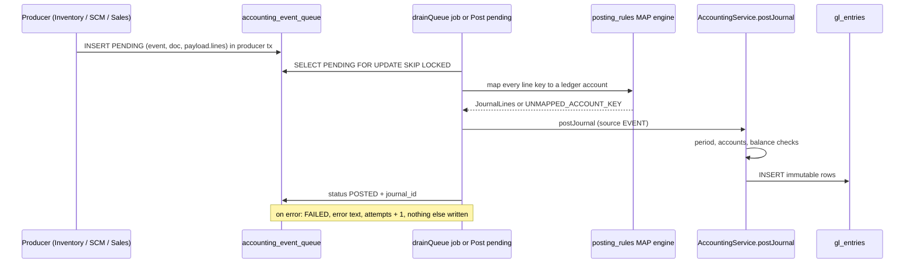
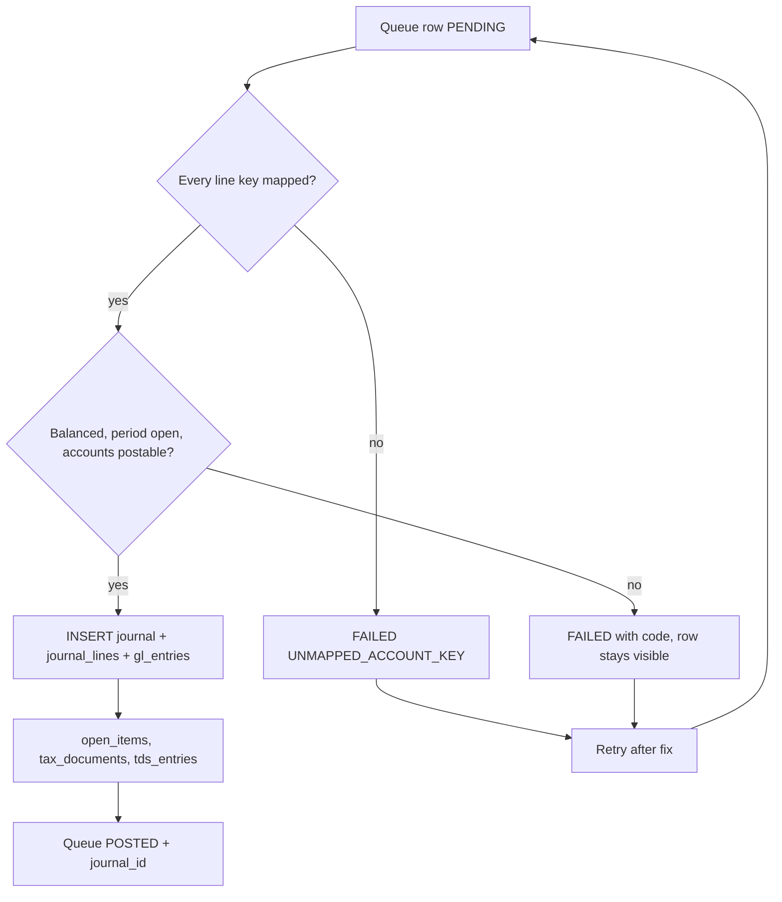
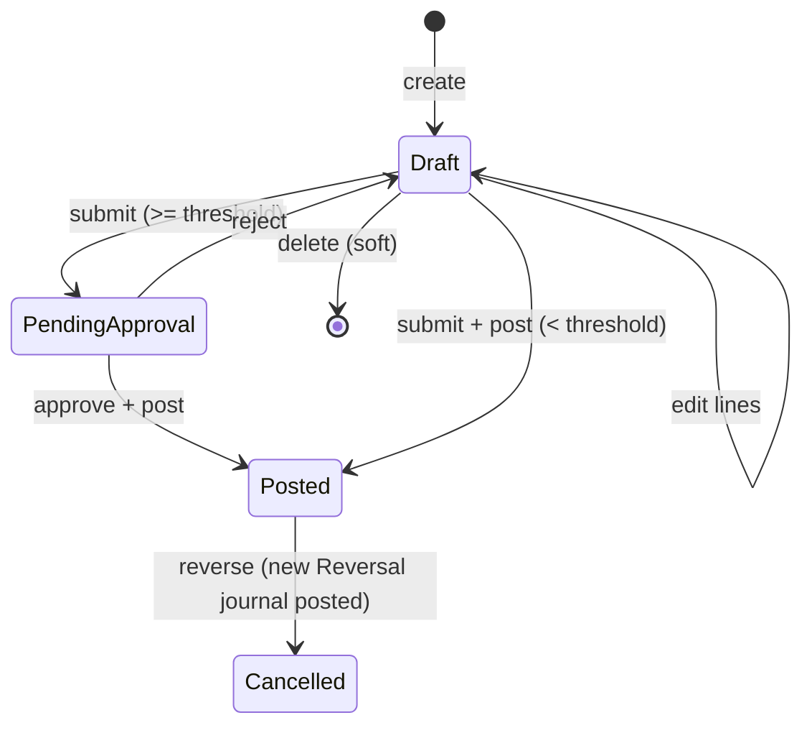
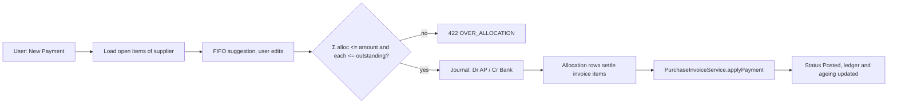
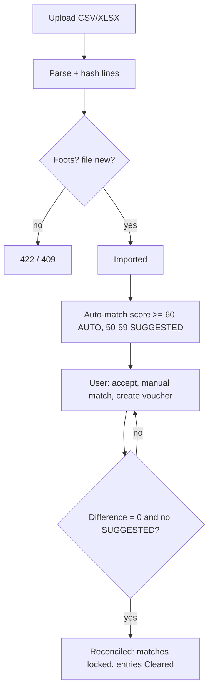
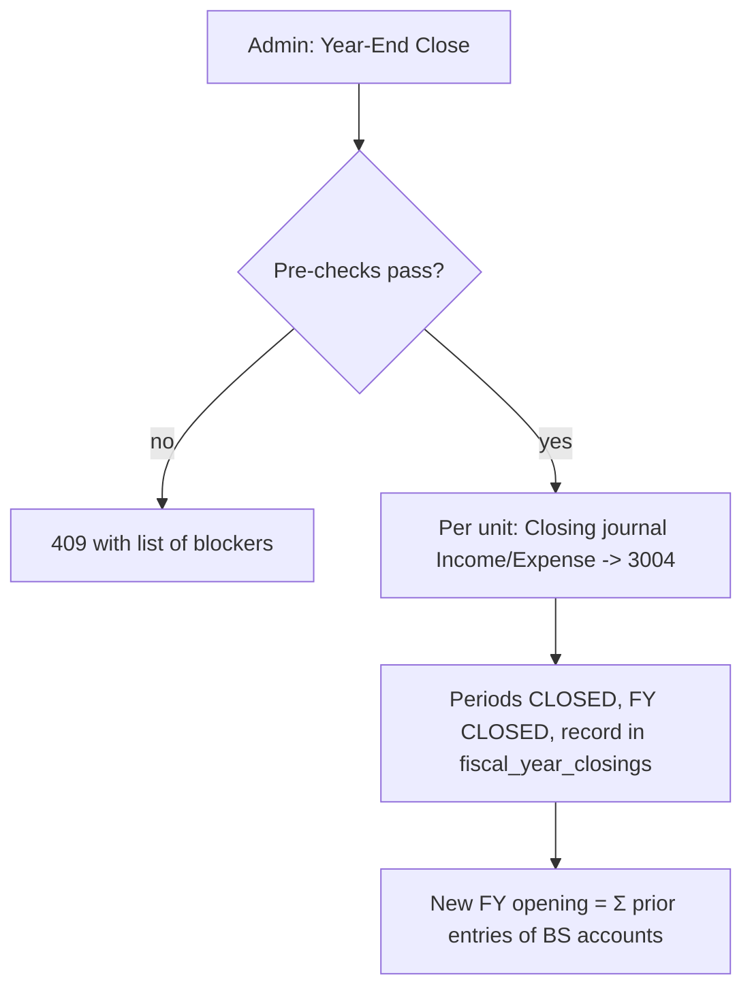
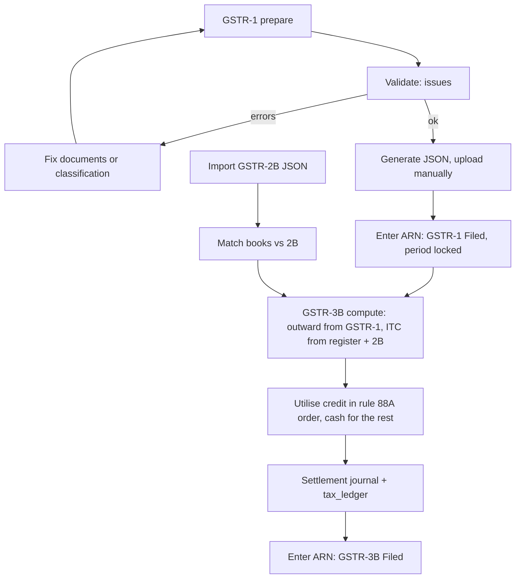
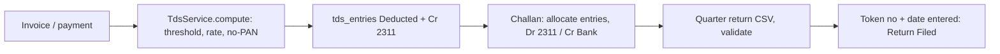
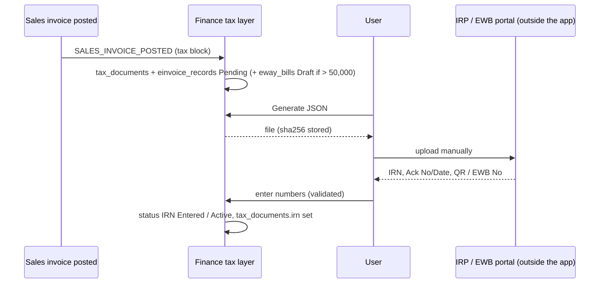

# 05a — Finance & Accounts + Indian Taxation: header, scope, frozen UI

> Part 1 of 5 of `05-FINANCE-TAX.md` (see the index file for the part map). Read `00-BUILDER-RULES.md` and `01-SHARED-FOUNDATION.md` first.

---

## 0. Header

**Purpose.** Build the real accounting engine of the Sawant Group ERP and the Indian tax layer on top of it:

* the chart of accounts, fiscal periods, the **immutable general ledger** (`gl_entries`), manual and automatic journals, the real `AccountingService.post / reverse`, `posting_rules`, and the drain of the `accounting_event_queue` that Inventory, SCM and Sales fill;
* cash / bank books, receipts and payments with bill-wise allocation, AR / AP, credit and debit notes, bank reconciliation, cost / profit centres, expense claims, budgets;
* the statutory reports (trial balance, P&L, balance sheet, indirect cash flow, ageing);
* GST (registrations, sales/purchase registers, GSTR-1, GSTR-2B reconciliation, GSTR-3B, ITC and cash ledgers), TDS and TCS (sections, deduction, challan, quarterly return data), e-invoice and e-way bill JSON with **manual** IRN / EWB number entry.

**Users.** Finance department (Accountant = MEMBER, Senior Accountant = LEAD, Finance Manager = MANAGER), CFO (module scope `finance`), ADMIN / SUPER_ADMIN. Other departments only *produce events*; they never write journals.

**Owner department.** Finance (every page here; Indian Taxation family: Finance).

**Money, dates, locale.** `numeric(18,2)` money, `Decimal` in code (never JS `number`), round half-up at 2 dp, India FY 1 Apr - 31 Mar (`financial_years.code` like `2026-27`), units `TAL` Talwade, `SAW` Sawardari, `VAR` Varale, ₹ with en-IN grouping, dates `YYYY-MM-DD` on the wire.

**Dependencies (build order).**

| Needs | From | Note |
|---|---|---|
| Users, roles, `requirePageAction`, audit, context (`req.ctx` unit/FY), `number_series`, `idempotency_keys`, generic engine, typed-page dispatch (`TYPED_PAGES`, `typedHandlerFor`) | Phases 1-5 | exists |
| `accounting_event_queue` (columns `id, event, doc_type, doc_id, doc_date, unit_id, payload, status, journal_id, error, created_at, processed_at`; unique `(event, doc_type, doc_id)`), `AccountingService.post` stub, `uoms`, `GlBridge` interface | `02-INVENTORY-WMS.md` (T-INV-02) | built before Finance; Finance replaces the stub body and implements `GlBridge` |
| The engine kit: `tabPanels`, `commands`, `requires` incl. `approve`, `LinesEditor`, tab-panel and command routes, web panel renderer | `07-ENGINE-KIT.md` (T-KIT-xx) | built before any module ticket; Finance tickets say "depends on T-KIT-xx (see 07)" |
| `parties` (+ addresses, bank accounts), `payment_terms`, `tax_codes`, `tax_code_rates`, `hsn_sac`, `tds_sections`, `document_links`, async `TaxService.compute(db, input)` / pure `computeWithRates`, `PurchaseInvoiceService.applyPayment`, `supplier_tds_ledger`, events `GRN_POSTED`, `PURCHASE_INVOICE_POSTED`, `PURCHASE_RETURN_POSTED` | `03-SCM-PROCUREMENT.md` | built before Finance |
| `sales_invoices`, `sales_credit_notes`, `sales_collections`, events `SALES_INVOICE_POSTED`, `CREDIT_NOTE_POSTED`, `SALES_RETURN_POSTED`, `DELIVERY_POSTED`, `RECEIPT_RECEIVED`, `EInvoiceGateway`, services `recordIrn` / `recordEwb` | `04-SALES-CRM.md` | built before Finance (the two service names are assumed, see 4.1.3 e.5) |
| Existing: `units`, `financial_years` (OPEN / CLOSED), `companies`, `settings` (key/value json) | Phase 3 | exists (one company; no company column anywhere, D-01) |

**Conventions taken from the architect's decisions.** Audit columns are `created_by_id`, `updated_by_id`, `deleted_by_id` (as the built tables). A unit of measure is stored as its code text (`uoms.code`), never an id. Currency is the text column `currency_code` (no currency FK; v1 posts INR only). `TaxService.compute` is async (`compute(db, input)`); Finance never calls it (tax arrives computed in the event payload).

**Foundation items used (and not redefined here).** `parties`, `payment_terms`, `tax_codes`, `tax_code_rates`, `hsn_sac`, `tds_sections` (plan 03; Finance adds four columns), `document_links`, `NumberingService.next`, `AccountingService.post/reverse` (this plan builds the real one), `accounting_event_queue` (this plan drains it), status vocabulary (foundation section 6), standard columns and CHECK conventions (foundation section 2, with the `_id` audit naming above).

**FOUNDATION-CHANGE list (decisions taken; builders are not blocked).**

| # | Text | Decision |
|---|---|---|
| FC-1 | `FOUNDATION-CHANGE:` `accounting_event_queue` (built by plan 02) gets two columns `attempts int not null default 0` and `last_error_at timestamptz null`; its `status` stays `PENDING / POSTED / FAILED`. The foundation call `post(tx, {event, docType, docId, date, lines})` is served by the real `AccountingService.post(tx, e)` which accepts the producers' shapes (4.1.1). | T-FIN-05 |
| FC-2 | `FOUNDATION-CHANGE:` `NumberingService` docTypes used by Finance: `JV, RCP, PAY, CNT, CRN, DBN, EXP, BUD, BRC, TDS, TCS, OBL, CLS, EWD` (format `<PFX>/<UNIT>/<FY>/<0001>`; they are the `page_id` value of the existing `number_series` row). | Use as written; add to plan 02's `DOC_PREFIX` map in T-FIN-04. |
| FC-3 | `FOUNDATION-CHANGE:` plan 03's `tds_sections` gets columns `kind` (`TDS` / `TCS`), `new_section`, `payment_code`, `return_form`; Finance inserts the TCS rows. | T-FIN-25 / T-FIN-31 |
| FC-4 | Profile-tab content, header commands and the `approve` action use the **single engine kit** of `07-ENGINE-KIT.md` (tickets T-KIT-xx, built before any module ticket): schema `tabPanels`, header `commands`, `requires` = `add|edit|delete|approve`, widened `lookup`, `LinesEditor`. Finance defines no kit of its own and only adds its panel builders and line kinds. | depends on T-KIT-xx (see 07) |
| FC-5 | `FOUNDATION-CHANGE:` `TYPED_PAGES` gains the 29 page ids of this plan (the kit builds the list from registered schemas; Finance registers its schemas). | T-FIN-08 |
| FC-6 | `FOUNDATION-CHANGE:` the new tables of Finance use `created_by_id / updated_by_id / deleted_by_id` (naming only). | all migrations |

---

## 1. Scope and status

### 1.1 Page table (29 pages)

"Kind": **typed** = own tables and own actions (a `TYPED_PAGES` handler, generic engine answers 404 `NOT_GENERIC`); **report-view** = read-only over ledger data (lists, totals, export, no create/edit/delete); **mixed** = a read-only ledger list plus `[ADD]` action buttons that create documents in other tables. "Exists" = what is in the repo today: for all 29 pages that is only the **generic placeholder** (`generic_records` through the generic engine, 6 profile tabs + 10 universal tabs, all non-register profile tabs show "built in Phase 8 / 12"). Everything below is **added**.

| # | Page id | Title | Family / owner dept | Kind | Storage / source | Exists today | Added by this plan |
|---|---|---|---|---|---|---|---|
| 1 | `fin-coa` | Chart of Accounts | Finance & Accounts / Finance | typed | `accounts`, `report_lines`, `account_defaults` | generic placeholder | typed CRUD, tree, validation, opening balances (T-FIN-10) |
| 2 | `fin-gl` | General Ledger | Finance / Finance | report-view | `gl_entries` | placeholder | ledger list, drilldown, movement, cost-centre split, period compare (T-FIN-11) |
| 3 | `fin-journal` | Journal Entries | Finance / Finance | typed | `journals`, `journal_lines` | placeholder | draft, submit, approve, post, reverse (T-FIN-09) |
| 4 | `fin-cashbook` | Cash Book | Finance / Finance | mixed | `gl_entries` of cash accounts; `payments` | placeholder | ledger view + `[ADD]` New Receipt / New Payment (T-FIN-14) |
| 5 | `fin-bankbook` | Bank Book | Finance / Finance | mixed | `gl_entries` of bank accounts; `payments`; `bank_matches` | placeholder | ledger view + `[ADD]` New Receipt / Payment / Transfer (T-FIN-14) |
| 6 | `fin-ap` | Accounts Payable | Finance / Finance | typed | `open_items` (PAYABLE), `allocations`, `payments` | placeholder | vendor invoice list, due schedule, payment proposal, block (T-FIN-15) |
| 7 | `fin-ar` | Accounts Receivable | Finance / Finance | typed | `open_items` (RECEIVABLE), `allocations`, `payments` | placeholder | invoice list, exposure, collection allocation (T-FIN-15) |
| 8 | `fin-creditnote` | Credit Notes | Finance / Finance | typed | `credit_debit_notes` (CUSTOMER_CREDIT) | placeholder | draft, approve, post, GST adjustment (T-FIN-16) |
| 9 | `fin-debitnote` | Debit Notes | Finance / Finance | typed | `credit_debit_notes` (VENDOR_DEBIT) | placeholder | same (T-FIN-16) |
| 10 | `fin-bankreco` | Bank Reconciliation | Finance / Finance | typed | `bank_statements`, `bank_statement_lines`, `bank_matches` | placeholder | import, auto-match, manual match, reconcile (T-FIN-17) |
| 11 | `fin-costcenter` | Cost Centers | Finance / Finance | typed | `cost_centers` (+ computed budget / actual) | placeholder | master + tree + statement (T-FIN-12) |
| 12 | `fin-profitcenter` | Profit Centers | Finance / Finance | typed | `profit_centers` (+ computed revenue / cost) | placeholder | master + segment P&L (T-FIN-12) |
| 13 | `fin-expenses` | Expense Management | Finance / Finance | typed | `expense_claims`, `expense_policies` | placeholder | claim, policy check, approve, post (T-FIN-22) |
| 14 | `fin-budget` | Budgeting | Finance / Finance | typed | `budgets`, `budget_months`, `budget_commitments` | placeholder | budget, control mode, commitments (T-FIN-23) |
| 15 | `fin-trial` | Trial Balance | Finance / Finance | report-view | SQL function over `gl_entries` | placeholder | TB report (T-FIN-18) |
| 16 | `fin-pnl` | Profit & Loss | Finance / Finance | report-view | `report_lines` + `gl_entries` | placeholder | P&L (T-FIN-19) |
| 17 | `fin-bs` | Balance Sheet | Finance / Finance | report-view | `report_lines` + `gl_entries` | placeholder | Schedule III style BS (T-FIN-19) |
| 18 | `fin-cashflow` | Cash Flow | Finance / Finance | report-view | indirect method over `gl_entries` | placeholder | cash flow (T-FIN-20) |
| 19 | `fin-ageing` | AR/AP Ageing | Finance / Finance | report-view | `open_items` | placeholder | buckets, top overdue, collection priority (T-FIN-21) |
| 20 | `tax-gst` | GST Setup | Indian Taxation / Finance | typed | `gst_registrations` (+ tax-code / POS read) | placeholder | GSTIN registrations per unit (T-FIN-26) |
| 21 | `tax-gstr1` | GSTR-1 | Indian Taxation / Finance | typed | `gst_returns`, `gst_return_sections`, `gst_return_issues` | placeholder | prepare, validate, JSON (T-FIN-28) |
| 22 | `tax-gstr3b` | GSTR-3B | Indian Taxation / Finance | typed | `gst_returns`, `tax_ledger` | placeholder | compute, utilise credit, payment (T-FIN-30) |
| 23 | `tax-tds` | TDS | Indian Taxation / Finance | typed | `tds_entries`, `tax_challans`, `tax_returns`, `tds_sections` | placeholder | register, challan, return prep (T-FIN-31) |
| 24 | `tax-tcs` | TCS | Indian Taxation / Finance | typed | same tables, `kind='TCS'` | placeholder | same (T-FIN-32) |
| 25 | `tax-hsn` | HSN / SAC | Indian Taxation / Finance | typed | `hsn_sac` (plan 03 table) + usage counts | placeholder | typed master page (T-FIN-26) |
| 26 | `tax-einvoice` | E-Invoice | Indian Taxation / Finance | typed | `einvoice_records` | placeholder | JSON + manual IRN (T-FIN-33) |
| 27 | `tax-eway` | E-Way Bill | Indian Taxation / Finance | typed | `eway_bills`, `eway_validity_rules` | placeholder | JSON + manual EWB + validity (T-FIN-34) |
| 28 | `tax-salesreg` | Sales Register | Indian Taxation / Finance | report-view | `tax_documents` (OUTWARD) | placeholder | register (T-FIN-27) |
| 29 | `tax-purchasereg` | Purchase Register | Indian Taxation / Finance | report-view | `tax_documents` (INWARD) + 2B match | placeholder | register, ITC eligibility, 2B match (T-FIN-27, T-FIN-29) |

### 1.2 Decisions on page behaviour

1. **Report-view pages** (`fin-gl`, `fin-trial`, `fin-pnl`, `fin-bs`, `fin-cashflow`, `fin-ageing`, `tax-salesreg`, `tax-purchasereg`): the API answers `GET` list / get / export only. `POST`, `PATCH`, `DELETE`, restore, bulk, actions on them answer **405 `READ_ONLY`** (existing code). The schema says `readOnly: true`. **The frozen UI keeps the buttons**: header `＋ Add`, record-bar `＋ Add`, `Edit`, `Delete` render **disabled** with `title="Report — post a voucher instead"` (decision D-07). `Excel`, `Letterhead PDF`, `Print` stay enabled (permission `export`). `Submit Approval` / `Approval Queue` / `Documents` buttons stay as the prototype draws them.
2. **Mixed pages** (`fin-cashbook`, `fin-bankbook`): same as report-view for the frozen buttons, plus `[ADD]` buttons appended after the frozen ones in the header: `＋ Receipt`, `＋ Payment` (bank book also `＋ Transfer`). They open a modal that posts a `payments` document (section 4.4). The register rows are ledger rows (read-only); the tabs `Receipts`, `Payments`, `Transfers` list the `payments` documents (views).
3. **Typed pages** use the Inventory pattern: `definitions.ts` (schema), a handler in the module `typed-pages.ts`, service + repository, migration, tests. Status changes are **actions** (`POST /pages/:pageId/records/:id/actions/:action`), not the generic `/status`.
4. **`tax-gstr1`, `tax-gstr3b`** have no field called exactly `Status` (they have `Filing Status`). The internal `status` column holds the same words as `Filing Status` (`Not Started`, `Prepared`, `Validated`, `JSON Ready`, `Filed`, `Revised`); the schema lists them as `statuses`.
5. **`fin-pnl`, `fin-bs`, `fin-cashflow`** declare `Current Month`, `Current Period`, `Prior Period` as `date` in `field-types.json` (an artefact of the label classifier). The API schema keeps those **labels** unchanged but declares the typed columns as `money` (they hold amounts). Reviewer: the schema test for these three pages compares **labels and order**, not the `date` type (open question OQ-1, default taken).
6. **Employee Vendor** (`fin-expenses`), **Deductee / Collectee** (`tax-tds`, `tax-tcs`), **Vendor / Customer** fields are `ref` to `parties` (lookup `GET /lookups/parties?role=customer|supplier|transporter`). Until HRMS exists employees who claim expenses are created as `parties` with `party_type='INDIVIDUAL'`, `is_supplier=true` (OQ-2).
7. **Vehicle** (`tax-eway`) is a `ref` in the registry; Logistics (`log-vehicles`) does not exist yet. v1 stores a vehicle number (`^[A-Z]{2}[0-9]{1,2}[A-Z]{0,3}[0-9]{4}$`) as text in `eway_bills.vehicle_no` and the schema declares the field `text`-like `ref` with `lookup: null` (OQ-3).
8. **Approval** (`fin-creditnote`, `fin-debitnote` field `Approval`): until Phase 6 `ApprovalService` exists, Finance runs a built-in **maker-checker**: a document at or above the threshold (setting `fin.note_approval_threshold`, default `100000.00`) needs an `approve` action by a different user than the creator. The `Approval` field shows `Not Required`, `Pending`, `Approved`, `Rejected`. Journals use the same setting `fin.journal_approval_threshold` (default `500000.00`, total debit).
9. **Unit dimension.** Periods are **global**; the unit is a **dimension** on every journal (`journals.unit_id`, `journal_lines.unit_id`, `gl_entries.unit_id`). All lists filter by context unit; "All Units" (ADMIN+) reads consolidated figures, never writes (`requireConcreteUnit`).
10. **Which department may do what.** MEMBER (Accountant): create drafts, post receipts and payments within limits; LEAD: approve and post journals, reconcile bank; MANAGER: lock periods, reverse; ADMIN+: year-end close, unlock a LOCKED (not CLOSED) period. Enforced only through `requirePageAction` (`add`, `edit`, `delete`, `export`, `view`) plus the extra permission flags in the table of section 7.6; never by role name inside a service.

---

## 2. The frozen UI, page by page

### 2.0 Common rules for every page in this plan

* The page shows the **16 tabs**: `Module Dashboard`, the 6 profile tabs (registry names below, exact), then the universal tabs `Analytics & Graphs`, `AI Decision Center`, `Automation Studio`, `Data Quality`, `Documents`, `Approvals`, `Reports`, `Audit Trail` (as `moduleTabs()` in `apps/web/src/pages/generic/fieldModel.ts`). **This plan changes only the 6 profile tabs** (and nothing else of the 16-tab strip).
* The register tab is the profile tab matching `/register|list|directory|master|queue|log/i`, else the first profile tab (`registerTabName`). It shows the list columns below (<= 12 fields, in registry order). `[ADD]` columns/fields come after the frozen ones.
* **Tab mapping for the six profile tabs.** Finance uses the engine kit of `07-ENGINE-KIT.md`. The page schema carries `tabPanels` (one entry per profile tab: tab name, panel key, title, panel sections), header `commands` (buttons appended after the frozen ones) and actions with `requires` `add | edit | delete | approve`. Finance writes only the **panel builders** (the data of each panel) and its own line kinds. In the tables below "panel `key`" names the panel key of that tab and "register" means the register tab (the page list). This plan gives every profile tab of the 29 pages real content (no "built in Phase N" notice remains).
* Row actions appear in the register's action column and in the record drawer; confirmation text uses `{code}` as in Inventory.
* **Empty state** (all pages): table body shows `No records yet.` (existing text) plus, for typed pages, the hint line given per page. Report pages with no ledger data show `No postings in the selected period.`
* **Totals line** (typed schema `totals`): shown under the register; money formatted en-IN with ₹.
* Context chips (Department, Role, Owner, Approval) unchanged. `Owner: Finance` for all pages.
* Field `required` marks below are from `apps/api/tests/fixtures/field-types.json` (`*`). A `code` field that is required is generated by the server (numbering) and read-only on create.
* **Field type words** (from the fixture): `code, text, longtext, money, qty, pct, date, datetime, ref, enum, status, bool, gstin, pan, hsn`. Enum option lists are decided here (frozen as the option list of the typed schema; "Category", "Method", "Mode", "Type" are drop-downs per builder-rules lesson 4).

### 2.1 Finance & Accounts (19 pages)

#### 2.1.1 `fin-coa` Chart of Accounts (typed)

Purpose line (registry): "Maintain controlled double-entry accounting, reconciliations, working capital and statutory-ready financial reporting."

| Field (label, exact) | Type | Req | Stored in / notes |
|---|---|---|---|
| Account Code | code | * | `accounts.code` `^[0-9]{4,8}$`, user-entered on create (not auto-numbered), unique, immutable once the account has entries |
| Account Name | text | * | `accounts.name` 2-120 |
| Account Type | enum | | `Asset`, `Liability`, `Equity`, `Income`, `Expense` (`accounts.root_type`) |
| Parent Group | ref | | `accounts.parent_id` -> `refPage: fin-coa`, only `is_group=true` accounts |
| Normal Balance | enum | | `Debit` / `Credit`; read-only, derived from type (Asset, Expense = Debit; others Credit) |
| Posting Allowed | bool | | `accounts.posting_allowed`; forced `false` for groups; leaf accounts default `true` |
| Cost Center Required | bool | | `accounts.cost_center_required` |
| Tax Mapping | text | | `accounts.tax_mapping` free text <= 60, e.g. `GST-OUT-CGST`, `TDS-194C`; **[ADD]** also a machine key in `accounts.tax_key` (drop-down in the form, section 5.2) |
| Currency | text | | `accounts.currency_code` default `INR`, 3 letters |
| Status | status | | `Active`, `Inactive` |
| **[ADD]** Sub Type | enum | | `accounts.sub_type` (Bank, Cash, Receivable, Payable, Stock, Fixed Asset, Accumulated Depreciation, CWIP, GST Input, GST Output, TDS Payable, TDS Receivable, TCS Payable, Round Off, Retained Earnings, COGS, Other) - drives report mapping |
| **[ADD]** Report Line | ref | | `accounts.report_line_code` (Schedule III line) |
| **[ADD]** Cash Flow Class | enum | | `accounts.cf_class` |

Register columns (10): Account Code, Account Name, Account Type, Parent Group, Normal Balance, Posting Allowed, Cost Center Required, Tax Mapping, Currency, Status.
Statuses `Active`, `Inactive`. Header buttons frozen (`Excel`, `Letterhead PDF`, `Print`, `＋ Add`). Row actions: `activate`, `deactivate` (Inactive hides it from lookups; blocked while the balance is non-zero: 409 `ACCOUNT_HAS_BALANCE`), `delete` (soft delete only when the account has no entries and no children; else 409 `IN_USE`). Filters: `type` (select), `postingAllowed` (bool), `q` (code or name), `group` (parent). Totals: none. Empty hint: "Run the COA seed or add the first group account."

| Tab (registry name) | Prototype renderer | What it shows / does | Data |
|---|---|---|---|
| Account Tree | v9Tree | Indented tree of groups and ledgers with the live balance per node (Dr/Cr, ₹); node click opens the drawer; `Update Node` = edit; groups expand/collapse | `GET /finance/accounts/tree?asOf=` (balances from `gl_entries`) |
| Account Master | v9Master | The register table (the flat list with Edit/Delete) | register |
| Group Mapping | v9Mapping | Table `Account | Schedule III Report Line | Cash Flow Class | Sub Type` with inline selects; `Save Mapping` PATCHes accounts; `Test Mapping` runs the COA validation and shows unmapped count | `PATCH /finance/accounts/:id` + `GET /finance/coa/validation` |
| Posting Controls | v9Ledger | Two blocks: (a) account flags (posting allowed, cost-centre required) list; (b) **fiscal period grid** `Period | From | To | Status | GST filed | Action` with `Lock`, `Unlock`, `Close` buttons (permission flags in 7.6), and the FY `Year-End Close` button | `GET /finance/periods`, `POST /finance/periods/:id/{lock,unlock,close}`, `POST /finance/fiscal-years/:fyId/close` |
| Opening Balances | v9Payment | Grid `Account | Debit | Credit` for the go-live opening trial balance with a live "Difference" and the `Post Opening Balances` button (creates journal voucher type `OPENING`, only before go-live lock) | `GET/PUT /finance/opening-balances`, `POST /finance/opening-balances/post` |
| COA Validation | v9Validation | Rule table (Pass / Warning / Fail counts) for: every ledger has a report line, every leaf has a type, no group has entries, no duplicate names under the same parent, required default accounts exist (`account_defaults`), control accounts flagged; `Run Full Validation` | `GET /finance/coa/validation` |

#### 2.1.2 `fin-gl` General Ledger (report-view)

Fields: Posting Date:date*, Voucher No:text, Voucher Type:enum, Account:ref, Narration:longtext, Debit:money, Credit:money, Cost Center:ref, Profit Center:ref, Reference:ref, Running Balance:money, Status:status. Register columns (12) in this order. All read-only. `Voucher Type` options: `Journal`, `Receipt`, `Payment`, `Contra`, `Sales Invoice`, `Purchase Invoice`, `Credit Note`, `Debit Note`, `Goods Receipt`, `Delivery`, `Stock Adjustment`, `Expense`, `Opening`, `Closing`, `Reversal`, `Depreciation`, `Bank Charges`, `Other`. `Reference` is the source document (code, link by `refs`). `Running Balance` is computed **per account** in posting order when an account filter is set; without an account filter it is blank (`-`). `Status`: `Posted`, `Reversed` (original entry whose journal was reversed), `Reversal`.

Filters: `account` (lookup), `from`, `to`, `voucherType`, `costCenter`, `profitCenter`, `party`, `q` (narration / voucher no), `includeClosing` (bool, default false). Context unit + FY apply (FY default range = whole FY). Totals: `debit`, `credit` of the filtered set and `closingBalance` when an account is selected.
Empty: "No postings in the selected period."

| Tab | Renderer | Shows | View key / API |
|---|---|---|---|
| General Ledger | v9Ledger | the register (ledger rows) | register |
| Voucher Drilldown | v9Ledger | pick a voucher no -> all lines of that journal with account, Dr, Cr, party, CC, PC, narration and a link to the source document; `Reverse` link only for a MANAGER (calls journals reverse) | `GET /finance/journals/:id` (by `voucherNo` query) |
| Account Movement | v9Allocation | one account: opening, Σ debit, Σ credit, closing for each period (month) of the FY, bar chart | panel `movement` (query `account`) |
| Cost Center Split | v9Finance | for one account (or all P&L accounts): amount by cost centre and by profit centre with % share | panel `ccsplit` |
| Period Comparison | analyticsTab | selected account group: current period vs previous period vs same period last FY, variance and % | panel `compare` |
| Ledger Audit | v9Ledger | ledger integrity checks: Σ Dr = Σ Cr per voucher, entries without a valid voucher, entries in a locked period created after the lock, reversal pairs; list of offenders | `GET /finance/ledger/integrity` |

#### 2.1.3 `fin-journal` Journal Entries (typed)

Fields: JV No:code* (auto `JV/<UNIT>/<FY>/0001`, read-only), Date:date* (posting date), Reference:ref (source document or free `reference_no`), Narration:longtext, Debit Total:money (read-only, computed), Credit Total:money (read-only, computed), Cost Center:ref (default cost centre of the lines; header convenience), Supporting Doc:text, Prepared By:ref (read-only = creator), Approved By:ref (read-only, set by approve), Posting Status:enum (`Not Posted`, `Pending Approval`, `Posted`, `Reversed`; read-only), Status:status (`Draft`, `Posted`, `Cancelled`). **[ADD]** Voucher Type:enum (`Journal`, `Opening`, `Closing`, `Depreciation`, `Provision`, `Adjustment`, `Reversal`, `Bank Charges`), **[ADD]** Lines (child grid, not a column), **[ADD]** Auto Reverse On:date (accrual reversal, optional).

Register columns (12) in order: JV No, Date, Reference, Narration, Debit Total, Credit Total, Cost Center, Supporting Doc, Prepared By, Approved By, Posting Status, Status. Event-created journals (source `EVENT`/`PAYMENT`) are listed too, flagged `Reference` = source doc; they are never editable.
Statuses `Draft`, `Posted`, `Cancelled`; editable only `Draft`.
Row actions: `submit` (Draft, validates balanced; sets `Pending Approval` when total debit >= threshold, else straight to post-ready), `approve` (LEAD+; approver != preparer: 403 `MAKER_CHECKER`), `post` (Draft/approved -> Posted, writes gl_entries), `reverse` (Posted, MANAGER, asks `reason` and `reversalDate`), `delete` (Draft only, soft). Confirm texts: `Post journal {code}? Posted journals can never be edited; only reversed.`; `Reverse journal {code}? A new journal with debit and credit swapped will be posted.`
Header buttons frozen + `[ADD]` none. Filters: `status`, `from`, `to`, `voucherType`, `source` (`Manual`/`System`), `preparedBy`, `q`. Totals: `debitTotal`, `creditTotal`. Empty: "No journals yet. Use ＋ Add to create one."
Web behaviour (T-FIN-40): the add/edit modal is a **journal editor**: header fields + a lines grid (`Account`, `Party` when the account is a control account, `Cost Center`, `Profit Center`, `Debit`, `Credit`, `Narration`) with **live Σ Debit, Σ Credit, Difference**; `Save` and `Post` are disabled while Difference is not exactly `0.00`.

| Tab | Renderer | Shows | Data |
|---|---|---|---|
| Journal Register | v9Ledger | the register | register |
| Debit Credit Lines | v9Ledger | all lines (journal, account, party, CC, Dr, Cr) filtered like the register; shows line-level Σ | panel `lines` |
| Supporting Documents | v9DocumentOps | journals with their `Supporting Doc` text and attached documents (Documents tab store); `Open Upload Vault` | panel `docs` |
| Approval & Posting | v9Approval | queue of `Pending Approval` journals with value, preparer, age; `Approve` / `Reject` buttons; the 5-level stepper of the prototype shows Level 1 Preparer, Level 2 Senior Accountant (LEAD), Level 3 Finance Manager; levels above are `NA` | panel `approval` + actions |
| Reversal Entries | v9Ledger | pairs (original <-> reversal), date, reason, user; `Reverse` button for the selected posted journal | panel `reversals` |
| Journal Audit | v9Ledger | audit rows of `JOURNAL_*` actions (who/when/ip for ADMIN+) | `GET /pages/fin-journal/audit` |

#### 2.1.4 `fin-cashbook` Cash Book (mixed)

Fields: Date:date*, Voucher No:text, Receipt Payment:text (`Receipt` / `Payment` / `Contra`), Party:ref, Narration:longtext, Cash In:money, Cash Out:money, Balance:money, Reference:ref, User:ref, Status:status. Register (11 columns) = ledger rows of **cash accounts** (`accounts.sub_type='Cash'`), `Balance` = running balance per cash account (filter `cashAccount`; default = the unit's main cash account `1101-x`). Statuses `Posted`, `Reversed`, `Reversal`.
`[ADD]` header buttons: `＋ Receipt`, `＋ Payment` (open the payment modal with mode `CASH`). Filters: `cashAccount`, `from`, `to`, `party`, `kind`, `q`. Totals: `cashIn`, `cashOut`, `closingBalance`. Empty: "No cash vouchers in this period."

| Tab | Renderer | Shows | Data |
|---|---|---|---|
| Cash Book | v9Ledger | the register | register |
| Receipts | v9Payment | cash receipt documents (`payments.kind='RECEIPT', mode='CASH'`): voucher, party, amount, allocated, unallocated; `Allocate` button for the unallocated part | panel `receipts` |
| Payments | v9Payment | cash payment documents | panel `payments` |
| Petty Cash | v9Ledger | ledger of the accounts with `sub_type='Cash'` and `is_petty=true` (imprest), balance vs imprest limit (`bank_accounts.imprest_limit`) | panel `petty` |
| Cash Reconciliation | v9Ledger | denomination count form: physical count total vs book balance, difference; `Save Count` writes an audit note (no journal); a non-zero difference offers `Post Cash Difference` -> journal to `5995 Cash Short / Excess` | panel `count` + `POST /finance/cash-counts` |
| Cash Position | v9Ledger | cash balance per unit/account today, 7-day inflow / outflow, negative-cash alerts | panel `position` |

#### 2.1.5 `fin-bankbook` Bank Book (mixed)

Fields: Date:date*, Voucher No:text, Bank Account:ref, Receipt Payment:text, Party:ref, Instrument UTR:text, Debit:money (deposit), Credit:money (withdrawal), Balance:money, Clearing Status:enum (`Uncleared`, `Cleared`), Status:status. Register 11 columns. `Clearing Status` = `Cleared` iff an active row exists in `bank_matches` for the entry (set only by reconciliation). `[ADD]` header buttons `＋ Receipt`, `＋ Payment`, `＋ Transfer` (bank-to-bank or cash<->bank contra). Filters: `bankAccount`, `from`, `to`, `clearing`, `party`, `q`. Totals: `debit`, `credit`, `closingBalance`, `unclearedNet`.

| Tab | Renderer | Shows | Data |
|---|---|---|---|
| Bank Book | v9Ledger | the register | register |
| Bank Receipts | v9Payment | bank receipt documents with UTR, party, allocation | panel `receipts` |
| Bank Payments | v9Payment | bank payment documents | panel `payments` |
| Transfers | v9Allocation | contra / inter-bank transfers (`payments.kind='TRANSFER'`) with from, to, amount, UTR; both legs | panel `transfers` |
| Uncleared Items | v9Ledger | ledger rows with `Clearing Status = Uncleared` ordered oldest first, age in days, flag > 30 days | panel `uncleared` |
| Bank Position | v9Ledger | per bank account: book balance, last statement balance and date, uncleared net, last reconciled date | panel `position` |

#### 2.1.6 `fin-ap` Accounts Payable (typed over `open_items`, side PAYABLE)

Fields: Vendor Invoice:ref* (the invoice document no; stored `open_items.doc_no`; `refs` link to the purchase invoice when it exists), Vendor:ref (`parties`), Invoice Date:date*, Due Date:date, Invoice Amount:money, Paid:money, Outstanding:money, Age Days:qty, Payment Block:text (`blocked_reason`, empty = not blocked), Payment Method:enum (`NEFT`, `RTGS`, `IMPS`, `UPI`, `Cheque`, `Cash`), Status:status (`Open`, `Part Paid`, `Paid`, `Blocked`, `Cancelled`). Computed server side: `Paid = Σ allocations`, `Outstanding = Invoice Amount - Paid`, `Age Days = max(0, asOf - Due Date)`.
`Add` (frozen) = **Opening Bill** only (dates before `fin.go_live_date`), see section 4.4.7; after go-live the button is disabled with the tooltip "Vendor bills come from Purchase Invoices". Row actions: `block` (reason required), `unblock`, `addToProposal`, `pay` (opens payment modal prefilled), `cancel` (only Opening Bills with zero allocations; posts reversal). Filters: `vendor`, `status`, `dueFrom`, `dueTo`, `overdue` (bool), `msme` (bool, `[ADD]`), `q`. Totals: `invoiceAmount`, `paid`, `outstanding`, `overdue`. `[ADD]` columns after the 11: `MSME Due By`, `TDS Withheld`.

| Tab | Renderer | Shows | Data |
|---|---|---|---|
| Vendor Payables | v9Payment | open payables grouped by vendor: invoices, ₹ outstanding, due today, overdue, advance on account; `Allocate` / `Pay` | panel `vendors` |
| Invoice Queue | registerTab | the register (all invoices) | register |
| Due Schedule | v9Payment | outstanding by due date (this week, next 7 / 15 / 30 days), MSME 45-day alerts | panel `due` |
| Payment Proposal | v9Payment | selectable list; `Create Proposal` builds a payment run (`[ADD]` MUST: one payment per vendor, amount editable, TDS/credit applied); `Release` posts payments | panel `proposal`, `POST /finance/payment-proposals` |
| Debit Notes | v9Payment | vendor debit notes (negative open items) and their allocation to invoices | panel `debitnotes` |
| AP Ageing | v9Ageing | bucket chart Current / 1-30 / 31-60 / 61-90 / 90+ from `open_items` | `GET /finance/ageing?side=PAYABLE` |

#### 2.1.7 `fin-ar` Accounts Receivable (typed over `open_items`, side RECEIVABLE)

Fields: Invoice No:code*, Customer:ref*, Invoice Date:date*, Due Date:date, Invoice Amount:money, Received:money, Outstanding:money, Age Days:qty, Credit Limit:money (from `parties.credit_limit`), Collection Owner:ref (`open_items.collection_owner_id` -> users, default `parties.sales_person_id`), Status:status (`Open`, `Part Received`, `Received`, `Disputed`, `Cancelled`). Actions: `receive` (opens receipt modal), `dispute` / `resolveDispute`, `setOwner`, `promise` (`[ADD]` promise-to-pay date + amount stored in `open_items.promise_date/promise_amount`), `cancel` (Opening Bills only). Filters `customer`, `status`, `overdue`, `owner`, `q`, `dueFrom/dueTo`. Totals `invoiceAmount`, `received`, `outstanding`, `overdue`.

| Tab | Renderer | Shows | Data |
|---|---|---|---|
| Customer Receivables | v9Payment | per customer: outstanding, overdue, credit limit, utilisation %, unallocated receipts | panel `customers` |
| Invoice Exposure | v9Ledger | invoices ordered by outstanding with running exposure vs credit limit | panel `exposure` |
| Due Schedule | v9Payment | outstanding by due date bucket, promises to pay | panel `due` |
| Collection Allocation | v9Allocation | unallocated receipts and open invoices side by side; `Allocate` (FIFO suggestion, user can edit) | panel `allocation`, `POST /finance/payments/:id/allocate` |
| Credit Notes | v9Payment | customer credit notes (negative open items) and their allocation | panel `creditnotes` |
| AR Ageing | v9Ageing | bucket chart from `open_items` | `GET /finance/ageing?side=RECEIVABLE` |

#### 2.1.8 `fin-creditnote` Credit Notes (typed) and 2.1.9 `fin-debitnote` Debit Notes (typed)

Credit Note fields: Credit Note No:code* (`CRN/<UNIT>/<FY>/0001`), Customer:ref*, Invoice Ref:ref (the original `open_items` / tax document), Date:date*, Reason:longtext, Taxable Adjustment:money, GST Adjustment:money, Total:money (= taxable + GST, computed), Approval:text (`Not Required`/`Pending`/`Approved`/`Rejected`, read-only), Posting Ref:ref (the journal, read-only), Status:status (`Draft`, `Submitted`, `Approved`, `Posted`, `Rejected`, `Cancelled`). `[ADD]`: Reason Code:enum (`Sales Return`, `Post Sale Discount`, `Deficiency in Services`, `Correction in Invoice`, `Change in POS`, `Finalization of Provisional Assessment`, `Others`), Lines (grid: description, HSN, qty, taxable, rate; the tax is computed by `TaxService.compute` rules of the original invoice: **same rate as the original invoice**).
Debit Note fields identical with `Vendor` instead of `Customer` (`DBN/...`), meaning a debit note **issued to a vendor** (purchase return / price correction); the ITC of the original invoice is reversed proportionally.
Register columns (11) in registry order. Actions: `submit`, `approve` (threshold, maker-checker), `reject`, `post`, `cancel` (Draft/Submitted only; a Posted note is cancelled by `reverse` which also reverses its tax document), `delete` (Draft). Filters `status`, `party`, `from`, `to`, `reasonCode`, `q`. Totals `taxableAdjustment`, `gstAdjustment`, `total`.

| Tab (Credit Note) | Renderer | Shows | Data |
|---|---|---|---|
| Credit Note Register | v9Payment | the register | register |
| Reference Invoice | v9Ledger | original invoice(s) with amount, already credited, balance creditable, link | panel `invoices` |
| Tax Adjustment | v9TaxWorkspace | per rate: taxable, CGST, SGST, IGST, cess adjustment; GSTR-1 CDNR readiness checks (GSTIN valid, original invoice found, within Section 34 limit) | panel `tax` |
| Approval | v9Approval | pending approvals (>= threshold), Approve/Reject | panel `approval` |
| Ledger Posting | v9Ledger | the journal lines each posted note produced (Dr Sales Returns, Dr Output GST, Cr AR) | panel `posting` |
| Credit Note Analysis | v9Payment | by reason code and month: count, taxable, GST; top customers | panel `analysis` |

Debit Note tabs: `Debit Note Register`, `Vendor Reference`, `Tax Adjustment`, `Approval`, `Ledger Posting`, `Debit Note Analysis` with the same renderer list and the vendor-side meaning (ITC reversal shown in `Tax Adjustment`).

#### 2.1.10 `fin-bankreco` Bank Reconciliation (typed over `bank_statements`)

Fields: Statement Ref:code* (`BRC/<UNIT>/<FY>/0001`), Bank Account:ref, Statement Date:date* (the closing date of the statement), ERP Balance:money, Bank Balance:money (statement closing balance), Matched Amount:money, Unmatched Bank:money, Unmatched ERP:money, Difference:money, Reconciled By:ref, Status:status (`Draft`, `Imported`, `In Progress`, `Reconciled`, `Cancelled`). All six money fields except `Bank Balance` are computed (read-only). `Bank Balance` is entered/derived from the file (`closing_balance`).
Actions: `import` (upload CSV/XLSX), `autoMatch`, `reconcile` (only when `Difference = 0.00`), `reopen` (MANAGER; reverses clearing), `cancel` (Imported / In Progress with no `Reconciled`). Filters `bankAccount`, `status`, `from`, `to`. Totals `matched`, `unmatchedBank`, `unmatchedErp`, `difference`.

| Tab | Renderer | Shows | Data |
|---|---|---|---|
| Reconciliation Workspace | v9Ledger | two panes: bank lines (left) and ERP entries (right) for the selected statement; select one or many on each side and click `Match`; `Unmatch`; live Difference | `GET /finance/bank-reco/:id/workspace` |
| Bank Statement | v9Ledger | the imported lines with match status | panel `lines` |
| ERP Transactions | v9TaxWorkspace | GL entries of the bank account up to the statement date not yet cleared (candidates), with age | panel `erp` |
| Auto Matching | v9Ledger | matches found by `autoMatch` with score, method, `Accept`/`Reject` for SUGGESTED, rule explanation | panel `matches` |
| Unmatched Exceptions | v9Exceptions | unmatched bank lines (needs a voucher: `Create Voucher` from line -> bank charges, interest, receipt, payment) and unmatched ERP entries older than 7 days | panel `exceptions` |
| Reconciliation Summary | v9Ledger | the standard reconciliation statement: book balance, + deposits in transit, - cheques outstanding, +/- bank-only items = bank balance, Difference; `Print` | panel `summary` |

#### 2.1.11 `fin-costcenter` Cost Centers and 2.1.12 `fin-profitcenter` Profit Centers (typed)

Cost Center fields: Cost Center Code:code* (`^[A-Z0-9-]{2,20}$`, user-entered, unique), Cost Center Name:text*, Department:ref (`departments` name stored as text), Manager:ref (users), Parent:ref (`fin-costcenter`), Budget:money (computed Σ approved budgets in the FY), Actual:money (computed from gl_entries), Committed:money (computed from `budget_commitments`), Available:qty (computed `Budget - Committed - Actual`, may be negative; shown ₹), Status:status (`Active`, `Inactive`). Actions `activate`, `deactivate`, delete (soft; 409 `IN_USE` if entries or children). Filters `department`, `parent`, `status`, `q`. Totals `budget`, `actual`, `committed`, `available`.

| Tab | Renderer | Shows | Data |
|---|---|---|---|
| Cost Center Master | v9Finance | register (the registry draws a simulator; the real build shows the register + the `Available` bar per row) | register |
| Hierarchy | v9Tree | tree with roll-up actual per node | panel `tree` |
| Budget Mapping | v9Finance | budgets per cost centre / account for the FY (read; links to fin-budget) | panel `budgets` |
| Transaction Allocation | v9Allocation | journal lines grouped by cost centre, plus unallocated P&L lines (no CC) with `Allocate` (creates a reclass journal `Adjustment`) | panel `allocation` |
| Cost Statement | v9Finance | P&L-account statement for one cost centre, month columns | panel `statement` |
| Variance | v9Finance | budget vs actual vs committed per account for one cost centre; variance % | panel `variance` |

Profit Center fields: Profit Center Code:code*, Profit Center Name:text*, Branch:ref (= unit, `refPage: admin-branches`; defaults to the context unit), Manager:ref, Revenue:money, Direct Cost:money, Allocated Cost:money, Contribution:money (= Revenue - Direct Cost - Allocated Cost), Margin %:pct (= Contribution / Revenue × 100, 0 when Revenue = 0), Status:status. Computed from `gl_entries` of the context FY. Tabs: `Profit Center Master` (v9Master, register), `Revenue Allocation` (v9Allocation: revenue by account), `Cost Allocation` (v9Finance: direct vs allocated cost by account; `[ADD]` allocation rules by % between profit centres), `Contribution Margin` (v9Finance), `Segment P&L` (v9Ledger: P&L columns per profit centre), `Performance` (v9HRWorkspace-type scorecard: revenue, margin %, vs budget; manager). Views `master/revenue/cost/margin/segment/performance`.

#### 2.1.13 `fin-expenses` Expense Management (typed)

Fields: Expense No:code* (`EXP/<UNIT>/<FY>/0001`), Employee Vendor:ref* (`parties`), Date:date*, Category:enum (`Travel`, `Food`, `Fuel`, `Lodging`, `Communication`, `Office`, `Repairs`, `Training`, `Entertainment`, `Other`), Department:ref, Cost Center:ref, Amount:money (taxable amount), GST:money (input GST on the bill, 0 when none), Policy Result:enum (`Not Checked`, `Within`, `Exceeded`; read-only), Approver:ref (read-only, set on approve), Payment Status:enum (`Unpaid`, `Part Paid`, `Paid`; read-only), Status:status (`Draft`, `Submitted`, `Approved`, `Posted`, `Rejected`, `Cancelled`). `[ADD]`: Expense Account (ref fin-coa, default by category), Bill No, Bill Date, Supplier GSTIN (for ITC), Receipt (Documents tab).
Actions: `submit` (runs policy), `approve` (approver != claimant; limit by `expense_policies.approval_limit`), `reject`, `post` (posts event `EXPENSE_CLAIM_APPROVED` -> AP open item), `cancel`. Filters `category`, `status`, `payee`, `department`, `from`, `to`, `policy`, `q`. Totals `amount`, `gst`, `total`.

| Tab | Renderer | Shows | Data |
|---|---|---|---|
| Expense Register | registerTab | the register | register |
| Expense Claims | v9Service | claims grouped by employee/vendor with status and amounts | panel `claims` |
| Policy Validation | v9Validation | the policy rules table (limit per claim / per month per category) with pass/warn/fail counts and failing claims; `Run Full Validation` re-evaluates Draft/Submitted claims | panel `policy` |
| Approval Queue | v9Approval | Submitted claims with Approve/Reject | panel `approval` |
| Payment Status | v9Payment | posted claims with their AP open item, paid / unpaid, `Pay` | panel `payments` |
| Spend Analytics | analyticsTab | by category, department, month; top spenders; policy exceptions | panel `analytics` |

#### 2.1.14 `fin-budget` Budgeting (typed)

Fields: Budget No:code* (`BUD/<UNIT>/<FY>/0001`), Financial Year:text (read-only, FY code from context), Department:ref, Cost Center:ref, Account:ref (P&L or capex account), Budget Amount:money, Committed:money (computed), Actual:money (computed), Available:qty (= Budget - Committed - Actual), Variance %:pct (= (Actual - Budget) / Budget × 100, 0 when Budget = 0; positive = overspend), Control Mode:enum (`Ignore`, `Warn`, `Stop`), Status:status (`Draft`, `Approved`, `Closed`, `Cancelled`). `[ADD]`: monthly distribution (`budget_months`, 12 rows, Σ = Budget Amount), Revision No.
Actions: `approve` (MANAGER; Draft -> Approved; budget amount then frozen, change by `revise` which creates revision rows - SHOULD), `close`, `cancel`. Filters `fy`, `costCenter`, `department`, `account`, `mode`, `status`. Totals `budget`, `committed`, `actual`, `available`.

| Tab | Renderer | Shows | Data |
|---|---|---|---|
| Budget Register | v9Finance | register | register |
| Department Budgets | v9Finance | Σ by department: budget, committed, actual, available, % used | panel `departments` |
| Commitments | v9Ledger | rows of `budget_commitments` (PR / PO / expense) open and released | panel `commitments` |
| Actual Consumption | v9Ledger | gl actuals per budget line per month | panel `actuals` |
| Budget Control | v9Finance | table of control modes and the last 30 control events (Warned / Blocked) | panel `control` |
| Variance Forecast | v9Finance | YTD actual / months elapsed × 12 = forecast vs budget (simple run-rate), variance | panel `forecast` |

#### 2.1.15 `fin-trial` Trial Balance (report-view)

Fields: Account Code:code*, Account Name:text*, Opening Debit, Opening Credit, Period Debit, Period Credit, Closing Debit, Closing Credit, Variance (money), Status:status (`Balanced`, `Check`: per row `Check` when an account has both a Dr and a Cr closing, which cannot happen; row status `OK` / `Inactive with balance`). Register 10 columns. Rows: ledger accounts with any opening or period activity, ordered by code; groups roll up with the `groups=true` filter (`[ADD]`). The **Variance** column shows `Σ closing debit - Σ closing credit` on the totals row only; on account rows `0.00`. A **red banner** appears when the grand variance is not `0.00`: "Trial balance is out by ₹ X.XX - posting integrity check failed." Filters `from`, `to` (default FY start .. today), `costCenter`, `profitCenter`, `accountType`, `hideZero` (default true), `groups`. Totals: the six amount totals and `variance`.

| Tab | Renderer | Shows | Data |
|---|---|---|---|
| Trial Balance | v9Payment | the register with totals | register |
| Opening Balance | v9Payment | opening Dr / Cr per account and total | panel `opening` |
| Debit Movement | v9Allocation | top accounts by period debit | panel `debit` |
| Credit Movement | v9Allocation | top accounts by period credit | panel `credit` |
| Closing Balance | v9Payment | closing Dr / Cr per account, grouped by Asset / Liability / Equity / Income / Expense | panel `closing` |
| Exception Review | v9Exceptions | the integrity checks list: TB variance, inventory sub-ledger vs GL, AR / AP control vs open items, bank accounts vs last reconciliation, GST ledgers vs tax_ledger, accounts with the wrong-side balance (e.g., credit balance in Cash), inactive accounts with balance | `GET /finance/integrity-checks` |

#### 2.1.16 `fin-pnl` Profit & Loss, 2.1.17 `fin-bs` Balance Sheet, 2.1.18 `fin-cashflow` Cash Flow (report-view)

* `fin-pnl` fields: Line Code:code*, Particulars:text, Current Month (money, see 1.2 item 5), YTD:money, Prior Year YTD:money, Budget YTD:money, Variance:money (= YTD - Budget YTD for income lines, Budget YTD - YTD is *not* used; sign rule: variance = YTD - Budget YTD for all lines; the UI colours by line nature), Variance %:pct (= Variance / |Budget YTD| × 100, blank when Budget YTD = 0), Status:status (`Computed`). Rows are `report_lines` of statement `PNL` (section 5.3) in order. `Current Month` = month of the `asOf` date (default the latest month with postings in the FY); YTD = FY start to `asOf`; Prior Year YTD = same span previous FY; Budget YTD = Σ `budget_months` up to the month for the mapped accounts (0 when none).
* `fin-bs` fields: Line Code:code*, Particulars:text, Current Period (money, balance at `asOf`), Prior Period (money, balance at the same date of the previous month by default; `compare=PY` for previous year-end), Movement:money (= current - prior), Category:enum (`Non-Current Assets`, `Current Assets`, `Equity`, `Non-Current Liabilities`, `Current Liabilities`), Status:status (`Computed`).
* `fin-cashflow` fields: Line Code:code*, Cash Flow Category:enum (`Operating`, `Investing`, `Financing`, `Net Change`), Current Month, YTD, Prior YTD, Forecast (`[ADD]` run-rate = YTD / months elapsed × 12 for operating lines; blank others), Variance (= YTD - Prior YTD), Status:status.
All three: `Excel`, `Letterhead PDF`, `Print` enabled. Filters `asOf` (date), `unit` (via context), `costCenter` (P&L only), `profitCenter` (P&L only), `compare` (`PM`, `PY`). Totals line shows the key check: P&L `Net Profit`, BS `Assets - (Liabilities + Equity)` must be `0.00` (red banner otherwise), Cash flow `Closing cash - (Opening cash + Net change)` must be `0.00`.

| Page | Tab | Renderer | Shows (all from `GET /finance/reports/<name>` with `view`) |
|---|---|---|---|
| fin-pnl | Profit & Loss | v9Ledger | the full statement (register) |
| fin-pnl | Revenue Breakdown | v9Maintenance | revenue lines by account and by profit centre; share % |
| fin-pnl | COGS & Gross Margin | v9Finance | Revenue - COGS = Gross profit; gross margin % trend by month |
| fin-pnl | Operating Expenses | v9Ledger | expense lines by group; % of revenue |
| fin-pnl | EBITDA & Net Profit | v9Ledger | EBITDA, depreciation, finance cost, PBT, tax, PAT |
| fin-pnl | Period Comparison | analyticsTab | CM vs PM vs same month PY; YTD vs PY |
| fin-bs | Balance Sheet | v9Payment | full statement (register) |
| fin-bs | Assets | v9Asset | non-current and current assets lines, fixed-asset schedule (gross, acc. depreciation, net) |
| fin-bs | Liabilities | v9Ledger | non-current and current liabilities lines, MSME dues disclosure line |
| fin-bs | Equity | v9Ledger | share capital, reserves, current-year profit, retained earnings |
| fin-bs | Working Capital | v9Integration | current assets - current liabilities, current ratio, quick ratio, DSO, DPO, inventory days |
| fin-bs | Period Comparison | analyticsTab | selected `compare` columns |
| fin-cashflow | Cash Flow | v9Ledger | full statement |
| fin-cashflow | Operating Activities | v9Ledger | net profit, non-cash adjustments, working-capital changes |
| fin-cashflow | Investing Activities | v9Ledger | fixed-asset purchases / disposals, CWIP |
| fin-cashflow | Financing Activities | v9Ledger | loans, equity, interest paid |
| fin-cashflow | Cash Forecast | analyticsTab | 13-week forecast from open AR due dates, AP due dates, payroll/tax calendar (read-only projection) |
| fin-cashflow | Variance | v9Finance | actual vs forecast vs prior year |

#### 2.1.19 `fin-ageing` AR/AP Ageing (report-view)

Fields: Party Code:code*, Party Name:text*, Type:enum (`Customer`, `Supplier`), Current:money, 1 30 Days:money, 31 60 Days:money, 61 90 Days:money, 90 Plus:money, Total Outstanding:money, Owner:ref (collection owner or buyer), Status:status (`Current`, `Overdue`, `Critical`: `Critical` when 90 Plus > 0, `Overdue` when any overdue bucket > 0). The column labels are exactly as in the registry ("1 30 Days"). Filters `type` (default both), `asOf`, `bucketBasis` (`DueDate` default / `InvoiceDate`), `owner`, `q`, `minOutstanding`. Totals: five buckets and total. `[ADD]` columns after the 11: `Oldest Invoice Days`, `MSME`.

| Tab | Renderer | Shows | Data |
|---|---|---|---|
| Ageing Summary | v9Ageing | register + stacked chart per bucket | register |
| Receivable Buckets | v9Payment | customer rows only | panel `receivable` |
| Payable Buckets | v9Payment | supplier rows only | panel `payable` |
| Top Overdue Accounts | v9Ageing | top 10 by overdue amount | panel `top` |
| Collection Priority | v9Payment | customers ranked by score = overdue ₹ × days factor (BR-FIN-25b) with last promise-to-pay and `Create Follow-up` | panel `priority` |
| Ageing Trend | v9Ageing | bucket totals at each month-end of the FY (recomputed from allocations dates) | panel `trend` |

### 2.2 Indian Taxation (10 pages)

#### 2.2.1 `tax-gst` GST Setup (typed over `gst_registrations`)

Fields: GSTIN:gstin* (15 chars, checksum validated, unique), Legal Name:text*, State:enum (the 37 GST state / UT names, stored with 2-digit code; must equal GSTIN chars 1-2 else 422 `GSTIN_STATE_MISMATCH`), Registration Type:enum (`Regular`, `Composition`, `SEZ`, `ISD`), Effective Date:date*, Default Tax Scheme:ref (`tax_codes` row, `kind='GST'` or null), E Invoice Enabled:bool, E Way Enabled:bool, Status:status (`Active`, `Inactive`). `[ADD]`: Unit (ref, **exactly one active GSTIN per unit**), Filing Frequency (`Monthly`, `QRMP`), AATO Band (`<= 5 Cr`, `5-10 Cr`, `>= 10 Cr`; drives HSN digits, e-invoice and the 30-day rule), Place-of-business address, PAN (derived from GSTIN chars 3-12, read-only), Trade Name.
Actions `activate`, `deactivate` (blocked while open returns exist: 409 `IN_USE`). Filters `status`, `state`, `type`, `unit`. Empty: "Add the GSTIN of each unit (Talwade, Sawardari, Varale)."

| Tab | Renderer | Shows | Data |
|---|---|---|---|
| GST Configuration | v9TaxWorkspace | company PAN, filing frequency per GSTIN, e-invoice / e-way flags, AATO band; the five-step stepper of the prototype is replaced by a real readiness checklist: GSTIN valid, unit linked, HSN present on items, tax codes active, `fin.go_live_date` set | panel `config` |
| GSTIN Registrations | v9TaxWorkspace | the register | register |
| Tax Rates | v9TaxWorkspace | read-only list of `tax_codes`/`tax_code_rates` of kind GST/CESS with `effective_from/to` (edited in `admin-taxes`); seed shows 0, 5, 18, 40 | panel `rates` |
| Place of Supply | v9TaxWorkspace | the intra/inter-state decision table: supplier state vs place-of-supply state -> CGST+SGST or IGST; a **tester**: pick two states and see the split; list of the units' states | panel `pos`, `GET /tax/pos/test?from=&to=` |
| Reverse Charge | v9TaxWorkspace | RCM categories list (`tax_rcm_categories` is a settings JSON `tax.rcm_categories`): GTA freight, legal services, unregistered supplier above threshold (notified), etc.; flag per supplier party; pending RCM invoices | panel `rcm` |
| GST Validation | v9TaxWorkspace | validation run: GSTIN checksum for all parties and registrations, state vs GSTIN prefix, missing HSN, items with GST 0 but not exempt; `Run Validation` | `GET /tax/gst/validate` |

#### 2.2.2 `tax-gstr1` GSTR-1 (typed over `gst_returns`, type GSTR1)

Fields: Return Period:date* (first day of the month, shown `MMM YYYY`), GSTIN:gstin, B2B Taxable:money, B2C Taxable:money (B2CL + B2CS), Exports:text (shown as a formatted amount string such as `₹ 1,25,000.00`; stored numeric in `exports_taxable`), Credit Notes:money (net of CDNR + CDNUR taxable), Tax Liability:money (Σ output tax of the period), Document Count:qty, Validation Errors:qty, Filing Status:enum (`Not Started`, `Prepared`, `Validated`, `JSON Ready`, `Filed`, `Revised`). `[ADD]`: ARN / Acknowledgement No (manual), Filed On (date, manual), Frequency (`Monthly`/`QRMP`).
Actions: `prepare` (build sections from `tax_documents`; idempotent re-run overwrites sections of a not-Filed return), `validate`, `generateJson` (stores file + sha256), `markFiled` (needs ARN + filed date; locks the period), `revise` (Filed -> Revised: opens a GSTR-1A style correction copy; section 4.7), `reopen` (MANAGER; only before `Filed`). Filters `gstin`, `period`, `status`. Totals `b2bTaxable`, `b2cTaxable`, `taxLiability`, `validationErrors`. Empty hint: "Use Prepare to build the return for a period."

| Tab | Renderer | Shows | Data |
|---|---|---|---|
| GSTR 1 Workspace | v9TaxWorkspace | the real stepper `Source Data -> Tax Validation -> Document Generation -> Portal Status -> Reconciliation` bound to the return status; due date, days left; buttons `Prepare`, `Run Validation`, `Generate JSON` | `GET /tax/gstr1/:id/summary` |
| B2B Invoices | v9TaxWorkspace | table 4A/4B/6B/6C rows (recipient GSTIN, invoice, date, POS, value, taxable, tax by head) | panel `b2b` |
| B2C Supplies | v9TaxWorkspace | B2CL (inter-state > ₹1 lakh) rows and B2CS summary by POS and rate | panel `b2c` |
| Credit Debit Notes | v9Payment | CDNR and CDNUR rows with original invoice ref | panel `cdn` |
| HSN Summary | v9TaxWorkspace | table 12 by HSN, UQC, qty, taxable, tax; digit-length check vs AATO band | panel `hsn` |
| Return Validation | v9Validation | `gst_return_issues` grouped by code with severity and `Review` links; error count | panel `issues` |

#### 2.2.3 `tax-gstr3b` GSTR-3B (typed over `gst_returns`, type GSTR3B)

Fields: Return Period:date*, GSTIN:gstin, Outward Tax:money (taxable value x tax, i.e. total output tax of the period incl. RCM? **no**: Outward Tax = output tax on outward supplies from GSTR-1; RCM shown separately), Reverse Charge:bool (true when the period has RCM inward supplies), Eligible ITC:money (net ITC available after reversals), Ineligible ITC:money, Net Tax Payable:money (= liability after credit utilisation, i.e. cash tax), Cash Paid:money, Credit Utilized:money, Filing Status:enum. Same `Filing Status` words as GSTR-1. `[ADD]`: Interest, Late Fee, ARN, Filed On, Payment Reference (PMT-06 / challan CPIN).
Actions: `compute`, `utilise` (book the credit utilisation order and cash payment into `tax_ledger`), `generateJson`, `markFiled`, `reopen`. Constraint: `compute` is refused while the same GSTIN/period GSTR-1 is not `Filed` (409 `GSTR1_NOT_FILED`, because from the July 2025 period GSTR-3B outward liability is hard-locked to GSTR-1/1A). Filters, totals analogous.

| Tab | Renderer | Shows | Data |
|---|---|---|---|
| GSTR 3B Workspace | v9TaxWorkspace | stepper bound to status; Table 3.1 / 4 / 6 summary; buttons Compute / Utilise / Generate JSON | `GET /tax/gstr3b/:id/summary` |
| Outward Tax Liability | v9TaxWorkspace | Table 3.1(a)-(e) and 3.2 values per head | panel `outward` |
| Eligible ITC | v9TaxWorkspace | Table 4(A) (import, RCM, ISD, all other ITC), 4(B) reversals, 4(C) net | panel `itc` |
| Ineligible ITC | v9TaxWorkspace | 4(D) ineligible (17(5), rule 38/42/43) with reason | panel `ineligible` |
| Tax Payment | v9Payment | utilisation table: liability by head, credit used by head in the exact order (BR-FIN-15), cash by head, interest, late fee | panel `payment` |
| Return Reconciliation | v9Ledger | GSTR-3B vs GL: output tax per GL (accounts 2301-2304) vs return, ITC per GL (1401-1404) vs return, difference per head | panel `reco` |

#### 2.2.4 `tax-tds` TDS and 2.2.5 `tax-tcs` TCS (typed over `tds_entries`)

TDS fields: TDS Entry No:code* (`TDS/<UNIT>/<FY>/0001`), Section:text (code of `tds_sections`, e.g. `194C`; for transactions on/after 2026-04-01 the display also shows the 2025-Act reference `393(1)[6(i)]` in the drawer), Deductee:ref (`parties`), PAN:pan (copied from the party at deduction; `PANNOTAVBL` allowed -> no-PAN rate), Payment Date:date* (the date of payment or credit, **earlier of the two** triggers deduction), Amount Paid:money (the base amount of the transaction on which TDS is tested), Rate %:pct, TDS Amount:money, Challan Ref:ref (`tax_challans`), Return Quarter:text (`Q1` ... `Q4` of the FY, e.g. `2026-27 Q2`), Status:status (`Deducted`, `Challan Linked`, `Paid`, `Return Filed`, `Cancelled`).
TCS fields mirror: TCS Entry No:code* (`TCS/...`), Section, Collectee:ref, PAN:pan, Receipt Date:date*, Amount:money, Rate %:pct, TCS Amount:money, Challan Ref:ref, Return Quarter:text, Status:status (same words).
Actions: `create` (manual entry for payments not auto-captured), `linkChallan` (select entries -> challan), `cancel` (before challan link; reverses the journal), `recompute` (Deducted only). Filters `section`, `deductee`, `quarter`, `status`, `from`, `to`, `noPan` (bool). Totals `amountPaid`, `tdsAmount`, `pending` (Deducted not yet in a challan).

| Tab (TDS) | Renderer | Shows | Data |
|---|---|---|---|
| TDS Register | v9TaxWorkspace | the register | register |
| Section Mapping | v9TaxWorkspace | `tds_sections` list (kind TDS) with old section, 2025 section, rate, thresholds, effective dates; supplier -> default section mapping; `Edit` for ADMIN | panel `sections` |
| Deduction Entries | v9TaxWorkspace | entries with computation trail: cumulative before, threshold, base, rate, no-PAN flag | panel `entries` |
| Challan Allocation | v9Allocation | challans (BSR code, serial, date, amount) and allocation of entries to challans; amount check challan = Σ allocated + interest + fee | panel `challans`, `POST /tax/challans` |
| Return Preparation | v9TaxWorkspace | per quarter and form: deductee-wise annexure rows, totals, validation (PAN missing, challan amount mismatch), `Generate Return File` (CSV for the FVU utility) | panel `returns` |
| TDS Compliance | v9TaxWorkspace | calendar: deposit due 7th of next month (30 Apr for March), return due dates, late-deduction and late-deposit interest estimates, entries without challan | panel `compliance` |

TCS tabs: `TCS Register`, `Section Mapping`, `Collection Entries`, `Challan Allocation`, `Return Preparation`, `TCS Compliance` with renderers v9TaxWorkspace, v9TaxWorkspace, v9Payment, v9Allocation, v9TaxWorkspace, v9TaxWorkspace and the same meaning (kind TCS, return 27EQ).

#### 2.2.6 `tax-hsn` HSN / SAC (typed over `hsn_sac`)

Fields: HSN SAC:hsn* (4, 6 or 8 digits for goods; 6 digits for SAC, `^[0-9]{4}([0-9]{2}([0-9]{2})?)?$`), Description:longtext, Goods Service:text (`Goods` / `Service`), GST Rate:pct (the default rate from `default_tax_code_id` effective on the date), Cess Rate:pct, UQC:text (one of the GSTN UQC list, e.g. `NOS`, `KGS`, `MTR`, `LTR`, `BOX`, `PCS`, `SET`), Effective From:date*, Effective To:date, Usage Count:qty (computed: items + document lines using the code), Status:status (`Active`, `Inactive`). Actions: `activate`, `deactivate`, `endDate` (sets Effective To), delete only when Usage Count = 0 (409 `IN_USE`). Rates are **effective dated**: a rate change = a new row version with a new `Effective From` (never edit the old row's rate). Filters `type`, `status`, `q`, `digits`. Totals: count, `usage`. Seed: the HSN codes of the Sawant catalogue come from Plan 03; this plan seeds none but 20 common manufacturing codes in `docs` (not required).
Tabs: HSN SAC Master (v9TaxWorkspace, register), Rate Mapping (v9Mapping: HSN -> tax code by date), Item Service Mapping (v9Service: items/lines per HSN, items lacking HSN), Usage Validation (v9Validation: HSN digit length vs AATO band, inactive HSN in use, rate 0 not exempt), HSN Summary (v9TaxWorkspace: usage and taxable value per HSN for the FY), Compliance Checks (v9Validation: GSTN mandatory-digit checks, UQC missing).

#### 2.2.7 `tax-einvoice` E-Invoice (typed over `einvoice_records`)

Fields: Invoice No:code* (the invoice doc no), Customer GSTIN:gstin, Invoice Date:date*, Taxable Value:money, GST:money, IRN:text (64 hex, entered manually), Ack No:text, Ack Date:date, QR Status:enum (`Pending`, `Available`, `Invalid`), Cancellation Status:enum (`Not Cancelled`, `Cancel Requested`, `Cancelled`), Error:text, Status:status (`Pending`, `JSON Generated`, `IRN Entered`, `Cancelled`, `Error`, `Not Applicable`). `[ADD]`: Due By (invoice date + 30 days when the unit's AATO band is `>= 10 Cr`), Document Type (`INV`, `CRN`, `DBN`), Signed QR (text, manual paste).
Rows are **created automatically** when a sales invoice / credit note / debit note is drained into `tax_documents` and the unit's GSTIN has `e_invoice_enabled` and the customer is a registered business (B2B) or export; else none. Actions: `generateJson` (builds IRP INV-01 JSON, stores it), `enterIrn` (IRN, Ack No, Ack Date, QR; validates 64 hex, Ack Date >= invoice date and <= Due By), `markError` (store IRP error text), `requestCancel` (within 24 h of Ack Date; stores reason code), `confirmCancel` (manual confirmation after cancelling on the portal), `markNotApplicable`. Filters `status`, `overdue` (past Due By without IRN), `from`, `to`, `q`. Totals `taxable`, `gst`, `pendingCount`. KPI: invoices without IRN.
Tabs: E Invoice Queue (registerTab), IRN Generation (v9TaxWorkspace: pick records, `Download JSON`, manual IRN form), QR Code (v9TaxWorkspace: signed QR text and a rendered QR image of the signed QR string, status), Cancellation (v9TaxWorkspace: 24-hour window countdown, reason), Error Queue (v9Exceptions), IRP Reconciliation (v9Ledger: records with IRN vs `tax_documents.irn` consistency, invoices > 30 days without IRN).

#### 2.2.8 `tax-eway` E-Way Bill (typed over `eway_bills`)

Fields: EWB No:code* (12 digits entered manually; before that the draft carries the temporary code `EWD/<UNIT>/<FY>/0001`), Document No:text, Document Date:date*, From GSTIN:gstin, To GSTIN:gstin, Transporter:ref (`parties` where `is_transporter`), Vehicle:ref (see 1.2 item 7), Distance KM:qty, Valid Until:date (computed from `Distance KM` and generation date, or manual), Part B Status:enum (`Not Updated`, `Updated`, `Expired`), Status:status (`Draft`, `JSON Generated`, `Active`, `Expired`, `Cancelled`, `Extended`). `[ADD]`: Supply Type (`Outward`, `Inward`), Document Type (`Invoice`, `Delivery Challan`, `Credit Note`, `Others`), Consignment Value, Cargo Type (`Normal`, `ODC`), Transport Mode (`Road`, `Rail`, `Air`, `Ship`), Generated At (datetime), Extended Count.
Actions: `generateJson`, `enterEwb` (EWB no, generated date/time), `updatePartB` (vehicle, transporter doc no/date; sets Part B `Updated`), `extend` (new vehicle / remaining distance; recomputes Valid Until; allowed from 8 hours before to 8 hours after expiry per the portal rule, (unverified)), `cancel` (within 24 h of generation and before Part B movement), `markExpired` (job). Filters `status`, `expiresToday`, `from`, `to`, `q`. Totals count, `consignmentValue`.
Tabs: E Way Bill Queue (v9TaxWorkspace; register), Part A Details (v9TaxWorkspace: supplier, recipient, document, HSN lines, consignment value), Vehicle Part B (v9TaxWorkspace: vehicle, transporter, update form), Validity & Distance (v9TaxWorkspace: validity calculator from the `eway_validity_rules` table), Extension Cancellation (v9TaxWorkspace), EWB Exceptions (v9TaxWorkspace: > ₹50,000 consignments without EWB, expired with goods in transit, Part B missing).

#### 2.2.9 `tax-salesreg` Sales Register and 2.2.10 `tax-purchasereg` Purchase Register (report-view over `tax_documents`)

Sales Register fields: Invoice No:code*, Date:date*, Customer:ref*, GSTIN:gstin, Document Type:enum (`Invoice`, `Credit Note`, `Debit Note`, `Export Invoice`, `Delivery Challan`), Taxable:money, CGST:money, SGST:money, IGST:money, Total:money, IRN:text, Status:status (`Posted`, `Cancelled`, `Filed`: `Filed` once its GSTR-1 period is Filed). Credit notes show negative amounts. Filters `from`, `to`, `customer`, `docType`, `gstin`, `hasIrn`, `rate`, `q`. Totals `taxable`, `cgst`, `sgst`, `igst`, `total`.
Purchase Register fields: Vendor Invoice:ref*, Date:date*, Vendor:ref, GSTIN:gstin, Taxable:money, CGST:money, SGST:money, IGST:money, ITC Eligible:money (the ITC claimable now), 2B Match:text (`Matched`, `Value Mismatch`, `Date Mismatch`, `GSTIN Mismatch`, `Missing in 2B`, `Not Checked`), Difference:money (= books tax - 2B tax), Status:status (`Posted`, `ITC Claimed`, `ITC Pending`, `Ineligible`, `Cancelled`). Filters `from`, `to`, `vendor`, `match`, `eligibility`, `rcm`, `q`. `[ADD]` row actions on the purchase register: `setEligibility` (Eligible / Ineligible 17(5) / Blocked / Pending, with reason), `claimInPeriod`. Totals `taxable`, `cgst`, `sgst`, `igst`, `itcEligible`, `difference`.
Tabs (sales): Sales Register (registerTab), Invoice Detail (v9TaxWorkspace: lines with HSN, qty, rate), Tax Summary (v9TaxWorkspace: by rate and head), Customer GSTIN (v9TaxWorkspace: GSTIN validity per customer, missing GSTIN for B2B), Document Type (v9DocumentOps: counts by type), GST Reconciliation (v9TaxWorkspace: register totals vs GL output tax accounts vs GSTR-1).
Tabs (purchase): Purchase Register (registerTab), Vendor Invoice Detail (v9TaxWorkspace), ITC Eligibility (v9TaxWorkspace: eligibility classification totals), Vendor GSTIN (v9TaxWorkspace: GSTIN validity, composition vendors flagged), 2B Match Status (v9Operations: match counts and the exceptions), GST Reconciliation (v9TaxWorkspace: register vs GL input tax vs GSTR-3B Table 4).

> The tab names above are the registry names verbatim (`docs/REGISTRY.csv` rows 96-123). A builder must copy them from `packages/registry/registry.json`, never retype.

---

## 3. How the market does it

Sources are in section 15. "Adopt" = built as described; "Adapt" = built with the change stated; "Skip" = not built in v1 and why.

| Concept | ERPNext | Odoo | Zoho Books | Tally Prime | SAP B1 / S4 FI | Dynamics 365 / BC | Decision for Sawant ERP |
|---|---|---|---|---|---|---|---|
| Ledger | `GL Entry` rows made on submit of any document; cancel writes reverse entries; immutable | `account.move` + `account.move.line`; posted moves locked by lock dates | transactions + journal | vouchers -> ledger postings | `JDT1`/`ACDOCA` universal journal | G/L Entry from posted journals | **Adopt** immutable `gl_entries` written only by `AccountingService.post`; documents (`journals`) are separate and frozen when posted |
| Chart of accounts | single tree with groups and ledgers, root type, account type | accounts with type, groups by code prefix | account types flat | **groups** (28 predefined) then ledgers | account classes, levels | account categories | **Adopt** one tree (`is_group`), root type + sub type, Schedule III report line per ledger (Tally-style fixed groups, ERPNext-style tree) |
| Voucher types | Journal Entry, Payment Entry, Invoices, Period Closing Voucher | Journals (Sales, Purchase, Bank, Cash, Misc) | invoice, bill, payment, journal | Sales, Purchase, Receipt, Payment, Contra, Journal, Debit/Credit Note | document types with number ranges | journal templates / batches | **Adopt** voucher types as a closed list (`JV, RCP, PAY, CNT, CRN, DBN, EXP`...) each with a gap-free `number_series` |
| Posting automation | accounts picked from company defaults and item/party accounts | fiscal positions + default accounts per journal | automation via settings | ledger chosen on voucher | automatic account determination (OBYC/OBXX style) | **posting groups** matrix | **Adopt** `posting_rules` table (event -> lines) + `account_defaults` keys, editable without code (Dynamics/SAP idea) |
| Periods and locks | accounting period + FY close; Period Closing Voucher moves P&L to reserves | lock dates: non-advisers, all users, tax lock, hard lock (irreversible) | lock transactions date | "Accounts locking / security levels" | posting period variants | posting periods / allowed posting dates | **Adopt** per-month `fiscal_periods` with `OPEN`/`LOCKED`/`CLOSED` (LOCKED = ADMIN override, CLOSED = nobody, like Odoo soft vs hard) + GST-filed lock per GSTIN; **adapt** the closing voucher: a `CLOSING` journal per unit |
| Bill-wise settlement | Payment Entry references invoices; Payment Reconciliation tool | reconcile move lines (full / partial) | apply payment to bills | bill-by-bill references (New Ref, Against Ref, Advance, On Account) | open item management | open entries + applications | **Adopt** `open_items` + `allocations` (Tally bill-wise + ERPNext references); FIFO suggestion |
| Bank reconciliation | Bank Reconciliation Tool, bank rules | reconciliation models (write-off, counterpart suggestions, invoice match) | bank feeds + rules + auto match; reconciliation locks edits | reconcile with date; auto-reconcile exact matches | bank reconciliation with rules | bank rec worksheet + auto match | **Adopt** import file, score-based auto-match, suggestions, manual match, `Difference = 0` before `Reconciled`; **skip** live bank feeds (no portal calls in v1); **SHOULD** bank rules |
| GST | India Compliance app: GSTR-1/3B reports, 2B reconciliation, e-invoice and e-way bill via GSP | l10n_in: GSTR-1 JSON export, e-invoice, e-way | GST filing via GSP, 2B reco | GSTR-1/3B JSON, reconciliation, e-invoice | add-on / localisation | add-ons | **Adopt** JSON export + 2B reconciliation + e-invoice/e-way JSON with manual number; **skip** GSP / IRP / portal API (v1 rule) but define an adapter interface |
| TDS | Tax Withholding Category with thresholds and cumulative tracking; no-PAN rate | l10n_in TDS/TCS on bills | TDS/TCS settings | TDS nature of payment, deductee type, thresholds, e-TDS file | add-on | add-ons | **Adopt** `tds_sections` effective-dated with thresholds, cumulative catch-up, no-PAN rate, challan allocation, quarterly return data file |
| Budgets | Budget with action if exceeded: Stop / Warn / Ignore (annual and monthly) | budgets (Enterprise) | budgets (basic) | budgets / scenarios | budget control (commitments) | Budget control (stop / warn) | **Adopt** `Ignore / Warn / Stop` (ERPNext words match the registry) incl. commitments from PR/PO |
| Cost / profit centres | accounting dimensions + cost center tree | analytic accounts / plans | projects, reporting tags | cost centres and categories | CO module cost / profit centres | financial dimensions | **Adopt** cost-centre tree + profit centre per unit as journal-line dimensions |
| Multi-currency | exchange gain/loss, revaluation tool | currency rates, FX difference journal | multi-currency, unrealised gain/loss | multi-currency vouchers | revaluation run | revaluation | **SHOULD**: store `currency_code`, `fx_rate`, `amount_fc` on lines; revaluation journal (BR-FIN-09). v1 posts INR only |
| Consolidation | consolidated financial statement | multi-company consolidation | no | group company | consolidation | consolidation | **Adapt**: one company, three units as a **dimension**; "All Units" view is the consolidation; inter-unit stock transfers use `1308 Goods in Transit` (no elimination needed within one legal entity) |
| Approval | workflow | approval rules | approvals | voucher authorisation | release strategies | approval workflows | **Adopt** built-in maker-checker with thresholds (replaced by `ApprovalService` in Phase 6) |
| Recurring | Auto Repeat | recurring entries | recurring invoices / expenses | no (memorised voucher) | recurring journals | recurring general journals | **SHOULD** `recurring_journals` |

**Pitfalls the market reports (and how this plan reacts).**
* Editing posted entries (Tally "alteration" culture) destroys audit trail -> immutable ledger, reversal only.
* Wrong "confirm" on a suggested bank match posts to the wrong invoice (Zoho warning) -> SUGGESTED matches never change the ledger; only `Accept` does, and every match is reversible (`Unmatch`).
* Lock dates that are forgotten (Odoo docs recommend setting the lock before the tax closing entry) -> posting a GST return as Filed locks the period for that GSTIN automatically.
* Period-closing voucher posted when sub-ledgers are not reconciled -> `closeFiscalYear` refuses unless every period is `CLOSED`, the TB is balanced and no document is `Draft` in the FY (BR-FIN-28).
* Companies Act books retention: Section 128 requires books of account for at least **8 financial years** -> posted data is never hard-deleted; soft delete is limited to Drafts.

---

## 4. End-to-end processes

### 4.1 Events: from operational document to journal

#### 4.1.1 Principle

Inventory (plan 02), SCM (plan 03) and Sales (plan 04) never write journal lines. Inside their own transaction they call `AccountingService.post(tx, e)` (the stub built by plan 02, T-INV-02, whose body Finance replaces in T-FIN-05; the exported signature does not change). Every producer sends **already balanced symbolic lines** (a logical account key plus an amount); Finance maps the keys to ledger accounts with `posting_rules` rows and posts them.

Two modes, chosen by the setting `fin.posting_mode`:
* `QUEUE` (default in production): `post` inserts a row into `accounting_event_queue` (status `PENDING`) in the producer's transaction with `INSERT ... ON CONFLICT (event, doc_type, doc_id) DO NOTHING` (the unique index created by plan 02). A job (`drainQueue`) or the manual button `Post pending` later turns it into a journal. A producer never fails because Finance is down or a period is closed; the failure is a visible `FAILED` queue row with the error.
* `INLINE`: `post` posts the journal at once in the same transaction (used by Finance's own documents and by tests).

Idempotency: the unique `(event, doc_type, doc_id)` of the queue; a second call with the same key is a no-op returning the existing row. A second call whose payload hash differs -> 409 `EVENT_PAYLOAD_CHANGED`.

#### 4.1.2 Event catalogue (names are fixed by the producing plans)

| Event | Producer | `doc_type` | Meaning |
|---|---|---|---|
| `STOCK_OPENING_POSTED` | Inventory (02) | `OPENING` | opening stock voucher posted |
| `STOCK_RECEIPT_POSTED` | Inventory | `TRANSACTION` | manual receipt without PO (credit to `STOCK_SUSPENSE`) |
| `STOCK_ISSUE_POSTED` | Inventory | `TRANSACTION` | manual issue / pack dispatch (debit `CONSUMPTION_EXPENSE`) |
| `STOCK_ADJUSTMENT_POSTED` | Inventory | `ADJUSTMENT` | count correction / other: gain or loss |
| `STOCK_SCRAP_POSTED` | Inventory | `ADJUSTMENT` | damage, expiry, theft: `SCRAP_LOSS`; payload `gstItcReversal=true` |
| `STOCK_RECONCILIATION_POSTED` | Inventory | `RECONCILIATION` | reconciliation variance; `gstItcReversal` when the root cause is damage or theft |
| `STOCK_TRANSFER_OUT_POSTED` / `STOCK_TRANSFER_IN_POSTED` | Inventory | `TRANSFER` | inter-unit transfer dispatch / receipt (line `unitId` differs per event) |
| `STOCK_REVALUATION_POSTED` | Inventory | `REVALUATION` | revaluation (rate, standard, NRV, NRV reversal) |
| `STOCK_LANDED_COST_POSTED` | Inventory | `REVALUATION` | landed cost applied to stock (share on hand and share already consumed) |
| `GRN_POSTED` | SCM (03) | `goods-receipts` (doc type of plan 03) | goods received |
| `PURCHASE_INVOICE_POSTED` | SCM | `purchase-invoices` | supplier invoice (TDS, RCM, ITC, price variance) |
| `PURCHASE_RETURN_POSTED` | SCM | `purchase-debit-notes` / returns | return or value-only debit note |
| `DELIVERY_POSTED` | Sales (04) | dispatch | goods issued, COGS |
| `SALES_INVOICE_POSTED` | Sales | `sales-invoices` | tax invoice |
| `CREDIT_NOTE_POSTED` | Sales | `sales-credit-notes` | customer credit note |
| `SALES_RETURN_POSTED` | Sales | returns | stock back in, COGS reversed |
| `RECEIPT_RECEIVED` | Sales | `sales-collections` | customer receipt with allocations |
| `EXPENSE_CLAIM_APPROVED`, `FIN_CREDIT_NOTE_POSTED`, `FIN_DEBIT_NOTE_POSTED`, `DEPRECIATION_POSTED` | Finance (internal) / Assets later | own documents | built by `BUILD` rules (5.20) |
| Payments, receipts, transfers, tax settlement, opening balances, closing, revaluation | Finance | own documents | built in code with explicit lines (not events) |

An event with no mapping for one of its keys fails with `UNMAPPED_ACCOUNT_KEY` (never silently skipped). The exact doc type strings are taken from the producer (the drain never depends on them except in the reversal table below).

#### 4.1.3 The event contract Finance implements (single source of truth)

**(a) Lines (the one shape every producer sends).** `AccountingService.post(tx, e)` is called with `e = { event, docType, docId, docDate, unitId, payload }` and `payload.lines = [ { account, debit, credit, partyId?, itemId?, itemType?, warehouseId?, unitId?, costCenter?, narration? } ]`. `account` is the **logical account key** (`INVENTORY`, `GRIR`, `AR`, `SALES`, ... table (d)); `debit` and `credit` are decimal strings with at most 2 decimals, exactly one of them greater than 0; `unitId` on a line (inter-unit transfers) overrides the event `unitId`; `costCenter` is a cost-centre code. Σ debit must equal Σ credit: a producer builder asserts it and Finance re-checks at enqueue (422 `JOURNAL_UNBALANCED`, so the producer's own transaction fails early). Finance does **not** accept other line spellings (`role/side/amount`, `dr/cr`): producers 02 and 04 are asked to emit this shape (decision D-13; see `INVENTORY-PLAN-ISSUE` / `SALES-PLAN-ISSUE` in section 14).

**(b) Reversal events.** A reversal is the event `<ORIGINAL>_CANCELLED` where the original name ends in `_POSTED` or `_RECEIVED` (`GRN_POSTED` -> `GRN_CANCELLED`, `STOCK_ADJUSTMENT_POSTED` -> `STOCK_ADJUSTMENT_CANCELLED`, `DELIVERY_POSTED` -> `DELIVERY_CANCELLED`, `SALES_INVOICE_POSTED` -> `SALES_INVOICE_CANCELLED`, `RECEIPT_RECEIVED` -> `RECEIPT_CANCELLED`, `PURCHASE_RETURN_POSTED` -> `PURCHASE_RETURN_CANCELLED`, `CREDIT_NOTE_POSTED` -> `CREDIT_NOTE_CANCELLED`) with the same `docType` and `docId` and a mandatory `payload.reverses = '<ORIGINAL EVENT>:<docType>:<docId>'` and `payload.reason`. Finance finds the original journal by `(source_event, source_doc_type, source_doc_id)` and calls `AccountingService.reverseBySource`: journal reversal, open items and allocations neutralised, tax document `Cancelled`, `tds_entries` cancelled when not in a challan (else the queue row is FAILED `TDS_ALREADY_DEPOSITED`), mirror credit/debit note flagged, e-invoice record flagged. A reversal event whose `reverses` does not match a posted journal -> FAILED `ORIGINAL_NOT_FOUND`.

**(c) Payload fields Finance reads** (besides `lines`; producers send exactly these names (decision D-13); `F/events/payload-schemas.ts` validates them with zod and the builder writes QUESTION. in the report when a producer lacks one): `docNo` (producer document number), `docDate`, `dueDate` (invoices), `partyId`, `partyType?` (`EMPLOYEE` for expense reimbursements), `isImport?`, `invoiceType?` (`Tax Invoice`, `Export`, `SEZ`), `dispatchType?`, `paymentMode?`, `bankAccountId?` (receipts), `allocations?: [{ invoiceId, invoiceDocNo, amount, tdsAmount }]` (`RECEIPT_RECEIVED`), `tds?: { sectionCode, baseAmount, ratePct, tdsAmount, panAvailable }` (purchase invoices, computed by plan 03), `rcm?`, `irn / ackNo / ackDate / signedQr?` (sales), `gstItcReversal?`, `reasonCode?`, and the `tax` block: `{ direction: 'OUTWARD'|'INWARD', docKind: 'INV'|'CRN'|'DBN'|'CHALLAN', partyGstin?, partyName, partyStateCode, placeOfSupplyStateCode, supplyStateCode, reverseCharge, isExport, exportType?, sezType?, eligibleForItc?, originalDocNo?, originalDocDate?, noteReasonCode?, lines: [{ hsn, uqc, uom?, itemDescription?, qty, taxable, rate, cgst, sgst, igst, cess, cessRate? }] }`. `uom` is the unit code text (as `uoms.code`); `uqc` the GST unit quantity code. The producers' own `TaxService.compute` guarantees `Σ line.taxable` and the head sums; Finance re-verifies and never recomputes (BR-FIN-14). An `AR` / `AP_CONTROL` line with a `partyId` creates (or, when it is on the credit-document side, creates a negative) open item with `docNo` and `dueDate`; `RECEIPT_RECEIVED` lines on `AR` settle the items named in `allocations`.

**(d) MAP rules seed** (`rule_kind='MAP'`, `event='*'`; lower `seq` wins; conditions read the payload and the line, e.g. `line.itemType`; `PAYLOAD_BANK_ACCOUNT` = the ledger account of `payload.bankAccountId`):

| line key (all producers) | Default account | Overrides (in seq order) |
|---|---|---|
| `INVENTORY` | 1301 Raw Materials | `line.itemType` = `Semi-Finished` -> 1302; `Finished Good` -> 1303; `Consumable` -> 1304; `Spare Part` -> 1305; `Packing Material` -> 1306 |
| `INTER_UNIT_CLEARING` | 1308 Goods in Transit (Inter-Unit) | |
| `OPENING_BALANCE_EQUITY` | 3009 | |
| `STOCK_SUSPENSE` | 2152 Stock Suspense (manual receipts) | |
| `CONSUMPTION_EXPENSE` | 5110 Materials Consumed (manual issues) | |
| `STOCK_ADJUSTMENT_GAIN_LOSS` | 5108 | |
| `SCRAP_LOSS` | 5109 | |
| `INVENTORY_REVALUATION_GAIN` | 4209 Inventory Revaluation Gain | |
| `INVENTORY_REVALUATION_LOSS` | 5113 Inventory Revaluation Loss | |
| `INVENTORY_WRITE_DOWN` | 5114 Inventory Write-down (NRV) | |
| `LANDED_COST_VARIANCE` | 5115 Landed Cost Variance | |
| `LANDED_COST_CLEARING` | 2151 Landed Cost Clearing | |
| `GRIR` and `GRNI` (plan 03 and plan 02 spell it differently) | 2150 GRN Clearing | |
| `AP_CONTROL` | 2101 | `payload.isImport = true` -> 2102; `payload.partyType = 'EMPLOYEE'` -> 2104 |
| `PURCHASE_PRICE_VARIANCE` | 5111 | |
| `PURCHASE_EXPENSE` | 5102 | |
| `ITC_INELIGIBLE_EXPENSE` | 6269 | |
| `INPUT_CGST` / `INPUT_SGST` / `INPUT_IGST` / `INPUT_CESS` | 1401 / 1402 / 1403 / 1404 | |
| `RCM_PAYABLE_CGST` / `_SGST` / `_IGST` / `_CESS` | 2305 / 2306 / 2307 / 2308 | |
| `TDS_PAYABLE` | 2311 | |
| `TDS_RECEIVABLE` | 1410 | |
| `AR` | 1201 | `payload.invoiceType` in (`Export`, `SEZ`) -> 1202 |
| `SALES` | 4101 | export or SEZ -> 4102; `line.itemType` = `Service` -> 4105; `payload.dispatchType` = `Job Work` -> 4104 |
| `SALES_RETURNS` | 4107 | |
| `COGS` | 5101 | |
| `OUTPUT_CGST` / `OUTPUT_SGST` / `OUTPUT_IGST` / `OUTPUT_CESS` | 2301 / 2302 / 2303 / 2304 | |
| `ROUND_OFF` | 6270 | |
| `BANK_OR_CASH` | 1101 Cash when `payload.paymentMode` = `Cash` | seq 1: `payload.bankAccountId` present -> `PAYLOAD_BANK_ACCOUNT`; seq 2: Cash -> 1101; default key `DEFAULT_BANK` (1111) |
| `CUSTOMER_ADVANCE` | 2401 | |

The rules are editable in `fin-coa` > Posting Controls (`PUT /finance/posting-rules`) with a self-test that feeds a stored sample payload and asserts the mapping resolves and the journal balances.

**(e) Ownership notes (decided with plans 03 and 04).**
1. **TDS (decision D-08).** `tds_sections` and the threshold tracker `supplier_tds_ledger` belong to plan 03 (`TdsService`, BR-SCM-17). Plan 03 computes TDS on purchase invoices and sends the result in `payload.tds`; Finance's `tds_entries` is a **register fed from that tracker** (each row stores the `supplier_tds_ledger` row id it came from) and never computes a threshold, rate or amount itself. For Finance-originated sources (expense claims, advance payments) Finance calls plan 03's `TdsService` (`computeTds` + ledger write) so there is still exactly one tracker. Finance adds four columns to `tds_sections` (5.11) and owns the challan, return, due-date and interest logic.
2. **Customer receipts and credit notes belong to Sales** (`sales_collections`, `sales_credit_notes`); **debit notes and returns to vendors belong to SCM** (`purchase_debit_notes`). Finance mirrors them: `RECEIPT_RECEIVED` creates the receipt open item and the `allocations` of `payload.allocations`; `CREDIT_NOTE_POSTED` and `PURCHASE_RETURN_POSTED` create read-only `credit_debit_notes` rows with `source='AUTO'`. Finance never allocates or edits a Sales receipt. Finance-created notes (`source='MANUAL'`, event `FIN_CREDIT_NOTE_POSTED` / `FIN_DEBIT_NOTE_POSTED`) exist only for corrections with no goods movement (finance charges, interest, agreed discounts, vendor rate corrections).
3. **Supplier payments belong to Finance** (`payments`). After posting, Finance calls plan 03's `PurchaseInvoiceService.applyPayment(tx, { invoiceId, amount, paymentRef, paymentDate })` for each allocation whose open item has `doc_type = 'purchase-invoices'`; `PAYMENT_EXCEEDS_PAYABLE` aborts the payment. In the cash and bank books the `[ADD]` receipt command is limited to non-customer receipts (`purpose = 'OTHER'`); customer receipts are entered in `sales-collections`, and the `fin-ar` action `receive` is a link to that page.
4. **TCS.** Plan 04 never adds TCS to a sales invoice (BR-SAL-47). `tax-tcs` entries are created manually in v1 (BR-FIN-13).
5. **E-invoice and e-way bill.** Plan 04 holds the IRN fields on the sales invoice and `eway_bill_no` on the dispatch (services `recordIrn` / `recordEwb`, names from BR-SAL-44, builder writes QUESTION. if absent). Finance's `tax-einvoice` and `tax-eway` pages are the compliance workspace: JSON is generated by Finance, and entering an IRN or EWB number there calls the Sales service in the same transaction and then updates `einvoice_records`, `eway_bills` and `tax_documents.irn`. An IRN recorded first in Sales arrives through the next `SALES_INVOICE_POSTED` payload or the job `syncEinvoiceFromSales`. `GstPortalAdapter` (7.11) is Finance's twin of Sales' `EInvoiceGateway`.
6. **Document numbers.** Sales invoice and credit-note numbers are the compact `TAL/2627/00001` and `CN/TAL/2627/0001`; Finance stores them verbatim in `doc_no` and the GSTR-1 validation raises `DOC_NO_INVALID` (ERROR) for numbers over 16 characters, starting with `0`, `/` or `-`, or with characters other than letters, digits, `/`, `-`. Finance's own voucher numbers (`JV/TAL/2026-27/0001`) are not GST documents and keep the foundation format.
7. **ITC reversal on scrap.** `payload.gstItcReversal = true` (`STOCK_SCRAP_POSTED`, `STOCK_RECONCILIATION_POSTED`) creates one row in `itc_reversal_items` (Section 17(5)(h): input tax on goods lost, stolen, destroyed or written off must be reversed); Finance staff enter the tax amounts, which then appear in GSTR-3B Table 4(B)(1) (BR-FIN-17).
8. **Inventory = GL.** Plan 02's `GlBridge.inventoryBalance(tx, {unitId, asOf, warehouseId?})` is implemented and registered by Finance (T-FIN-36): net debit of the inventory accounts 1301..1306 for the unit (warehouse filter: not available in the GL, so the function returns `null` when `warehouseId` is given).

### 4.2 Event -> journal via posting rules (flow F1)

1. `drainQueue(limit=100)` (job every 60 s when `fin.auto_drain=true`, and `POST /finance/queue/drain`): select `PENDING` rows `ORDER BY created_at, id` `FOR UPDATE SKIP LOCKED`, one DB transaction **per row**.
2. Skip rows whose `doc_date` is after "today + 1" (future-dated events wait).
3. Normalise `payload.lines` (4.1.3 a). A reversal event (4.1.3 b) goes to step 8.
4. Map every line key to a ledger account with the `MAP` rows of `posting_rules` (4.1.3 d): first matching active rule by `(event specific before '*')`, then `seq`, effective on `doc_date`. No match -> FAILED `UNMAPPED_ACCOUNT_KEY`. Events created by Finance itself (`FIN_*`, `EXPENSE_CLAIM_APPROVED`, `DEPRECIATION_POSTED`) have no producer lines: their lines are built by the `BUILD` rules (5.20); no rules -> FAILED `NO_POSTING_RULE`.
5. Build `JournalInput` (`source='EVENT'`, `voucherType` from the event map in T-FIN-07, `reference` = `docNo`) and call `postJournal`. It checks BR-FIN-01..03, writes `journals`, `journal_lines`, `gl_entries`, creates or settles `open_items`, and (when the payload has them) creates `tax_documents` (`tax` block), `tds_entries` (`tds` block), `einvoice_records`, `eway_bills` drafts, `itc_reversal_items` (`gstItcReversal`) and the mirror `credit_debit_notes`.
6. Mark the queue row `POSTED`, `journal_id`, `processed_at`.
7. Any exception in 3-5: roll back that row's transaction, then in a **second** short transaction set `FAILED`, `error`, `attempts + 1`, `last_error_at`. `FAILED` rows with `attempts < 5` are retried by the job after 15 minutes; `Retry` (manual) resets.
8. Reversal events call `AccountingService.reverseBySource(tx, event, docType, docId, reason)`: reverse the original journal, mark its tax document `Cancelled`, settle open items back, cancel the `tds_entries` (only if not in a challan, else FAILED `TDS_ALREADY_DEPOSITED`).

### 4.3 Manual journal and reversal (flow F2)

Statuses: `Draft -> Posted -> Cancelled` (Posting Status: `Not Posted -> Pending Approval -> Posted -> Reversed`).

1. User creates a Draft (`POST /pages/fin-journal/records`) with lines; the server computes `Debit Total`, `Credit Total`; a Draft may be unbalanced (so the user can save work), but `submit` refuses (`JOURNAL_UNBALANCED`).
2. `submit`: validates lines (accounts postable, party where required, cost centre where required, period open for the date). If `total_debit >= fin.journal_approval_threshold` the status stays `Draft` with Posting Status `Pending Approval`; a different user with `edit` permission and LEAD+ runs `approve` (403 `MAKER_CHECKER` if same user). Below the threshold `Posting Status = Not Posted` and `post` is allowed directly.
3. `post`: takes the next `JV` number **only now** (a Draft carries a temporary code `DRAFT-<8 hex>`; numbers are gap-free and assigned at post: this deviates from "number at create" used by the generic engine, decision D-FIN-1, because a deleted Draft must not burn a number; the register shows the temporary code while Draft). Calls `postJournal`; status `Posted`.
4. `reverse` (MANAGER): body `{reason, reversalDate?}`. The reversal date defaults to the original date when its period is OPEN, else the first day of the earliest OPEN period after it; it must be in an OPEN period. A new journal of voucher type `Reversal` with every line's debit and credit swapped, `reversal_of_id = original.id`; original gets `status='Cancelled'`, `posting_status='Reversed'`, `reversed_by_id`. A journal can be reversed **once**; reversing a reversal is refused (409 `ALREADY_REVERSED` / `CANNOT_REVERSE_REVERSAL`); to redo, post a fresh journal.
5. Accrual helper `[ADD]`: `auto_reverse_on` makes the job create the reversal on that date.

### 4.4 Supplier payment, other receipt and transfer with allocation (flow F3)

Finance's own cash documents are `payments` (kinds `PAYMENT` to suppliers and others, `RECEIPT` for **non-customer** money only (purpose `OTHER`: refunds, interest, loans, tax refunds), `TRANSFER` between cash and bank accounts), statuses `Posted`, `Cancelled` (the modal is the draft; the document is created already Posted). **Customer receipts are entered in `sales-collections`** (plan 04) and reach Finance through the event `RECEIPT_RECEIVED` (4.1.3 e.2): the drain posts `Dr BANK_OR_CASH / Dr TDS_RECEIVABLE / Cr AR` and settles the invoices named in `payload.allocations`; Finance does not allocate Sales receipts.

1. User opens `＋ Payment` (cash/bank book or `fin-ap` row action `pay`): fields `Date`, `Mode` (`Cash`, `Cheque`, `NEFT`, `RTGS`, `IMPS`, `UPI`, `Card`, `DD`), `Bank/Cash Account` (a `bank_accounts` row), `Party` (supplier), `Amount`, `Instrument / UTR`, `Instrument Date`, `Narration`, optional `Bank Charges`.
2. The modal loads the supplier's open items (`GET /finance/open-items?partyId=&side=PAYABLE`) and **suggests FIFO** allocation (BR-FIN-10). The user may edit allocated amounts (specific allocation).
3. `post` (INLINE, `FIN_PAYMENT_POSTED`, number `PAY`): `Dr AP control (party, bill AGAINST) amount / Cr Bank`; bank charges `Dr 6216 / Cr Bank`. Each allocation settles a PAYABLE invoice item; the unallocated remainder becomes an `ADVANCE` open item (negative) on the same control account. For every allocated item whose `doc_type = 'purchase-invoices'`, Finance calls plan 03's `PurchaseInvoiceService.applyPayment` in the same transaction. TDS was deducted when the invoice was posted (BR-FIN-12); a payment does not deduct again (an advance payment to a supplier before invoicing may create a TDS entry, T-FIN-44).
4. Other receipt (`＋ Receipt`, purpose `OTHER`): `Dr Bank / Cr <account chosen by the user>`; no allocation. Transfer (`＋ Transfer`): `Dr counter account / Cr bank account`, kind `TRANSFER`, number `CNT`.
5. Overpayment: allocation > outstanding of an invoice -> 422 `OVER_ALLOCATION`. A payment with no allocation at all and no `allowAdvance` -> 422 `ADVANCE_NOT_CONFIRMED`.
6. Cancel = reversal of the journal + **reversing allocation rows** (negative amounts; `allocations` is append-only). A payment that touched a `purchase-invoices` item cannot be cancelled (409 `SETTLED_DOCUMENT`; plan 03 has no un-apply: issue a debit note or ask SCM for a reversal).
7. An unallocated payment can later be allocated (`POST /finance/payments/:id/allocate`) or netted against a debit note.

#### 4.4.7 Opening bills (AR/AP `Add`)

Before `fin.go_live_date`: `Add` on `fin-ar` / `fin-ap` creates an Opening Bill: fields Invoice No, party, date, due date, amount. It posts voucher type `Opening` journal `Dr AR (or Cr AP) / Cr (or Dr) 3009 Opening Balance Equity`. After the go-live date the button is disabled ("Customer invoices come from Sales"). The sum of `3009` must be `0.00` after the opening trial balance is complete (COA validation check).

### 4.5 Bank statement import and reconciliation (flow F4)

1. `fin-bankreco` `＋ Add` (frozen button) opens an **import** modal (not the generic form): choose `Bank Account`, upload `.csv` / `.xlsx` (max 5 MB, 10,000 lines), map columns if the header is unknown (saved per bank account as `bank_accounts.import_map` json), enter/confirm `Opening Balance` and `Closing Balance` (derived from the first/last `Balance` column when present).
2. Parse: date formats `DD/MM/YYYY`, `DD-MM-YYYY`, `YYYY-MM-DD`, `DD-MMM-YYYY`; amounts with commas; `Withdrawal`/`Debit` and `Deposit`/`Credit` columns, or a single `Amount` with `Dr/Cr`. Each line gets `line_hash = sha256(bank_account_id|txn_date|amount|direction|ref|description-normalised|balance)`; a line whose hash already exists for this bank account is skipped and counted as a duplicate (`BANK_LINE_DUPLICATE` summary, not an error). The same file `sha256` for the same account is refused as a whole (409 `DUPLICATE_STATEMENT`).
3. Validation of the file: `opening + Σ deposits - Σ withdrawals = closing` (to the paisa) else 422 `STATEMENT_DOES_NOT_FOOT`, the user fixes the closing balance or the file.
4. Status `Imported`. `autoMatch` (BR-FIN-20) fills `bank_matches` with method `AUTO` for score >= 60 and `SUGGESTED` for 50-59.
5. The user reviews, matches manually (one bank line to one or many GL entries; many bank lines to one entry for batch settlements), or creates a voucher from an unmatched line (bank charge -> journal `Bank Charges`; interest -> `Bank Interest`; unknown receipt -> `＋ Receipt` prefilled), then matches it.
6. Status `In Progress` while any line is unmatched or suggested. `reconcile` requires `Difference = 0.00` (BR-FIN-19) and no `SUGGESTED` left; then status `Reconciled`, all matches `locked=true`, entries show `Cleared` in the bank book. A reconciled statement locks edits (cannot unmatch) until `reopen` (MANAGER, audited).
7. Statements of one bank account must be reconciled in date order (the next statement cannot be reconciled before the earlier one: 409 `PREVIOUS_STATEMENT_OPEN`).

### 4.6 Credit and debit notes (flow F5)

**Scope.** Credit notes for returned or mis-priced **goods** are created in Sales (plan 04, table `sales_credit_notes`, BR-SAL-46) and debit notes to vendors in SCM (plan 03, table `purchase_debit_notes`); Finance receives them as events and shows read-only mirror rows (`source='AUTO'`, 4.1.3 e.2). The flow below is for the notes Finance creates itself (`source='MANUAL'`): finance charges, interest, agreed post-sale discounts, vendor rate corrections.

1. Create a Draft note from `＋ Add`. Select the original invoice (`Invoice Ref`); the server loads its `tax_documents` lines. The user enters per line the credited **taxable value** (<= original taxable still creditable) and reason code. The GST adjustment is computed **at the original invoice's rates and head split** (CGST+SGST or IGST as on the original), per line `round2(taxable x rate)`, never by the current rate table.
2. `submit`; `approve` when total >= `fin.note_approval_threshold` (maker-checker).
3. Time limit (BR-FIN-30): for a credit note that reduces GST liability, the note must be dated on or before **30 November following the end of the financial year of the original invoice** (or the date of the annual return, whichever earlier); later -> the GST adjustment is forced to `0.00` and the note is a **commercial credit note** (booked as a pure discount: Dr Sales Discount / Cr AR with no tax lines); the UI shows a banner.
4. `post`: `FIN_CREDIT_NOTE_POSTED` INLINE (BUILD rules, 5.20) -> journal `Dr Sales Returns (taxable) + Dr Output GST (per head) / Cr AR (total)`; open item `CREDIT_NOTE` negative; if the note references an invoice, allocation to that invoice is created automatically (up to its outstanding; excess remains on account); a `tax_documents` row `docKind=CRN` is created (feeds GSTR-1 CDNR/CDNUR; if the unit is e-invoice enabled an `einvoice_records` row `CRN`).
5. Debit note to vendor is symmetric: `Dr AP / Cr Purchase Returns + Cr Input GST` (ITC reversal pro-rata, only the ITC that was actually claimed on the original; if not yet claimed the reversal credits nothing and the register reduces the pending ITC) and a tax document `DBN` INWARD with negative effect on ITC.
6. Cancel of a Posted note = `reverse` (journal reversal, allocation reversal, tax document `Cancelled`).

### 4.7 Period and fiscal-year close, opening balances carry-forward (flow F6)

**Periods.** `fiscal_periods` are generated per FY (12 rows April..March) when the FY exists (job and T-FIN-02 seed). Status ladder: `OPEN` -> `LOCKED` (MANAGER sets; ADMIN+ can unlock; posting needs `fin.override_locked_period`) -> `CLOSED` (ADMIN+; irreversible except SUPER_ADMIN with an audited `reopen`). A period with a **Filed GSTR-1 or GSTR-3B** of any unit rejects documents dated in it for taxable transactions: `GST_PERIOD_FILED` 409 (BR-FIN-35); the document must be dated in the next open period (the UI suggests it). Existing `financial_years.status = CLOSED` stays the hard stop (`PERIOD_CLOSED`).

**Year-end close** (`POST /finance/fiscal-years/:fyId/close`, ADMIN+, idempotent):
1. Pre-checks (all must pass, else 409 with the list): every period of the FY is `CLOSED` or `LOCKED` and none has a `Draft` journal, no `PENDING`/`FAILED` queue rows dated in the FY, trial balance variance = 0, balance sheet equation holds, every bank account reconciled to the last day of the FY (warning only if `fin.require_bank_reco_at_close=false`).
2. For **each unit** with P&L activity in the FY, post one journal of voucher type `Closing` dated the last day of the FY: for every Income/Expense account with a non-zero unit net balance, a line that zeroes it; the balancing line goes to `3004 Retained Earnings` (credit if profit, debit if loss) with that unit. Number series `CLS`.
3. Set `financial_years.status = 'CLOSED'` and all periods `CLOSED`, insert `fiscal_year_closings`.
4. **Carry forward:** nothing is copied. The ledger is continuous; the next FY's opening balances are computed as the sum of all earlier entries for balance-sheet accounts (P&L accounts open at zero because the closing journal zeroed them). The trial balance of the new FY therefore shows opening = last FY closing automatically; the closing journal is excluded from P&L reports (`voucher_type <> 'Closing'`) but included in balance sheet math.
5. Opening balances for **go-live** (migration from Tally/Excel) are posted once through `fin-coa` > Opening Balances as one journal per unit, voucher type `Opening`, dated the day before the go-live date, with the difference to `3009` which must end at `0.00`.

### 4.8 GST monthly cycle (flow F7)

Calendar per GSTIN (monthly filer; QRMP in brackets; verify due dates before coding, section 15): GSTR-1 due **11th** of next month (QRMP: quarterly GSTR-1 by the **13th** of the month after the quarter; optional IFF by the 13th for months 1-2); GSTR-3B due **20th** (QRMP quarterly 3B on the **22nd or 24th** by state category; tax payment PMT-06 by the 25th for months 1-2); GSTR-2B generated on the 14th; GSTR-1A available from the 12th until the GSTR-3B for the period is filed.

1. **Prepare GSTR-1** (`prepare`): select `tax_documents` where `direction='OUTWARD'`, `gst_registration_id` = the GSTIN of the return, `doc_date` in the month, `status='Posted'`. Build sections (BR-FIN-33): B2B (4A, 4B, 4C, 6B, 6C), B2CL (5), B2CS (7), exports (6A), CDNR (9B registered), CDNUR (9B unregistered), HSN summary (12), document summary (13). Store in `gst_return_sections` (json per section) and totals on the `gst_returns` row.
2. **Validate**: write `gst_return_issues` (code, severity `ERROR`/`WARN`, document ref, message). `ERROR` blocks `generateJson`. Examples: invalid GSTIN checksum, POS missing, HSN digits below the AATO requirement, rate not in the allowed set, tax head mismatch with POS, duplicate invoice number, invoice date outside the month, e-invoice-applicable invoice without IRN.
3. **Generate JSON** in the GSTN offline-tool schema (`gstin`, `fp` = `MMYYYY`, `gt`, `cur_gt`, `b2b`, `b2cl`, `b2cs`, `cdnr`, `cdnur`, `exp`, `hsn`, `doc_issue`); keys listed in section 7.9. The file is stored; user uploads it to the portal manually; enters ARN and filed date -> `markFiled` -> status `Filed`, period locked for outward taxable documents of that GSTIN. Corrections after filing: GSTR-1A / amendment sections in the **next** period (`revise` creates `Revised` status linking the period).
4. **GSTR-2B import**: user uploads the GSTR-2B JSON (portal download) in the purchase register; `gstr2b_lines` stored; matching runs (BR-FIN-34).
5. **ITC decision** per inward `tax_documents` row: `ELIGIBLE`, `INELIGIBLE` (Section 17(5) or other), `PENDING`; rule 36(4)/2B: claim only if `match = Matched` or the user explicitly overrides with a reason (audited, `itc_override`). Rule 37: 180 days unpaid after invoice -> ITC reversal line in 3B 4(B)(2) (BR-FIN-17).
6. **Compute GSTR-3B** (`compute`, requires GSTR-1 for the same period in status `Filed` for **GSTR-3B hard-lock periods from July 2025**; otherwise 409 `GSTR1_NOT_FILED`): Table 3.1 from the GSTR-1 snapshot (taxable value and tax per head), 3.1(d) RCM inward from inward docs with `reverse_charge`, Table 4 ITC from eligible inward docs + RCM + reversals, Table 5 exempt/nil, Table 6.1 payment: liability by head vs credit and cash by the **utilisation order** (BR-FIN-15). Interest (BR-FIN-18) computed if paid after due date.
7. **Pay**: user deposits cash to the electronic cash ledger (challan PMT-06; recorded as `Dr 1415 GST Cash Ledger / Cr Bank` via a `payments` document of kind `PAYMENT` with `purpose='GST'`), then `utilise` posts the settlement journal (below) and `tax_ledger` rows.
8. **Settlement journal** (voucher type `Journal`, source `TAX`): per head: `Dr Output tax payable (2301..2304 and RCM payable 2305..2307)` / `Cr Input tax credit (1401..1404)` for the credit used; `Dr Output tax payable` / `Cr 1415` for cash; interest and late fee `Dr 6254` / `Cr 1415`. Residual output tax accounts become `0.00` for the period; the remaining input credit is the carried-forward ITC.
9. `markFiled` for GSTR-3B (ARN, date) -> status `Filed`.

### 4.9 TDS deduction -> challan -> quarterly return (flow F8)

1. **Deduction.** Plan 03 computes TDS when a purchase invoice is posted and sends it in `payload.tds` (`sectionCode, baseAmount, ratePct, tdsAmount, panAvailable`) with the credit line `TDS_PAYABLE`; the drain creates the `tds_entries` row (`Deducted`) copying those figures (no recomputation) and the computation trail from the payload. For sources Finance owns (expense claims, advance payments, manual entries) Finance computes with `TdsService.compute(tx, {partyId, sectionCode?, amount, date})` (section 7.8, BR-FIN-12). Deduction is triggered by the **earlier of credit (invoice posting) and payment**: an advance paid to a supplier before invoicing creates the entry at payment (T-FIN-44) and the later invoice nets it.
2. **Deposit.** The user creates a **challan** (`＋ Add` is frozen on `tax-tds`; the challan is created from the tab *Challan Allocation*): BSR code (7 digits), challan serial (5 digits), date, amount, interest, fee; selects entries -> allocation rows; rule: `Σ allocated TDS = challan TDS amount`, challan date <= **7th of the next month** (30 April for March deductions) else interest is computed (BR-FIN-12). Posting: `Dr 2311 TDS Payable / Cr Bank` (payments document purpose `TDS`).
3. **Quarter assignment.** `return_quarter` is derived from the deduction date: Q1 Apr-Jun, Q2 Jul-Sep, Q3 Oct-Dec, Q4 Jan-Mar of the FY.
4. **Return preparation.** Tab *Return Preparation*: pick `quarter` and `form` (26Q for non-salary resident payments; 27Q non-resident; 24Q salary is **not** built here (Payroll plan); TCS uses 27EQ). The service validates each entry (PAN present, challan linked, challan amounts reconcile, section valid) and writes a **deductee-wise CSV** per the annexure layout (section 7.10). The user runs the file through the Income-tax department's FVU utility (outside the app), files on TRACES, then records the token number and filing date (`markFiled`) -> entries `Return Filed`.
5. **Due dates** (shown, verify): returns 31 Jul, 31 Oct, 31 Jan, 31 May. Form numbers and challan names under the Income-tax Act 2025 (from 1 Apr 2026) are not final in the sources found: configurable text on `tds_sections.return_form` and `tax_returns.form_code` (unverified).
6. **Certificates.** `[ADD]` Form 16A data export per deductee per quarter (SHOULD).

### 4.10 E-invoice and e-way bill JSON, manual number entry (flow F9)

1. Applicability: GSTIN `e_invoice_enabled=true` and the document is B2B / export / SEZ (not B2C, not exempt). The drain creates the `einvoice_records` row `Pending` with `due_by` = invoice date + 30 days **only when** the GSTIN AATO band is `>= 10 Cr` (reporting limit from 1 Apr 2025; lower bands have no limit field).
2. `generateJson`: build the IRP schema (INV-01, version 1.1) document: `Version`, `TranDtls` (`TaxSch=GST`, `SupTyp=B2B|SEZWP|SEZWOP|EXPWP|EXPWOP`, `RegRev`), `DocDtls` (`Typ=INV|CRN|DBN`, `No`, `Dt` `DD/MM/YYYY`), `SellerDtls`, `BuyerDtls` (`Gstin`, `LglNm`, `Pos`, `Addr1`, `Loc`, `Pin`, `Stcd`), `ItemList[]` (`SlNo`, `PrdDesc`, `IsServc`, `HsnCd`, `Qty`, `Unit`, `UnitPrice`, `TotAmt`, `Discount`, `AssAmt`, `GstRt`, `IgstAmt`, `CgstAmt`, `SgstAmt`, `CesRt`, `CesAmt`, `TotItemVal`), `ValDtls` (`AssVal`, `CgstVal`, `SgstVal`, `IgstVal`, `CesVal`, `Discount`, `OthChrg`, `RndOffAmt`, `TotInvVal`). Amounts 2 decimals. Stored in `einvoice_records.request_json` with `json_sha256`. The user uploads to the IRP (or bulk tool) and gets IRN, Ack No, Ack Date, signed QR.
3. `enterIrn`: IRN = 64 lowercase hex chars, Ack No numeric, Ack Date between invoice date and now; **late rule** (BR-FIN-31): if `due_by` is set and Ack Date > `due_by` the IRN is stored but the record is flagged `LATE` and a WARN issue is raised (the IRP itself blocks late reporting; a late entry means the user is recording something that should not exist: the UI asks for confirmation and writes an audit note). Entering the IRN calls the Sales service `recordIrn` (4.1.3 e.5) in the same transaction and then copies it to `tax_documents.irn`, which feeds GSTR-1 (`irn`, `irngendate`).
4. Cancellation: `requestCancel` only within **24 hours** of Ack Date (reason codes `1 Duplicate`, `2 Data entry mistake`, `3 Order cancelled`, `4 Others`); user cancels on the portal and `confirmCancel` marks `Cancelled`; the underlying invoice must also be cancelled in Sales (event `SALES_INVOICE_POSTED_REVERSED`) else a WARN issue.
5. **E-way bill**: required when consignment value > ₹50,000 (setting `tax.eway_threshold`, state rules may differ for intra-state: setting per state `tax.eway_threshold_by_state` JSON, default empty -> use the national value). The `eway_bills` Draft is created from the delivery/invoice (`tax_documents` of kind INV or CHALLAN) when the value exceeds the threshold (job + `Create E-Way Bill` button). `generateJson` builds the bulk-upload JSON (`version`, `billLists[]` with `userGstin`, `supplyType`, `subSupplyType`, `docType`, `docNo`, `docDate`, `fromGstin`, `fromTrdName`, `fromStateCode`, `toGstin`, `toStateCode`, `totalValue`, `cgstValue`, `sgstValue`, `igstValue`, `cessValue`, `totInvValue`, `transporterId`, `transDistance`, `transMode`, `vehicleNo`, `vehicleType`, `itemList[]`). The user enters the 12-digit EWB number and the generated date/time -> status `Active`; `Valid Until` computed (BR-FIN-32); Part B updated when the vehicle changes.
6. The adapter interface for later portal calls is `GstPortalAdapter` (section 7.11); in v1 only `ManualAdapter` (no network) exists.

### 4.11 Budget check (flow F10)

1. Budgets are per `(FY, cost centre or department, account)` with a `Control Mode`.
2. `BudgetService.check(tx, {unitId, date, accountId, costCenterId?, department?, amount, source})` is called (a) by `postJournal` for every **expense** line **debit** (INLINE and QUEUE), (b) by SCM on PR approval and PO approval through `BudgetService.commit` (assumed call; the plan 03 builder adds it), (c) by expense claim submit.
3. `available = budget - committed - actual`. `Ignore`: nothing. `Warn`: allowed; result carries `warning` text (UI toast; queue rows are posted with the warning stored in `journals.warnings`). `Stop`: if `amount > available` -> 409 `BUDGET_EXCEEDED` (journal not posted; producer queue row FAILED with the code so Finance can override: the `post` button accepts `overrideBudget=true` for MANAGER with a reason, audited).
4. Commitment lifecycle: `commit` (PO approved) creates `budget_commitments` (status `OPEN`), `release` when the GRN/invoice posts (commitment reduced by the invoiced amount), `cancel` when the PO is cancelled.
5. Multiple budget lines can match one entry (cost-centre + account, department + account, account only): the **most specific** applies (cost-centre+account, then department+account, then account), one line only.

### 4.12 Cash, petty cash and cash controls

Cash book entries come only from `payments` (`mode='Cash'`) and journals touching cash accounts; the UI never offers a direct "add cash entry". BR-FIN-11 governs limits. A cash count (`POST /finance/cash-counts`) is informational; a difference needs an explicit journal.

### 4.13 Expense claim (flow F11)

`Draft -> Submitted -> Approved -> Posted -> (Paid via AP)`; `Rejected`, `Cancelled`. At `submit` the policy check sets `Policy Result` (`Within` / `Exceeded`; an `Exceeded` claim needs the approver's note). `approve` needs a different user. `post` runs `EXPENSE_CLAIM_APPROVED` INLINE: `Dr Expense (+ Input GST if bill GSTIN valid and ITC-eligible category)` / `Cr Accounts Payable (party)` with an open item due in `fin.expense_due_days` (default 7). Payment is a normal AP payment. `Payment Status` is derived from the open item.
