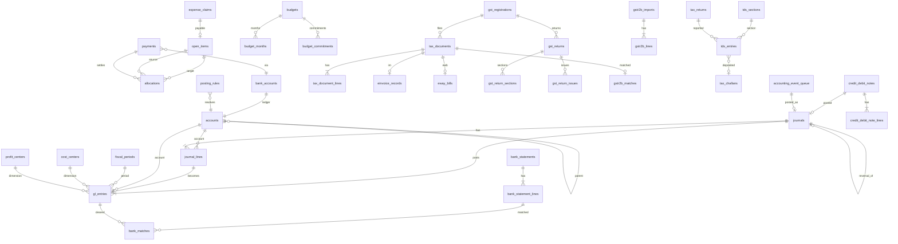

# 05b — Finance & Tax: database design (section 5)

> Part 2 of 5 of `05-FINANCE-TAX.md`. Sections 5.0-5.14: conventions, ERD, every NEW table with DDL + Prisma model, SQL report functions, migration order. Seed data is section 5.15-5.20.

---

## 5. Database design (the core)

### 5.0 Conventions and decisions

**Decision D-FIN-2 (ledger).** The ledger is a separate **immutable** table `gl_entries`, one row per posted journal line, written only by `AccountingService.postJournal`. `journals` / `journal_lines` are the *document* (a Draft is editable; once Posted the lines are frozen by trigger). Why not "journal_lines as the ledger": drafts and the ledger would share a table, a bug could edit history, and every report would have to filter on status. ERPNext (GL Entry) and Dynamics (G/L Entry) separate them too. `gl_entries` is append-only (trigger), balanced per journal at commit (deferred constraint trigger), and is the only source for TB, P&L, BS, cash flow, GL, books.

**Decision D-FIN-3 (periods).** Periods are global (one company), one row per month per FY (`fiscal_periods`), the unit is a dimension column on every ledger row. Per-GSTIN filing locks live on `gst_returns` (filed return = lock for that GSTIN's taxable documents), not on periods.

**Decision D-FIN-4 (sub-ledgers).** AR/AP are **bill-wise** (`open_items` + append-only `allocations`). Party balance = `Σ open_items.outstanding` and must equal the GL balance of the control accounts for that party (test, BR-FIN-36).

**Standard columns `STD`** (foundation section 2). Every business table below says `+STD` (and `+SOFT` when it also has soft delete). Expand exactly as:

```sql
-- STD (put first in CREATE TABLE)
id          uuid PRIMARY KEY DEFAULT gen_random_uuid(),
created_at  timestamptz NOT NULL DEFAULT now(),
created_by_id  uuid NOT NULL REFERENCES users(id) ON DELETE RESTRICT ON UPDATE CASCADE,
updated_at  timestamptz NOT NULL DEFAULT now(),
updated_by_id  uuid NULL REFERENCES users(id) ON DELETE SET NULL ON UPDATE CASCADE,
version     integer NOT NULL DEFAULT 1
-- SOFT (put last)
deleted_at  timestamptz NULL,
deleted_by_id  uuid NULL REFERENCES users(id) ON DELETE SET NULL ON UPDATE CASCADE
```

Constraint naming: FK `<table>_<col>_fkey`, check `<table>_<what>_check`, unique index `<table>_<cols>_key`, index `<table>_<cols>_idx`. Every FK column gets an index (listed once as "FK indexes: ..."; the builder creates one `CREATE INDEX` per column listed). `ON DELETE RESTRICT ON UPDATE CASCADE` is the default for every FK not otherwise stated. `unit_id` always `REFERENCES units(id)`, `fy_id` `REFERENCES financial_years(id)` (the built tables carry no company column and neither do the new ones, D-01).

**Prisma `PRISMA-STD`** (paste into every model marked `+STD`; `@map` columns are snake_case):

```prisma
  id        String   @id @default(uuid()) @db.Uuid
  createdAt DateTime @default(now()) @map("created_at") @db.Timestamptz(3)
  createdById String   @map("created_by_id") @db.Uuid
  updatedAt DateTime @default(now()) @updatedAt @map("updated_at") @db.Timestamptz(3)
  updatedById String?  @map("updated_by_id") @db.Uuid
  version   Int      @default(1)
  // +SOFT adds:
  deletedAt DateTime? @map("deleted_at") @db.Timestamptz(3)
  deletedById String?   @map("deleted_by_id") @db.Uuid
```

Prisma rules for this plan: (1) models declare **scalar** foreign-key fields and only the relations the code needs (`Journal.lines`, `Account.parent`, ...); the SQL FKs are the integrity truth. (2) Money `@db.Decimal(18, 2)`, rate `@db.Decimal(18, 6)`, percent `@db.Decimal(7, 4)`, qty `@db.Decimal(18, 3)`. (3) A column that is `GENERATED ALWAYS` in SQL is declared `@default(dbgenerated())` and is **never written** by code. (4) Enums are `String`, validated by zod + SQL CHECK. (5) After each migration run `npx prisma generate`. (6) Repository code uses `$queryRaw`/`$executeRaw` for the report functions and the `FOR UPDATE` selects.

**Migration folders (strict order; each depends on the previous ones).**

| # | Folder | Content | Ticket |
|---|---|---|---|
| M1 | `20261110000000_fin01_coa_periods` | `accounts`, `fiscal_periods`, `report_lines`, `account_defaults`, `cost_centers`, `profit_centers`, number-series docTypes (no DDL: rows inserted by seed) | T-FIN-01 |
| M2 | `20261110000100_fin02_ledger` | `journals`, `journal_lines`, `gl_entries`, triggers, balance constraint trigger, `posting_rules`, `open_items`, `allocations`, `accounting_event_queue` ALTER | T-FIN-03, T-FIN-05 |
| M3 | `20261110000200_fin03_cash_bank` | `bank_accounts`, `payments`, `bank_statements`, `bank_statement_lines`, `bank_matches` | T-FIN-13 |
| M4 | `20261110000300_fin04_notes_expense_budget` | `credit_debit_notes`, `credit_debit_note_lines`, `expense_claims`, `expense_policies`, `budgets`, `budget_months`, `budget_commitments`, `fiscal_year_closings` | T-FIN-16 (notes), T-FIN-22, T-FIN-23, T-FIN-24 (the builder of each ticket adds ONLY its tables to the one migration folder if it is still unapplied; otherwise creates `…_fin04b_…` with the same prefix and the next timestamp) |
| M5 | `20261110000400_fin05_tax_core` | `gst_registrations`, `tds_sections`, `tax_documents`, `tax_document_lines`, `tax_ledger` | T-FIN-25 |
| M6 | `20261110000500_fin06_returns` | `gst_returns`, `gst_return_sections`, `gst_return_issues`, `gstr2b_imports`, `gstr2b_lines`, `gstr2b_matches`, `tds_entries`, `tax_challans`, `tax_challan_allocations`, `tax_returns` | T-FIN-28 |
| M7 | `20261110000600_fin07_einvoice_eway` | `einvoice_records`, `eway_bills`, `eway_validity_rules` | T-FIN-33 |
| M8 | `20261110000700_fin08_report_sql` | SQL functions `fn_trial_balance`, `fn_account_balances`, `fn_open_items_asof`, views | T-FIN-18 |
| M9 | `20261110000800_fin09_should` | `recurring_journals`, `bank_rules` | T-FIN-43 |

Rule: a migration is **never edited after it is applied** (builder rules). If a ticket needs a column the earlier migration lacks, it adds a new folder `<next timestamp>_finNN_<what>`.

### 5.1 ERD



### 5.2 `accounts` (chart of accounts)

Purpose: one tree of group and ledger accounts; the only place that says what an account is.

```sql
CREATE TABLE accounts (
  -- STD
  code                 varchar(8)  NOT NULL,
  name                 varchar(120) NOT NULL,
  parent_id            uuid NULL REFERENCES accounts(id) ON DELETE RESTRICT ON UPDATE CASCADE,
  is_group             boolean NOT NULL DEFAULT false,
  root_type            text NOT NULL,
  normal_balance       text NOT NULL,
  sub_type             text NOT NULL DEFAULT 'Other',
  posting_allowed      boolean NOT NULL DEFAULT true,
  cost_center_required boolean NOT NULL DEFAULT false,
  party_required       boolean NOT NULL DEFAULT false,
  control_side         text NULL,
  tax_mapping          varchar(60) NULL,
  tax_key              text NULL,
  currency_code        char(3) NOT NULL DEFAULT 'INR',
  report_line_code     text NULL,
  cf_class             text NOT NULL DEFAULT 'NA',
  status               text NOT NULL DEFAULT 'Active',
  is_system            boolean NOT NULL DEFAULT false,
  -- SOFT
  CONSTRAINT accounts_root_type_check CHECK (root_type IN ('Asset','Liability','Equity','Income','Expense')),
  CONSTRAINT accounts_normal_balance_check CHECK (normal_balance = CASE WHEN root_type IN ('Asset','Expense') THEN 'Debit' ELSE 'Credit' END),
  CONSTRAINT accounts_sub_type_check CHECK (sub_type IN ('Bank','Cash','Receivable','Payable','Stock','FixedAsset','AccumDep','CWIP','GSTInput','GSTOutput','GSTRCM','GSTCash','TDSPayable','TDSReceivable','TCSPayable','TCSReceivable','RoundOff','RetainedEarnings','COGS','Depreciation','Revenue','Other')),
  CONSTRAINT accounts_control_side_check CHECK (control_side IS NULL OR control_side IN ('RECEIVABLE','PAYABLE')),
  CONSTRAINT accounts_cf_class_check CHECK (cf_class IN ('CASH','WC','INVESTING','FINANCING','NONCASH','NA')),
  CONSTRAINT accounts_status_check CHECK (status IN ('Active','Inactive')),
  CONSTRAINT accounts_group_check CHECK (NOT is_group OR (posting_allowed = false AND party_required = false)),
  CONSTRAINT accounts_party_check CHECK (NOT party_required OR control_side IS NOT NULL),
  CONSTRAINT accounts_code_check CHECK (code ~ '^[0-9]{4,8}$')
);
CREATE UNIQUE INDEX accounts_code_key ON accounts (code);   -- includes soft-deleted: codes never reused
CREATE INDEX accounts_parent_id_idx ON accounts (parent_id);
CREATE INDEX accounts_report_line_code_idx ON accounts (report_line_code);
CREATE INDEX accounts_sub_type_idx ON accounts (sub_type);
```
Triggers: none (rules in service: type / code immutable once `EXISTS(gl_entries)`; deletion rules).

```prisma
model Account {
  // +STD +SOFT
  code               String   @db.VarChar(8)
  name               String   @db.VarChar(120)
  parentId           String?  @map("parent_id") @db.Uuid
  parent             Account? @relation("AccountTree", fields: [parentId], references: [id])
  children           Account[] @relation("AccountTree")
  isGroup            Boolean  @default(false) @map("is_group")
  rootType           String   @map("root_type")
  normalBalance      String   @map("normal_balance")
  subType            String   @default("Other") @map("sub_type")
  postingAllowed     Boolean  @default(true) @map("posting_allowed")
  costCenterRequired Boolean  @default(false) @map("cost_center_required")
  partyRequired      Boolean  @default(false) @map("party_required")
  controlSide        String?  @map("control_side")
  taxMapping         String?  @map("tax_mapping") @db.VarChar(60)
  taxKey             String?  @map("tax_key")
  currencyCode       String   @default("INR") @map("currency_code") @db.Char(3)
  reportLineCode     String?  @map("report_line_code")
  cfClass            String   @default("NA") @map("cf_class")
  status             String   @default("Active")
  isSystem           Boolean  @default(false) @map("is_system")
  @@unique([code])
  @@index([parentId])
  @@map("accounts")
}
```
Seed: section 5.15 (about 150 rows).

### 5.3 `fiscal_periods`

```sql
CREATE TABLE fiscal_periods (
  -- STD
  fy_id       uuid NOT NULL REFERENCES financial_years(id) ON DELETE RESTRICT ON UPDATE CASCADE,
  period_no   smallint NOT NULL,
  name        varchar(20) NOT NULL,            -- 'Apr 2026'
  start_date  date NOT NULL,
  end_date    date NOT NULL,
  status      text NOT NULL DEFAULT 'OPEN',
  locked_at   timestamptz NULL, locked_by uuid NULL REFERENCES users(id) ON DELETE SET NULL,
  closed_at   timestamptz NULL, closed_by uuid NULL REFERENCES users(id) ON DELETE SET NULL,
  CONSTRAINT fiscal_periods_status_check CHECK (status IN ('OPEN','LOCKED','CLOSED')),
  CONSTRAINT fiscal_periods_no_check CHECK (period_no BETWEEN 1 AND 12),
  CONSTRAINT fiscal_periods_dates_check CHECK (end_date >= start_date)
);
CREATE UNIQUE INDEX fiscal_periods_fy_id_period_no_key ON fiscal_periods (fy_id, period_no);
CREATE UNIQUE INDEX fiscal_periods_start_date_key ON fiscal_periods (start_date);
CREATE INDEX fiscal_periods_fy_id_idx ON fiscal_periods (fy_id);
```
```prisma
model FiscalPeriod {
  // +STD
  fyId      String    @map("fy_id") @db.Uuid
  periodNo  Int       @map("period_no") @db.SmallInt
  name      String    @db.VarChar(20)
  startDate DateTime  @map("start_date") @db.Date
  endDate   DateTime  @map("end_date") @db.Date
  status    String    @default("OPEN")
  lockedAt  DateTime? @map("locked_at") @db.Timestamptz(3)
  lockedBy  String?   @map("locked_by") @db.Uuid
  closedAt  DateTime? @map("closed_at") @db.Timestamptz(3)
  closedBy  String?   @map("closed_by") @db.Uuid
  @@unique([fyId, periodNo])
  @@unique([startDate])
  @@map("fiscal_periods")
}
```
Seed: for every existing FY, 12 rows (April = period 1), status `OPEN`, if the FY is `CLOSED` then `CLOSED`. The job `ensureFiscalPeriods` (called on app start and when `admin-fy` creates a FY) is idempotent (insert-if-missing).

### 5.4 `report_lines`, `account_defaults`

```sql
CREATE TABLE report_lines (
  -- STD
  statement    text NOT NULL,                 -- 'PNL','BS','CF'
  code         varchar(20) NOT NULL,
  name         varchar(120) NOT NULL,
  sort_no      integer NOT NULL,
  level        smallint NOT NULL DEFAULT 1,
  line_type    text NOT NULL,                 -- 'HEADER','ACCOUNTS','SUBTOTAL','SPECIAL'
  category     text NULL,                     -- BS: 'Non-Current Assets','Current Assets','Equity','Non-Current Liabilities','Current Liabilities'; CF: 'Operating','Investing','Financing','Net Change'
  components   jsonb NULL,                    -- SUBTOTAL: [{"code":"PL.100","sign":1},{"code":"PL.200","sign":-1}]
  special      text NULL,                     -- 'CURRENT_PL' | 'NET_PROFIT' | 'OPENING_CASH' | 'CLOSING_CASH' | 'DEPRECIATION_ADDBACK' | 'WC_DELTA'
  CONSTRAINT report_lines_statement_check CHECK (statement IN ('PNL','BS','CF')),
  CONSTRAINT report_lines_type_check CHECK (line_type IN ('HEADER','ACCOUNTS','SUBTOTAL','SPECIAL'))
);
CREATE UNIQUE INDEX report_lines_statement_code_key ON report_lines (statement, code);

CREATE TABLE account_defaults (
  -- STD
  key         varchar(40) NOT NULL,
  account_id  uuid NOT NULL REFERENCES accounts(id) ON DELETE RESTRICT ON UPDATE CASCADE
);
CREATE UNIQUE INDEX account_defaults_key_key ON account_defaults (key);
CREATE INDEX account_defaults_account_id_idx ON account_defaults (account_id);
```
```prisma
model ReportLine {
  // +STD
  statement  String
  code       String  @db.VarChar(20)
  name       String  @db.VarChar(120)
  sortNo     Int     @map("sort_no")
  level      Int     @default(1) @db.SmallInt
  lineType   String  @map("line_type")
  category   String?
  components Json?
  special    String?
  @@unique([statement, code])
  @@map("report_lines")
}
model AccountDefault {
  // +STD
  key       String @db.VarChar(40)
  accountId String @map("account_id") @db.Uuid
  @@unique([key])
  @@map("account_defaults")
}
```
Seeds: 5.16 and 5.17.

### 5.5 `cost_centers`, `profit_centers`

```sql
CREATE TABLE cost_centers (
  -- STD
  unit_id     uuid NULL REFERENCES units(id) ON DELETE RESTRICT ON UPDATE CASCADE,   -- NULL = group-wide
  code        varchar(20) NOT NULL,
  name        varchar(120) NOT NULL,
  parent_id   uuid NULL REFERENCES cost_centers(id) ON DELETE RESTRICT ON UPDATE CASCADE,
  department  varchar(60) NULL,
  manager_id  uuid NULL REFERENCES users(id) ON DELETE SET NULL ON UPDATE CASCADE,
  is_group    boolean NOT NULL DEFAULT false,
  status      text NOT NULL DEFAULT 'Active',
  -- SOFT
  CONSTRAINT cost_centers_status_check CHECK (status IN ('Active','Inactive')),
  CONSTRAINT cost_centers_code_check CHECK (code ~ '^[A-Z0-9-]{2,20}$')
);
CREATE UNIQUE INDEX cost_centers_code_key ON cost_centers (code);
CREATE INDEX cost_centers_parent_id_idx ON cost_centers (parent_id);
CREATE INDEX cost_centers_unit_id_idx ON cost_centers (unit_id);

CREATE TABLE profit_centers (
  -- STD
  unit_id     uuid NOT NULL REFERENCES units(id) ON DELETE RESTRICT ON UPDATE CASCADE,   -- "Branch"
  code        varchar(20) NOT NULL,
  name        varchar(120) NOT NULL,
  manager_id  uuid NULL REFERENCES users(id) ON DELETE SET NULL ON UPDATE CASCADE,
  is_default  boolean NOT NULL DEFAULT false,
  status      text NOT NULL DEFAULT 'Active',
  -- SOFT
  CONSTRAINT profit_centers_status_check CHECK (status IN ('Active','Inactive')),
  CONSTRAINT profit_centers_code_check CHECK (code ~ '^[A-Z0-9-]{2,20}$')
);
CREATE UNIQUE INDEX profit_centers_code_key ON profit_centers (code);
CREATE UNIQUE INDEX profit_centers_unit_default_key ON profit_centers (unit_id) WHERE is_default AND deleted_at IS NULL;
CREATE INDEX profit_centers_unit_id_idx ON profit_centers (unit_id);
```
```prisma
model CostCenter {
  // +STD +SOFT
  unitId     String?  @map("unit_id") @db.Uuid
  code       String   @db.VarChar(20)
  name       String   @db.VarChar(120)
  parentId   String?  @map("parent_id") @db.Uuid
  department String?  @db.VarChar(60)
  managerId  String?  @map("manager_id") @db.Uuid
  isGroup    Boolean  @default(false) @map("is_group")
  status     String   @default("Active")
  @@unique([code])
  @@map("cost_centers")
}
model ProfitCenter {
  // +STD +SOFT
  unitId    String  @map("unit_id") @db.Uuid
  code      String  @db.VarChar(20)
  name      String  @db.VarChar(120)
  managerId String? @map("manager_id") @db.Uuid
  isDefault Boolean @default(false) @map("is_default")
  status    String  @default("Active")
  @@unique([code])
  @@map("profit_centers")
}
```
Seed: 5.18.

### 5.6 `journals`, `journal_lines`, `gl_entries` (the ledger) and triggers

```sql
CREATE TABLE journals (
  -- STD
  unit_id          uuid NOT NULL REFERENCES units(id) ON DELETE RESTRICT ON UPDATE CASCADE,
  fy_id            uuid NOT NULL REFERENCES financial_years(id) ON DELETE RESTRICT ON UPDATE CASCADE,
  period_id        uuid NULL REFERENCES fiscal_periods(id) ON DELETE RESTRICT ON UPDATE CASCADE,  -- set at post
  code             varchar(60) NOT NULL,                  -- 'DRAFT-xxxxxxxx' until posted, then JV/TAL/2026-27/0001 (or RCP/.. etc.)
  voucher_type     text NOT NULL,
  doc_date         date NOT NULL,
  status           text NOT NULL DEFAULT 'Draft',
  posting_status   text NOT NULL DEFAULT 'Not Posted',
  source           text NOT NULL DEFAULT 'MANUAL',
  source_event     text NULL,
  source_doc_type  text NULL,
  source_doc_id    uuid NULL,
  source_doc_no    text NULL,
  reference_no     varchar(60) NULL,
  narration        text NULL,
  supporting_doc   varchar(200) NULL,
  cost_center_id   uuid NULL REFERENCES cost_centers(id) ON DELETE RESTRICT ON UPDATE CASCADE,
  currency_code    char(3) NOT NULL DEFAULT 'INR',
  total_debit      numeric(18,2) NOT NULL DEFAULT 0,
  total_credit     numeric(18,2) NOT NULL DEFAULT 0,
  prepared_by      uuid NOT NULL REFERENCES users(id) ON DELETE RESTRICT ON UPDATE CASCADE,
  approved_by      uuid NULL REFERENCES users(id) ON DELETE SET NULL ON UPDATE CASCADE,
  approved_at      timestamptz NULL,
  posted_by        uuid NULL REFERENCES users(id) ON DELETE SET NULL ON UPDATE CASCADE,
  posted_at        timestamptz NULL,
  reversal_of_id   uuid NULL REFERENCES journals(id) ON DELETE RESTRICT ON UPDATE CASCADE,
  reversed_by_id   uuid NULL REFERENCES journals(id) ON DELETE RESTRICT ON UPDATE CASCADE,
  reversal_reason  varchar(300) NULL,
  auto_reverse_on  date NULL,
  warnings         jsonb NOT NULL DEFAULT '[]'::jsonb,
  -- SOFT
  CONSTRAINT journals_status_check CHECK (status IN ('Draft','Posted','Cancelled')),
  CONSTRAINT journals_posting_status_check CHECK (posting_status IN ('Not Posted','Pending Approval','Posted','Reversed')),
  CONSTRAINT journals_source_check CHECK (source IN ('MANUAL','EVENT','PAYMENT','NOTE','EXPENSE','TAX','SYSTEM')),
  CONSTRAINT journals_totals_check CHECK (total_debit >= 0 AND total_credit >= 0),
  CONSTRAINT journals_posted_balanced_check CHECK (status = 'Draft' OR total_debit = total_credit),
  CONSTRAINT journals_posted_fields_check CHECK (status = 'Draft' OR (period_id IS NOT NULL AND posted_at IS NOT NULL AND code NOT LIKE 'DRAFT-%')),
  CONSTRAINT journals_reversal_check CHECK (reversal_of_id IS NULL OR reversal_of_id <> id)
);
CREATE UNIQUE INDEX journals_code_key ON journals (code);
CREATE UNIQUE INDEX journals_event_idem_key ON journals (source_event, source_doc_type, source_doc_id)
  WHERE source_event IS NOT NULL AND reversal_of_id IS NULL;
CREATE UNIQUE INDEX journals_reversal_of_key ON journals (reversal_of_id) WHERE reversal_of_id IS NOT NULL;   -- reversed once only
CREATE INDEX journals_unit_id_doc_date_idx ON journals (unit_id, doc_date);
CREATE INDEX journals_fy_id_idx ON journals (fy_id);
CREATE INDEX journals_period_id_idx ON journals (period_id);
CREATE INDEX journals_status_idx ON journals (status, posting_status);
CREATE INDEX journals_source_doc_idx ON journals (source_doc_type, source_doc_id);

CREATE TABLE journal_lines (
  id               uuid PRIMARY KEY DEFAULT gen_random_uuid(),
  journal_id       uuid NOT NULL REFERENCES journals(id) ON DELETE CASCADE ON UPDATE CASCADE,
  line_no          integer NOT NULL,
  unit_id          uuid NOT NULL REFERENCES units(id) ON DELETE RESTRICT ON UPDATE CASCADE,
  account_id       uuid NOT NULL REFERENCES accounts(id) ON DELETE RESTRICT ON UPDATE CASCADE,
  debit            numeric(18,2) NOT NULL DEFAULT 0,
  credit           numeric(18,2) NOT NULL DEFAULT 0,
  party_id         uuid NULL,        -- FK to parties added in M2 by the guarded DO block below
  cost_center_id   uuid NULL REFERENCES cost_centers(id) ON DELETE RESTRICT ON UPDATE CASCADE,
  profit_center_id uuid NULL REFERENCES profit_centers(id) ON DELETE RESTRICT ON UPDATE CASCADE,
  narration        varchar(300) NULL,
  bill_mode        text NULL,        -- 'NEW' creates an open item, 'AGAINST' settles (payments only), NULL none
  bill_doc_no      varchar(60) NULL,
  bill_doc_date    date NULL,
  bill_due_date    date NULL,
  currency_code    char(3) NOT NULL DEFAULT 'INR',
  fx_rate          numeric(18,6) NOT NULL DEFAULT 1,
  amount_fc        numeric(18,2) NULL,
  CONSTRAINT journal_lines_one_side_check CHECK (debit >= 0 AND credit >= 0 AND ((debit > 0 AND credit = 0) OR (credit > 0 AND debit = 0))),
  CONSTRAINT journal_lines_bill_mode_check CHECK (bill_mode IS NULL OR bill_mode IN ('NEW','AGAINST')),
  CONSTRAINT journal_lines_fx_check CHECK (fx_rate > 0)
);
CREATE UNIQUE INDEX journal_lines_journal_id_line_no_key ON journal_lines (journal_id, line_no);
CREATE INDEX journal_lines_account_id_idx ON journal_lines (account_id);
CREATE INDEX journal_lines_party_id_idx ON journal_lines (party_id);
CREATE INDEX journal_lines_cost_center_id_idx ON journal_lines (cost_center_id);
CREATE INDEX journal_lines_profit_center_id_idx ON journal_lines (profit_center_id);

CREATE TABLE gl_entries (
  id               uuid PRIMARY KEY DEFAULT gen_random_uuid(),
  seq              bigint GENERATED ALWAYS AS IDENTITY,
  unit_id          uuid NOT NULL REFERENCES units(id) ON DELETE RESTRICT ON UPDATE CASCADE,
  journal_id       uuid NOT NULL REFERENCES journals(id) ON DELETE RESTRICT ON UPDATE CASCADE,
  journal_line_id  uuid NOT NULL REFERENCES journal_lines(id) ON DELETE RESTRICT ON UPDATE CASCADE,
  posting_date     date NOT NULL,
  fy_id            uuid NOT NULL REFERENCES financial_years(id) ON DELETE RESTRICT ON UPDATE CASCADE,
  period_id        uuid NOT NULL REFERENCES fiscal_periods(id) ON DELETE RESTRICT ON UPDATE CASCADE,
  account_id       uuid NOT NULL REFERENCES accounts(id) ON DELETE RESTRICT ON UPDATE CASCADE,
  debit            numeric(18,2) NOT NULL DEFAULT 0,
  credit           numeric(18,2) NOT NULL DEFAULT 0,
  party_id         uuid NULL,
  cost_center_id   uuid NULL REFERENCES cost_centers(id) ON DELETE RESTRICT ON UPDATE CASCADE,
  profit_center_id uuid NULL REFERENCES profit_centers(id) ON DELETE RESTRICT ON UPDATE CASCADE,
  voucher_type     text NOT NULL,
  voucher_no       varchar(60) NOT NULL,
  source_doc_type  text NULL,
  source_doc_id    uuid NULL,
  source_doc_no    text NULL,
  narration        varchar(300) NULL,
  is_closing       boolean NOT NULL DEFAULT false,
  is_reversal      boolean NOT NULL DEFAULT false,
  reverses_gl_id   uuid NULL REFERENCES gl_entries(id) ON DELETE RESTRICT ON UPDATE CASCADE,
  currency_code    char(3) NOT NULL DEFAULT 'INR',
  fx_rate          numeric(18,6) NOT NULL DEFAULT 1,
  amount_fc        numeric(18,2) NULL,
  created_at       timestamptz NOT NULL DEFAULT now(),
  created_by_id       uuid NOT NULL REFERENCES users(id) ON DELETE RESTRICT ON UPDATE CASCADE,
  CONSTRAINT gl_entries_one_side_check CHECK (debit >= 0 AND credit >= 0 AND ((debit > 0 AND credit = 0) OR (credit > 0 AND debit = 0)))
);
CREATE UNIQUE INDEX gl_entries_journal_line_id_key ON gl_entries (journal_line_id);
CREATE UNIQUE INDEX gl_entries_seq_key ON gl_entries (seq);
CREATE INDEX gl_entries_account_date_idx ON gl_entries (account_id, posting_date, seq);
CREATE INDEX gl_entries_unit_date_idx ON gl_entries (unit_id, posting_date);
CREATE INDEX gl_entries_journal_id_idx ON gl_entries (journal_id);
CREATE INDEX gl_entries_party_idx ON gl_entries (party_id, account_id);
CREATE INDEX gl_entries_cost_center_idx ON gl_entries (cost_center_id, posting_date);
CREATE INDEX gl_entries_profit_center_idx ON gl_entries (profit_center_id, posting_date);
CREATE INDEX gl_entries_fy_period_idx ON gl_entries (fy_id, period_id);
CREATE INDEX gl_entries_source_idx ON gl_entries (source_doc_type, source_doc_id);

-- guarded FK to parties (the table belongs to plans 03/04; the block is a no-op if it does not exist yet)
DO $$ BEGIN
  IF to_regclass('public.parties') IS NOT NULL THEN
    ALTER TABLE journal_lines ADD CONSTRAINT journal_lines_party_id_fkey FOREIGN KEY (party_id) REFERENCES parties(id) ON DELETE RESTRICT ON UPDATE CASCADE;
    ALTER TABLE gl_entries    ADD CONSTRAINT gl_entries_party_id_fkey    FOREIGN KEY (party_id) REFERENCES parties(id) ON DELETE RESTRICT ON UPDATE CASCADE;
  END IF;
END $$;

-- TRIGGERS ---------------------------------------------------------------
-- (a) gl_entries is append-only
CREATE FUNCTION fin_gl_append_only() RETURNS trigger LANGUAGE plpgsql AS $$
BEGIN RAISE EXCEPTION 'gl_entries is append-only (% blocked)', TG_OP USING ERRCODE = 'P0001'; END $$;
CREATE TRIGGER gl_entries_no_update_delete BEFORE UPDATE OR DELETE ON gl_entries
  FOR EACH ROW EXECUTE FUNCTION fin_gl_append_only();
CREATE TRIGGER gl_entries_no_truncate BEFORE TRUNCATE ON gl_entries
  FOR EACH STATEMENT EXECUTE FUNCTION fin_gl_append_only();

-- (b) every journal balances at COMMIT (deferred): Σ debit = Σ credit and at least 2 rows
CREATE FUNCTION fin_assert_journal_balanced() RETURNS trigger LANGUAGE plpgsql AS $$
DECLARE d numeric; c numeric; n integer;
BEGIN
  SELECT COALESCE(SUM(debit),0), COALESCE(SUM(credit),0), COUNT(*) INTO d, c, n FROM gl_entries WHERE journal_id = NEW.journal_id;
  IF d <> c OR n < 2 THEN
    RAISE EXCEPTION 'JOURNAL_UNBALANCED journal=% debit=% credit=% rows=%', NEW.journal_id, d, c, n USING ERRCODE = 'P0001';
  END IF;
  RETURN NULL;
END $$;
CREATE CONSTRAINT TRIGGER gl_entries_balanced AFTER INSERT ON gl_entries
  DEFERRABLE INITIALLY DEFERRED FOR EACH ROW EXECUTE FUNCTION fin_assert_journal_balanced();

-- (c) journal_lines are frozen unless the parent journal is Draft
CREATE FUNCTION fin_journal_lines_guard() RETURNS trigger LANGUAGE plpgsql AS $$
DECLARE st text;
BEGIN
  IF TG_OP = 'DELETE' THEN SELECT status INTO st FROM journals WHERE id = OLD.journal_id;
  ELSE SELECT status INTO st FROM journals WHERE id = NEW.journal_id; END IF;
  IF st IS NOT NULL AND st <> 'Draft' THEN
    RAISE EXCEPTION 'journal lines of a % journal cannot be changed', st USING ERRCODE = 'P0001';
  END IF;
  RETURN COALESCE(NEW, OLD);
END $$;
CREATE TRIGGER journal_lines_guard BEFORE INSERT OR UPDATE OR DELETE ON journal_lines
  FOR EACH ROW EXECUTE FUNCTION fin_journal_lines_guard();

-- (d) posted journals: only status / posting_status / reversed_by_id / version / audit columns may change; Cancelled is final; no hard delete of non-Draft
CREATE FUNCTION fin_journals_guard() RETURNS trigger LANGUAGE plpgsql AS $$
BEGIN
  IF TG_OP = 'DELETE' THEN
    IF OLD.status <> 'Draft' THEN RAISE EXCEPTION 'a posted journal cannot be deleted' USING ERRCODE='P0001'; END IF;
    RETURN OLD;
  END IF;
  IF OLD.status = 'Cancelled' THEN RAISE EXCEPTION 'a cancelled journal cannot be changed' USING ERRCODE='P0001'; END IF;
  IF OLD.status = 'Posted' THEN
    IF NEW.status NOT IN ('Posted','Cancelled')
       OR (NEW.NEW.unit_id, NEW.fy_id, NEW.period_id, NEW.code, NEW.voucher_type, NEW.doc_date, NEW.total_debit, NEW.total_credit, NEW.narration, NEW.source, NEW.source_event, NEW.source_doc_id, NEW.reversal_of_id)
          IS DISTINCT FROM
          (OLD.OLD.unit_id, OLD.fy_id, OLD.period_id, OLD.code, OLD.voucher_type, OLD.doc_date, OLD.total_debit, OLD.total_credit, OLD.narration, OLD.source, OLD.source_event, OLD.source_doc_id, OLD.reversal_of_id)
    THEN RAISE EXCEPTION 'a posted journal is immutable (only status / reversal link may change)' USING ERRCODE='P0001'; END IF;
  END IF;
  RETURN NEW;
END $$;
CREATE TRIGGER journals_guard BEFORE UPDATE OR DELETE ON journals
  FOR EACH ROW EXECUTE FUNCTION fin_journals_guard();
```
How a post works against these triggers (so the builder does not fight them): insert `journals` (status `Draft`) -> insert `journal_lines` -> insert `gl_entries` -> `UPDATE journals SET status='Posted', posting_status='Posted', period_id, code, posted_at, posted_by, total_debit, total_credit` (allowed: from Draft) -> commit (the deferred trigger checks balance). The error text `JOURNAL_UNBALANCED` raised by the DB is mapped to the API error `JOURNAL_UNBALANCED` (the service already checked, so this is the safety net).

```prisma
model Journal {
  // +STD +SOFT
  unitId         String    @map("unit_id") @db.Uuid
  fyId           String    @map("fy_id") @db.Uuid
  periodId       String?   @map("period_id") @db.Uuid
  code           String    @db.VarChar(60)
  voucherType    String    @map("voucher_type")
  docDate        DateTime  @map("doc_date") @db.Date
  status         String    @default("Draft")
  postingStatus  String    @default("Not Posted") @map("posting_status")
  source         String    @default("MANUAL")
  sourceEvent    String?   @map("source_event")
  sourceDocType  String?   @map("source_doc_type")
  sourceDocId    String?   @map("source_doc_id") @db.Uuid
  sourceDocNo    String?   @map("source_doc_no")
  referenceNo    String?   @map("reference_no") @db.VarChar(60)
  narration      String?
  supportingDoc  String?   @map("supporting_doc") @db.VarChar(200)
  costCenterId   String?   @map("cost_center_id") @db.Uuid
  currencyCode   String    @default("INR") @map("currency_code") @db.Char(3)
  totalDebit     Decimal   @default(0) @map("total_debit") @db.Decimal(18, 2)
  totalCredit    Decimal   @default(0) @map("total_credit") @db.Decimal(18, 2)
  preparedBy     String    @map("prepared_by") @db.Uuid
  approvedBy     String?   @map("approved_by") @db.Uuid
  approvedAt     DateTime? @map("approved_at") @db.Timestamptz(3)
  postedBy       String?   @map("posted_by") @db.Uuid
  postedAt       DateTime? @map("posted_at") @db.Timestamptz(3)
  reversalOfId   String?   @map("reversal_of_id") @db.Uuid
  reversedById   String?   @map("reversed_by_id") @db.Uuid
  reversalReason String?   @map("reversal_reason") @db.VarChar(300)
  autoReverseOn  DateTime? @map("auto_reverse_on") @db.Date
  warnings       Json      @default("[]")
  lines          JournalLine[]
  @@unique([code])
  @@index([unitId, docDate])
  @@map("journals")
}
model JournalLine {
  id             String   @id @default(uuid()) @db.Uuid
  journalId      String   @map("journal_id") @db.Uuid
  journal        Journal  @relation(fields: [journalId], references: [id], onDelete: Cascade)
  lineNo         Int      @map("line_no")
  unitId         String   @map("unit_id") @db.Uuid
  accountId      String   @map("account_id") @db.Uuid
  debit          Decimal  @default(0) @db.Decimal(18, 2)
  credit         Decimal  @default(0) @db.Decimal(18, 2)
  partyId        String?  @map("party_id") @db.Uuid
  costCenterId   String?  @map("cost_center_id") @db.Uuid
  profitCenterId String?  @map("profit_center_id") @db.Uuid
  narration      String?  @db.VarChar(300)
  billMode       String?  @map("bill_mode")
  billDocNo      String?  @map("bill_doc_no") @db.VarChar(60)
  billDocDate    DateTime? @map("bill_doc_date") @db.Date
  billDueDate    DateTime? @map("bill_due_date") @db.Date
  currencyCode   String   @default("INR") @map("currency_code") @db.Char(3)
  fxRate         Decimal  @default(1) @map("fx_rate") @db.Decimal(18, 6)
  amountFc       Decimal? @map("amount_fc") @db.Decimal(18, 2)
  @@unique([journalId, lineNo])
  @@map("journal_lines")
}
model GlEntry {
  id             String   @id @default(uuid()) @db.Uuid
  seq            BigInt   @default(dbgenerated()) 
  unitId         String   @map("unit_id") @db.Uuid
  journalId      String   @map("journal_id") @db.Uuid
  journalLineId  String   @unique @map("journal_line_id") @db.Uuid
  postingDate    DateTime @map("posting_date") @db.Date
  fyId           String   @map("fy_id") @db.Uuid
  periodId       String   @map("period_id") @db.Uuid
  accountId      String   @map("account_id") @db.Uuid
  debit          Decimal  @default(0) @db.Decimal(18, 2)
  credit         Decimal  @default(0) @db.Decimal(18, 2)
  partyId        String?  @map("party_id") @db.Uuid
  costCenterId   String?  @map("cost_center_id") @db.Uuid
  profitCenterId String?  @map("profit_center_id") @db.Uuid
  voucherType    String   @map("voucher_type")
  voucherNo      String   @map("voucher_no") @db.VarChar(60)
  sourceDocType  String?  @map("source_doc_type")
  sourceDocId    String?  @map("source_doc_id") @db.Uuid
  sourceDocNo    String?  @map("source_doc_no")
  narration      String?  @db.VarChar(300)
  isClosing      Boolean  @default(false) @map("is_closing")
  isReversal     Boolean  @default(false) @map("is_reversal")
  reversesGlId   String?  @map("reverses_gl_id") @db.Uuid
  currencyCode   String   @default("INR") @map("currency_code") @db.Char(3)
  fxRate         Decimal  @default(1) @map("fx_rate") @db.Decimal(18, 6)
  amountFc       Decimal? @map("amount_fc") @db.Decimal(18, 2)
  createdAt      DateTime @default(now()) @map("created_at") @db.Timestamptz(3)
  createdById      String   @map("created_by_id") @db.Uuid
  @@index([accountId, postingDate, seq])
  @@map("gl_entries")
}
```
(`GlEntry.seq` is generated by the database; the repository never sets it. If `dbgenerated()` without an expression is refused by the installed Prisma version, write `@default(autoincrement())` and keep the SQL `GENERATED ALWAYS AS IDENTITY`; the code never sends the column either way.)

### 5.7 `posting_rules`, queue alteration

```sql
CREATE TABLE posting_rules (
  -- STD
  rule_kind         text NOT NULL DEFAULT 'MAP',          -- 'MAP' = symbolic key -> account (events of plans 02-04); 'BUILD' = Finance builds the lines from payload paths
  line_key          varchar(40) NULL,                      -- MAP: the logical account key used in the event lines, e.g. 'INVENTORY'
  event             varchar(60) NOT NULL,                  -- event name, or '*' for every event (MAP rules)
  seq               smallint NOT NULL,
  description       varchar(200) NOT NULL,
  side              text NULL,
  account_selector  text NOT NULL,                        -- FIXED_CODE | DEFAULT_KEY | PAYLOAD_KEY | PAYLOAD_ACCOUNT | PAYLOAD_BANK_ACCOUNT
  account_ref       varchar(120) NOT NULL,
  amount_path       varchar(120) NULL,                   -- NULL for MAP rules
  amount_fn         text NOT NULL DEFAULT 'RAW',
  foreach_path      varchar(60) NULL,
  condition         jsonb NULL,
  party_path        varchar(60) NULL,
  bill_mode         text NOT NULL DEFAULT 'NONE',
  cost_center_path  varchar(60) NULL,
  unit_path         varchar(60) NULL,
  narration_tpl     varchar(200) NULL,
  effective_from    date NOT NULL DEFAULT DATE '2000-01-01',
  effective_to      date NULL,
  is_active         boolean NOT NULL DEFAULT true,
  CONSTRAINT posting_rules_kind_check CHECK (rule_kind IN ('MAP','BUILD') AND ((rule_kind = 'MAP' AND line_key IS NOT NULL) OR (rule_kind = 'BUILD' AND side IS NOT NULL AND amount_path IS NOT NULL))),
  CONSTRAINT posting_rules_side_check CHECK (side IS NULL OR side IN ('DR','CR')),
  CONSTRAINT posting_rules_selector_check CHECK (account_selector IN ('FIXED_CODE','DEFAULT_KEY','PAYLOAD_KEY','PAYLOAD_ACCOUNT','PAYLOAD_BANK_ACCOUNT')),
  CONSTRAINT posting_rules_fn_check CHECK (amount_fn IN ('RAW','POS','NEG','ABS')),
  CONSTRAINT posting_rules_bill_check CHECK (bill_mode IN ('NONE','NEW')),
  CONSTRAINT posting_rules_dates_check CHECK (effective_to IS NULL OR effective_to >= effective_from)
);
CREATE UNIQUE INDEX posting_rules_event_seq_from_key ON posting_rules (event, seq, effective_from);
CREATE INDEX posting_rules_event_idx ON posting_rules (event, is_active);

-- accounting_event_queue is built by plan 02 (M1; unique (event, doc_type, doc_id); columns id, event, doc_type, doc_id, doc_date, unit_id, payload, status, journal_id, error, created_at, processed_at).
-- Finance adds only two columns:
ALTER TABLE accounting_event_queue ADD COLUMN IF NOT EXISTS attempts integer NOT NULL DEFAULT 0;
ALTER TABLE accounting_event_queue ADD COLUMN IF NOT EXISTS last_error_at timestamptz NULL;

-- Voucher types: a lookup table (no CHECK list; decision D-11). Each module INSERTs its own codes.
CREATE TABLE voucher_types (
  code        varchar(30) PRIMARY KEY,
  prefix      varchar(10) NOT NULL,
  description varchar(100) NOT NULL
);
INSERT INTO voucher_types (code, prefix, description) VALUES
 ('Journal','JV','Manual journal'),('Opening','OBL','Opening balances'),('Closing','CLS','Year-end closing'),
 ('Depreciation','JV','Depreciation'),('Provision','JV','Provision'),('Adjustment','JV','Adjustment / reclass'),
 ('Reversal','JV','Reversal'),('Bank Charges','JV','Bank charges and interest'),('Receipt','RCP','Receipt'),
 ('Payment','PAY','Payment'),('Contra','CNT','Transfer between cash and bank'),('Sales Invoice','EV','Sales invoice (event)'),
 ('Purchase Invoice','EV','Purchase invoice (event)'),('Credit Note','CRN','Credit note'),('Debit Note','DBN','Debit note'),
 ('Goods Receipt','EV','Goods receipt (event)'),('Delivery','EV','Delivery (event)'),('Stock Adjustment','EV','Stock event'),
 ('Expense','EXP','Expense claim'),('Tax Settlement','JV','GST settlement'),('Payroll','JV','Payroll'),('Other','JV','Other')
ON CONFLICT DO NOTHING;
ALTER TABLE journals ADD CONSTRAINT journals_voucher_type_fkey FOREIGN KEY (voucher_type) REFERENCES voucher_types(code) ON DELETE RESTRICT ON UPDATE CASCADE;
ALTER TABLE gl_entries ADD CONSTRAINT gl_entries_voucher_type_fkey FOREIGN KEY (voucher_type) REFERENCES voucher_types(code) ON DELETE RESTRICT ON UPDATE CASCADE;
```
`unit_id` is nullable in the ALTER (old rows have none); the service reads `payload.unitId` when the column is null and **new inserts always set it**. `status` check: the builder verifies the plan-02 CHECK allows `PENDING`,`POSTED`,`FAILED` (foundation) and that `journal_id`, `error`, `processed_at` exist (else QUESTION).
```prisma
model PostingRule {
  // +STD
  ruleKind        String   @default("MAP") @map("rule_kind")
  lineKey         String?  @map("line_key") @db.VarChar(40)
  event           String   @db.VarChar(60)
  seq             Int      @db.SmallInt
  description     String   @db.VarChar(200)
  side            String?
  accountSelector String   @map("account_selector")
  accountRef      String   @map("account_ref") @db.VarChar(120)
  amountPath      String?  @map("amount_path") @db.VarChar(120)
  amountFn        String   @default("RAW") @map("amount_fn")
  foreachPath     String?  @map("foreach_path") @db.VarChar(60)
  condition       Json?
  partyPath       String?  @map("party_path") @db.VarChar(60)
  billMode        String   @default("NONE") @map("bill_mode")
  costCenterPath  String?  @map("cost_center_path") @db.VarChar(60)
  unitPath        String?  @map("unit_path") @db.VarChar(60)
  narrationTpl    String?  @map("narration_tpl") @db.VarChar(200)
  effectiveFrom   DateTime @default(dbgenerated("'2000-01-01'")) @map("effective_from") @db.Date
  effectiveTo     DateTime? @map("effective_to") @db.Date
  isActive        Boolean  @default(true) @map("is_active")
  @@unique([event, seq, effectiveFrom])
  @@map("posting_rules")
}
model VoucherType {
  code        String @id @db.VarChar(30)
  prefix      String @db.VarChar(10)
  description String @db.VarChar(100)
  @@map("voucher_types")
}
```
(`accounting_event_queue` has its Prisma model from plan 02 (`AccountingEventQueue`); T-FIN-05 adds only `attempts Int @default(0)` and `lastErrorAt DateTime? @map("last_error_at") @db.Timestamptz(3)`.)

### 5.8 `open_items`, `allocations`

```sql
CREATE TABLE open_items (
  -- STD
  unit_id           uuid NOT NULL REFERENCES units(id) ON DELETE RESTRICT ON UPDATE CASCADE,
  side              text NOT NULL,
  party_id          uuid NOT NULL,                 -- FK to parties added by the guarded DO block
  item_type         text NOT NULL,
  doc_type          text NULL,
  doc_id            uuid NULL,
  doc_no            varchar(60) NOT NULL,
  doc_date          date NOT NULL,
  due_date          date NULL,
  amount            numeric(18,2) NOT NULL,
  settled_amount    numeric(18,2) NOT NULL DEFAULT 0,
  outstanding       numeric(18,2) GENERATED ALWAYS AS (CASE WHEN amount > 0 THEN amount - settled_amount ELSE amount + settled_amount END) STORED,
  currency_code     char(3) NOT NULL DEFAULT 'INR',
  journal_id        uuid NOT NULL REFERENCES journals(id) ON DELETE RESTRICT ON UPDATE CASCADE,
  status            text NOT NULL DEFAULT 'Open',
  blocked_reason    varchar(200) NULL,
  payment_method    text NULL,
  collection_owner_id uuid NULL REFERENCES users(id) ON DELETE SET NULL ON UPDATE CASCADE,
  promise_date      date NULL,
  promise_amount    numeric(18,2) NULL,
  msme_due_date     date NULL,
  tds_withheld      numeric(18,2) NOT NULL DEFAULT 0,
  dispute_reason    varchar(200) NULL,
  CONSTRAINT open_items_side_check CHECK (side IN ('RECEIVABLE','PAYABLE')),
  CONSTRAINT open_items_type_check CHECK (item_type IN ('INVOICE','CREDIT_NOTE','DEBIT_NOTE','RECEIPT','PAYMENT','ADVANCE','OPENING','JOURNAL')),
  CONSTRAINT open_items_amount_check CHECK (amount <> 0),
  CONSTRAINT open_items_settled_check CHECK (settled_amount >= 0 AND settled_amount <= abs(amount)),
  CONSTRAINT open_items_status_check CHECK (status IN ('Open','Settled','Disputed','Blocked','Cancelled')),
  CONSTRAINT open_items_method_check CHECK (payment_method IS NULL OR payment_method IN ('NEFT','RTGS','IMPS','UPI','Cheque','Cash'))
);
CREATE UNIQUE INDEX open_items_party_doc_key ON open_items (side, party_id, item_type, doc_no) WHERE status <> 'Cancelled';
CREATE INDEX open_items_party_idx ON open_items (side, party_id, status);
CREATE INDEX open_items_due_idx ON open_items (side, due_date) WHERE outstanding <> 0;
CREATE INDEX open_items_unit_id_idx ON open_items (unit_id);
CREATE INDEX open_items_journal_id_idx ON open_items (journal_id);
CREATE INDEX open_items_doc_idx ON open_items (doc_type, doc_id);

CREATE TABLE allocations (
  id             uuid PRIMARY KEY DEFAULT gen_random_uuid(),
  unit_id        uuid NOT NULL REFERENCES units(id) ON DELETE RESTRICT ON UPDATE CASCADE,
  source_item_id uuid NOT NULL REFERENCES open_items(id) ON DELETE RESTRICT ON UPDATE CASCADE,   -- the credit side (amount < 0)
  target_item_id uuid NOT NULL REFERENCES open_items(id) ON DELETE RESTRICT ON UPDATE CASCADE,   -- the invoice side (amount > 0)
  amount         numeric(18,2) NOT NULL,                     -- > 0 allocate, < 0 reversal row
  allocated_on   date NOT NULL,
  payment_id     uuid NULL,                                  -- FK to payments added in M3
  journal_id     uuid NULL REFERENCES journals(id) ON DELETE RESTRICT ON UPDATE CASCADE,
  reverses_id    uuid NULL REFERENCES allocations(id) ON DELETE RESTRICT ON UPDATE CASCADE,
  created_at     timestamptz NOT NULL DEFAULT now(),
  created_by_id     uuid NOT NULL REFERENCES users(id) ON DELETE RESTRICT ON UPDATE CASCADE,
  CONSTRAINT allocations_amount_check CHECK (amount <> 0),
  CONSTRAINT allocations_distinct_check CHECK (source_item_id <> target_item_id),
  CONSTRAINT allocations_reversal_check CHECK ((amount < 0) = (reverses_id IS NOT NULL))
);
CREATE INDEX allocations_source_idx ON allocations (source_item_id);
CREATE INDEX allocations_target_idx ON allocations (target_item_id);
CREATE INDEX allocations_payment_idx ON allocations (payment_id);
CREATE TRIGGER allocations_no_update_delete BEFORE UPDATE OR DELETE ON allocations FOR EACH ROW EXECUTE FUNCTION fin_gl_append_only();
CREATE TRIGGER allocations_no_truncate BEFORE TRUNCATE ON allocations FOR EACH STATEMENT EXECUTE FUNCTION fin_gl_append_only();
-- the same guarded DO block adds open_items_party_id_fkey -> parties(id)
```
Invariant (service + test): for every open item, `settled_amount = Σ allocations.amount` where the item is `source_item_id` or `target_item_id`. Both sides of one allocation add the same positive amount to each item's `settled_amount` (the two items settle each other).
```prisma
model OpenItem {
  // +STD
  unitId            String    @map("unit_id") @db.Uuid
  side              String
  partyId           String    @map("party_id") @db.Uuid
  itemType          String    @map("item_type")
  docType           String?   @map("doc_type")
  docId             String?   @map("doc_id") @db.Uuid
  docNo             String    @map("doc_no") @db.VarChar(60)
  docDate           DateTime  @map("doc_date") @db.Date
  dueDate           DateTime? @map("due_date") @db.Date
  amount            Decimal   @db.Decimal(18, 2)
  settledAmount     Decimal   @default(0) @map("settled_amount") @db.Decimal(18, 2)
  outstanding       Decimal   @default(dbgenerated()) @db.Decimal(18, 2)
  currencyCode      String    @default("INR") @map("currency_code") @db.Char(3)
  journalId         String    @map("journal_id") @db.Uuid
  status            String    @default("Open")
  blockedReason     String?   @map("blocked_reason") @db.VarChar(200)
  paymentMethod     String?   @map("payment_method")
  collectionOwnerId String?   @map("collection_owner_id") @db.Uuid
  promiseDate       DateTime? @map("promise_date") @db.Date
  promiseAmount     Decimal?  @map("promise_amount") @db.Decimal(18, 2)
  msmeDueDate       DateTime? @map("msme_due_date") @db.Date
  tdsWithheld       Decimal   @default(0) @map("tds_withheld") @db.Decimal(18, 2)
  disputeReason     String?   @map("dispute_reason") @db.VarChar(200)
  @@index([side, partyId, status])
  @@map("open_items")
}
model Allocation {
  id           String   @id @default(uuid()) @db.Uuid
  unitId       String   @map("unit_id") @db.Uuid
  sourceItemId String   @map("source_item_id") @db.Uuid
  targetItemId String   @map("target_item_id") @db.Uuid
  amount       Decimal  @db.Decimal(18, 2)
  allocatedOn  DateTime @map("allocated_on") @db.Date
  paymentId    String?  @map("payment_id") @db.Uuid
  journalId    String?  @map("journal_id") @db.Uuid
  reversesId   String?  @map("reverses_id") @db.Uuid
  createdAt    DateTime @default(now()) @map("created_at") @db.Timestamptz(3)
  createdById    String   @map("created_by_id") @db.Uuid
  @@map("allocations")
}
```

### 5.9 Cash and bank: `bank_accounts`, `payments`, `bank_statements`, `bank_statement_lines`, `bank_matches` (M3)

```sql
CREATE TABLE bank_accounts (
  -- STD
  unit_id         uuid NULL REFERENCES units(id) ON DELETE RESTRICT ON UPDATE CASCADE,   -- NULL = usable by every unit
  code            varchar(20) NOT NULL,
  name            varchar(120) NOT NULL,
  account_id      uuid NOT NULL REFERENCES accounts(id) ON DELETE RESTRICT ON UPDATE CASCADE,
  kind            text NOT NULL,
  bank_name       varchar(100) NULL,
  branch          varchar(100) NULL,
  account_no_last4 char(4) NULL,
  account_no_enc  text NULL,
  ifsc            char(11) NULL,
  holder_name     varchar(120) NULL,
  od_limit        numeric(18,2) NOT NULL DEFAULT 0,
  imprest_limit   numeric(18,2) NULL,
  is_default      boolean NOT NULL DEFAULT false,
  import_map      jsonb NULL,
  last_reconciled_date date NULL,
  verified_by     uuid NULL REFERENCES users(id) ON DELETE SET NULL ON UPDATE CASCADE,
  verified_at     timestamptz NULL,
  status          text NOT NULL DEFAULT 'Active',
  -- SOFT
  CONSTRAINT bank_accounts_kind_check CHECK (kind IN ('CASH','BANK','PETTY')),
  CONSTRAINT bank_accounts_status_check CHECK (status IN ('Active','Inactive')),
  CONSTRAINT bank_accounts_ifsc_check CHECK (ifsc IS NULL OR ifsc ~ '^[A-Z]{4}0[A-Z0-9]{6}$'),
  CONSTRAINT bank_accounts_od_check CHECK (od_limit >= 0)
);
CREATE UNIQUE INDEX bank_accounts_code_key ON bank_accounts (code);
CREATE UNIQUE INDEX bank_accounts_account_id_key ON bank_accounts (account_id) WHERE deleted_at IS NULL;
CREATE INDEX bank_accounts_unit_id_idx ON bank_accounts (unit_id);

CREATE TABLE payments (
  -- STD
  unit_id           uuid NOT NULL REFERENCES units(id) ON DELETE RESTRICT ON UPDATE CASCADE,
  fy_id             uuid NOT NULL REFERENCES financial_years(id) ON DELETE RESTRICT ON UPDATE CASCADE,
  code              varchar(60) NOT NULL,
  kind              text NOT NULL,
  mode              text NOT NULL,
  purpose           text NOT NULL DEFAULT 'TRADE',
  doc_date          date NOT NULL,
  bank_account_id   uuid NOT NULL REFERENCES bank_accounts(id) ON DELETE RESTRICT ON UPDATE CASCADE,
  counter_bank_account_id uuid NULL REFERENCES bank_accounts(id) ON DELETE RESTRICT ON UPDATE CASCADE,
  party_id          uuid NULL,
  amount            numeric(18,2) NOT NULL,
  tds_amount        numeric(18,2) NOT NULL DEFAULT 0,
  charges_amount    numeric(18,2) NOT NULL DEFAULT 0,
  allocated_amount  numeric(18,2) NOT NULL DEFAULT 0,
  allow_advance     boolean NOT NULL DEFAULT false,
  instrument_no     varchar(30) NULL,
  instrument_date   date NULL,
  utr               varchar(40) NULL,
  narration         varchar(300) NULL,
  status            text NOT NULL DEFAULT 'Draft',
  journal_id        uuid NULL REFERENCES journals(id) ON DELETE RESTRICT ON UPDATE CASCADE,
  reversal_journal_id uuid NULL REFERENCES journals(id) ON DELETE RESTRICT ON UPDATE CASCADE,
  cancelled_reason  varchar(300) NULL,
  -- SOFT
  CONSTRAINT payments_kind_check CHECK (kind IN ('RECEIPT','PAYMENT','TRANSFER')),
  CONSTRAINT payments_mode_check CHECK (mode IN ('Cash','Cheque','NEFT','RTGS','IMPS','UPI','Card','DD')),
  CONSTRAINT payments_purpose_check CHECK (purpose IN ('TRADE','ADVANCE','GST','TDS','TCS','EXPENSE','OTHER')),
  CONSTRAINT payments_amount_check CHECK (amount > 0 AND tds_amount >= 0 AND charges_amount >= 0 AND allocated_amount >= 0 AND allocated_amount <= amount + tds_amount),
  CONSTRAINT payments_status_check CHECK (status IN ('Draft','Posted','Cancelled')),
  CONSTRAINT payments_party_check CHECK (kind = 'TRANSFER' OR party_id IS NOT NULL OR purpose IN ('GST','TDS','TCS','OTHER')),
  CONSTRAINT payments_transfer_check CHECK ((kind = 'TRANSFER') = (counter_bank_account_id IS NOT NULL))
);
CREATE UNIQUE INDEX payments_code_key ON payments (code);
CREATE UNIQUE INDEX payments_utr_key ON payments (bank_account_id, utr) WHERE utr IS NOT NULL AND status <> 'Cancelled';
CREATE INDEX payments_party_idx ON payments (party_id);
CREATE INDEX payments_bank_idx ON payments (bank_account_id, doc_date);
CREATE INDEX payments_unit_date_idx ON payments (unit_id, doc_date);
ALTER TABLE allocations ADD CONSTRAINT allocations_payment_id_fkey FOREIGN KEY (payment_id) REFERENCES payments(id) ON DELETE RESTRICT ON UPDATE CASCADE;
-- guarded FK payments.party_id -> parties(id) in the same DO block style as 5.6
```
(The mode/bank account consistency "mode `Cash` only with a bank account of kind `CASH` or `PETTY`, other modes only with kind `BANK`" is enforced in the service, error `MODE_ACCOUNT_MISMATCH`.)

```sql
CREATE TABLE bank_statements (
  -- STD
  unit_id          uuid NOT NULL REFERENCES units(id) ON DELETE RESTRICT ON UPDATE CASCADE,
  fy_id            uuid NOT NULL REFERENCES financial_years(id) ON DELETE RESTRICT ON UPDATE CASCADE,
  code             varchar(60) NOT NULL,
  bank_account_id  uuid NOT NULL REFERENCES bank_accounts(id) ON DELETE RESTRICT ON UPDATE CASCADE,
  statement_date   date NOT NULL,
  period_from      date NOT NULL,
  period_to        date NOT NULL,
  opening_balance  numeric(18,2) NOT NULL,
  closing_balance  numeric(18,2) NOT NULL,
  file_name        varchar(200) NOT NULL,
  file_sha256      char(64) NOT NULL,
  line_count       integer NOT NULL DEFAULT 0,
  duplicate_skipped integer NOT NULL DEFAULT 0,
  erp_balance      numeric(18,2) NOT NULL DEFAULT 0,
  matched_amount   numeric(18,2) NOT NULL DEFAULT 0,
  unmatched_bank   numeric(18,2) NOT NULL DEFAULT 0,
  unmatched_erp    numeric(18,2) NOT NULL DEFAULT 0,
  difference       numeric(18,2) NOT NULL DEFAULT 0,
  status           text NOT NULL DEFAULT 'Imported',
  reconciled_by    uuid NULL REFERENCES users(id) ON DELETE SET NULL ON UPDATE CASCADE,
  reconciled_at    timestamptz NULL,
  -- SOFT
  CONSTRAINT bank_statements_status_check CHECK (status IN ('Draft','Imported','In Progress','Reconciled','Cancelled')),
  CONSTRAINT bank_statements_period_check CHECK (period_to >= period_from AND statement_date >= period_to)
);
CREATE UNIQUE INDEX bank_statements_code_key ON bank_statements (code);
CREATE UNIQUE INDEX bank_statements_file_key ON bank_statements (bank_account_id, file_sha256) WHERE status <> 'Cancelled';
CREATE INDEX bank_statements_bank_idx ON bank_statements (bank_account_id, statement_date);

CREATE TABLE bank_statement_lines (
  id              uuid PRIMARY KEY DEFAULT gen_random_uuid(),
  statement_id    uuid NOT NULL REFERENCES bank_statements(id) ON DELETE CASCADE ON UPDATE CASCADE,
  bank_account_id uuid NOT NULL REFERENCES bank_accounts(id) ON DELETE RESTRICT ON UPDATE CASCADE,
  line_no         integer NOT NULL,
  txn_date        date NOT NULL,
  value_date      date NULL,
  description     varchar(500) NULL,
  reference       varchar(60) NULL,
  debit           numeric(18,2) NOT NULL DEFAULT 0,      -- withdrawal
  credit          numeric(18,2) NOT NULL DEFAULT 0,      -- deposit
  balance         numeric(18,2) NULL,
  line_hash       char(64) NOT NULL,
  match_status    text NOT NULL DEFAULT 'Unmatched',
  CONSTRAINT bank_statement_lines_side_check CHECK (debit >= 0 AND credit >= 0 AND ((debit > 0 AND credit = 0) OR (credit > 0 AND debit = 0))),
  CONSTRAINT bank_statement_lines_status_check CHECK (match_status IN ('Unmatched','Suggested','Matched','Ignored'))
);
CREATE UNIQUE INDEX bank_statement_lines_statement_line_key ON bank_statement_lines (statement_id, line_no);
CREATE UNIQUE INDEX bank_statement_lines_hash_key ON bank_statement_lines (bank_account_id, line_hash);
CREATE INDEX bank_statement_lines_status_idx ON bank_statement_lines (statement_id, match_status);

CREATE TABLE bank_matches (
  id                uuid PRIMARY KEY DEFAULT gen_random_uuid(),
  statement_line_id uuid NOT NULL REFERENCES bank_statement_lines(id) ON DELETE CASCADE ON UPDATE CASCADE,
  gl_entry_id       uuid NOT NULL REFERENCES gl_entries(id) ON DELETE RESTRICT ON UPDATE CASCADE,
  amount            numeric(18,2) NOT NULL,
  method            text NOT NULL,
  status            text NOT NULL DEFAULT 'Active',
  score             smallint NULL,
  locked            boolean NOT NULL DEFAULT false,
  matched_by        uuid NULL REFERENCES users(id) ON DELETE SET NULL ON UPDATE CASCADE,
  matched_at        timestamptz NOT NULL DEFAULT now(),
  unmatched_by      uuid NULL REFERENCES users(id) ON DELETE SET NULL ON UPDATE CASCADE,
  unmatched_at      timestamptz NULL,
  notes             varchar(200) NULL,
  CONSTRAINT bank_matches_amount_check CHECK (amount > 0),
  CONSTRAINT bank_matches_method_check CHECK (method IN ('AUTO','MANUAL','RULE')),
  CONSTRAINT bank_matches_status_check CHECK (status IN ('Suggested','Active','Rejected','Unmatched'))
);
CREATE UNIQUE INDEX bank_matches_pair_key ON bank_matches (statement_line_id, gl_entry_id) WHERE status IN ('Suggested','Active');
CREATE INDEX bank_matches_gl_entry_idx ON bank_matches (gl_entry_id) WHERE status = 'Active';
CREATE INDEX bank_matches_line_idx ON bank_matches (statement_line_id);
```
`Clearing Status` of a `gl_entries` row on a bank account = `Cleared` iff `Σ amount of bank_matches(status='Active', gl_entry_id) >= the entry amount`.
```prisma
model BankAccount {
  // +STD +SOFT
  unitId            String?   @map("unit_id") @db.Uuid
  code              String    @db.VarChar(20)
  name              String    @db.VarChar(120)
  accountId         String    @map("account_id") @db.Uuid
  kind              String
  bankName          String?   @map("bank_name") @db.VarChar(100)
  branch            String?   @db.VarChar(100)
  accountNoLast4    String?   @map("account_no_last4") @db.Char(4)
  accountNoEnc      String?   @map("account_no_enc")
  ifsc              String?   @db.Char(11)
  holderName        String?   @map("holder_name") @db.VarChar(120)
  odLimit           Decimal   @default(0) @map("od_limit") @db.Decimal(18, 2)
  imprestLimit      Decimal?  @map("imprest_limit") @db.Decimal(18, 2)
  isDefault         Boolean   @default(false) @map("is_default")
  importMap         Json?     @map("import_map")
  lastReconciledDate DateTime? @map("last_reconciled_date") @db.Date
  verifiedBy        String?   @map("verified_by") @db.Uuid
  verifiedAt        DateTime? @map("verified_at") @db.Timestamptz(3)
  status            String    @default("Active")
  @@unique([code])
  @@map("bank_accounts")
}
model Payment {
  // +STD +SOFT
  unitId              String    @map("unit_id") @db.Uuid
  fyId                String    @map("fy_id") @db.Uuid
  code                String    @db.VarChar(60)
  kind                String
  mode                String
  purpose             String    @default("TRADE")
  docDate             DateTime  @map("doc_date") @db.Date
  bankAccountId       String    @map("bank_account_id") @db.Uuid
  counterBankAccountId String?  @map("counter_bank_account_id") @db.Uuid
  partyId             String?   @map("party_id") @db.Uuid
  amount              Decimal   @db.Decimal(18, 2)
  tdsAmount           Decimal   @default(0) @map("tds_amount") @db.Decimal(18, 2)
  chargesAmount       Decimal   @default(0) @map("charges_amount") @db.Decimal(18, 2)
  allocatedAmount     Decimal   @default(0) @map("allocated_amount") @db.Decimal(18, 2)
  allowAdvance        Boolean   @default(false) @map("allow_advance")
  instrumentNo        String?   @map("instrument_no") @db.VarChar(30)
  instrumentDate      DateTime? @map("instrument_date") @db.Date
  utr                 String?   @db.VarChar(40)
  narration           String?   @db.VarChar(300)
  status              String    @default("Draft")
  journalId           String?   @map("journal_id") @db.Uuid
  reversalJournalId   String?   @map("reversal_journal_id") @db.Uuid
  cancelledReason     String?   @map("cancelled_reason") @db.VarChar(300)
  @@unique([code])
  @@map("payments")
}
model BankStatement {
  // +STD +SOFT
  unitId           String    @map("unit_id") @db.Uuid
  fyId             String    @map("fy_id") @db.Uuid
  code             String    @db.VarChar(60)
  bankAccountId    String    @map("bank_account_id") @db.Uuid
  statementDate    DateTime  @map("statement_date") @db.Date
  periodFrom       DateTime  @map("period_from") @db.Date
  periodTo         DateTime  @map("period_to") @db.Date
  openingBalance   Decimal   @map("opening_balance") @db.Decimal(18, 2)
  closingBalance   Decimal   @map("closing_balance") @db.Decimal(18, 2)
  fileName         String    @map("file_name") @db.VarChar(200)
  fileSha256       String    @map("file_sha256") @db.Char(64)
  lineCount        Int       @default(0) @map("line_count")
  duplicateSkipped Int       @default(0) @map("duplicate_skipped")
  erpBalance       Decimal   @default(0) @map("erp_balance") @db.Decimal(18, 2)
  matchedAmount    Decimal   @default(0) @map("matched_amount") @db.Decimal(18, 2)
  unmatchedBank    Decimal   @default(0) @map("unmatched_bank") @db.Decimal(18, 2)
  unmatchedErp     Decimal   @default(0) @map("unmatched_erp") @db.Decimal(18, 2)
  difference       Decimal   @default(0) @db.Decimal(18, 2)
  status           String    @default("Imported")
  reconciledBy     String?   @map("reconciled_by") @db.Uuid
  reconciledAt     DateTime? @map("reconciled_at") @db.Timestamptz(3)
  lines            BankStatementLine[]
  @@unique([code])
  @@map("bank_statements")
}
model BankStatementLine {
  id            String        @id @default(uuid()) @db.Uuid
  statementId   String        @map("statement_id") @db.Uuid
  statement     BankStatement @relation(fields: [statementId], references: [id], onDelete: Cascade)
  bankAccountId String        @map("bank_account_id") @db.Uuid
  lineNo        Int           @map("line_no")
  txnDate       DateTime      @map("txn_date") @db.Date
  valueDate     DateTime?     @map("value_date") @db.Date
  description   String?       @db.VarChar(500)
  reference     String?       @db.VarChar(60)
  debit         Decimal       @default(0) @db.Decimal(18, 2)
  credit        Decimal       @default(0) @db.Decimal(18, 2)
  balance       Decimal?      @db.Decimal(18, 2)
  lineHash      String        @map("line_hash") @db.Char(64)
  matchStatus   String        @default("Unmatched") @map("match_status")
  @@unique([statementId, lineNo])
  @@unique([bankAccountId, lineHash])
  @@map("bank_statement_lines")
}
model BankMatch {
  id              String    @id @default(uuid()) @db.Uuid
  statementLineId String    @map("statement_line_id") @db.Uuid
  glEntryId       String    @map("gl_entry_id") @db.Uuid
  amount          Decimal   @db.Decimal(18, 2)
  method          String
  status          String    @default("Active")
  score           Int?      @db.SmallInt
  locked          Boolean   @default(false)
  matchedBy       String?   @map("matched_by") @db.Uuid
  matchedAt       DateTime  @default(now()) @map("matched_at") @db.Timestamptz(3)
  unmatchedBy     String?   @map("unmatched_by") @db.Uuid
  unmatchedAt     DateTime? @map("unmatched_at") @db.Timestamptz(3)
  notes           String?   @db.VarChar(200)
  @@map("bank_matches")
}
```

### 5.10 Notes, expenses, budgets, closings (M4)

```sql
CREATE TABLE credit_debit_notes (
  -- STD
  unit_id            uuid NOT NULL REFERENCES units(id) ON DELETE RESTRICT ON UPDATE CASCADE,
  fy_id              uuid NOT NULL REFERENCES financial_years(id) ON DELETE RESTRICT ON UPDATE CASCADE,
  note_type          text NOT NULL,
  code               varchar(60) NOT NULL,
  doc_date           date NOT NULL,
  party_id           uuid NOT NULL,
  original_item_id   uuid NULL REFERENCES open_items(id) ON DELETE RESTRICT ON UPDATE CASCADE,
  original_doc_no    varchar(60) NULL,
  original_doc_date  date NULL,
  reason             text NULL,
  reason_code        text NOT NULL DEFAULT 'Others',
  place_of_supply    char(2) NULL,
  taxable_total      numeric(18,2) NOT NULL DEFAULT 0,
  cgst_total         numeric(18,2) NOT NULL DEFAULT 0,
  sgst_total         numeric(18,2) NOT NULL DEFAULT 0,
  igst_total         numeric(18,2) NOT NULL DEFAULT 0,
  cess_total         numeric(18,2) NOT NULL DEFAULT 0,
  gst_total          numeric(18,2) NOT NULL DEFAULT 0,
  round_off          numeric(18,2) NOT NULL DEFAULT 0,
  total              numeric(18,2) NOT NULL DEFAULT 0,
  is_commercial      boolean NOT NULL DEFAULT false,
  approval_status    text NOT NULL DEFAULT 'Not Required',
  approver_id        uuid NULL REFERENCES users(id) ON DELETE SET NULL ON UPDATE CASCADE,
  approved_at        timestamptz NULL,
  status             text NOT NULL DEFAULT 'Draft',
  journal_id         uuid NULL REFERENCES journals(id) ON DELETE RESTRICT ON UPDATE CASCADE,
  tax_document_id    uuid NULL,
  source             text NOT NULL DEFAULT 'MANUAL',
  source_doc_id      uuid NULL,
  cancelled_reason   varchar(300) NULL,
  -- SOFT
  CONSTRAINT credit_debit_notes_type_check CHECK (note_type IN ('CUSTOMER_CREDIT','VENDOR_DEBIT')),
  CONSTRAINT credit_debit_notes_status_check CHECK (status IN ('Draft','Submitted','Approved','Posted','Rejected','Cancelled')),
  CONSTRAINT credit_debit_notes_approval_check CHECK (approval_status IN ('Not Required','Pending','Approved','Rejected')),
  CONSTRAINT credit_debit_notes_reason_check CHECK (reason_code IN ('Sales Return','Post Sale Discount','Deficiency in Services','Correction in Invoice','Change in POS','Finalization of Provisional Assessment','Others')),
  CONSTRAINT credit_debit_notes_amounts_check CHECK (taxable_total >= 0 AND gst_total >= 0 AND total >= 0),
  CONSTRAINT credit_debit_notes_total_check CHECK (total = taxable_total + gst_total + round_off),
  CONSTRAINT credit_debit_notes_gst_check CHECK (gst_total = cgst_total + sgst_total + igst_total + cess_total),
  CONSTRAINT credit_debit_notes_source_check CHECK (source IN ('MANUAL','AUTO'))
);
CREATE UNIQUE INDEX credit_debit_notes_code_key ON credit_debit_notes (code);
CREATE UNIQUE INDEX credit_debit_notes_source_key ON credit_debit_notes (note_type, source_doc_id) WHERE source_doc_id IS NOT NULL;
CREATE INDEX credit_debit_notes_party_idx ON credit_debit_notes (party_id);
CREATE INDEX credit_debit_notes_original_item_idx ON credit_debit_notes (original_item_id);
CREATE INDEX credit_debit_notes_unit_date_idx ON credit_debit_notes (unit_id, doc_date);

CREATE TABLE credit_debit_note_lines (
  id            uuid PRIMARY KEY DEFAULT gen_random_uuid(),
  note_id       uuid NOT NULL REFERENCES credit_debit_notes(id) ON DELETE CASCADE ON UPDATE CASCADE,
  line_no       integer NOT NULL,
  description   varchar(200) NOT NULL,
  hsn           varchar(8) NULL,
  uqc           varchar(8) NULL,
  qty           numeric(18,3) NOT NULL DEFAULT 0,
  taxable_value numeric(18,2) NOT NULL,
  rate          numeric(7,4) NOT NULL DEFAULT 0,
  cgst_amount   numeric(18,2) NOT NULL DEFAULT 0,
  sgst_amount   numeric(18,2) NOT NULL DEFAULT 0,
  igst_amount   numeric(18,2) NOT NULL DEFAULT 0,
  cess_amount   numeric(18,2) NOT NULL DEFAULT 0,
  account_id    uuid NULL REFERENCES accounts(id) ON DELETE RESTRICT ON UPDATE CASCADE,
  CONSTRAINT credit_debit_note_lines_check CHECK (taxable_value > 0 AND qty >= 0 AND rate >= 0 AND cgst_amount >= 0 AND sgst_amount >= 0 AND igst_amount >= 0 AND cess_amount >= 0)
);
CREATE UNIQUE INDEX credit_debit_note_lines_note_line_key ON credit_debit_note_lines (note_id, line_no);

CREATE TABLE expense_policies (
  -- STD
  category          text NOT NULL,
  grade             varchar(30) NULL,
  limit_per_claim   numeric(18,2) NOT NULL,
  limit_per_month   numeric(18,2) NULL,
  approval_limit    numeric(18,2) NULL,
  receipt_required_above numeric(18,2) NOT NULL DEFAULT 0,
  effective_from    date NOT NULL DEFAULT DATE '2000-01-01',
  effective_to      date NULL,
  status            text NOT NULL DEFAULT 'Active',
  CONSTRAINT expense_policies_category_check CHECK (category IN ('Travel','Food','Fuel','Lodging','Communication','Office','Repairs','Training','Entertainment','Other')),
  CONSTRAINT expense_policies_limits_check CHECK (limit_per_claim >= 0),
  CONSTRAINT expense_policies_status_check CHECK (status IN ('Active','Inactive'))
);
CREATE UNIQUE INDEX expense_policies_key ON expense_policies (category, COALESCE(grade,''), effective_from);

CREATE TABLE expense_claims (
  -- STD
  unit_id           uuid NOT NULL REFERENCES units(id) ON DELETE RESTRICT ON UPDATE CASCADE,
  fy_id             uuid NOT NULL REFERENCES financial_years(id) ON DELETE RESTRICT ON UPDATE CASCADE,
  code              varchar(60) NOT NULL,
  doc_date          date NOT NULL,
  party_id          uuid NOT NULL,
  category          text NOT NULL DEFAULT 'Other',
  department        varchar(60) NULL,
  cost_center_id    uuid NULL REFERENCES cost_centers(id) ON DELETE RESTRICT ON UPDATE CASCADE,
  expense_account_id uuid NOT NULL REFERENCES accounts(id) ON DELETE RESTRICT ON UPDATE CASCADE,
  amount            numeric(18,2) NOT NULL,
  gst_amount        numeric(18,2) NOT NULL DEFAULT 0,
  total_amount      numeric(18,2) NOT NULL,
  bill_no           varchar(60) NULL,
  bill_date         date NULL,
  supplier_gstin    char(15) NULL,
  policy_result     text NOT NULL DEFAULT 'Not Checked',
  policy_note       varchar(300) NULL,
  approver_id       uuid NULL REFERENCES users(id) ON DELETE SET NULL ON UPDATE CASCADE,
  approved_at       timestamptz NULL,
  status            text NOT NULL DEFAULT 'Draft',
  journal_id        uuid NULL REFERENCES journals(id) ON DELETE RESTRICT ON UPDATE CASCADE,
  open_item_id      uuid NULL REFERENCES open_items(id) ON DELETE RESTRICT ON UPDATE CASCADE,
  remarks           varchar(300) NULL,
  -- SOFT
  CONSTRAINT expense_claims_amount_check CHECK (amount > 0 AND gst_amount >= 0 AND total_amount = amount + gst_amount),
  CONSTRAINT expense_claims_policy_check CHECK (policy_result IN ('Not Checked','Within','Exceeded')),
  CONSTRAINT expense_claims_status_check CHECK (status IN ('Draft','Submitted','Approved','Posted','Rejected','Cancelled')),
  CONSTRAINT expense_claims_category_check CHECK (category IN ('Travel','Food','Fuel','Lodging','Communication','Office','Repairs','Training','Entertainment','Other'))
);
CREATE UNIQUE INDEX expense_claims_code_key ON expense_claims (code);
CREATE UNIQUE INDEX expense_claims_bill_key ON expense_claims (party_id, bill_no) WHERE bill_no IS NOT NULL AND status NOT IN ('Cancelled','Rejected');
CREATE INDEX expense_claims_party_idx ON expense_claims (party_id);
CREATE INDEX expense_claims_unit_date_idx ON expense_claims (unit_id, doc_date);

CREATE TABLE budgets (
  -- STD
  unit_id        uuid NOT NULL REFERENCES units(id) ON DELETE RESTRICT ON UPDATE CASCADE,
  fy_id          uuid NOT NULL REFERENCES financial_years(id) ON DELETE RESTRICT ON UPDATE CASCADE,
  code           varchar(60) NOT NULL,
  department     varchar(60) NULL,
  cost_center_id uuid NULL REFERENCES cost_centers(id) ON DELETE RESTRICT ON UPDATE CASCADE,
  account_id     uuid NOT NULL REFERENCES accounts(id) ON DELETE RESTRICT ON UPDATE CASCADE,
  amount         numeric(18,2) NOT NULL,
  control_mode   text NOT NULL DEFAULT 'Warn',
  revision       integer NOT NULL DEFAULT 0,
  status         text NOT NULL DEFAULT 'Draft',
  -- SOFT
  CONSTRAINT budgets_amount_check CHECK (amount >= 0),
  CONSTRAINT budgets_mode_check CHECK (control_mode IN ('Ignore','Warn','Stop')),
  CONSTRAINT budgets_status_check CHECK (status IN ('Draft','Approved','Closed','Cancelled'))
);
CREATE UNIQUE INDEX budgets_code_key ON budgets (code);
CREATE UNIQUE INDEX budgets_scope_key ON budgets (fy_id, unit_id, account_id, COALESCE(cost_center_id, '00000000-0000-0000-0000-000000000000'::uuid))
  WHERE status IN ('Draft','Approved') AND deleted_at IS NULL;
CREATE INDEX budgets_cost_center_idx ON budgets (cost_center_id);
CREATE INDEX budgets_account_idx ON budgets (account_id);

CREATE TABLE budget_months (
  budget_id  uuid NOT NULL REFERENCES budgets(id) ON DELETE CASCADE ON UPDATE CASCADE,
  period_no  smallint NOT NULL,
  amount     numeric(18,2) NOT NULL,
  PRIMARY KEY (budget_id, period_no),
  CONSTRAINT budget_months_check CHECK (period_no BETWEEN 1 AND 12 AND amount >= 0)
);

CREATE TABLE budget_commitments (
  -- STD
  unit_id         uuid NOT NULL REFERENCES units(id) ON DELETE RESTRICT ON UPDATE CASCADE,
  fy_id           uuid NOT NULL REFERENCES financial_years(id) ON DELETE RESTRICT ON UPDATE CASCADE,
  budget_id       uuid NULL REFERENCES budgets(id) ON DELETE RESTRICT ON UPDATE CASCADE,
  account_id      uuid NOT NULL REFERENCES accounts(id) ON DELETE RESTRICT ON UPDATE CASCADE,
  cost_center_id  uuid NULL REFERENCES cost_centers(id) ON DELETE RESTRICT ON UPDATE CASCADE,
  department      varchar(60) NULL,
  source_type     text NOT NULL,
  source_id       uuid NOT NULL,
  source_no       varchar(60) NULL,
  commit_date     date NOT NULL,
  amount          numeric(18,2) NOT NULL,
  released_amount numeric(18,2) NOT NULL DEFAULT 0,
  status          text NOT NULL DEFAULT 'OPEN',
  CONSTRAINT budget_commitments_amount_check CHECK (amount > 0 AND released_amount >= 0 AND released_amount <= amount),
  CONSTRAINT budget_commitments_source_check CHECK (source_type IN ('PR','PO','EXPENSE','OTHER')),
  CONSTRAINT budget_commitments_status_check CHECK (status IN ('OPEN','RELEASED','CANCELLED'))
);
CREATE UNIQUE INDEX budget_commitments_source_key ON budget_commitments (source_type, source_id, account_id);
CREATE INDEX budget_commitments_budget_idx ON budget_commitments (budget_id);
CREATE INDEX budget_commitments_scope_idx ON budget_commitments (fy_id, account_id, cost_center_id) WHERE status = 'OPEN';

CREATE TABLE fiscal_year_closings (
  -- STD
  fy_id       uuid NOT NULL REFERENCES financial_years(id) ON DELETE RESTRICT ON UPDATE CASCADE,
  journal_ids uuid[] NOT NULL,
  net_profit  numeric(18,2) NOT NULL,
  notes       varchar(300) NULL
);
CREATE UNIQUE INDEX fiscal_year_closings_fy_id_key ON fiscal_year_closings (fy_id);
```
Prisma models (all with `@@map` to the table, `// +STD` expanded; scalar FKs):
```prisma
model CreditDebitNote {
  // +STD +SOFT
  unitId String @map("unit_id") @db.Uuid
  fyId String @map("fy_id") @db.Uuid
  noteType String @map("note_type")
  code String @db.VarChar(60)
  docDate DateTime @map("doc_date") @db.Date
  partyId String @map("party_id") @db.Uuid
  originalItemId String? @map("original_item_id") @db.Uuid
  originalDocNo String? @map("original_doc_no") @db.VarChar(60)
  originalDocDate DateTime? @map("original_doc_date") @db.Date
  reason String?
  reasonCode String @default("Others") @map("reason_code")
  placeOfSupply String? @map("place_of_supply") @db.Char(2)
  taxableTotal Decimal @default(0) @map("taxable_total") @db.Decimal(18, 2)
  cgstTotal Decimal @default(0) @map("cgst_total") @db.Decimal(18, 2)
  sgstTotal Decimal @default(0) @map("sgst_total") @db.Decimal(18, 2)
  igstTotal Decimal @default(0) @map("igst_total") @db.Decimal(18, 2)
  cessTotal Decimal @default(0) @map("cess_total") @db.Decimal(18, 2)
  gstTotal Decimal @default(0) @map("gst_total") @db.Decimal(18, 2)
  roundOff Decimal @default(0) @map("round_off") @db.Decimal(18, 2)
  total Decimal @default(0) @db.Decimal(18, 2)
  isCommercial Boolean @default(false) @map("is_commercial")
  approvalStatus String @default("Not Required") @map("approval_status")
  approverId String? @map("approver_id") @db.Uuid
  approvedAt DateTime? @map("approved_at") @db.Timestamptz(3)
  status String @default("Draft")
  journalId String? @map("journal_id") @db.Uuid
  taxDocumentId String? @map("tax_document_id") @db.Uuid
  source String @default("MANUAL")
  sourceDocId String? @map("source_doc_id") @db.Uuid
  cancelledReason String? @map("cancelled_reason") @db.VarChar(300)
  lines CreditDebitNoteLine[]
  @@unique([code])
  @@map("credit_debit_notes")
}
model CreditDebitNoteLine {
  id String @id @default(uuid()) @db.Uuid
  noteId String @map("note_id") @db.Uuid
  note CreditDebitNote @relation(fields: [noteId], references: [id], onDelete: Cascade)
  lineNo Int @map("line_no")
  description String @db.VarChar(200)
  hsn String? @db.VarChar(8)
  uqc String? @db.VarChar(8)
  qty Decimal @default(0) @db.Decimal(18, 3)
  taxableValue Decimal @map("taxable_value") @db.Decimal(18, 2)
  rate Decimal @default(0) @db.Decimal(7, 4)
  cgstAmount Decimal @default(0) @map("cgst_amount") @db.Decimal(18, 2)
  sgstAmount Decimal @default(0) @map("sgst_amount") @db.Decimal(18, 2)
  igstAmount Decimal @default(0) @map("igst_amount") @db.Decimal(18, 2)
  cessAmount Decimal @default(0) @map("cess_amount") @db.Decimal(18, 2)
  accountId String? @map("account_id") @db.Uuid
  @@unique([noteId, lineNo])
  @@map("credit_debit_note_lines")
}
model ExpensePolicy {
  // +STD
  category String
  grade String? @db.VarChar(30)
  limitPerClaim Decimal @map("limit_per_claim") @db.Decimal(18, 2)
  limitPerMonth Decimal? @map("limit_per_month") @db.Decimal(18, 2)
  approvalLimit Decimal? @map("approval_limit") @db.Decimal(18, 2)
  receiptRequiredAbove Decimal @default(0) @map("receipt_required_above") @db.Decimal(18, 2)
  effectiveFrom DateTime @default(dbgenerated("'2000-01-01'")) @map("effective_from") @db.Date
  effectiveTo DateTime? @map("effective_to") @db.Date
  status String @default("Active")
  @@map("expense_policies")
}
model ExpenseClaim {
  // +STD +SOFT
  unitId String @map("unit_id") @db.Uuid
  fyId String @map("fy_id") @db.Uuid
  code String @db.VarChar(60)
  docDate DateTime @map("doc_date") @db.Date
  partyId String @map("party_id") @db.Uuid
  category String @default("Other")
  department String? @db.VarChar(60)
  costCenterId String? @map("cost_center_id") @db.Uuid
  expenseAccountId String @map("expense_account_id") @db.Uuid
  amount Decimal @db.Decimal(18, 2)
  gstAmount Decimal @default(0) @map("gst_amount") @db.Decimal(18, 2)
  totalAmount Decimal @map("total_amount") @db.Decimal(18, 2)
  billNo String? @map("bill_no") @db.VarChar(60)
  billDate DateTime? @map("bill_date") @db.Date
  supplierGstin String? @map("supplier_gstin") @db.Char(15)
  policyResult String @default("Not Checked") @map("policy_result")
  policyNote String? @map("policy_note") @db.VarChar(300)
  approverId String? @map("approver_id") @db.Uuid
  approvedAt DateTime? @map("approved_at") @db.Timestamptz(3)
  status String @default("Draft")
  journalId String? @map("journal_id") @db.Uuid
  openItemId String? @map("open_item_id") @db.Uuid
  remarks String? @db.VarChar(300)
  @@unique([code])
  @@map("expense_claims")
}
model Budget {
  // +STD +SOFT
  unitId String @map("unit_id") @db.Uuid
  fyId String @map("fy_id") @db.Uuid
  code String @db.VarChar(60)
  department String? @db.VarChar(60)
  costCenterId String? @map("cost_center_id") @db.Uuid
  accountId String @map("account_id") @db.Uuid
  amount Decimal @db.Decimal(18, 2)
  controlMode String @default("Warn") @map("control_mode")
  revision Int @default(0)
  status String @default("Draft")
  months BudgetMonth[]
  @@unique([code])
  @@map("budgets")
}
model BudgetMonth {
  budgetId String @map("budget_id") @db.Uuid
  budget Budget @relation(fields: [budgetId], references: [id], onDelete: Cascade)
  periodNo Int @map("period_no") @db.SmallInt
  amount Decimal @db.Decimal(18, 2)
  @@id([budgetId, periodNo])
  @@map("budget_months")
}
model BudgetCommitment {
  // +STD
  unitId String @map("unit_id") @db.Uuid
  fyId String @map("fy_id") @db.Uuid
  budgetId String? @map("budget_id") @db.Uuid
  accountId String @map("account_id") @db.Uuid
  costCenterId String? @map("cost_center_id") @db.Uuid
  department String? @db.VarChar(60)
  sourceType String @map("source_type")
  sourceId String @map("source_id") @db.Uuid
  sourceNo String? @map("source_no") @db.VarChar(60)
  commitDate DateTime @map("commit_date") @db.Date
  amount Decimal @db.Decimal(18, 2)
  releasedAmount Decimal @default(0) @map("released_amount") @db.Decimal(18, 2)
  status String @default("OPEN")
  @@unique([sourceType, sourceId, accountId])
  @@map("budget_commitments")
}
model FiscalYearClosing {
  // +STD
  fyId String @unique @map("fy_id") @db.Uuid
  journalIds String[] @map("journal_ids") @db.Uuid
  netProfit Decimal @map("net_profit") @db.Decimal(18, 2)
  notes String? @db.VarChar(300)
  @@map("fiscal_year_closings")
}
```

### 5.11 Tax core (M5): `gst_registrations`, `tds_sections`, `tax_documents`, `tax_document_lines`, `tax_ledger`

```sql
CREATE TABLE gst_registrations (
  -- STD
  unit_id            uuid NOT NULL REFERENCES units(id) ON DELETE RESTRICT ON UPDATE CASCADE,
  gstin              char(15) NOT NULL,
  legal_name         varchar(150) NOT NULL,
  trade_name         varchar(150) NULL,
  state_code         char(2) NOT NULL,
  pan                char(10) NOT NULL,
  registration_type  text NOT NULL DEFAULT 'Regular',
  effective_date     date NOT NULL,
  default_tax_code_id uuid NULL,                       -- FK to tax_codes added by guarded DO block (plan 03)
  e_invoice_enabled  boolean NOT NULL DEFAULT false,
  e_way_enabled      boolean NOT NULL DEFAULT true,
  filing_frequency   text NOT NULL DEFAULT 'Monthly',
  aato_band          text NOT NULL DEFAULT 'LE_5CR',
  address            varchar(300) NULL,
  status             text NOT NULL DEFAULT 'Active',
  -- SOFT
  CONSTRAINT gst_registrations_gstin_check CHECK (gstin ~ '^[0-9]{2}[A-Z]{5}[0-9]{4}[A-Z][1-9A-Z]Z[0-9A-Z]$'),
  CONSTRAINT gst_registrations_state_check CHECK (state_code = left(gstin, 2)),
  CONSTRAINT gst_registrations_pan_check CHECK (pan = substr(gstin, 3, 10)),
  CONSTRAINT gst_registrations_type_check CHECK (registration_type IN ('Regular','Composition','SEZ','ISD')),
  CONSTRAINT gst_registrations_freq_check CHECK (filing_frequency IN ('Monthly','QRMP')),
  CONSTRAINT gst_registrations_band_check CHECK (aato_band IN ('LE_5CR','GT_5_LT_10CR','GE_10CR')),
  CONSTRAINT gst_registrations_status_check CHECK (status IN ('Active','Inactive'))
);
CREATE UNIQUE INDEX gst_registrations_gstin_key ON gst_registrations (gstin);
CREATE UNIQUE INDEX gst_registrations_unit_active_key ON gst_registrations (unit_id) WHERE status = 'Active' AND deleted_at IS NULL;
CREATE INDEX gst_registrations_unit_id_idx ON gst_registrations (unit_id);

-- tds_sections is OWNED BY PLAN 03 (SCM, `03b` section "tds_sections"; columns: code, description, ref_2025, rate_pct, rate_pct_individual, no_pan_rate,
-- threshold_single, threshold_annual, threshold_mode ('ON_ALL'|'ON_EXCESS'), effective_from, effective_to, act_version, needs_review, status ('ACTIVE'|'INACTIVE')).
-- Finance does NOT create it (FC-3 revised). Finance only ADDS columns (guard: the migration first checks to_regclass('tds_sections') and stops with a clear message if missing):
ALTER TABLE tds_sections ADD COLUMN IF NOT EXISTS kind text NOT NULL DEFAULT 'TDS';
ALTER TABLE tds_sections ADD COLUMN IF NOT EXISTS new_section varchar(40) NULL;     -- 2025-Act reference, e.g. '393(1)[6(i)]' (structured copy of ref_2025)
ALTER TABLE tds_sections ADD COLUMN IF NOT EXISTS payment_code varchar(10) NULL;
ALTER TABLE tds_sections ADD COLUMN IF NOT EXISTS return_form varchar(10) NULL;
ALTER TABLE tds_sections ADD CONSTRAINT tds_sections_kind_check CHECK (kind IN ('TDS','TCS'));
-- Naming used in this plan vs plan 03: base_mode CATCHUP = threshold_mode 'ON_ALL' (tax on the whole aggregate once the annual threshold is crossed);
-- base_mode EXCESS_ONLY = threshold_mode 'ON_EXCESS'; rate_individual = rate_pct_individual; status 'Active' here = 'ACTIVE' there. Code reads plan-03 names.
-- The unique index is plan 03's (code, effective_from); TCS codes are prefixed '206C-' (or the 2025-Act key) so they never collide with TDS codes.

CREATE TABLE tax_documents (
  -- STD
  unit_id            uuid NOT NULL REFERENCES units(id) ON DELETE RESTRICT ON UPDATE CASCADE,
  gst_registration_id uuid NOT NULL REFERENCES gst_registrations(id) ON DELETE RESTRICT ON UPDATE CASCADE,
  direction          text NOT NULL,
  doc_kind           text NOT NULL,
  doc_no             varchar(60) NOT NULL,
  doc_date           date NOT NULL,
  party_id           uuid NULL,
  party_gstin        char(15) NULL,
  party_name         varchar(150) NOT NULL,
  party_state_code   char(2) NULL,
  pos_state_code     char(2) NOT NULL,
  supply_state_code  char(2) NOT NULL,
  gst_treatment      text NOT NULL,
  reverse_charge     boolean NOT NULL DEFAULT false,
  is_export          boolean NOT NULL DEFAULT false,
  export_type        text NULL,
  taxable            numeric(18,2) NOT NULL DEFAULT 0,
  cgst               numeric(18,2) NOT NULL DEFAULT 0,
  sgst               numeric(18,2) NOT NULL DEFAULT 0,
  igst               numeric(18,2) NOT NULL DEFAULT 0,
  cess               numeric(18,2) NOT NULL DEFAULT 0,
  round_off          numeric(18,2) NOT NULL DEFAULT 0,
  tcs_amount         numeric(18,2) NOT NULL DEFAULT 0,
  invoice_value      numeric(18,2) NOT NULL DEFAULT 0,
  irn                char(64) NULL,
  irn_date           date NULL,
  original_doc_no    varchar(60) NULL,
  original_doc_date  date NULL,
  note_reason_code   text NULL,
  itc_eligibility    text NOT NULL DEFAULT 'NA',
  itc_reason         varchar(200) NULL,
  itc_cgst           numeric(18,2) NOT NULL DEFAULT 0,
  itc_sgst           numeric(18,2) NOT NULL DEFAULT 0,
  itc_igst           numeric(18,2) NOT NULL DEFAULT 0,
  itc_cess           numeric(18,2) NOT NULL DEFAULT 0,
  itc_claim_period   date NULL,
  itc_override_reason varchar(200) NULL,
  match_status       text NOT NULL DEFAULT 'Not Checked',
  status             text NOT NULL DEFAULT 'Posted',
  journal_id         uuid NULL REFERENCES journals(id) ON DELETE RESTRICT ON UPDATE CASCADE,
  source_doc_type    text NOT NULL,
  source_doc_id      uuid NOT NULL,
  source_event       text NULL,
  CONSTRAINT tax_documents_direction_check CHECK (direction IN ('OUTWARD','INWARD')),
  CONSTRAINT tax_documents_kind_check CHECK (doc_kind IN ('INV','CRN','DBN','CHALLAN')),
  CONSTRAINT tax_documents_treatment_check CHECK (gst_treatment IN ('B2B','B2CL','B2CS','EXPORT','SEZ','NIL','EXEMPT')),
  CONSTRAINT tax_documents_itc_check CHECK (itc_eligibility IN ('NA','ELIGIBLE','INELIGIBLE','PENDING','BLOCKED')),
  CONSTRAINT tax_documents_match_check CHECK (match_status IN ('Not Checked','Matched','Value Mismatch','Date Mismatch','GSTIN Mismatch','Missing in 2B')),
  CONSTRAINT tax_documents_status_check CHECK (status IN ('Posted','Cancelled')),
  CONSTRAINT tax_documents_amounts_check CHECK (taxable >= 0 AND cgst >= 0 AND sgst >= 0 AND igst >= 0 AND cess >= 0 AND itc_cgst >= 0 AND itc_sgst >= 0 AND itc_igst >= 0 AND itc_cess >= 0),
  CONSTRAINT tax_documents_irn_check CHECK (irn IS NULL OR irn ~ '^[0-9a-f]{64}$'),
  CONSTRAINT tax_documents_split_check CHECK (NOT (igst > 0 AND (cgst > 0 OR sgst > 0)))
);
CREATE UNIQUE INDEX tax_documents_source_key ON tax_documents (source_doc_type, source_doc_id, doc_kind);
CREATE UNIQUE INDEX tax_documents_outward_no_key ON tax_documents (gst_registration_id, doc_kind, doc_no) WHERE direction = 'OUTWARD' AND status = 'Posted';
CREATE UNIQUE INDEX tax_documents_inward_no_key ON tax_documents (party_id, doc_kind, doc_no) WHERE direction = 'INWARD' AND status = 'Posted' AND party_id IS NOT NULL;
CREATE INDEX tax_documents_period_idx ON tax_documents (gst_registration_id, direction, doc_date);
CREATE INDEX tax_documents_party_idx ON tax_documents (party_id);
CREATE INDEX tax_documents_match_idx ON tax_documents (gst_registration_id, match_status) WHERE direction = 'INWARD';
CREATE INDEX tax_documents_journal_id_idx ON tax_documents (journal_id);

CREATE TABLE tax_document_lines (
  id               uuid PRIMARY KEY DEFAULT gen_random_uuid(),
  tax_document_id  uuid NOT NULL REFERENCES tax_documents(id) ON DELETE CASCADE ON UPDATE CASCADE,
  line_no          integer NOT NULL,
  hsn              varchar(8) NOT NULL,
  uqc              varchar(8) NULL,
  description      varchar(200) NULL,
  qty              numeric(18,3) NOT NULL DEFAULT 0,
  taxable          numeric(18,2) NOT NULL,
  rate             numeric(7,4) NOT NULL,
  cgst             numeric(18,2) NOT NULL DEFAULT 0,
  sgst             numeric(18,2) NOT NULL DEFAULT 0,
  igst             numeric(18,2) NOT NULL DEFAULT 0,
  cess             numeric(18,2) NOT NULL DEFAULT 0,
  cess_rate        numeric(7,4) NOT NULL DEFAULT 0,
  is_service       boolean NOT NULL DEFAULT false,
  CONSTRAINT tax_document_lines_check CHECK (taxable >= 0 AND rate >= 0 AND cgst >= 0 AND sgst >= 0 AND igst >= 0 AND cess >= 0)
);
CREATE UNIQUE INDEX tax_document_lines_doc_line_key ON tax_document_lines (tax_document_id, line_no);
CREATE INDEX tax_document_lines_hsn_idx ON tax_document_lines (hsn);

CREATE TABLE tax_ledger (
  id                  uuid PRIMARY KEY DEFAULT gen_random_uuid(),
  seq                 bigint GENERATED ALWAYS AS IDENTITY,
  gst_registration_id uuid NOT NULL REFERENCES gst_registrations(id) ON DELETE RESTRICT ON UPDATE CASCADE,
  ledger_type         text NOT NULL,
  head                text NOT NULL,
  entry_type          text NOT NULL,
  entry_date          date NOT NULL,
  period_start        date NULL,
  debit               numeric(18,2) NOT NULL DEFAULT 0,
  credit              numeric(18,2) NOT NULL DEFAULT 0,
  return_id           uuid NULL,
  tax_document_id     uuid NULL REFERENCES tax_documents(id) ON DELETE RESTRICT ON UPDATE CASCADE,
  journal_id          uuid NULL REFERENCES journals(id) ON DELETE RESTRICT ON UPDATE CASCADE,
  reverses_id         uuid NULL REFERENCES tax_ledger(id) ON DELETE RESTRICT ON UPDATE CASCADE,
  narration           varchar(300) NULL,
  created_at          timestamptz NOT NULL DEFAULT now(),
  created_by_id          uuid NOT NULL REFERENCES users(id) ON DELETE RESTRICT ON UPDATE CASCADE,
  CONSTRAINT tax_ledger_type_check CHECK (ledger_type IN ('ITC','CASH','LIABILITY')),
  CONSTRAINT tax_ledger_head_check CHECK (head IN ('IGST','CGST','SGST','CESS','INTEREST','LATE_FEE','PENALTY','OTHER')),
  CONSTRAINT tax_ledger_entry_check CHECK (entry_type IN ('OPENING','ITC_CLAIMED','ITC_REVERSED','ITC_UTILISED','CASH_DEPOSIT','CASH_UTILISED','LIABILITY_RAISED','LIABILITY_DISCHARGED','REFUND','REVERSAL')),
  CONSTRAINT tax_ledger_side_check CHECK (debit >= 0 AND credit >= 0 AND ((debit > 0 AND credit = 0) OR (credit > 0 AND debit = 0)))
);
CREATE INDEX tax_ledger_reg_idx ON tax_ledger (gst_registration_id, ledger_type, head, entry_date, seq);
CREATE INDEX tax_ledger_return_idx ON tax_ledger (return_id);
CREATE TRIGGER tax_ledger_no_update_delete BEFORE UPDATE OR DELETE ON tax_ledger FOR EACH ROW EXECUTE FUNCTION fin_gl_append_only();
CREATE TRIGGER tax_ledger_no_truncate BEFORE TRUNCATE ON tax_ledger FOR EACH STATEMENT EXECUTE FUNCTION fin_gl_append_only();
```
Ledger meaning: `ITC` ledger: `credit` = ITC claimed (increases), `debit` = utilised / reversed. `CASH`: credit = deposit, debit = utilised. `LIABILITY`: debit = liability raised (output tax of the return), credit = discharged. Balance of (type, head) = `Σ credit − Σ debit` (liability ledger: `Σ debit − Σ credit`).
```prisma
model GstRegistration {
  // +STD +SOFT
  unitId String @map("unit_id") @db.Uuid
  gstin String @db.Char(15)
  legalName String @map("legal_name") @db.VarChar(150)
  tradeName String? @map("trade_name") @db.VarChar(150)
  stateCode String @map("state_code") @db.Char(2)
  pan String @db.Char(10)
  registrationType String @default("Regular") @map("registration_type")
  effectiveDate DateTime @map("effective_date") @db.Date
  defaultTaxCodeId String? @map("default_tax_code_id") @db.Uuid
  eInvoiceEnabled Boolean @default(false) @map("e_invoice_enabled")
  eWayEnabled Boolean @default(true) @map("e_way_enabled")
  filingFrequency String @default("Monthly") @map("filing_frequency")
  aatoBand String @default("LE_5CR") @map("aato_band")
  address String? @db.VarChar(300)
  status String @default("Active")
  @@unique([gstin])
  @@map("gst_registrations")
}
// model TdsSection is OWNED by plan 03 (SCM). Finance adds ONLY these fields to it in schema.prisma:
//   kind String @default("TDS"); newSection String? @map("new_section") @db.VarChar(40); paymentCode String? @map("payment_code") @db.VarChar(10); returnForm String? @map("return_form") @db.VarChar(10)
model TaxDocument {
  // +STD
  unitId String @map("unit_id") @db.Uuid
  gstRegistrationId String @map("gst_registration_id") @db.Uuid
  direction String
  docKind String @map("doc_kind")
  docNo String @map("doc_no") @db.VarChar(60)
  docDate DateTime @map("doc_date") @db.Date
  partyId String? @map("party_id") @db.Uuid
  partyGstin String? @map("party_gstin") @db.Char(15)
  partyName String @map("party_name") @db.VarChar(150)
  partyStateCode String? @map("party_state_code") @db.Char(2)
  posStateCode String @map("pos_state_code") @db.Char(2)
  supplyStateCode String @map("supply_state_code") @db.Char(2)
  gstTreatment String @map("gst_treatment")
  reverseCharge Boolean @default(false) @map("reverse_charge")
  isExport Boolean @default(false) @map("is_export")
  exportType String? @map("export_type")
  taxable Decimal @default(0) @db.Decimal(18, 2)
  cgst Decimal @default(0) @db.Decimal(18, 2)
  sgst Decimal @default(0) @db.Decimal(18, 2)
  igst Decimal @default(0) @db.Decimal(18, 2)
  cess Decimal @default(0) @db.Decimal(18, 2)
  roundOff Decimal @default(0) @map("round_off") @db.Decimal(18, 2)
  tcsAmount Decimal @default(0) @map("tcs_amount") @db.Decimal(18, 2)
  invoiceValue Decimal @default(0) @map("invoice_value") @db.Decimal(18, 2)
  irn String? @db.Char(64)
  irnDate DateTime? @map("irn_date") @db.Date
  originalDocNo String? @map("original_doc_no") @db.VarChar(60)
  originalDocDate DateTime? @map("original_doc_date") @db.Date
  noteReasonCode String? @map("note_reason_code")
  itcEligibility String @default("NA") @map("itc_eligibility")
  itcReason String? @map("itc_reason") @db.VarChar(200)
  itcCgst Decimal @default(0) @map("itc_cgst") @db.Decimal(18, 2)
  itcSgst Decimal @default(0) @map("itc_sgst") @db.Decimal(18, 2)
  itcIgst Decimal @default(0) @map("itc_igst") @db.Decimal(18, 2)
  itcCess Decimal @default(0) @map("itc_cess") @db.Decimal(18, 2)
  itcClaimPeriod DateTime? @map("itc_claim_period") @db.Date
  itcOverrideReason String? @map("itc_override_reason") @db.VarChar(200)
  matchStatus String @default("Not Checked") @map("match_status")
  status String @default("Posted")
  journalId String? @map("journal_id") @db.Uuid
  sourceDocType String @map("source_doc_type")
  sourceDocId String @map("source_doc_id") @db.Uuid
  sourceEvent String? @map("source_event")
  lines TaxDocumentLine[]
  @@index([gstRegistrationId, direction, docDate])
  @@map("tax_documents")
}
model TaxDocumentLine {
  id String @id @default(uuid()) @db.Uuid
  taxDocumentId String @map("tax_document_id") @db.Uuid
  taxDocument TaxDocument @relation(fields: [taxDocumentId], references: [id], onDelete: Cascade)
  lineNo Int @map("line_no")
  hsn String @db.VarChar(8)
  uqc String? @db.VarChar(8)
  description String? @db.VarChar(200)
  qty Decimal @default(0) @db.Decimal(18, 3)
  taxable Decimal @db.Decimal(18, 2)
  rate Decimal @db.Decimal(7, 4)
  cgst Decimal @default(0) @db.Decimal(18, 2)
  sgst Decimal @default(0) @db.Decimal(18, 2)
  igst Decimal @default(0) @db.Decimal(18, 2)
  cess Decimal @default(0) @db.Decimal(18, 2)
  cessRate Decimal @default(0) @map("cess_rate") @db.Decimal(7, 4)
  isService Boolean @default(false) @map("is_service")
  @@unique([taxDocumentId, lineNo])
  @@map("tax_document_lines")
}
model TaxLedger {
  id String @id @default(uuid()) @db.Uuid
  seq BigInt @default(autoincrement())
  gstRegistrationId String @map("gst_registration_id") @db.Uuid
  ledgerType String @map("ledger_type")
  head String
  entryType String @map("entry_type")
  entryDate DateTime @map("entry_date") @db.Date
  periodStart DateTime? @map("period_start") @db.Date
  debit Decimal @default(0) @db.Decimal(18, 2)
  credit Decimal @default(0) @db.Decimal(18, 2)
  returnId String? @map("return_id") @db.Uuid
  taxDocumentId String? @map("tax_document_id") @db.Uuid
  journalId String? @map("journal_id") @db.Uuid
  reversesId String? @map("reverses_id") @db.Uuid
  narration String? @db.VarChar(300)
  createdAt DateTime @default(now()) @map("created_at") @db.Timestamptz(3)
  createdById String @map("created_by_id") @db.Uuid
  @@index([gstRegistrationId, ledgerType, head, entryDate, seq])
  @@map("tax_ledger")
}
```
(`tax_ledger.seq`: the SQL says `GENERATED ALWAYS AS IDENTITY`; declare the Prisma field `@default(autoincrement())` and never send it.)
Seed of `tds_sections`: 5.19.

### 5.12 Returns, 2B, TDS entries, challans (M6)

```sql
CREATE TABLE gst_returns (
  -- STD
  gst_registration_id uuid NOT NULL REFERENCES gst_registrations(id) ON DELETE RESTRICT ON UPDATE CASCADE,
  unit_id            uuid NOT NULL REFERENCES units(id) ON DELETE RESTRICT ON UPDATE CASCADE,
  return_type        text NOT NULL,
  period_start       date NOT NULL,
  frequency          text NOT NULL DEFAULT 'Monthly',
  due_date           date NOT NULL,
  status             text NOT NULL DEFAULT 'Not Started',
  revision_of_id     uuid NULL REFERENCES gst_returns(id) ON DELETE RESTRICT ON UPDATE CASCADE,
  b2b_taxable        numeric(18,2) NOT NULL DEFAULT 0,
  b2c_taxable        numeric(18,2) NOT NULL DEFAULT 0,
  exports_taxable    numeric(18,2) NOT NULL DEFAULT 0,
  credit_notes_taxable numeric(18,2) NOT NULL DEFAULT 0,
  tax_liability      numeric(18,2) NOT NULL DEFAULT 0,
  doc_count          integer NOT NULL DEFAULT 0,
  error_count        integer NOT NULL DEFAULT 0,
  warn_count         integer NOT NULL DEFAULT 0,
  outward_igst numeric(18,2) NOT NULL DEFAULT 0, outward_cgst numeric(18,2) NOT NULL DEFAULT 0,
  outward_sgst numeric(18,2) NOT NULL DEFAULT 0, outward_cess numeric(18,2) NOT NULL DEFAULT 0,
  rcm_igst numeric(18,2) NOT NULL DEFAULT 0, rcm_cgst numeric(18,2) NOT NULL DEFAULT 0,
  rcm_sgst numeric(18,2) NOT NULL DEFAULT 0, rcm_cess numeric(18,2) NOT NULL DEFAULT 0,
  has_rcm            boolean NOT NULL DEFAULT false,
  itc_igst numeric(18,2) NOT NULL DEFAULT 0, itc_cgst numeric(18,2) NOT NULL DEFAULT 0,
  itc_sgst numeric(18,2) NOT NULL DEFAULT 0, itc_cess numeric(18,2) NOT NULL DEFAULT 0,
  itc_eligible_total numeric(18,2) NOT NULL DEFAULT 0,
  itc_ineligible_total numeric(18,2) NOT NULL DEFAULT 0,
  itc_reversed_total numeric(18,2) NOT NULL DEFAULT 0,
  credit_utilised    numeric(18,2) NOT NULL DEFAULT 0,
  cash_paid          numeric(18,2) NOT NULL DEFAULT 0,
  net_tax_payable    numeric(18,2) NOT NULL DEFAULT 0,
  interest           numeric(18,2) NOT NULL DEFAULT 0,
  late_fee           numeric(18,2) NOT NULL DEFAULT 0,
  utilisation        jsonb NULL,
  generated_json     text NULL,
  json_sha256        char(64) NULL,
  json_generated_at  timestamptz NULL,
  arn                varchar(30) NULL,
  filed_on           date NULL,
  filed_by           uuid NULL REFERENCES users(id) ON DELETE SET NULL ON UPDATE CASCADE,
  payment_reference  varchar(60) NULL,
  CONSTRAINT gst_returns_type_check CHECK (return_type IN ('GSTR1','GSTR3B')),
  CONSTRAINT gst_returns_freq_check CHECK (frequency IN ('Monthly','QRMP')),
  CONSTRAINT gst_returns_status_check CHECK (status IN ('Not Started','Prepared','Validated','JSON Ready','Filed','Revised')),
  CONSTRAINT gst_returns_period_check CHECK (EXTRACT(day FROM period_start) = 1),
  CONSTRAINT gst_returns_filed_check CHECK (status <> 'Filed' OR (arn IS NOT NULL AND filed_on IS NOT NULL))
);
CREATE UNIQUE INDEX gst_returns_period_key ON gst_returns (gst_registration_id, return_type, period_start) WHERE revision_of_id IS NULL;
CREATE INDEX gst_returns_unit_idx ON gst_returns (unit_id, return_type, period_start);

CREATE TABLE gst_return_sections (
  return_id  uuid NOT NULL REFERENCES gst_returns(id) ON DELETE CASCADE ON UPDATE CASCADE,
  section    varchar(20) NOT NULL,
  payload    jsonb NOT NULL,
  totals     jsonb NOT NULL DEFAULT '{}'::jsonb,
  PRIMARY KEY (return_id, section)
);
CREATE TABLE gst_return_issues (
  id            uuid PRIMARY KEY DEFAULT gen_random_uuid(),
  return_id     uuid NOT NULL REFERENCES gst_returns(id) ON DELETE CASCADE ON UPDATE CASCADE,
  code          varchar(40) NOT NULL,
  severity      text NOT NULL,
  tax_document_id uuid NULL REFERENCES tax_documents(id) ON DELETE SET NULL ON UPDATE CASCADE,
  message       varchar(300) NOT NULL,
  resolved      boolean NOT NULL DEFAULT false,
  created_at    timestamptz NOT NULL DEFAULT now(),
  CONSTRAINT gst_return_issues_severity_check CHECK (severity IN ('ERROR','WARN'))
);
CREATE INDEX gst_return_issues_return_idx ON gst_return_issues (return_id, severity);

CREATE TABLE gstr2b_imports (
  -- STD
  gst_registration_id uuid NOT NULL REFERENCES gst_registrations(id) ON DELETE RESTRICT ON UPDATE CASCADE,
  period_start   date NOT NULL,
  file_name      varchar(200) NOT NULL,
  file_sha256    char(64) NOT NULL,
  line_count     integer NOT NULL DEFAULT 0,
  status         text NOT NULL DEFAULT 'Imported',
  CONSTRAINT gstr2b_imports_status_check CHECK (status IN ('Imported','Matched','Superseded'))
);
CREATE UNIQUE INDEX gstr2b_imports_file_key ON gstr2b_imports (gst_registration_id, period_start, file_sha256);
CREATE TABLE gstr2b_lines (
  id            uuid PRIMARY KEY DEFAULT gen_random_uuid(),
  import_id     uuid NOT NULL REFERENCES gstr2b_imports(id) ON DELETE CASCADE ON UPDATE CASCADE,
  supplier_gstin char(15) NOT NULL,
  supplier_name varchar(150) NULL,
  doc_type      text NOT NULL,
  doc_no        varchar(60) NOT NULL,
  doc_date      date NOT NULL,
  pos_state_code char(2) NULL,
  reverse_charge boolean NOT NULL DEFAULT false,
  taxable       numeric(18,2) NOT NULL DEFAULT 0,
  igst numeric(18,2) NOT NULL DEFAULT 0, cgst numeric(18,2) NOT NULL DEFAULT 0,
  sgst numeric(18,2) NOT NULL DEFAULT 0, cess numeric(18,2) NOT NULL DEFAULT 0,
  itc_available text NOT NULL DEFAULT 'Y',
  itc_reason    varchar(100) NULL,
  CONSTRAINT gstr2b_lines_type_check CHECK (doc_type IN ('INV','CRN','DBN')),
  CONSTRAINT gstr2b_lines_itc_check CHECK (itc_available IN ('Y','N'))
);
CREATE INDEX gstr2b_lines_import_idx ON gstr2b_lines (import_id);
CREATE INDEX gstr2b_lines_key_idx ON gstr2b_lines (supplier_gstin, doc_no);
CREATE TABLE gstr2b_matches (
  id              uuid PRIMARY KEY DEFAULT gen_random_uuid(),
  tax_document_id uuid NULL REFERENCES tax_documents(id) ON DELETE CASCADE ON UPDATE CASCADE,
  gstr2b_line_id  uuid NULL REFERENCES gstr2b_lines(id) ON DELETE CASCADE ON UPDATE CASCADE,
  status          text NOT NULL,
  taxable_diff    numeric(18,2) NOT NULL DEFAULT 0,
  tax_diff        numeric(18,2) NOT NULL DEFAULT 0,
  matched_by      text NOT NULL DEFAULT 'AUTO',
  notes           varchar(200) NULL,
  created_at      timestamptz NOT NULL DEFAULT now(),
  CONSTRAINT gstr2b_matches_status_check CHECK (status IN ('Matched','Value Mismatch','Date Mismatch','GSTIN Mismatch','Missing in 2B','Missing in Books')),
  CONSTRAINT gstr2b_matches_ref_check CHECK (tax_document_id IS NOT NULL OR gstr2b_line_id IS NOT NULL),
  CONSTRAINT gstr2b_matches_by_check CHECK (matched_by IN ('AUTO','MANUAL'))
);
CREATE UNIQUE INDEX gstr2b_matches_doc_key ON gstr2b_matches (tax_document_id) WHERE tax_document_id IS NOT NULL;
CREATE UNIQUE INDEX gstr2b_matches_line_key ON gstr2b_matches (gstr2b_line_id) WHERE gstr2b_line_id IS NOT NULL;

CREATE TABLE tax_challans (
  -- STD
  unit_id        uuid NOT NULL REFERENCES units(id) ON DELETE RESTRICT ON UPDATE CASCADE,
  kind           text NOT NULL,
  code           varchar(60) NOT NULL,
  challan_date   date NOT NULL,
  bsr_code       char(7) NOT NULL,
  challan_serial varchar(5) NOT NULL,
  tax_amount     numeric(18,2) NOT NULL,
  interest       numeric(18,2) NOT NULL DEFAULT 0,
  fee            numeric(18,2) NOT NULL DEFAULT 0,
  other          numeric(18,2) NOT NULL DEFAULT 0,
  total          numeric(18,2) NOT NULL,
  payment_id     uuid NULL REFERENCES payments(id) ON DELETE RESTRICT ON UPDATE CASCADE,
  status         text NOT NULL DEFAULT 'Paid',
  CONSTRAINT tax_challans_kind_check CHECK (kind IN ('TDS','TCS')),
  CONSTRAINT tax_challans_amount_check CHECK (tax_amount > 0 AND interest >= 0 AND fee >= 0 AND other >= 0 AND total = tax_amount + interest + fee + other),
  CONSTRAINT tax_challans_bsr_check CHECK (bsr_code ~ '^[0-9]{7}$' AND challan_serial ~ '^[0-9]{5}$'),
  CONSTRAINT tax_challans_status_check CHECK (status IN ('Paid','Cancelled'))
);
CREATE UNIQUE INDEX tax_challans_code_key ON tax_challans (code);
CREATE UNIQUE INDEX tax_challans_cin_key ON tax_challans (kind, bsr_code, challan_date, challan_serial) WHERE status = 'Paid';

CREATE TABLE tax_returns (
  -- STD
  unit_id        uuid NULL REFERENCES units(id) ON DELETE RESTRICT ON UPDATE CASCADE,
  kind           text NOT NULL,
  form_code      varchar(10) NOT NULL,
  fy_id          uuid NOT NULL REFERENCES financial_years(id) ON DELETE RESTRICT ON UPDATE CASCADE,
  quarter        smallint NOT NULL,
  revision       smallint NOT NULL DEFAULT 0,
  status         text NOT NULL DEFAULT 'Draft',
  entry_count    integer NOT NULL DEFAULT 0,
  total_amount   numeric(18,2) NOT NULL DEFAULT 0,
  total_tax      numeric(18,2) NOT NULL DEFAULT 0,
  file_name      varchar(200) NULL,
  file_sha256    char(64) NULL,
  token_no       varchar(30) NULL,
  filed_on       date NULL,
  CONSTRAINT tax_returns_kind_check CHECK (kind IN ('TDS','TCS')),
  CONSTRAINT tax_returns_quarter_check CHECK (quarter BETWEEN 1 AND 4),
  CONSTRAINT tax_returns_status_check CHECK (status IN ('Draft','Prepared','Filed')),
  CONSTRAINT tax_returns_filed_check CHECK (status <> 'Filed' OR (token_no IS NOT NULL AND filed_on IS NOT NULL))
);
CREATE UNIQUE INDEX tax_returns_key ON tax_returns (kind, form_code, fy_id, quarter, revision);

CREATE TABLE tds_entries (
  -- STD
  unit_id        uuid NOT NULL REFERENCES units(id) ON DELETE RESTRICT ON UPDATE CASCADE,
  fy_id          uuid NOT NULL REFERENCES financial_years(id) ON DELETE RESTRICT ON UPDATE CASCADE,
  kind           text NOT NULL,
  code           varchar(60) NOT NULL,
  section_id     uuid NOT NULL REFERENCES tds_sections(id) ON DELETE RESTRICT ON UPDATE CASCADE,
  section_code   varchar(30) NOT NULL,
  party_id       uuid NOT NULL,
  pan            varchar(10) NULL,
  payment_date   date NOT NULL,
  base_amount    numeric(18,2) NOT NULL,
  rate_pct       numeric(7,4) NOT NULL,
  tds_amount     numeric(18,2) NOT NULL,
  no_pan_applied boolean NOT NULL DEFAULT false,
  cum_before     numeric(18,2) NOT NULL DEFAULT 0,
  cum_taxed_before numeric(18,2) NOT NULL DEFAULT 0,
  computation    jsonb NOT NULL DEFAULT '{}'::jsonb,
  source_doc_type text NULL,
  source_doc_id  uuid NULL,
  source_doc_no  varchar(60) NULL,
  journal_id     uuid NULL REFERENCES journals(id) ON DELETE RESTRICT ON UPDATE CASCADE,
  challan_id     uuid NULL REFERENCES tax_challans(id) ON DELETE RESTRICT ON UPDATE CASCADE,
  return_id      uuid NULL REFERENCES tax_returns(id) ON DELETE RESTRICT ON UPDATE CASCADE,
  return_quarter varchar(12) NOT NULL,
  status         text NOT NULL DEFAULT 'Deducted',
  cancelled_reason varchar(300) NULL,
  -- SOFT
  CONSTRAINT tds_entries_kind_check CHECK (kind IN ('TDS','TCS')),
  CONSTRAINT tds_entries_amount_check CHECK (base_amount >= 0 AND tds_amount >= 0 AND rate_pct >= 0),
  CONSTRAINT tds_entries_status_check CHECK (status IN ('Deducted','Challan Linked','Paid','Return Filed','Cancelled')),
  CONSTRAINT tds_entries_pan_check CHECK (pan IS NULL OR pan ~ '^([A-Z]{5}[0-9]{4}[A-Z]|PANNOTAVBL)$')
);
CREATE UNIQUE INDEX tds_entries_code_key ON tds_entries (code);
CREATE UNIQUE INDEX tds_entries_source_key ON tds_entries (kind, source_doc_type, source_doc_id, section_code) WHERE source_doc_id IS NOT NULL AND status <> 'Cancelled';
CREATE INDEX tds_entries_party_fy_idx ON tds_entries (kind, party_id, section_code, fy_id);
CREATE INDEX tds_entries_challan_idx ON tds_entries (challan_id);
CREATE INDEX tds_entries_return_idx ON tds_entries (return_id);

CREATE TABLE tax_challan_allocations (
  challan_id uuid NOT NULL REFERENCES tax_challans(id) ON DELETE CASCADE ON UPDATE CASCADE,
  entry_id   uuid NOT NULL REFERENCES tds_entries(id) ON DELETE RESTRICT ON UPDATE CASCADE,
  amount     numeric(18,2) NOT NULL,
  PRIMARY KEY (challan_id, entry_id),
  CONSTRAINT tax_challan_allocations_check CHECK (amount > 0)
);
CREATE INDEX tax_challan_allocations_entry_idx ON tax_challan_allocations (entry_id);
```
`tds_entries` rows for `kind='TCS'` hold collections (`party_id` = collectee). Because the numbering of `tax-tds` and `tax-tcs` differ the `code` prefix is `TDS` / `TCS`.
Prisma models for all of these follow the same mechanical mapping (camelCase field, `@map` snake column, `@db` per the SQL type, `+STD`/`+SOFT` where the SQL says). They are written in full in the file `apps/api/prisma/schema.prisma` by the builder using these exact names: `GstReturn` (`gst_returns`), `GstReturnSection` (`gst_return_sections`, `@@id([returnId, section])`), `GstReturnIssue`, `Gstr2bImport`, `Gstr2bLine`, `Gstr2bMatch`, `TaxChallan`, `TaxChallanAllocation` (`@@id([challanId, entryId])`), `TaxReturn`, `TdsEntry`. **Rule for the builder:** every SQL column above becomes one Prisma field (name = camelCase of the column, `@map("<column>")`), type mapping `numeric(p,s)` -> `Decimal @db.Decimal(p, s)`, `date` -> `DateTime @db.Date`, `timestamptz` -> `DateTime @db.Timestamptz(3)`, `char(n)`/`varchar(n)` -> `String @db.Char(n)`/`@db.VarChar(n)`, `jsonb` -> `Json`, `uuid` -> `String @db.Uuid`, `boolean` -> `Boolean`, `integer` -> `Int`, `smallint` -> `Int @db.SmallInt`, `uuid[]` -> `String[] @db.Uuid`, `text` -> `String`; `NOT NULL DEFAULT x` -> `@default(x)`; nullable -> `?`. The reviewer compares column lists of the SQL and the Prisma model name by name (this is a checklist item).

### 5.13 E-invoice and e-way bill (M7)

```sql
CREATE TABLE einvoice_records (
  -- STD
  unit_id             uuid NOT NULL REFERENCES units(id) ON DELETE RESTRICT ON UPDATE CASCADE,
  gst_registration_id uuid NOT NULL REFERENCES gst_registrations(id) ON DELETE RESTRICT ON UPDATE CASCADE,
  tax_document_id     uuid NOT NULL REFERENCES tax_documents(id) ON DELETE RESTRICT ON UPDATE CASCADE,
  doc_type            text NOT NULL,
  status              text NOT NULL DEFAULT 'Pending',
  irn                 char(64) NULL,
  ack_no              varchar(20) NULL,
  ack_date            date NULL,
  signed_qr           text NULL,
  qr_status           text NOT NULL DEFAULT 'Pending',
  cancellation_status text NOT NULL DEFAULT 'Not Cancelled',
  cancel_reason_code  smallint NULL,
  cancel_remark       varchar(100) NULL,
  cancel_requested_at timestamptz NULL,
  error_text          varchar(500) NULL,
  request_json        jsonb NULL,
  json_sha256         char(64) NULL,
  due_by              date NULL,
  late                boolean NOT NULL DEFAULT false,
  CONSTRAINT einvoice_records_doc_type_check CHECK (doc_type IN ('INV','CRN','DBN')),
  CONSTRAINT einvoice_records_status_check CHECK (status IN ('Pending','JSON Generated','IRN Entered','Cancelled','Error','Not Applicable')),
  CONSTRAINT einvoice_records_qr_check CHECK (qr_status IN ('Pending','Available','Invalid')),
  CONSTRAINT einvoice_records_cancel_check CHECK (cancellation_status IN ('Not Cancelled','Cancel Requested','Cancelled')),
  CONSTRAINT einvoice_records_irn_check CHECK (irn IS NULL OR irn ~ '^[0-9a-f]{64}$'),
  CONSTRAINT einvoice_records_entered_check CHECK (status <> 'IRN Entered' OR (irn IS NOT NULL AND ack_no IS NOT NULL AND ack_date IS NOT NULL)),
  CONSTRAINT einvoice_records_reason_check CHECK (cancel_reason_code IS NULL OR cancel_reason_code BETWEEN 1 AND 4)
);
CREATE UNIQUE INDEX einvoice_records_tax_document_key ON einvoice_records (tax_document_id);
CREATE UNIQUE INDEX einvoice_records_irn_key ON einvoice_records (irn) WHERE irn IS NOT NULL;
CREATE INDEX einvoice_records_status_idx ON einvoice_records (gst_registration_id, status, due_by);

CREATE TABLE eway_validity_rules (
  -- STD
  cargo_type     text NOT NULL,
  km_per_day     integer NOT NULL,
  effective_from date NOT NULL,
  effective_to   date NULL,
  CONSTRAINT eway_validity_rules_cargo_check CHECK (cargo_type IN ('Normal','ODC')),
  CONSTRAINT eway_validity_rules_km_check CHECK (km_per_day > 0)
);
CREATE UNIQUE INDEX eway_validity_rules_key ON eway_validity_rules (cargo_type, effective_from);

CREATE TABLE eway_bills (
  -- STD
  unit_id            uuid NOT NULL REFERENCES units(id) ON DELETE RESTRICT ON UPDATE CASCADE,
  gst_registration_id uuid NOT NULL REFERENCES gst_registrations(id) ON DELETE RESTRICT ON UPDATE CASCADE,
  code               varchar(60) NOT NULL,                  -- draft code EWD/<UNIT>/<FY>/0001
  ewb_no             char(12) NULL,
  tax_document_id    uuid NULL REFERENCES tax_documents(id) ON DELETE RESTRICT ON UPDATE CASCADE,
  supply_type        text NOT NULL DEFAULT 'Outward',
  doc_type           text NOT NULL DEFAULT 'Invoice',
  doc_no             varchar(60) NOT NULL,
  doc_date           date NOT NULL,
  from_gstin         char(15) NULL,
  to_gstin           char(15) NULL,
  transporter_party_id uuid NULL,
  transporter_gstin  char(15) NULL,
  vehicle_no         varchar(15) NULL,
  vehicle_type       text NOT NULL DEFAULT 'Regular',
  transport_mode     text NOT NULL DEFAULT 'Road',
  cargo_type         text NOT NULL DEFAULT 'Normal',
  distance_km        numeric(18,3) NOT NULL DEFAULT 0,
  consignment_value  numeric(18,2) NOT NULL DEFAULT 0,
  generated_at       timestamptz NULL,
  valid_until        timestamptz NULL,
  part_b_status      text NOT NULL DEFAULT 'Not Updated',
  status             text NOT NULL DEFAULT 'Draft',
  extended_count     integer NOT NULL DEFAULT 0,
  request_json       jsonb NULL,
  json_sha256        char(64) NULL,
  cancel_reason      varchar(200) NULL,
  -- SOFT
  CONSTRAINT eway_bills_supply_check CHECK (supply_type IN ('Outward','Inward')),
  CONSTRAINT eway_bills_doc_type_check CHECK (doc_type IN ('Invoice','Delivery Challan','Credit Note','Others')),
  CONSTRAINT eway_bills_vehicle_type_check CHECK (vehicle_type IN ('Regular','ODC')),
  CONSTRAINT eway_bills_mode_check CHECK (transport_mode IN ('Road','Rail','Air','Ship')),
  CONSTRAINT eway_bills_cargo_check CHECK (cargo_type IN ('Normal','ODC')),
  CONSTRAINT eway_bills_part_b_check CHECK (part_b_status IN ('Not Updated','Updated','Expired')),
  CONSTRAINT eway_bills_status_check CHECK (status IN ('Draft','JSON Generated','Active','Expired','Cancelled','Extended')),
  CONSTRAINT eway_bills_ewb_check CHECK (ewb_no IS NULL OR ewb_no ~ '^[0-9]{12}$'),
  CONSTRAINT eway_bills_vehicle_check CHECK (vehicle_no IS NULL OR vehicle_no ~ '^[A-Z]{2}[0-9]{1,2}[A-Z]{0,3}[0-9]{4}$'),
  CONSTRAINT eway_bills_active_check CHECK (status NOT IN ('Active','Extended') OR (ewb_no IS NOT NULL AND generated_at IS NOT NULL AND valid_until IS NOT NULL)),
  CONSTRAINT eway_bills_distance_check CHECK (distance_km >= 0 AND consignment_value >= 0)
);
CREATE UNIQUE INDEX eway_bills_code_key ON eway_bills (code);
CREATE UNIQUE INDEX eway_bills_ewb_key ON eway_bills (ewb_no) WHERE ewb_no IS NOT NULL;
CREATE INDEX eway_bills_tax_document_idx ON eway_bills (tax_document_id);
CREATE INDEX eway_bills_valid_idx ON eway_bills (status, valid_until);
```
Prisma: models `EinvoiceRecord`, `EwayValidityRule`, `EwayBill` by the mechanical rule of 5.12.

### 5.14 SQL report functions and views (M8)

All report functions are `STABLE`, read only `gl_entries` / `accounts` (+ `open_items`/`allocations` for ageing), and take `p_units uuid[]` (NULL = all units the caller may see; the API passes the context unit or the user's unit list).

```sql
-- Trial balance. Opening = BS accounts: all entries before p_from; P&L accounts: only entries from the FY start of p_from.
CREATE FUNCTION fn_trial_balance(p_units uuid[], p_from date, p_to date, p_cc uuid DEFAULT NULL, p_pc uuid DEFAULT NULL)
RETURNS TABLE (account_id uuid, code text, name text, root_type text, sub_type text,
               opening_debit numeric, opening_credit numeric, period_debit numeric, period_credit numeric,
               closing_debit numeric, closing_credit numeric)
LANGUAGE sql STABLE AS $$
  WITH fy AS (SELECT COALESCE((SELECT start_date FROM financial_years WHERE p_from BETWEEN start_date AND end_date), p_from) AS s),
  agg AS (
    SELECT g.account_id,
      SUM(CASE WHEN g.posting_date < p_from AND (a.root_type IN ('Asset','Liability','Equity') OR g.posting_date >= (SELECT s FROM fy))
               THEN g.debit - g.credit ELSE 0 END) AS open_net,
      SUM(CASE WHEN g.posting_date BETWEEN p_from AND p_to THEN g.debit  ELSE 0 END) AS pd,
      SUM(CASE WHEN g.posting_date BETWEEN p_from AND p_to THEN g.credit ELSE 0 END) AS pc
    FROM gl_entries g JOIN accounts a ON a.id = g.account_id
    WHERE g.posting_date <= p_to
      AND (p_units IS NULL OR g.unit_id = ANY (p_units))
      AND (p_cc IS NULL OR g.cost_center_id = p_cc) AND (p_pc IS NULL OR g.profit_center_id = p_pc)
    GROUP BY g.account_id)
  SELECT a.id, a.code::text, a.name::text, a.root_type, a.sub_type,
         GREATEST(agg.open_net, 0), GREATEST(-agg.open_net, 0), agg.pd, agg.pc,
         GREATEST(agg.open_net + agg.pd - agg.pc, 0), GREATEST(-(agg.open_net + agg.pd - agg.pc), 0)
  FROM agg JOIN accounts a ON a.id = agg.account_id
  WHERE agg.open_net <> 0 OR agg.pd <> 0 OR agg.pc <> 0
  ORDER BY a.code
$$;
```
**TB invariants** (the API checks them and returns them in `totals`): `Σ opening_debit = Σ opening_credit`, `Σ period_debit = Σ period_credit`, `Σ closing_debit = Σ closing_credit` (to the paisa). Any difference is reported as `variance` and the red banner.

```sql
-- Net balances by account for P&L / BS / CF builders: signed (debit - credit) between two dates, optional closing exclusion.
CREATE FUNCTION fn_account_movement(p_units uuid[], p_from date, p_to date, p_include_closing boolean, p_cc uuid DEFAULT NULL, p_pc uuid DEFAULT NULL)
RETURNS TABLE (account_id uuid, net numeric) LANGUAGE sql STABLE AS $$
  SELECT g.account_id, SUM(g.debit - g.credit)
  FROM gl_entries g
  WHERE g.posting_date BETWEEN p_from AND p_to
    AND (p_units IS NULL OR g.unit_id = ANY (p_units))
    AND (p_include_closing OR NOT g.is_closing)
    AND (p_cc IS NULL OR g.cost_center_id = p_cc) AND (p_pc IS NULL OR g.profit_center_id = p_pc)
  GROUP BY g.account_id
$$;

-- Open items as of a date (outstanding recomputed from allocations dated <= p_asof).
CREATE FUNCTION fn_open_items_asof(p_units uuid[], p_side text, p_asof date)
RETURNS TABLE (item_id uuid, party_id uuid, doc_no text, doc_date date, due_date date, amount numeric, outstanding numeric)
LANGUAGE sql STABLE AS $$
  SELECT o.id, o.party_id, o.doc_no::text, o.doc_date, o.due_date, o.amount,
         o.amount - SIGN(o.amount) * COALESCE((
           SELECT SUM(al.amount) FROM allocations al
           WHERE (al.source_item_id = o.id OR al.target_item_id = o.id) AND al.allocated_on <= p_asof), 0) AS outstanding
  FROM open_items o
  WHERE o.side = p_side AND o.doc_date <= p_asof AND o.status <> 'Cancelled'
    AND (p_units IS NULL OR o.unit_id = ANY (p_units))
$$;
```
Ageing (API repository uses this query; bucket on **due date**, `Current` = not yet due):
```sql
SELECT party_id,
  SUM(outstanding) FILTER (WHERE COALESCE(due_date, doc_date) >= :asof)                                              AS current,
  SUM(outstanding) FILTER (WHERE :asof - COALESCE(due_date, doc_date) BETWEEN 1  AND 30)                              AS d1_30,
  SUM(outstanding) FILTER (WHERE :asof - COALESCE(due_date, doc_date) BETWEEN 31 AND 60)                              AS d31_60,
  SUM(outstanding) FILTER (WHERE :asof - COALESCE(due_date, doc_date) BETWEEN 61 AND 90)                              AS d61_90,
  SUM(outstanding) FILTER (WHERE :asof - COALESCE(due_date, doc_date) > 90)                                           AS d90_plus,
  SUM(outstanding)                                                                                                     AS total
FROM fn_open_items_asof(:units, :side, :asof) WHERE outstanding <> 0 GROUP BY party_id;
```
(Credit items (receipts, credit notes) have negative `outstanding` and reduce the bucket they fall in by due-date logic; `on account` credits without a due date use `doc_date`. This is the same as Tally's "on account" handling: shown in `Current` unless the user passes `bucketBasis=InvoiceDate`.)

View for the books:
```sql
CREATE VIEW v_party_ledger AS
SELECT g.g.unit_id, g.party_id, g.account_id, g.posting_date, g.seq, g.voucher_no, g.voucher_type, g.debit, g.credit, g.narration, g.journal_id
FROM gl_entries g WHERE g.party_id IS NOT NULL;
```
Statement logic for P&L / BS / CF is in section 6 (BR-FIN-23, 24) because it combines `fn_account_movement` with `report_lines`.

---

### 5.15 Seed: chart of accounts (about 150 accounts; `is_system=true`)

Columns: code, name, parent (code), type, sub type, flags (P = `posting_allowed` leaf; G = group; CC = cost-centre required; PTY = party required control; CF = cash-flow class; RL = report line). `Normal Balance` follows `root_type`. Currency `INR`. Codes are 4 digits; groups end in `00`. Account Code uniqueness is per company.

| Code | Name | Parent | Type / Sub type | Flags | CF | RL |
|---|---|---|---|---|---|---|
| 1000 | Assets | - | Asset / Other | G | NA | - |
| 1100 | Cash and Bank | 1000 | Asset / Other | G | NA | - |
| 1101 | Cash in Hand | 1100 | Asset / Cash | P | CASH | BS.A.220 |
| 1102 | Petty Cash (Imprest) | 1100 | Asset / Cash | P | CASH | BS.A.220 |
| 1111 | HDFC Bank Current A/c | 1100 | Asset / Bank | P | CASH | BS.A.220 |
| 1112 | ICICI Bank Current A/c | 1100 | Asset / Bank | P | CASH | BS.A.220 |
| 1113 | State Bank of India Current A/c | 1100 | Asset / Bank | P | CASH | BS.A.220 |
| 1114 | Bank Collection Account | 1100 | Asset / Bank | P | CASH | BS.A.220 |
| 1115 | Funds in Transit | 1100 | Asset / Bank | P | CASH | BS.A.220 |
| 1116 | Fixed Deposits (under 3 months) | 1100 | Asset / Bank | P | CASH | BS.A.220 |
| 1200 | Trade Receivables | 1000 | Asset / Other | G | NA | - |
| 1201 | Trade Receivables - Domestic | 1200 | Asset / Receivable | P, PTY(RECEIVABLE) | WC | BS.A.210 |
| 1202 | Trade Receivables - Export | 1200 | Asset / Receivable | P, PTY(RECEIVABLE) | WC | BS.A.210 |
| 1205 | Allowance for Doubtful Debts | 1200 | Asset / Other | P | WC | BS.A.210 |
| 1206 | Unbilled Revenue | 1200 | Asset / Other | P | WC | BS.A.210 |
| 1300 | Inventories | 1000 | Asset / Other | G | NA | - |
| 1301 | Raw Materials | 1300 | Asset / Stock | P | WC | BS.A.200 |
| 1302 | Work in Progress | 1300 | Asset / Stock | P | WC | BS.A.200 |
| 1303 | Finished Goods | 1300 | Asset / Stock | P | WC | BS.A.200 |
| 1304 | Stores and Consumables | 1300 | Asset / Stock | P | WC | BS.A.200 |
| 1305 | Spare Parts | 1300 | Asset / Stock | P | WC | BS.A.200 |
| 1306 | Packing Material | 1300 | Asset / Stock | P | WC | BS.A.200 |
| 1307 | Trading Goods | 1300 | Asset / Stock | P | WC | BS.A.200 |
| 1308 | Goods in Transit (Inter-Unit) | 1300 | Asset / Stock | P | WC | BS.A.200 |
| 1310 | Scrap Stock | 1300 | Asset / Stock | P | WC | BS.A.200 |
| 1400 | Duties and Taxes Receivable | 1000 | Asset / Other | G | NA | - |
| 1401 | Input CGST | 1400 | Asset / GSTInput | P | WC | BS.A.240 |
| 1402 | Input SGST / UTGST | 1400 | Asset / GSTInput | P | WC | BS.A.240 |
| 1403 | Input IGST | 1400 | Asset / GSTInput | P | WC | BS.A.240 |
| 1404 | Input Cess | 1400 | Asset / GSTInput | P | WC | BS.A.240 |
| 1410 | TDS Receivable (deducted by customers) | 1400 | Asset / TDSReceivable | P | WC | BS.A.240 |
| 1411 | TCS Receivable (collected by suppliers) | 1400 | Asset / TCSReceivable | P | WC | BS.A.240 |
| 1412 | Advance Income Tax and Self Assessment Tax | 1400 | Asset / Other | P | WC | BS.A.240 |
| 1414 | GST Refund Receivable | 1400 | Asset / Other | P | WC | BS.A.240 |
| 1415 | GST Electronic Cash Ledger | 1400 | Asset / GSTCash | P | WC | BS.A.240 |
| 1500 | Loans and Advances | 1000 | Asset / Other | G | NA | - |
| 1501 | Advances to Suppliers | 1500 | Asset / Payable | P, PTY(PAYABLE) | WC | BS.A.230 |
| 1502 | Employee Advances | 1500 | Asset / Other | P | WC | BS.A.230 |
| 1503 | Security Deposits Paid | 1500 | Asset / Other | P | WC | BS.A.140 |
| 1504 | Prepaid Expenses | 1500 | Asset / Other | P | WC | BS.A.230 |
| 1505 | Advances to Contractors | 1500 | Asset / Payable | P, PTY(PAYABLE) | WC | BS.A.230 |
| 1506 | Loans to Employees | 1500 | Asset / Other | P | WC | BS.A.230 |
| 1600 | Property, Plant and Equipment (Gross) | 1000 | Asset / Other | G | NA | - |
| 1601 | Land | 1600 | Asset / FixedAsset | P | INVESTING | BS.A.100 |
| 1602 | Buildings | 1600 | Asset / FixedAsset | P | INVESTING | BS.A.100 |
| 1603 | Plant and Machinery | 1600 | Asset / FixedAsset | P | INVESTING | BS.A.100 |
| 1604 | Furniture and Fixtures | 1600 | Asset / FixedAsset | P | INVESTING | BS.A.100 |
| 1605 | Vehicles | 1600 | Asset / FixedAsset | P | INVESTING | BS.A.100 |
| 1606 | Office Equipment | 1600 | Asset / FixedAsset | P | INVESTING | BS.A.100 |
| 1607 | Computers and IT Equipment | 1600 | Asset / FixedAsset | P | INVESTING | BS.A.100 |
| 1608 | Electrical Installations | 1600 | Asset / FixedAsset | P | INVESTING | BS.A.100 |
| 1609 | Tools, Dies and Moulds | 1600 | Asset / FixedAsset | P | INVESTING | BS.A.100 |
| 1650 | Capital Work in Progress | 1000 | Asset / CWIP | P | INVESTING | BS.A.110 |
| 1660 | Intangible Assets - Software | 1000 | Asset / FixedAsset | P | INVESTING | BS.A.120 |
| 1700 | Accumulated Depreciation | 1000 | Asset / Other | G | NA | - |
| 1702 | Acc. Depreciation - Buildings | 1700 | Asset / AccumDep | P | NONCASH | BS.A.100 |
| 1703 | Acc. Depreciation - Plant and Machinery | 1700 | Asset / AccumDep | P | NONCASH | BS.A.100 |
| 1704 | Acc. Depreciation - Furniture and Fixtures | 1700 | Asset / AccumDep | P | NONCASH | BS.A.100 |
| 1705 | Acc. Depreciation - Vehicles | 1700 | Asset / AccumDep | P | NONCASH | BS.A.100 |
| 1706 | Acc. Depreciation - Office Equipment | 1700 | Asset / AccumDep | P | NONCASH | BS.A.100 |
| 1707 | Acc. Depreciation - Computers | 1700 | Asset / AccumDep | P | NONCASH | BS.A.100 |
| 1708 | Acc. Depreciation - Electrical Installations | 1700 | Asset / AccumDep | P | NONCASH | BS.A.100 |
| 1709 | Acc. Depreciation - Tools and Dies | 1700 | Asset / AccumDep | P | NONCASH | BS.A.100 |
| 1761 | Acc. Amortisation - Software | 1700 | Asset / AccumDep | P | NONCASH | BS.A.120 |
| 1800 | Deferred Tax Asset | 1000 | Asset / Other | P | NONCASH | BS.A.130 |
| 2000 | Liabilities | - | Liability / Other | G | NA | - |
| 2100 | Trade Payables | 2000 | Liability / Other | G | NA | - |
| 2101 | Trade Payables - Domestic | 2100 | Liability / Payable | P, PTY(PAYABLE) | WC | BS.L.210 |
| 2102 | Trade Payables - Imports | 2100 | Liability / Payable | P, PTY(PAYABLE) | WC | BS.L.210 |
| 2103 | Expenses Payable (Accruals) | 2100 | Liability / Other | P | WC | BS.L.220 |
| 2104 | Employee Reimbursements Payable | 2100 | Liability / Payable | P, PTY(PAYABLE) | WC | BS.L.220 |
| 2150 | GRN Clearing (Goods Received Not Invoiced) | 2100 | Liability / Other | P | WC | BS.L.220 |
| 2151 | Landed Cost Clearing | 2100 | Liability / Other | P | WC | BS.L.220 |
| 2200 | Short-term Borrowings | 2000 | Liability / Other | G | NA | - |
| 2201 | Bank Overdraft / Cash Credit | 2200 | Liability / Other | P | FINANCING | BS.L.200 |
| 2202 | Working Capital Loan | 2200 | Liability / Other | P | FINANCING | BS.L.200 |
| 2203 | Current Maturities of Long-term Debt | 2200 | Liability / Other | P | FINANCING | BS.L.200 |
| 2300 | Duties and Taxes Payable | 2000 | Liability / Other | G | NA | - |
| 2301 | Output CGST | 2300 | Liability / GSTOutput | P | WC | BS.L.220 |
| 2302 | Output SGST / UTGST | 2300 | Liability / GSTOutput | P | WC | BS.L.220 |
| 2303 | Output IGST | 2300 | Liability / GSTOutput | P | WC | BS.L.220 |
| 2304 | Output Cess | 2300 | Liability / GSTOutput | P | WC | BS.L.220 |
| 2305 | RCM CGST Payable | 2300 | Liability / GSTRCM | P | WC | BS.L.220 |
| 2306 | RCM SGST Payable | 2300 | Liability / GSTRCM | P | WC | BS.L.220 |
| 2307 | RCM IGST Payable | 2300 | Liability / GSTRCM | P | WC | BS.L.220 |
| 2308 | RCM Cess Payable | 2300 | Liability / GSTRCM | P | WC | BS.L.220 |
| 2311 | TDS Payable | 2300 | Liability / TDSPayable | P | WC | BS.L.220 |
| 2312 | TCS Payable | 2300 | Liability / TCSPayable | P | WC | BS.L.220 |
| 2314 | Professional Tax Payable | 2300 | Liability / Other | P | WC | BS.L.220 |
| 2315 | PF Payable | 2300 | Liability / Other | P | WC | BS.L.220 |
| 2316 | ESI Payable | 2300 | Liability / Other | P | WC | BS.L.220 |
| 2320 | Salaries and Wages Payable | 2300 | Liability / Other | P | WC | BS.L.220 |
| 2324 | TDS on Salary Payable | 2300 | Liability / TDSPayable | P | WC | BS.L.220 |
| 2400 | Advances from Customers | 2000 | Liability / Other | G | NA | - |
| 2401 | Customer Advances | 2400 | Liability / Receivable | P, PTY(RECEIVABLE) | WC | BS.L.220 |
| 2402 | Deferred Revenue | 2400 | Liability / Other | P | WC | BS.L.220 |
| 2500 | Provisions | 2000 | Liability / Other | G | NA | - |
| 2501 | Provision for Gratuity | 2500 | Liability / Other | P | WC | BS.L.230 |
| 2502 | Provision for Leave Encashment | 2500 | Liability / Other | P | WC | BS.L.230 |
| 2503 | Provision for Income Tax | 2500 | Liability / Other | P | WC | BS.L.230 |
| 2504 | Provision for Warranty | 2500 | Liability / Other | P | WC | BS.L.230 |
| 2505 | Other Provisions | 2500 | Liability / Other | P | WC | BS.L.230 |
| 2600 | Long-term Borrowings | 2000 | Liability / Other | G | NA | - |
| 2601 | Term Loan - Bank | 2600 | Liability / Other | P | FINANCING | BS.L.100 |
| 2602 | Vehicle Loan | 2600 | Liability / Other | P | FINANCING | BS.L.100 |
| 2603 | Loans from Directors / Related Parties | 2600 | Liability / Other | P | FINANCING | BS.L.100 |
| 2604 | Unsecured Loans | 2600 | Liability / Other | P | FINANCING | BS.L.100 |
| 2700 | Other Liabilities | 2000 | Liability / Other | G | NA | - |
| 2701 | Security Deposits Received | 2700 | Liability / Other | P | WC | BS.L.120 |
| 2702 | Deferred Tax Liability | 2700 | Liability / Other | P | NONCASH | BS.L.110 |
| 2703 | Dividend Payable | 2700 | Liability / Other | P | FINANCING | BS.L.220 |
| 3000 | Equity | - | Equity / Other | G | NA | - |
| 3001 | Equity Share Capital | 3000 | Equity / Other | P | FINANCING | BS.E.100 |
| 3002 | Securities Premium | 3000 | Equity / Other | P | FINANCING | BS.E.110 |
| 3003 | General Reserve | 3000 | Equity / Other | P | NA | BS.E.110 |
| 3004 | Retained Earnings | 3000 | Equity / RetainedEarnings | P | NA | BS.E.110 |
| 3006 | Capital Reserve | 3000 | Equity / Other | P | NA | BS.E.110 |
| 3007 | Revaluation Reserve | 3000 | Equity / Other | P | NA | BS.E.110 |
| 3009 | Opening Balance Equity (suspense, must net to 0) | 3000 | Equity / Other | P | NA | BS.E.110 |
| 4000 | Income | - | Income / Other | G | NA | - |
| 4100 | Revenue from Operations | 4000 | Income / Other | G | NA | - |
| 4101 | Sales - Finished Goods (Domestic) | 4100 | Income / Revenue | P | NA | PL.100 |
| 4102 | Sales - Export | 4100 | Income / Revenue | P | NA | PL.100 |
| 4103 | Sales - Trading Goods | 4100 | Income / Revenue | P | NA | PL.100 |
| 4104 | Job Work Income | 4100 | Income / Revenue | P | NA | PL.100 |
| 4105 | Service Income | 4100 | Income / Revenue | P | NA | PL.100 |
| 4106 | Scrap Sales | 4100 | Income / Revenue | P | NA | PL.100 |
| 4107 | Sales Returns | 4100 | Income / Revenue | P | NA | PL.100 |
| 4108 | Sales Discounts and Rebates | 4100 | Income / Revenue | P | NA | PL.100 |
| 4109 | Freight and Packing Recovered | 4100 | Income / Revenue | P | NA | PL.100 |
| 4200 | Other Income | 4000 | Income / Other | G | NA | - |
| 4201 | Interest Income | 4200 | Income / Other | P | NA | PL.110 |
| 4202 | Dividend Income | 4200 | Income / Other | P | NA | PL.110 |
| 4203 | Gain on Sale of Assets | 4200 | Income / Other | P | NA | PL.110 |
| 4204 | Foreign Exchange Gain | 4200 | Income / Other | P | NA | PL.110 |
| 4205 | Discount Received | 4200 | Income / Other | P | NA | PL.110 |
| 4206 | Miscellaneous Income | 4200 | Income / Other | P | NA | PL.110 |
| 4207 | Rental Income | 4200 | Income / Other | P | NA | PL.110 |
| 4208 | Provisions Written Back | 4200 | Income / Other | P | NA | PL.110 |
| 5000 | Direct Costs | - | Expense / Other | G | NA | - |
| 5101 | Cost of Goods Sold | 5000 | Expense / COGS | P, CC | NA | PL.200 |
| 5102 | Non-stock Purchases (Direct) | 5000 | Expense / COGS | P, CC | NA | PL.200 |
| 5103 | Purchase Returns | 5000 | Expense / COGS | P | NA | PL.200 |
| 5104 | Direct Labour | 5000 | Expense / COGS | P, CC | NA | PL.200 |
| 5105 | Job Work Charges | 5000 | Expense / COGS | P, CC | NA | PL.200 |
| 5106 | Power and Fuel (Production) | 5000 | Expense / COGS | P, CC | NA | PL.200 |
| 5107 | Freight Inward | 5000 | Expense / COGS | P, CC | NA | PL.200 |
| 5108 | Inventory Adjustment (Gain) / Loss | 5000 | Expense / COGS | P | NA | PL.200 |
| 5109 | Scrap and Wastage | 5000 | Expense / COGS | P, CC | NA | PL.200 |
| 5111 | Purchase Price Variance | 5000 | Expense / COGS | P | NA | PL.200 |
| 5112 | Customs Duty and Clearing | 5000 | Expense / COGS | P | NA | PL.200 |
| 6000 | Operating Expenses | - | Expense / Other | G | NA | - |
| 6100 | Employee Benefit Expense | 6000 | Expense / Other | G | NA | - |
| 6101 | Salaries and Wages | 6100 | Expense / Other | P, CC | NA | PL.300 |
| 6102 | Contribution to PF and ESI | 6100 | Expense / Other | P, CC | NA | PL.300 |
| 6103 | Staff Welfare | 6100 | Expense / Other | P, CC | NA | PL.300 |
| 6104 | Bonus | 6100 | Expense / Other | P, CC | NA | PL.300 |
| 6105 | Gratuity Expense | 6100 | Expense / Other | P, CC | NA | PL.300 |
| 6106 | Leave Encashment Expense | 6100 | Expense / Other | P, CC | NA | PL.300 |
| 6200 | Administrative and Selling Expenses | 6000 | Expense / Other | G | NA | - |
| 6201 | Rent | 6200 | Expense / Other | P, CC | NA | PL.310 |
| 6202 | Rates and Taxes | 6200 | Expense / Other | P | NA | PL.310 |
| 6203 | Electricity (Non-production) | 6200 | Expense / Other | P, CC | NA | PL.310 |
| 6204 | Telephone and Internet | 6200 | Expense / Other | P, CC | NA | PL.310 |
| 6205 | Printing and Stationery | 6200 | Expense / Other | P, CC | NA | PL.310 |
| 6206 | Travel and Conveyance | 6200 | Expense / Other | P, CC | NA | PL.310 |
| 6207 | Legal and Professional Fees | 6200 | Expense / Other | P, CC | NA | PL.310 |
| 6208 | Audit Fees | 6200 | Expense / Other | P | NA | PL.310 |
| 6209 | Insurance | 6200 | Expense / Other | P, CC | NA | PL.310 |
| 6210 | Repairs and Maintenance - Building | 6200 | Expense / Other | P, CC | NA | PL.310 |
| 6211 | Repairs and Maintenance - Plant and Machinery | 6200 | Expense / Other | P, CC | NA | PL.310 |
| 6212 | Vehicle Running and Maintenance | 6200 | Expense / Other | P, CC | NA | PL.310 |
| 6213 | Security Charges | 6200 | Expense / Other | P, CC | NA | PL.310 |
| 6214 | Housekeeping and Cleaning | 6200 | Expense / Other | P, CC | NA | PL.310 |
| 6215 | Software and Subscriptions | 6200 | Expense / Other | P, CC | NA | PL.310 |
| 6216 | Bank Charges | 6200 | Expense / Other | P | NA | PL.310 |
| 6217 | Office Expenses | 6200 | Expense / Other | P, CC | NA | PL.310 |
| 6218 | Entertainment | 6200 | Expense / Other | P, CC | NA | PL.310 |
| 6219 | Training and Development | 6200 | Expense / Other | P, CC | NA | PL.310 |
| 6220 | Postage and Courier | 6200 | Expense / Other | P, CC | NA | PL.310 |
| 6221 | Fuel (Non-production) | 6200 | Expense / Other | P, CC | NA | PL.310 |
| 6222 | Canteen and Food | 6200 | Expense / Other | P, CC | NA | PL.310 |
| 6223 | Lodging | 6200 | Expense / Other | P, CC | NA | PL.310 |
| 6231 | Freight Outward | 6200 | Expense / Other | P, CC | NA | PL.310 |
| 6232 | Sales Commission | 6200 | Expense / Other | P, CC | NA | PL.310 |
| 6233 | Advertising | 6200 | Expense / Other | P, CC | NA | PL.310 |
| 6234 | Sales Promotion | 6200 | Expense / Other | P, CC | NA | PL.310 |
| 6235 | Warranty Expense | 6200 | Expense / Other | P | NA | PL.310 |
| 6236 | Bad Debts Written Off | 6200 | Expense / Other | P | NA | PL.310 |
| 6237 | Provision for Doubtful Debts | 6200 | Expense / Other | P | NA | PL.310 |
| 6240 | Depreciation and Amortisation | 6000 | Expense / Other | G | NA | - |
| 6241 | Depreciation - Tangible Assets | 6240 | Expense / Depreciation | P, CC | NONCASH | PL.330 |
| 6242 | Amortisation - Intangible Assets | 6240 | Expense / Depreciation | P, CC | NONCASH | PL.330 |
| 6250 | Finance Costs | 6000 | Expense / Other | G | NA | - |
| 6251 | Interest on Term Loans | 6250 | Expense / Other | P | NA | PL.340 |
| 6252 | Interest on Working Capital | 6250 | Expense / Other | P | NA | PL.340 |
| 6253 | Interest on Delayed Payment to MSME | 6250 | Expense / Other | P | NA | PL.340 |
| 6254 | GST Interest and Late Fee | 6250 | Expense / Other | P | NA | PL.340 |
| 6255 | Other Borrowing Costs | 6250 | Expense / Other | P | NA | PL.340 |
| 6260 | Other Expenses | 6000 | Expense / Other | G | NA | - |
| 6261 | Foreign Exchange Loss | 6260 | Expense / Other | P | NA | PL.310 |
| 6262 | Loss on Sale of Assets | 6260 | Expense / Other | P | NA | PL.310 |
| 6263 | Penalties and Fines | 6260 | Expense / Other | P | NA | PL.310 |
| 6264 | Miscellaneous Expense | 6260 | Expense / Other | P, CC | NA | PL.310 |
| 6265 | Donations and CSR | 6260 | Expense / Other | P | NA | PL.310 |
| 6266 | Income Tax Expense - Current | 6260 | Expense / Other | P | NA | PL.410 |
| 6267 | Income Tax Expense - Deferred | 6260 | Expense / Other | P | NA | PL.410 |
| 6268 | Prior Period Items | 6260 | Expense / Other | P | NA | PL.310 |
| 6269 | Ineligible GST Credit Expensed | 6260 | Expense / Other | P | NA | PL.310 |
| 6270 | Round Off | 6260 | Expense / RoundOff | P | NA | PL.310 |
| 6271 | Cash Short and Excess | 6260 | Expense / Other | P | NA | PL.310 |

(That is 211 rows including 27 group accounts, 184 postable accounts (`2151` and `2308` serve the plan 03/04 keys).) The seed function `seedChartOfAccounts(db, userId)` inserts missing codes only, parent by code, `report_line_code` = the RL column, `cf_class` = CF column, `party_required` and `control_side` per the flags (`PTY(RECEIVABLE)` -> `party_required=true, control_side='RECEIVABLE'`), `cost_center_required` per CC, `is_system=true`. Accounts `1501`, `1505` (advances to suppliers) and `2401` (customer advances) are party-required with the **opposite** natural side; they are used for advance payments/receipts and are **not** part of the AR/AP control balance reconciliation (BR-FIN-36 lists the exact set: `1201,1202,2101,2102,2104`).

### 5.16 Seed: `report_lines`

`PNL` (statement `PNL`; `S` = SUBTOTAL with components, `A` = ACCOUNTS (sum of accounts whose `report_line_code` = this code, Income = credit-debit, Expense = debit-credit)):

| Code | Name | Type | Components / note |
|---|---|---|---|
| PL.100 | Revenue from Operations | A | accounts RL=PL.100 (Income sign; 4107/4108 reduce it automatically because they are debit-natured) |
| PL.110 | Other Income | A | |
| PL.120 | Total Income | S | PL.100 + PL.110 |
| PL.200 | Cost of Goods Sold and Direct Costs | A | Expense sign |
| PL.210 | Gross Profit | S | PL.100 - PL.200 |
| PL.300 | Employee Benefit Expense | A | |
| PL.310 | Other Expenses | A | |
| PL.320 | EBITDA | S | PL.210 - PL.300 - PL.310 |
| PL.330 | Depreciation and Amortisation | A | |
| PL.340 | Finance Costs | A | |
| PL.400 | Profit Before Tax | S | PL.320 + PL.110 - PL.330 - PL.340 |
| PL.410 | Tax Expense | A | |
| PL.500 | Profit After Tax (Net Profit) | S | PL.400 - PL.410 |

(Check: PL.500 = PL.120 - PL.200 - PL.300 - PL.310 - PL.330 - PL.340 - PL.410.)

`BS` (statement `BS`; Asset lines = debit-credit, Liability/Equity lines = credit-debit):

| Code | Name | Category | Type |
|---|---|---|---|
| BS.E.100 | Share Capital | Equity | A |
| BS.E.110 | Reserves and Surplus | Equity | A |
| BS.E.120 | Profit for the Period (unclosed) | Equity | SPECIAL `CURRENT_PL` |
| BS.E.900 | Total Equity | Equity | S (E.100 + E.110 + E.120) |
| BS.L.100 | Long-term Borrowings | Non-Current Liabilities | A |
| BS.L.110 | Deferred Tax Liabilities (Net) | Non-Current Liabilities | A |
| BS.L.120 | Other Long-term Liabilities | Non-Current Liabilities | A |
| BS.L.200 | Short-term Borrowings | Current Liabilities | A |
| BS.L.210 | Trade Payables | Current Liabilities | A |
| BS.L.220 | Other Current Liabilities | Current Liabilities | A |
| BS.L.230 | Short-term Provisions | Current Liabilities | A |
| BS.L.900 | Total Liabilities | - | S (L.100..L.230) |
| BS.TL | Total Equity and Liabilities | - | S (E.900 + L.900) |
| BS.A.100 | Property, Plant and Equipment (Net) | Non-Current Assets | A (gross accounts + accumulated depreciation, which are credit balances and reduce) |
| BS.A.110 | Capital Work in Progress | Non-Current Assets | A |
| BS.A.120 | Intangible Assets (Net) | Non-Current Assets | A |
| BS.A.130 | Deferred Tax Assets (Net) | Non-Current Assets | A |
| BS.A.140 | Long-term Loans and Advances | Non-Current Assets | A |
| BS.A.200 | Inventories | Current Assets | A |
| BS.A.210 | Trade Receivables | Current Assets | A |
| BS.A.220 | Cash and Cash Equivalents | Current Assets | A |
| BS.A.230 | Short-term Loans and Advances | Current Assets | A |
| BS.A.240 | Other Current Assets | Current Assets | A |
| BS.TA | Total Assets | - | S (A.100..A.240) |

Presentation follows Schedule III (Division II) grouping and order of heads (Equity and Liabilities first, then Assets); the lines are configuration, so the accountant can add sub-lines later. A liability account with a debit balance (and vice versa) is shown in its line with a negative sign, never netted across lines. `BS.E.120` = `-(Σ debit − credit of every Income/Expense account for entries ≤ asOf)` (includes closing journals, so a closed FY contributes 0).

`CF` (statement `CF`, built by code, lines for display): `CF.100` Net Profit Before Tax -> hmm: use PAT: `CF.100 Net Profit (PAT)` (SPECIAL NET_PROFIT), `CF.110 Depreciation and Amortisation (non-cash)` (SPECIAL DEPRECIATION_ADDBACK), `CF.120 Tax expense and provisions (non-cash part)` skipped (included in WC deltas), `CF.130 Change in Trade Receivables`, `CF.131 Change in Inventories`, `CF.132 Change in Other Current Assets`, `CF.133 Change in Trade Payables`, `CF.134 Change in Other Current Liabilities and Provisions` (all SPECIAL WC_DELTA with account filter by report line), `CF.190 Net Cash from Operating Activities` (S), `CF.200 Purchase / Sale of PPE, CWIP, Intangibles` (INVESTING accounts delta, sign inverted), `CF.290 Net Cash from Investing Activities`, `CF.300 Proceeds / Repayment of Borrowings` (FINANCING accounts delta), `CF.310 Share Capital and Premium`, `CF.390 Net Cash from Financing Activities`, `CF.900 Net Change in Cash`, `CF.910 Opening Cash and Cash Equivalents`, `CF.920 Closing Cash and Cash Equivalents`. The calculation is BR-FIN-24.

### 5.17 Seed: `account_defaults` (keys used by `posting_rules`)

| Key | Code | | Key | Code | | Key | Code |
|---|---|---|---|---|---|---|---|
| AR_DOMESTIC | 1201 | | OUT_CGST | 2301 | | SALES_FG | 4101 |
| AR_EXPORT | 1202 | | OUT_SGST | 2302 | | SALES_EXPORT | 4102 |
| AP_TRADE | 2101 | | OUT_IGST | 2303 | | SALES_TRADING | 4103 |
| AP_IMPORT | 2102 | | OUT_CESS | 2304 | | JOBWORK_INC | 4104 |
| AP_EMPLOYEE | 2104 | | RCM_CGST | 2305 | | SERVICE_INC | 4105 |
| GRN_CLEARING | 2150 | | RCM_SGST | 2306 | | SCRAP_SALES | 4106 |
| INV_RM | 1301 | | RCM_IGST | 2307 | | SALES_RETURNS | 4107 |
| INV_WIP | 1302 | | INP_CGST | 1401 | | SALES_DISCOUNT | 4108 |
| INV_FG | 1303 | | INP_SGST | 1402 | | FREIGHT_RECOVERED | 4109 |
| INV_STORES | 1304 | | INP_IGST | 1403 | | COGS | 5101 |
| INV_SPARES | 1305 | | INP_CESS | 1404 | | PURCHASE_NONSTOCK | 5102 |
| INV_PACK | 1306 | | TDS_PAYABLE | 2311 | | PURCHASE_RETURNS | 5103 |
| INV_TRADING | 1307 | | TCS_PAYABLE | 2312 | | INV_ADJ | 5108 |
| INV_TRANSIT | 1308 | | TDS_RECEIVABLE | 1410 | | PPV | 5111 |
| INV_SCRAP | 1310 | | TCS_RECEIVABLE | 1411 | | ROUND_OFF | 6270 |
| SUPPLIER_ADVANCE | 1501 | | GST_CASH | 1415 | | CASH_SHORT | 6271 |
| CUSTOMER_ADVANCE | 2401 | | ADVANCE_TAX | 1412 | | ITC_INELIGIBLE | 6269 |
| RETAINED_EARNINGS | 3004 | | OPENING_EQUITY | 3009 | | DEP_EXP | 6241 |
| BANK_CHARGES | 6216 | | INTEREST_INC | 4201 | | MSME_INTEREST | 6253 |
| GST_INTEREST | 6254 | | FX_GAIN | 4204 | | FX_LOSS | 6261 |
| ACC_DEP_BUILDINGS | 1702 | | ACC_DEP_PM | 1703 | | ACC_DEP_FF | 1704 |
| ACC_DEP_VEHICLES | 1705 | | ACC_DEP_OFFICE | 1706 | | ACC_DEP_COMPUTERS | 1707 |
| ACC_DEP_ELECTRICAL | 1708 | | ACC_DEP_TOOLS | 1709 | | ACC_AMORT_SOFTWARE | 1761 |

### 5.18 Seed: cost centres, profit centres, numbering, settings, expense policies

* Cost centres: root group `HO` Head Office (group), then `TAL`, `SAW`, `VAR` (groups, parent HO, `unit_id` = that unit), and leaf centres under each unit: `<UNIT>-PROD` Production, `<UNIT>-STORE` Stores, `<UNIT>-QC` Quality, `<UNIT>-MNT` Maintenance, `<UNIT>-ADM` Administration, `<UNIT>-SAL` Sales and Dispatch. Plus company-wide `HO-FIN` Finance, `HO-HR` Human Resources, `HO-IT` IT. Departments are text (`departments.name`).
* Profit centres: `PC-TAL` Talwade, `PC-SAW` Sawardari, `PC-VAR` Varale (`unit_id` = the unit, `is_default=true`).
* Number series (`number_series.page_id` values, per unit and FY, created lazily by `NumberingService`): `JV, RCP, PAY, CNT, CRN, DBN, EXP, BUD, BRC, TDS, TCS, OBL, CLS, EWD`.
* Settings keys (table `settings`, JSON values) with defaults: `fin.posting_mode` `"QUEUE"`; `fin.auto_drain` `true`; `fin.go_live_date` `null` (must be set before opening balances); `fin.journal_approval_threshold` `"500000.00"`; `fin.note_approval_threshold` `"100000.00"`; `fin.cash_payment_limit_per_day` `"10000.00"` (warn); `fin.cash_receipt_limit_per_day` `"200000.00"` (block at or above); `fin.allow_negative_cash` `false`; `fin.expense_due_days` `7`; `fin.require_bank_reco_at_close` `true`; `fin.max_round_off` `"1.00"`; `fin.override_locked_period_roles` `["ADMIN","SUPER_ADMIN"]` (read by the permission flag, not by role-name checks in services: the flag `finance.override_lock` is the real gate, 7.6); `fin.igst_spill_order` `"CGST_FIRST"`; `gst.einvoice_30day_band` `"GE_10CR"`; `tax.eway_threshold` `"50000.00"`; `tax.eway_threshold_by_state` `{}`; `msme.bank_rate_pct` `"6.50"` (placeholder, **must be set by Finance**; unverified, see section 15); `tax.rcm_categories` (list of `{code, description, hsnPrefix?}`: `GTA` goods transport agency, `LEGAL` advocates / legal services, `SEC_SERVICES` security services (partly), `UNREG_SUPPLIER` notified supply from unregistered, `IMPORT_SERVICES`); `fin.budget_override_roles` `["MANAGER"]`.
* Expense policy seed (limits are examples the CFO edits): Travel 5000 per claim / 25000 per month; Food 1500 / 6000; Fuel 3000 / 12000; Lodging 6000 / 30000; Communication 1500 / 3000; Office 5000 / 20000; Repairs 10000 / 50000; Training 15000 / 50000; Entertainment 3000 / 10000; Other 2000 / 10000; `approval_limit` = 3× the per-claim limit.

### 5.19 Seed: TDS / TCS section data owned by Finance (decisions D-08, D-21, D-22)

Plan 03 seeds `tds_sections` (codes, rates, thresholds, effective dates, `ref_2025`) and owns the threshold tracker. Finance's seed ticket (T-FIN-31) does exactly two things: (a) for each existing row, fills the four added columns from the table below, matched by `code` (rows missing in plan 03's seed are **not** invented: the builder reports QUESTION.); (b) inserts the TCS rows (`kind='TCS'`). **No rate or threshold appears in Finance code or in this plan as a constant**; the table has none. Rounding of TDS to the nearest rupee is a data setting of plan 03; the rent threshold (annual versus monthly under the Income-tax Act 2025) is a data row of plan 03's seed, flagged `needs_review`, re-verified by the architect before T-SCM-26 is handed out.

| `code` (plan 03) | `kind` | `new_section` (2025 Act reference, re-verify) | `payment_code` | `return_form` |
|---|---|---|---|---|
| `194C` | TDS | `393(1)[6(i)]` | `1024` (individual/HUF `1023`) | `26Q` |
| `194H` | TDS | `393(1)[1(ii)]` | `1006` | `26Q` |
| `194I-A`, `194I-B` (rent) | TDS | `393(1)[2(ii)]` | `1008`, `1009` | `26Q` |
| `194J-A`, `194J-B` | TDS | `393(1)[6(iii)]` | `1026`, `1027` | `26Q` |
| `194A` | TDS | `393(1)[5(iii)]` | `1022` | `26Q` |
| `194Q` | TDS | `393(1)[8(ii)]` | `1031` | `26Q` |
| `194R` | TDS | `393(1)[8(iv)]` | `1033` | `26Q` |
| `194O` | TDS | `393(1)[8(v)]` | `1035` | `26Q` |
| `195` | TDS | `393(2)[17]` | `1057` | `27Q` |

The form names (`26Q`, `27Q`, `27EQ`) and payment codes are plain text columns (the 2025-Act renumbering of forms is unverified): changing them is a data update, not a code change. TCS rows inserted by Finance (rates and thresholds are data, flagged `needs_review = true`): `206C-SCRAP` (scrap), `206C-FOREST` (forest produce), `206C-MINERALS`, `206C-MOTOR-VEHICLE` (value above the threshold in the data row), `206C-1G` (overseas remittance / tour package); `return_form = '27EQ'`. There is **no** row for the former `206C(1H)` (sale of goods above the threshold, not applicable from 1 Apr 2025); a test asserts that no TCS row has a code containing `1H`.

### 5.20 Seed: `BUILD` posting rules (Finance-originated events only)

Events from Inventory, SCM and Sales carry their own balanced lines and are mapped by the `MAP` rows of section 4.1.3 (d); **no BUILD rule exists for them**. `BUILD` rules (`rule_kind='BUILD'`) build the lines of the four events that Finance or a later Finance-side module originates, from the payload they put in the queue (or pass INLINE). Notation: `amt` = `amount_path` with `amount_fn` (RAW unless `POS()` / `NEG()` / `ABS()`); `L[]` = `foreach_path` over the named array; accounts are `account_defaults` keys (5.17).

| Event | seq | Side | Account | Amount | Condition | Party / bill |
|---|---|---|---|---|---|---|
| `EXPENSE_CLAIM_APPROVED` | 10 | DR | `expenseAccountId` (PAYLOAD_ACCOUNT) | `amount` | | cost centre `costCenterId` |
| | 20 | DR | `INP_CGST` | `itc.cgst` | > 0 | |
| | 21 | DR | `INP_SGST` | `itc.sgst` | > 0 | |
| | 22 | DR | `INP_IGST` | `itc.igst` | > 0 | |
| | 23 | DR | `INP_CESS` | `itc.cess` | > 0 | |
| | 30 | CR | `AP_EMPLOYEE` | `grandTotal` (= amount + Σ itc) | | `partyId` / bill NEW |
| `FIN_CREDIT_NOTE_POSTED` (manual customer credit note) | 10 | DR | `SALES_RETURNS` (or `SALES_DISCOUNT` when `isCommercial`) | `taxableTotal` | | |
| | 20 | DR | `OUT_CGST` / `OUT_SGST` / `OUT_IGST` / `OUT_CESS` (seq 20-23) | `cgstTotal` / `sgstTotal` / `igstTotal` / `cessTotal` | > 0 | |
| | 30 | DR | `ROUND_OFF` | `POS(roundOff)` | roundOff > 0 | |
| | 31 | CR | `ROUND_OFF` | `NEG(roundOff)` | roundOff < 0 | |
| | 40 | CR | `AR_EXPORT` if `isExport` else `AR_DOMESTIC` | `total` | | `partyId` / bill NEW (negative item) |
| `FIN_DEBIT_NOTE_POSTED` (manual vendor debit note) | 10 | DR | `AP_TRADE` | `total` | | `partyId` / bill NEW (negative item) |
| | 20 | CR | `PURCHASE_RETURNS` | `taxableTotal` | | |
| | 30 | CR | `INP_CGST` / `INP_SGST` / `INP_IGST` / `INP_CESS` (seq 30-33) | `itcReversal.*` | > 0 | |
| | 40 | CR | `ROUND_OFF` | `POS(roundOff)` | roundOff > 0 | |
| | 41 | DR | `ROUND_OFF` | `NEG(roundOff)` | roundOff < 0 | |
| `DEPRECIATION_POSTED` (Assets module, later) | 10 | DR | `lines[].depAccountKey` (default `DEP_EXP`) | `lines[].amount` | foreach | cost centre `lines[].costCenterId` |
| | 20 | CR | `lines[].accDepAccountKey` | `lines[].amount` | foreach | |

Balance check of the credit-note rule: `total = taxableTotal + gstTotal + roundOff`; debits `taxableTotal + gstTotal + POS(roundOff)`, credits `total + NEG(roundOff)` = `taxableTotal + gstTotal + roundOff + NEG(roundOff)` = `taxableTotal + gstTotal + POS(roundOff)`: equal. Debit note: debits `total + NEG(roundOff)`, credits `taxableTotal + itcReversal + POS(roundOff)` with `total = taxableTotal + itcReversal + roundOff`: equal. Payments, transfers, GST settlement, opening balances, closing, revaluation journals are built **in code** with explicit lines (not rules).

### 5.21 Table `voucher_types` seed and remaining tables

`voucher_types` is created and seeded in M2 (5.7). Further DDL for the tables of M7/M9 that are not written above follows in 5.22, and the Prisma models of every table of 5.11-5.13 and 5.22 are in 5.23.
