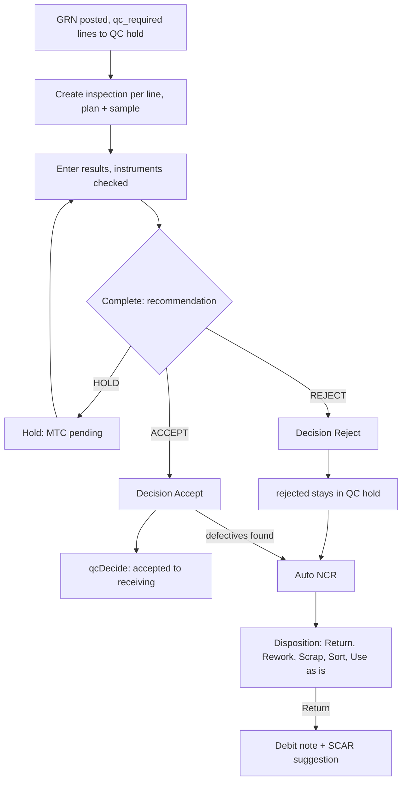
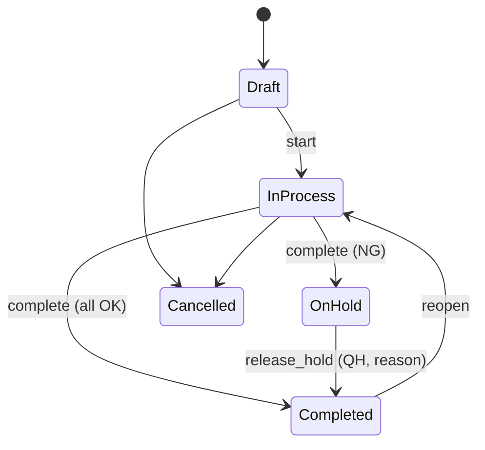
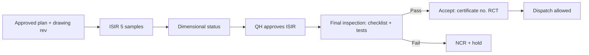
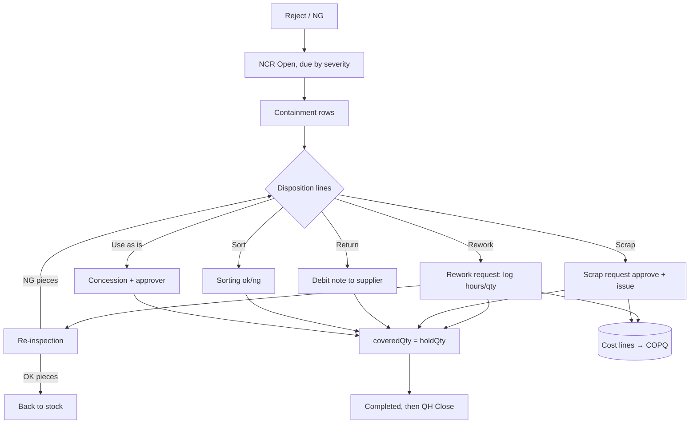
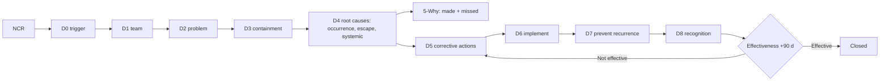
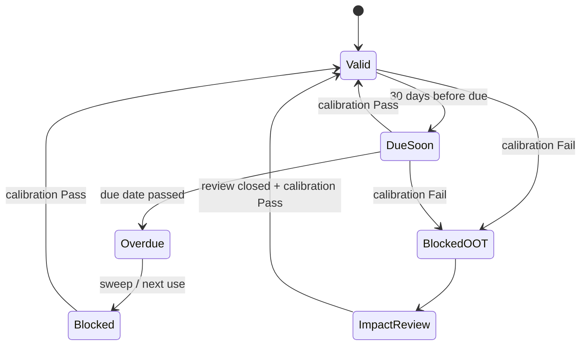
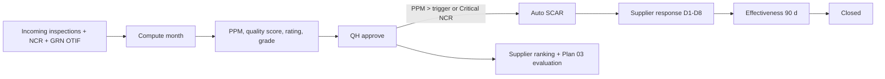

# 06a — Quality / QMS: the frozen UI page by page and the end-to-end processes (sections 2 and 4 of the plan)

> Part of `06-QUALITY-QMS.md` (index). Field keys are `labelToKey(label)` of `apps/api/src/engine/keys.ts`; types and required flags are those of `apps/api/tests/fixtures/field-types.json` (the truth). Columns named in the "Source" column are in `06b-QMS-DATABASE.md`; rule ids `BR-QMS-nn` are in `06c`. `[ADD]` items are always **after** the frozen ones; they never replace or reorder a frozen field or tab.

## 2. The frozen UI, page by page

### 2.0 Rules that apply to all ten pages
1. **Frozen:** page id, title, the page head (title, purpose "Define inspection standards, capture results, control nonconformance and drive corrective action.", Excel / Letterhead PDF / Print / ＋ Add), context chips, the record bar, the universal 16-tab strip (`Module Dashboard`, the 6 profile tabs, `Analytics & Graphs`, `AI Decision Center`, `Automation Studio`, `Data Quality`, `Activity Timeline`, `Documents`, `Approvals`, `Reports`, `Audit Trail`), the register table look, modal, drawer, toast.
2. **Profile tabs become real.** Today the 6 profile tabs are placeholders (`PhaseNotice`) or the generic register. QMS fills them through the optional `tabPanels` entry of the typed schema introduced by Plan 03 (`03-SCM-PROCUREMENT.md` §1): `tabPanels: { '<tab label>': { component: 'QmsXyz', endpoint: '…' } }`. The **first profile tab of every page is the register table** (list + filters + row actions). The other five are panels built from the data named in each tab line below. If `tabPanels` does not exist when the builder starts (Plan 03 not built), T-QMS-30 creates it exactly as described there (one optional map in `TypedSchema` and one lookup in `ModuleTabs.tsx`).
3. **`[ADD]` tabs** are appended **after `Audit Trail`** (the end of the 16-tab strip) and are visually identical tabs; they are listed per page below. (Open question Q-6: the owner may prefer them directly after the 6th profile tab.)
4. **Field order** = registry order, then `[ADD]`. The **list columns** are the frozen fields (≤ 12 shown; `qms-incoming` has 13 frozen fields, the register table shows all 13 as the prototype does) — `[ADD]` fields appear in the drawer/form and as optional columns, never in the default list.
5. **Required flags** are the frozen ones. Where the database needs something the frozen flag does not give (for example `Item` on `qms-incoming` is `required: false` in the fixture), the **service** enforces it with a field error (`"Choose the item"`); the schema flag is not changed.
6. **Status field:** the field labelled exactly `Status` is the workflow status; read-only in the form; changed only by actions. All other "…Status" fields are normal.
7. **Soft delete / undo** behave as in the Inventory slice (Draft only; undo token), except where a page below says "no delete".
8. **Empty states** use the existing text pattern: "No <things> yet." + the page's primary button.
9. **Money / qty** display: qty 3 dp trimmed, `Actual` (type `money`) shows up to 4 dp (display override `decimals: 4` — a presentation setting; the frozen type stays `money`).

**Kind → page map** (used for permissions and numbering): `INCOMING → qms-incoming`, `IN_PROCESS → qms-process`, `FINAL → qms-final`, `ISIR, VT, WELD_BEFORE_AFTER, LAYOUT → qms-inspections`; `qms-inspections` lists **all** kinds.

---

### 2.1 `qms-plans` — Inspection Plans (kind `typed`, document `IPL`)
**Tabs (frozen names):**
1. **Inspection Plan Master** — the register of plan revisions (list of `inspection_plans`, newest revision of each code first), filters, row actions.
2. **Characteristics** — grid editor of the selected plan's characteristics (`inspection_plan_characteristics`): `#`, Name, Type, Class, Zone/Item, Specification, Nominal, LSL, USL, Tolerance, UOM, Method, Instrument type, Frequency, Sample rule, Reaction plan; add / delete / reorder rows; editable only while the plan is Draft.
3. **Sampling Rules** — the sampling tables (`qms_sampling_plans` + rows): list of tables with rows (lot from–to, sample size, Ac, Re, code letter); create / edit / activate / set default (needs `approve`); a **Sample finder** box ("Lot size → sample, Ac, Re", `GET /qms/sampling-lookup`).
4. **Specification Limits** — read-only matrix of every `MEASURED` characteristic of the selected plan with nominal, LSL, USL, tolerance and the instrument type needed; a red badge when a limit is missing (cannot approve).
5. **Revision Control** — revision chain of the selected plan code (rev 0, 1, 2…): status, effective date, approved by / at, number of characteristics changed vs the previous revision (count of added / removed / changed rows); button `New Revision`.
6. **Plan Coverage** — items and item categories **covered** by an Approved plan and the **uncovered** ones (items with `qc_required` style types but no plan), per supplier override; click an uncovered item → "Create plan for this item".

**Frozen fields** (11):
| Label | Key | Type | Req | Source / options |
|---|---|---|---|---|
| Plan Code | `planCode` | code | yes | `code` (auto `IPL/<UNIT>/<FY>/<0001>`, read-only) |
| Plan Name | `planName` | text | yes | `plan_name` 2–150 |
| Inspection Type | `inspectionType` | enum | no | `inspection_kind` ← `INSPECTION_TYPES` |
| Item Category | `itemCategory` | enum | no | `item_category`; options = distinct `items.category` (lookup, free value allowed) |
| Revision | `revision` | text | no | `revision` shown "Rev 0"; read-only (system) |
| Sampling Standard | `samplingStandard` | text | no | `sampling_standard` (e.g. "IS 2500 / client table") |
| Sample Size | `sampleSize` | qty | no | `fixed_sample_size` (blank = from the sampling table) |
| Characteristic Count | `characteristicCount` | qty | no | `characteristic_count` (calc, read-only) |
| Effective Date | `effectiveDate` | date | yes | `effective_date` |
| Owner | `owner` | ref | no | `owner_id` (users lookup) |
| Status | `status` | status | no | `Draft`, `Approved`, `Inactive` |
**`[ADD]` fields:** `item` (lookup items, `item_id`) · `supplier` (lookup suppliers, `supplier_id`) · `samplingTable` (lookup sampling plans, `sampling_plan_id`) · `drawingNo` (text 60) · `drawingRev` (text 20) · `controlPlanRef` (text 60) · `supersedes` (calc: previous revision code) · `approvedBy`, `approvedAt` (calc).
**Statuses:** Draft → Approved → Inactive. **Row actions:** `approve` (Draft), `new_revision` (Approved / Inactive), `deactivate` (Approved), Edit (Draft only), Delete (Draft only). **Header buttons:** Excel, Letterhead PDF, Print, ＋ Add. **Filters:** Status, Inspection Type, Item (lookup), Supplier (lookup), "Latest revision only" (default on). **Totals:** plans Approved / Draft / Inactive count. **Empty:** "No inspection plans yet. Create the first plan." **`[ADD]` tab:** `Print Forms` (the 15 `qms_form_headers`: edit title, Doc No., Rev No., Rev Date, signature labels; needs `approve`).

### 2.2 `qms-incoming` — Incoming Quality (kind `typed`, inspections `INCOMING`, document `IQC`)
**Tabs:**
1. **Incoming Inspection Queue** — register of INCOMING inspections **plus** a "Waiting for inspection" strip: GRN lines in the QC hold warehouse with no inspection yet (`GrnPort.listPending`), each with `Create inspection`.
2. **Supplier Lot** — the lot facts of the selected inspection: supplier, PO, invoice / DC no, GRN no + line, item, material grade, heat / batch no, thickness × width × length, MTC status, lot qty, QC hold stock quantity (live `QcStockPort.onHand`).
3. **Sampling & Tests** — sampling result card (lot size → sample size, Ac, Re, plan, AQL label) and the **inspection entry grid** (`InspectionGrid`, section 2.12): one row per characteristic × sample, instrument picker, OK/NG buttons, defect picker; the seven acceptance-criteria rows of the client sheet; `Save results`, `Complete inspection`.
4. **Acceptance Decision** — recommendation (BR-QMS-02) with reasons, quantity split form (accepted / rejected / hold / rework, BR-QMS-03), decision buttons (`Accept`, `Hold`, `Reject`, `Accept Under Deviation` for approvers), target warehouse, deviation ref; list of stock moves caused (`inspection_stock_moves`).
5. **NCR Link** — NCR(s) raised from this inspection (auto-NCR, BR-QMS-07): number, severity, status, disposition lines and coverage bar; `Open NCR`.
6. **Supplier Quality Trend** — 12-month PPM and quality-score line chart of this supplier (report 3/10), last 10 lots table.

**Frozen fields** (13):
| Label | Key | Type | Req | Source / options |
|---|---|---|---|---|
| Inspection No | `inspectionNo` | code | yes | `code` (`IQC/<UNIT>/<FY>/<0001>`) |
| GRN Ref | `grnRef` | ref | no | `grn_no` — type the GRN code; with `grnLineNo` it resolves `grn_id`/`grn_line_id` (BR-QMS-06 R-6) |
| Vendor | `vendor` | ref | yes | `supplier_id` (lookup suppliers) — taken from the GRN when linked |
| Item | `item` | ref | no (service requires it) | `item_id` (lookup items) |
| Batch | `batch` | text | no | `batch_no` |
| Lot Qty | `lotQty` | qty | no | `lot_qty` |
| Sample Qty | `sampleQty` | qty | no | `sample_qty` (calc from BR-QMS-01; approver override) |
| Accepted Qty | `acceptedQty` | qty | no | `accepted_qty` |
| Rejected Qty | `rejectedQty` | qty | no | `rejected_qty` |
| Decision | `decision` | enum | no | `decision` ← `DECISIONS` (read-only; set by `decide`) |
| Inspector | `inspector` | ref | no | `inspector_id` (users lookup; default = creator) |
| NCR Ref | `ncrRef` | ref | no | `ncr_id` (calc link) |
| Status | `status` | status | no | Draft, In Process, Completed, On Hold, Cancelled |
**`[ADD]` fields** (client sheets "Incoming Inspection Report" + data sheet): `grnLineNo` (qty, line of the GRN) · `inspectionDate` is the record `doc_date` (date, default today) · `poNo` (text 60) · `invoiceNo` (text 60, "Invoice/DC No") · `itemDescription` (calc from item name) · `partNo` (calc item code) · `drawingNo` (text 60) · `materialType` (enum `RM`,`BO`,`Fabricated`,`Machined`) · `category` (text) · `materialGrade` (text 60, "Material Grade/Spec") · `heatNo` (text 100, "Heat/Batch No") · `thickness` (qty, mm) · `width` (qty, mm) · `length` (qty, mm) · `mtcStatus` (enum `Received`,`Pending`,`Not Applicable`) · `uom` (text) · `inspectedQty` (qty) · `samplingTable` (lookup) · `aql` (qty, calc) · `ac`, `re` (qty, calc) · `defectiveCount` (qty, calc) · `aqlResult` (enum `ACCEPT`,`REJECT`, calc) · `recommendation` (enum, calc) · `surfaceCondition`, `materialVerification`, `dimensionVerification`, `quantityVerification`, `traceabilityVerification`, `functionalCheck` (enum `OK`,`NG`,`Yes`,`No`,`NA`) · `holdQty`, `reworkQty` (qty) · `acceptancePct`, `rejectionPct` (pct, calc) · `supplierPpm` (qty, calc) · `supplierRating` (enum `A`–`D`, calc) · `defectDescription` (longtext) · `targetWarehouse` (lookup warehouses) · `remarks` (text 500) · `plan` (lookup plans).
**Row actions:** `start` (Draft), `complete` (In Process), `decide` (In Process / On Hold), `release_hold` (On Hold), `reopen` (Completed), `cancel` (Draft / In Process), Edit (Draft / In Process), Delete (Draft only). **Header buttons:** Excel (frozen columns), `Excel — client register` [ADD], Letterhead PDF, Print (incoming inspection report), ＋ Add (manual), `From GRN` [ADD]. **Filters:** Status, Decision, Vendor, Item, date range, "Waiting for decision". **Totals:** lots, Σ lot qty, Σ accepted, Σ rejected, rejection %, PPM (of the filtered list). **Empty:** "No incoming inspections yet. They appear here when a GRN with quality inspection is posted."

### 2.3 `qms-process` — In-Process Quality (typed, `IN_PROCESS`, document `IPQ`)
**Tabs:**
1. **In Process Inspection** — register of IN_PROCESS inspections.
2. **Operation Checkpoints** — the in-process plan for the selected item + operation: each checkpoint's specification, checking method, frequency, instrument type, reaction plan (read from the approved plan; button `Start inspection with this plan`).
3. **SPC Readings** — `InspectionGrid` for the selected inspection (parts 1…12 across, as the client sheet) and a **run chart** of the last 50 readings of the selected characteristic with LSL / USL / mean lines (SVG, existing chart style).
4. **Hold Release** — queue of inspections `On Hold` with hold qty, NCR, coverage; `Release hold` dialog (reason, approver) (BR-QMS-20).
5. **Defect Escalation** — streaks of consecutive NG per item + operation + characteristic (`qms.escalation_consecutive_ng`), the escalation NCRs created, and "near streak" warnings (2 of 3).
6. **Process Capability** — Cp / Cpk / Pp / Ppk calculator (item, characteristic, date range, subgroup size, include final inspections) with the histogram + the saved studies list (`capability_studies`), `Save study`, verdict badge (BR-QMS-19).

**Frozen fields** (12):
| Label | Key | Type | Req | Source / notes |
|---|---|---|---|---|
| Inspection No | `inspectionNo` | code | yes | `IPQ/…` |
| Production Order | `productionOrder` | ref | no | `production_order_ref` (free text until Manufacturing exists) |
| Operation | `operation` | text | no | `operation_name` |
| Item | `item` | ref | yes | `item_id` |
| Sample Time | `sampleTime` | datetime | no | `inspected_at` |
| Parameter | `parameter` | text | no | `parameter_name` (calc: the first NG characteristic, else the first characteristic) |
| Specification | `specification` | longtext | no | `specification_text` (calc, same row) |
| Actual | `actual` | money | no | `actual_value` (calc, same row; 4 dp) |
| Result | `result` | enum | no | `result` ← `RESULTS` (calc) |
| Inspector | `inspector` | ref | no | `inspector_id` |
| Hold Status | `holdStatus` | enum | no | `hold_status` ← `HOLD_STATUSES` (calc / by actions) |
| Status | `status` | status | no | Draft, In Process, Completed, On Hold, Cancelled |
**`[ADD]`:** `partName` (calc) · `customer` (lookup customers) · `machineNo` (text 40) · `operatorName` (text 100) · `shift` (enum `A`,`B`,`C`,`General`) · `lotQty` (qty, "pieces produced in the checked lot") · `sampleQty` (qty) · `rejectedQty`, `reworkQty` (qty) · `defectiveCount` (calc) · `drawingNo`, `drawingRev` · `plan` (lookup) · `holdReason` (text) · `partsPerRow` (qty 1–12).
**Row actions:** `start`, `complete`, `release_hold`, `reopen`, `cancel`, Edit, Delete (Draft). **Header buttons:** Excel, Letterhead PDF, Print (in-process inspection report), ＋ Add. **Filters:** Status, Result, Hold Status, Item, Operation (text), date range. **Totals:** inspections, NG count, On Hold count, FPY %. **Empty:** "No in-process inspections yet."

### 2.4 `qms-final` — Final Quality (typed, `FINAL`, document `FQC`)
**Tabs:**
1. **Final Inspection Queue** — register of FINAL inspections.
2. **Final Checklist** — the checklist rows (`CHECKLIST` characteristics: packing, label, paint, documents, dimensions summary…) as an OK / NG / NA list with score; `Complete`.
3. **Test Results** — measured / test rows (`MEASURED` + `ATTRIBUTE`) incl. NDT remarks (VT, DPT, MPT, UT references typed in `observed_text` with attachment of the report).
4. **Release Certificate** — certificate preview (Release Certificate print), `Generate` happens on decision `Accept`; `Void` on reopen; certificate number list.
5. **Customer Requirement** — customer + drawing requirement text, customer-specific checks, **the latest Approved ISIR** of the item/drawing rev (status, date, link) and PPAP-style checklist of attached documents.
6. **Final Yield** — table / bar of final yield % per item and week (`accepted/lot`), rejected qty by defect.

**Frozen fields** (12):
| Label | Key | Type | Req | Source |
|---|---|---|---|---|
| Inspection No | `inspectionNo` | code | yes | `FQC/…` |
| Production Order | `productionOrder` | ref | no | `production_order_ref` |
| Item | `item` | ref | yes | `item_id` |
| Batch Serial | `batchSerial` | text | no | `serial_ref` (else batch no) |
| Qty | `qty` | qty | no | `lot_qty` |
| Checklist Score | `checklistScore` | pct | no | `checklist_score` (calc, BR-QMS-21) |
| Test Result | `testResult` | enum | no | `test_result` ← `TEST_RESULTS` (calc) |
| Accepted | `accepted` | qty | no | `accepted_qty` |
| Rejected | `rejected` | qty | no | `rejected_qty` |
| Certificate No | `certificateNo` | text | no | `certificate_no` (calc) |
| Inspector | `inspector` | ref | no | `inspector_id` |
| Status | `status` | status | no | Draft, In Process, Completed, On Hold, Cancelled |
**`[ADD]`:** `customer` (lookup) · `drawingNo`, `drawingRev` · `customerRequirement` (longtext) · `pdiDone` (bool) · `packingOk`, `labelOk` (enum OK/NG/NA) · `dispatchTarget` (text) · `decision` (enum, calc) · `holdQty`, `reworkQty` (qty) · `finalYield` (pct, calc) · `approvedIsir` (calc code) · `plan` (lookup) · `remarks`.
**Row actions:** `start`, `complete`, `decide`, `release_hold`, `reopen`, `cancel`, Edit, Delete (Draft). **Header:** Excel, Letterhead PDF, Print (release certificate / final inspection), ＋ Add. **Filters:** Status, Test Result, Item, Customer, date range. **Totals:** lots, Σ qty, Σ accepted, Σ rejected, final yield %. **Empty:** "No final inspections yet."

### 2.5 `qms-supplier` — Supplier Quality (typed, document `SQS`, one row per supplier per month)
**Tabs:**
1. **Supplier Quality Dashboard** — register of `supplier_quality_periods` + ranking cards (A / B / C / D counts) for the chosen month; `Compute month` button.
2. **PPM & Rejection** — per supplier: lots, qty received / rejected, rejection %, PPM, PPM grade, target line.
3. **Incoming Trends** — 12-month charts per supplier (PPM, quality score, OTIF) from Approved periods.
4. **SCAR Actions** — SCARs (`capas` with type `Supplier (SCAR)`) of the supplier: number, NCR, status, target date, age; `Raise SCAR`.
5. **Audit Findings** — supplier audits and findings (`supplier_audits`, `supplier_audit_findings`): add audit, findings with grade, due date, linked CAPA, status.
6. **Supplier Quality Score** — the scoring explanation for the selected row: ppm → quality score → weights → overall rating → grade (BR-QMS-24 shown as a small worked table).

**Frozen fields** (12):
| Label | Key | Type | Req | Source |
|---|---|---|---|---|
| Vendor | `vendor` | ref | yes | `supplier_id` |
| Period | `period` | date | yes | `period` (first day of the month; the UI shows "Sep 2026") |
| Lots Received | `lotsReceived` | qty | no | calc |
| Lots Rejected | `lotsRejected` | qty | no | calc |
| PPM | `ppm` | qty | no | calc |
| Quality Score | `qualityScore` | pct | no | calc |
| OTIF | `otif` | pct | no | `otif_pct` (calc from Plan 03; blank when unavailable) |
| NCR Count | `ncrCount` | qty | no | calc |
| SCAR Open | `scarOpen` | qty | no | calc |
| Audit Score | `auditScore` | pct | no | calc |
| Overall Rating | `overallRating` | pct | no | calc |
| Status | `status` | status | no | Draft, Approved |
All numeric fields are **calc / read-only** (computed by `compute`); only Vendor and Period are typed when adding. **`[ADD]`:** `qtyReceived`, `qtyRejected` (qty) · `ppmGrade`, `ratingGrade` (enum A–D) · `computedAt` (datetime) · `approvedBy` (calc).
**Row actions:** `compute` (Draft), `approve` (Draft), `reopen` (Approved), `raise_scar`. **Header:** Excel, Excel — scorecard [ADD], Letterhead PDF, Print, ＋ Add (= compute a supplier-month). **Filters:** Vendor, Period (month), Status, Grade. **Totals:** suppliers, average rating, Σ lots rejected. **Empty:** "No supplier scorecards yet. Choose a month and press Compute."

### 2.6 `qms-inspections` — Quality Inspections (typed, all kinds)
**Tabs:**
1. **Inspection Register** — all kinds, with the kind column; `＋ Add` asks for the type first.
2. **Parameter Results** — `InspectionGrid` of the selected inspection; for ISIR a 5-sample dimension table, for VT the flaw list, for Weld Before/After the 12-row form.
3. **Sample Details** — sample plan, sample numbers, instruments used (code, calibration due, state), who measured, when.
4. **Accept Reject** — dimensional status (ISIR), result, decision panel as in 2.2 tab 4 (incoming only posts stock), `approve_isir`.
5. **Attachments & Certificates** — `qms_attachments` of the inspection (photos, MTC, drawings, UT/DPT reports) with upload / download.
6. **Inspection Analytics** — report 12 (counts by kind / status, accept-reject split, average completion time).

**Frozen fields** (12):
| Label | Key | Type | Req | Source |
|---|---|---|---|---|
| Inspection No | `inspectionNo` | code | yes | `ISR/`, `VTR/`, `WBA/`, `LAY/` (or `IQC/`, `IPQ/`, `FQC/` for those kinds) |
| Inspection Type | `inspectionType` | enum | no | `inspection_kind` ← `INSPECTION_TYPES`; chosen at creation, **not editable afterwards** |
| Reference | `reference` | ref | no | `reference` (free text: GRN / PO / drawing / job) |
| Item | `item` | ref | yes | `item_id` |
| Lot Batch | `lotBatch` | text | no | `batch_no` (or `heat_no`) |
| Sample Qty | `sampleQty` | qty | no | `sample_qty` |
| Parameters | `parameters` | text | no | calc "12 characteristics × 5 samples" |
| Accepted | `accepted` | qty | no | `accepted_qty` |
| Rejected | `rejected` | qty | no | `rejected_qty` |
| Inspector | `inspector` | ref | no | `inspector_id` |
| Inspection Date | `inspectionDate` | date | yes | `doc_date` |
| Status | `status` | status | no | Draft … Cancelled |
**`[ADD]`:** `lotQty` · `supplier`, `customer` (lookups) · `drawingNo`, `drawingRev` · `result`, `decision` (calc enums) · `plan` (lookup) · the **kind-specific header fields** of 06b §5.7.5 shown as a form section that depends on the type (ISIR: ISIR No, Job No, Part Rev, Material Specification, Revision Status, Reviewed By / On, Dimensional Status, Sample Count; VT: Project, Stage, Scope, Component, Part No, Weld Sr No, Material Grade, Procedure, Gauge details / Sr no, Applicable Code, Process, Technique, Test Standard, Surface condition, Temperature, Surface preparation, Method, Lighting, Light intensity, Post-examination cleaning, Examination date, Examined by, Reviewed by; Weld Before/After: Acceptance criteria, Part description, Drawing rev, Serial no, Weld no, Welder no, WPS no, Parent metal heat no, Wire spool TC/Lot no, Reworked & accepted qty) stored in `header_data`.
**Row actions:** as 2.2. **Header:** Excel, Letterhead PDF, Print (the form of the row's type), ＋ Add. **Filters:** Inspection Type, Status, Item, Supplier, Result, date range. **Totals:** inspections, Σ sample qty, Σ accepted, Σ rejected. **Empty:** "No inspections yet."

### 2.7 `qms-ncr` — Non-Conformance / NCR (typed, document `NCR`)
**Tabs:**
1. **NCR Register** — the register in the **client's rejection / rework register layout** option (toggle `Client layout`): Sr no, Date, Process, Operator, Part Name, Part No, Hold Qty, Defect, Defect Type, Root Cause, Corrective Action, Responsibility, Rework Qty, Reject Qty, Closing Date, Status; default view = frozen columns.
2. **Containment** — containment text + rows (scope × action × qty × responsible × date) (`ncr_containment_actions`), shown as the client's D3 matrix; `Create Quality Alert` button.
3. **Root Cause** — root-cause text, defect + category pickers, link / create 5-Why, link / create CAPA, repeat-NCR notice, `needsCapa` badge.
4. **Disposition** — disposition lines editor (type, qty, status, concession ref, approver, return ref), coverage bar (`coveredQty / holdQty`), the rework and scrap requests created (status, qty done / ok / ng), cost lines (type, qty, rate, hours, amount) with COPQ subtotal.
5. **Responsibility & Due Date** — owner, responsibility (person), due date, SLA by severity, days left / overdue, escalation history, reminders.
6. **NCR Trend** — Pareto of defects, monthly rejection trend, ageing matrix, by process / part (reports 4, 5, 7) and the client's Summary tables (closed / open, dimensional / visual / missing / functional / leakage).

**Frozen fields** (12):
| Label | Key | Type | Req | Source / options |
|---|---|---|---|---|
| NCR No | `ncrNo` | code | yes | `NCR/<UNIT>/<FY>/<0001>` |
| Date | `date` | date | yes | `doc_date` |
| Source | `source` | enum | no | `source` ← `NCR_SOURCES` |
| Reference | `reference` | ref | no | `reference` (inspection code / complaint no.) |
| Item | `item` | ref | yes | `item_id` |
| Problem Description | `problemDescription` | longtext | no | `problem_description` |
| Containment | `containment` | longtext | no | `containment` |
| Disposition | `disposition` | enum | no | `disposition` ← `NCR_DISPOSITIONS` (calc from lines; read-only) |
| Owner | `owner` | ref | no | `owner_id` |
| Due Date | `dueDate` | date | no | `due_date` (default by severity) |
| Severity | `severity` | enum | no | `severity` ← `SEVERITIES` (override of the default enum) |
| Status | `status` | status | no | Open, In Process, Completed, Closed, Cancelled |
**`[ADD]` fields** (client rejection / rework register): `partName` (calc) · `partNo` (calc item code) · `processName` (text 100, "Process Name") · `operatorName` (text 100, "Operator / Fitter Name") · `holdQty` (qty, "HOLD QTY") · `reworkQty` (qty calc, "REWORK QTY") · `rejectQty` (qty calc, "REJECT QTY") · `useAsIsQty`, `returnQty` (qty calc) · `defect` (lookup defects, "Defect") · `defectCategory` (calc, "Defect Type") · `rootCauseText` (longtext, "Root Cause") · `correctiveActionTaken` (longtext, "Corrective Action Taken") · `responsibility` (text 100, "Responsibility") · `closingDate` (date, "Closing Date") · `supplier`, `customer` (lookups) · `batchNo` · `drawingNo` · `isRepeat` (bool calc) · `needsCapa` (bool calc) · `capaRef`, `fiveWhyRef` (calc links) · `costInternal`, `costExternal` (money calc) · `ageDays` (qty calc) · `overdue` (bool calc).
**Row actions:** `close` (Completed), `reopen` (Closed), `cancel` (Open), `raise_capa`, `raise_5why`, Edit (not Closed), Delete (Open with no lines; else Cancel). **Header:** Excel (frozen), `Excel — rejection register` [ADD], Letterhead PDF, Print (rejection / rework register for the filtered list), ＋ Add. **Filters:** Status, Severity, Source, Item, Defect category, Supplier, Process (text), Owner, Overdue only, date range. **Totals:** NCR count, Σ hold qty, Σ reject qty, Σ rework qty, open count, overdue count, internal cost, external cost. **Empty:** "No non-conformances yet."
**`[ADD]` tabs (after Audit Trail):** `Quality Alerts` (the Q-Alert one-page form list: part, issue, notification date, containment, OK / Not-OK photos; print `Q_ALERT`) · `Cost of Poor Quality` (report 6, client COPQ summary and quality cost monitor tables) · `Defect Master` (defect categories and defects CRUD; `approve` to edit) · `Monthly Quality Data` (`quality_monthly_inputs` grid: month, customer, produced, dispatched, customer rejected, sales value, PPM target, prevention, appraisal, customer return, warranty, penalty).

### 2.8 `qms-capa` — CAPA (typed, document `CAPA` / `SCAR`)
**Tabs:**
1. **CAPA Register** — register; type badge (CAPA / SCAR / 8D).
2. **Problem Statement** — D0 trigger, **D1 team** editor (name, department, role, leader), **D2** What / Where / When / Why / How / Who, problem statement, photographs (attachments), customer reference.
3. **Root Cause** — **D3 containment matrix** (scope × Segregation / Rework / Replacement quantities, as the client's table) and **D4 root causes** (OCCURRENCE "1st", ESCAPE "2nd", SYSTEMIC "3rd"; method; verified; evidence), "Open 5-Why" link.
4. **Corrective Action** — **D5** permanent corrective actions (action, responsibility, target date) and **D6** implementation (done date, evidence); gate checklist (what is missing, BR-QMS-13).
5. **Preventive Action** — **D7** preventive actions: PFMEA / control plan / training / work-instruction revisions, horizontal deployment (other parts / lines).
6. **Effectiveness Check** — **D8** recognition text, effectiveness due date, record effectiveness (result, note, date), rounds history, `Close CAPA`.

**Frozen fields** (11):
| Label | Key | Type | Req | Source |
|---|---|---|---|---|
| CAPA No | `capaNo` | code | yes | `CAPA/…` or `SCAR/…` |
| NCR Ref | `ncrRef` | ref | no | `ncr_id` (lookup ncrs) |
| Problem Statement | `problemStatement` | longtext | no | `problem_statement` |
| Root Cause | `rootCause` | text | no | `root_cause` (one line; filled from D4) |
| Corrective Action | `correctiveAction` | longtext | no | `corrective_action` (summary of D5) |
| Preventive Action | `preventiveAction` | longtext | no | `preventive_action` (summary of D7) |
| Owner | `owner` | ref | no | `owner_id` |
| Target Date | `targetDate` | date | no | `target_date` |
| Effectiveness Date | `effectivenessDate` | date | no | `effectiveness_date` |
| Effectiveness Result | `effectivenessResult` | enum | no | `effectiveness_result` ← `EFFECTIVENESS_RESULTS` (read-only; set by action) |
| Status | `status` | status | no | Open, In Process, Completed, Closed, Cancelled |
**`[ADD]`:** `capaType` (enum `Internal`,`Supplier (SCAR)`,`Customer (8D)`) · `severity` (enum) · `item` (lookup) · `supplier`, `customer` (lookups) · `customerRef` (text 60, "CAPA Ref. No. / IQPR No.") · `d0Trigger` (longtext) · `d2Who`, `d2What`, `d2Where`, `d2When`, `d2Why`, `d2How` · `d8Recognition` (longtext) · `preparedBy`, `authorizedBy` (users) · `completedDate` · `effectivenessDueDate` · `effectivenessRound` · `fiveWhyRef` · `closedBy`, `closedAt` (calc).
**Row actions:** `start`, `complete`, `record_effectiveness`, `close`, `cancel`, Edit (not Closed), Delete (Open, empty). **Header:** Excel, Letterhead PDF, Print (**8D report**), ＋ Add (`From NCR` offered). **Filters:** Status, Type, Severity, Owner, Supplier, Overdue only. **Totals:** open, overdue, closed, average cycle days. **Empty:** "No CAPA yet."
**`[ADD]` tabs:** `Review Meetings (MOM)` (the client's Minutes of Meeting: date, type, customer, reps, agenda, points table with responsible team, due date, remark, status, link to NCR / CAPA; `approve`) · `Improvement Ideas` (the client's Continuous Improvement team slide: theme, SQDCPE tags, team, before / objective / benefits / why 1-4 / root cause / action plan / after / saving).

### 2.9 `qms-5why` — 5 Why Analysis (typed, document `5WY`)
**Tabs:**
1. **5 Why Cases** — register.
2. **Problem Definition** — problem text, item, NCR / CAPA link, cause category (Man / Machine / Material / Method / Measurement / Environment).
3. **Why Chain** — the two chains side by side exactly as the client sheet: **Why made** (Why 1 … Why 5 → Root Cause) and **Why missed** (detection chain, `[ADD]`), each step "Why? … Because …".
4. **Root Cause Evidence** — evidence text and attachments, "verified" tick by the owner, link to 4M diagram image (attachment).
5. **Action Linkage** — linked NCR / CAPA, the CAPA actions created from this root cause; `Push root cause to CAPA`.
6. **Closure Review** — checklist (root cause ≥ 10 chars, not equal to problem, evidence attached, CAPA action exists), `Complete` / `Close`.

**Frozen fields** (11):
| Label | Key | Type | Req | Source |
|---|---|---|---|---|
| Case No | `caseNo` | code | yes | `5WY/…` |
| NCR Ref | `ncrRef` | ref | no | `ncr_id` |
| Problem | `problem` | longtext | no | `problem` |
| Why 1 | `why1` | longtext | no | `why_1` |
| Why 2 | `why2` | longtext | no | `why_2` |
| Why 3 | `why3` | longtext | no | `why_3` |
| Why 4 | `why4` | longtext | no | `why_4` |
| Why 5 | `why5` | longtext | no | `why_5` |
| Root Cause | `rootCause` | text | no | `root_cause` |
| Owner | `owner` | ref | no | `owner_id` |
| Status | `status` | status | no | Open, In Process, Completed, Closed, Cancelled |
**`[ADD]`:** `capaRef` · `item` · `causeCategory` (enum) · `missedProblem` (longtext) · `missedWhy1`…`missedWhy5` (longtext) · `missedRootCause` (text) · `evidence` (longtext).
**Row actions:** `complete`, `close`, `push_to_capa`, Edit (not Closed), Delete (Open). **Header:** Excel, Letterhead PDF, Print (Why-Why analysis), ＋ Add. **Filters:** Status, Owner, Cause category. **Totals:** cases, open, completed. **Empty:** "No 5-Why cases yet."

### 2.10 `qms-calibration` — Calibration (typed master `instruments`; code = Instrument ID)
**Tabs:**
1. **Instrument Register** — the register in the client's *Instruments List* layout toggle; filters by unit, type, state.
2. **Calibration Schedule** — calendar-style list: Overdue (red), due in ≤ 30 days (amber), next 90 days, grouped by week, with agency and notify-to; `Send for calibration` action; export client list.
3. **Calibration Results** — calibration records (`calibration_records`): date, instrument, performed by, agency, certificate no, result, as-found / as-left points table; `＋ Record calibration` form (points grid computing OK / NG per point).
4. **Out of Tolerance** — records with Fail / adjusted-with-as-found-NG, the **impact reviews** (window, items, actions, conclusion) with `Close review`; blocked instruments list with reason.
5. **Certificates** — certificate numbers, agency, accreditation no., attachments (PDF certificates), validity.
6. **Compliance Status** — report 9: compliance %, valid / due soon / overdue / not calibrated counts, on-time vs late calibrations, by unit and instrument type.

**Frozen fields** (12):
| Label | Key | Type | Req | Source / options |
|---|---|---|---|---|
| Instrument ID | `instrumentId` | code | yes | `instruments.code` (typed or auto `INS/…`) |
| Instrument Name | `instrumentName` | text | yes | `name` (client "Equipment Name") |
| Department | `department` | ref | no | `department` (department name pick-list from `admin-departments`) |
| Range | `range` | text | no | `range_text` ("Equipment Range / Specification") |
| Accuracy | `accuracy` | pct | no | `accuracy_pct` |
| Calibration Frequency | `calibrationFrequency` | enum | no | `frequency_label` ← `CAL_FREQUENCIES` |
| Last Calibration | `lastCalibration` | date | no | `last_calibration_date` (calc from records; editable only on first entry / import) |
| Next Due | `nextDue` | date | no | `next_due_date` (calc, BR-QMS-16) |
| Agency | `agency` | text | no | `agency` ("Calibration Agency") |
| Certificate | `certificate` | text | no | `certificate_no` |
| Result | `result` | enum | no | `last_result` ← `CAL_RESULTS` |
| Status | `status` | status | no | Active, Inactive, Blocked |
**`[ADD]`:** `instrumentType` (text 60) · `unit` (calc: the unit name = client "Division") · `leastCount` (text 30) · `historyCardNo` · `equipmentNo` · `serialNo` · `partName` ("Part Name") · `sourceOfCalibration` (enum Internal/External) · `manufacturer` · `displayType` (enum Analog/Digital/NA) · `purpose` · `modelNo` · `location` · `commissioningDate` · `notifyTo` (users) · `frequencyDays` (qty; editable only when frequency = Custom) · `calibrationState` (enum Valid / Due Soon / Overdue / Not Calibrated, calc) · `daysToDue` (qty, calc) · `blockReason` (calc).
**Row actions:** `calibrate` (opens a record Draft), `block`, `unblock`, `retire`, Edit, Delete (no calibration records and no results). **Header:** Excel, `Excel — instruments list` [ADD], `Import client sheet` [ADD] (dry-run first), Letterhead PDF, Print (instrument list), ＋ Add. **Filters:** Status, Calibration State, Instrument type, Department, Agency, Source, Due in (≤ 7 / 30 / 90 days). **Totals:** instruments, valid, due soon, overdue, blocked, compliance %. **Empty:** "No instruments yet. Import the instruments list or add the first instrument."

### 2.11 Document templates (the client's forms as print layouts)
Every form below is a React print component `qp-<form>` rendering `GET /qms/print/:formCode/:id`; header block = the client's block, with `Doc No.`, `Rev No.`, `Rev Date` read from `qms_form_headers`. Table columns keep the client's wording (in this section the client's spelling is **not** reproduced where it is a typo; the Excel exports in `06c` §7.4 keep it). Signature blocks are `signature_labels`.
| formCode | Page | Header block fields | Table / body | Signatures |
|---|---|---|---|---|
| `IQC_REPORT` | qms-incoming | Company name, title "Incoming Inspection Report", Doc No., Rev No., Rev Date | Register of the filtered inspections: `Sr No, Date, Supplier Name, Invoice No, Item Description, Material Grade/Spec, Heat/Batch No, Thickness, Width, Length, Total Qty, Accepted Qty, Rejected Qty, MTC Status, Remark` | Inspected By, Approved By |
| `IQC_SHEET` | qms-incoming | `Supplier Name`, `PO No`, `Date`, `GRN No`, `Inspector` | `Sr No, Item Description, Part No, Material Grade/Spec, Category (RM/BO/Fabricated/Machined), Qty Recd, UOM, Drawing No, Heat/Batch No, MTC Available (Yes/No), Critical Dimension, Actual Result, Status (OK/NG), Remarks`; **Acceptance Criteria** list (the 7 criteria) with OK/NG; line "Final Status: Accept / Reject / Hold" | Inspector |
| `IPQ_REPORT` | qms-process | `Part No`, `Part Name`, `Customer`, `Shift`, `M/c No`, `Opn Name`, `Operator name`, `Date`, Doc no, Doc date | Rows `Sr. No., Specification, Checking Method, Parts 1…12, Remarks` (15 rows); footer "Remark: Accepted / Rejected / Cond. Accepted." | Inspected By, Approved By |
| `ISIR` | qms-inspections | Title "Initial Sample Inspection Report", Format No, `ISIR No`, `Job No`, `Supplier Name and Code`, `Page n of N`, `Part Number`, `Rev`, `Description`, `Revision Status`, `Material Specification` | `Zone / Item, Description, Dimension Specification, Tolerance, Measuring Method, Measured Dimension (Sr.No.1…5), OK, Not OK, Remark` (rows from the plan, 12 per page) ; footer `Dimensional Status: Accepted / Rejected` | Reviewed By (name, signature, date) |
| `VT_REPORT` | qms-inspections | Title "Visual Inspection Report", Format No; `Manufacturer`, `Address`, `Project`, `Material Grade`, `Procedure`, `Stage`, `Scope`, `Component`, `Part No`, `Sr.No`, `Welding Gauge Details`, `Gauge Sr no`, `Applicable Code Edition & Added` (1–3), `Process`, `Technique`, `VT (test standard)`, `Surface Condition`, `Temperature`, `Surface Preparation`, `Method`, `Lighting Equipment`, `Light Intensity`, `Post Examination Cleaning`, `Examination Date` | `Sr.No, Type Of Flaw (ISO 6520-1), Interpretation: Requirement For weld joints, Observation, Remark, Result`; the 34 flaw rows; legend `NA - Not Applicable, NF - Not Found, NP - Not Permitted` | Examined By (name, date), Reviewed and Accepted (name, date) |
| `WELD_BA` | qms-inspections | Title "Welding Inspection Report (Before/After-VT)", Format No, `Acceptance Criteria`, `Date`, `Part No & Description`, `Drawing Rev`, `Qty`, `Serial no.`, `Weld No.`, `Welder no.`, `WPS no.`, `Parent Metal Heat no.` | Sections **Fit-Up** (Welding joint preparation; Ensure gap between two parts is less than 1 mm; Weld surface free from oil, dust), **Before Welding** (Wire Spool TC/Lot no., Cleaning, Tacking), **After Welding (VT-100%)** (Weld Size & Profile, Spatter, Undercut, Surface Porosity, Surface Crack, End Crater) each OK/NG/NA; lines `Accepted as per <criteria>`, `Reworked & Accepted Quantity`, `Rejected Quantity` | Inspector Name & Sign |
| `REWORK_REG` | qms-ncr | Title "Rejection/Rework Register", Format No, Rev No, Rev Date | `Sr no, Date, Process Name, Operator /Fitter Name, Part Name, Part No, HOLD QTY, Defect, Defect Type, Root Cause, Corrective Action Taken, Responsibility, REWORK QTY, REJECT QTY, Closing Date, Status` | Prepared By, Reviewed By |
| `EIGHT_D` | qms-capa | Title "8D Problem Solving", `CAPA Ref. No.`, `Part No.`, `Part Description`, `Supplier`, `Date` | **D1** team table (`Name`, `Department`); **D2** Who / What / Where / When / Why / How / Photographs; **D3** matrix `Customer Line, Customer Stock, In-transit Parts, Our Stock, Our Line, Manufacturing Process` × `Segregation, Rework, Replacement`; **D4** `1st / 2nd / 3rd` root cause; **D5** PCAs (`PCAs, Responsibility, Target Date`); **D6** implementation (same columns); **D7** prevent recurrence (`Actions, Responsibility, Target Date`); **D8** Recognition text | Prepared By, Authorized By |
| `Q_ALERT` | qms-ncr | Title "Quality Alert", Format No, Rev, Rev Date; `PART NUMBER`, `PART DESCRIPTION`, `Notification Date` | `ISSUE` text; OK photo and Not-OK photo boxes; `Containment Action` | — |
| `WHY_WHY` | qms-5why | Company, "Cause & Effect Diagram — Why-Why Analysis report", `Part Description`, `Part No.`, problem statement | Two columns: **Why Made** (`Why?` × 5 with "Because …", `Root Cause`) and **Why Missed** (same) | — |
| `MOM` | qms-capa | Company, "Minutes of Meeting", Format No, Rev & Date, `Agenda Of Meeting`, `Date Of Meeting`, `Customer Representatives`, `Representatives (<own company>)` | `Sr.No., Point Discussed, Responsible Team, Remark` (15 rows) | — |
| `CI_PROJECT` | qms-capa | "Continuous Improvement Team", Format No, `Team Name`, `Project Theme / Overview`, `Project No`, `Start Date`, `Close Date`, SQDCPE tick row (Safety, Quality, Delivery, Cost, People, Environment), `Team Names`, `Area / Function`, `Champion`, `Team Members` | boxes: `Current Situation (Before)`, `Objective / Target`, `Benefits / Improvement`, `Analysis: Why 1…Why 4, Root Cause`, `Action Plan`, `New Situation (After)`, `New Situation vs Objective / Target` | — |
| `INSTRUMENT_LIST` | qms-calibration | Company, "Instruments List", unit (Division) | `Sr No, History Card No, Equipment Name, Equipment No, Equipment Range / Specification, Least Count, Part Name, Validity (= Next Due), Source of Calibration, Calibration Frequency, Manufacturer Name, Analog/Digital, Purpose of Equipment, Model No., Equipment Location, Commissioning Date, Equipment Status, Notify To, Calibration Agency` | — |
| `CAL_RECORD` | qms-calibration | Instrument ID, name, range, least count, location, agency, certificate no, accreditation no, calibration date, next due | points table `Nominal, As Found, As Left, Tolerance, Result`; result; reference standard; uncertainty | Calibrated By, Approved By |
| `RELEASE_CERT` | qms-final | Certificate No, date, customer, item, drawing no / rev, batch / serial, qty | tested characteristics summary, checklist score, "Released for dispatch", under-deviation mark | Inspector, Quality Head |

### 2.12 Shared web components (new, `apps/web/src/pages/qms/`)
`QmsTabs.tsx` (tab-panel registry), `InspectionGrid.tsx` (the entry grid: rows = characteristics, columns = samples 1…N; cells per type: numeric input for MEASURED with live OK/NG colouring from limits, OK/NG/NA/NF buttons for ATTRIBUTE/CHECKLIST; instrument picker (blocked instruments shown disabled with the reason); defect picker on NG; keyboard: Tab moves right, Enter moves down; "Save results" sends only changed rows; autosave draft to `localStorage` try/catch), `DecisionPanel.tsx`, `DispositionEditor.tsx`, `EightDEditor.tsx`, `WhyChain.tsx`, `CalibrationRecordForm.tsx`, `RunChart.tsx`, `ParetoChart.tsx` (SVG, existing chart classes), `AttachmentsPanel.tsx`, `PrintForm.tsx` + one component per form in `print/`. No CSS framework; new class names use the `qm-` prefix in `apps/web/src/styles/qms.css` (new file, imported next to the existing style files; colours only from the existing CSS variables).

---

## 4. End-to-end processes

Actors: **INS** inspector, **QE** quality engineer, **QH** quality head (`approve`), **WH** warehouse, **PUR** purchase, **PRD** production, **SUP** supplier, **CUS** customer. Status words as in section 2.

### 4.1 Incoming inspection from GRN → decision → stock → NCR → SCAR / debit note
1. PUR / WH post a GRN (Plan 03). A line is `qc_required` (item type or supplier quality hold): stock goes to the QC hold warehouse, `qc_state = PENDING`. Plan 03 calls `QmsInboundPort.onGrnPosted`.
2. QMS creates one `Draft` inspection per GRN line (per batch if the line has batches): `selectPlan` (BR-QMS-23), `sampleFor` (BR-QMS-01), result rows copied from the plan. No plan → the line shows in "Waiting for inspection" with `QMS_NO_PLAN`.
3. INS opens the inspection (`start` → In Process), measures with instruments (blocked ones refused, BR-QMS-17), records OK/NG, `Save results`.
4. `complete` evaluates results, `aqlResult`, recommendation (BR-QMS-02) and sets status `Completed` (or stays In Process if `PEND` rows).
5. INS / QE chooses the decision with the quantity split (BR-QMS-03). `Accept Under Deviation` needs QH.
6. In one transaction: decision row, stock (BR-QMS-06: accepted qty QC hold → receiving through Plan 03 `qcDecide`; rejected stays in QC hold), inspection `Completed`, auto-NCR (BR-QMS-07) when rejected > 0.
7. QE handles the NCR (4.4): `Return To Supplier` calls the Plan 03 debit note; a SCAR may be raised (BR-QMS-24).

### 4.2 In-process inspection at a work-order operation with hold
1. INS starts an `IN_PROCESS` inspection for item + operation (+ production order text); the approved in-process plan loads checkpoints; parts 1…12 across.
2. Readings are typed; MEASURED rows are judged by limits (BR-QMS-04); instruments checked.
3. `complete`: any required NG → `result NG`, `hold_status On Hold`, status `On Hold`; auto-NCR (BR-QMS-07); streak counter (BR-QMS-20).
4. PRD fixes (rework request through the NCR) → re-inspection → QH `release_hold` (reason) → `Released`, status `Completed`.

### 4.3 Final inspection, ISIR and release certificate
1. **ISIR (first article)**: `qms-inspections`, type First Article (ISIR); drawing dimensions × 5 samples; `complete` → `dimensionalStatus`; QH (≠ inspector) `approve_isir`. Only an approved ISIR for the drawing revision appears in `qms-final → Customer Requirement`.
2. **Final inspection** (`qms-final`): checklist + test rows → `test_result`, `checklist_score` (BR-QMS-21); `Accept` generates the Release Certificate number; Sales plan reads `GET /qms/final-release` before dispatch.
3. Rejected / rework quantity → auto-NCR; hold stays until dispositions are covered.

### 4.4 Rejection and rework: reject → containment → disposition → rework → re-inspection → COPQ
1. NCR opens (auto or manual `＋ Add`): hold qty, defect, process, operator, severity → due date (BR-QMS-08); containment rows (Our Line / Our Stock / Customer Stock…).
2. QE records root cause and corrective action text (client columns) and chooses dispositions (BR-QMS-09): `Rework` → rework request; `Scrap` → scrap request (QH approves, issue stock); `Return To Supplier` → debit note; `Sort` → sorting results; `Use As Is` → concession + approver.
3. Rework: shop logs hours / qty; at `Completed` QMS creates a re-inspection (same kind / plan) (BR-QMS-10); OK pieces released, NG pieces need a new disposition.
4. Cost lines accumulate (BR-QMS-12): scrap, rework (hours × rate + material), sorting.
5. When `coveredQty = holdQty` and all lines are done, the NCR auto-becomes `Completed`; QH `close` (root cause + corrective action present; CAPA linked when Critical / repeat).

### 4.5 NCR → CAPA / 8D with effectiveness check; 5-Why
1. NCR shows `needsCapa` (Critical, repeat, cost ≥ 50,000.00). `raise_capa` creates CAPA (copies problem, containment).
2. **D0** trigger text; **D1** team (≥ 2, one leader); **D2** What / Where / When / Why / How / Who; `start`.
3. **D3** containment matrix; **D4** root causes: occurrence, escape (detection), systemic — using 5-Why (`qms-5why`: Why made / Why missed chains) → `push_to_capa`.
4. **D5** permanent corrective actions with owners and dates; **D6** implementation with done dates and evidence; **D7** prevent recurrence (PFMEA, control plan, work instruction, training, horizontal deployment); **D8** recognition; `complete` checks all gates (BR-QMS-13) and sets `effectiveness_due_date = +90 days`.
5. After the due date QE records the effectiveness (recurrence check); `Effective` → QH (≠ owner) `close`; `Not Effective` → back to In Process, round 2.

### 4.6 Calibration lifecycle
1. Instrument created (or imported from the client sheet): frequency, agency, notify-to. `next_due = last + frequency_days` (BR-QMS-16).
2. 30 days before due: state `Due Soon`, notification to `notify_to`; the schedule tab lists it.
3. QE sends it out (`calibrate` → Draft record; instrument may stay Active until the due date) or calibrates in-house (reference standard + points).
4. Certificate received: record `Completed` with certificate no., agency, accreditation no., points; instrument updated (last / next due / result).
5. **Fail** (or as-found out of tolerance): instrument `Blocked / OUT_OF_TOLERANCE`; impact review lists inspections done with it in the look-back window; QH closes the review (each item: no impact / re-inspect / recall / NCR) (BR-QMS-18); only then does the instrument return to Active.
6. **Overdue**: blocked automatically (BR-QMS-17); using it in a result entry is refused.

### 4.7 Supplier quality rating and SCAR
1. Month end: QE `compute` for the month: lots, qty, PPM, NCR count, open SCAR, OTIF (Plan 03), audit score (BR-QMS-24).
2. QE reviews, QH `approve` → frozen; if PPM > 5,000 or a Critical NCR exists, a SCAR is created automatically (owner = approver).
3. SCAR = CAPA of type `Supplier (SCAR)`: D1–D8 columns are filled by the supplier's response (entered by QE; supplier portal is `[ADD]` COULD); SCAR is closed after effectiveness (next two months' PPM below trigger).
4. Supplier audits (process / system) add findings and an audit score; next audit date reminder.

### 4.8 Hand-off points (summary)
| To / from | What | How |
|---|---|---|
| Procurement (Plan 03) | GRN lines needing inspection; QC decision stock; debit note on return; OTIF; supplier score | `QmsInboundPort.onGrnPosted`, `GrnQcPort.decideLine` / `returnToVendor`, `OtifPort`, `GET /qms/supplier-ranking` |
| Inventory | QC hold warehouse, stock moves, valuation | `QcStockPort` over `postMovement` / `reverseVoucher` |
| Manufacturing (later) | `mfg-rework`, `mfg-scrap` pages over `rework_requests` / `scrap_requests`; production-order hold list; in-process / final inspection of a production order | `ReworkService`, `ScrapService`, `GET /qms/holds`, free-text `production_order_ref` replaced by a lookup |
| Sales (later) | Dispatch allowed only with a final release | `GET /qms/final-release` (`QmsReleasePort`) |
| Finance | `SCRAP_POSTED`, `RETURN_TO_SUPPLIER_POSTED` events (queue) | `AccountingEventPort` → `accounting_event_queue` |
