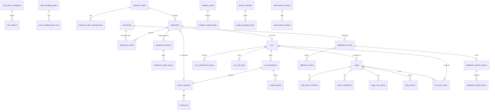

# 06b — Quality / QMS: Database design (section 5 of the plan)

> Part of `06-QUALITY-QMS.md` (index). Read `00-BUILDER-RULES.md` and `01-SHARED-FOUNDATION.md` first. Every table here is **NEW** and **owned by the Quality module**. Nothing from the foundation is redefined.

## 5. Database design (core)

### 5.0 Conventions used by every QMS table (read once)

**Database rules that apply (global, from `DECISIONS.md`).** D-01: no company column on any table (there is one company); unique keys are `(code)`. D-02: audit columns are `created_by_id`, `updated_by_id`, `deleted_by_id`. D-03: migrations are hand-written SQL (`apps/api/prisma/migrations/<YYYYMMDDHHMMSS>_<name>/migration.sql`), scalar models are added to `schema.prisma`, then `npx prisma generate` and `npm run db:reset:test`; `prisma migrate dev` is never used. D-04: a line stores the unit of measure as the code text (`uom varchar(20)`, referencing `uoms.code`). D-11: open lists of types are lookup tables, never CHECKs.

**Foreign keys in QMS.** In SQL every reference to another table is a real FK (auto-named `<table>_<col>_fkey`) and every FK column is indexed (a UNIQUE or composite index that starts with the column counts). In `schema.prisma` the QMS models declare **relations only between QMS tables** (both sides); references to core or other-module tables (`units`, `financial_years`, `items`, `warehouses`, `parties`, `goods_receipts`, `goods_receipt_lines`) and every user reference are plain scalar `String @db.Uuid` fields without `@relation` (a relation needs a back-relation field on the other model, which would mean editing `Unit`, `FinancialYear`, `Item`, `Warehouse`, `User` dozens of times). User columns are FKs to `users(id)` in SQL: `created_by_id ... ON DELETE RESTRICT`, every other user column `ON DELETE SET NULL`.

**Standard column blocks.** Written once here; each table below says which block it includes. The builder pastes the block text into the `CREATE TABLE` at the place the table shows `-- @DOC` / `-- @AUDIT` / `-- @CHILD(...)`.

`@AUDIT` (SQL):
```sql
version        int          NOT NULL DEFAULT 1,
created_by_id  uuid         NOT NULL REFERENCES users(id) ON DELETE RESTRICT ON UPDATE CASCADE,
created_at     timestamptz(3) NOT NULL DEFAULT now(),
updated_by_id  uuid         NULL REFERENCES users(id) ON DELETE SET NULL ON UPDATE CASCADE,
updated_at     timestamptz(3) NOT NULL DEFAULT now(),
deleted_by_id  uuid         NULL REFERENCES users(id) ON DELETE SET NULL ON UPDATE CASCADE,
deleted_at     timestamptz(3) NULL
```
`@DOC` (a numbered document) = these columns **plus** `@AUDIT`, then `CONSTRAINT <t>_code_key UNIQUE (code)` and two indexes:
```sql
id          uuid PRIMARY KEY DEFAULT gen_random_uuid(),
unit_id     uuid NOT NULL REFERENCES units(id) ON DELETE RESTRICT ON UPDATE CASCADE,
fy_id       uuid NOT NULL REFERENCES financial_years(id) ON DELETE RESTRICT ON UPDATE CASCADE,
code        varchar(60) NOT NULL,
status      varchar(30) NOT NULL,
doc_date    date NOT NULL,
department  varchar(60) NOT NULL DEFAULT 'Quality',
-- + @AUDIT
-- then, for table T:
--   CONSTRAINT T_code_key UNIQUE (code)
--   CREATE INDEX T_unit_status_idx ON T (unit_id, status) WHERE deleted_at IS NULL;
--   CREATE INDEX T_fy_idx ON T (fy_id);
```
`@CHILD(parent)` (a line of a document): `id uuid PRIMARY KEY DEFAULT gen_random_uuid(), <p>_id uuid NOT NULL REFERENCES <parent>(id) ON DELETE CASCADE ON UPDATE CASCADE, line_no int NOT NULL CHECK (line_no > 0), created_at timestamptz(3) NOT NULL DEFAULT now(), created_by_id uuid NOT NULL REFERENCES users(id) ON DELETE RESTRICT`, then `CONSTRAINT <t>_line_key UNIQUE (<p>_id, line_no)`. `<p>_id` is the **singular** name: `plan_id` (inspection_plans), `ncr_id` (ncrs), `capa_id` (capas), `request_id` (rework_requests), `record_id` (calibration_records), `review_id` (calibration_impact_reviews), `audit_id` (supplier_audits), `meeting_id` (quality_meetings), `project_id` (improvement_projects).

**Prisma macros** (the builder pastes these field blocks where a model shows `// @DOC_P`, `// @AUDIT_P`, `// @CHILD_P(...)`; all models use `@@map("<table>")`):
```prisma
// @DOC_P
id String @id @default(uuid()) @db.Uuid
unitId String @map("unit_id") @db.Uuid
fyId String @map("fy_id") @db.Uuid
code String @unique @db.VarChar(60)
status String @db.VarChar(30)
docDate DateTime @map("doc_date") @db.Date
department String @default("Quality") @db.VarChar(60)
// @AUDIT_P
version Int @default(1)
createdById String @map("created_by_id") @db.Uuid
createdAt DateTime @default(now()) @map("created_at") @db.Timestamptz(3)
updatedById String? @map("updated_by_id") @db.Uuid
updatedAt DateTime @updatedAt @map("updated_at") @db.Timestamptz(3)
deletedById String? @map("deleted_by_id") @db.Uuid
deletedAt DateTime? @map("deleted_at") @db.Timestamptz(3)
// @CHILD_P(ncr -> Ncr)   (example; the parent relation is declared on both sides)
id String @id @default(uuid()) @db.Uuid
ncrId String @map("ncr_id") @db.Uuid
ncr Ncr @relation(fields: [ncrId], references: [id], onDelete: Cascade)
lineNo Int @map("line_no")
createdAt DateTime @default(now()) @map("created_at") @db.Timestamptz(3)
createdById String @map("created_by_id") @db.Uuid
@@unique([ncrId, lineNo])
```
Prisma type rules: `varchar(n)`→`String @db.VarChar(n)`, `text`→`String`, `numeric(p,s)`→`Decimal @db.Decimal(p,s)`, `int`→`Int`, `boolean`→`Boolean`, `date`→`DateTime @db.Date`, `timestamptz(3)`→`DateTime @db.Timestamptz(3)`, `jsonb`→`Json`, `char(1)`→`String @db.Char(1)`; nullable adds `?`; every snake_case column gets a camelCase field with `@map("snake_case")`. A relation between two QMS tables is declared on both sides (child holds `@relation(...)`, parent holds `Child[]`). Where a model below says `// @DOC_P` and must **not** have `@unique` on `code` it says so.

**Type and rounding rules.** quantity `numeric(18,3)`; measured value `numeric(18,4)`; money `numeric(18,2)`; rate `numeric(18,6)`; displayed score/percentage `numeric(5,2)`; PPM `numeric(18,2)`; capability index `numeric(8,3)`. Decimal math uses `Decimal` (`apps/api/src/modules/inventory/money.ts`); statistics (mean, sigma) use JS `number` and are rounded half-up to the stored scale with one helper `roundHalfUp(x, dp)` in `modules/qms/calc.ts`. Stated again in section 6.

**Status words** follow foundation §6.

### 5.1 ERD


Tables referenced but owned elsewhere: `units`, `financial_years`, `users`, `items`, `warehouses`, `settings`, `number_series`, `accounting_event_queue` (existing / foundation); `parties` (suppliers and customers), `goods_receipts`, `goods_receipt_lines` (Plan 03, real FKs from `inspections`); a Manufacturing production order (**free text** `production_order_ref` until the Manufacturing plan exists).

### 5.2 What QMS needs from other plans (checked by T-QMS-01) and the ports that isolate it

QMS is built **after** Plan 02 (Inventory), Plan 03 (SCM) and the engine kit (`07-ENGINE-KIT.md`). The names below are the real names of those plans; each is used in exactly one adapter file (5.2.1), so a rename changes one file.

| Id | Provided by | What QMS uses |
|---|---|---|
| P-INV-1 | Plan 02 | `StockService.postMovement(tx, MovementInput): Promise<PostedEntry[]>` (`apps/api/src/modules/inventory/stock/stock-service.ts`, ticket T-INV-11); `MovementInput` fields `unitId, warehouseId, itemId, postingDate, voucherType, voucherId, voucherNo, createdById, qtyIn, qtyOut, rate, value, outValue, outRate, reversesId, batchId?, batchSpec?, reference?`; the voucher reversal helper `reverseVoucher(db, voucherId, ctx)` of `stock/posting.ts`; `StockService.availability`. |
| P-INV-2 | Plan 02 M1 | table `stock_voucher_types(code)` (D-11). QMS migration M4 inserts `QC_OUT` and `QC_IN` with `INSERT ... ON CONFLICT DO NOTHING`; no CHECK is rebuilt. |
| P-INV-3 | Plan 02 | `batches (id, item_id, batch_no, qc_status in 'Pending QC','Released','On Hold','Rejected', recalled ...)` and the batch service of ticket T-INV-12 (`apps/api/src/modules/inventory/batches/service.ts`) behind the `inv-batch` actions `release`, `hold`, `reject`. QMS keeps the batch QC status in step with its decision (`BatchQcPort`). |
| P-INV-4 | Foundation 5 / Plan 02 | `AccountingService.post(tx, {event, docType, docId, date, lines, payload})` and `accounting_event_queue`; event shape of Finance 4.1.3 (see 5.2.2). |
| P-SCM-1 | Plan 03 | tables `parties` (`is_supplier`, `is_customer`), `goods_receipts` (`code`, `status`, `qc_status`, `supplier_id`, `warehouse_id`), `goods_receipt_lines` (`document_id`, `line_no`, `item_id`, `received_qty`, `accepted_qty`, `rejected_qty`, `qc_required`, `qc_state`, `returned_qty`), `goods_receipt_batches (grn_line_id, batch_no, qty)`, `scm_settings.qc_hold_warehouse_id` (unit row, else the row with `unit_id IS NULL`). |
| P-SCM-2 | Plan 03 BR-SCM-09 | the QC decision `qcDecide` (per line: `accepted_qty + rejected_qty = received_qty`; accepted stock moves QC hold to receiving with `TRANSFER_OUT` / `TRANSFER_IN` at unchanged value; **rejected stock stays in the QC hold warehouse**) and `returnToVendor` (debit note and stock issue). |
| P-SCM-3 | Plan 03 (D-16) | `post` of a GRN with `qc_required` lines calls `QmsInboundPort.onGrnPosted(tx, grnId)` in the same transaction (interface defined by QMS ticket T-QMS-19, see 5.2.1). |
| P-KIT | `07-ENGINE-KIT.md` | `tabPanels`, panel section types, header `commands`, `requires`, typed filters, action `payload`, widened `lookup` kinds, print-template registry (tickets `T-KIT-xx`). QMS only adds its panel builders, lookup registrations and print components. |
| P-MFG | later plan | owns pages `mfg-rework` and `mfg-scrap`; reads and writes `rework_requests`, `rework_log`, `scrap_requests` **only through `ReworkService` / `ScrapService`** defined by QMS. |

If a name above does not exist when the builder starts, the ticket stops with `STATUS: QUESTION` (00-BUILDER-RULES section 9); the builder never invents it.

**Quality of stock is held in two places and QMS keeps them equal.** Plan 03 quarantines goods by location (the QC hold warehouse); Plan 02 blocks goods by batch status (`batches.qc_status`). On every decision QMS (a) moves or keeps the stock by location through Plan 03 or `StockService`, and (b) sets the Plan 02 batch status for batch-tracked items: Accept = `Released`, Reject = `Rejected`, Hold = `On Hold` (`BatchQcPort`).

**5.2.1 Ports** (TypeScript interfaces in `apps/api/src/modules/qms/ports.ts`; default adapters in `apps/api/src/modules/qms/adapters/*.ts`; tests replace them with `setPortsForTest()`):
```ts
export interface GrnLineInfo { grnLineId: string; grnId: string; grnNo: string; lineNo: number; batchNo: string | null;
  poNo: string | null; invoiceNo: string | null; supplierId: string; itemId: string; qty: string; uom: string;
  warehouseId: string; unitId: string; qcRequired: boolean; qcState: 'NOT_REQUIRED' | 'PENDING' | 'DECIDED'; }
export interface GrnPort {
  getLine(tx: Db, grnLineId: string): Promise<GrnLineInfo | null>;
  findLine(tx: Db, a: { grnCode: string; lineNo: number }): Promise<GrnLineInfo | null>;
  listLines(tx: Db, grnId: string): Promise<GrnLineInfo[]>;
  listPendingQc(tx: Db, unitId: string, limit: number): Promise<GrnLineInfo[]>;   // qc_state PENDING and no live inspection
}
export interface GrnQcPort {   // Plan 03 (P-SCM-2); GRN-linked stock is posted by Plan 03, never by QMS
  decideLine(tx: Db, a: { grnLineId: string; acceptedQty: string; rejectedQty: string; rejectReason: string | null; remark: string; userId: string }): Promise<{ ledgerIds: string[] }>;
  returnToVendor(tx: Db, a: { grnLineId: string; qty: string; reason: 'QUALITY'; remark: string; userId: string }): Promise<{ debitNoteId: string; debitNoteCode: string }>;
}
export interface QmsInboundPort { onGrnPosted(tx: Db, grnId: string): Promise<{ created: number; waiting: number }>; }   // implemented by QMS, called by Plan 03
export interface PartyPort {
  assertSupplier(tx: Db, partyId: string): Promise<{ id: string; code: string; name: string }>;
  assertCustomer(tx: Db, partyId: string): Promise<{ id: string; code: string; name: string }>;
  search(kind: 'supplier' | 'customer', q: string, limit: number): Promise<{ id: string; code: string; name: string }[]>;
}
export interface OtifPort { otifPct(tx: Db, supplierId: string, from: string, to: string): Promise<string | null>; }   // null = not available
export interface QcStockPort {   // Plan 02 StockService (P-INV-1); for stock without a GRN line, and for scrap
  qcHoldWarehouse(tx: Db, unitId: string): Promise<string>;   // QMS_NO_QC_WAREHOUSE 422
  move(tx: Db, m: { unitId: string; itemId: string; fromWarehouseId: string; toWarehouseId: string; qty: string; batchId?: string;
    postingDate: string; moveId: string; voucherNo: string; createdById: string }): Promise<{ outLedgerId: string; inLedgerId: string }>;
  issueOut(tx: Db, m: { unitId: string; itemId: string; fromWarehouseId: string; qty: string; batchId?: string;
    postingDate: string; moveId: string; voucherNo: string; createdById: string }): Promise<{ ledgerId: string; value: string; rate: string }>;
  reverse(tx: Db, moveId: string, ctx: { voucherNo: string; postingDate: string; createdById: string }): Promise<number>;
  onHand(tx: Db, itemId: string, warehouseId: string, batchId?: string): Promise<string>;
  avgRate(tx: Db, itemId: string, warehouseId: string): Promise<string>;
}
export interface BatchQcPort { setStatus(tx: Db, a: { itemId: string; batchNo: string; status: 'Released' | 'On Hold' | 'Rejected'; reason: string; userId: string }): Promise<void>; }  // no-op for items that are not batch tracked
export interface FileStoragePort { save(key: string, data: Buffer): Promise<void>; read(key: string): Promise<Buffer>; remove(key: string): Promise<void>; }
```
Accounting is not a port: QMS calls the foundation `AccountingService.post` directly (5.2.2).

Default `QcStockPort.move`: inside the caller's transaction call `StockService.postMovement` twice, with `voucherType: 'QC_OUT'` (quantity out of `fromWarehouseId`, leaves at the moving-average value) and `voucherType: 'QC_IN'` (quantity into `toWarehouseId` with `value` = the value of the out entry, so the total stock value is conserved, the same pattern the built `TRANSFER_IN` uses); `voucherId` = the `inspection_stock_moves.id`, `voucherNo` = the inspection code. `issueOut` = one `QC_OUT` movement. `reverse` = `reverseVoucher(tx, moveId, ctx)` (it undoes every live ledger row of that `voucherId`).

**5.2.2 The accounting event QMS emits (D-13).** Exactly one: when a **scrap request is completed** (stock leaves the QC hold warehouse as a loss) QMS calls `AccountingService.post(tx, { event: 'STOCK_SCRAP_POSTED', docType: 'SCRAP_REQUEST', docId: <scrap_requests.id>, date: <posting date>, lines, payload })` with the Plan 02 / Finance 4.1.3 shapes:
```json
{ "lines": [
    { "role": "SCRAP_LOSS", "side": "DR", "amount": "500.00", "itemId": "<uuid>", "itemType": "Raw Material", "warehouseId": "<uuid>", "unitId": "<uuid>", "narration": "Scrap SCP/U3/26-27/0001" },
    { "role": "INVENTORY",  "side": "CR", "amount": "500.00", "itemId": "<uuid>", "itemType": "Raw Material", "warehouseId": "<uuid>", "unitId": "<uuid>", "narration": "Scrap SCP/U3/26-27/0001" } ],
  "docNo": "SCP/U3/26-27/0001", "docDate": "2026-09-30", "gstItcReversal": true, "reasonCode": "Damage" }
```
`amount` = the ledger value of the issue (2 dp, positive). `gstItcReversal` is always `true` for a scrap (Section 17(5)(h); Finance decides the tax entries). Salvage value is not netted in the event (a sale is entered by Sales / Finance). No other QMS action posts an event: a QC release of GRN-linked stock is a move inside one unit (no event), supplier returns are posted by Plan 03 (`PURCHASE_RETURN_POSTED`). A completed scrap is not reversed; a wrong scrap is corrected by a stock adjustment in Inventory.

### 5.3 Numbering (foundation: `<PFX>/<UNIT>/<FY>/<0001>`)
Use the existing gap-free mechanism (`number_series`, `SELECT … FOR UPDATE`, as in `modules/records/repository.ts` lines ~195–204 and `numbered()` in `vouchers/service.ts`): code = `${prefix}/${unit.code}/${fy.code.slice(2)}/${String(n).padStart(4,'0')}`, e.g. `NCR/U3/26-27/0001`. `number_series.page_id` is a free `varchar(80)`; QMS uses the **number key** below as `page_id`. One function `nextQmsNumber(tx, key, prefix, unit, fy)` in `modules/qms/numbering.ts`; **never** `MAX(code)+1`.

| Document | Prefix | Number key (`number_series.page_id`) |
|---|---|---|
| Inspection plan | `IPL` | `qms-plans` |
| Incoming inspection | `IQC` | `qms-incoming` |
| In-process inspection | `IPQ` | `qms-process` |
| Final inspection | `FQC` | `qms-final` |
| ISIR / first article | `ISR` | `qms-inspections:ISIR` |
| Visual weld (VT) report | `VTR` | `qms-inspections:VT` |
| Weld before/after report | `WBA` | `qms-inspections:WBA` |
| Layout / dimensional | `LAY` | `qms-inspections:LAY` |
| Release certificate (`Certificate No`) | `RCT` | `qms-final:cert` |
| NCR | `NCR` | `qms-ncr` |
| Quality alert | `QAL` | `qms-ncr:alert` |
| CAPA / 8D | `CAPA` | `qms-capa` |
| SCAR | `SCAR` | `qms-capa:scar` |
| 5-Why case | `5WY` | `qms-5why` |
| Rework request | `RWK` | `mfg-rework` |
| Scrap request | `SCP` | `mfg-scrap` |
| Calibration record | `CAL` | `qms-calibration:record` |
| Impact review | `CIR` | `qms-calibration:impact` |
| Instrument ID (only when left blank) | `INS` | `qms-calibration` |
| Supplier period score | `SQS` | `qms-supplier` |
| Supplier audit | `SAU` | `qms-supplier:audit` |
| Meeting minutes | `MOM` | `qms-capa:mom` |
| Improvement project | `CIP` | `qms-capa:ci` |
| Capability study | `CPS` | `qms-process:cap` |

The client's own instrument history-card numbers are imported as **user-entered** Instrument IDs (pattern `^[A-Z0-9/_-]{2,40}$`). An auto-generated Instrument ID contains the FY (`INS/U3/26-27/0001`) because the counter is per unit and FY; it never changes afterwards.

### 5.4 Masters

**5.4.1 `qms_defect_categories`** — the client's defect classes (Dimensional, Visual, Missing, Functional, Leakage, Painting …). Used by NCR classification and the Pareto report.
```sql
CREATE TABLE qms_defect_categories (
  id uuid PRIMARY KEY DEFAULT gen_random_uuid(),
  code varchar(30) NOT NULL,
  name varchar(100) NOT NULL,
  sort_order int NOT NULL DEFAULT 100,
  status varchar(20) NOT NULL DEFAULT 'Active' CHECK (status IN ('Active','Inactive')),
  -- @AUDIT
  CONSTRAINT qms_defect_categories_code_key UNIQUE (code),
  CONSTRAINT qms_defect_categories_name_key UNIQUE (name)
);
```
```prisma
model QmsDefectCategory {
  id String @id @default(uuid()) @db.Uuid
  code String @unique @db.VarChar(30)
  name String @unique @db.VarChar(100)
  sortOrder Int @default(100) @map("sort_order")
  status String @default("Active") @db.VarChar(20)
  // @AUDIT_P
  defects QmsDefect[]
  @@map("qms_defect_categories")
}
```

**5.4.2 `qms_defects`** — defect master (the client's free-text "Defect" column becomes a pick-list plus free text).
```sql
CREATE TABLE qms_defects (
  id uuid PRIMARY KEY DEFAULT gen_random_uuid(),
  code varchar(30) NOT NULL,
  name varchar(150) NOT NULL,
  category_id uuid NOT NULL REFERENCES qms_defect_categories(id) ON DELETE RESTRICT ON UPDATE CASCADE,
  default_severity varchar(10) NOT NULL DEFAULT 'Major' CHECK (default_severity IN ('Critical','Major','Minor')),
  process_hint varchar(60) NULL,      -- 'Cutting','Fabrication','Welding','Machining','Painting','Assembly','Incoming'
  iso_ref varchar(30) NULL,           -- e.g. ISO 6520-1 reference of a weld imperfection
  status varchar(20) NOT NULL DEFAULT 'Active' CHECK (status IN ('Active','Inactive')),
  -- @AUDIT
  CONSTRAINT qms_defects_code_key UNIQUE (code)
);
CREATE INDEX qms_defects_category_idx ON qms_defects (category_id);
```
```prisma
model QmsDefect {
  id String @id @default(uuid()) @db.Uuid
  code String @unique @db.VarChar(30)
  name String @db.VarChar(150)
  categoryId String @map("category_id") @db.Uuid
  category QmsDefectCategory @relation(fields: [categoryId], references: [id], onDelete: Restrict)
  defaultSeverity String @default("Major") @map("default_severity") @db.VarChar(10)
  processHint String? @map("process_hint") @db.VarChar(60)
  isoRef String? @map("iso_ref") @db.VarChar(30)
  status String @default("Active") @db.VarChar(20)
  // @AUDIT_P
  @@index([categoryId])
  @@map("qms_defects")
}
```

**5.4.3 `qms_sampling_plans`** and **5.4.4 `qms_sampling_plan_rows`** — lot size → sample size, Ac, Re lookup (data, not code).
```sql
CREATE TABLE qms_sampling_plans (
  id uuid PRIMARY KEY DEFAULT gen_random_uuid(),
  code varchar(30) NOT NULL,
  name varchar(150) NOT NULL,
  standard varchar(100) NOT NULL,
  aql numeric(5,2) NULL,
  inspection_level varchar(20) NULL,
  is_default boolean NOT NULL DEFAULT false,
  status varchar(20) NOT NULL DEFAULT 'Active' CHECK (status IN ('Active','Inactive')),
  -- @AUDIT
  CONSTRAINT qms_sampling_plans_code_key UNIQUE (code)
);
CREATE UNIQUE INDEX qms_sampling_plans_one_default_idx ON qms_sampling_plans ((true)) WHERE is_default AND deleted_at IS NULL;

CREATE TABLE qms_sampling_plan_rows (
  id uuid PRIMARY KEY DEFAULT gen_random_uuid(),
  plan_id uuid NOT NULL REFERENCES qms_sampling_plans(id) ON DELETE CASCADE ON UPDATE CASCADE,
  lot_min int NOT NULL CHECK (lot_min >= 1),
  lot_max int NOT NULL,
  sample_size int NOT NULL CHECK (sample_size >= 1),
  ac int NOT NULL CHECK (ac >= 0),
  re int NOT NULL,
  code_letter varchar(2) NULL,
  CONSTRAINT qms_spr_range_chk CHECK (lot_min <= lot_max),
  CONSTRAINT qms_spr_acre_chk CHECK (re = ac + 1),
  CONSTRAINT qms_spr_sample_chk CHECK (sample_size <= lot_max),
  CONSTRAINT qms_spr_unique UNIQUE (plan_id, lot_min)
);
CREATE FUNCTION qms_spr_no_overlap() RETURNS trigger LANGUAGE plpgsql AS $$
BEGIN
  IF EXISTS (SELECT 1 FROM qms_sampling_plan_rows r
             WHERE r.plan_id = NEW.plan_id AND r.id <> NEW.id
               AND r.lot_min <= NEW.lot_max AND NEW.lot_min <= r.lot_max) THEN
    RAISE EXCEPTION 'QMS_SAMPLING_OVERLAP: lot ranges overlap in plan %', NEW.plan_id USING ERRCODE = '23505';
  END IF;
  RETURN NEW;
END $$;
CREATE TRIGGER qms_spr_no_overlap_trg BEFORE INSERT OR UPDATE ON qms_sampling_plan_rows
  FOR EACH ROW EXECUTE FUNCTION qms_spr_no_overlap();
```
(`qms_sampling_plan_rows` has no audit columns: it is edited only through its plan, whose `version` and audit entry change with it. The partial unique index on `(true)` allows exactly one default plan.)
```prisma
model QmsSamplingPlan {
  id String @id @default(uuid()) @db.Uuid
  code String @unique @db.VarChar(30)
  name String @db.VarChar(150)
  standard String @db.VarChar(100)
  aql Decimal? @db.Decimal(5,2)
  inspectionLevel String? @map("inspection_level") @db.VarChar(20)
  isDefault Boolean @default(false) @map("is_default")
  status String @default("Active") @db.VarChar(20)
  // @AUDIT_P
  rows QmsSamplingPlanRow[]
  @@map("qms_sampling_plans")
}
model QmsSamplingPlanRow {
  id String @id @default(uuid()) @db.Uuid
  planId String @map("plan_id") @db.Uuid
  plan QmsSamplingPlan @relation(fields: [planId], references: [id], onDelete: Cascade)
  lotMin Int @map("lot_min")
  lotMax Int @map("lot_max")
  sampleSize Int @map("sample_size")
  ac Int
  re Int
  codeLetter String? @map("code_letter") @db.VarChar(2)
  @@unique([planId, lotMin])
  @@map("qms_sampling_plan_rows")
}
```

**5.4.5 `qms_form_headers`** — the header block of each printed client form (Doc No., Rev No., Rev Date, title), editable, so a form revision never needs a code change.
```sql
CREATE TABLE qms_form_headers (
  id uuid PRIMARY KEY DEFAULT gen_random_uuid(),
  form_code varchar(30) NOT NULL,
  title varchar(150) NOT NULL,
  doc_no varchar(40) NOT NULL,
  rev_no varchar(10) NOT NULL DEFAULT '0',
  rev_date date NOT NULL,
  page_id varchar(80) NOT NULL,
  signature_labels jsonb NOT NULL DEFAULT '[]',
  status varchar(20) NOT NULL DEFAULT 'Active' CHECK (status IN ('Active','Inactive')),
  -- @AUDIT
  CONSTRAINT qms_form_headers_form_code_key UNIQUE (form_code)
);
```
```prisma
model QmsFormHeader {
  id String @id @default(uuid()) @db.Uuid
  formCode String @unique @map("form_code") @db.VarChar(30)
  title String @db.VarChar(150)
  docNo String @map("doc_no") @db.VarChar(40)
  revNo String @default("0") @map("rev_no") @db.VarChar(10)
  revDate DateTime @map("rev_date") @db.Date
  pageId String @map("page_id") @db.VarChar(80)
  signatureLabels Json @default("[]") @map("signature_labels")
  status String @default("Active") @db.VarChar(20)
  // @AUDIT_P
  @@map("qms_form_headers")
}
```

### 5.5 Calibration (page `qms-calibration`) — created before the inspections because results reference instruments

**5.5.1 `instruments`** — the instrument register (client "Instruments List" sheets, one per client plant). `code` = Instrument ID.
```sql
CREATE TABLE instruments (
  id uuid PRIMARY KEY DEFAULT gen_random_uuid(),
  unit_id uuid NOT NULL REFERENCES units(id) ON DELETE RESTRICT ON UPDATE CASCADE,
  code varchar(40) NOT NULL,
  name varchar(150) NOT NULL,
  instrument_type varchar(60) NULL,
  department varchar(60) NULL,
  range_text varchar(100) NULL,
  accuracy_pct numeric(7,4) NULL CHECK (accuracy_pct IS NULL OR accuracy_pct >= 0),
  least_count varchar(30) NULL,
  frequency_label varchar(20) NOT NULL DEFAULT '365 days' CHECK (frequency_label IN ('30 days','90 days','180 days','365 days','730 days','Custom')),
  frequency_days int NOT NULL DEFAULT 365 CHECK (frequency_days BETWEEN 1 AND 3650),
  last_calibration_date date NULL,
  next_due_date date NULL,
  agency varchar(150) NULL,
  certificate_no varchar(100) NULL,
  last_result varchar(25) NULL CHECK (last_result IN ('Pass','Fail','Pass After Adjustment')),
  status varchar(10) NOT NULL DEFAULT 'Active' CHECK (status IN ('Active','Inactive','Blocked')),
  block_reason varchar(20) NULL CHECK (block_reason IN ('OVERDUE','OUT_OF_TOLERANCE','DAMAGED','AT_CALIBRATION','MANUAL')),
  history_card_no varchar(40) NULL,
  equipment_no varchar(60) NULL,
  serial_no varchar(60) NULL,
  part_name varchar(150) NULL,
  source_of_calibration varchar(10) NOT NULL DEFAULT 'External' CHECK (source_of_calibration IN ('Internal','External')),
  manufacturer varchar(100) NULL,
  display_type varchar(10) NULL CHECK (display_type IN ('Analog','Digital','NA')),
  purpose varchar(100) NULL,
  model_no varchar(60) NULL,
  location varchar(100) NULL,
  commissioning_date date NULL,
  notify_user_id uuid NULL REFERENCES users(id) ON DELETE SET NULL,
  -- @AUDIT
  CONSTRAINT instruments_code_key UNIQUE (code),
  CONSTRAINT instruments_blocked_chk CHECK ((status = 'Blocked') = (block_reason IS NOT NULL)),
  CONSTRAINT instruments_due_chk CHECK (next_due_date IS NULL OR last_calibration_date IS NULL OR next_due_date >= last_calibration_date)
);
CREATE INDEX instruments_unit_status_idx ON instruments (unit_id, status) WHERE deleted_at IS NULL;
CREATE INDEX instruments_due_idx ON instruments (next_due_date) WHERE deleted_at IS NULL AND status <> 'Inactive';
CREATE INDEX instruments_notify_idx ON instruments (notify_user_id);
```
```prisma
model Instrument {
  id String @id @default(uuid()) @db.Uuid
  unitId String @map("unit_id") @db.Uuid
  code String @unique @db.VarChar(40)
  name String @db.VarChar(150)
  instrumentType String? @map("instrument_type") @db.VarChar(60)
  department String? @db.VarChar(60)
  rangeText String? @map("range_text") @db.VarChar(100)
  accuracyPct Decimal? @map("accuracy_pct") @db.Decimal(7,4)
  leastCount String? @map("least_count") @db.VarChar(30)
  frequencyLabel String @default("365 days") @map("frequency_label") @db.VarChar(20)
  frequencyDays Int @default(365) @map("frequency_days")
  lastCalibrationDate DateTime? @map("last_calibration_date") @db.Date
  nextDueDate DateTime? @map("next_due_date") @db.Date
  agency String? @db.VarChar(150)
  certificateNo String? @map("certificate_no") @db.VarChar(100)
  lastResult String? @map("last_result") @db.VarChar(25)
  status String @default("Active") @db.VarChar(10)
  blockReason String? @map("block_reason") @db.VarChar(20)
  historyCardNo String? @map("history_card_no") @db.VarChar(40)
  equipmentNo String? @map("equipment_no") @db.VarChar(60)
  serialNo String? @map("serial_no") @db.VarChar(60)
  partName String? @map("part_name") @db.VarChar(150)
  sourceOfCalibration String @default("External") @map("source_of_calibration") @db.VarChar(10)
  manufacturer String? @db.VarChar(100)
  displayType String? @map("display_type") @db.VarChar(10)
  purpose String? @db.VarChar(100)
  modelNo String? @map("model_no") @db.VarChar(60)
  location String? @db.VarChar(100)
  commissioningDate DateTime? @map("commissioning_date") @db.Date
  notifyUserId String? @map("notify_user_id") @db.Uuid
  // @AUDIT_P
  calibrations CalibrationRecord[]
  results InspectionResult[]
  @@index([unitId, status])
  @@map("instruments")
}
```

**5.5.2 `calibration_records`** (`@DOC`; statuses `Draft`, `Completed`, `Cancelled`; `doc_date` = calibration date) and **5.5.3 `calibration_points`** (`@CHILD(calibration_records)`, `record_id`).
```sql
CREATE TABLE calibration_records (
  -- @DOC
  instrument_id uuid NOT NULL REFERENCES instruments(id) ON DELETE RESTRICT ON UPDATE CASCADE,
  performed_by varchar(10) NOT NULL CHECK (performed_by IN ('Internal','External')),
  agency varchar(150) NULL,
  certificate_no varchar(100) NULL,
  certificate_date date NULL,
  accreditation_no varchar(60) NULL,
  reference_standard varchar(200) NULL,
  uncertainty_text varchar(100) NULL,
  result varchar(25) NOT NULL CHECK (result IN ('Pass','Fail','Pass After Adjustment')),
  as_found_text text NULL,
  as_left_text text NULL,
  max_error numeric(18,6) NULL,
  tolerance numeric(18,6) NULL,
  due_before date NULL,
  next_due_date date NULL,
  cost numeric(18,2) NOT NULL DEFAULT 0 CHECK (cost >= 0),
  impact_review_id uuid NULL,
  CONSTRAINT calibration_records_status_chk CHECK (status IN ('Draft','Completed','Cancelled')),
  CONSTRAINT calibration_records_done_chk CHECK (status <> 'Completed' OR (certificate_no IS NOT NULL AND next_due_date IS NOT NULL))
);
CREATE INDEX calibration_records_instrument_idx ON calibration_records (instrument_id, doc_date DESC);

CREATE TABLE calibration_points (
  -- @CHILD(calibration_records) record_id
  nominal numeric(18,6) NOT NULL,
  as_found numeric(18,6) NULL,
  as_left numeric(18,6) NULL,
  tolerance numeric(18,6) NOT NULL CHECK (tolerance >= 0),
  uom varchar(20) NULL,
  point_result varchar(4) NOT NULL DEFAULT 'OK' CHECK (point_result IN ('OK','NG'))
);
```
```prisma
model CalibrationRecord {
  // @DOC_P
  instrumentId String @map("instrument_id") @db.Uuid
  instrument Instrument @relation(fields: [instrumentId], references: [id], onDelete: Restrict)
  performedBy String @map("performed_by") @db.VarChar(10)
  agency String? @db.VarChar(150)
  certificateNo String? @map("certificate_no") @db.VarChar(100)
  certificateDate DateTime? @map("certificate_date") @db.Date
  accreditationNo String? @map("accreditation_no") @db.VarChar(60)
  referenceStandard String? @map("reference_standard") @db.VarChar(200)
  uncertaintyText String? @map("uncertainty_text") @db.VarChar(100)
  result String @db.VarChar(25)
  asFoundText String? @map("as_found_text")
  asLeftText String? @map("as_left_text")
  maxError Decimal? @map("max_error") @db.Decimal(18,6)
  tolerance Decimal? @db.Decimal(18,6)
  dueBefore DateTime? @map("due_before") @db.Date
  nextDueDate DateTime? @map("next_due_date") @db.Date
  cost Decimal @default(0) @db.Decimal(18,2)
  impactReviewId String? @map("impact_review_id") @db.Uuid
  // @AUDIT_P
  points CalibrationPoint[]
  @@index([instrumentId])
  @@map("calibration_records")
}
model CalibrationPoint {
  // @CHILD_P(record -> CalibrationRecord)
  nominal Decimal @db.Decimal(18,6)
  asFound Decimal? @map("as_found") @db.Decimal(18,6)
  asLeft Decimal? @map("as_left") @db.Decimal(18,6)
  tolerance Decimal @db.Decimal(18,6)
  uom String? @db.VarChar(20)
  pointResult String @default("OK") @map("point_result") @db.VarChar(4)
  @@map("calibration_points")
}
```

### 5.6 Inspection plans (page `qms-plans`)

**5.6.1 `inspection_plans`** (`@DOC`; statuses `Draft` → `Approved` → `Inactive`). One row = one **revision** of a plan. `@DOC`'s `UNIQUE (code)` is **replaced** by `UNIQUE (code, revision)`.
```sql
CREATE TABLE inspection_plans (
  -- @DOC (but NO UNIQUE (code); see the constraint below)
  plan_name varchar(150) NOT NULL,
  inspection_kind varchar(30) NOT NULL CHECK (inspection_kind IN ('INCOMING','IN_PROCESS','FINAL','ISIR','VT','WELD_BEFORE_AFTER','LAYOUT')),
  revision int NOT NULL DEFAULT 0 CHECK (revision >= 0),
  item_category varchar(100) NULL,
  item_id uuid NULL REFERENCES items(id) ON DELETE RESTRICT,
  supplier_id uuid NULL REFERENCES parties(id) ON DELETE RESTRICT,
  sampling_plan_id uuid NULL REFERENCES qms_sampling_plans(id) ON DELETE RESTRICT,
  sampling_standard varchar(100) NULL,
  fixed_sample_size int NULL CHECK (fixed_sample_size IS NULL OR fixed_sample_size >= 1),
  characteristic_count int NOT NULL DEFAULT 0 CHECK (characteristic_count >= 0),
  effective_date date NOT NULL,
  owner_id uuid NULL REFERENCES users(id) ON DELETE SET NULL,
  drawing_no varchar(60) NULL,
  drawing_rev varchar(20) NULL,
  control_plan_ref varchar(60) NULL,
  supersedes_id uuid NULL REFERENCES inspection_plans(id) ON DELETE SET NULL,
  approved_by_id uuid NULL REFERENCES users(id) ON DELETE SET NULL,
  approved_at timestamptz(3) NULL,
  CONSTRAINT inspection_plans_status_chk CHECK (status IN ('Draft','Approved','Inactive')),
  CONSTRAINT inspection_plans_code_rev_key UNIQUE (code, revision),
  CONSTRAINT inspection_plans_approval_chk CHECK (status = 'Draft' OR approved_by_id IS NOT NULL)
);
CREATE INDEX inspection_plans_item_idx ON inspection_plans (item_id) WHERE deleted_at IS NULL;
CREATE INDEX inspection_plans_supplier_idx ON inspection_plans (supplier_id) WHERE deleted_at IS NULL;
CREATE INDEX inspection_plans_sampling_idx ON inspection_plans (sampling_plan_id);
CREATE INDEX inspection_plans_supersedes_idx ON inspection_plans (supersedes_id);
CREATE UNIQUE INDEX inspection_plans_one_approved_idx ON inspection_plans (code) WHERE status = 'Approved' AND deleted_at IS NULL;
```
```prisma
model InspectionPlan {
  // @DOC_P  — but write `code String @db.VarChar(60)` WITHOUT @unique
  planName String @map("plan_name") @db.VarChar(150)
  inspectionKind String @map("inspection_kind") @db.VarChar(30)
  revision Int @default(0)
  itemCategory String? @map("item_category") @db.VarChar(100)
  itemId String? @map("item_id") @db.Uuid
  supplierId String? @map("supplier_id") @db.Uuid
  samplingPlanId String? @map("sampling_plan_id") @db.Uuid
  samplingPlan QmsSamplingPlan? @relation(fields: [samplingPlanId], references: [id], onDelete: Restrict)
  samplingStandard String? @map("sampling_standard") @db.VarChar(100)
  fixedSampleSize Int? @map("fixed_sample_size")
  characteristicCount Int @default(0) @map("characteristic_count")
  effectiveDate DateTime @map("effective_date") @db.Date
  ownerId String? @map("owner_id") @db.Uuid
  drawingNo String? @map("drawing_no") @db.VarChar(60)
  drawingRev String? @map("drawing_rev") @db.VarChar(20)
  controlPlanRef String? @map("control_plan_ref") @db.VarChar(60)
  supersedesId String? @map("supersedes_id") @db.Uuid
  approvedById String? @map("approved_by_id") @db.Uuid
  approvedAt DateTime? @map("approved_at") @db.Timestamptz(3)
  // @AUDIT_P
  characteristics InspectionPlanCharacteristic[]
  inspections Inspection[]
  @@unique([code, revision])
  @@map("inspection_plans")
}
```
(Add `inspectionPlans InspectionPlan[]` to `QmsSamplingPlan`.)

**5.6.2 `inspection_plan_characteristics`** (`@CHILD(inspection_plans)`, `plan_id`; `line_no` = sequence). The characteristic list of a plan — the rows of the client's inward sheet (acceptance criteria), in-process sheet (Specification + Checking Method), ISIR (Zone/Item, Description, Dimension Specification, Tolerance, Measuring Method), VT (flaw list) and weld sheet.
```sql
CREATE TABLE inspection_plan_characteristics (
  -- @CHILD(inspection_plans) plan_id
  name varchar(200) NOT NULL,
  char_type varchar(12) NOT NULL CHECK (char_type IN ('MEASURED','ATTRIBUTE','CHECKLIST')),
  char_class varchar(10) NOT NULL DEFAULT 'Major' CHECK (char_class IN ('Critical','Major','Minor','Special')),
  zone_item varchar(60) NULL,
  spec_text varchar(300) NULL,
  nominal numeric(18,4) NULL,
  lsl numeric(18,4) NULL,
  usl numeric(18,4) NULL,
  tolerance_text varchar(100) NULL,
  uom varchar(20) NULL,
  method varchar(200) NULL,
  instrument_type varchar(60) NULL,
  requires_instrument boolean NOT NULL DEFAULT false,
  frequency_text varchar(80) NULL,
  sample_rule varchar(10) NOT NULL DEFAULT 'PLAN' CHECK (sample_rule IN ('PLAN','FIXED','ALL','PER_N')),
  sample_fixed int NULL CHECK (sample_fixed IS NULL OR sample_fixed >= 1),
  sample_per_n int NULL CHECK (sample_per_n IS NULL OR sample_per_n >= 1),
  reaction_plan varchar(300) NULL,
  control_plan_ref varchar(60) NULL,
  iso_ref varchar(30) NULL,
  defect_id uuid NULL REFERENCES qms_defects(id) ON DELETE SET NULL,
  is_required boolean NOT NULL DEFAULT true,
  CONSTRAINT ipc_limits_chk CHECK (lsl IS NULL OR usl IS NULL OR lsl <= usl),
  CONSTRAINT ipc_measured_chk CHECK (char_type <> 'MEASURED' OR lsl IS NOT NULL OR usl IS NOT NULL),
  CONSTRAINT ipc_rule_chk CHECK ((sample_rule <> 'FIXED' OR sample_fixed IS NOT NULL) AND (sample_rule <> 'PER_N' OR sample_per_n IS NOT NULL))
);
CREATE INDEX ipc_defect_idx ON inspection_plan_characteristics (defect_id);
```
`MEASURED` = numeric reading against LSL/USL; `ATTRIBUTE` = OK/NG judged by eye or gauge (VT flaws); `CHECKLIST` = an acceptance-criterion line.
```prisma
model InspectionPlanCharacteristic {
  // @CHILD_P(plan -> InspectionPlan)
  name String @db.VarChar(200)
  charType String @map("char_type") @db.VarChar(12)
  charClass String @default("Major") @map("char_class") @db.VarChar(10)
  zoneItem String? @map("zone_item") @db.VarChar(60)
  specText String? @map("spec_text") @db.VarChar(300)
  nominal Decimal? @db.Decimal(18,4)
  lsl Decimal? @db.Decimal(18,4)
  usl Decimal? @db.Decimal(18,4)
  toleranceText String? @map("tolerance_text") @db.VarChar(100)
  uom String? @db.VarChar(20)
  method String? @db.VarChar(200)
  instrumentType String? @map("instrument_type") @db.VarChar(60)
  requiresInstrument Boolean @default(false) @map("requires_instrument")
  frequencyText String? @map("frequency_text") @db.VarChar(80)
  sampleRule String @default("PLAN") @map("sample_rule") @db.VarChar(10)
  sampleFixed Int? @map("sample_fixed")
  samplePerN Int? @map("sample_per_n")
  reactionPlan String? @map("reaction_plan") @db.VarChar(300)
  controlPlanRef String? @map("control_plan_ref") @db.VarChar(60)
  isoRef String? @map("iso_ref") @db.VarChar(30)
  defectId String? @map("defect_id") @db.Uuid
  isRequired Boolean @default(true) @map("is_required")
  @@map("inspection_plan_characteristics")
}
```

### 5.7 Inspections (pages `qms-incoming`, `qms-process`, `qms-final`, `qms-inspections`)

**5.7.1 `inspections`** (`@DOC`). One row = one inspection of **one item and one lot/heat/batch**. Four pages are filtered views of this table by `inspection_kind`; `qms-inspections` shows all kinds. Kind-specific header fields live in `header_data jsonb` (keys in 5.7.5, validated by a Zod schema per kind).
```sql
CREATE TABLE inspections (
  -- @DOC
  inspection_kind varchar(30) NOT NULL CHECK (inspection_kind IN ('INCOMING','IN_PROCESS','FINAL','ISIR','VT','WELD_BEFORE_AFTER','LAYOUT')),
  plan_id uuid NULL REFERENCES inspection_plans(id) ON DELETE RESTRICT,
  plan_revision int NULL,
  item_id uuid NOT NULL REFERENCES items(id) ON DELETE RESTRICT,
  supplier_id uuid NULL REFERENCES parties(id) ON DELETE RESTRICT,
  customer_id uuid NULL REFERENCES parties(id) ON DELETE RESTRICT,
  grn_id uuid NULL REFERENCES goods_receipts(id) ON DELETE RESTRICT,
  grn_line_id uuid NULL REFERENCES goods_receipt_lines(id) ON DELETE RESTRICT,
  grn_no varchar(60) NULL,
  po_no varchar(60) NULL,
  invoice_no varchar(60) NULL,
  reference varchar(100) NULL,
  production_order_ref varchar(60) NULL,
  operation_name varchar(100) NULL,
  machine_no varchar(40) NULL,
  shift varchar(10) NULL,
  operator_name varchar(100) NULL,
  batch_no varchar(100) NULL,
  heat_no varchar(100) NULL,
  serial_ref varchar(100) NULL,
  material_grade varchar(60) NULL,
  thickness numeric(18,3) NULL,
  width numeric(18,3) NULL,
  length numeric(18,3) NULL,
  mtc_status varchar(20) NULL CHECK (mtc_status IN ('Received','Pending','Not Applicable')),
  drawing_no varchar(60) NULL,
  drawing_rev varchar(20) NULL,
  uom varchar(20) NULL,
  lot_qty numeric(18,3) NOT NULL DEFAULT 0 CHECK (lot_qty >= 0),
  sample_qty numeric(18,3) NOT NULL DEFAULT 0 CHECK (sample_qty >= 0),
  inspected_qty numeric(18,3) NOT NULL DEFAULT 0 CHECK (inspected_qty >= 0),
  accepted_qty numeric(18,3) NOT NULL DEFAULT 0 CHECK (accepted_qty >= 0),
  rejected_qty numeric(18,3) NOT NULL DEFAULT 0 CHECK (rejected_qty >= 0),
  hold_qty numeric(18,3) NOT NULL DEFAULT 0 CHECK (hold_qty >= 0),
  rework_qty numeric(18,3) NOT NULL DEFAULT 0 CHECK (rework_qty >= 0),
  sampling_plan_id uuid NULL REFERENCES qms_sampling_plans(id) ON DELETE RESTRICT,
  aql numeric(5,2) NULL,
  ac int NULL,
  re int NULL,
  defective_count int NOT NULL DEFAULT 0 CHECK (defective_count >= 0),
  aql_result varchar(10) NULL CHECK (aql_result IN ('ACCEPT','REJECT')),
  decision varchar(30) NOT NULL DEFAULT 'Pending' CHECK (decision IN ('Pending','Accept','Accept Under Deviation','Reject','Hold')),
  result varchar(10) NOT NULL DEFAULT 'Pending' CHECK (result IN ('OK','NG','Pending')),
  test_result varchar(10) NOT NULL DEFAULT 'Pending' CHECK (test_result IN ('Pass','Fail','Pending')),
  checklist_score numeric(5,2) NULL CHECK (checklist_score IS NULL OR checklist_score BETWEEN 0 AND 100),
  certificate_no varchar(60) NULL,
  inspector_id uuid NULL REFERENCES users(id) ON DELETE SET NULL,
  inspected_at timestamptz(3) NULL,
  hold_status varchar(12) NOT NULL DEFAULT 'None' CHECK (hold_status IN ('None','On Hold','Released')),
  parameter_name varchar(200) NULL,
  specification_text varchar(300) NULL,
  actual_value numeric(18,4) NULL,
  target_warehouse_id uuid NULL REFERENCES warehouses(id) ON DELETE RESTRICT,
  ncr_id uuid NULL,
  rework_request_id uuid NULL,
  header_data jsonb NOT NULL DEFAULT '{}',
  remarks varchar(500) NULL,
  cancelled_reason varchar(300) NULL,
  CONSTRAINT inspections_status_chk CHECK (status IN ('Draft','In Process','Completed','On Hold','Cancelled')),
  CONSTRAINT inspections_qty_chk CHECK (status <> 'Completed' OR (accepted_qty + rejected_qty + hold_qty + rework_qty = lot_qty)),
  CONSTRAINT inspections_acre_chk CHECK ((ac IS NULL AND re IS NULL) OR (ac IS NOT NULL AND re = ac + 1))
);
CREATE INDEX inspections_kind_idx ON inspections (inspection_kind, status) WHERE deleted_at IS NULL;
CREATE INDEX inspections_item_idx ON inspections (item_id);
CREATE INDEX inspections_supplier_idx ON inspections (supplier_id, doc_date) WHERE deleted_at IS NULL;
CREATE INDEX inspections_customer_idx ON inspections (customer_id);
CREATE INDEX inspections_grn_idx ON inspections (grn_id) WHERE grn_id IS NOT NULL;
CREATE INDEX inspections_grn_line_idx ON inspections (grn_line_id) WHERE grn_line_id IS NOT NULL;
CREATE INDEX inspections_plan_idx ON inspections (plan_id);
CREATE INDEX inspections_sampling_idx ON inspections (sampling_plan_id);
CREATE INDEX inspections_target_wh_idx ON inspections (target_warehouse_id);
CREATE INDEX inspections_inspector_idx ON inspections (inspector_id);
CREATE INDEX inspections_ncr_idx ON inspections (ncr_id);
CREATE INDEX inspections_rework_idx ON inspections (rework_request_id);
CREATE UNIQUE INDEX inspections_one_per_grn_line_idx ON inspections (grn_line_id, (COALESCE(batch_no, '')))
  WHERE grn_line_id IS NOT NULL AND deleted_at IS NULL AND status <> 'Cancelled' AND inspection_kind = 'INCOMING';
```
(`ncr_id` and `rework_request_id` are plain columns now; their FK constraints are added by the NCR migration, M5.)
```prisma
model Inspection {
  // @DOC_P
  inspectionKind String @map("inspection_kind") @db.VarChar(30)
  planId String? @map("plan_id") @db.Uuid
  plan InspectionPlan? @relation(fields: [planId], references: [id], onDelete: Restrict)
  planRevision Int? @map("plan_revision")
  itemId String @map("item_id") @db.Uuid
  supplierId String? @map("supplier_id") @db.Uuid
  customerId String? @map("customer_id") @db.Uuid
  grnId String? @map("grn_id") @db.Uuid
  grnLineId String? @map("grn_line_id") @db.Uuid
  grnNo String? @map("grn_no") @db.VarChar(60)
  poNo String? @map("po_no") @db.VarChar(60)
  invoiceNo String? @map("invoice_no") @db.VarChar(60)
  reference String? @db.VarChar(100)
  productionOrderRef String? @map("production_order_ref") @db.VarChar(60)
  operationName String? @map("operation_name") @db.VarChar(100)
  machineNo String? @map("machine_no") @db.VarChar(40)
  shift String? @db.VarChar(10)
  operatorName String? @map("operator_name") @db.VarChar(100)
  batchNo String? @map("batch_no") @db.VarChar(100)
  heatNo String? @map("heat_no") @db.VarChar(100)
  serialRef String? @map("serial_ref") @db.VarChar(100)
  materialGrade String? @map("material_grade") @db.VarChar(60)
  thickness Decimal? @db.Decimal(18,3)
  width Decimal? @db.Decimal(18,3)
  length Decimal? @db.Decimal(18,3)
  mtcStatus String? @map("mtc_status") @db.VarChar(20)
  drawingNo String? @map("drawing_no") @db.VarChar(60)
  drawingRev String? @map("drawing_rev") @db.VarChar(20)
  uom String? @db.VarChar(20)
  lotQty Decimal @default(0) @map("lot_qty") @db.Decimal(18,3)
  sampleQty Decimal @default(0) @map("sample_qty") @db.Decimal(18,3)
  inspectedQty Decimal @default(0) @map("inspected_qty") @db.Decimal(18,3)
  acceptedQty Decimal @default(0) @map("accepted_qty") @db.Decimal(18,3)
  rejectedQty Decimal @default(0) @map("rejected_qty") @db.Decimal(18,3)
  holdQty Decimal @default(0) @map("hold_qty") @db.Decimal(18,3)
  reworkQty Decimal @default(0) @map("rework_qty") @db.Decimal(18,3)
  samplingPlanId String? @map("sampling_plan_id") @db.Uuid
  aql Decimal? @db.Decimal(5,2)
  ac Int?
  re Int?
  defectiveCount Int @default(0) @map("defective_count")
  aqlResult String? @map("aql_result") @db.VarChar(10)
  decision String @default("Pending") @db.VarChar(30)
  result String @default("Pending") @db.VarChar(10)
  testResult String @default("Pending") @map("test_result") @db.VarChar(10)
  checklistScore Decimal? @map("checklist_score") @db.Decimal(5,2)
  certificateNo String? @map("certificate_no") @db.VarChar(60)
  inspectorId String? @map("inspector_id") @db.Uuid
  inspectedAt DateTime? @map("inspected_at") @db.Timestamptz(3)
  holdStatus String @default("None") @map("hold_status") @db.VarChar(12)
  parameterName String? @map("parameter_name") @db.VarChar(200)
  specificationText String? @map("specification_text") @db.VarChar(300)
  actualValue Decimal? @map("actual_value") @db.Decimal(18,4)
  targetWarehouseId String? @map("target_warehouse_id") @db.Uuid
  ncrId String? @map("ncr_id") @db.Uuid
  reworkRequestId String? @map("rework_request_id") @db.Uuid
  headerData Json @default("{}") @map("header_data")
  remarks String? @db.VarChar(500)
  cancelledReason String? @map("cancelled_reason") @db.VarChar(300)
  // @AUDIT_P
  results InspectionResult[]
  decisions InspectionDecision[]
  moves InspectionStockMove[]
  @@index([inspectionKind, status])
  @@index([itemId])
  @@map("inspections")
}
```

**5.7.2 `inspection_results`** — one row per characteristic **per sample** (the grid the inspector fills: the in-process sheet has "Parts 1…12", the ISIR has "Sr.No.1…5", the VT sheet one observation per flaw). `line_no` = characteristic sequence copied from the plan; uniqueness is `(inspection_id, line_no, sample_no)`.
```sql
CREATE TABLE inspection_results (
  id uuid PRIMARY KEY DEFAULT gen_random_uuid(),
  inspection_id uuid NOT NULL REFERENCES inspections(id) ON DELETE CASCADE ON UPDATE CASCADE,
  line_no int NOT NULL CHECK (line_no > 0),
  sample_no int NOT NULL DEFAULT 1 CHECK (sample_no >= 1),
  characteristic_id uuid NULL REFERENCES inspection_plan_characteristics(id) ON DELETE SET NULL,
  char_type varchar(12) NOT NULL CHECK (char_type IN ('MEASURED','ATTRIBUTE','CHECKLIST')),
  name varchar(200) NOT NULL,
  zone_item varchar(60) NULL,
  spec_text varchar(300) NULL,
  nominal numeric(18,4) NULL,
  lsl numeric(18,4) NULL,
  usl numeric(18,4) NULL,
  uom varchar(20) NULL,
  instrument_id uuid NULL REFERENCES instruments(id) ON DELETE RESTRICT,
  measured_value numeric(18,4) NULL,
  observed_text varchar(200) NULL,
  result varchar(4) NOT NULL DEFAULT 'PEND' CHECK (result IN ('OK','NG','NA','NF','PEND')),
  defect_id uuid NULL REFERENCES qms_defects(id) ON DELETE SET NULL,
  remark varchar(300) NULL,
  measured_by_id uuid NULL REFERENCES users(id) ON DELETE SET NULL,
  measured_at timestamptz(3) NULL,
  CONSTRAINT inspection_results_key UNIQUE (inspection_id, line_no, sample_no),
  CONSTRAINT inspection_results_limits_chk CHECK (lsl IS NULL OR usl IS NULL OR lsl <= usl)
);
CREATE INDEX inspection_results_instrument_idx ON inspection_results (instrument_id, measured_at) WHERE instrument_id IS NOT NULL;
CREATE INDEX inspection_results_char_idx ON inspection_results (characteristic_id);
CREATE INDEX inspection_results_defect_idx ON inspection_results (defect_id) WHERE defect_id IS NOT NULL;
CREATE INDEX inspection_results_measured_by_idx ON inspection_results (measured_by_id);
```
```prisma
model InspectionResult {
  id String @id @default(uuid()) @db.Uuid
  inspectionId String @map("inspection_id") @db.Uuid
  inspection Inspection @relation(fields: [inspectionId], references: [id], onDelete: Cascade)
  lineNo Int @map("line_no")
  sampleNo Int @default(1) @map("sample_no")
  characteristicId String? @map("characteristic_id") @db.Uuid
  charType String @map("char_type") @db.VarChar(12)
  name String @db.VarChar(200)
  zoneItem String? @map("zone_item") @db.VarChar(60)
  specText String? @map("spec_text") @db.VarChar(300)
  nominal Decimal? @db.Decimal(18,4)
  lsl Decimal? @db.Decimal(18,4)
  usl Decimal? @db.Decimal(18,4)
  uom String? @db.VarChar(20)
  instrumentId String? @map("instrument_id") @db.Uuid
  instrument Instrument? @relation(fields: [instrumentId], references: [id], onDelete: Restrict)
  measuredValue Decimal? @map("measured_value") @db.Decimal(18,4)
  observedText String? @map("observed_text") @db.VarChar(200)
  result String @default("PEND") @db.VarChar(4)
  defectId String? @map("defect_id") @db.Uuid
  remark String? @db.VarChar(300)
  measuredById String? @map("measured_by_id") @db.Uuid
  measuredAt DateTime? @map("measured_at") @db.Timestamptz(3)
  @@unique([inspectionId, lineNo, sampleNo])
  @@map("inspection_results")
}
```

**5.7.3 `inspection_decisions`** — the **usage decision** history (SAP QM idea). A decision is never edited; reversing one sets `reversed_*` and `is_current=false`, then a new row is added.
```sql
CREATE TABLE inspection_decisions (
  id uuid PRIMARY KEY DEFAULT gen_random_uuid(),
  inspection_id uuid NOT NULL REFERENCES inspections(id) ON DELETE RESTRICT ON UPDATE CASCADE,
  seq int NOT NULL CHECK (seq >= 1),
  decision varchar(30) NOT NULL CHECK (decision IN ('Accept','Accept Under Deviation','Reject','Hold')),
  accepted_qty numeric(18,3) NOT NULL DEFAULT 0 CHECK (accepted_qty >= 0),
  rejected_qty numeric(18,3) NOT NULL DEFAULT 0 CHECK (rejected_qty >= 0),
  hold_qty numeric(18,3) NOT NULL DEFAULT 0 CHECK (hold_qty >= 0),
  rework_qty numeric(18,3) NOT NULL DEFAULT 0 CHECK (rework_qty >= 0),
  reason varchar(500) NULL,
  deviation_ref varchar(60) NULL,
  decided_by_id uuid NOT NULL REFERENCES users(id) ON DELETE RESTRICT,
  decided_at timestamptz(3) NOT NULL DEFAULT now(),
  approved_by_id uuid NULL REFERENCES users(id) ON DELETE SET NULL,
  is_current boolean NOT NULL DEFAULT true,
  reversed_at timestamptz(3) NULL,
  reversed_by_id uuid NULL REFERENCES users(id) ON DELETE SET NULL,
  reversal_reason varchar(300) NULL,
  CONSTRAINT inspection_decisions_key UNIQUE (inspection_id, seq),
  CONSTRAINT inspection_decisions_dev_chk CHECK (decision <> 'Accept Under Deviation' OR (deviation_ref IS NOT NULL AND approved_by_id IS NOT NULL))
);
CREATE UNIQUE INDEX inspection_decisions_one_current_idx ON inspection_decisions (inspection_id) WHERE is_current;
CREATE INDEX inspection_decisions_decided_by_idx ON inspection_decisions (decided_by_id);
CREATE FUNCTION inspection_decisions_guard() RETURNS trigger LANGUAGE plpgsql AS $$
BEGIN
  IF TG_OP IN ('DELETE','TRUNCATE') THEN
    RAISE EXCEPTION 'inspection_decisions is append-only';
  END IF;
  IF NEW.inspection_id <> OLD.inspection_id OR NEW.seq <> OLD.seq OR NEW.decision <> OLD.decision
     OR NEW.accepted_qty <> OLD.accepted_qty OR NEW.rejected_qty <> OLD.rejected_qty
     OR NEW.hold_qty <> OLD.hold_qty OR NEW.rework_qty <> OLD.rework_qty
     OR NEW.decided_by_id <> OLD.decided_by_id OR NEW.decided_at <> OLD.decided_at THEN
    RAISE EXCEPTION 'inspection_decisions: only is_current and reversed_* may change';
  END IF;
  RETURN NEW;
END $$;
CREATE TRIGGER inspection_decisions_guard_trg BEFORE UPDATE OR DELETE ON inspection_decisions
  FOR EACH ROW EXECUTE FUNCTION inspection_decisions_guard();
CREATE TRIGGER inspection_decisions_no_truncate BEFORE TRUNCATE ON inspection_decisions
  FOR EACH STATEMENT EXECUTE FUNCTION inspection_decisions_guard();
```
(Copy the exact trigger layout of the stock-ledger trigger in `20261105000000_phase5_inventory/migration.sql`; the function above is the contract: block DELETE/TRUNCATE, allow only `is_current` and `reversed_*` to change.)
```prisma
model InspectionDecision {
  id String @id @default(uuid()) @db.Uuid
  inspectionId String @map("inspection_id") @db.Uuid
  inspection Inspection @relation(fields: [inspectionId], references: [id], onDelete: Restrict)
  seq Int
  decision String @db.VarChar(30)
  acceptedQty Decimal @default(0) @map("accepted_qty") @db.Decimal(18,3)
  rejectedQty Decimal @default(0) @map("rejected_qty") @db.Decimal(18,3)
  holdQty Decimal @default(0) @map("hold_qty") @db.Decimal(18,3)
  reworkQty Decimal @default(0) @map("rework_qty") @db.Decimal(18,3)
  reason String? @db.VarChar(500)
  deviationRef String? @map("deviation_ref") @db.VarChar(60)
  decidedById String @map("decided_by_id") @db.Uuid
  decidedAt DateTime @default(now()) @map("decided_at") @db.Timestamptz(3)
  approvedById String? @map("approved_by_id") @db.Uuid
  isCurrent Boolean @default(true) @map("is_current")
  reversedAt DateTime? @map("reversed_at") @db.Timestamptz(3)
  reversedById String? @map("reversed_by_id") @db.Uuid
  reversalReason String? @map("reversal_reason") @db.VarChar(300)
  moves InspectionStockMove[]
  @@unique([inspectionId, seq])
  @@map("inspection_decisions")
}
```

**5.7.4 `inspection_stock_moves`** — each stock transfer caused by a decision (QC hold to stock, sorted-OK pieces back to stock, scrap out of the QC hold warehouse; a supplier return is posted by Plan 03 and is not a QMS move).
```sql
CREATE TABLE inspection_stock_moves (
  id uuid PRIMARY KEY DEFAULT gen_random_uuid(),
  decision_id uuid NOT NULL REFERENCES inspection_decisions(id) ON DELETE RESTRICT ON UPDATE CASCADE,
  inspection_id uuid NOT NULL REFERENCES inspections(id) ON DELETE RESTRICT ON UPDATE CASCADE,
  move_kind varchar(20) NOT NULL CHECK (move_kind IN ('RELEASE_TO_STOCK','SORT_OK_TO_STOCK','SCRAP_OUT')),
  unit_id uuid NOT NULL REFERENCES units(id) ON DELETE RESTRICT,
  item_id uuid NOT NULL REFERENCES items(id) ON DELETE RESTRICT,
  from_warehouse_id uuid NOT NULL REFERENCES warehouses(id) ON DELETE RESTRICT,
  to_warehouse_id uuid NULL REFERENCES warehouses(id) ON DELETE RESTRICT,
  qty numeric(18,3) NOT NULL CHECK (qty > 0),
  out_ledger_id uuid NULL,
  in_ledger_id uuid NULL,
  idempotency_key varchar(128) NOT NULL,
  reversed_at timestamptz(3) NULL,
  created_by_id uuid NOT NULL REFERENCES users(id) ON DELETE RESTRICT,
  created_at timestamptz(3) NOT NULL DEFAULT now(),
  CONSTRAINT inspection_stock_moves_idem_key UNIQUE (idempotency_key)
);
CREATE INDEX inspection_stock_moves_inspection_idx ON inspection_stock_moves (inspection_id);
CREATE INDEX inspection_stock_moves_decision_idx ON inspection_stock_moves (decision_id);
CREATE INDEX inspection_stock_moves_unit_idx ON inspection_stock_moves (unit_id);
CREATE INDEX inspection_stock_moves_item_idx ON inspection_stock_moves (item_id);
CREATE INDEX inspection_stock_moves_from_idx ON inspection_stock_moves (from_warehouse_id);
CREATE INDEX inspection_stock_moves_to_idx ON inspection_stock_moves (to_warehouse_id);
```
`idempotency_key` = `QCMOVE:<decision_id>:<move_kind>` (deterministic: a retry hits the UNIQUE key and is a no-op replay). `out_ledger_id` / `in_ledger_id` are `stock_ledger` ids (an append-only table, kept as plain uuid columns). For GRN-linked stock the ids come from Plan 03 `qcDecide` (`GrnQcPort.decideLine`).
```prisma
model InspectionStockMove {
  id String @id @default(uuid()) @db.Uuid
  decisionId String @map("decision_id") @db.Uuid
  decision InspectionDecision @relation(fields: [decisionId], references: [id], onDelete: Restrict)
  inspectionId String @map("inspection_id") @db.Uuid
  inspection Inspection @relation(fields: [inspectionId], references: [id], onDelete: Restrict)
  moveKind String @map("move_kind") @db.VarChar(20)
  unitId String @map("unit_id") @db.Uuid
  itemId String @map("item_id") @db.Uuid
  fromWarehouseId String @map("from_warehouse_id") @db.Uuid
  toWarehouseId String? @map("to_warehouse_id") @db.Uuid
  qty Decimal @db.Decimal(18,3)
  outLedgerId String? @map("out_ledger_id") @db.Uuid
  inLedgerId String? @map("in_ledger_id") @db.Uuid
  idempotencyKey String @unique @map("idempotency_key") @db.VarChar(128)
  reversedAt DateTime? @map("reversed_at") @db.Timestamptz(3)
  createdById String @map("created_by_id") @db.Uuid
  createdAt DateTime @default(now()) @map("created_at") @db.Timestamptz(3)
  @@index([inspectionId])
  @@index([decisionId])
  @@map("inspection_stock_moves")
}
```

**5.7.5 `header_data` keys per `inspection_kind`** (all optional unless stated; validated by Zod; unknown keys rejected with `VALIDATION_ERROR`). These are the client's header-block fields.

| Kind | Keys (JSON name: type) |
|---|---|
| `INCOMING` | `materialType: 'RM'\|'BO'\|'Fabricated'\|'Machined'`, `category: string`, `invoiceDcNo: string`, `surfaceCondition: 'OK'\|'NG'\|'NA'`, `materialVerification`, `dimensionVerification`, `quantityVerification`, `traceabilityVerification`, `functionalCheck` (each `'OK'\|'NG'\|'Yes'\|'No'\|'NA'`), `supplierPpm: number` (server), `supplierRating: 'A'\|'B'\|'C'\|'D'` (server), `defectDescription: string`, `acceptancePct: number` (server), `rejectionPct: number` (server) |
| `IN_PROCESS` | `partName`, `customerName`, `partsPerRow: 1..12`, `approvedByName` |
| `FINAL` | `customerRequirement: string`, `pdiDone: boolean`, `packingOk: 'OK'\|'NG'\|'NA'`, `labelOk: 'OK'\|'NG'\|'NA'`, `dispatchTarget: string` |
| `ISIR` | `isirNo`, `jobNo`, `supplierCodeText`, `partRev`, `partDescription`, `materialSpecification`, `revisionStatus`, `pageNo: int`, `pageCount: int`, `reviewedByName`, `reviewedOn: 'YYYY-MM-DD'`, `dimensionalStatus: 'ACCEPTED'\|'REJECTED'` (server), `sampleCount: 1..10` |
| `VT` | `project`, `stage`, `scope`, `component`, `partNo`, `weldSrNo`, `materialGrade`, `procedureNo`, `gaugeDetails`, `gaugeSrNo`, `applicableCode` (default `DIN EN ISO 5817 CLASS B`), `weldProcess` (default `DIN EN ISO 4063 135`), `technique`, `testStandard` (default `VT (ISO 17637:2016)`), `surfaceCondition`, `temperature`, `surfacePreparation`, `method`, `lighting`, `lightIntensity`, `postExamCleaning`, `examinationDate: date`, `examinedByName`, `reviewedByName`, `reviewedOn: date` |
| `WELD_BEFORE_AFTER` | `acceptanceCriteria` (default `DIN EN ISO 5817 CLASS C`), `partDescription`, `drawingRev`, `serialNo`, `weldNo`, `welderNo`, `wpsNo`, `parentMetalHeatNo`, `wireSpoolLotNo`, `reworkedAcceptedQty: number`, `inspectorName` |
| `LAYOUT` | `{}` (no keys) |

### 5.8 Non-conformance (page `qms-ncr`) and the rework / scrap hand-off

**5.8.1 `ncrs`** (`@DOC`; statuses `Open`, `In Process`, `Completed`, `Closed`, `Cancelled`). `doc_date` = the register's **Date**.
```sql
CREATE TABLE ncrs (
  -- @DOC
  source varchar(30) NOT NULL CHECK (source IN ('Incoming Inspection','In-Process','Final Inspection','Customer Complaint','Internal Audit','Supplier Audit','Process Deviation','Calibration','Other')),
  reference varchar(100) NULL,
  source_inspection_id uuid NULL REFERENCES inspections(id) ON DELETE SET NULL,
  source_decision_seq int NULL,
  item_id uuid NOT NULL REFERENCES items(id) ON DELETE RESTRICT,
  supplier_id uuid NULL REFERENCES parties(id) ON DELETE RESTRICT,
  customer_id uuid NULL REFERENCES parties(id) ON DELETE RESTRICT,
  process_name varchar(100) NULL,
  operator_name varchar(100) NULL,
  batch_no varchar(100) NULL,
  drawing_no varchar(60) NULL,
  hold_qty numeric(18,3) NOT NULL DEFAULT 0 CHECK (hold_qty >= 0),
  rework_qty numeric(18,3) NOT NULL DEFAULT 0 CHECK (rework_qty >= 0),
  reject_qty numeric(18,3) NOT NULL DEFAULT 0 CHECK (reject_qty >= 0),
  use_as_is_qty numeric(18,3) NOT NULL DEFAULT 0 CHECK (use_as_is_qty >= 0),
  return_qty numeric(18,3) NOT NULL DEFAULT 0 CHECK (return_qty >= 0),
  defect_id uuid NULL REFERENCES qms_defects(id) ON DELETE SET NULL,
  defect_category_id uuid NULL REFERENCES qms_defect_categories(id) ON DELETE SET NULL,
  problem_description text NULL,
  containment text NULL,
  disposition varchar(30) NULL CHECK (disposition IN ('Use As Is','Rework','Scrap','Return To Supplier','Sort','Mixed')),
  owner_id uuid NULL REFERENCES users(id) ON DELETE SET NULL,
  responsibility varchar(100) NULL,
  due_date date NULL,
  severity varchar(10) NOT NULL DEFAULT 'Major' CHECK (severity IN ('Critical','Major','Minor')),
  root_cause text NULL,
  corrective_action text NULL,
  closing_date date NULL,
  closed_by_id uuid NULL REFERENCES users(id) ON DELETE SET NULL,
  capa_id uuid NULL,
  five_why_id uuid NULL,
  is_repeat boolean NOT NULL DEFAULT false,
  repeat_of_ncr_id uuid NULL REFERENCES ncrs(id) ON DELETE SET NULL,
  cost_internal numeric(18,2) NOT NULL DEFAULT 0 CHECK (cost_internal >= 0),
  cost_external numeric(18,2) NOT NULL DEFAULT 0 CHECK (cost_external >= 0),
  cancelled_reason varchar(300) NULL,
  CONSTRAINT ncrs_status_chk CHECK (status IN ('Open','In Process','Completed','Closed','Cancelled')),
  CONSTRAINT ncrs_closed_chk CHECK (status <> 'Closed' OR (closing_date IS NOT NULL AND closed_by_id IS NOT NULL)),
  CONSTRAINT ncrs_due_chk CHECK (due_date IS NULL OR due_date >= doc_date)
);
CREATE INDEX ncrs_item_idx ON ncrs (item_id);
CREATE INDEX ncrs_supplier_idx ON ncrs (supplier_id, doc_date) WHERE deleted_at IS NULL;
CREATE INDEX ncrs_customer_idx ON ncrs (customer_id);
CREATE INDEX ncrs_source_inspection_idx ON ncrs (source_inspection_id);
CREATE INDEX ncrs_defect_idx ON ncrs (defect_id);
CREATE INDEX ncrs_defect_cat_idx ON ncrs (defect_category_id, doc_date) WHERE deleted_at IS NULL;
CREATE INDEX ncrs_owner_idx ON ncrs (owner_id);
CREATE INDEX ncrs_due_idx ON ncrs (due_date) WHERE status IN ('Open','In Process') AND deleted_at IS NULL;
CREATE INDEX ncrs_capa_idx ON ncrs (capa_id);
CREATE INDEX ncrs_repeat_idx ON ncrs (repeat_of_ncr_id);
CREATE UNIQUE INDEX ncrs_one_per_decision_idx ON ncrs (source_inspection_id, source_decision_seq)
  WHERE source_inspection_id IS NOT NULL AND source_decision_seq IS NOT NULL AND status <> 'Cancelled' AND deleted_at IS NULL;
-- constraints that need tables created later in this migration or the next ones:
ALTER TABLE inspections ADD CONSTRAINT inspections_ncr_id_fkey FOREIGN KEY (ncr_id) REFERENCES ncrs(id) ON DELETE SET NULL;
```
```prisma
model Ncr {
  // @DOC_P
  source String @db.VarChar(30)
  reference String? @db.VarChar(100)
  sourceInspectionId String? @map("source_inspection_id") @db.Uuid
  sourceDecisionSeq Int? @map("source_decision_seq")
  itemId String @map("item_id") @db.Uuid
  supplierId String? @map("supplier_id") @db.Uuid
  customerId String? @map("customer_id") @db.Uuid
  processName String? @map("process_name") @db.VarChar(100)
  operatorName String? @map("operator_name") @db.VarChar(100)
  batchNo String? @map("batch_no") @db.VarChar(100)
  drawingNo String? @map("drawing_no") @db.VarChar(60)
  holdQty Decimal @default(0) @map("hold_qty") @db.Decimal(18,3)
  reworkQty Decimal @default(0) @map("rework_qty") @db.Decimal(18,3)
  rejectQty Decimal @default(0) @map("reject_qty") @db.Decimal(18,3)
  useAsIsQty Decimal @default(0) @map("use_as_is_qty") @db.Decimal(18,3)
  returnQty Decimal @default(0) @map("return_qty") @db.Decimal(18,3)
  defectId String? @map("defect_id") @db.Uuid
  defectCategoryId String? @map("defect_category_id") @db.Uuid
  problemDescription String? @map("problem_description")
  containment String?
  disposition String? @db.VarChar(30)
  ownerId String? @map("owner_id") @db.Uuid
  responsibility String? @db.VarChar(100)
  dueDate DateTime? @map("due_date") @db.Date
  severity String @default("Major") @db.VarChar(10)
  rootCause String? @map("root_cause")
  correctiveAction String? @map("corrective_action")
  closingDate DateTime? @map("closing_date") @db.Date
  closedById String? @map("closed_by_id") @db.Uuid
  capaId String? @map("capa_id") @db.Uuid
  fiveWhyId String? @map("five_why_id") @db.Uuid
  isRepeat Boolean @default(false) @map("is_repeat")
  repeatOfNcrId String? @map("repeat_of_ncr_id") @db.Uuid
  costInternal Decimal @default(0) @map("cost_internal") @db.Decimal(18,2)
  costExternal Decimal @default(0) @map("cost_external") @db.Decimal(18,2)
  cancelledReason String? @map("cancelled_reason") @db.VarChar(300)
  // @AUDIT_P
  dispositions NcrDisposition[]
  containmentActions NcrContainmentAction[]
  costLines NcrCostLine[]
  reworkRequests ReworkRequest[]
  scrapRequests ScrapRequest[]
  @@index([itemId])
  @@map("ncrs")
}
```

**5.8.2 `ncr_dispositions`** (`@CHILD(ncrs)`, `ncr_id`) — the split of the affected quantity into dispositions (BR-QMS-09: Σ `qty` of non-cancelled lines ≤ `hold_qty + rework_qty + reject_qty` of the NCR).
```sql
CREATE TABLE ncr_dispositions (
  -- @CHILD(ncrs) ncr_id
  disposition varchar(20) NOT NULL CHECK (disposition IN ('Use As Is','Rework','Scrap','Return To Supplier','Sort')),
  qty numeric(18,3) NOT NULL CHECK (qty > 0),
  status varchar(12) NOT NULL DEFAULT 'Open' CHECK (status IN ('Open','In Process','Completed','Cancelled')),
  qty_ok_after numeric(18,3) NOT NULL DEFAULT 0 CHECK (qty_ok_after >= 0),
  qty_ng_after numeric(18,3) NOT NULL DEFAULT 0 CHECK (qty_ng_after >= 0),
  concession_ref varchar(60) NULL,
  approved_by_id uuid NULL REFERENCES users(id) ON DELETE SET NULL,
  rts_ref varchar(60) NULL,
  rework_request_id uuid NULL,
  scrap_request_id uuid NULL,
  remark varchar(300) NULL,
  CONSTRAINT ncr_dispositions_after_chk CHECK (qty_ok_after + qty_ng_after <= qty),
  CONSTRAINT ncr_dispositions_asis_chk CHECK (disposition <> 'Use As Is' OR status = 'Cancelled' OR (concession_ref IS NOT NULL AND approved_by_id IS NOT NULL))
);
CREATE INDEX ncr_dispositions_approved_by_idx ON ncr_dispositions (approved_by_id);
CREATE INDEX ncr_dispositions_rework_idx ON ncr_dispositions (rework_request_id);
CREATE INDEX ncr_dispositions_scrap_idx ON ncr_dispositions (scrap_request_id);
```
```prisma
model NcrDisposition {
  // @CHILD_P(ncr -> Ncr)
  disposition String @db.VarChar(20)
  qty Decimal @db.Decimal(18,3)
  status String @default("Open") @db.VarChar(12)
  qtyOkAfter Decimal @default(0) @map("qty_ok_after") @db.Decimal(18,3)
  qtyNgAfter Decimal @default(0) @map("qty_ng_after") @db.Decimal(18,3)
  concessionRef String? @map("concession_ref") @db.VarChar(60)
  approvedById String? @map("approved_by_id") @db.Uuid
  rtsRef String? @map("rts_ref") @db.VarChar(60)
  reworkRequestId String? @map("rework_request_id") @db.Uuid
  scrapRequestId String? @map("scrap_request_id") @db.Uuid
  remark String? @db.VarChar(300)
  @@map("ncr_dispositions")
}
```

**5.8.3 `ncr_containment_actions`** (`@CHILD(ncrs)`): what was done to protect the customer — the 8D D3 matrix (scope × action).
```sql
CREATE TABLE ncr_containment_actions (
  -- @CHILD(ncrs) ncr_id
  scope varchar(30) NOT NULL CHECK (scope IN ('Customer Line','Customer Stock','In-Transit Parts','Our Stock','Our Line','Manufacturing Process')),
  action_type varchar(30) NOT NULL CHECK (action_type IN ('Segregation','Rework','Replacement','100% Inspection','Stop Shipment','Other')),
  qty numeric(18,3) NOT NULL DEFAULT 0 CHECK (qty >= 0),
  responsible varchar(100) NULL,
  done_on date NULL,
  remark varchar(300) NULL
);
```
```prisma
model NcrContainmentAction {
  // @CHILD_P(ncr -> Ncr)
  scope String @db.VarChar(30)
  actionType String @map("action_type") @db.VarChar(30)
  qty Decimal @default(0) @db.Decimal(18,3)
  responsible String? @db.VarChar(100)
  doneOn DateTime? @map("done_on") @db.Date
  remark String? @db.VarChar(300)
  @@map("ncr_containment_actions")
}
```

**5.8.4 `ncr_cost_lines`** (`@CHILD(ncrs)`): COPQ lines. `cost_class`: `SCRAP`,`REWORK`,`SORTING`,`REINSPECTION`,`OTHER_INTERNAL` → `INTERNAL`; `CUSTOMER_RETURN`,`WARRANTY`,`PENALTY`,`OTHER_EXTERNAL` → `EXTERNAL`.
```sql
CREATE TABLE ncr_cost_lines (
  -- @CHILD(ncrs) ncr_id
  cost_type varchar(20) NOT NULL CHECK (cost_type IN ('SCRAP','REWORK','SORTING','REINSPECTION','OTHER_INTERNAL','CUSTOMER_RETURN','WARRANTY','PENALTY','OTHER_EXTERNAL')),
  cost_class varchar(10) NOT NULL CHECK (cost_class IN ('INTERNAL','EXTERNAL')),
  cost_date date NOT NULL,
  qty numeric(18,3) NULL CHECK (qty IS NULL OR qty >= 0),
  rate numeric(18,6) NULL CHECK (rate IS NULL OR rate >= 0),
  hours numeric(10,2) NULL CHECK (hours IS NULL OR hours >= 0),
  amount numeric(18,2) NOT NULL CHECK (amount >= 0),
  basis varchar(200) NULL,
  source_type varchar(20) NULL,
  source_id uuid NULL,
  CONSTRAINT ncr_cost_class_chk CHECK ((cost_class = 'INTERNAL') = (cost_type IN ('SCRAP','REWORK','SORTING','REINSPECTION','OTHER_INTERNAL')))
);
CREATE INDEX ncr_cost_lines_date_idx ON ncr_cost_lines (cost_date, cost_class);
CREATE UNIQUE INDEX ncr_cost_lines_source_idx ON ncr_cost_lines (source_type, source_id) WHERE source_id IS NOT NULL;
```
(`source_type` is `REWORK_LOG`, `SCRAP_REQUEST`, `SORT` or NULL for manual lines.)
```prisma
model NcrCostLine {
  // @CHILD_P(ncr -> Ncr)
  costType String @map("cost_type") @db.VarChar(20)
  costClass String @map("cost_class") @db.VarChar(10)
  costDate DateTime @map("cost_date") @db.Date
  qty Decimal? @db.Decimal(18,3)
  rate Decimal? @db.Decimal(18,6)
  hours Decimal? @db.Decimal(10,2)
  amount Decimal @db.Decimal(18,2)
  basis String? @db.VarChar(200)
  sourceType String? @map("source_type") @db.VarChar(20)
  sourceId String? @map("source_id") @db.Uuid
  @@map("ncr_cost_lines")
}
```

**5.8.5 `rework_requests`** (`@DOC`, number key `mfg-rework`; statuses `Open`, `In Process`, `Completed`, `Closed`, `Cancelled`) — **the hand-off contract to Manufacturing page `mfg-rework`**. Status contract: QMS creates `Open`; the shop (the Manufacturing page, or until it exists the QMS rework panel) moves it to `In Process` when work starts and to `Completed` when `qty_done = qty`; the QMS re-inspection moves it to `Closed` (every piece OK) or leaves it `Completed` with `qty_ng > 0` and a new disposition on the NCR. Manufacturing may **never** set `Closed`.
```sql
CREATE TABLE rework_requests (
  -- @DOC
  ncr_id uuid NOT NULL REFERENCES ncrs(id) ON DELETE RESTRICT ON UPDATE CASCADE,
  disposition_id uuid NOT NULL REFERENCES ncr_dispositions(id) ON DELETE RESTRICT ON UPDATE CASCADE,
  item_id uuid NOT NULL REFERENCES items(id) ON DELETE RESTRICT,
  qty numeric(18,3) NOT NULL CHECK (qty > 0),
  qty_done numeric(18,3) NOT NULL DEFAULT 0 CHECK (qty_done >= 0),
  qty_ok numeric(18,3) NOT NULL DEFAULT 0 CHECK (qty_ok >= 0),
  qty_ng numeric(18,3) NOT NULL DEFAULT 0 CHECK (qty_ng >= 0),
  instructions text NULL,
  due_date date NULL,
  production_order_ref varchar(60) NULL,
  reinspection_id uuid NULL REFERENCES inspections(id) ON DELETE SET NULL,
  CONSTRAINT rework_requests_status_chk CHECK (status IN ('Open','In Process','Completed','Closed','Cancelled')),
  CONSTRAINT rework_requests_qty_chk CHECK (qty_done <= qty AND qty_ok + qty_ng <= qty_done)
);
CREATE INDEX rework_requests_ncr_idx ON rework_requests (ncr_id);
CREATE INDEX rework_requests_disp_idx ON rework_requests (disposition_id);
CREATE INDEX rework_requests_item_idx ON rework_requests (item_id);
CREATE INDEX rework_requests_reinsp_idx ON rework_requests (reinspection_id);
ALTER TABLE ncr_dispositions ADD CONSTRAINT ncr_dispositions_rework_request_id_fkey FOREIGN KEY (rework_request_id) REFERENCES rework_requests(id) ON DELETE SET NULL;
ALTER TABLE inspections ADD CONSTRAINT inspections_rework_request_id_fkey FOREIGN KEY (rework_request_id) REFERENCES rework_requests(id) ON DELETE SET NULL;
```
```prisma
model ReworkRequest {
  // @DOC_P
  ncrId String @map("ncr_id") @db.Uuid
  ncr Ncr @relation(fields: [ncrId], references: [id], onDelete: Restrict)
  dispositionId String @map("disposition_id") @db.Uuid
  itemId String @map("item_id") @db.Uuid
  qty Decimal @db.Decimal(18,3)
  qtyDone Decimal @default(0) @map("qty_done") @db.Decimal(18,3)
  qtyOk Decimal @default(0) @map("qty_ok") @db.Decimal(18,3)
  qtyNg Decimal @default(0) @map("qty_ng") @db.Decimal(18,3)
  instructions String?
  dueDate DateTime? @map("due_date") @db.Date
  productionOrderRef String? @map("production_order_ref") @db.VarChar(60)
  reinspectionId String? @map("reinspection_id") @db.Uuid
  // @AUDIT_P
  logs ReworkLog[]
  @@index([ncrId])
  @@map("rework_requests")
}
```

**5.8.6 `rework_log`** (`@CHILD(rework_requests)`, `request_id`) — each work session; `hours × qms.rework_hour_rate + material_cost` becomes an `ncr_cost_lines` row of type `REWORK` (BR-QMS-12).
```sql
CREATE TABLE rework_log (
  -- @CHILD(rework_requests) request_id
  log_date date NOT NULL,
  operator_name varchar(100) NULL,
  hours numeric(10,2) NOT NULL DEFAULT 0 CHECK (hours >= 0),
  qty_reworked numeric(18,3) NOT NULL CHECK (qty_reworked > 0),
  material_cost numeric(18,2) NOT NULL DEFAULT 0 CHECK (material_cost >= 0),
  remark varchar(300) NULL
);
```
```prisma
model ReworkLog {
  // @CHILD_P(request -> ReworkRequest)
  logDate DateTime @map("log_date") @db.Date
  operatorName String? @map("operator_name") @db.VarChar(100)
  hours Decimal @default(0) @db.Decimal(10,2)
  qtyReworked Decimal @map("qty_reworked") @db.Decimal(18,3)
  materialCost Decimal @default(0) @map("material_cost") @db.Decimal(18,2)
  remark String? @db.VarChar(300)
  @@map("rework_log")
}
```

**5.8.7 `scrap_requests`** (`@DOC`, number key `mfg-scrap`; statuses `Open` → `Approved` → `Completed`, `Cancelled`) — **hand-off contract to `mfg-scrap`**. `Completed` = the stock was issued out of the reject warehouse (`SCRAP_POSTED` queued).
```sql
CREATE TABLE scrap_requests (
  -- @DOC
  ncr_id uuid NOT NULL REFERENCES ncrs(id) ON DELETE RESTRICT ON UPDATE CASCADE,
  disposition_id uuid NOT NULL REFERENCES ncr_dispositions(id) ON DELETE RESTRICT ON UPDATE CASCADE,
  item_id uuid NOT NULL REFERENCES items(id) ON DELETE RESTRICT,
  qty numeric(18,3) NOT NULL CHECK (qty > 0),
  from_warehouse_id uuid NULL REFERENCES warehouses(id) ON DELETE RESTRICT,
  unit_cost numeric(18,6) NULL CHECK (unit_cost IS NULL OR unit_cost >= 0),
  scrap_value numeric(18,2) NOT NULL DEFAULT 0 CHECK (scrap_value >= 0),
  salvage_value numeric(18,2) NOT NULL DEFAULT 0 CHECK (salvage_value >= 0),
  approved_by_id uuid NULL REFERENCES users(id) ON DELETE SET NULL,
  stock_ledger_id uuid NULL,
  reason varchar(300) NULL,
  CONSTRAINT scrap_requests_status_chk CHECK (status IN ('Open','Approved','Completed','Cancelled')),
  CONSTRAINT scrap_requests_approval_chk CHECK (status IN ('Open','Cancelled') OR approved_by_id IS NOT NULL)
);
CREATE INDEX scrap_requests_ncr_idx ON scrap_requests (ncr_id);
CREATE INDEX scrap_requests_disp_idx ON scrap_requests (disposition_id);
CREATE INDEX scrap_requests_item_idx ON scrap_requests (item_id);
CREATE INDEX scrap_requests_wh_idx ON scrap_requests (from_warehouse_id);
CREATE INDEX scrap_requests_approved_idx ON scrap_requests (approved_by_id);
ALTER TABLE ncr_dispositions ADD CONSTRAINT ncr_dispositions_scrap_request_id_fkey FOREIGN KEY (scrap_request_id) REFERENCES scrap_requests(id) ON DELETE SET NULL;
```
```prisma
model ScrapRequest {
  // @DOC_P
  ncrId String @map("ncr_id") @db.Uuid
  ncr Ncr @relation(fields: [ncrId], references: [id], onDelete: Restrict)
  dispositionId String @map("disposition_id") @db.Uuid
  itemId String @map("item_id") @db.Uuid
  qty Decimal @db.Decimal(18,3)
  fromWarehouseId String? @map("from_warehouse_id") @db.Uuid
  unitCost Decimal? @map("unit_cost") @db.Decimal(18,6)
  scrapValue Decimal @default(0) @map("scrap_value") @db.Decimal(18,2)
  salvageValue Decimal @default(0) @map("salvage_value") @db.Decimal(18,2)
  approvedById String? @map("approved_by_id") @db.Uuid
  stockLedgerId String? @map("stock_ledger_id") @db.Uuid
  reason String? @db.VarChar(300)
  // @AUDIT_P
  @@index([ncrId])
  @@map("scrap_requests")
}
```

### 5.9 CAPA / 8D, 5-Why, quality alert

**5.9.1 `capas`** (`@DOC`; statuses `Open`, `In Process`, `Completed`, `Closed`, `Cancelled`). `capa_type`: `Internal` (CAPA), `Supplier (SCAR)`, `Customer (8D)`. The `d2_*` columns and the child tables are the **client's 8D report** (D1 team, D2 problem, D3 containment, D4 root causes, D5–D7 actions, D8 recognition).
```sql
CREATE TABLE capas (
  -- @DOC
  capa_type varchar(20) NOT NULL DEFAULT 'Internal' CHECK (capa_type IN ('Internal','Supplier (SCAR)','Customer (8D)')),
  ncr_id uuid NULL REFERENCES ncrs(id) ON DELETE SET NULL,
  item_id uuid NULL REFERENCES items(id) ON DELETE RESTRICT,
  supplier_id uuid NULL REFERENCES parties(id) ON DELETE RESTRICT,
  customer_id uuid NULL REFERENCES parties(id) ON DELETE RESTRICT,
  customer_ref varchar(60) NULL,
  severity varchar(10) NOT NULL DEFAULT 'Major' CHECK (severity IN ('Critical','Major','Minor')),
  d0_trigger text NULL,
  problem_statement text NULL,
  d2_who varchar(200) NULL,
  d2_what text NULL,
  d2_where varchar(200) NULL,
  d2_when varchar(200) NULL,
  d2_why varchar(200) NULL,
  d2_how text NULL,
  root_cause varchar(500) NULL,
  corrective_action text NULL,
  preventive_action text NULL,
  d8_recognition text NULL,
  owner_id uuid NULL REFERENCES users(id) ON DELETE SET NULL,
  prepared_by_id uuid NULL REFERENCES users(id) ON DELETE SET NULL,
  authorized_by_id uuid NULL REFERENCES users(id) ON DELETE SET NULL,
  target_date date NULL,
  completed_date date NULL,
  effectiveness_due_date date NULL,
  effectiveness_date date NULL,
  effectiveness_result varchar(15) NOT NULL DEFAULT 'Pending' CHECK (effectiveness_result IN ('Pending','Effective','Not Effective')),
  effectiveness_round int NOT NULL DEFAULT 1 CHECK (effectiveness_round >= 1),
  effectiveness_note text NULL,
  five_why_id uuid NULL,
  closed_by_id uuid NULL REFERENCES users(id) ON DELETE SET NULL,
  closed_at timestamptz(3) NULL,
  cancelled_reason varchar(300) NULL,
  CONSTRAINT capas_status_chk CHECK (status IN ('Open','In Process','Completed','Closed','Cancelled')),
  CONSTRAINT capas_closed_chk CHECK (status <> 'Closed' OR (effectiveness_result = 'Effective' AND closed_by_id IS NOT NULL AND closed_at IS NOT NULL)),
  CONSTRAINT capas_scar_chk CHECK (capa_type <> 'Supplier (SCAR)' OR supplier_id IS NOT NULL),
  CONSTRAINT capas_dates_chk CHECK (target_date IS NULL OR target_date >= doc_date)
);
CREATE INDEX capas_ncr_idx ON capas (ncr_id);
CREATE INDEX capas_item_idx ON capas (item_id);
CREATE INDEX capas_supplier_idx ON capas (supplier_id) WHERE deleted_at IS NULL;
CREATE INDEX capas_customer_idx ON capas (customer_id);
CREATE INDEX capas_owner_idx ON capas (owner_id);
CREATE INDEX capas_five_why_idx ON capas (five_why_id);
CREATE INDEX capas_due_idx ON capas (target_date) WHERE status IN ('Open','In Process') AND deleted_at IS NULL;
ALTER TABLE ncrs ADD CONSTRAINT ncrs_capa_id_fkey FOREIGN KEY (capa_id) REFERENCES capas(id) ON DELETE SET NULL;
```
```prisma
model Capa {
  // @DOC_P
  capaType String @default("Internal") @map("capa_type") @db.VarChar(20)
  ncrId String? @map("ncr_id") @db.Uuid
  itemId String? @map("item_id") @db.Uuid
  supplierId String? @map("supplier_id") @db.Uuid
  customerId String? @map("customer_id") @db.Uuid
  customerRef String? @map("customer_ref") @db.VarChar(60)
  severity String @default("Major") @db.VarChar(10)
  d0Trigger String? @map("d0_trigger")
  problemStatement String? @map("problem_statement")
  d2Who String? @map("d2_who") @db.VarChar(200)
  d2What String? @map("d2_what")
  d2Where String? @map("d2_where") @db.VarChar(200)
  d2When String? @map("d2_when") @db.VarChar(200)
  d2Why String? @map("d2_why") @db.VarChar(200)
  d2How String? @map("d2_how")
  rootCause String? @map("root_cause") @db.VarChar(500)
  correctiveAction String? @map("corrective_action")
  preventiveAction String? @map("preventive_action")
  d8Recognition String? @map("d8_recognition")
  ownerId String? @map("owner_id") @db.Uuid
  preparedById String? @map("prepared_by_id") @db.Uuid
  authorizedById String? @map("authorized_by_id") @db.Uuid
  targetDate DateTime? @map("target_date") @db.Date
  completedDate DateTime? @map("completed_date") @db.Date
  effectivenessDueDate DateTime? @map("effectiveness_due_date") @db.Date
  effectivenessDate DateTime? @map("effectiveness_date") @db.Date
  effectivenessResult String @default("Pending") @map("effectiveness_result") @db.VarChar(15)
  effectivenessRound Int @default(1) @map("effectiveness_round")
  effectivenessNote String? @map("effectiveness_note")
  fiveWhyId String? @map("five_why_id") @db.Uuid
  closedById String? @map("closed_by_id") @db.Uuid
  closedAt DateTime? @map("closed_at") @db.Timestamptz(3)
  cancelledReason String? @map("cancelled_reason") @db.VarChar(300)
  // @AUDIT_P
  team CapaTeamMember[]
  containment CapaContainment[]
  rootCauses CapaRootCause[]
  actions CapaAction[]
  @@index([ncrId])
  @@map("capas")
}
```

**5.9.2–5.9.5 CAPA children** (all `@CHILD(capas)`, `capa_id`): `capa_team_members` (D1), `capa_containment` (D3 matrix), `capa_root_causes` (D4), `capa_actions` (D5/D6/D7).
```sql
CREATE TABLE capa_team_members (
  -- @CHILD(capas) capa_id
  member_name varchar(100) NOT NULL,
  user_id uuid NULL REFERENCES users(id) ON DELETE SET NULL,
  department varchar(60) NULL,
  role_in_team varchar(20) NOT NULL DEFAULT 'Member' CHECK (role_in_team IN ('Leader','Champion','Member')),
  designation varchar(100) NULL
);
CREATE UNIQUE INDEX capa_team_one_leader_idx ON capa_team_members (capa_id) WHERE role_in_team = 'Leader';
CREATE INDEX capa_team_user_idx ON capa_team_members (user_id);

CREATE TABLE capa_containment (
  -- @CHILD(capas) capa_id
  scope varchar(30) NOT NULL CHECK (scope IN ('Customer Line','Customer Stock','In-Transit Parts','Our Stock','Our Line','Manufacturing Process')),
  action_type varchar(30) NOT NULL CHECK (action_type IN ('Segregation','Rework','Replacement','100% Inspection','Stop Shipment','Other')),
  qty numeric(18,3) NOT NULL DEFAULT 0 CHECK (qty >= 0),
  responsible varchar(100) NULL,
  done_on date NULL,
  remark varchar(300) NULL,
  CONSTRAINT capa_containment_scope_key UNIQUE (capa_id, scope, action_type)
);

CREATE TABLE capa_root_causes (
  -- @CHILD(capas) capa_id
  cause_kind varchar(12) NOT NULL CHECK (cause_kind IN ('OCCURRENCE','ESCAPE','SYSTEMIC')),
  method varchar(20) NOT NULL DEFAULT '5-Why' CHECK (method IN ('5-Why','Fishbone','Is/Is-Not','4M','Other')),
  description text NOT NULL,
  verified boolean NOT NULL DEFAULT false,
  evidence text NULL
);

CREATE TABLE capa_actions (
  -- @CHILD(capas) capa_id
  phase varchar(2) NOT NULL CHECK (phase IN ('D5','D6','D7')),
  action_type varchar(24) NOT NULL DEFAULT 'Corrective' CHECK (action_type IN ('Corrective','Preventive','Horizontal Deployment','Training','Document Revision')),
  description text NOT NULL,
  responsible varchar(150) NOT NULL,
  responsible_user_id uuid NULL REFERENCES users(id) ON DELETE SET NULL,
  target_date date NOT NULL,
  done_date date NULL,
  status varchar(12) NOT NULL DEFAULT 'Open' CHECK (status IN ('Open','In Process','Completed','Cancelled')),
  evidence text NULL,
  CONSTRAINT capa_actions_done_chk CHECK (status <> 'Completed' OR done_date IS NOT NULL)
);
CREATE INDEX capa_actions_due_idx ON capa_actions (target_date) WHERE status IN ('Open','In Process');
CREATE INDEX capa_actions_user_idx ON capa_actions (responsible_user_id);
```
```prisma
model CapaTeamMember {
  // @CHILD_P(capa -> Capa)
  memberName String @map("member_name") @db.VarChar(100)
  userId String? @map("user_id") @db.Uuid
  department String? @db.VarChar(60)
  roleInTeam String @default("Member") @map("role_in_team") @db.VarChar(20)
  designation String? @db.VarChar(100)
  @@map("capa_team_members")
}
model CapaContainment {
  // @CHILD_P(capa -> Capa)
  scope String @db.VarChar(30)
  actionType String @map("action_type") @db.VarChar(30)
  qty Decimal @default(0) @db.Decimal(18,3)
  responsible String? @db.VarChar(100)
  doneOn DateTime? @map("done_on") @db.Date
  remark String? @db.VarChar(300)
  @@unique([capaId, scope, actionType])
  @@map("capa_containment")
}
model CapaRootCause {
  // @CHILD_P(capa -> Capa)
  causeKind String @map("cause_kind") @db.VarChar(12)
  method String @default("5-Why") @db.VarChar(20)
  description String
  verified Boolean @default(false)
  evidence String?
  @@map("capa_root_causes")
}
model CapaAction {
  // @CHILD_P(capa -> Capa)
  phase String @db.VarChar(2)
  actionType String @default("Corrective") @map("action_type") @db.VarChar(24)
  description String
  responsible String @db.VarChar(150)
  responsibleUserId String? @map("responsible_user_id") @db.Uuid
  targetDate DateTime @map("target_date") @db.Date
  doneDate DateTime? @map("done_date") @db.Date
  status String @default("Open") @db.VarChar(12)
  evidence String?
  @@map("capa_actions")
}
```

**5.9.6 `five_why_cases`** (`@DOC`; statuses `Open`, `In Process`, `Completed`, `Closed`, `Cancelled`). `why_1..why_5` + `root_cause` are the **frozen** fields (the "Why made / occurrence" chain). The client's second chain ("Why missed / detection") is `missed_*` **[ADD]**.
```sql
CREATE TABLE five_why_cases (
  -- @DOC
  ncr_id uuid NULL REFERENCES ncrs(id) ON DELETE SET NULL,
  capa_id uuid NULL REFERENCES capas(id) ON DELETE SET NULL,
  item_id uuid NULL REFERENCES items(id) ON DELETE RESTRICT,
  problem text NULL,
  why_1 text NULL, why_2 text NULL, why_3 text NULL, why_4 text NULL, why_5 text NULL,
  root_cause varchar(500) NULL,
  missed_problem text NULL,
  missed_why_1 text NULL, missed_why_2 text NULL, missed_why_3 text NULL, missed_why_4 text NULL, missed_why_5 text NULL,
  missed_root_cause varchar(500) NULL,
  cause_category varchar(15) NULL CHECK (cause_category IN ('Man','Machine','Material','Method','Measurement','Environment')),
  evidence text NULL,
  owner_id uuid NULL REFERENCES users(id) ON DELETE SET NULL,
  CONSTRAINT five_why_status_chk CHECK (status IN ('Open','In Process','Completed','Closed','Cancelled')),
  CONSTRAINT five_why_completed_chk CHECK (status NOT IN ('Completed','Closed') OR (root_cause IS NOT NULL AND length(trim(root_cause)) >= 10 AND why_1 IS NOT NULL AND why_2 IS NOT NULL))
);
CREATE INDEX five_why_ncr_idx ON five_why_cases (ncr_id);
CREATE INDEX five_why_capa_idx ON five_why_cases (capa_id);
CREATE INDEX five_why_item_idx ON five_why_cases (item_id);
CREATE INDEX five_why_owner_idx ON five_why_cases (owner_id);
ALTER TABLE ncrs ADD CONSTRAINT ncrs_five_why_id_fkey FOREIGN KEY (five_why_id) REFERENCES five_why_cases(id) ON DELETE SET NULL;
ALTER TABLE capas ADD CONSTRAINT capas_five_why_id_fkey FOREIGN KEY (five_why_id) REFERENCES five_why_cases(id) ON DELETE SET NULL;
```
```prisma
model FiveWhyCase {
  // @DOC_P
  ncrId String? @map("ncr_id") @db.Uuid
  capaId String? @map("capa_id") @db.Uuid
  itemId String? @map("item_id") @db.Uuid
  problem String?
  why1 String? @map("why_1")
  why2 String? @map("why_2")
  why3 String? @map("why_3")
  why4 String? @map("why_4")
  why5 String? @map("why_5")
  rootCause String? @map("root_cause") @db.VarChar(500)
  missedProblem String? @map("missed_problem")
  missedWhy1 String? @map("missed_why_1")
  missedWhy2 String? @map("missed_why_2")
  missedWhy3 String? @map("missed_why_3")
  missedWhy4 String? @map("missed_why_4")
  missedWhy5 String? @map("missed_why_5")
  missedRootCause String? @map("missed_root_cause") @db.VarChar(500)
  causeCategory String? @map("cause_category") @db.VarChar(15)
  evidence String?
  ownerId String? @map("owner_id") @db.Uuid
  // @AUDIT_P
  @@map("five_why_cases")
}
```

**5.9.7 `quality_alerts`** (`@DOC`; statuses `Open`, `Closed`, `Cancelled`) — the client's one-page **Quality Alert** (part, description, notification date, issue, OK / Not-OK photos, containment). Shown on `qms-ncr` as an **[ADD]** tab. `doc_date` = Notification Date.
```sql
CREATE TABLE quality_alerts (
  -- @DOC
  item_id uuid NULL REFERENCES items(id) ON DELETE RESTRICT,
  part_text varchar(150) NULL,
  issue text NOT NULL,
  containment_action text NULL,
  ncr_id uuid NULL REFERENCES ncrs(id) ON DELETE SET NULL,
  issued_to varchar(200) NULL,
  CONSTRAINT quality_alerts_status_chk CHECK (status IN ('Open','Closed','Cancelled'))
);
CREATE INDEX quality_alerts_ncr_idx ON quality_alerts (ncr_id);
CREATE INDEX quality_alerts_item_idx ON quality_alerts (item_id);
```
```prisma
model QualityAlert {
  // @DOC_P
  itemId String? @map("item_id") @db.Uuid
  partText String? @map("part_text") @db.VarChar(150)
  issue String
  containmentAction String? @map("containment_action")
  ncrId String? @map("ncr_id") @db.Uuid
  issuedTo String? @map("issued_to") @db.VarChar(200)
  // @AUDIT_P
  @@map("quality_alerts")
}
```
(The OK / Not-OK photos are `qms_attachments` rows with `entity_type = 'quality_alert'` and `caption IN ('OK','NOT OK')`.)

### 5.10 Calibration impact (needs inspections, so it comes after them)

**5.10.1 `calibration_impact_reviews`** (`@DOC`, key `qms-calibration:impact`; statuses `Open`, `In Process`, `Closed`) and **5.10.2 `calibration_impact_items`** (`@CHILD(calibration_impact_reviews)`, `review_id`).
```sql
CREATE TABLE calibration_impact_reviews (
  -- @DOC
  instrument_id uuid NOT NULL REFERENCES instruments(id) ON DELETE RESTRICT,
  record_id uuid NOT NULL REFERENCES calibration_records(id) ON DELETE RESTRICT,
  window_start date NOT NULL,
  window_end date NOT NULL,
  conclusion text NULL,
  reviewed_by_id uuid NULL REFERENCES users(id) ON DELETE SET NULL,
  CONSTRAINT cir_status_chk CHECK (status IN ('Open','In Process','Closed')),
  CONSTRAINT cir_window_chk CHECK (window_start <= window_end),
  CONSTRAINT cir_closed_chk CHECK (status <> 'Closed' OR (conclusion IS NOT NULL AND reviewed_by_id IS NOT NULL))
);
CREATE UNIQUE INDEX cir_one_per_record_idx ON calibration_impact_reviews (record_id) WHERE deleted_at IS NULL;
CREATE INDEX cir_instrument_idx ON calibration_impact_reviews (instrument_id);
CREATE INDEX cir_reviewer_idx ON calibration_impact_reviews (reviewed_by_id);
ALTER TABLE calibration_records ADD CONSTRAINT calibration_records_impact_review_id_fkey FOREIGN KEY (impact_review_id) REFERENCES calibration_impact_reviews(id) ON DELETE SET NULL;
CREATE INDEX calibration_records_impact_idx ON calibration_records (impact_review_id);

CREATE TABLE calibration_impact_items (
  -- @CHILD(calibration_impact_reviews) review_id
  inspection_id uuid NOT NULL REFERENCES inspections(id) ON DELETE RESTRICT,
  item_id uuid NOT NULL REFERENCES items(id) ON DELETE RESTRICT,
  readings_count int NOT NULL CHECK (readings_count >= 1),
  qty numeric(18,3) NOT NULL DEFAULT 0 CHECK (qty >= 0),
  action varchar(15) NOT NULL DEFAULT 'Pending' CHECK (action IN ('Pending','No Impact','Re-inspect','Recall','NCR Raised')),
  ncr_id uuid NULL REFERENCES ncrs(id) ON DELETE SET NULL,
  remark varchar(300) NULL,
  CONSTRAINT cii_unique UNIQUE (review_id, inspection_id)
);
CREATE INDEX cii_inspection_idx ON calibration_impact_items (inspection_id);
CREATE INDEX cii_item_idx ON calibration_impact_items (item_id);
CREATE INDEX cii_ncr_idx ON calibration_impact_items (ncr_id);
```
```prisma
model CalibrationImpactReview {
  // @DOC_P
  instrumentId String @map("instrument_id") @db.Uuid
  recordId String @map("record_id") @db.Uuid
  windowStart DateTime @map("window_start") @db.Date
  windowEnd DateTime @map("window_end") @db.Date
  conclusion String?
  reviewedById String? @map("reviewed_by_id") @db.Uuid
  // @AUDIT_P
  items CalibrationImpactItem[]
  @@map("calibration_impact_reviews")
}
model CalibrationImpactItem {
  // @CHILD_P(review -> CalibrationImpactReview)
  inspectionId String @map("inspection_id") @db.Uuid
  itemId String @map("item_id") @db.Uuid
  readingsCount Int @map("readings_count")
  qty Decimal @default(0) @db.Decimal(18,3)
  action String @default("Pending") @db.VarChar(15)
  ncrId String? @map("ncr_id") @db.Uuid
  remark String? @db.VarChar(300)
  @@unique([reviewId, inspectionId])
  @@map("calibration_impact_items")
}
```

### 5.11 Supplier quality (page `qms-supplier`)

**5.11.1 `supplier_quality_periods`** (`@DOC`; statuses `Draft`, `Approved`; one row per unit + supplier + month; recomputed while `Draft`). `doc_date` = last day of the period month.
```sql
CREATE TABLE supplier_quality_periods (
  -- @DOC
  supplier_id uuid NOT NULL REFERENCES parties(id) ON DELETE RESTRICT,
  period date NOT NULL,
  lots_received int NOT NULL DEFAULT 0 CHECK (lots_received >= 0),
  lots_rejected int NOT NULL DEFAULT 0 CHECK (lots_rejected >= 0),
  qty_received numeric(18,3) NOT NULL DEFAULT 0 CHECK (qty_received >= 0),
  qty_rejected numeric(18,3) NOT NULL DEFAULT 0 CHECK (qty_rejected >= 0),
  ppm numeric(18,2) NOT NULL DEFAULT 0 CHECK (ppm >= 0),
  ppm_grade char(1) NULL CHECK (ppm_grade IN ('A','B','C','D')),
  quality_score numeric(5,2) NOT NULL DEFAULT 100 CHECK (quality_score BETWEEN 0 AND 100),
  otif_pct numeric(5,2) NULL CHECK (otif_pct IS NULL OR otif_pct BETWEEN 0 AND 100),
  ncr_count int NOT NULL DEFAULT 0 CHECK (ncr_count >= 0),
  scar_open int NOT NULL DEFAULT 0 CHECK (scar_open >= 0),
  audit_score numeric(5,2) NULL CHECK (audit_score IS NULL OR audit_score BETWEEN 0 AND 100),
  overall_rating numeric(5,2) NOT NULL DEFAULT 0 CHECK (overall_rating BETWEEN 0 AND 100),
  rating_grade char(1) NULL CHECK (rating_grade IN ('A','B','C','D')),
  computed_at timestamptz(3) NULL,
  approved_by_id uuid NULL REFERENCES users(id) ON DELETE SET NULL,
  CONSTRAINT sqp_status_chk CHECK (status IN ('Draft','Approved')),
  CONSTRAINT sqp_period_chk CHECK (EXTRACT(DAY FROM period) = 1),
  CONSTRAINT sqp_rejected_chk CHECK (lots_rejected <= lots_received AND qty_rejected <= qty_received),
  CONSTRAINT sqp_key UNIQUE (unit_id, supplier_id, period)
);
CREATE INDEX sqp_supplier_idx ON supplier_quality_periods (supplier_id, period DESC);
CREATE INDEX sqp_approved_idx ON supplier_quality_periods (approved_by_id);
```
```prisma
model SupplierQualityPeriod {
  // @DOC_P
  supplierId String @map("supplier_id") @db.Uuid
  period DateTime @db.Date
  lotsReceived Int @default(0) @map("lots_received")
  lotsRejected Int @default(0) @map("lots_rejected")
  qtyReceived Decimal @default(0) @map("qty_received") @db.Decimal(18,3)
  qtyRejected Decimal @default(0) @map("qty_rejected") @db.Decimal(18,3)
  ppm Decimal @default(0) @db.Decimal(18,2)
  ppmGrade String? @map("ppm_grade") @db.Char(1)
  qualityScore Decimal @default(100) @map("quality_score") @db.Decimal(5,2)
  otifPct Decimal? @map("otif_pct") @db.Decimal(5,2)
  ncrCount Int @default(0) @map("ncr_count")
  scarOpen Int @default(0) @map("scar_open")
  auditScore Decimal? @map("audit_score") @db.Decimal(5,2)
  overallRating Decimal @default(0) @map("overall_rating") @db.Decimal(5,2)
  ratingGrade String? @map("rating_grade") @db.Char(1)
  computedAt DateTime? @map("computed_at") @db.Timestamptz(3)
  approvedById String? @map("approved_by_id") @db.Uuid
  // @AUDIT_P
  @@unique([unitId, supplierId, period])
  @@map("supplier_quality_periods")
}
```

**5.11.2 `supplier_audits`** (`@DOC`, key `qms-supplier:audit`; statuses `Draft`, `Completed`, `Cancelled`; `doc_date` = audit date) and **5.11.3 `supplier_audit_findings`** (`@CHILD(supplier_audits)`, `audit_id`). Back the tab "Audit Findings" and feed `Audit Score`.
```sql
CREATE TABLE supplier_audits (
  -- @DOC
  supplier_id uuid NOT NULL REFERENCES parties(id) ON DELETE RESTRICT,
  audit_type varchar(10) NOT NULL CHECK (audit_type IN ('Process','System','Product','Special')),
  standard varchar(60) NULL,
  auditor_id uuid NULL REFERENCES users(id) ON DELETE SET NULL,
  score numeric(5,2) NULL CHECK (score IS NULL OR score BETWEEN 0 AND 100),
  audit_result varchar(25) NULL CHECK (audit_result IN ('Approved','Conditionally Approved','Not Approved')),
  next_audit_date date NULL,
  CONSTRAINT supplier_audits_status_chk CHECK (status IN ('Draft','Completed','Cancelled'))
);
CREATE INDEX supplier_audits_supplier_idx ON supplier_audits (supplier_id, doc_date DESC);
CREATE INDEX supplier_audits_auditor_idx ON supplier_audits (auditor_id);

CREATE TABLE supplier_audit_findings (
  -- @CHILD(supplier_audits) audit_id
  clause varchar(60) NULL,
  finding text NOT NULL,
  grade varchar(12) NOT NULL CHECK (grade IN ('Major NC','Minor NC','Observation','OFI')),
  due_date date NULL,
  capa_id uuid NULL REFERENCES capas(id) ON DELETE SET NULL,
  finding_status varchar(10) NOT NULL DEFAULT 'Open' CHECK (finding_status IN ('Open','Closed'))
);
CREATE INDEX saf_capa_idx ON supplier_audit_findings (capa_id);
```
```prisma
model SupplierAudit {
  // @DOC_P
  supplierId String @map("supplier_id") @db.Uuid
  auditType String @map("audit_type") @db.VarChar(10)
  standard String? @db.VarChar(60)
  auditorId String? @map("auditor_id") @db.Uuid
  score Decimal? @db.Decimal(5,2)
  auditResult String? @map("audit_result") @db.VarChar(25)
  nextAuditDate DateTime? @map("next_audit_date") @db.Date
  // @AUDIT_P
  findings SupplierAuditFinding[]
  @@map("supplier_audits")
}
model SupplierAuditFinding {
  // @CHILD_P(audit -> SupplierAudit)
  clause String? @db.VarChar(60)
  finding String
  grade String @db.VarChar(12)
  dueDate DateTime? @map("due_date") @db.Date
  capaId String? @map("capa_id") @db.Uuid
  findingStatus String @default("Open") @map("finding_status") @db.VarChar(10)
  @@map("supplier_audit_findings")
}
```

### 5.12 Meetings (MOM), improvement projects (the client's "Continuous Improvement" format), monthly inputs, capability studies, attachments

**5.12.1 `quality_meetings`** (`@DOC`, key `qms-capa:mom`; statuses `Draft`, `Approved`, `Closed`, `Cancelled`; `doc_date` = Date Of Meeting) and **5.12.2 `quality_meeting_points`** (`@CHILD(quality_meetings)`, `meeting_id`) — the client's *Minutes of Meeting* form.
```sql
CREATE TABLE quality_meetings (
  -- @DOC
  meeting_type varchar(30) NOT NULL DEFAULT 'Customer Quality Review' CHECK (meeting_type IN ('Customer Quality Review','Internal Quality Review','Supplier Review','Management Review')),
  agenda text NULL,
  customer_id uuid NULL REFERENCES parties(id) ON DELETE RESTRICT,
  customer_reps text NULL,
  our_reps text NULL,
  next_meeting_date date NULL,
  CONSTRAINT quality_meetings_status_chk CHECK (status IN ('Draft','Approved','Closed','Cancelled'))
);
CREATE INDEX quality_meetings_customer_idx ON quality_meetings (customer_id);

CREATE TABLE quality_meeting_points (
  -- @CHILD(quality_meetings) meeting_id
  point_discussed text NOT NULL,
  responsible_team varchar(150) NULL,
  responsible_user_id uuid NULL REFERENCES users(id) ON DELETE SET NULL,
  due_date date NULL,
  remark text NULL,
  action_status varchar(10) NOT NULL DEFAULT 'Open' CHECK (action_status IN ('Open','Completed')),
  linked_ncr_id uuid NULL REFERENCES ncrs(id) ON DELETE SET NULL,
  linked_capa_id uuid NULL REFERENCES capas(id) ON DELETE SET NULL
);
CREATE INDEX qmp_user_idx ON quality_meeting_points (responsible_user_id);
CREATE INDEX qmp_ncr_idx ON quality_meeting_points (linked_ncr_id);
CREATE INDEX qmp_capa_idx ON quality_meeting_points (linked_capa_id);
```
```prisma
model QualityMeeting {
  // @DOC_P
  meetingType String @default("Customer Quality Review") @map("meeting_type") @db.VarChar(30)
  agenda String?
  customerId String? @map("customer_id") @db.Uuid
  customerReps String? @map("customer_reps")
  ourReps String? @map("our_reps")
  nextMeetingDate DateTime? @map("next_meeting_date") @db.Date
  // @AUDIT_P
  points QualityMeetingPoint[]
  @@map("quality_meetings")
}
model QualityMeetingPoint {
  // @CHILD_P(meeting -> QualityMeeting)
  pointDiscussed String @map("point_discussed")
  responsibleTeam String? @map("responsible_team") @db.VarChar(150)
  responsibleUserId String? @map("responsible_user_id") @db.Uuid
  dueDate DateTime? @map("due_date") @db.Date
  remark String?
  actionStatus String @default("Open") @map("action_status") @db.VarChar(10)
  linkedNcrId String? @map("linked_ncr_id") @db.Uuid
  linkedCapaId String? @map("linked_capa_id") @db.Uuid
  @@map("quality_meeting_points")
}
```

**5.12.3 `improvement_projects`** (`@DOC`, key `qms-capa:ci`; statuses `Draft`, `In Process`, `Completed`, `Closed`, `Cancelled`; `doc_date` = start date) and **5.12.4 `improvement_actions`** (`@CHILD(improvement_projects)`, `project_id`) — the client's *Continuous Improvement Team* slide (theme, SQDCPE, team, before / objective / benefits / why 1–4 / root cause / action plan / after).
```sql
CREATE TABLE improvement_projects (
  -- @DOC
  team_name varchar(100) NULL,
  theme text NOT NULL,
  sqdcpe_tags jsonb NOT NULL DEFAULT '[]',
  area_function varchar(100) NULL,
  champion varchar(100) NULL,
  team_members text NULL,
  start_date date NOT NULL,
  close_date date NULL,
  current_situation text NULL,
  objective_target text NULL,
  benefits text NULL,
  why_1 text NULL, why_2 text NULL, why_3 text NULL, why_4 text NULL,
  root_cause text NULL,
  new_situation text NULL,
  result_vs_target text NULL,
  annual_saving numeric(18,2) NULL CHECK (annual_saving IS NULL OR annual_saving >= 0),
  CONSTRAINT improvement_projects_status_chk CHECK (status IN ('Draft','In Process','Completed','Closed','Cancelled')),
  CONSTRAINT improvement_projects_dates_chk CHECK (close_date IS NULL OR close_date >= start_date)
);
CREATE TABLE improvement_actions (
  -- @CHILD(improvement_projects) project_id
  action_text text NOT NULL,
  responsible varchar(100) NULL,
  target_date date NULL,
  done_date date NULL,
  action_status varchar(10) NOT NULL DEFAULT 'Open' CHECK (action_status IN ('Open','Completed'))
);
```
`sqdcpe_tags` = JSON array whose items are only `Safety`, `Quality`, `Delivery`, `Cost`, `People`, `Environment` (validated by Zod).
```prisma
model ImprovementProject {
  // @DOC_P
  teamName String? @map("team_name") @db.VarChar(100)
  theme String
  sqdcpeTags Json @default("[]") @map("sqdcpe_tags")
  areaFunction String? @map("area_function") @db.VarChar(100)
  champion String? @db.VarChar(100)
  teamMembers String? @map("team_members")
  startDate DateTime @map("start_date") @db.Date
  closeDate DateTime? @map("close_date") @db.Date
  currentSituation String? @map("current_situation")
  objectiveTarget String? @map("objective_target")
  benefits String?
  why1 String? @map("why_1")
  why2 String? @map("why_2")
  why3 String? @map("why_3")
  why4 String? @map("why_4")
  rootCause String? @map("root_cause")
  newSituation String? @map("new_situation")
  resultVsTarget String? @map("result_vs_target")
  annualSaving Decimal? @map("annual_saving") @db.Decimal(18,2)
  // @AUDIT_P
  actions ImprovementAction[]
  @@map("improvement_projects")
}
model ImprovementAction {
  // @CHILD_P(project -> ImprovementProject)
  actionText String @map("action_text")
  responsible String? @db.VarChar(100)
  targetDate DateTime? @map("target_date") @db.Date
  doneDate DateTime? @map("done_date") @db.Date
  actionStatus String @default("Open") @map("action_status") @db.VarChar(10)
  @@map("improvement_actions")
}
```

**5.12.5 `quality_monthly_inputs`** — manual monthly numbers that no other module supplies yet (the client's *PPM Monitor*, *Quality Cost Monitor*, *Summary Sheet* inputs). When Sales / Manufacturing exist, reports read their data first and fall back to these rows (BR-QMS-12).
```sql
CREATE TABLE quality_monthly_inputs (
  id uuid PRIMARY KEY DEFAULT gen_random_uuid(),
  unit_id uuid NOT NULL REFERENCES units(id) ON DELETE RESTRICT,
  month date NOT NULL CHECK (EXTRACT(DAY FROM month) = 1),
  customer_id uuid NULL REFERENCES parties(id) ON DELETE RESTRICT,
  produced_qty numeric(18,3) NOT NULL DEFAULT 0 CHECK (produced_qty >= 0),
  dispatched_qty numeric(18,3) NOT NULL DEFAULT 0 CHECK (dispatched_qty >= 0),
  customer_rej_qty numeric(18,3) NOT NULL DEFAULT 0 CHECK (customer_rej_qty >= 0),
  sales_value numeric(18,2) NOT NULL DEFAULT 0 CHECK (sales_value >= 0),
  ppm_target numeric(18,2) NOT NULL DEFAULT 20000 CHECK (ppm_target >= 0),
  prevention_cost numeric(18,2) NOT NULL DEFAULT 0 CHECK (prevention_cost >= 0),
  appraisal_cost numeric(18,2) NOT NULL DEFAULT 0 CHECK (appraisal_cost >= 0),
  customer_return_cost numeric(18,2) NOT NULL DEFAULT 0 CHECK (customer_return_cost >= 0),
  warranty_cost numeric(18,2) NOT NULL DEFAULT 0 CHECK (warranty_cost >= 0),
  penalty_cost numeric(18,2) NOT NULL DEFAULT 0 CHECK (penalty_cost >= 0),
  -- @AUDIT
  CONSTRAINT qmi_unit_month_customer_key UNIQUE NULLS NOT DISTINCT (unit_id, month, customer_id)
);
CREATE INDEX qmi_customer_idx ON quality_monthly_inputs (customer_id);
```
(`UNIQUE NULLS NOT DISTINCT` needs PostgreSQL 15+. T-QMS-09 runs `SHOW server_version_num`; if < 150000 it uses two partial unique indexes instead: `(unit_id, month) WHERE customer_id IS NULL` and `(unit_id, month, customer_id) WHERE customer_id IS NOT NULL`.)
```prisma
model QualityMonthlyInput {
  id String @id @default(uuid()) @db.Uuid
  unitId String @map("unit_id") @db.Uuid
  month DateTime @db.Date
  customerId String? @map("customer_id") @db.Uuid
  producedQty Decimal @default(0) @map("produced_qty") @db.Decimal(18,3)
  dispatchedQty Decimal @default(0) @map("dispatched_qty") @db.Decimal(18,3)
  customerRejQty Decimal @default(0) @map("customer_rej_qty") @db.Decimal(18,3)
  salesValue Decimal @default(0) @map("sales_value") @db.Decimal(18,2)
  ppmTarget Decimal @default(20000) @map("ppm_target") @db.Decimal(18,2)
  preventionCost Decimal @default(0) @map("prevention_cost") @db.Decimal(18,2)
  appraisalCost Decimal @default(0) @map("appraisal_cost") @db.Decimal(18,2)
  customerReturnCost Decimal @default(0) @map("customer_return_cost") @db.Decimal(18,2)
  warrantyCost Decimal @default(0) @map("warranty_cost") @db.Decimal(18,2)
  penaltyCost Decimal @default(0) @map("penalty_cost") @db.Decimal(18,2)
  // @AUDIT_P
  @@unique([unitId, month, customerId])
  @@map("quality_monthly_inputs")
}
```

**5.12.6 `capability_studies`** (`@DOC`, key `qms-process:cap`; statuses `Draft`, `Approved`) — snapshot of a Cp/Cpk study on in-process readings (tab "Process Capability" of `qms-process`).
```sql
CREATE TABLE capability_studies (
  -- @DOC
  item_id uuid NOT NULL REFERENCES items(id) ON DELETE RESTRICT,
  characteristic_name varchar(200) NOT NULL,
  plan_characteristic_id uuid NULL REFERENCES inspection_plan_characteristics(id) ON DELETE SET NULL,
  instrument_id uuid NULL REFERENCES instruments(id) ON DELETE SET NULL,
  lsl numeric(18,4) NULL,
  usl numeric(18,4) NULL,
  nominal numeric(18,4) NULL,
  date_from date NOT NULL,
  date_to date NOT NULL,
  n int NOT NULL CHECK (n >= 2),
  subgroup_size int NOT NULL DEFAULT 1 CHECK (subgroup_size BETWEEN 1 AND 10),
  mean numeric(18,6) NOT NULL,
  sigma_within numeric(18,6) NOT NULL CHECK (sigma_within >= 0),
  sigma_overall numeric(18,6) NOT NULL CHECK (sigma_overall >= 0),
  cp numeric(8,3) NULL,
  cpk numeric(8,3) NULL,
  pp numeric(8,3) NULL,
  ppk numeric(8,3) NULL,
  verdict varchar(25) NOT NULL CHECK (verdict IN ('Capable','Conditionally Capable','Not Capable','Insufficient Data')),
  CONSTRAINT capability_studies_status_chk CHECK (status IN ('Draft','Approved')),
  CONSTRAINT capability_studies_limits_chk CHECK (lsl IS NOT NULL OR usl IS NOT NULL),
  CONSTRAINT capability_studies_dates_chk CHECK (date_from <= date_to)
);
CREATE INDEX capability_studies_item_idx ON capability_studies (item_id, doc_date DESC);
CREATE INDEX capability_studies_char_idx ON capability_studies (plan_characteristic_id);
CREATE INDEX capability_studies_instrument_idx ON capability_studies (instrument_id);
```
```prisma
model CapabilityStudy {
  // @DOC_P
  itemId String @map("item_id") @db.Uuid
  characteristicName String @map("characteristic_name") @db.VarChar(200)
  planCharacteristicId String? @map("plan_characteristic_id") @db.Uuid
  instrumentId String? @map("instrument_id") @db.Uuid
  lsl Decimal? @db.Decimal(18,4)
  usl Decimal? @db.Decimal(18,4)
  nominal Decimal? @db.Decimal(18,4)
  dateFrom DateTime @map("date_from") @db.Date
  dateTo DateTime @map("date_to") @db.Date
  n Int
  subgroupSize Int @default(1) @map("subgroup_size")
  mean Decimal @db.Decimal(18,6)
  sigmaWithin Decimal @map("sigma_within") @db.Decimal(18,6)
  sigmaOverall Decimal @map("sigma_overall") @db.Decimal(18,6)
  cp Decimal? @db.Decimal(8,3)
  cpk Decimal? @db.Decimal(8,3)
  pp Decimal? @db.Decimal(8,3)
  ppk Decimal? @db.Decimal(8,3)
  verdict String @db.VarChar(25)
  // @AUDIT_P
  @@map("capability_studies")
}
```

**5.12.7 `qms_attachments`** — photos, certificates, drawings, scanned reports for any QMS record (the "Documents" tab, "Attachments & Certificates", "Photographs" of the 8D, calibration certificates).
```sql
CREATE TABLE qms_attachments (
  id uuid PRIMARY KEY DEFAULT gen_random_uuid(),
  entity_type varchar(40) NOT NULL CHECK (entity_type IN ('inspection','ncr','capa','five_why','quality_alert','instrument','calibration_record','calibration_impact_review','supplier_audit','quality_meeting','improvement_project','inspection_plan','rework_request','scrap_request')),
  entity_id uuid NOT NULL,
  unit_id uuid NOT NULL REFERENCES units(id) ON DELETE RESTRICT,
  file_name varchar(200) NOT NULL,
  mime_type varchar(100) NOT NULL CHECK (mime_type IN ('image/jpeg','image/png','image/webp','application/pdf','text/csv','application/vnd.openxmlformats-officedocument.spreadsheetml.sheet')),
  size_bytes int NOT NULL CHECK (size_bytes BETWEEN 1 AND 10485760),
  sha256 char(64) NOT NULL,
  storage_key varchar(300) NOT NULL,
  caption varchar(200) NULL,
  -- @AUDIT
  CONSTRAINT qms_attachments_storage_key UNIQUE (storage_key)
);
CREATE INDEX qms_attachments_entity_idx ON qms_attachments (entity_type, entity_id) WHERE deleted_at IS NULL;
CREATE INDEX qms_attachments_unit_idx ON qms_attachments (unit_id);
```
Storage: files are written under `QMS_UPLOAD_DIR` (env var with default `./uploads/qms`, added to `config/env.ts`; the folder is git-ignored), the on-disk name is the attachment `id` (no user text in any path), and files are served only through `GET /qms/attachments/:id/download` after `requirePageAction` of the owning page. `FileStoragePort` hides this so the DMS plan can replace it.
```prisma
model QmsAttachment {
  id String @id @default(uuid()) @db.Uuid
  entityType String @map("entity_type") @db.VarChar(40)
  entityId String @map("entity_id") @db.Uuid
  unitId String @map("unit_id") @db.Uuid
  fileName String @map("file_name") @db.VarChar(200)
  mimeType String @map("mime_type") @db.VarChar(100)
  sizeBytes Int @map("size_bytes")
  sha256 String @db.Char(64)
  storageKey String @unique @map("storage_key") @db.VarChar(300)
  caption String? @db.VarChar(200)
  // @AUDIT_P
  @@index([entityType, entityId])
  @@map("qms_attachments")
}
```

### 5.13 Table list (40) and migration folders in build order

| # | Table | Migration | # | Table | Migration |
|---|---|---|---|---|---|
| 1 | `qms_defect_categories` | M1 | 21 | `scrap_requests` | M5 |
| 2 | `qms_defects` | M1 | 22 | `capas` | M6 |
| 3 | `qms_sampling_plans` | M1 | 23 | `capa_team_members` | M6 |
| 4 | `qms_sampling_plan_rows` | M1 | 24 | `capa_containment` | M6 |
| 5 | `qms_form_headers` | M1 | 25 | `capa_root_causes` | M6 |
| 6 | `instruments` | M2 | 26 | `capa_actions` | M6 |
| 7 | `calibration_records` | M2 | 27 | `five_why_cases` | M6 |
| 8 | `calibration_points` | M2 | 28 | `quality_alerts` | M6 |
| 9 | `inspection_plans` | M3 | 29 | `calibration_impact_reviews` | M7 |
| 10 | `inspection_plan_characteristics` | M3 | 30 | `calibration_impact_items` | M7 |
| 11 | `inspections` | M4 | 31 | `supplier_quality_periods` | M8 |
| 12 | `inspection_results` | M4 | 32 | `supplier_audits` | M8 |
| 13 | `inspection_decisions` | M4 | 33 | `supplier_audit_findings` | M8 |
| 14 | `inspection_stock_moves` | M4 | 34 | `quality_meetings` | M8 |
| 15 | `ncrs` | M5 | 35 | `quality_meeting_points` | M8 |
| 16 | `ncr_dispositions` | M5 | 36 | `improvement_projects` | M8 |
| 17 | `ncr_containment_actions` | M5 | 37 | `improvement_actions` | M8 |
| 18 | `ncr_cost_lines` | M5 | 38 | `quality_monthly_inputs` | M8 |
| 19 | `rework_requests` | M5 | 39 | `capability_studies` | M8 |
| 20 | `rework_log` | M5 | 40 | `qms_attachments` | M8 |

Migration folders (names binding; QMS uses the `2027` range so it sorts after Plans 02–05; if Plans 02–05 end up later, the builder renames the QMS folder **prefixes only before they are applied anywhere** so they sort after the newest existing folder; never edit an applied migration):
1. `20270301000000_qms_m1_masters` (T-QMS-02) — tables 1–5.
2. `20270301000100_qms_m2_instruments` (T-QMS-03) — tables 6–8.
3. `20270301000200_qms_m3_plans` (T-QMS-04) — tables 9–10.
4. `20270301000300_qms_m4_inspections` (T-QMS-05) — tables 11–14, the `inspection_decisions` trigger, and `INSERT INTO stock_voucher_types (code, description) VALUES ('QC_OUT','QC release / scrap out of the QC hold warehouse'),('QC_IN','QC release into a warehouse') ON CONFLICT (code) DO NOTHING` (D-11; the column list of `stock_voucher_types` is read from Plan 02 M1 and the INSERT adapted to it; no CHECK is touched).
5. `20270301000400_qms_m5_ncr` (T-QMS-06) — tables 15–21 + the three `ALTER TABLE` FKs shown in 5.8.
6. `20270301000500_qms_m6_capa` (T-QMS-07) — tables 22–28 + `ncrs_capa_id_fkey`, `ncrs_five_why_id_fkey`, `capas_five_why_id_fkey`.
7. `20270301000600_qms_m7_impact` (T-QMS-08) — tables 29–30 + `calibration_records_impact_review_id_fkey`.
8. `20270301000700_qms_m8_supplier_misc` (T-QMS-09) — tables 31–40.

### 5.14 Seed data (idempotent insert-if-missing; file `apps/api/src/core/seed/qms-defaults.ts`, called from `run-seed.ts`; pattern of `phase5-defaults.ts`)

**Defect categories** (from the client's *Summary Sheet* "Defect Category" table and the register's "Defect Type" column): `DIMENSIONAL` Dimensional (10), `VISUAL` Visual (20), `MISSING` Missing (30), `FUNCTIONAL` Functional (40), `LEAKAGE` Leakage (50), `PAINTING` Painting (60), `MATERIAL` Material (70), `WELDING` Welding (80), `DOCUMENTATION` Documentation (90). The client's misspellings and the combined "Functional & Visual" are **not** seeded (the pick-list removes the spelling problem; a combined defect is recorded as two defects).

**Defects** (code · name · category · severity · process hint): `DIM-FLATNESS` Flatness not OK · Dimensional · Major · Fabrication; `DIM-DIAGONAL` Diagonal out · Dimensional · Major · Fabrication; `DIM-HOLE-POS` Hole position / alignment not OK · Dimensional · Major · Fabrication; `DIM-CHAMFER` Chamfer / edge preparation not OK · Dimensional · Major · Machining; `DIM-SHIFT` Component shifted / wrong position · Dimensional · Major · Fabrication; `DIM-WRONG-CUT` Cutting on wrong dimension · Dimensional · Major · Cutting; `DIM-BEND` Plate bent / distorted · Dimensional · Major · Fabrication; `MIS-WELD` Weld missing · Missing · Major · Fabrication; `MIS-DRILL-TAP` Drilling / tapping missing · Missing · Major · Machining; `MIS-PART` Part / component missing · Missing · Major · Fabrication; `VIS-WELD` Weld visual defect · Visual · Major · Welding; `VIS-FINISH` Finishing not clear · Visual · Minor · Fabrication; `VIS-LEVEL` Level not OK · Visual · Minor · Fabrication; `PNT-BLAST` Blasting not done · Painting · Major · Painting; `PNT-DFT` Paint thickness out of range · Painting · Major · Painting; `FUN-UT-FAIL` Weld joint UT fail · Functional · Critical · Welding; `FUN-DPT-FAIL` DPT / MPT indication · Functional · Critical · Welding; `LEAK` Leakage · Leakage · Critical · Assembly; `MAT-GRADE` Material grade mismatch · Material · Critical · Incoming; `MAT-MTC` MTC missing / not matching · Documentation · Major · Incoming; `MAT-DAMAGE` Transit damage / rust · Material · Major · Incoming; and the **34 weld imperfections of the VT sheet** as `VT-01 … VT-34` (category `WELDING`; severity `Major`, except crack, crater crack, lack of fusion (LOF), incomplete root penetration and burn-through = `Critical`); names exactly as in Appendix A.6; `iso_ref` NULL (the client sheet prints the ISO 6520-1 column header but no per-flaw numbers).

**Sampling plan `CLIENT-AQL`** (is_default true; standard `Client sheet "Sampling & AQL Reference"`; aql `1.00` as labelled by the client — see open question Q-2): rows (lot_min, lot_max, sample, ac, re): (2,8,2,0,1) (9,15,3,0,1) (16,25,5,0,1) (26,50,8,1,2) (51,90,13,1,2) (91,150,20,1,2) (151,280,32,2,3) (281,500,50,3,4) (501,1200,80,5,6). **Plan `IS2500-GII`** (standard `IS 2500 (Part 1) / ISO 2859-1, general inspection level II`, status `Inactive`, aql NULL): rows hold only lot range, sample size and code letter — (2,8,2,A) (9,15,3,B) (16,25,5,C) (26,50,8,D) (51,90,13,E) (91,150,20,F) (151,280,32,G) (281,500,50,H) (501,1200,80,J) (1201,3200,125,K) (3201,10000,200,L) (10001,35000,315,M) (35001,150000,500,N) (150001,500000,800,P) (500001,2147483647,1250,Q) — with placeholder `ac=0, re=1`; the Quality Head must enter the real Ac/Re for the chosen AQL from the purchased standard before activating this plan (the Ac/Re values are **not** seeded because they were not verified against the standard text, see Sources).

**Settings** (table `settings`, JSON values; added by the seed if the key is absent): `qms.calibration_alert_days`=`30`; `qms.ncr_sla_days`=`{"Critical":2,"Major":7,"Minor":15}`; `qms.capa_effectiveness_days`=`90`; `qms.capa_default_target_days`=`30`; `qms.rework_hour_rate`=`"350.00"`; `qms.sorting_hour_rate`=`"300.00"`; `qms.supplier_ppm_zero_point`=`10000`; `qms.supplier_weights`=`{"quality":0.5,"otif":0.3,"audit":0.2}`; `qms.supplier_grade_cuts`=`{"A":85,"B":70,"C":50}`; `qms.ppm_grade_cuts`=`{"A":1000,"B":5000,"C":10000}`; `qms.ppm_target_default`=`20000`; `qms.capability_min_samples`=`25`; `qms.cpk_targets`=`{"capable":1.67,"acceptable":1.33}`; `qms.auto_ncr_on_reject`=`true`; `qms.deviation_requires_approver`=`true`; `qms.scar_ppm_trigger`=`5000`; `qms.default_sampling_plan`=`"CLIENT-AQL"`; `qms.capa_cost_trigger`=`"50000.00"`; `qms.repeat_window_days`=`90`; `qms.escalation_consecutive_ng`=`3`; `qms.timezone`=`"Asia/Kolkata"`; `qms.max_results_per_inspection`=`2000`; `qms.four_eyes`=`true`. (Rates `350.00` / `300.00` are placeholders; the client must give the real shop-floor rates: Q-9.)

**Form headers** (`qms_form_headers`; `doc_no` values are **placeholders** `QF-…`, to be replaced by the client's controlled form numbers on the form-header screen; `rev_no` `0`, `rev_date` `2026-04-01`): `IQC_REPORT` "Incoming Inspection Report" (page `qms-incoming`; signatures `Inspected By`, `Approved By`); `IQC_SHEET` "Incoming Inspection Sheet" (`qms-incoming`; `Inspector`); `IPQ_REPORT` "In-Process Inspection Report" (`qms-process`; `Inspected By`, `Approved By`); `ISIR` "Initial Sample Inspection Report" (`qms-inspections`; `Reviewed By`); `VT_REPORT` "Visual Inspection Report" (`qms-inspections`; `Examined By`, `Reviewed and Accepted`); `WELD_BA` "Welding Inspection Report (Before / After VT)" (`qms-inspections`; `Inspector Name & Sign`); `REWORK_REG` "Rejection / Rework Register" (`qms-ncr`; `Prepared By`, `Reviewed By`); `EIGHT_D` "8D Problem Solving" (`qms-capa`; `Prepared By`, `Authorized By`); `Q_ALERT` "Quality Alert" (`qms-ncr`; none); `WHY_WHY` "Cause & Effect — Why-Why Analysis" (`qms-5why`; none); `MOM` "Minutes of Meeting" (`qms-capa`; none); `CI_PROJECT` "Continuous Improvement Team" (`qms-capa`; none); `INSTRUMENT_LIST` "Instruments List" (`qms-calibration`; none); `CAL_RECORD` "Calibration Record" (`qms-calibration`; `Calibrated By`, `Approved By`); `RELEASE_CERT` "Release Certificate" (`qms-final`; `Inspector`, `Quality Head`).

**Default inspection plans** (status `Approved`, revision 0, effective `2026-04-01`, fixed codes so the seed is idempotent): `IPL/SEED/00/0001` kind `INCOMING` "Incoming — default checklist" (the 7 `CHECKLIST` characteristics of the client's acceptance criteria); `IPL/SEED/00/0002` kind `VT` "Visual weld inspection — ISO 5817 class B" (the 34 `ATTRIBUTE` flaw rows); `IPL/SEED/00/0003` kind `WELD_BEFORE_AFTER` (12 `ATTRIBUTE` rows: 3 fit-up, 2 before-welding, 6 after-welding, 1 wire-spool); and **Draft** empty plans `IPL/SEED/00/0004` (`ISIR`), `0005` (`IN_PROCESS`), `0006` (`LAYOUT`) — a plan with 0 characteristics cannot be Approved (BR-QMS-23). Row detail of all of these: Appendix A.

**Demo instruments** (first unit; **fake** values only; seeded only when `NODE_ENV !== 'production'`): `INS-DEMO-001` "Digital Vernier Caliper" `0-300 mm` LC `0.02 mm` Digital, `365 days`, agency `Demo Calibration Lab`, last calibration = seed date − 400 days (so it shows Overdue); `INS-DEMO-002` "Digital Micrometer" `0-25 mm` `0.01 mm`; `INS-DEMO-003` "Pressure Gauge" `0-10 bar` Analog; `INS-DEMO-004` "Welding Gauge" `a1-a10` Analog; `INS-DEMO-005` "Torque Wrench" `20-100 Nm` Analog.
