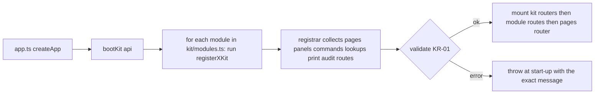
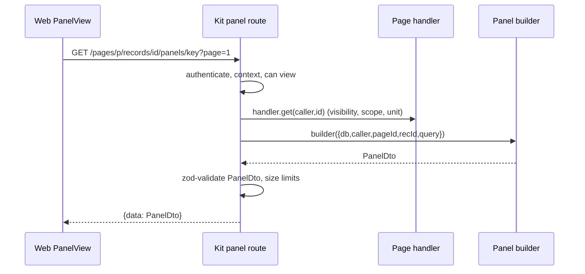

# 07 — Engine Kit (the shared typed-page extensions, built once, before any module ticket)

Binding input: `DECISIONS.md` (D-07, D-01, D-02, D-03). Read `00-BUILDER-RULES.md` first. This plan replaces the separate kit work that plans 02 (T-INV-04/05), 03 (T-SCM-05, T-SCM-35), 04 (FC-5 / T-SAL-15/20), 05 (FC-4 / T-FIN-38/39) and 06 (T-QMS-13/30) each described under different names. **Module plans use the kit and only add their own panel builders, line kinds, lookups, print templates and schemas.** Single file (about 700 lines), sections 0–15 where they apply. Dates as of 2026-11-03. No web research was needed (pure internal design); where an idea is borrowed from a product it is named as an idea only.

---

## 0. Header

**Purpose.** One mechanism, built once, that lets a module (Inventory, SCM, Sales/CRM, Finance & Tax, Quality, later Manufacturing …) turn its pages into **typed pages** with: real content in the six profile tabs (`tabPanels`), header buttons (`commands`), row actions with data (`payload`) and a permission level (`requires`), a registry of lookups, typed register filters, an editable line grid for documents (`LinesEditor` + line-kind registry), a print/PDF template registry, and `readOnlyCreate`.
**Serves.** Every module builder; nothing in this plan is visible to the end user by itself. The frozen UI (page head, 16-tab strip, table look, modal, drawer, toast) is unchanged; the kit only fills in what the frozen tabs were missing and appends `[ADD]` buttons/tabs after the frozen ones.
**Dependencies.** Existing code only: `apps/api/src/engine/*`, `modules/records/*`, `modules/inventory/{typed.ts,definitions.ts,typed-pages.ts,audit.ts,export.ts}`, `core/audit/audit-service.ts`, `core/rbac/access.ts`, `apps/web/src/pages/generic/*`. It must be built **first** (before T-INV-0x, T-SCM-0x, T-SAL-0x, T-FIN-0x, T-QMS-0x tickets that use it).
**Decisions applied.** D-07 (one kit, one name `tabPanels`), D-01 (no `company_id`; the kit has no tables), D-02/D-03 (n/a, no migrations).
**FOUNDATION-CHANGE:** none beyond DECISIONS D-07; the kit **is** that change. It adds no table.

### 0.1 Where the kit lives
| Area | Path | Contents |
|---|---|---|
| API | `apps/api/src/kit/` | `types.ts`, `registry.ts`, `boot.ts`, `modules.ts`, `schema.ts`, `filters.ts`, `lookups.ts`, `panels/{types,registry,routes,helpers}.ts`, `commands.ts`, `print.ts`, `audit.ts`, `routes.ts` |
| Web | `apps/web/src/pages/generic/kit/` | `PanelView.tsx`, `panelTypes.ts`, `sections/*.tsx`, `LinesEditor.tsx`, `lineKinds.ts`, `PayloadDialog.tsx`, `CommandBar.tsx`, `PrintMenu.tsx`, `printRegistry.ts`, `panelComponents.ts`, `kitApi.ts`, `modules.ts` |
| Tests | `apps/api/tests/kit-*.test.ts`, `apps/web/src/pages/generic/kit/*.test.tsx` | see section 11 |

---

## 1. Scope and status

**In scope (13 things):** (1) typed-page **registry** (schema + handler + routes per module, no edit of core files per module); (2) schema extensions `tabPanels`, `commands`, `readOnlyCreate`, `printTemplates`, `filters` (typed), action `payloadFields`; (3) `requires = add|edit|delete|approve`; (4) action/command **`payload`**; (5) **panel** routes, DTO and builders registry; (6) panel **section types**: `table`, `stepper`, `facts`, `notice`, `lines`, `funnel`, `bars`, `chart`, `timeline`, `calendar`, `board`, `custom`; (7) **lookup registry** and `FieldMeta.suffix`; (8) **typed filters** on lists; (9) `LinesEditor` + **line-kind registry**; (10) header **command bar**; (11) **print/PDF** registry; (12) `[ADD]` tabs; (13) audit vocabulary registration.
**Out of scope:** any module page, table, builder or line kind; Inventory's `makeTableHandler` (stays in plan 02: it is a handler factory for Inventory tables, not part of the page machinery); report engines; notifications.
**What exists vs what is added.** Exists: `TypedSchema`, `TypedHandler`, `SchemaAction`, `FieldMeta.lookup: 'items'|'warehouses'`, typed filters `bool|select` with a fixed query whitelist, `actionBodySchema {dispatchedQty, receivedQty}`, `views`, `GenericModulePage` with `PhaseNotice` for non-live tabs. Added: everything above, all **optional** in the schema JSON, so a page that does not use them behaves exactly as today.

### 1.1 Compatibility promise (tested by T-KIT-12)
The seven built Inventory pages return a schema JSON **deep-equal** to today's (the kit adds no key to them); the 645 API and 246 web tests that exist today stay green without edits; `kindOf()` results for all 252 registry pages are unchanged until a module registers a page.

### 1.2 Name mapping: name used in plan X → name in the kit
| Plan | Name used there | Name in the kit | Note |
|---|---|---|---|
| 02 Inventory | `tabViews: {tab,key,title,kind}[]` | `tabPanels: TabPanelRef[]` (`{tab,key,scope,title?,component?}`) | `kind` R/C/A is dropped: every view is a panel; `scope` is `page` for aggregates and `record` for per-row |
| 02 | `GET /pages/:id/tab-views/:key` | `GET /pages/:id/panels/:key` | |
| 02 | `TabViewResult {kpis,columns,rows,meta,totals,chart,actions,inputs,notice}` | `PanelDto {kpis, sections:[table{columns,rows,meta,totals,rowActions,headerActions}, chart, notice]}` | `inputs` → table column `editable`; `actions[].scope row/header` → `rowActions` / `headerActions` with `call` |
| 02 | `TypedHandler.tabView`, `.command` | `kit.panel(...)`, `kit.command(...)` registrations | handlers no longer carry them |
| 02 | `commands: {key,label,variant,requires,confirm?,fields?}[]` | `commands: KitCommand[]` | same shape |
| 02 | `POST /pages/:id/commands/:cmd` body `{params}` | same URL, body `{payload}` | `params` is renamed `payload` everywhere |
| 02 | action body `params` | `payload` | |
| 02 | `schemaOverrides?(caller)` (dynamic dropdown options) | kept as optional `TypedHandler.schemaOverrides` (T-KIT-02) | lookups are preferred |
| 02 | `TabViewPanel`, `CommandDialog` | `PanelView`, `PayloadDialog` | |
| 02 | `SchemaAction.requires 'approve'` | `Requires = 'add'|'edit'|'delete'|'approve'` | |
| 03 SCM | `ScmTypedSchema`, `defineScm()` | `KitSchema` (type) + module-local helper that calls the kit's `defineKitSchema()` | module `common.ts` keeps only field helpers |
| 03 | `tabPanels: {tab,key,scope}[]`, `readOnlyCreate` | same names | |
| 03 | `PanelDto` (C6) and sections `table,stepper,facts,notice,lines` | same | `endpoint` on actions → `call` |
| 03 | `scmHandlerFor` map, `scm/typed-pages.ts` | `kit.page({schema, handler})` | |
| 03 | `FieldMeta.lookup` union | `lookup?: string` checked against the lookup registry | URL name = kebab-case of the kind (`purchaseOrders` → `/lookups/purchase-orders`) |
| 03 | flat action body fields (`comment`, `reason`, `lines`, `supplierIds` …) | `payload.comment`, `payload.reason`, … | |
| 03 | `LinesEditor lineKind pr|rfq|vq|po|grn|pi|dn|contract` | same ids, registered by SCM via `registerLineKind` | |
| 04 Sales | sections `funnel,bars,timeline,calendar,board` | same ids and data contracts (2.3) | |
| 04 | `lineKind qtn|so|plan|dsp|inv|cn|ret` | same ids, registered by Sales | |
| 04 | `registerPanel(pageId,key,scope,fn)` | `kit.panel(pageId,key,scope,builder)` (identical arguments) | routes E40/E41 are the kit routes |
| 04 | `FieldMeta.suffix` and the new lookup list | `FieldMeta.suffix?: string`; `kit.lookup(...)` per kind | |
| 04 | `GET /sales/documents/:pageId/:id/pdf?template=` | `GET /pages/:pageId/records/:id/pdf/:templateKey` | renderer registered with `kit.pdf(...)` |
| 05 Finance | `tabViews`, `headerActions` | `tabPanels`, `commands` | |
| 05 | `ViewTab` | `PanelView` with a `table` section | |
| 05 | `FinanceSchema`, `makeReportHandler`, `F/context.ts` | stay in Finance (not kit) | |
| 05 | journal editor / bank-reco workspaces | `custom` section (`component` registered with `registerPanelComponent`) | |
| 06 QMS | `tabPanels: Record<tab,{component,endpoint}>` | `tabPanels: TabPanelRef[]` with `component` | |
| 06 | `typedFilters` fixed whitelist in `records/schemas.ts` | `filters: KitFilter[]` declared in the page schema; parsed by `kit/filters.ts` | |
| 06 | `actionBodySchema.payload` / `payloadFields` / `ActionDialog` | same `payload` / `payloadFields`; dialog is `PayloadDialog` | |
| 06 | `QMS_PANELS[page][tab] = Component` | `registerPanelComponent(name, Component)` + `tabPanels[].component = name` | |
| 06 | `GET /qms/print/:formCode/:id` and React print components | kit print route `GET /pages/:pageId/records/:id/print/:templateKey` + `registerPrintTemplate(pageId, key, Component)` | |
| 06 | `[ADD]` tabs after Audit Trail | `tabPanels` entry whose `tab` is not a frozen profile tab | rule KR-13 |
| all | `AuditTarget` / `AUDIT_ACTIONS` edits per plan | `kit.audit({actions,targets})` | |

---

## 2. The contracts

### 2.1 Schema additions (API, JSON and TypeScript)
File `apps/api/src/kit/types.ts` (exact):
```ts
export type Requires = 'add' | 'edit' | 'delete' | 'approve';

export interface PayloadField {
  key: string; label: string;
  type: 'text' | 'longtext' | 'qty' | 'money' | 'pct' | 'date' | 'bool' | 'enum' | 'lookup';
  required: boolean; options?: string[]; lookup?: string;
  min?: number; max?: number; maxLength?: number;
}
export interface KitCommand {            // header button, not tied to a record
  key: string; label: string; variant: 'primary' | 'default' | 'danger';
  requires: Requires;                    // default 'add' when omitted by the module helper
  confirm: string | null; fields?: PayloadField[];
}
export interface TabPanelRef {
  tab: string;                           // a frozen profile tab label, or a new [ADD] label (KR-13)
  key: string;                           // panel key, ^[a-z0-9]+(-[a-z0-9]+)*$ , unique per page
  scope: 'record' | 'page';
  title?: string;
  component?: string;                    // name registered with registerPanelComponent; then the panel is drawn by that component
}
export interface PrintTemplateRef {
  key: string; label: string; kind: 'web' | 'pdf'; scope: 'record' | 'page'; default?: boolean;
}
export type FilterType = 'bool' | 'select' | 'text' | 'date' | 'month' | 'lookup';
export interface KitFilter {             // widens inventory SchemaFilter (bool|select)
  key: string; label: string; type: FilterType; param: string;
  options?: string[]; lookup?: string;
}
export interface KitSchemaExtras {
  tabPanels?: TabPanelRef[]; commands?: KitCommand[];
  readOnlyCreate?: boolean;              // true: no "＋ Add", POST /records answers 405 READ_ONLY
  printTemplates?: PrintTemplateRef[];
}
```
Changes to existing types (all additive):
* `engine/field-schema.ts` `SchemaAction.requires: Requires`; new optional `payloadFields?: PayloadField[]`.
* `engine/field-types.ts` `FieldMeta.lookup?: string` (was `'items'|'warehouses'`), new `FieldMeta.suffix?: string` (display only, e.g. `/10`).
* `modules/inventory/definitions.ts` `TypedSchema` = existing shape **plus** `KitSchemaExtras`; `pageId: string` (was `InventoryPageId`); `SchemaFilter.type: FilterType` and `lookup?: string`.
* `modules/inventory/typed.ts` `ActionBody` gains `payload?: Record<string, unknown>`; `TypedListQuery` gains `filters?: Record<string, string | boolean>`; `TypedHandler` gains optional `schemaOverrides?(caller): Promise<Record<string, { options?: string[] }>>`; `AuditTarget = string`.
* `modules/records/schemas.ts` `actionBodySchema` = `{dispatchedQty?, receivedQty?, payload?: z.record(z.string(), z.unknown()).refine(size ≤ 100 KB)}` `.strict()`.

**JSON example** (a schema fragment a module may return):
```json
{ "pageId": "scm-po", "kind": "typed", "readOnlyCreate": false,
  "tabs": ["PO Register","Item Schedule","Commercial Terms","Approval & Amendments","GRN Invoice Match","Supplier Performance"],
  "tabPanels": [
    { "tab": "Item Schedule", "key": "item-schedule", "scope": "record" },
    { "tab": "Supplier Performance", "key": "supplier-performance", "scope": "record" },
    { "tab": "Release Orders", "key": "release-orders", "scope": "record", "component": "ScmReleaseOrders" } ],
  "commands": [ { "key": "auto-generate", "label": "Auto-generate PRs", "variant": "default", "requires": "add", "confirm": null,
                  "fields": [ { "key": "horizonDays", "label": "Horizon (days)", "type": "qty", "required": false } ] } ],
  "actions": [ { "key": "shortClose", "label": "Short close", "variant": "danger", "confirm": "Short close {code}?", "allowedFrom": ["In Process","Completed"],
                 "requires": "approve", "payloadFields": [ { "key": "reason", "label": "Reason", "type": "longtext", "required": true, "minLength": 10 } ] } ],
  "filters": [ { "key": "month", "label": "Month", "type": "month", "param": "month" },
               { "key": "supplier", "label": "Supplier", "type": "lookup", "param": "supplierId", "lookup": "suppliers" } ],
  "printTemplates": [ { "key": "po", "label": "Purchase Order", "kind": "pdf", "scope": "record", "default": true } ] }
```
(`minLength` above is shown for the dialog; `PayloadField` carries `min/max/maxLength` — use `maxLength`/`min` only; the example's `minLength` is NOT valid, builders use the server zod for minimums.) **Correction applied: `PayloadField` has no `minLength`; the module validates minimum length in its own zod and the dialog shows the server message.**

### 2.2 Registry and boot (API)
```ts
// apps/api/src/kit/registry.ts
export interface KitRegistrar {
  page(p: { schema: TypedSchema; handler: TypedHandler }): void;
  panel(pageId: string, key: string, scope: 'record' | 'page', builder: PanelBuilder, opts?: { requires?: Requires }): void;
  command(pageId: string, key: string, run: CommandRunner): void;
  lookup(def: LookupDef): void;
  printData(pageId: string, key: string, build: PrintBuilder): void;     // kind 'web'
  pdf(pageId: string, key: string, render: PdfRenderer): void;           // kind 'pdf'
  audit(v: { actions: readonly string[]; targets?: readonly string[] }): void;
  routes(mount: (api: Router) => void): void;                            // extra routers (e.g. /scm/reports)
}
export function registerKitModule(name: string, fn: (kit: KitRegistrar) => void): void;
```
* `apps/api/src/kit/modules.ts` is the **only** file a module ticket edits to join the kit: it imports the module's `register<Module>Kit` function and calls `registerKitModule('scm', registerScmKit)`.
* `bootKit(api: Router)` (called once in `app.ts` before `api.use('/pages', …)`) runs every registered function with a registrar bound to the module name, validates (see KR-01), mounts the kit routers, then module `routes()` mounts.
* `registry.ts` keeps `TYPED_SCHEMAS: Map<string, TypedSchema>`, `TYPED_HANDLERS: Map<string, TypedHandler>`; `page()` also **adds the id to `TYPED_PAGES`** (the existing `ReadonlySet` in `engine/kinds.ts` becomes a module-level mutable `Set` exported with the same type; its 7 built ids stay literal).
* Dispatch: `typedSchema(pageId)` (inventory/definitions.ts) = built Inventory schema ?? `TYPED_SCHEMAS.get(pageId)`; `typedHandlerFor(pageId)` = built map ?? `TYPED_HANDLERS.get(pageId)`.

### 2.3 Panel DTO (the single vocabulary) — `apps/api/src/kit/panels/types.ts`
```ts
export type Format = 'text'|'number'|'qty'|'money'|'pct'|'date'|'datetime'|'bool'|'status';
export interface Kpi { key?: string; label: string; value: string | number | null; format: Format; tone?: 'good'|'warn'|'bad'|null; hint?: string }
export interface Column { key: string; label: string; format: Format; align?: 'left'|'right'; editable?: { type: 'qty'|'money'|'text'; action: PanelCall } }
export type PanelCall =
  | { kind: 'action';  name: string; target: 'row' | 'rec' }        // POST /pages/:pageId/records/:id/actions/:name (id = row.id or panel record)
  | { kind: 'command'; name: string }                                 // POST /pages/:pageId/commands/:name
  | { kind: 'post';    path: string };                                // POST under /api/v1, placeholders {rowId} {recId} {pageId}
export interface PanelAction {
  key: string; label: string; variant?: 'primary'|'default'|'danger'; requires?: Requires; confirm?: string | null;
  call: PanelCall; payloadFields?: PayloadField[];
}
export type Section =
  | { type: 'table'; title?: string; columns: Column[]; rows: Row[]; empty?: string;
      meta?: { page: number; size: number; total: number }; totals?: Record<string, number>;
      rowActions?: PanelAction[]; headerActions?: PanelAction[] }
  | { type: 'stepper'; title?: string; steps: { label: string; state: 'done'|'current'|'pending'|'rejected'; note?: string }[] }
  | { type: 'facts';   title?: string; items: { label: string; value: string }[] }
  | { type: 'notice';  tone: 'info'|'warn'|'bad'; text: string }
  | { type: 'lines';   lineKind: string; editable: boolean }
  | { type: 'funnel';  title?: string; stages: { label: string; count: number; valueText?: string }[] }
  | { type: 'bars';    title?: string; rows: { label: string; value: number; max?: number; format?: Format; tone?: Kpi['tone'] }[] }
  | { type: 'chart';   title?: string; chartType: 'bar'|'line'; labels: string[]; series: { name: string; data: number[] }[] }
  | { type: 'timeline';title?: string; events: { at: string; title: string; detail?: string; by?: string; tone?: Kpi['tone'] }[] }
  | { type: 'calendar';title?: string; month: string /* YYYY-MM */; days: { date: string; items: { label: string; tone?: Kpi['tone']; ref?: string }[] }[] }
  | { type: 'board';   title?: string; draggable: boolean; move?: PanelCall /* receives payload {cardId, laneKey} */;
      lanes: { key: string; label: string; cards: { id: string; title: string; subtitle?: string; badge?: string; amount?: number }[] }[] }
  | { type: 'custom';  component: string; props: Record<string, unknown> };
export interface PanelDto {
  key: string; title: string; subtitle?: string; kpis?: Kpi[]; sections: Section[]; actions?: PanelAction[]; notice?: string | null;
}
type Row = { id?: string; refs?: Record<string, { id: string; code: string; name: string }> } & Record<string, string | number | boolean | null>;
```
Data contracts per section (what the web renders, only prototype classes): **table** → `.table-wrap > table`, `format` decides cell text (money `₹ 1,23,456.00` en-IN, qty ≤ 3 dp trimmed, date `DD-MMM-YYYY`, pct `12.5 %`, bool Yes/No, status chip via `statusClass`); with `meta` shows `Pager` and re-requests the same panel with `page`; `totals` bold last row; `rowActions` buttons per row; `editable` column renders an inline input, posts on blur/Enter; empty → `empty ?? 'No records yet.'`. **stepper** → `.v9-stepper .v9-step(.done|.current)`. **facts** → `.detail-grid .detail`. **notice** → `.notice`. **funnel** → `.v9-funnel .v9-funnel-col .v9-funnel-bar` widths proportional to count/max. **bars** → `.v9-metric-row .v9-progress` (only inline style: width %). **chart** → existing chart helper if present, else the same CSS bars. **timeline** → `.v9-timeline .v9-event`. **calendar** → `.calendar .day` for `month`. **board** → `.workflow .lane .lane-card`; drag and keyboard move call `move` with `{cardId, laneKey}`. **custom** → component from `registerPanelComponent`. **lines** → `LinesEditor` (2.5).

### 2.4 Panel routes
`GET /pages/:pageId/panels/:key` (page scope) and `GET /pages/:pageId/records/:id/panels/:key` (record scope). Query: `page` (default 1), `size` (1–100, default 20), `q` (≤100), `from`, `to` (dates), `status`, plus any other key declared by that panel's registration `opts.params` (name list, strings ≤ 100). Permission: `view` on the page (or `opts.requires`). Rules in KR-04.

### 2.5 `LinesEditor` and the line-kind registry (web)
```ts
// apps/web/src/pages/generic/kit/lineKinds.ts
export interface LineColumn {
  key: string; label: string;
  type: 'lookup' | 'text' | 'qty' | 'money' | 'pct' | 'date' | 'select' | 'readonly';
  lookup?: string; options?: string[]; width?: string; format?: Format;
  editableWhen?: (line: Line, ctx: LineCtx) => boolean;      // default: type !== 'readonly'
}
export interface LineKindSpec {
  kind: string;                                              // 'po', 'qtn', …
  columns: LineColumn[];
  newLine: (ctx: LineCtx) => Line;                           // defaults for “Add row”
  onPick?: (col: string, picked: LookupItem, line: Line, ctx: LineCtx) => Promise<Partial<Line>>; // e.g. item pick fills uom, rate, hint
  preview?: { path: (ctx: LineCtx) => string; body: (lines: Line[], ctx: LineCtx) => unknown };   // server computes tax/totals
  totalsLabels?: { key: string; label: string; format: Format }[];   // “Document Total” rows, values come from preview
  isEditable: (status: string) => boolean;                   // default: status === 'Draft'
}
export function registerLineKind(spec: LineKindSpec): void;   // throws on duplicate kind
export type Line = Record<string, unknown>;  export interface LineCtx { pageId: string; record: RecordRow; schema: PageSchema }
```
Component props: `LinesEditor({ kind, record, schema, onSaved })`. Behaviour: loads `record.data.lines`; edits locally; when `preview` exists it posts (debounced 400 ms) and shows **only** server values for computed columns/totals (the browser never computes tax or money); **Save** = `PATCH /pages/:pageId/records/:id` with `{data:{lines}}` and `If-Match` of the record version; shows field errors from `error.fields["lines[n].key"]`; disabled with a tooltip when `!isEditable(status)`; add/remove row; item/lookup cells use `LookupCombobox`; no local arithmetic except displaying what was returned. A module registers kinds in `apps/web/src/pages/<module>/lineKinds.ts` and the kit's `kit/modules.ts` imports it for its side effect. Names reserved for modules: SCM `pr rfq vq po grn pi dn contract`, Sales `qtn so plan dsp inv cn ret`.

### 2.6 Header command bar, actions, payload
* Commands render **after** the frozen buttons (`Excel`, `Letterhead PDF`/`Print`, `＋ Add`) as `.btn` in schema order, only for users who have the `requires` permission on the page (`usePagePermissions`). Click: if `fields` → `PayloadDialog`; else if `confirm` → existing confirm modal; then `POST /pages/:pageId/commands/:key` `{ "payload": {…} }` with a fresh `Idempotency-Key`; success toast = server `result.message ?? label`; the page reloads.
* A row **action** with `payloadFields` opens the same `PayloadDialog` (fields rendered with the existing `.form-grid .field` classes), posts `{ "payload": {…} }`. `{code}` in `confirm` is replaced as today.
* `requires` semantics (KR-03): server decides with `can(user, pageId, requires)` after the visibility 404; `requiresFrom` (existing) still means "`requires` only from those statuses, `edit` otherwise". Web hides a button when the user lacks the right (the server is the authority).

### 2.7 Lookups
`kit.lookup({ name: 'purchaseOrders', pageId: 'scm-po', search(db, caller, q, limit, filters) → LookupItem[], byId?(db, ids) → LookupItem[] })`; `LookupItem = { id: string; code: string; name: string; extra?: Record<string, string|number|null> }`. Route `GET /lookups/:slug?q=&limit=&<filters>` where `slug` = kebab-case of `name`; permission `view` on `pageId`; `limit` 1–50 (default 20); active rows only unless the def says otherwise. The existing `/lookups/items` and `/lookups/warehouses` routes stay untouched (registered first); the kit's route only answers other slugs; unknown → 404. `FieldMeta.lookup` must name a registered lookup — checked at boot (KR-01). `byId` lets the web show labels of stored ids (`refs` of typed rows come from the handler as today).

### 2.8 Typed filters
`filters: KitFilter[]` in the schema. `kit/filters.ts` `parseFilters(schema, rawQuery) → { base: {q,status,sort,page,size,deleted,view}, filters: Record<string, string|boolean> }`: every declared `param` is accepted and validated by type (`bool` `'true'|'false'` → boolean; `select` must be in `options`; `text` trimmed ≤ 100; `date` `YYYY-MM-DD` real date; `month` `YYYY-MM`; `lookup` UUID); an undeclared param → 422 `VALIDATION_ERROR` (field = the param). The legacy params `warehouseId`, `belowReorder` keep working because Inventory declares them as filters; the handler also receives them in `query.warehouseId`/`query.belowReorder` as today. `routes.ts::byEngine` builds the zod schema per page from `schema.filters`.

### 2.9 Print / PDF registry
`printTemplates` in the schema lists templates. `kind:'web'`: API `GET /pages/:pageId/records/:id/print/:templateKey` returns `PrintDto` built by `kit.printData`; the web renders the registered React component (`registerPrintTemplate(pageId, key, Component)`, props `{ dto: PrintDto }`) inside a print layout and calls `window.print()`. `kind:'pdf'`: `GET /pages/:pageId/records/:id/pdf/:templateKey` returns `application/pdf` from `kit.pdf` (renderer `(db, caller, id, key) → Buffer`). Page scope (`scope:'page'`) uses `/pages/:pageId/print/:templateKey` and `/pages/:pageId/pdf/:templateKey` (query = list filters). Permission `view` (+ `export` for pdf). The frozen header `Print` button prints the page as today; **only when a page has templates** a `Print ▾` menu (`PrintMenu`) is shown in the row menu and the drawer ([ADD]) and the default template is used by the existing `Print` button for a selected record.
```ts
export interface PrintDto { templateKey: string; title: string; docNo: string; docDate: string; revision?: string;
  unit: { code: string; name: string; gstin?: string; address?: string };
  letterhead: Record<string, string>;                         // existing letterhead settings
  parties: { role: string; name: string; gstin?: string; address?: string; contact?: string }[];
  facts: { label: string; value: string }[];
  lines: { columns: { key: string; label: string; format: Format; align?: 'left'|'right' }[]; rows: Record<string, string|number|null>[] } | null;
  sections: { title: string; rows?: { label: string; value: string }[]; text?: string }[];
  totals: { label: string; value: string; bold?: boolean }[]; amountInWords?: string; notes?: string;
  signatures: { label: string; name?: string }[] }
```
Money in `PrintDto` is already formatted by the server (strings), so web print components never compute.

---

## 3. How the market does it (ideas only, no research done for this plan)
Odoo form views and ERPNext "Desk" tabs/dashboards motivate **declarative tabs** (a tab is data, not code); SAP Fiori object pages motivate **record-scoped panels** with actions; Odoo/ERPNext report views motivate the `table` section with server paging and totals. We adopt: panels as JSON (one renderer), registries instead of per-module edits, and server-side calculation. We skip: a visual view builder, per-user layout customisation (backlog), and a client-side expression engine (tax and totals are server-only, rule KR-15).

---

## 4. Processes

### 4.1 Boot and registration

### 4.2 Request flow of a panel

### 4.3 Add a panel to a page (what a module builder does)
1. Declare `tabPanels` in the schema. 2. `kit.panel(pageId, key, scope, builder)`. 3. Return `PanelDto` using the helpers. 4. If an editable grid is needed use a `lines` section and `registerLineKind`. Nothing else is edited.

---

## 5. Database design
**No tables, no migrations.** The kit reads existing tables only (audit_logs for the generic audit view). `Hand-written migration` rules (D-03) are therefore not exercised by this plan.

---

## 6. Business rules (KR = kit rule)
* **KR-01 Registration validation (at boot).** (a) Page ids must exist in the registry (`pageInfo`) and be unique across modules (two modules registering the same page → throw `KIT: page <id> registered twice (<m1>, <m2>)`). (b) every `tabPanels[].key` of a page has exactly one registered builder (unless `component` is set and no builder is needed) and the panel key matches `^[a-z0-9]+(-[a-z0-9]+)*$`; (c) `tab` is either one of the page's registry tabs or a new label (KR-13); (d) every `FieldMeta.lookup`, `KitFilter.lookup`, `PayloadField.lookup` names a registered lookup; (e) every `commands[].key` has a registered runner; (f) every action `key` has the handler's `action` support (not checked here); (g) every `printTemplates` entry has a builder/renderer of the right kind; (h) `kind:'pdf'`/`'web'` keys are unique per page. Tests: T-KIT-01/12.
* **KR-02 Compatibility.** Every new schema key is optional; the server omits absent keys; the web treats absence as today's behaviour. A page without `tabPanels` shows `PhaseNotice` for non-live tabs exactly as now.
* **KR-03 `requires`.** Values `add|edit|delete|approve`. Action: default `edit`; with `requiresFrom` the rule of the built code applies. Command: default `add`. Panel: `view` unless `opts.requires`. All checks via `can()`; module controls (`allow_*` switches) apply as for built pages; unknown value → boot error.
* **KR-04 Panels.** (1) Unknown page/key → 404 `NOT_FOUND`; scope mismatch (record URL for a page panel or the reverse) → 404. (2) Record scope: the kit first calls `handler.get(caller, id)`; its 404 (not visible / other unit / scope) is returned unchanged. (3) Page scope uses the unit/FY context and data scope inside the builder through helper `unitScope(caller)`. (4) The builder result is validated by zod (`PanelDtoSchema`): unknown section type → 500 `INTERNAL` in tests, logged and 500 in production; ≤ 12 sections, ≤ 500 rows per table section, ≤ 400 KB JSON; `size` > 100 → 422. (5) "All units" is readable for ADMIN+ only, as for lists. (6) A panel never writes; writes are actions/commands. (7) Cache: none (`Cache-Control: no-store`).
* **KR-05 Table sections.** Server paging: builder uses `pagedTable(columns, rowsQuery, query)`; `meta.total` is the full count; sort is server-side by a whitelisted key; `totals` cover the whole filtered set, not the page.
* **KR-06 Action payload.** Body `{ payload? }` (≤ 100 KB). The kit passes `payload` to `TypedHandler.action` as `body.payload`; the module validates it with its own zod schema (`z.object(...).strict()`); a missing required payload field → 422 `VALIDATION_ERROR` with `fields["payload.<key>"]`. `Idempotency-Key` behaviour is unchanged. Old bodies `{dispatchedQty}`/`{receivedQty}` keep working.
* **KR-07 Commands.** `POST /pages/:pageId/commands/:command` body `{ payload? }`; guards: authenticate, password changed, context, `can(requires)`, `requireConcreteUnit` unless the runner declares `allowAllUnits:true`; runner signature `(ctx: { db: Db; caller: Caller; payload: Record<string, unknown>; idempotencyKey?: string }) → Promise<{ message?: string; result?: unknown }>`; response `200 { result }`; the runner opens its own transaction. Unknown command → 404. Audit action is the runner's.
* **KR-08 Typed filters** as 2.8; a filter never widens data scope; unit/FY context still applies.
* **KR-09 Lookups** as 2.7; results are limited by data scope of the owning page when that page has scoped data (module decides in `search`); `limit` > 50 → 422.
* **KR-10 Lines.** The server is the only calculator. A `lines` section appears only when the record is a document with `data.lines`. Save replaces the whole array (module rule). Concurrency by `If-Match`. Unknown `lineKind` → the editor shows `ErrorMessage` "Line kind <kind> is not registered" (and the boot check in `kit/modules.ts` import test fails in CI).
* **KR-11 Print.** `web` templates never fetch more than the `PrintDto`; `pdf` renderers return a Buffer ≤ 10 MB; both audit `RECORDS_EXPORTED`-style via `SCM`-like module action name chosen by the module (`kit.printData` wrapper writes `PRINT_RENDERED` core audit with pageId, id, templateKey).
* **KR-12 `readOnlyCreate`.** The kit's controller guard answers `POST /pages/:pageId/records` with 405 `READ_ONLY` ("Records of this page are created by other documents.") before the handler; actions on existing records are unaffected; web hides `＋ Add` and the empty-state sentence changes to "Nothing here yet." only when the flag is set.
* **KR-13 `[ADD]` tabs.** The tab strip is `Module Dashboard`, the six registry tabs, the universal tabs, then `[ADD]` tabs: every `tabPanels[].tab` that is not a registry tab of the page, in schema order, **after `Audit Trail`**. The six frozen tab names and the position of the others never change. (Open question Q-KIT-2 records the owner's possible preference to put them right after the sixth tab.)
* **KR-14 Audit vocabulary.** `AUDIT_ACTIONS` stays the exported runtime array; `kit.audit({actions})` appends (dedupe); `AuditAction` becomes `string`; `AuditEntry.targetType` becomes `string | null`; `GET /audit-logs/actions` returns core + registered. The generic page audit endpoint for kit pages (`kitAudit`) filters `detail->>'pageId' = :pageId` (and by record `target_id`), applies the unit filter from `detail->>'unitId'`, OWN scope as inventory does.
* **KR-15 No money maths in the web.** The web renders what the server sends; formatting only (`lib/format`). Review rule.
* **KR-16 UI freeze.** No new CSS framework, colours or fonts. CSS: copy the `.v9-*` rules of `reference/index.html` lines 44–65 verbatim into `apps/web/src/styles/panels.css` **once** (T-KIT-07) if not already in `app.css`; section classes listed in 2.3 only.

---

## 7. API design (all under `/api/v1`)
| # | Method + path | Permission | Request → response | Errors |
|---|---|---|---|---|
| K1 | `GET /pages/:pageId/schema` | view | existing; plus optional keys of 2.1 | 404 |
| K2 | `GET /pages/:pageId/panels/:key` | view (or opts) | query 2.4 → `{data: PanelDto}` | 404, 422 |
| K3 | `GET /pages/:pageId/records/:id/panels/:key` | view | same | 404 |
| K4 | `POST /pages/:pageId/commands/:command` | per command | `{payload?}` → `{result}` | 403, 404, 409, 422 |
| K5 | `POST /pages/:pageId/records/:id/actions/:action` | per action | existing + `{payload?}` | 403, 404, 409, 422 |
| K6 | `GET /lookups/:slug` | view on lookup page | `?q&limit&<filters>` → `{data: LookupItem[]}` | 404, 422 |
| K7 | `GET /pages/:pageId/records/:id/print/:templateKey` | view | → `{data: PrintDto}` | 404 |
| K8 | `GET /pages/:pageId/records/:id/pdf/:templateKey` | view + export | → `application/pdf` | 404, 413 |
| K9 | `GET /pages/:pageId/print/:templateKey`, `GET /pages/:pageId/pdf/:templateKey` | view (+export) | page scope, list filters as query | |
| K10 | `GET /pages/:pageId/audit`, `GET /records/:id/audit` | view | existing shape, served by `kitAudit` for kit pages | |
Everything else (CRUD, restore, bulk, export) is the existing record API, dispatched through the registry.

**Example panel response**
```json
{ "data": { "key": "val-fifo-layers", "title": "FIFO Layers",
  "kpis": [ { "label": "Open layers", "value": 42, "format": "number", "hint": "Items valued FIFO" } ],
  "sections": [
    { "type": "table", "columns": [ { "key": "itemCode", "label": "Item", "format": "text" }, { "key": "qtyRemaining", "label": "Qty left", "format": "qty", "align": "right" } ],
      "rows": [ { "id": "r1", "itemCode": "ITM/00012", "qtyRemaining": 5 } ], "meta": { "page": 1, "size": 20, "total": 42 }, "totals": { "qtyRemaining": 30 },
      "rowActions": [ { "key": "revalue", "label": "Revalue", "requires": "approve", "confirm": null, "call": { "kind": "command", "name": "revalue-standard" } } ] },
    { "type": "chart", "chartType": "bar", "labels": ["0-30","31-90"], "series": [ { "name": "Qty", "data": [30, 30] } ] } ] } }
```

---

## 8. Reports and KPIs
None. (The kit measures nothing; module plans define their reports.) Operational counters logged at `info`: number of registered pages/panels/lookups at boot.

---

## 9. Extras (beyond what the five plans asked) — prioritised
| # | Idea | Prio | In tickets |
|---|---|---|---|
| 1 | Boot-time validation of registrations (KR-01) catches missing builders early | MUST | T-KIT-01 |
| 2 | Zod validation of every `PanelDto` before it leaves the server | MUST | T-KIT-04 |
| 3 | Test-only fixture page `kit-test` that exercises every kit feature | MUST | T-KIT-12 |
| 4 | Generic `kitAudit` so a module needs no audit code for its page | MUST | T-KIT-05 |
| 5 | `byId` on lookups to label stored ids without a handler | SHOULD | T-KIT-03 |
| 6 | `PrintMenu` with several templates per page | SHOULD | T-KIT-11 |
| 7 | Per-section "Export CSV" of a table section | COULD | backlog |
| 8 | User-customisable panel layout | COULD | backlog |

---

## 10. Edge cases and careless-user scenarios
| # | Scenario | Safe behaviour | Test |
|---|---|---|---|
| 1 | Two modules register the same page id | boot throws naming both | `kit-registry` |
| 2 | `tabPanels` key without a builder | boot throws | `kit-registry` |
| 3 | Lookup name unknown in a field | boot throws | `kit-registry` |
| 4 | Panel key not in schema but builder registered | boot throws (unused builder) | `kit-registry` |
| 5 | Record panel for a record of another unit | 404 from `handler.get` | `kit-panels` |
| 6 | Page panel called with `/records/:id/` URL | 404 | `kit-panels` |
| 7 | Builder returns an unknown section type | 500, logged | `kit-panels` |
| 8 | Builder returns > 500 rows | 500 `INTERNAL` (builder bug), never truncated silently | `kit-panels` |
| 9 | `size=500` | 422 | `kit-panels` |
| 10 | Member without `approve` runs an `approve` action | 403 `FORBIDDEN` | `kit-actions` |
| 11 | Payload > 100 KB | 413 `PAYLOAD_TOO_LARGE` | `kit-actions` |
| 12 | Unknown payload key | module zod `.strict()` → 422 | `kit-actions` |
| 13 | Command double click | same `Idempotency-Key` returns the stored result with `Idempotent-Replay` | `kit-commands` |
| 14 | Command in "All units" | 422 `CONTEXT_INVALID` | `kit-commands` |
| 15 | Undeclared query filter | 422 on that param | `kit-filters` |
| 16 | Filter `month=2026-13` | 422 | `kit-filters` |
| 17 | `readOnlyCreate` page POST | 405 `READ_ONLY` | `kit-schema` |
| 18 | Old client ignores new keys | pages behave as before | `kit-compat` |
| 19 | Lines editor save with stale version | 409 `VERSION_CONFLICT` shown, lines kept in the grid | web `LinesEditor.test` |
| 20 | Line kind registered twice | throws at import | web `lineKinds.test` |
| 21 | Panel component name not registered | `ErrorMessage` in the panel only; page still works | web `PanelView.test` |
| 22 | PDF renderer throws | 500, no partial file | `kit-print` |

---

## 11. Test plan
**API (supertest, `rhai_erp_test`)** — one file per area, each ticket lists its tests: `kit-registry.test.ts` (KR-01, dispatch order, `TYPED_PAGES` live set), `kit-schema.test.ts` (extensions pass through, `readOnlyCreate` 405, widened `requires`), `kit-filters.test.ts`, `kit-lookups.test.ts`, `kit-panels.test.ts`, `kit-actions.test.ts` (payload, `requires`), `kit-commands.test.ts`, `kit-print.test.ts`, `kit-audit.test.ts`, `kit-compat.test.ts` (deep-equal of the 7 inventory schemas against a stored fixture `apps/api/tests/fixtures/inventory-schemas.json`, generated once in T-KIT-12 from the **unchanged** code before any other kit edit lands — so T-KIT-01 first creates the fixture). A **fixture module** `apps/api/tests/kit-fixture-module.ts` registers page `kit-test` (an in-memory handler over an array, a panel of every section type, a command, a lookup, a print template); it is registered **only in tests** through `registerKitModule` called by the test files.
**Web (vitest + Testing Library)** — `PanelView.test.tsx` (each section type from fixtures, empty states, paging request, inline input post, board move), `LinesEditor.test.tsx` (preview-only totals, disabled outside Draft, field errors, add/remove), `PayloadDialog.test.tsx` (required fields, enum, lookup), `CommandBar.test.tsx` (order after frozen buttons, permission hiding), `PrintMenu.test.tsx`, `GenericModulePage.kit.test.tsx` (tab strip order incl. `[ADD]` tab after Audit Trail, `PhaseNotice` kept for pages without panels, `readOnlyCreate` hides Add).
**Regression** — run the whole existing suites (`cd apps/api && npm run verify`, `cd apps/web && npm run verify`): 645 API and 246 web tests unchanged and green after every ticket.
**E2E** — none in the kit (module e2e tests exercise it).

---

## 12. Build tickets

Rules for all tickets: `00-BUILDER-RULES.md`; one process at a time; no commit; every new file starts with a comment; no `any`; kit code never imports from a module folder except `modules/inventory/{typed,definitions,typed-pages,audit,export}.ts` (existing) and `modules/records/*`. Paths relative to repo root; `API` = `apps/api/src`, `WEB` = `apps/web/src`.

| Ticket | Title | Depends on | Size |
|---|---|---|---|
| T-KIT-01 | Registry, boot, dispatch, TYPED_PAGES live set, audit vocabulary | — | M |
| T-KIT-02 | Schema extensions, `requires`, `payload`, `readOnlyCreate`, `suffix`, `lookup` widening | 01 | M |
| T-KIT-03 | Lookup registry and `/lookups/:slug` | 01, 02 | S |
| T-KIT-04 | Panel DTO, registry, routes, helpers | 01, 02 | L |
| T-KIT-05 | Commands route, action payload plumbing, `kitAudit` | 02 | M |
| T-KIT-06 | Typed filters (parse + schema + route wiring) | 02 | M |
| T-KIT-07 | Web core: types, `kitApi`, CSS, `PanelView` basic sections, tab integration | 04 | L |
| T-KIT-08 | Web extended sections and custom components | 07 | M |
| T-KIT-09 | Web `LinesEditor` and line-kind registry | 07 | M |
| T-KIT-10 | Web `PayloadDialog`, `CommandBar`, typed filter toolbar, `requires` visibility | 05, 06, 07 | L |
| T-KIT-11 | Print/PDF registry (API + web) | 04, 07 | M |
| T-KIT-12 | Fixture module, regression fixture, contract tests, kit checklist | all | M |

### T-KIT-01 — Registry, boot, dispatch, live `TYPED_PAGES`, audit vocabulary
**Goal.** Let a module register a page without editing core files. **Depends on:** none. **Size:** M.
**Files.** Create `API/kit/types.ts` (2.1 types), `API/kit/registry.ts`, `API/kit/boot.ts`, `API/kit/modules.ts` (empty list + comment), `API/kit/audit.ts`, `apps/api/tests/kit-registry.test.ts`, `apps/api/tests/fixtures/inventory-schemas.json`. Change `API/engine/kinds.ts`, `API/modules/inventory/typed-pages.ts`, `API/modules/inventory/definitions.ts` (`typedSchema` only), `API/core/audit/audit-service.ts`, `API/modules/inventory/typed.ts` (`AuditTarget`), `API/app.ts`.
**Steps.**
1. **First**, before any edit, write a throw-away script in the test (not committed as a script) that fetches `typedSchema(id)` for the 7 inventory ids and writes `apps/api/tests/fixtures/inventory-schemas.json` (stable key order, `JSON.stringify(x, null, 2)`); the file is committed with the ticket and used by T-KIT-12.
2. `kinds.ts`: `TYPED_PAGES` becomes `const typedPages = new Set<string>([...7 ids]); export const TYPED_PAGES: ReadonlySet<string> = typedPages; export function addTypedPage(id: string): void` (throws if already present).
3. `registry.ts`: types `KitRegistrar` (2.2), maps `TYPED_SCHEMAS`, `TYPED_HANDLERS`, `registerKitModule(name, fn)` (stores in an array; duplicate module name → throw), `kitSchemaFor(pageId)`, `kitHandlerFor(pageId)`.
4. `boot.ts`: `bootKit(api: Router): void` — for each module call `fn(registrar)`; the registrar methods push into collection arrays tagged with the module name; after all modules ran, run validations KR-01 (a)(b)(c)(e)(g)(h) (the lookup check (d) is added by T-KIT-03, panels by 04); on success call `addTypedPage` for each page; then mount routers in this order (later tickets add theirs): none yet. Throw `new Error('KIT: …')` with the exact messages of KR-01.
5. `inventory/definitions.ts::typedSchema(pageId)` → `built ?? kitSchemaFor(pageId)`; `inventory/typed-pages.ts::typedHandlerFor` → `HANDLERS[pageId] ?? kitHandlerFor(pageId)`. Nothing else in these files changes.
6. `audit-service.ts`: rename the literal list to `CORE_AUDIT_ACTIONS`; `export const AUDIT_ACTIONS: string[] = [...CORE_AUDIT_ACTIONS]`; `export type AuditAction = string`; `AuditEntry.targetType?: string | null`; `kit/audit.ts` `registerAuditVocabulary(actions, targets)` appends with dedupe (a conflicting duplicate is ignored, not an error). `inventory/typed.ts`: `export type AuditTarget = string`.
7. `app.ts`: call `bootKit(api)` right before `api.use('/pages', createPagesRouter())`.
**Acceptance.** `npm run verify` green with the 645 tests unchanged; with no module registered nothing changes.
**Tests (`kit-registry.test.ts`, 8).** `registers a page and the id becomes typed`; `schema and handler dispatch fall back to the kit`; `built inventory pages win over the kit`; `duplicate page id throws naming both modules`; `tabPanels key without builder throws` (enabled after T-KIT-04: here test only structure checks that exist); `registerAuditVocabulary appends and dedupes`; `audit-logs actions endpoint lists core and registered`; `no module registered: kindOf unchanged for all registry pages`.
**Do NOT** change Inventory behaviour; do not export a mutable set type.

### T-KIT-02 — Schema extensions, `requires`, `payload`, `readOnlyCreate`, `suffix`, `lookup` widening
**Goal.** All schema/type changes of 2.1 and the controller guards. **Depends on:** 01. **Size:** M.
**Files.** Change `API/engine/field-schema.ts`, `API/engine/field-types.ts`, `API/modules/inventory/definitions.ts` (types), `API/modules/inventory/typed.ts`, `API/modules/records/schemas.ts`, `API/modules/records/controller.ts`, `API/modules/records/routes.ts`; create `API/kit/schema.ts` (`defineKitSchema(def)`: same as inventory `define()` but accepts the extras, sets `kind:'typed'`, `listColumns` from `def.listColumns ?? first 11 fields + status` hmm — see step 2), `apps/api/tests/kit-schema.test.ts`.
**Steps.**
1. Types per 2.1 (`Requires`, `PayloadField`, extras, `FieldMeta.lookup?: string`, `suffix`, `TypedSchema.pageId: string`, `ActionBody.payload`, `TypedHandler.schemaOverrides`).
2. `defineKitSchema(def)`: input = `TypedSchema` minus computed keys; if `def.listColumns` is absent it is the first 11 field keys plus the status key (identical to the SCM/Sales rule C3); keeps `slice(0,12)` behaviour of the existing `define()` untouched (Inventory keeps its own helper).
3. `recordParams`: `SchemaAction.requires` check in the typed action guard: replace the literal comparison by `Requires`; for `approve` use `requireParamPageAction('approve')`-equivalent `can(user, pageId, 'approve')`. Keep the `requiresFrom` logic.
4. `actionBodySchema` per 2.1 (`payload` with size refine). `controller.action` passes `body` unchanged to the handler.
5. `readOnlyCreate`: in `controller.create` before `typed.create`, if `typedSchema(pageId)?.readOnlyCreate` throw `Errors.readOnly('Records of this page are created by other documents.')` (405). `GET schema` returns the key only when true.
6. `GET /pages/:id/schema` already returns the typed schema object; ensure the new optional keys pass through (no whitelist).
**Acceptance.** Inventory schemas deep-equal the fixture; existing action tests pass.
**Tests (`kit-schema.test.ts`, 8).** `extras pass through GET schema`; `readOnlyCreate POST is 405 and GET works`; `approve action: member 403, manager 200`; `payload accepted and passed to handler`; `payload over 100 KB 413`; `old body dispatchedQty still valid`; `unknown body key 422`; `suffix and string lookup survive serialization`.
**Do NOT** touch SCM/Sales/Finance/QMS code.

### T-KIT-03 — Lookup registry and `/lookups/:slug`
**Goal.** Section 2.7. **Depends on:** 01, 02. **Size:** S.
**Files.** Create `API/kit/lookups.ts`; change `API/kit/boot.ts`, `API/kit/registry.ts`, `API/app.ts` (mount `createKitLookupsRouter()` **after** the inventory lookups router); create `apps/api/tests/kit-lookups.test.ts`.
**Steps.** `LookupDef { name; pageId; search; byId?; filters?: string[]; includeInactive?: boolean }`; slug = `name` converted camelCase → kebab-case (`purchaseOrders` → `purchase-orders`); route validates `q ≤ 100`, `limit 1–50 default 20`, declared `filters` as strings ≤ 64; permission `requirePageAction(def.pageId,'view')`; unknown slug 404. Boot check (KR-01 d) over all schemas' `FieldMeta.lookup`, filters, payload fields (the built `items`/`warehouses` are known names). Duplicate lookup name across modules → throw.
**Tests (6).** known slug returns items; `limit=51` → 422; unknown → 404; permission 403 without `view`; kebab slug mapping; boot throws for a field naming an unregistered lookup.

### T-KIT-04 — Panel DTO, registry, routes, helpers
**Goal.** Sections 2.3, 2.4, KR-04/05. **Depends on:** 01, 02. **Size:** L.
**Files.** Create `API/kit/panels/types.ts` (TS types of 2.3), `API/kit/panels/schema.ts` (zod `PanelDtoSchema`, discriminated union on `type`, limits), `API/kit/panels/registry.ts`, `API/kit/panels/routes.ts`, `API/kit/panels/helpers.ts`; change `API/kit/boot.ts`, `API/app.ts`; create `apps/api/tests/kit-panels.test.ts`.
**Steps.** (1) `registerPanel(pageId,key,scope,builder,opts)` stores `PanelDef`; duplicate (page,key) → throw. (2) Routes (K2/K3) mounted before `/pages`: guards `authenticate, requirePasswordChanged, resolveContext, requirePageAction(pageId,'view' or opts.requires)`; parse query with a strict zod (`page,size,q,from,to,status` + `opts.params`); K3 first `typedHandlerFor(pageId)?.get(caller,id)`; call builder; validate with `PanelDtoSchema`; `res.set('Cache-Control','no-store').json({data})`. (3) Helpers: `kpi(label,value,format,tone?,hint?)`, `tableSection({columns, rows, empty, meta?, totals?, rowActions?, headerActions?})`, `pagedTable(db, {countSql, rowsSql, query, columns, sorts, defaultSort})` (whitelisted ORDER BY, `LIMIT/OFFSET`, `meta.total`), `periodOf(query, fy)` (default FY start..today), `unitScope(caller)` returning `{unitId|null, none}` like `unitFilter`, `money(d)`/`qty(d)` using `num()`. (4) Boot check: every `tabPanels` entry without `component` has a builder; every builder is referenced by a `tabPanels` entry (KR-01 b, unused builder).
**Tests (`kit-panels.test.ts`, 10, using the fixture module).** page panel 200 shape; record panel 200; scope mismatch 404; other-unit record 404; permission 403; `size=500` 422; builder returning unknown section type → 500; > 500 rows → 500; `pagedTable` paging + totals of the full set; `Cache-Control: no-store`.

### T-KIT-05 — Commands route, action payload plumbing, `kitAudit`
**Goal.** KR-06/07/14. **Depends on:** 02. **Size:** M.
**Files.** Create `API/kit/commands.ts`, `API/kit/audit-view.ts`; change `API/kit/boot.ts`, `API/modules/records/controller.ts` (audit endpoints dispatch: inventory pages → `typedAudit`, kit pages → `kitAudit`), `API/app.ts`; create `apps/api/tests/kit-commands.test.ts`, `apps/api/tests/kit-audit.test.ts`.
**Steps.** (1) `registerCommand(pageId,key,run,{allowAllUnits?})`; route K4 under `/pages/:pageId/commands/:command` with guards of KR-07 using the command's `requires` from the schema (not from the runner); read `Idempotency-Key`; body zod `{payload?: record}`; wrap: if a key is present use `recordRepository.lockIdempotency/findIdempotency` pattern of `vouchers/service.ts::runAction` keyed by `(userId, key)` and store the response hash; return `{result}`; replay header. (2) `kitAudit(caller, pageId, page, recordId?)`: same query as `typedAudit` but without the three target types and with `detail->>'pageId' = pageId`; unit filter from `detail->>'unitId'`; OWN scope → actor filter; ip/user agent only for ADMIN+. (3) Boot checks KR-01 (e).
**Tests (10).** command 200 + result; double click with same key → one execution and `Idempotent-Replay`; `requires:'approve'` member 403; no concrete unit → 422 `CONTEXT_INVALID`; unknown command 404; payload too large 413; `kitAudit` rows only for that page and unit; OWN scope shows own rows only; audit endpoint of inventory pages unchanged.

### T-KIT-06 — Typed filters
**Goal.** 2.8, KR-08. **Depends on:** 02. **Size:** M.
**Files.** Create `API/kit/filters.ts`; change `API/modules/records/schemas.ts` (`typedListQuerySchema` kept for the legacy keys; add `buildTypedListQuery(schema)`), `API/modules/records/routes.ts` (`byEngine` picks the per-page schema), `API/modules/records/controller.ts` (list/export pass `query.filters`), `API/modules/inventory/typed.ts` (`TypedListQuery.filters`); create `apps/api/tests/kit-filters.test.ts`.
**Steps.** `parseFilters(schema, raw)` per 2.8; `buildTypedListQuery(schema)` returns a zod object = legacy strict keys `.extend` one optional string per declared `param`, then a `.transform` that moves declared params into `filters` with typed values and rejects undeclared (strict). Real-date check for `date` (`new Date(y,m-1,d)` roundtrip). Legacy Inventory declared filters keep their old result fields (`warehouseId`, `belowReorder`) **and** appear in `filters`.
**Tests (8).** bool/select/text/date/month/lookup valid and invalid; undeclared param 422; inventory page with `warehouseId` and `belowReorder` unchanged; export honours filters; `month=2026-13` 422; `date=2026-02-30` 422; lookup non-UUID 422; `q` max length.

### T-KIT-07 — Web core: types, API client, CSS, `PanelView` basic sections, tab integration
**Goal.** Make non-register tabs with a `tabPanels` entry live. **Depends on:** 04. **Size:** L.
**Files.** Create `WEB/pages/generic/kit/panelTypes.ts` (mirror of 2.3), `kitApi.ts` (`getPanel(pageId,key,{recId,params})`, `runCommand`, `postCall`), `PanelView.tsx`, `sections/{KpiRow,TableSection,StepperSection,FactsSection,NoticeSection}.tsx`, `panelComponents.ts` (`registerPanelComponent`, `getPanelComponent`), `kit/modules.ts` (empty list of side-effect imports), `kit/PanelView.test.tsx`, `WEB/styles/panels.css` (only if the `.v9-*` rules are not in `app.css`: copy verbatim `reference/index.html` lines 44–65), `WEB/pages/generic/GenericModulePage.kit.test.tsx`; change `WEB/pages/generic/engineApi.ts` (`PageSchema` gains `tabPanels?`, `commands?`, `readOnlyCreate?`, `printTemplates?`, `PageAction.requires` widened + `payloadFields?`), `fieldModel.ts` (`isLiveTab` true when `schema.tabPanels` has the tab; `moduleTabs` appends KR-13 `[ADD]` tabs after `Audit Trail`), `GenericModulePage.tsx` (render `PanelView` for live panel tabs; read `?rec=` for record scope; `Open workspace` row action when a record-scope panel exists; hide `＋ Add` when `readOnlyCreate`), `main.tsx` or the page entry (import `kit/modules`).
**Steps.** `PanelView({ pageId, tab: TabPanelRef, recId?, schema, perms, onChanged })` fetches the panel (re-fetch on `page` change and `reloadToken`), renders `kpis` (`.v9-stat`: small label, b value, span hint), then sections in order with the classes of 2.3; `custom` sections and `tab.component` are resolved through `getPanelComponent` (unknown → `ErrorMessage` inside the panel only); row/header/panel actions: confirm via the existing modal, `postCall`, toast, `onChanged`; record scope without `?rec=` → the sentence "Select a record in the register to see its <tab name>."; errors → `ErrorMessage`; formatting via `lib/format` only.
**Acceptance.** `cd apps/web && npm run verify` green; the existing 246 tests unchanged; pages without `tabPanels` still show `PhaseNotice`.
**Tests (12).** each basic section from fixtures; empty states; paging re-request; row action posts then reloads; confirm text; unknown custom component; `[ADD]` tab position; `isLiveTab` false without entry; `?rec=` handling; `readOnlyCreate` hides Add; no inline style except bar widths; `Open workspace` action present only with record panels.

### T-KIT-08 — Web extended sections and custom components
**Goal.** `funnel, bars, chart, timeline, calendar, board`, inline editable cells. **Depends on:** 07. **Size:** M.
**Files.** Create `WEB/pages/generic/kit/sections/{FunnelSection,BarsSection,ChartSection,TimelineSection,CalendarSection,BoardSection}.tsx`, `sections/InlineCell.tsx`, `kit/sections.test.tsx`; change `PanelView.tsx`, `sections/TableSection.tsx` (editable columns).
**Steps.** Implement exactly 2.3 contracts. Board: HTML5 drag-and-drop **and** keyboard (focus a card, `Enter` picks it, arrow keys choose lane, `Enter` drops) → `move` call with `{cardId, laneKey}`; optimistic UI only after a 200, otherwise revert and toast the error. Chart: reuse an existing chart helper if the web already has one (grep `barChart`), else CSS bars. Calendar: month grid of `days[].items` using `.calendar .day`. InlineCell: number/text input, posts the column's `editable.action` with `{payload:{rowId, value}}` on blur/Enter, shows server error under the cell.
**Tests (10).** every section renders from a fixture and shows the empty state when its list is empty; board drop and keyboard move call `move` once; failed move reverts; inline cell posts and shows error; funnel bar widths proportional; calendar marks the right days.

### T-KIT-09 — Web `LinesEditor` and the line-kind registry
**Goal.** 2.5. **Depends on:** 07. **Size:** M.
**Files.** Create `WEB/pages/generic/kit/lineKinds.ts`, `kit/LinesEditor.tsx`, `kit/LinesEditor.test.tsx`, `kit/lineKinds.test.tsx`; change `kit/PanelView.tsx` (render `lines` section with `LinesEditor`), `engineApi.ts` (`patchRecord` accepting `data.lines` — reuse existing PATCH helper), `LookupCombobox.tsx` (generic `lookup` string → `GET /lookups/<kebab>`).
**Steps.** Implement the types of 2.5; `registerLineKind` throws on duplicate; editor state = array of line objects with a stable local key; debounce preview 400 ms with request cancellation (latest wins); preview error → `ErrorMessage` and totals left blank; Save → PATCH with `If-Match`; map `error.fields` keys `lines[n].<key>` to cells; read-only when `!isEditable(record.status)` with the title "Only a Draft can be edited"; totals box from `preview` response `totals` through `totalsLabels`; `onPick` result merged into the line. No arithmetic.
**Tests (9).** renders lines; typing qty triggers preview then shows returned totals (mock); preview error; disabled outside Draft; add/remove; `onPick` fills fields; field error mapped to a cell; stale version 409 keeps the grid; duplicate kind throws.

### T-KIT-10 — Web `PayloadDialog`, `CommandBar`, typed filter toolbar, `requires` visibility
**Goal.** 2.6, 2.8 in the UI. **Depends on:** 05, 06, 07. **Size:** L.
**Files.** Create `WEB/pages/generic/kit/PayloadDialog.tsx`, `kit/CommandBar.tsx`, `kit/FilterBar.tsx`, tests `kit/PayloadDialog.test.tsx`, `kit/CommandBar.test.tsx`, `kit/FilterBar.test.tsx`; change `GenericModulePage.tsx` (render `CommandBar` after the frozen header buttons), `RegisterTab.tsx` (filter controls for `text|date|month|lookup` in addition to `bool|select`), `RecordActions.tsx` (action with `payloadFields` opens `PayloadDialog`; `requires` incl. `approve` hides the button), `RecordFormModal.tsx` (lookup string kinds; `suffix` shown next to the input), `usePagePermissions.ts` (expose `approve`).
**Steps.** `PayloadDialog({ title, fields: PayloadField[], confirmText, onSubmit(payload) })` uses `.modal .form-grid .field`; validates required/min/max client-side for UX only; server errors with `fields["payload.<key>"]` shown under the field; submit disabled while posting; a new `Idempotency-Key` per open. `CommandBar({ schema, perms, onDone })`. `FilterBar` writes URL params exactly like the existing filters.
**Tests (12).** dialog required field; enum; lookup uses `LookupCombobox`; server field error placement; command order after `＋ Add`; command hidden without permission; `confirm` modal; month/date filter writes the URL param; lookup filter; `approve` action hidden for members; suffix shown; dialog posts `{payload}`.

### T-KIT-11 — Print/PDF registry (API and web)
**Goal.** 2.9, KR-11. **Depends on:** 04, 07. **Size:** M.
**Files.** Create `API/kit/print.ts`, `apps/api/tests/kit-print.test.ts`, `WEB/pages/generic/kit/printRegistry.ts`, `kit/PrintMenu.tsx`, `kit/PrintLayout.tsx`, `kit/PrintMenu.test.tsx`; change `API/kit/boot.ts`, `GenericModulePage.tsx`/`RecordDrawer.tsx` (show `Print ▾` only when `schema.printTemplates` has entries).
**Steps.** API: `registerPrintData`, `registerPdf`; routes K7–K9 with the guards of 2.9; `PrintDto` zod; pdf size limit 10 MB; audit `PRINT_RENDERED`. Web: `registerPrintTemplate(pageId,key,Component)`; `PrintLayout` wraps the component with the letterhead block and calls `window.print()` after render; `PrintMenu` lists templates; the existing header `Print` button keeps its behaviour for pages without templates.
**Tests (8).** web data route returns `PrintDto`; pdf route content type; unknown template 404; permission; renderer error 500; menu lists templates; default template used by `Print` on a selected record; pages without templates unchanged.

### T-KIT-12 — Fixture module, regression fixture, contract tests, kit checklist
**Goal.** Prove the whole kit end to end and freeze compatibility. **Depends on:** 01–11. **Size:** M.
**Files.** Create `apps/api/tests/kit-fixture-module.ts`, `apps/api/tests/kit-compat.test.ts`, `apps/api/tests/kit-e2e.test.ts`, `WEB/pages/generic/kit/kit.fixture.ts`, `WEB/pages/generic/kit/KitContract.test.tsx`; update `apps/api/tests/fixtures/inventory-schemas.json` only if T-KIT-01 produced it from unchanged code (do **not** regenerate).
**Steps.** The fixture module registers page `kit-test` (**test only**; the registry page id check is bypassed by a test flag `KIT_ALLOW_TEST_PAGES`), a handler over an in-memory array with create/list/get/action, panels of every section type, one command with fields, one lookup, one print template, one line kind. `kit-compat`: deep-equal of the 7 inventory schemas with the stored fixture; `kindOf` of all registry pages unchanged. `kit-e2e`: through HTTP — schema → list with typed filter → record panel → action with payload → command → lookup → print. Web contract: mounts `GenericModulePage` with the fixture schema and checks tab strip, panel, command bar, line editor, print menu.
**Acceptance.** `npm run verify` in both packages; counts: API ≥ 645 + 70 new, web ≥ 246 + 60 new.
**Do NOT** register `kit-test` in production code.

---

## 13. Reviewer checklist
1. No module code in `API/kit` or `WEB/.../kit` (grep for `scm|sales|crm|finance|qms` → 0). 2. All new schema keys optional; the 7 inventory schemas deep-equal the fixture. 3. `TYPED_PAGES` mutated only through `addTypedPage`. 4. Every panel response passes `PanelDtoSchema`; limits enforced. 5. Record-scope panels call `handler.get` first. 6. `requires` checked server-side with `can()`; `approve` works; command default `add`. 7. `payload` (not `params`) everywhere. 8. Lookup slugs kebab-case; unknown lookups fail at boot. 9. Filters declared in the schema only; undeclared → 422. 10. Web renders with existing classes only; CSS copied verbatim; no inline style except bar width. 11. `LinesEditor` does no arithmetic; duplicate kinds throw. 12. `[ADD]` tabs after `Audit Trail`; frozen tab names untouched. 13. `readOnlyCreate` → 405 and hidden Add. 14. Audit vocabulary additive. 15. 645 + 246 tests still green. **Likely builder mistakes:** widening `TypedSchema` and breaking Inventory's `define()` list-column slice; making new keys required; forgetting `no-store`; rendering money with `toFixed`; letting the board mutate before the server answers; registering the fixture page outside tests; editing `TYPED_PAGES` by hand per module.

---

## 14. Open questions and decisions taken
| # | Question | Decision (default) |
|---|---|---|
| Q-KIT-1 | One panel route vs per-module routes | one route (`/panels/:key`); modules register builders |
| Q-KIT-2 | `[ADD]` tabs after `Audit Trail` or after the 6th profile tab | after `Audit Trail` (QMS reading); owner may change by editing `moduleTabs` only |
| Q-KIT-3 | `AuditAction` as `string` loses compile-time checking | accepted; module constants (`as const`) keep local safety; a test lists core actions |
| Q-KIT-4 | Charts library | none: reuse the web's existing helper or CSS bars |
| Q-KIT-5 | Web code location | `pages/generic/kit/` (module pages stay in `pages/<module>/`) |
| Q-KIT-6 | `TabViewResult.kind` (R/C/A) of the Inventory plan | dropped; scope `page|record` is enough |
| Q-KIT-7 | PDF engine | the kit only routes; the module supplies the renderer (Sales uses `pdfkit` per its ticket) |
| Q-KIT-8 | Rewriting the five plans | the plan authors rewrite their references with the table 1.2; their kit tickets are replaced by "depends on T-KIT-nn" |

## 15. Sources
Internal only: `apps/api/src/engine/{field-schema,field-types,kinds}.ts`, `apps/api/src/modules/inventory/{typed,definitions,typed-pages,audit,export}.ts`, `apps/api/src/modules/records/{schemas,routes,controller}.ts`, `apps/api/src/core/audit/audit-service.ts`, `apps/web/src/pages/generic/*`, `reference/index.html` lines 44–65; plans 02d §7.2–7.4, 02f T-INV-04/05, 03a C6, 03c T-SCM-05/35, 04-SALES FC-5 / 04d T-SAL-15/20, 05a FC-4 / 05d T-FIN-38/39, 06 FOUNDATION-CHANGE 5–6 / 06c §7.1 / 06d T-QMS-13/30. No web sources.
