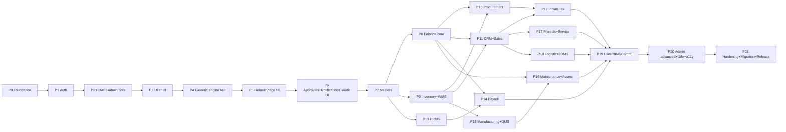

# 13. Delivery Roadmap

[← Back to PLAN.md](../../PLAN.md)

## Ground rules for every phase
Phases are ordered by dependency, and each one is sized so Claude Code can finish it in one session. Every phase closes with the same **Definition of Done** (§10.7):

* `npm run verify` is green (lint, typecheck, unit, API and e2e tests for the phase scope);
* the visual-parity tests for the phase's screens are under threshold;
* the break-it tests (B-nn) listed for the phase pass;
* `docs/PROGRESS.md` is updated with what was done and what was skipped (no claims without evidence);
* commits on a branch `phase-NN-<slug>`, ending in a PR.

**Every prompt below begins with this preamble.** Paste it before the phase text:

> You are working in `C:\Users\admin\Desktop\erp`. Read `PLAN.md`, `docs/plan/04-modules.md` (the sections for this phase), `docs/plan/09-user-will-break-it.md` and `docs/REGISTRY.csv` first. `reference/index.html` is the visual and behavioural source of truth and must not be modified. Follow §10 coding standards (TypeScript strict, no `any`, layered routes→controllers→services→repositories). Enforce every permission on the server. Do not invent pages that are not in the registry. When done, run `npm run verify` three times, update `docs/PROGRESS.md` with evidence (test counts, screenshots paths), and stop. Do not mark anything done that you did not run.

## Phase dependency graph

---

### Phase 0 — Foundation
* **Scope.**
  * Monorepo skeleton (npm workspaces: `apps/api`, `apps/web`, `packages/registry`, `packages/shared`).
  * TS strict, ESLint and Prettier, Vitest, Playwright.
  * Docker compose: Postgres 16, Redis, MinIO, ClamAV, Mailpit.
  * GitHub Actions CI.
  * **Registry extractor:** a script that reads `reference/index.html` and emits `packages/registry/registry.json` (MENU, PROFILES with the V9.2 payslip override, DEPT_FAMILIES, DEPARTMENTS, default permissions and approval matrix, letterhead keys, CSS tokens) plus generated TS types.
  * Move the pre-existing root code (`server.js`, `controllers/`, `routes/`, `models/`, `middleware/`, `src/`, `client/`, `prisma/`, `dist/`, `screens/`, `scripts/`, `tests/`, `create-tables.sql`) into `legacy/` untouched, after listing it in `docs/LEGACY.md`.
  * Copy `index.html` to `reference/index.html`.
* **Files:** `package.json`, `tsconfig.base.json`, `.eslintrc.cjs`, `.prettierrc`, `docker-compose.yml`, `.github/workflows/ci.yml`, `packages/registry/{extract.ts,registry.json,index.ts}`, `tests/registry/registry.spec.ts`, `docs/LEGACY.md`, `docs/PROGRESS.md`, `.env.example`.
* **Depends on:** nothing.
* **Acceptance.**
  * `registry.json` has **22 families, 248 menu pages, 244 profiles**, every profile with 6 tabs, and 2,773 fields in total.
  * The test asserts these numbers and that every id in `docs/REGISTRY.csv` exists.
  * `docker compose up` brings up healthy services.
  * CI runs on a PR.
* **Tests:** registry counts, schema of `registry.json`, compose health check script.
* **Prompt.**
  > Phase 0 — Foundation. Create the monorepo described in PLAN §6.2 and the tooling in §10 and §12. Before moving anything, list every file and folder at the repo root that is not `index.html`, `PLAN.md`, `docs/`, `reference/`, `.git*` into `docs/LEGACY.md` with a one-line description of each after reading it, then `git mv` them into `legacy/` (do not delete). Copy `index.html` to `reference/index.html`. Write `packages/registry/extract.ts` that parses `reference/index.html` with a JS parser (no regex eval of arbitrary code: use `acorn` to locate the `MENU`, `PROFILES`, `DEPT_FAMILIES`, `DEPARTMENTS` literals, the `seedSystem` permission/approval defaults, and the `Object.assign(PROFILES["pay-payslip"], …)` override), and writes `registry.json` + `registry.d.ts`. Add `tests/registry/registry.spec.ts` asserting 22 families, 248 pages, 244 profiles, 6 tabs each, 2,773 fields, and that the ids match `docs/REGISTRY.csv`. Add docker-compose (postgres:16, redis:7, minio, clamav, mailpit), `.env.example`, ESLint/Prettier/Vitest/Playwright configs, and a CI workflow running `npm run verify`.

### Phase 1 — Authentication and sessions
* **Scope.**
  * Prisma models `Company`, `User`, `Session`, `PasswordResetToken`, `LoginAttempt`, `AuditLog`.
  * Argon2id hashing.
  * Login with company code + email + password. The department is **derived from the user**; the Department select stays for parity but is display-only and pre-filled after email lookup **only after successful login** (no enumeration).
  * Access JWT (15 min, in memory) + refresh token (httpOnly, Secure, SameSite=Strict cookie, rotating, stored hashed).
  * Logout (current/all sessions).
  * Forgot password: email token through Mailpit.
  * Rate limiting and lockout.
  * Login screen built pixel-identical to the prototype (left hero, card, 3 auth tabs). Changes from the prototype:
    * the "Demo Accounts" box and quick-department buttons render **only when `APP_ENV=demo`**, and they prefill credentials but never bypass the password;
    * Sign Up is replaced by "Request access" (sends a request to admins) unless `ALLOW_SIGNUP=true`, in which case new users get role Employee with status Pending.
  * Seed: one Super User with the password from env.
* **Files:** `apps/api/src/core/auth/*`, `apps/api/src/modules/auth/*`, `apps/api/prisma/schema.prisma`, `apps/web/src/features/auth/*`, `apps/web/src/styles/tokens.css` (login tokens).
* **Depends on:** P0.
* **Acceptance.** B-38…B-42 and B-09/B-10 pass. The login screenshot matches `reference/screens/v92/00-login.png` within the threshold (§7.6). No password or hash is ever returned by the API.
* **Tests:** API auth tests (success, wrong password, locked, inactive user, wrong company, refresh rotation, reuse detection), e2e login and logout, visual login desktop + mobile.
* **Prompt.**
  > Phase 1 — Authentication. Implement PLAN §5.1 and §8 (auth items) exactly. Build the login page in React to match `reference/screens/v92/00-login.png` and `00-login-mobile.png` using the CSS tokens from §7.1 (copy the class names and values from `reference/index.html` lines 8–15). Demo-account UI shows only when `APP_ENV=demo` and never logs in without a password. Implement forgot/reset with a hashed single-use 15-minute token mailed via SMTP (Mailpit in dev). Add rate limiting (5/min per IP+email) and lockout (10 failures → 15 min). Write the API and e2e tests listed for Phase 1 in docs/plan/13-roadmap.md plus break-it tests B-09, B-10, B-38, B-39, B-40, B-41, B-42.

### Phase 2 — RBAC, departments, admin core, audit
* **Scope.**
  * Models `Department`, `Role`, `Permission(roleId, resource, action, scope)`, `UserRole`, `ModuleControl` (enabled, owner department, approval, add, edit, delete, export), `Branch`, `FinancialYear`, `Setting`, `Letterhead`.
  * Seed from `registry.json`: the 11 departments, 8 roles with their levels, the prototype permission defaults (as the starting matrix), `DEPT_FAMILIES` as **department → family access**, and the prototype default approval matrix (4 levels per department except Administration, thresholds 0 / 50,000 / 2,00,000 / 10,00,000).
  * The middleware `authorize(resource, action)` resolves page → family → department access plus the role permission plus the module control, and applies a data scope filter in repositories.
  * Admin pages, keeping the prototype layout but using real forms instead of `prompt()`:
    * User Master (invite, edit role/department/limit/status, force logout);
    * Role Master (add/edit/**delete-if-unused**);
    * Permission Master (same table, saved per role);
    * Department Master;
    * System Control Center;
    * Letterhead & PDF settings.
  * Append-only audit service (DB trigger denies UPDATE/DELETE on `audit_log`).
* **Files:** `apps/api/src/core/rbac/*`, `apps/api/src/core/audit/*`, `apps/api/src/modules/admin/*`, `apps/web/src/features/admin/*`.
* **Depends on:** P1.
* **Acceptance.**
  * Every API route is covered by the authorization test matrix (generated: 8 roles × 11 departments × sample routes).
  * Admin cannot delete or demote the last Super User (B-69).
  * Role rename keeps the links (B-68).
  * Department in use cannot be deleted (B-67).
* **Prompt.**
  > Phase 2 — RBAC and admin core. Implement PLAN §5.2–§5.4 and the Administration items marked for Phase 2 in docs/plan/04-modules.md §4.22. Seed roles, permissions, department-family access and the approval matrix from `packages/registry/registry.json` (values in PLAN §3.2). Every repository query must apply the caller's data scope. Replace the prototype's `prompt()` dialogs with modal forms that use the same `.modal`/`.form-grid`/`.field` styles. Add a generated authorization test matrix and break-it tests B-36, B-37, B-67, B-68, B-69.

### Phase 3 — UI shell and design system
* **Scope.**
  * React (Vite) app shell identical to the prototype: 304 px sidebar (brand, menu search, collapsible family sections with icons), 66 px top bar (☰ Menu, global search, Company/Branch/FY selects, health pill, ＋ quick add, 🔔, account button), main area, modal, drawer and toast.
  * Role-based menu from `/me/menu`.
  * Responsive breakpoints 1000 px and 600 px.
  * Component library: Button variants, Card, KPI, Chip, Status pill, Tabs, Table, Pager, Field, Modal, Drawer, Toast, Notice, Detail grid, Charts (Chart.js styled to match the canvas line and bar charts).
  * The context selectors set `X-Company/X-Branch/X-FY` headers.
  * Dashboard placeholder.
  * Storybook (optional) or a `/__ui` gallery route.
  * Visual-parity harness (§7.6).
* **Files:** `apps/web/src/layout/*`, `apps/web/src/components/ui/*`, `apps/web/src/styles/{tokens.css,base.css}`, `tests/visual/*`.
* **Depends on:** P2.
* **Acceptance.** Shell screenshots for each of the 11 department users match `reference/screens/v92/dash-*.png` in sidebar and top bar regions (the dashboard body is masked until P19). Menu sections per department equal `DEPT_FAMILIES` (asserted).
* **Prompt.**
  > Phase 3 — UI shell. Recreate the app layout of `reference/index.html` (classes `.app .sidebar .brand .side-search .menu .menu-head .menu-item .top .global .main .modal .drawer .toast`) in React components using `tokens.css` from PLAN §7.1. The menu comes from `GET /api/v1/me/menu` (server filters by permissions and module controls). Context selectors set request headers. Build the visual-parity harness in `tests/visual` per PLAN §7.6 and baseline it against `reference/screens/v92/`.

### Phase 4 — Generic metadata engine (API)
* **Scope.**
  * `generic_records` storage (JSONB with typed columns: id, page_id, company, branch, fy, department, code, status, amount, doc_date, version, created/updated/deleted metadata, `data jsonb`, `search tsvector`).
  * Zod schema builder from registry field types (§4.0.2) plus per-page overrides in `packages/registry/overrides/*.ts`.
  * CRUD with optimistic locking, idempotency, soft delete and restore, list with search/filter/sort/pagination (URL-encoded spec), bulk operations, numbering series (`admin-numbering`), Excel export (exceljs) and PDF export (pdfkit with Noto fonts and letterhead).
  * Documents service (MinIO, ClamAV scan, magic-byte check).
  * Audit on every write.
  * Generic routes: `/api/v1/pages/:pageId/records…`.
* **Depends on:** P2.
* **Acceptance.**
  * The **registry-wide CRUD test** (§11.3) runs over all generic pages and passes create → read → list → update → soft delete → restore → export for each.
  * B-01, B-07, B-12…B-17, B-19…B-22, B-24, B-25, B-26, B-43, B-44, B-48, B-49 pass at API level.
* **Prompt.**
  > Phase 4 — Generic engine API. Implement PLAN §6.3–§6.6 for the generic record engine. Build Zod schemas from `registry.json` field types using the rules in docs/plan/04-modules.md §4.0.2, with an override file per page. Implement CRUD, list query language, bulk, idempotency, optimistic locking, soft delete/restore, numbering series, Excel (exceljs) and PDF (pdfkit + Noto Sans/Noto Sans Devanagari, letterhead from settings, page x of y) exports, and the documents service (MinIO + ClamAV + magic bytes + 25 MB limit). Write the registry-wide CRUD test that iterates over every page whose renderer is `renderModule` in `docs/REGISTRY.csv`.

### Phase 5 — Generic module page (UI)
* **Scope.**
  * The `/m/:pageId` page reproducing `renderModule`: head buttons, context chips, record bar, health banner slot, 16 tabs.
  * Tab workspaces as components keyed by renderer type (the 36 V9 types + the 9 universal tabs), each fed from real API data. Where a workspace needs data that only a later phase creates (e.g. ledger), it shows an honest empty state "Available after <module> is enabled".
  * Register table (selection, sort, filter, page size, bulk, export selected).
  * Add/Edit modal generated from metadata (field types, validation messages, required marks).
  * View drawer.
  * Documents tab and per-record docs drawer.
  * Reports tab (Excel, PDF, Print).
  * Activity Timeline and Audit Trail (real audit rows).
  * Data Quality (real completeness and duplicate stats).
  * Analytics & Graphs (computed from records; no random numbers).
  * Automation Studio (rule CRUD; execution in P19).
  * AI Decision Center (stats-only until P19).
  * The V9.2 "detailed table under every tab" is kept for parity (decision D-05).
* **Depends on:** P3, P4.
* **Acceptance.**
  * For 22 sample pages (one per family, same list as the screenshots) the screenshot matches within the threshold with seeded deterministic data.
  * The e2e "every page opens, every tab renders with no console error" runs over all 227 generic pages × 16 tabs = **3,632 tab renders**.
  * B-46, B-47, B-58, B-59 pass.
* **Prompt.**
  > Phase 5 — Generic page UI. Implement PLAN §7.3–§7.5 for `/m/:pageId`, reproducing `renderModule`, `actionBar`, `v9ModuleTabs` and `v92TableSection` from `reference/index.html` with real data. Map each renderer type (column `tab_renderers` in docs/REGISTRY.csv) to one React workspace component. Never display hard-coded or random metrics; show empty states instead. Add the e2e test that visits all 227 generic pages and clicks all 16 tabs asserting no console errors, and the 22 visual-parity tests.

### Phase 6 — Approval engine, notifications, audit UI
* **Scope.**
  * Approval matrix by department + document type + amount, with levels, an approver role or user, SLA and escalation.
  * Submit / approve / reject / return / delegate. SoD (no self-approval). Approval limit check. Lock records under approval and after approval.
  * Approval Center page (same table design), "My Approvals" count on dashboards, Approvals tab per module.
  * Notifications table + bell drawer + Notification Center + email (Mailpit).
  * Admin Audit Trail page (filter, diff view).
* **Depends on:** P5.
* **Acceptance:** B-02, B-03, B-08, B-31…B-35, B-70 pass. Approval history is shown with timestamps and users.
* **Prompt.**
  > Phase 6 — Approvals and notifications. Implement PLAN §5.5 (approvals), §5.6 (audit trail UI) and §5.8 (notifications). Replace the prototype's client-side `approveReq` logic with a server state machine. Approval department comes from the document owner, never an editable field. Enforce segregation of duties and approval limits. Build the Approval Center, Approval Matrix (with level/threshold validation), Notification Center and bell drawer to match the prototype styles. Write break-it tests B-02, B-03, B-08, B-31–B-35, B-70.

### Phase 7 — Core masters
* **Scope:** typed tables and pages for Company, Branch, FY (with periods), Currency, Taxes, HSN/SAC, UOM, Document Numbering, Item (inv-items), Customer (from CRM/Sales), Supplier (scm-suppliers), Warehouse/Zone/Rack/Shelf/Bin, Cost/Profit Centers, Chart of Accounts (seeded), Employee core (hr-employees, incl. photo and **[ADD]** fields), Designations, Machines/Equipment, Assets master. Lookups API for `ref` fields.
* **Depends on:** P6.
* **Acceptance:** all `ref` fields across the registry resolve to a lookup endpoint (test). Duplicate rules (GSTIN, PAN, code). B-23, B-28, B-30 pass.
* **Prompt.**
  > Phase 7 — Masters. Promote the master pages listed in PLAN §6.4 (“typed tables”) from generic JSONB to Prisma models with migrations, keeping their page ids, fields and UI. Seed the Indian chart of accounts and GST rates (with effective dates per docs/plan/04-modules.md §4.11). Implement the lookup API used by every `ref` field and wire the form engine to it.

### Phase 8 — Finance core
* **Scope:** journal/GL double-entry engine, voucher types (JV, cash/bank receipt/payment, contra), posting service used by later modules, cash/bank books, AR/AP sub-ledgers, credit/debit notes (GL side), bank reconciliation (CSV import + auto-match), cost/profit centers, expenses, budgets with control modes, and the trial balance/P&L/BS/cash flow/ageing reports, plus period and FY close.
* **Depends on:** P7.
* **Acceptance:** property test "every posting is balanced" over 10k random vouchers. TB balances. BS equation holds. B-18, B-56, B-62 pass.
* **Prompt.**
  > Phase 8 — Finance core. Implement docs/plan/04-modules.md §4.10 with typed tables (`journal_entries`, `journal_lines`, `fiscal_periods`, `bank_statements`, `bank_statement_lines`, `budgets`). Posted entries are immutable; corrections by reversal. Provide `PostingService.post(voucher)` for other modules. Reports are views (read-only pages; Add/Edit/Delete disabled with tooltip). Add property-based tests for balancing and period locks.

### Phase 9 — Inventory and WMS
* **Scope:** stock ledger, balances, FIFO/moving average valuation with repost job, receipts/issues/transfers (two-step)/adjustments/reconciliation/opening, reservations, batch/serial/expiry (FEFO), reorder suggestions → PR, ageing, valuation report vs GL, WMS put-away/pick/pack/cycle/physical count, barcode labels/scan endpoint, and RFID CSV import.
* **Depends on:** P7, P8 (GL posting for perpetual inventory).
* **Acceptance:** valuation unit tests (FIFO/MA against worked examples). The concurrency test for the last unit (B-54). Stock value = GL inventory after a 1,000-transaction simulation.
* **Prompt.**
  > Phase 9 — Inventory & WMS. Implement docs/plan/04-modules.md §4.5–§4.6. The stock ledger is append-only; balances are updated in the same transaction with row locks. Implement FIFO and moving-average valuation with a backdated-entry repost job. Add simulation tests proving stock value equals the GL inventory account.

### Phase 10 — Procurement
* **Scope:** PR (with budget check) → RFQ → vendor quotes → comparison (weighted) → PO (amendments) → GRN (QC handoff, put-away) → purchase invoice with 3-way match and TDS → AP, plus supplier evaluation (computed), blanket contracts, and the purchase approval view.
* **Depends on:** P8, P9.
* **Acceptance:** an e2e happy path PR→payment. Variance block. Duplicate vendor invoice blocked (B-29). Over-receipt blocked (B-55).
* **Prompt.**
  > Phase 10 — Procurement. Implement docs/plan/04-modules.md §4.4 with document chaining (“create from”), tolerance-based three-way match, and postings through PostingService. Write the e2e PR→RFQ→Quote→PO→GRN→Invoice→Payment test and B-29, B-55.

### Phase 11 — CRM and Sales
* **Scope:** leads (dedupe, consent), opportunities, the drag-and-drop pipeline Kanban (replacing the static `kanbanPage` while keeping its look), follow-ups, meetings, customer 360, feedback/NPS, lead sources (computed), quotations (revisions), SO (credit check/hold), reservations, delivery planning, dispatch, invoices (GST split, round-off, COGS), collections (allocation), price lists, credit limits, and returns.
* **Depends on:** P8, P9.
* **Acceptance:** an e2e lead→cash test. GST split tests (intra/inter-state). Credit hold test. Invoice locked after posting.
* **Prompt.**
  > Phase 11 — CRM & Sales. Implement docs/plan/04-modules.md §4.2–§4.3, including line items, tax engine (shared package `packages/shared/tax`), credit check, and stock reservation. Rebuild `crm-pipeline` as a draggable Kanban matching `reference/screens/v92/ui-kanban.png`.

### Phase 12 — Indian Taxation
* **Scope:** GSTIN setup, HSN master, sales and purchase registers, GSTR-1 and GSTR-3B preparation with JSON export, 2B import and reconciliation, e-invoice JSON plus manual IRN entry (adapter interface), e-way bill JSON with validity calculation (slab table as configurable data), TDS/TCS entries with section master (1961 vs 2025 Act by date), quarterly grouping, and challans.
* **Depends on:** P10, P11.
* **Acceptance:** GSTR-1 JSON validates against the published schema version pinned in the repo. Rate effective-dating test across 22-Sep-2025. 2B reconciliation categories test.
* **Prompt.**
  > Phase 12 — Indian Tax. Implement docs/plan/04-modules.md §4.11. Re-verify every statutory number in that section against the official source listed in PLAN Appendix C before coding; record the check date in `packages/shared/tax/SOURCES.md`. No portal API calls: produce JSON files and accept manual IRN/EWB numbers through an adapter interface.

### Phase 13 — HRMS
* **Scope:** employees (extended fields, photo, **Virtual ID card tab + PDF restored**), recruitment, onboarding, shifts, attendance (calculations, regularisation), leave (policies, accrual, balance), employee expenses, performance, training, documents (expiry alerts), exit, and ESS with `self` scope.
* **Depends on:** P7.
* **Acceptance:** attendance calculation tests (night shift, grace, OT). Leave overlap and balance tests. ESS user sees only self (B-36 variant). ID card visual test.
* **Prompt.**
  > Phase 13 — HRMS. Implement docs/plan/04-modules.md §4.12. Restore the Virtual Employee ID card (`.id-card` styles in reference/index.html) as a tab and a PDF. Add the extra employee fields listed there.

### Phase 14 — Payroll
* **Scope:** salary structures (formula engine, 50% wage check), payroll run state machine, PF/ESIC/PT/TDS calculators as dated configurable parameters, OT, incentives, loans, payslips (the V9.2 preview layout and PDF with ₹), bank file, register, postings, ECR/ESIC challan data exports, and arrears and F&F.
* **Depends on:** P8, P13.
* **Acceptance:** calculator unit tests with worked examples (PF cap at 15,000, ESIC eligibility period, Maharashtra February PT, women exemption). Payroll lock (B-53). Payslip PDF visual and text test (contains "₹").
* **Prompt.**
  > Phase 14 — Payroll. Implement docs/plan/04-modules.md §4.13. All statutory rates and ceilings are effective-dated rows in `statutory_parameters`, never constants. Reproduce the payslip preview and PDF layout of `v92PayslipPDF` using pdfkit with Unicode fonts.

### Phase 15 — Manufacturing and Quality
* **Scope:** BOM (multi-level, cost rollup, revisions), routing, work centers, production planning, MRP job, production and work orders, shop floor (real OEE), WIP, FG receipt, scrap, rework, costing; QMS plans/AQL, incoming/in-process/final inspections with auto-NCR, NCR, CAPA, 5-Why, supplier quality, calibration (blocking).
* **Depends on:** P9 (and P10 for incoming QC).
* **Acceptance:** MRP worked example. BOM cycle detection. OEE formula test. Rejected lot → NCR automatically.
* **Prompt.**
  > Phase 15 — Manufacturing & QMS. Implement docs/plan/04-modules.md §4.7–§4.8. Replace the hard-coded `shopfloor()` numbers with OEE computed from work-order logs.

### Phase 16 — Maintenance and Assets
* **Scope:** machines and equipment, PM plans and job, breakdowns (time metrics), MWOs (spares issue), schedule calendar, downtime, MTBF/MTTR, alerts; asset capitalization, allocation, transfer, maintenance, depreciation runs (SLM/WDV), disposal, QR labels and scan.
* **Depends on:** P8, P9.
* **Acceptance:** depreciation tests (SLM, WDV, proration, residual floor). MTBF/MTTR calculation test.
* **Prompt.**
  > Phase 16 — Maintenance & Assets. Implement docs/plan/04-modules.md §4.9 and §4.15.

### Phase 17 — Projects and Service
* **Scope:** projects/tasks/subtasks/milestones, team allocation, timesheets, expenses, budget (EAC), draggable Kanban (replacing the static `kanbanPage`), Gantt with critical path, profitability; tickets with SLA clock, requests, technician allocation, visits, spares, history, AMC, warranty (auto from invoice), claims.
* **Depends on:** P11.
* **Acceptance:** critical path test. SLA pause test.
* **Prompt.**
  > Phase 17 — Projects & Service. Implement docs/plan/04-modules.md §4.14 and §4.16. Gantt and Kanban must be interactive but keep the prototype look (`.v9-gantt`, `.workflow/.lane`).

### Phase 18 — Logistics, Fleet, Gate, DMS
* **Scope:** transporters, routes, freight calculation, shipments, tracking, POD, vehicles/drivers (expiry blocking), fuel, vehicle service, vehicle documents, the 4 gate passes, container tracking; DMS folders, documents, versions, permissions, tags, search.
* **Depends on:** P11.
* **Acceptance:** odometer monotonic test. Expired document blocks a trip. Version check-in/check-out test.
* **Prompt.**
  > Phase 18 — Logistics & DMS. Implement docs/plan/04-modules.md §4.17–§4.18. The DMS reuses the documents service from Phase 4.

### Phase 19 — Executive, BI, AI & Automation, Communication
* **Scope:** department dashboards with real KPIs (§3), Command Center, Global Search (FTS), report builder over whitelisted datasets, saved reports, dashboards, scheduler; analytics pages as views; AI pages as real analytics, the optional LLM copilot (read-only tools, flag off by default); automation rules engine on the job queue, background jobs view, webhooks (HMAC, SSRF guard); communication adapters (mock by default), templates, logs, payment links.
* **Depends on:** P12, P14, P16, P17, P18.
* **Acceptance.**
  * Dashboard screenshots match `dash-*.png` layout (numbers masked).
  * Every KPI has a test that seeds known data and asserts the value.
  * B-73, B-74, B-75 pass.
* **Prompt.**
  > Phase 19 — Executive/BI/AI/Communication. Implement docs/plan/04-modules.md §4.1, §4.19–§4.21. No hard-coded or random numbers anywhere: grep the web app for numeric literals in KPI components as part of the test. The LLM copilot is optional, off by default, read-only tools only, audited.

### Phase 20 — Advanced admin, i18n, accessibility
* **Scope:** custom fields, form builder, workflow builder, import wizard (dry-run), duplicate rules UI, security policies (MFA TOTP, session timeout, IP allow-list), API clients, integrations list, backup status, settings; full Hindi translation (UI strings, PDFs, number/date formats); accessibility pass (WCAG 2.1 AA).
* **Depends on:** P19.
* **Acceptance:** axe-core zero serious/critical violations on 22 sample pages. Hindi screenshots for login and one module. B-60, B-63, B-64 pass.
* **Prompt.**
  > Phase 20 — Admin advanced, i18n, a11y. Implement the remaining Administration items in docs/plan/04-modules.md §4.22 and PLAN §5.16 (i18n) and §5.17 (accessibility). Extract every UI string to `apps/web/src/locales/{en,hi}.json` and translate Hindi; PDFs must render Devanagari.

### Phase 21 — Hardening, migration, release
* **Scope:**
  * Security review against §8 (OWASP mapping, dependency audit, ZAP baseline scan).
  * Performance: p95 < 300 ms on lists of 100k rows; k6 load test with 100 concurrent users.
  * The localStorage migration tool (§12.7).
  * Backup/restore drill.
  * Full regression **3× from a clean DB**.
  * Release checklist and user guide.
* **Depends on:** P20.
* **Acceptance:** every B-nn is green. Every visual test passes. Zero high or critical findings. Restore drill documented.
* **Prompt.**
  > Phase 21 — Hardening and release. Execute PLAN §8, §11.8 and §12 checklists. Build `tools/migrate-localstorage` per §12.7. Run the full suite three times from `docker compose down -v` and record the results in docs/PROGRESS.md.
